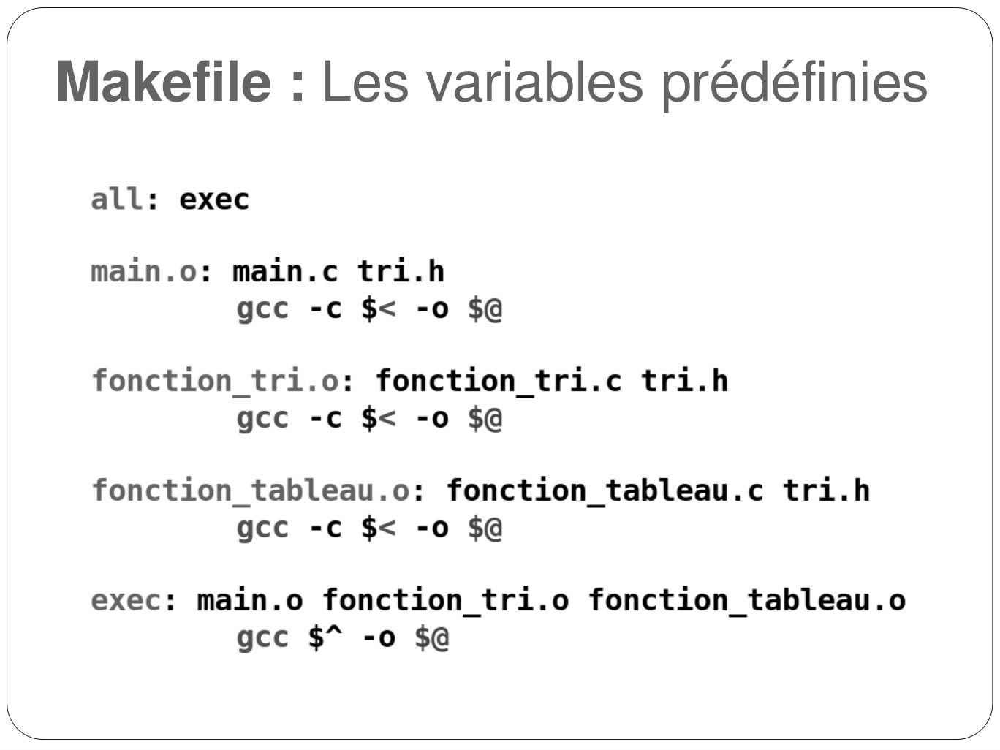
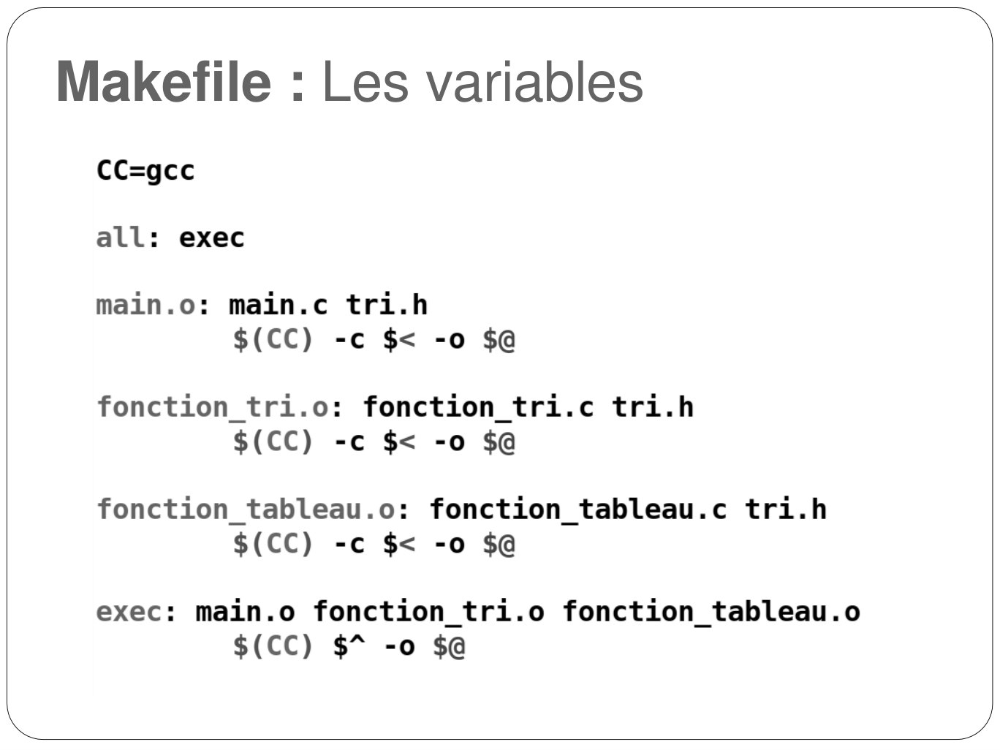
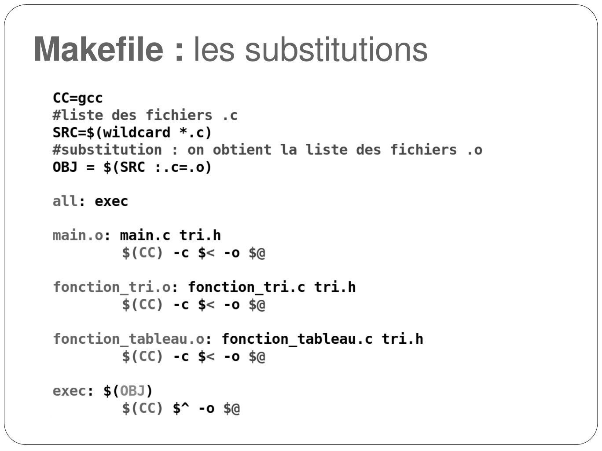
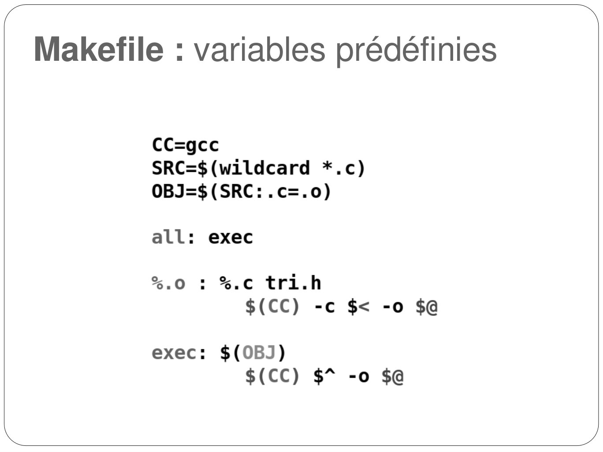
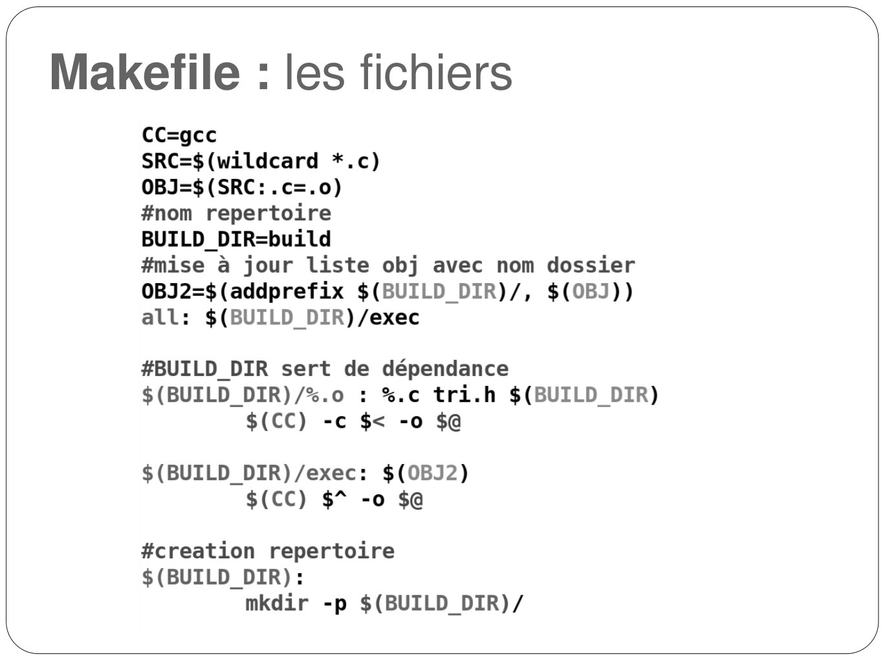

# Annexe-Compilation-separee_2024-2025_Informatique2_P1S2_EAnsermin-RGrignon.pdf

[Ouvrir l’original](https://drive.google.com/open?id=11VAqOPtU25oUfJp_4ljP0RS72i8Cm8uw) · Les pages signalées comprennent du texte reconnu automatiquement ou des éléments graphiques. Le fac-similé permet de vérifier chaque lecture.

**Pages avec fac-similé ou lecture OCR** — 1, 31, 43, 45, 48, 50, 52.

## Page 1

~~~text
  Informatique II
Compilation séparée
~~~

**Lecture OCR à contrôler**

~~~text
Informatique Il

Compilation séparée

€ TECH
NX I
~~~

## Page 2

~~~text
Problématiques
• Code du TD tris de tableaux : 309 lignes de code !

• Code trop long : compliqué de rechercher les différentes
  parties qui nous intéressent / que l’on souhaite modifier

• Code long <=> compilation lente tout le code va être inspecté
  même les parties qui ne sont pas utilisées

• Gestion des fonctions : les différentes fonctions doivent être
  écrites dans le bon ordre si elles s’appellent entre elles
~~~

## Page 3

~~~text
Problématique : appel croisé
S’il existe un appel croisé de fonctions, chacune doit être écrite
avant l'autre pour que le compilateur puisse les utiliser : ce n'est
pas possible implicitement.

void funcA(…){
    …
    funcB(…);        // déclaration implicite !
    …
}

void funcB(…){
    …
    funcA(…);       // appel croisé
    …
}
~~~

## Page 4

~~~text
Solution : déclaration explicite
// déclaration explicite des prototypes de fonctions !
void funcA(…);
void funcB(…);

void funcA(…){
    …
    funcB(…);    // pas d'erreur à la compilation
    …
}

void funcB(…){
    …
    funcA(…);    // pas d'erreur à la compilation
    …
}
~~~

## Page 5

~~~text
Problématique : modules
• Il est possible d’écrire un code en plusieurs parties ou modules

• Chaque module peut être compilé séparément. Cependant
  séparer le code en modules doit s’accompagner d’un moyen pour
  chacun des modules d’interagir avec les autres sans conflit

• Si l’on souhaite fournir un module de code compilé sans les
  sources, il faut pouvoir au moins fournir les prototypes des
  fonctions à appeler, les constantes utilisées, ou les types
  redéfinis (comme les structures par exemple)
~~~

## Page 6

~~~text
Problématique : modules
• Il existe 2 grands types de fichiers lorsque l’on écrit un code
  séparé en modules en langage C

   1.Les fichiers contenant des instructions classiques, du code.
     Dans notre cas des fichiers *.c (exemple : main.c, tris.c, …)

   1.Les fichiers d’entête, ou headers. Ce sont les fichiers *.h. ils
     permettent de rassembler les “entêtes” communs à plusieurs
     fichiers sources et/ou autres fichiers d’entête.
~~~

## Page 7

~~~text
Problématique : modules
• Le fichier d'entête :
    • est généralement nommé comme le fichier *.c qu'il accompagne
    • contient les inclusions d'autres fichiers d'entête nécessaires
    • contient les déclarations de fonctions (prototypes)
    • contient les définitions de constantes (#define …)
    • contient les variables globales utilisées
    • contient les redéfinitions de types (typedef) notamment celles
      pour les structures
    • ne contient pas la déclaration de la fonction main !
~~~

## Page 8

~~~text
Problématique : modules
tris.h                                functions_tri.c
#include<stdio.h>                     void triRapide(…){
#define TAILLE 1000                       …
                                          pivot=partition(…);
void triSelection(int tab[]);
                                           …
void triRapide( int tab[],
                                      }
                int debut,
                                      int partition(…){
                int fin);
                                          …
int partition(…);
                                          …
                                      }
main.c
                                      void triSelection(…){
int main(){
                                               …
    int tab[TAILLE];
                                      }
         triSelection(tab);
         …
    return 0;                   Problème : comment communiquent
}                               les fichiers entre eux ?
~~~

## Page 9

~~~text
 Les directives de préprocesseur
• Certaines commandes ne sont pas exécutées lors de l’exécution
  mais lors de la première phase de compilation. Ce sont les
  directives de préprocesseurs.
• Les directives de préprocesseurs sont précédées de #
• Elles effectuent des modifications textuelles sur le fichier source:
• Exemple :
• #define permet de remplacer une expression par une autre
  (définition de constante ou de macro)
   • #include permet d'incorporer dans le fichier source le texte
     figurant dans un autre fichier. (#include<stdio.h> permet
     d’inclure le code de la bibliothèque stdio au code)
~~~

## Page 10

~~~text
  Les directives de préprocesseur
• Il est possible d’obtenir le fichier intermédiaire après la phase de
  préprocessing avec l’option –E dans gcc.
• Par défaut cette commande ne créé pas de fichier, mais renvoie le résultat
  sur la sortie standard. Il est possible de stocker cette sortie dans un fichier
  toujours avec l‘option -o
main.c
// constante                                   gcc -E main.c -o main.i
#define TAILLE 15
// macro
#define COUCOU() printf("Coucou")          main.i

int main(){                                int main(){
    int tab[TAILLE]                            int tab[15]
    for(int i=0; i<TAILLE; i++){               for(int i=0; i<15; i++){
        …                                          …
    }                                          }
    COUCOU();                                  printf("Coucou");
    return 0 ;                                 return 0 ;
}                                          }
~~~

## Page 11

~~~text
 Problématique : modules
• Différents modules doivent pouvoir s’échanger des informations : il
  faut notamment que les fichiers .c puisse avoir accès aux
  information des fichiers .h

• La directive de préprocesseur #include : permet d'inclure un fichier
  dans un autre. Cela permet de fusionner le contenu de plusieurs
  fichiers de manière dynamique et de fournir le résultat à la phase
  de compilation.
                        #include "fichierHeader.h"

• Il faut donc inclure, entre autres, les fichiers .h utiles dans les
  fichiers.c
~~~

## Page 12

~~~text
Problématique : modules
• Exemple
tris.h
#include<stdio.h>               functions_tri.c
                                #include "tris.h"
#define TAILLE 1000
                                void triRapide(…){
void triSelection(int tab[]);       …
void triRapide(int tab[],int        pivot=partition(…);
debut, int fin);
                                     …
int partition(…);
                                }
main.c                          int partition(…){
#include "tris.h"                   …
int main(){                         …
    int tab[TAILLE];            }
    triSelection(tab);          void triSelection(…){
    …                                    …
    return 0;                   }
}
~~~

## Page 13

~~~text
Solution : fichier d'entête
functions.h                   functions.c
void funcA(…);                #include "functions.h"
void funcB(…);                void funcA(…){
                                   …
main.c
                                   funcB(…);
#include "functions.h"                 …
                              }
int main(){                   void funcB(…){
    funcA(…);                      …
    return 0;                      funcA(…);
}                                  …
                              }
~~~

## Page 14

~~~text
Solution : fichier d'entête
• Il faut donc pouvoir être capable de compiler chaque fichier C
  indépendemment des autres. L'option –c de gcc permet cette
  opération :
    • gcc –c functions.c -o functions.o
    • gcc –c main.c -o main.o
• Les fichiers issus de cette compilation sont des fichiers objets
  (*.o) c’est à dire un fichier intermédiaire dans le processus de
  compilation
• Il faut maintenant réunir/fusionner tous les "objets" (morceaux
  de codes compilés) en un seul exécutable : toujours grâce à gcc
  mais cette fois-ci, les fichiers d'entrée ne sont plus les fichiers *.c
  mais les fichiers *.o générés précédemment :
    • gcc functions.o main.o -o myExec
~~~

## Page 15

~~~text
 Solution : fichier d'entête
                       gcc –c …

              main.c                main.o

                                                gcc …

functions.h

                       gcc –c …

         functions.c              functions.o
~~~

## Page 16

~~~text
Problématique : inclusions circulaires
• Maintenant que nous pouvons compiler indépendamment les différents
  fichiers C de notre application, il apparait un nouveau problème
• Il est possible que deux modules s'incluent respectivement : création
  d'une boucle d'inclusion infinie
• Ces inclusions mutuelles ne sont pas forcément directes
    • le Module A est inclus par le module B
    • le module B est inclus par le module C
    • le module C est inclus par le module A
• Il va donc falloir se prémunir des multiples inclusions en utilisant les
  instructions de compilation conditionnelle
• Ces instructions permettent de "désactiver" des portions de code en
  fonction de paramètres statiques (configuration du programme)
~~~

## Page 17

~~~text
Exemple #1 : inclusions circulaires

moduleA.h                moduleC.h
#include "moduleC.h"     #include "moduleB.h"
void funcA(…);           void funcC(…);

main.c
#include "moduleA.h"     moduleB.h
int main(){              #include "moduleA.h"
    funcA(…);            void funcB(…);
    return 0;
}
~~~

## Page 18

~~~text
 Solution : compilation conditionnelle
• Idée: introduire un « ordre » d’inclusion grâce à des conditions.
• Rappel : #define : permet de définir une macro, qui est une chaine
  de caractères servant à remplacer, soit des constantes, soit des
  suites d'instructions
• Les directives préprocesseurs #ifdef / #ifndef … #elif … #else …
  #endif : ces instructions conditionnelles testent l'existence de
  macros définies (ou non), et incluent (ou non) la portion de code C
  associée.
   #define CONST 15                   #define CONST 15
   #ifdef CONST                       #ifndef CONST
       // Instructions                    // Instructions
       // compilées                       // NON compilées
       …                                  …
   #endif                             #endif
~~~

## Page 19

~~~text
Solution : compilation conditionnelle
  moduleA.h                               moduleB.h

  #ifndef MODULE_A_H                      #ifndef MODULE_B_H
    #define MODULE_A_H                      #define MODULE_B_H
    #include "moduleB.h"                    #include "moduleA.h"
    …                                       …
  #endif                                  #endif

• Le fait de définir une constante MODULE_A_H (nom totalement arbitraire
  dans l'absolu, mais dans la pratique on reprend le nom du fichier) la
  1ère fois que le fichier moduleA.h est inclus, va permettre, lors des
  prochaines inclusions, de "masquer" l'ensemble du contenu du fichier
• Cette méthode permet d'inclure les différentes dépendances dans un
  ordre quelconque et simplifie grandement le développement
~~~

## Page 20

~~~text
    Exemple #1 : inclusions circulaires
moduleA.h                  moduleC.h
#ifndef MODULE_A_H         #ifndef MODULE_C_H
    #define MODULE_A_H       #define MODULE_C_H
    #include "moduleC.h"     #include "moduleB.h"
#endif                     #endif
void funcA(…);             void funcA(…);

main.c                     moduleB.h
#include "moduleA.h"       #ifndef MODULE_B_H
int main(){                  #define MODULE_B_H
     funcA(…);               #include "moduleA.h"
     return 0;             #endif
}                          void funcA(…);
~~~

## Page 21

~~~text
Exemple #2 : inclusions multiples
                   (exemple simplifié)
moduleA.h                                main.i
void funcA(…);
                                         ...
                                         void funcA(…);
main.c                                                     ERREUR
                                         void funcA(…);
#include "functions.h"                   ...
#include "functions.h"                   ...
int main(){                              int main(){
    funcA(…);                                  funcA(…);
    return 0;                                  return 0;
}                                        }

                 • gcc –E main.c -o main.i
~~~

## Page 22

~~~text
Exemple #2 : inclusions multiples
                  (exemple simplifié)
functions.h                             main.i
#ifndef FUNCTIONS_H
                                        …
     #define FUNCTIONS_H
                                        void funcA(…);
     void funcA(…);                                       OK
                                        ...
#endif
                                        ...
main.c                                  ...
#include "functions.h"                  int main(){
#include "functions.h"                        funcA(…);
int main(){                                   return 0;
     funcA(…);                          }
     return 0;
}                                   • gcc –E main.c -o main.i
~~~

## Page 23

~~~text
 Exemple #3 : code conditionnel
system.h                      parameters.h
#include "parameters.h"       #define WINDOWS 1
#if OS == WINDOWS             #define LINUX 2
  ...                         #define MACOS 3
#elif OS == LINUX             #define OS LINUX
  ...
#elif OS == MACOS
  ...                         main.c
#else                         #include "system.h"
  #error Bad value for 'OS'   int main(){
#endif                            …
                                  return 0;
                              }
~~~

## Page 24

~~~text
  GCC : phases de compilation
• Maintenant nous allons voir les différentes phases de l’exécutable gcc et
  les options associées :

    PREMIERE ETAPE :
    gcc –E main.c -o main.i
    L'option –E de gcc (pré-traitement) permet de voir en sortie le
    programme C qui sera effectivement compilé
        • Le code non compilé entre les instructions #ifndef / #ifdef ne va
          plus apparaître
        • Toutes les macros ont été remplacées par leurs valeurs
        • L’ensemble des fichiers inclus par le fichier C est fusionné dans
          l’ordre d’inclusion : il n’y a donc plus qu’un seul fichier à compiler
~~~

## Page 25

~~~text
    GCC : phases de compilation
•   Maintenant nous allons voir les différentes phases de l’exécutable gcc et
    les options associées :

    DEUXIEME ETAPE :
    gcc –S main.i -o main.s
    L'option –S de gcc (compilation), permet de transformer le code C
    précédent en code assembleur (toujours lisible par l'humain… )
        • C’est cette phase qui va donc interpréter la syntaxe du code C et
          qui écrit régulièrement sur la console que vous avez oublié
          un point-virgule, qu’un symbole n’est pas déclaré ou qu’il y a un
          souci dans l’organisation des accolades
        • Un compilateur est spécifique à une cible physique (ou une
          famille de cibles) : le code assembleur généré est donc spécifique
          à un composant physique particulier
~~~

## Page 26

~~~text
    GCC : phases de compilation
•   Maintenant nous allons voir les différentes phases de l’exécutable gcc et
    les options associées :

    TROISIEME ETAPE :
    gcc –c main.s -o main.o
    L'option –c de gcc (compilation) permet de transformer le code
    assembleur en code machine, c’est à dire en un code que seul le
    composant cible peut interpréter
        • Il est donc difficile ici de pouvoir lire le code généré d’une
          manière fluide comme on pourrait le faire en C
        • C’est donc une partie de notre exécutable qui se trouve dans ce
          fichier, avec certains symboles qui n’ont pas encore été résolus
          (telles que les fonctions appelées qui sont situées dans d’autres
          modules (d’autres fichiers C) qui ne sont pas forcément encore
          compilés)
~~~

## Page 27

~~~text
    GCC : phases de compilation
•   Maintenant nous allons voir les différentes phases de l’exécutable gcc et
    les options associées :

    QUATRIEME ETAPE :
    gcc main.o -o main.exe
    L’exécutable gcc sans option (édition de liens) permet de fusionner les
    différents codes machines (fichiers objets) dans un seul exécutable que
    notre machine pourra alors exécuter
        • Ici gcc cherche à résoudre tous les symboles pour relier les
          morceaux de code entre eux. Il va “coller” bout à bout l’ensemble
          des fonctions et va déterminer l’adresse de code pour chacune
          d’entre elles : ensuite lors d’un appel de fonction, le code effectue
          un “saut” de code à la bonne adresse
        • C’est à cette étape que gcc écrit sur le terminal qu’il n’a pas
          trouvé telle ou telle fonction (quand on utilise la lib math et que
          l’on ne met pas l’option -lm par exemple)
~~~

## Page 28

~~~text
    Quelques directives du pré-processeur
•   #include : permet d'inclure un fichier dans un autre. Cela permet de
    fusionner le contenu de plusieurs fichiers de manière dynamique et
    de fournir le résultat à la phase de compilation
•   #define : permet de définir une macro (terme consacré), qui est
    une chaine de caractères servant à remplacer, soit des constantes,
    soit des suites d'instructions verbeuses et nombreuses. Le but est
    de fournir le moyen d'écrire un code plus concis et lisible
•   #undef : permet "d'oublier" une macro définie précédemment
•   #ifdef / #ifndef … #elif … #else … #endif : ces instructions
    conditionnelles testent l'existence de macros définies (ou non), et
    permet d’inclure (ou non) la portion de code C associée. Nous
    avons vu leur utilisation lors de la résolution de la problématique
    d'inclusions multiples, mais ces directives servent aussi à fournir
    différentes versions de code en fonction de paramètres utilisateurs
~~~

## Page 29

~~~text
    Quelques directives du pré-processeur
•   #if defined(…) : effectue la même action que la directive #ifdef … à
    la différence que la seconde ne peut tester que la définition d’une
    macro, alors que la première peut effectuer plusieurs
    comparaisons, combinées ensemble grâce à des opérateurs
    logiques :
            #if defined(LINUX) || defined (ANDROID)
•   #if !defined(…) : effectue la même action que la directive #ifndef …
    avec la même spécificité qu’énoncée au pragraphe précédent
•   #if … == … : permet d'effectuer des comparaisons entre des valeurs
    de macros et/ou des valeurs entières, pour construire
    conditionnellement un programme. Fonctionne aussi avec les
    opérateurs == , != , < , > , <= , >=
•   #error : stoppe la compilation et affiche le message qui suit la
    directive. Permet d'indiquer une configuration du programme
~~~

## Page 30

~~~text
    Quelques directives du pré-processeur
•   Macros prédéfinies : il existe des macros qui permettent de
    récupérer toutes sortes d'informations sur votre programme :
     ⚫   __FILE__ : chemin du fichier courant (chaîne)
     ⚫   __LINE__ : numéro de ligne du fichier courant (entier)
     ⚫   __DATE__ : date de compilation (chaîne "Feb 23 2022")
     ⚫   __TIME__ : heure de compilation (chaîne "23:59:59")
•   Ces macros peuvent être utilisées pour afficher des détails sur le
    programme notamment en cas d’erreur par exemple
•   Pour les utiliser comme paramètres de fonctions comme printf, il
    faudra bien entendu indiquer le type adéquat (%d ou %s)
•   Bien évidemment ces valeurs sont des constantes pour le fichier
    actuellement compilé et d’un fichier C à un autre, les valeurs de
    __DATE__ et __TIME__ peuvent changer par exemple
~~~

## Page 31

~~~text
 Informatique II
Make et makefile
~~~

**Lecture OCR à contrôler**

~~~text
Informatique II

Make et makefile

€ TECH
L D.
~~~

## Page 32

~~~text
Projet : schéma des dépendances

         fonction_tableau.c   fonction_tableau.o

 tri.h        main.c               main.o          exec

           fonction_tri.c       fonction_tri.o
~~~

## Page 33

~~~text
Problématiques : nombre de commandes
 • Code modulé <=> plus pratique et lisible mais nécessite plus de
   commandes de compilation: chaque fichier .c doit être compilé
   séparément
          gcc –c fonction_tri.c -o fonction_tri.o
          gcc –c fonctions_tableau.c –o fonctions_tableau.o
          …
          gcc –c main.c -o main.o
          gcc fonction_tri.o fonction_tableau.o … main.o -o myExec

 • il faut aussi gérer l'arbre des dépendances et l'ordre
   des commandes gcc à exécuter !​

 •      Pénibilité, risque d’erreur, impossible de demander à un utilisateur
     de faire cela.
        Perte de temps : il est inutile de tout recompiler : seuls les fichiers
      modifiés doivent l’être.
 • Il faut automatiser la compilation.
~~~

## Page 34

~~~text
Solution : make et makefile
 • make est un logiciel (utilisé par les système UNIX) qui permet de
   construire automatiquement des executables à partir de fichiers
   sources.

 • make utilise des fichiers de configurations appelés souvent Makefile

 •   le Makefile:
      • décrit les dépendances entre les fichiers
      • Se base sur les dates des fichiers pour savoir ce qui est à jour
      • peut compiler des fichiers, les déplacer, créer des
         dossiers, construire des bibliothèques, lancer des tests, créer des
         fichiers d'archives, effectuer des commits sur un dépôt git, lancer
         la génération de documentation (ex: avec Doxygen)
      • utilise des commande shell (langage de script des systèmes
         UNIX)
~~~

## Page 35

~~~text
Solution : make et makefile
 • make est un logiciel (utilisé par les systèmes UNIX) qui permet de
   construire automatiquement des executables à partir de fichiers
   sources.

 • make utilise des fichiers de configurations appelés souvent Makefile

 •   Exemple de Makefile :
~~~

## Page 36

~~~text
Structure d'un Makefile
 • Le makefile permet (entre autres)de générer les fichiers issus de la
   compilation.

 • Un Makefile est composé de règles pour la génération ou l'exécution de
   commandes.

 • Structure d'une règle :
                                   Dépendances (fichiers nécessaires
                                   pour générer la cible )
 Cible (fichier à générer)

               Commande(s) à exécuter si les dépendances existent.
~~~

## Page 37

~~~text
Makefile : structure
# Ligne de commentaire
# ____ est une tabulation (pas d'espace !)

cible1 : cible2 cible3

cible2 : dependanceA dependanceB
____commande shell
____commande shell

cible3 : dependanceA dependanceC
____commande shell

Cible4 :                              Aux tabulations !

____commande shell
~~~

## Page 38

~~~text
Makefile : utilisation
• Pour lancer un makefile :
                        make
• Si l'on souhaite exécuter une cible particulière :
                        make cible
• Pour forcer un fichier spécifique :
                        make –f filepath cible

• Les commandes ne sont exécutées que si les dépendances existent et sont plus
  récentes que la cible ! => entre 2 appels à make, seuls les fichiers modifiés (et
  ceux dont ils dépendent) seront recompilés.
~~~

## Page 39

~~~text
Makefile : cibles particulières
• Si la cible est omise (make) la première cible du fichier sera exécutée.
• On nomme souvent la première cible all : elle ne contient que des cibles
  dépendantes et n'a pas de commande.
~~~

## Page 40

~~~text
Makefile : cibles particulières
• Il existe des règles sans dépendance comme clean qui serviront à exécuter
  sans condition des commandes de nettoyage de l'environnement par exemple
~~~

## Page 41

~~~text
    Makefile : makefile dynamique
•   Le Makefile précédent n'est pas dynamique : il dépend du
    nom des fichiers et de leurs nombres.

•   On peut complexifier le makefile pour le rendre plus adaptable
    aux fichiers sources.

•   Il est possible de :
    •     Utiliser des variables
    •     Lister les différents fichiers
    •     Utiliser différentes commandes shell
    ...
~~~

## Page 42

~~~text
    Makefile : Les variables prédéfinies

•   Variables prédéfinies:
    • $@ représente la cible
    • $^ représente la liste des dépendances
    • $< représente la 1ère dépendance

• Plus difficile à lire mais plus pratique à utiliser.

• Modifier le makefile précédent
~~~

## Page 43

~~~text
Makefile : Les variables prédéfinies
~~~

**Lecture OCR à contrôler**

~~~text
Makefile : Les variables prédéfinies

all: exec

main.o: main.c tri.h
gcc -c $< -o $@

fonction_tri.o: fonction_tri.c tri.h
gcc -c $< -o $@

fonction_tableau.o: fonction_tableau.c tri.h
gcc -c $< -o $@

exec: main.o fonction_tri.o fonction_tableau.o
gcc $* -o $@
~~~

## Page 44

~~~text
    Makefile : Les variables

•   On peut définir ses propres variables. Ex:
    •   nomVariable=valeur
    •   CC = gcc
    •   MY_FILE=functions.c functions.h
    •   DIR=projet/build

•   Pour utiliser les variables :
                        $(nomVariable)
•   Modifier le makefile précédent
~~~

## Page 45

~~~text
Makefile : Les variables
~~~

**Lecture OCR à contrôler**

~~~text
Makefile : Les variables

CC=gcc
all: exec

main.o: main.c tri.h
$(CC) -c $< -o $@

fonction_tri.o: fonction_tri.c tri.h
$(CC) -c $< -o $@

fonction_tableau.o: fonction_tableau.c tri.h
$(CC) -c $< -o $@

exec: main.o fonction_tri.o fonction_tableau.o
$(CC) $* -o $@
~~~

## Page 46

~~~text
    Makefile : wildcard

•   Le code précédent est toujours dépendant des noms de
    fichiers.

•   L’instruction wildcard permet l’utilisation de caractères jokers
    pour remplacer n’importe quelle chaîne:
                           SRC = $(wildcard *.c)
    Dans notre exemple :
                 SRC <=> main.c fonction_tri.c fonction_tableau.c
•   Il est également possible de parcourir de
    manière récursive tous les sous-répertoires:
                           SRC = $(wildcard **/*.c)
~~~

## Page 47

~~~text
    Makefile : les substitutions
•   En pratique on n'utilise pas directement la liste des .c mais la
    liste des .o.
•   Il est possible de modifier le nom des suffixes d'une liste,
    c'est la substitution :
                          OBJ = $(SRC:.c=.o)
     Dans notre exemple :                             Aux espaces !

                OBJ <=> main.o fonction_tri.o fonction_tableau.o

•   Modifier le makefile précédent
~~~

## Page 48

~~~text
Makefile : les substitutions
~~~

**Lecture OCR à contrôler**

~~~text
/
Makefile : les substitutions

CC=gcc

#liste des fichiers .c

SRC=$(wildcard *.c)

#substitution : on obtient la liste des fichiers .o
OBJ = $(SRC :.c=.0)

all: exec

main.o: main.c tri.h
$(CC) -c $< -o $@

fonction_tri.o: fonction_tri.c tri.h
$(CC) -c $< -o $@

fonction_tableau.o: fonction_tableau.c tri.h
$(CC) -c $< -o $@

exec: $(0BJ)
$(CC) $* -o $@
~~~

## Page 49

~~~text
    Makefile : variables prédéfinies

•    Variables prédéfinis:
     • $@ représente la cible
     • $^ représente la liste des dépendances
     • $< représente la 1ere dépendance
     • % permet de définir un pattern
     • …

• On peut ainsi raccourcir grandement le makefile!

• Modifier le makefile précédent
~~~

## Page 50

~~~text
Makefile : variables prédéfinies
~~~

**Lecture OCR à contrôler**

~~~text
/

Makefile : variables prédéfinies

CC=gcc
SRC=$(wildcard *.c)
OBJ=$(SRC:.c=.0)

all: exec

%.0 : %.¢ tri.h
$(CC) -c $< -o $@

exec: $(0BJ)
$(CC) $* -o $@
~~~

## Page 51

~~~text
    Makefile : les fichiers
•   On peut créer les .o et l'exécutable dans un dossier séparé
    souvent appelé build.
•   Il faudra alors toujours indiquer le chemin des cibles :
    • Exemple:
         build/%.o : %.c tri.h $(BUILD_DIR)
                           $(CC) -c $< -o $

•   Si le dossier n'existe pas, il faut le créer et utiliser la cible
    comme dépendance pour les autres cibles qui doivent être
    stockées dedans:
                      build/:
                           mkdir -p build/
~~~

## Page 52

~~~text
Makefile : les fichiers
~~~

**Lecture OCR à contrôler**

~~~text
/

Makefile : les fichiers

CC=gcc

SRC=$(wildcard *.c)

OBJ=$ (SRC: .c=.0)

#nom repertoire

BUILD_DIR=build

#mise à jour liste obj avec nom dossier
0BJ2=$(addprefix $(BUILD DIR)/, $(0BJ))
all: $(BUILD DIR)/exec

#BUILD_ DIR sert de dépendance
$(BUILD DIR)/%.0 : %.c tri.h $(BUILD DIR)
$(CC) -c $< -o $@

$(BUILD_DIR)/exec: $(0BJ2)
$(CC) $* -o $@

#creation repertoire
$(BUILD DIR):
mkdir -p $(BUILD_DIR)/
~~~

## Page 53

~~~text
Makefile : les phony
• Chaque cible définie est vue par make comme étant un fichier
  physique sur le disque.

• Il est possible de rajouter des étapes à la compilation, de
  nouvelles cibles, dont les noms ne font pas forcément
  référence à des fichiers : ce sont les cibles PHONY

• Une cible phony sera toujours exécutée, comme les cibles sans
  dépendances, mais à l’inverse de ces dernières, on peut ajouter
  des dépendances aux cibles phony
~~~

## Page 54

~~~text
Makefile : les phony
...

VERSION = 1.2

# script pour envoyer l’archive dans un dépôt de code, ...
.PHONY commit
commit : archive
   git commit -m …..

# script pour envoyer un mail après création executable, ...
.PHONY mail
mail : exec
  bash envoyer_mail.sh
…
~~~

## Page 55

~~~text
Makefile : une multitude d’options
• Il existe plusieurs instructions pour gérer les listes de fichiers :
     •   V1 = $(notdir $(V0))                     # enlève les noms de
         dossiers
     •   V2 = $(dir $(V0))                        # enlève les noms de
         fichiers
     •   V3 = $(suffix $(V0))                     # extrait seulement les
         extensions
     •   V4 = $(basename $(V0))          # enlève les extensions
     •   V5 = $(addprefix dir/, $(V0))   #ajoute un prefixe à chaque fichier
     •   V6 = $(addsuffix .c, $(V0))     # ajoute un suffixe à chaque fichier

• Les différentes possibilités de make sont très nombreuses

• La documentation officielle se trouve sur le site de gnu.org
   https://www.gnu.org/software/make/manual/html_node/
~~~

## Page 56

~~~text
Résumé et conclusion
A partir de maintenant :
   • On écrit les prototypes des fonctions dans des fichier .h
   • On module son code.
   • au minimum:
        • Un fichier pour la fonction main
        • Un fichier avec les fonctions
        • Un header
   • On écrit un makefile le plus générique possible pour
       pouvoir le réutiliser.
~~~
