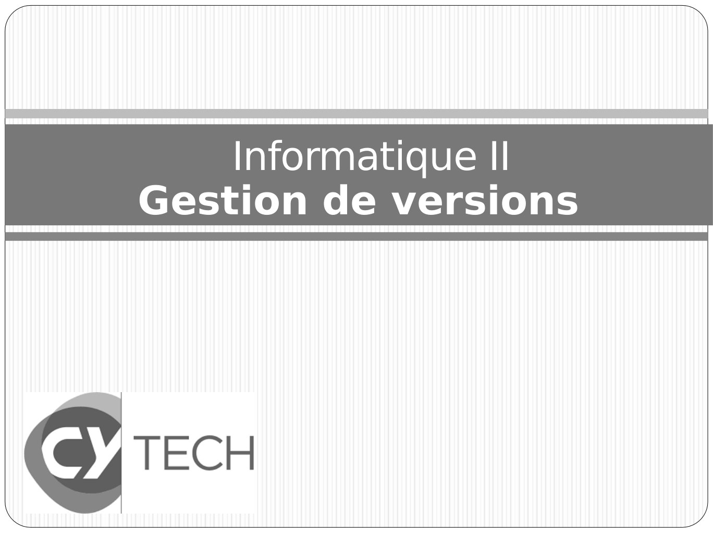
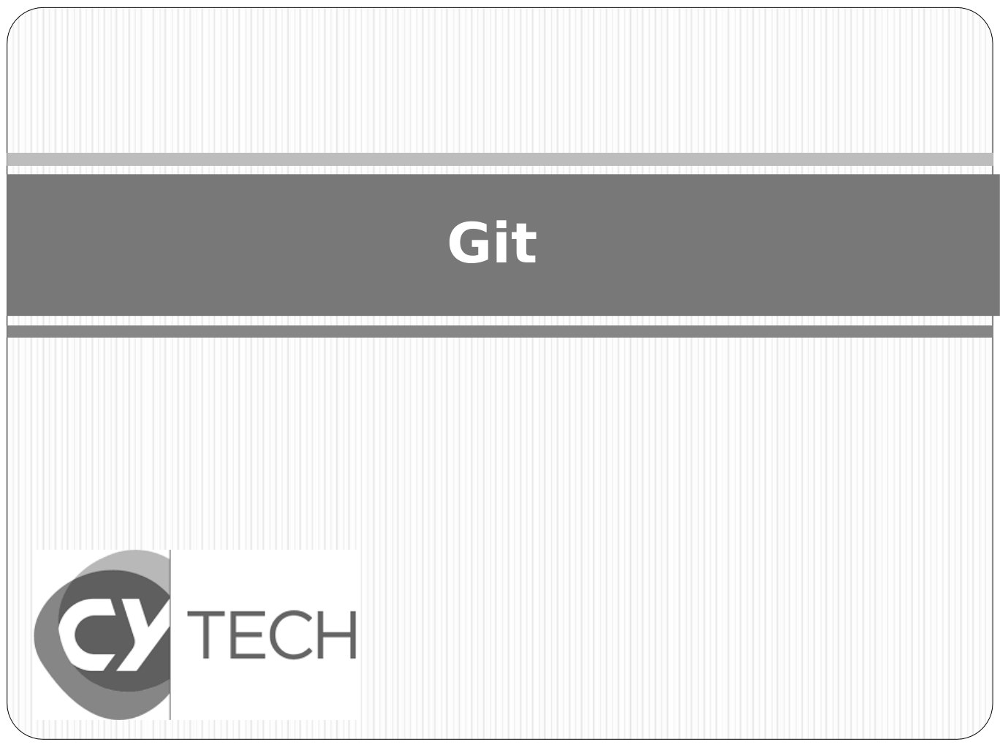
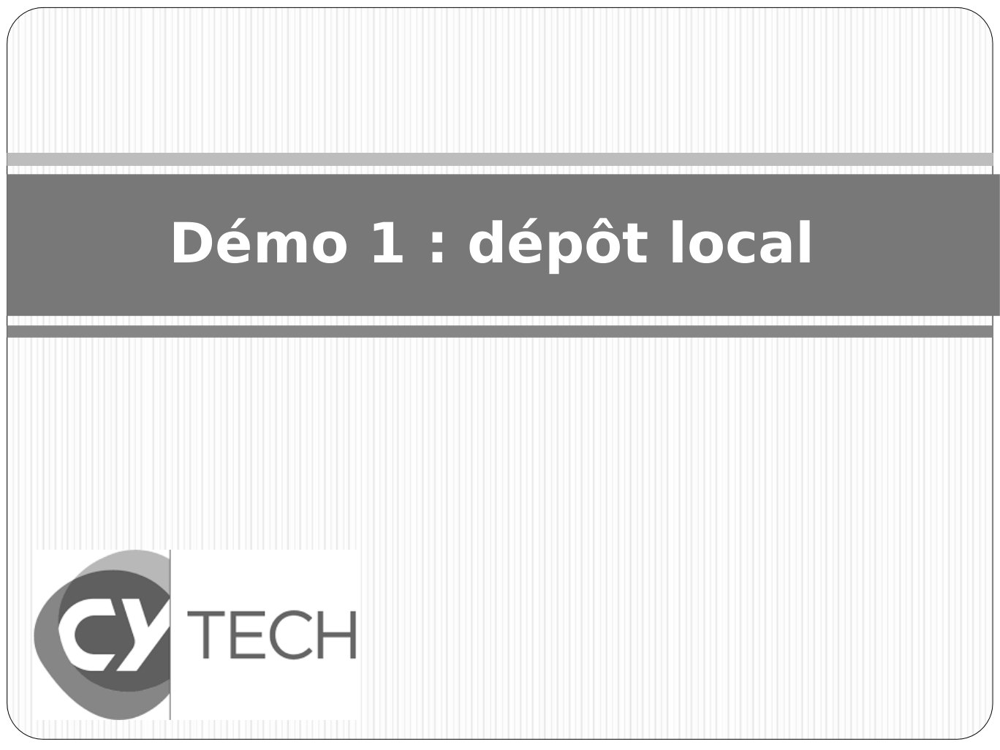
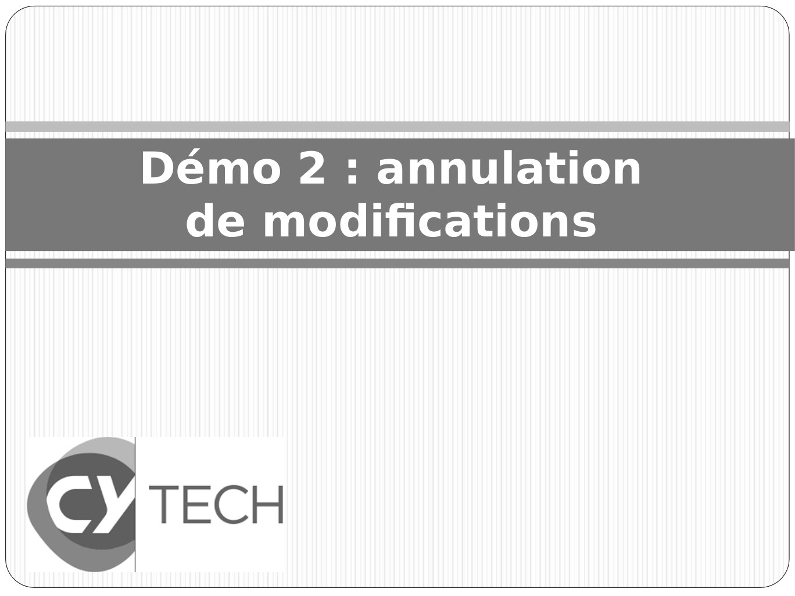
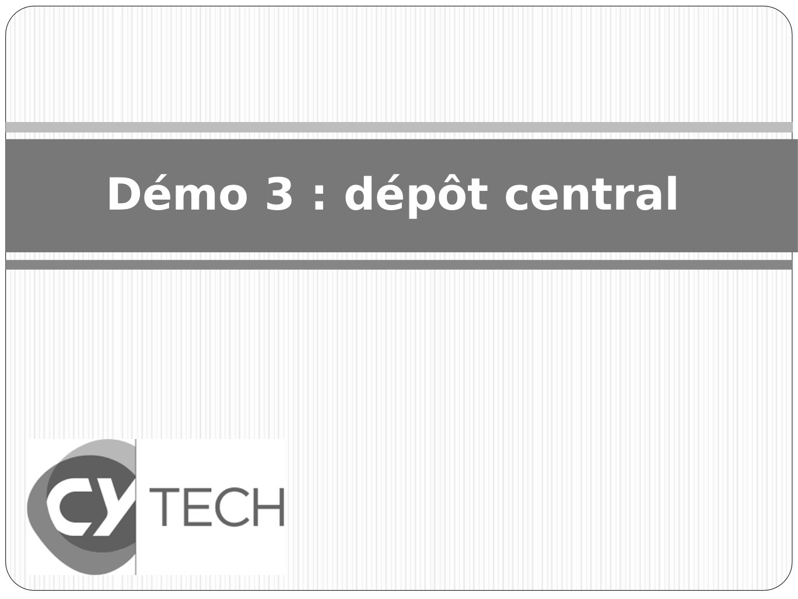
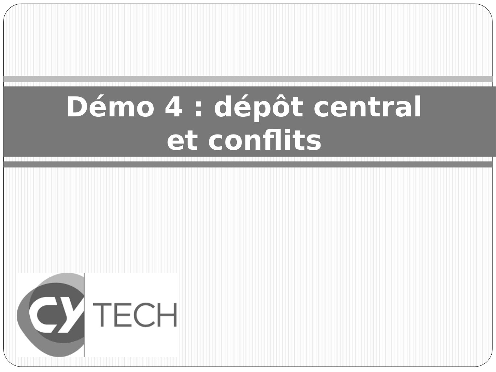
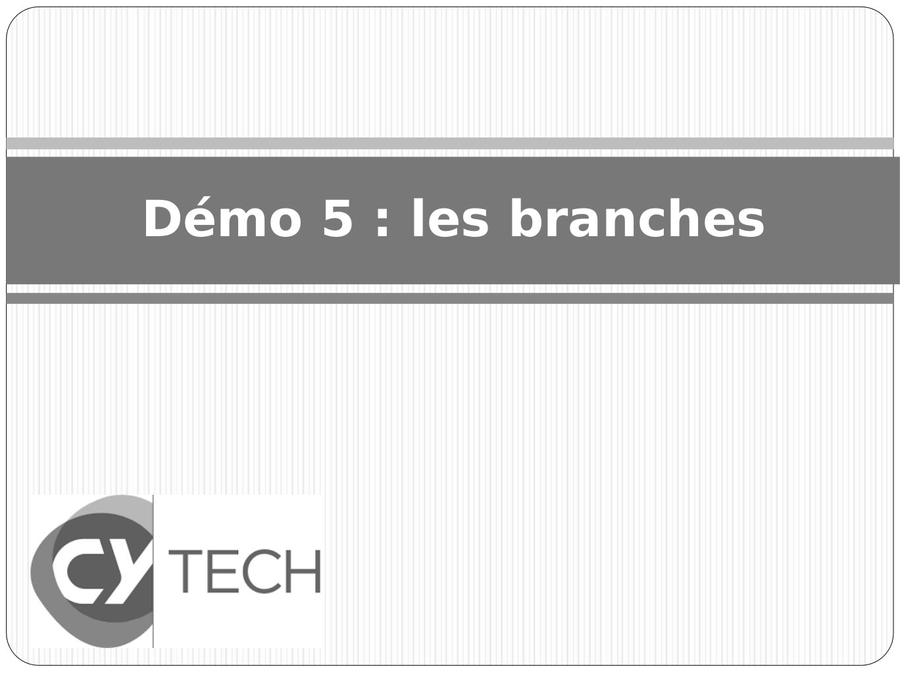
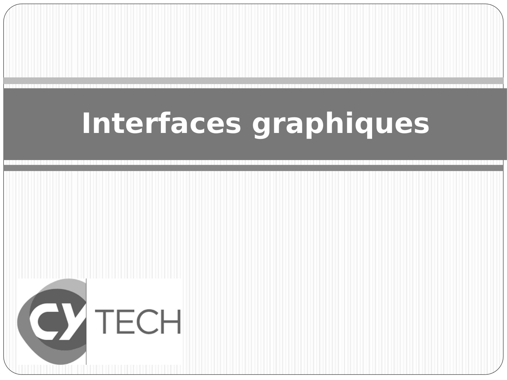
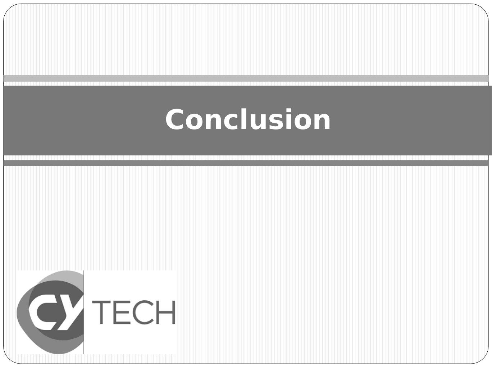

# CM-GIT_2024-2025_Informatique2_P1S2_EAnsermin-RGrignon.pdf

[Ouvrir l’original](https://drive.google.com/open?id=1DU9Mq2jvoL7XUH2erplaQ6Mf3BhII_4S) · Les pages signalées comprennent du texte reconnu automatiquement ou des éléments graphiques. Le fac-similé permet de vérifier chaque lecture.

**Pages avec fac-similé ou lecture OCR** — 1, 9, 19, 29, 35, 43, 59, 73, 77.

## Page 1

~~~text
    Informatique II
Gestion de versions
~~~

**Lecture OCR à contrôler**

~~~text
Informatique II

Gestion de versions

€ TECH
Uh Wy
~~~

## Page 2

~~~text
Comment gérer un projet ?
• Pour un projet seul :
   ●
     Comment gérer les différentes version/ les historiques du
     projet.
   ●
     Se souvenir de pourquoi des modifications ont été faites.
   ●
     Quels fichiers font partie de la version stable ? Sont des
     tests?
~~~

## Page 3

~~~text
Comment gérer un projet ?
• Pour un projet en équipe :
   ●
     Même problématiques que quand on code tout seul
   ●
     Comment partager ses avancées avec les autres? Où
     stocker les fichiers du projet?
   ●
     Comment modifier un code sans perturber le travail des
     autres ?
   ●
     Avoir une référence commune pour le projet.
   ●
     Savoir qui a fait quoi.
~~~

## Page 4

~~~text
La gestion de configuration
• La gestion de configuration consiste à :
   ●
     gérer la description technique d’un système
   ●
     gérer l'ensemble des modifications apportées au cours
     de l'évolution de ce système.

• Tout impact sur l’application doit être tracé. On peut
  rechercher et comparer les différentes version d’une
  application.

• Des méthodes doivent être appliquées pour garantir ce niveau
  de contrainte, mais ce n’est pas suffisant.

• Des outils doivent être utilisés pour garantir fiabilité / intégrité,
  et ainsi d’éviter au maximum les opérations humaines
~~~

## Page 5

~~~text
Les gestionnaires de versions
• Il existe des outils appelés gestionnaires de versions, ou outils
  de versionnage qui permettent de faire de la gestion de
  configurations en partie automatique.

• L’utilisation de ces outils représente l’une des obligations du
  développeur quand il travaille sur une application.

• Ces outils permettent de tracer toute modification dans le code,
  même mineure.
~~~

## Page 6

~~~text
Le but des outils de versionnage
• Avoir un espace centralisé sur lequel le code de l’application
  est stocké :
   ●
     Garantir une référence unique
   ●
     Accessible à tout le monde /ou membre de l’équipe
• Gérer et sauvegarder les différentes versions (et avancées) d’un
  projet:
   ●
     Avoir un historique des modifications
   ●
     Pouvoir revenir à une version précédente
   ●
     Faire une dichotomie dans l’historique des recherches
     pour retrouver l’origine d’un bug
   ●
     Garantir que l’on est capable de regénérer exactement le
     même exécutable
   ●
     Apporter des solutions avec des fils de discussions, des
     documents ect.
~~~

## Page 7

~~~text
Les outils de versionnage
• Les outils de gestion de versions pourraient faire l'objet d'un
  module de cours à eux seuls

• Ce cours n'a pour seul but que de vous sensibiliser à l'existence
  de ce type d'outils, vous informer sur la manière dont ils
  fonctionnent, et vous inciter à les utiliser dans vos projets
  académiques et/ou personnels.

• La question d’utiliser un tel type d’outils dans un contexte
  professionnel ne se pose pas : c’est une obligation (une de
  plus) pour le développeur.

• Initialiser un dépôt de code (terme consacré) pour archiver les
  futures modifications d’une application devrait être un réflexe,
  avant même de concevoir ou coder (et c’est un conseil qui vaut
  aussi pour vos projets académiques/persos)
~~~

## Page 8

~~~text
Les outils de versionnage
• Attention, il y a de mauvais côtés à utiliser ce type d’outils
~~~

## Page 9

~~~text
Git
~~~

**Lecture OCR à contrôler**

~~~text
€ TECH
Uh Wy
~~~

## Page 10

~~~text
Le logiciel Git : petit historique
• Linux est un logiciel libre : un outil de versionning est tout
  indispensable pour gérer les très nombreux apports et version
  de l’OS.

• Le logiciel BitKeeper était utilisé jusqu’en 2002, mais est devenu
  payant.

• En 2005, Linus Torvalds propose GIT qui devient rapidement un
  de outils de versioning les plus utilisé.
~~~

## Page 11

~~~text
Le logiciel Git
• La principale caractéristique de GIT est qu’il ne repose pas sur un
  serveur centralisé unique.

• Gestionnaire avec serveur centralisé : tous les utilisateurs
  partagent un même ensemble de fichiers stockés sur un
  serveur
~~~

## Page 12

~~~text
Le logiciel Git
• La principale caractéristique de GIT est qu’il ne repose pas sur un
  serveur centralisé unique.

• Gestionnaire avec serveur centralisé ET copie locale : chaque
  utilisateur peut contribuer au dépôt principal en synchronisant
  le dépôt local sur sa machine
~~~

## Page 13

~~~text
Le logiciel Git
• La principale caractéristique de GIT est qu’il ne repose pas sur un
  serveur centralisé unique.

• Il existe plusieurs solutions permettant d’héberger le dépôt
  central d’un projet géré avec Git

• L’un d’eux est GitHub.com (il faudra vous créer un compte!)

                                   La mascotte s’appelle octocat !
~~~

## Page 14

~~~text
Le versioning en local avec Git
• Au tout départ, il faut initialiser un espace de travail qui sera
  géré par Git

• On peut partir d’un nouveau répertoire vide, ou déjà existant, en
  indiquant à Git que ce répertoire deviendra la racine de notre
  projet

• L’exécutable Git possède une commande d’initialisation qui va
  créer un dossier caché dans le répertoire de travail : ‘.git’

• Ce dossier .git contiendra l’ensemble de l’historique des
  modifications ultérieures
                               initialisation
                Répertoire                      Répertoire géré
                  simple                           par Git
~~~

## Page 15

~~~text
Le versioning en local avec Git
• Quand un développeur effectue une modification de son code et
  qu'il souhaite soumettre cette modification, on parle de commit.

• Il peut choisir les changements qu’il soumet dans le commit en
  ajoutant des fichiers à la zone de staging

• Les différents commits sont stockés dans un espace mémoire
  persistant : le dossier .git vu précédemment

• Les commits sont donc des opérations issues de décisions
  humaines : pas de sauvegarde automatique par Git
                  nouveau
                  fichier                         commit   Répertoire avec
 Répertoire de
                                Zone de staging             modifications
    travail      modification
                                                            sauvegardées
                 suppression
                 renommage
~~~

## Page 16

~~~text
Le versioning en local avec Git
• En général chaque différence de fichier est stockée plutôt que
  l’intégralité du fichier lui-même

• Chaque commit est donc signé de manière unique permettant
  de s’assurer de l’intégrité des données : on parle de version de
  commit, ou de révision

• Un lien chronologique est créé entre les différentes révisions, ce
  qui permet d’obtenir un graphe de révisions
~~~

## Page 17

~~~text
Le versioning en local avec Git
• Une fois les commits effectués, on peut obtenir des
  informations sur l’historique

• La date, l’auteur et le message font partie de ces informations.
  Le message devant inclure le maximum de précisions possibles
  concernant le contenu des modifications

• Cet historique peut être consulté globalement, ou fichier par
  fichier, pour permettre de retrouver la cause d’un bug, ou tout
  simplement voir le détail d’une modification
           commit 1144223e4d741d4c6ad2d34278d10a1c8404518a
           Author: Romuald GRIGNON <rgn@cy-tech.fr>
           Date: Fri Apr 15 18:57:40 2022 +0200
             First commit for test
           …
           …
~~~

## Page 18

~~~text
Démos :
• Les sections qui suivent, intitulées “Démo”, serviront à vous
  présenter de manière interactive les différentes commandes
  Git et les situations dans lesquelles les employer

• Cela pourra vous servir de tutoriel si vous souhaitez refaire les
  manipulations chez vous plus tard

• Elles sont séparées en plusieurs parties :
   ●
     Démo 1 : dépôt local pour un seul développeur
   ●
     Démo 2 : dépôt local avec annulation de modifications
   ●
     Démo 3 : liaison du dépôt local avec un dépôt central (pour
     un seul développeur)
   ●
     Démo 4 : dépôt central avec gestion des conflits
   ●
     Démo 5 : les branches
~~~

## Page 19

~~~text
Démo 1 : dépôt local
~~~

**Lecture OCR à contrôler**

~~~text
Démo 1 : dépôt local

€ TECH
Uh Wy
~~~

## Page 20

~~~text
Démo 1 : dépôt local
• Créer un dossier vide
• Se placer dans le dossier et taper la commande git init

• Un sous dossier .git a été créé
• C’est un dossier caché, il n’apparait qu’avec l’option -a de la
  commande ls
~~~

## Page 21

~~~text
Démo 1 : dépôt local
• Créer un fichier texte et ajouter du contenu (ici un fichier
  main.c)
~~~

## Page 22

~~~text
Démo 1 : dépôt local
• Taper la commande git status qui permet de voir l’état du
  dépôt

• On voit que git a detecté le fichier main.c comme étant
  “untracked”, c’est à dire que git ne le connait pas
• Ce fichier ne fait donc pas (encore) partie des fichiers dont il
  doit suivre les modifications
~~~

## Page 23

~~~text
Démo 1 : dépôt local
• Ajouter le fichier main.c à la zone de staging grâce à la
  commande git add … (visualiser le résultat avec git status)

• Git détecte maintenant que le fichier main.c doit être soumis
  au dépôt lors du prochain commit
~~~

## Page 24

~~~text
Démo 1 : dépôt local
• Effectuer le commit à l’aide de la commande git commit … :

• On s’aperçoit que le commit a fonctionné, et que le dépôt local
  est à jour (aucune modification : working tree clean)

• L’option -m de la commande git commit, permet d’entrer le
  message du commit. L’omettre va ouvrir l’éditeur de texte du
  système par défaut (sous Linux cela sera probablement “vi”)

• Pour changer l’éditeur par défaut, par exemple gedit :
   ●
     git config --global core.editor gedit
~~~

## Page 25

~~~text
Démo 1 : dépôt local
• Pour visualiser le commit précédent, utilisez la commande
  suivante : git log -p
• L’option -p vous donne les détails de la modification du fichier
~~~

## Page 26

~~~text
Démo 1 : dépôt local
• Ajouter un fichier .h contenant une constante et modifier le
  fichier main.c pour l’utiliser
~~~

## Page 27

~~~text
Démo 1 : dépôt local
• Afficher le statut du dépôt

• Nous voyons apparaitre un nouveau fichier non connu de git
  (constants.h) et un fichier modifié (main.c)

• Là aussi, il faudra effectuer les commandes git add / git commit
   pour avoir une sauvegarde des modifications par Git
~~~

## Page 28

~~~text
Démo 1 : dépôt local
• Une fois l’ajout des 2 fichiers main.c et constants.h on peut
  afficher l’historique du commit (on peut limiter l’affichage au
  dernier commit avec la commande : git log -p -1
~~~

## Page 29

~~~text
Démo 2 : annulation
 de modifications
~~~

**Lecture OCR à contrôler**

~~~text
Démo 2 : annulation

de modifications

€ TECH
Uh Wy
~~~

## Page 30

~~~text
Démo 2 : annulation de modifications
• Nous allons effectuer une modification sur le fichier main.c
  puis nous allons revenir sur notre choix

• La commande git restore vous permet d’annuler les
  modifications locales et de restaurer l’état du fichier lors du
  dernier commit
~~~

## Page 31

~~~text
Démo 2 : annulation de modifications
• Nous allons maintenant effectuer une modification sur le
  fichier main.c puis le passer dans l’état “staged” avant de
  revenir sur notre choix de le modifier

• La commande git restore --staged vous permet d’annuler l’état
  “staged” mais pas les modifications locales
• Il faudra en plus effectuer la commande git restore, comme
  précédemment, pour revenir à l’état d’origine du fichier (si
  c’est ce que l’on souhaite)
~~~

## Page 32

~~~text
Démo 2 : annulation de modifications
• Nous allons maintenant effectuer une modification sur le
  fichier main.c puis la sauvegarder (commit)

• On retrouve dans l’historique notre modification actuelle,
  précédée de celle où nous avions ajouté le fichier constants.h
~~~

## Page 33

~~~text
Démo 2 : annulation de modifications
• D’une manière générale, on tend à ne jamais rien “oublier”
  et/ou “effacer” de manière à conserver une traçabilité totale
  de l’application
• La commande git revert permet d’annuler les opérations d’un
  commit (retour vers l’arrière), tout en créant un nouvel état
  (vers l’avant). Cette commande fonctionne comme git commit
  et demande un message utilisateur
• git revert f0f64be7d3fee0edab1411e9ba39b922b092f415
~~~

## Page 34

~~~text
Démo 2 : annulation de modifications
• Comme indiqué précédemment, chaque commit possède une
  signature unique et c’est celle-ci qui sera utilisée pour y faire
  référence
~~~

## Page 35

~~~text
Démo 3 : dépôt central
~~~

**Lecture OCR à contrôler**

~~~text
Démo 3 : dépôt central

€ TECH
Uh Wy
~~~

## Page 36

~~~text
Démo 3 : dépôt central
• On souhaite créer un dépôt central à partir de notre dépôt
  local.
• Nous allons utiliser le site github.com en créant un compte puis
  en créant un nouveau dépôt (vide)

• Il existe d’autres franchises permettant d’héberger un dépôt git
  gratuitement : GitLab / BitBucket / SourceForge / ...
~~~

## Page 37

~~~text
Démo 3 : dépôt central
• Toutes les modifications de code sont faites dans ce que l’on
  appelle une branche

• Une branche est une variation de l’application : gérer plusieurs
  branches permet de gérer plusieurs modifications en parallèle
  sans se perturber les unes avec les autres

• Par défaut notre dépôt local travaille sur la branche “master”.
  On peut le voir grâce à la commande git branch
~~~

## Page 38

~~~text
Démo 3 : dépôt central
• Par défaut le site de github.com créé une branche “main”

• Pour relier les 2 dépôts (local et distant) il faut que les
  branches soient alignées : si elles portent des noms différents,
  git interprétera ces 2 branches comme distinctes

• On peut forcer le renommage de la branche actuellement
  selectionnée avec la commande git branch -M en donnant le
  nouveau nom : ici “main” au lieu de “master”
~~~

## Page 39

~~~text
Démo 3 : dépôt central
• Maintenant nous pouvons relier les 2 dépôts

• c’est la commande git remote add qui permet d’indiquer où se
  trouve le dépôt distant

• On donne un nom au dépôt distant : très souvent vous
  trouverez l’exemple de “origin”
~~~

## Page 40

~~~text
Démo 3 : dépôt central
• Maintenant nous pouvons mettre à jour le dépôt distant (qui
  est vide) avec le contenu de notre dépôt local

• Les synchronisations entre le dépôt local et distant se font à
  l’aide de 2 commandes “git push” et “git pull”

• Attention : il faut être authentifié vis-a-vis du site github.com
• Utiliser un Personal Access Token (cf. détails sur github.com)
~~~

## Page 41

~~~text
Démo 3 : dépôt central
• Pour récupérer les mises à jour depuis le dépôt central, utiliser
  la commande git pull

• Bien évidemment notre dépôt est à jour. Sur le site github.com
  nous retrouvons l’ensemble des fichiers de l‘état courant
~~~

## Page 42

~~~text
Démo 3 : dépôt central
• Maintenant que nous avons un dépôt local et distant, il est
  possible de continuer nos développements

• La même séquence de commandes sera utilisée :
   ●
     Modifications (ajouts, modifications, suppressions,
     renommage, déplacements)
   ●
     Choix des modifications à sauver (commande git add)
   ●
     Sauvegarde (commande git commit)
   ●
     Synchronisation (commande git push)

• Une bonne pratique est de soumettre ses modifications quand
  elles apportent un ajout fonctionnel (même minime)

• Effectuer un commit quotidien au minimum, si les modifications
  sont longues, ou si le développeur doit s'interrompre (attention
  à ne pas casser le fonctionnement (cf. §branches ci-après))
~~~

## Page 43

~~~text
Démo 4 : dépôt central
     et conflits
~~~

**Lecture OCR à contrôler**

~~~text
Démo 4 : dépôt central

et conflits

€ TECH
Uh Wy
~~~

## Page 44

~~~text
Démo 4 : ajout d’un collaborateur
• Maintenant nous avons la possibilité de travailler à plusieurs

• Nous allons créer un autre repertoire pour simuler un nouveau
  collaborateur

• Créer un répertoire vide et se placer à l’intérieur.

• Utiliser la commande git clone pour récupérer l’état courant de
  l’application et faire le lien entre le nouveau dépôt local et le
  dépôt distant
~~~

## Page 45

~~~text
Démo 4 : ajout d’un collaborateur
• On peut vérifier que l’on possède une branche “main” en local

• Que le dépôt distant est bien connecté à la cible “origin”

• Que le statut du dépôt nouvellement créé est stable
~~~

## Page 46

~~~text
Démo 4 : ajout d’un collaborateur
• L’utilisation de la commande git clone vous servira également
  au niveau personnel, si vous devez changer de machine
     ●
        Votre ordinateur n’est plus opérationnel
     ●
        développement à faire urgemment et vous n’avez pas
        accès à votre ordinateur
     ●
        Le dépôt local et distant sont désynchronisés, vous
        n’arrivez pas à corriger cet état et vous ne voulez pas
        perdre vos modifs locales → création d’un autre dépôt
        local “à jour” dans lequel reporter vos modifications

• Une fois qu’un dépôt central existe, il n’est plus question de
  faire un git init : sa seule utilité est d’initier un dépôt avec des
  fichiers existants avant d’effectuer un git push vers le dépôt
  central

• Dès qu’un dépôt central existe, on utilisera git clone
~~~

## Page 47

~~~text
Démo 4 : conflits
• Il est possible de créer des conflits à partir du moment où un
  collaborateur effectue une modification sur les mêmes fichiers
  que vous et que vous possédez le même ancêtre commun

• Le premier développeur à faire un “push” verra ses
  modifications prises compte sur le dépôt central

• Le deuxième, en synchronisant sont dépôt local verra
  apparaitre des conflits qui devront être résolus manuellement

• Ce n’est qu’après la résolution qu’il pourra faire un “push”…. si
  personne entre temps n’a mis à jour le dépôt central ^^
~~~

## Page 48

~~~text
Démo 4 : conflits
• Astuce pour éviter les conflits quand vous travaillez à plusieurs
~~~

## Page 49

~~~text
Démo 4 : conflits
• Sur les 2 dépôts locaux, on modifie le fichier main.c en
  rajoutant un printf() différent à chaque fois
• Pour chaque dépôt local, on fait un git commit, suivi par un git
  pull (pour vérifier qu’il n’y a pas de modifications sur le central)
• DEV #2 → pull / push
~~~

## Page 50

~~~text
Démo 4 : conflits
• Sur les 2 dépôts locaux, on modifie le fichier main.c en
  rajoutant un printf() différent à chaque fois
• Pour chaque dépôt local, on fait un git commit, suivi par un git
  pull (pour vérifier qu’il n’y a pas de modifications sur le central)
• DEV #2 → log
~~~

## Page 51

~~~text
Démo 4 : conflits
• Sur les 2 dépôts locaux, on modifie le fichier main.c en
  rajoutant un printf() différent à chaque fois
• Pour chaque dépôt local, on fait un git commit, suivi par un git
  pull (pour vérifier qu’il n’y a pas de modifications sur le central)
• DEV #1 → pull ! Echec de la fusion automatique
~~~

## Page 52

~~~text
Démo 4 : conflits
• Il faut ouvrir le fichier main.c qui a été modifié par git et
  résoudre le conflit manuellement
• Les modifications locales sont entre les “<<<<<” et les “=====”
• Les modifications distantes en conflits sont entre les “=====”
  et les “>>>>>”
• Chaque train de chevrons est suivi de la signature du commit
~~~

## Page 53

~~~text
Démo 4 : conflits
• Nous allons conserver les 3 printf() et supprimer les 2 lignes
  vides comme résultat de la fusion

• Cette opération est forcément manuelle car l’outil ne peut pas
  deviner quel est le fonctionnel attendu sur le code
~~~

## Page 54

~~~text
Démo 4 : conflits
• Nous pouvons effectuer le commit en indiquant que c’est un
  commit de fusion

• Il faudra bien sur utiliser la séquence classique git add / git
  commit
~~~

## Page 55

~~~text
Démo 4 : conflits
• Après le commit de notre résolution de conflit, notre dépôt
  local est en avance de 2 commits par rapport au dernier état
  connu du dépôt distant

• On peut effectuer un git pull pour vérifier qu’un autre
  développeur n’a pas modifié le dépôt central

• Si il n’y a pas de conflit, on peut faire un git push
~~~

## Page 56

~~~text
Démo 4 : conflits
• Après la commande git push réussie, l’état du dépôt central est
  bien le résultat de la fusion des 2 développeurs : le DEV #1
  pourra récupérer cette fusion avec git pull
~~~

## Page 57

~~~text
Démo 4 : conflits
• Se mettre à jour régulièrement par rapport au dépôt central
  permet d’éviter des fusions trop importantes/pénibles …

                                                   … ou pas
~~~

## Page 58

~~~text
Démo 4 : conflits
• Si la fusion est complexe elle peut nécessiter plusieurs
  développeurs pour en venir à bout : chacun ayant la
  connaissance d’une partie de la modification

• Le fait de séparer le code en modules permet d’éliminer des
  fusions et/ou réduire leur complexité

• Malgré cette fusion, nous ne travaillons pas ici dans plusieurs
  branches mais bien une seule : la gestion de plusieurs branches
  de travail permet également d’éviter (temporairement) des
  fusions, et surtout de ne pas perturber l’état de l’application
~~~

## Page 59

~~~text
Démo 5 : les branches
~~~

**Lecture OCR à contrôler**

~~~text
Démo 5 : les branches

€ TECH
Uh Wy
~~~

## Page 60

~~~text
Démo 5 : branches
• La commande git branch <nom> permet de créer une nouvelle
  branche (ici spécifique aux développement du DEV #2)

• La commande git checkout <nom> permet de basculer d’une
  branche à l’autre

• Nous allons modifier les fichiers main.c et constants.h dans la
  branche dev2 et effectuer ce commit
~~~

## Page 61

~~~text
Démo 5 : branches
• Après les modifications et le commit dans la branche, nous
  avons un état stable en local

• Mais il faut dire au dépôt distant de suivre cette nouvelle
  branche également

• Comme avec le dépot vide au début du cours, en utilisant
  l’option -u de git push (lors du premier push uniquement)
~~~

## Page 62

~~~text
Démo 5 : branches
• Le push de la nouvelle branche sur le dépôt distant
~~~

## Page 63

~~~text
Démo 5 : branches
• La récupération par le développeur DEV #1 de cette branche
  ‘dev2’ ne créé aucun conflit puisqu’il est toujours sur la branche
  ‘main’
~~~

## Page 64

~~~text
Démo 5 : branches
• Si le développeur DEV #1 effectue une modification du fichier
  main.c sur la branche principale et commit, le DEV #2 pourra
  récupérer ces modifications sans conflit avec git pull

• On voit les 2 branches qui divergent avec l’ancêtre commun
~~~

## Page 65

~~~text
Démo 5 : branches
• Pour fusionner la branche de développement dans la branche
  principale, il est préférable de plutôt faire l’inverse dans un
  premier temps

• Donc, rappatrier la branche principale dans la branche de
  développement : seule cette dernière sera impactée, à charge
  au(x) développeur(s) de stabiliser cette branche (résoudre les
  conflits, passer les tests, ...)

• Une fois fait, la fusion vers la branche principale sera
  automatique. Les évolutions de la branche de développement
  n’ont que peu d’impact sur le travail des autres équipiers,
  surtout si cette branche de développement vit longtemps

• Il est donc primordial pour un développeur de se mettre à jour
  régulièrement par rapport à la branche principale
~~~

## Page 66

~~~text
Démo 5 : branches
• L’idéal étant de mettre à jour son poste de travail tous les jours
~~~

## Page 67

~~~text
Démo 5 : branches
• On se place dans la branche de developpement ‘dev2’

• On utilise la command git merge <nom> pour rappatrier les
  modifications d’une autre branche (ici ‘main’)

• Bien évidemment il y a des conflits dans le fichier main.c (pas
  dans constants.h puisqu’il n’y a qu’un rajout)

• Ces conflits n’impactent personne parmi les autres membres
  de l’équipe : c’est le but des branches (même pour un projet
  perso, le fait de tester une fonctionnalité en branche, permet
  de ne pas casser le reste de l’application)
~~~

## Page 68

~~~text
Démo 5 : branches
• Le fichier main.c a donc un conflit : nous allons choisir de
  garder tous les printf() ainsi que les déclarations des 2 variables
~~~

## Page 69

~~~text
Démo 5 : branches
• Le fichier main.c a donc un conflit : nous allons choisir de
  garder tous les printf() ainsi que les déclarations des 2 variables
~~~

## Page 70

~~~text
Démo 5 : branches
• On ajoute le fichier main.c au prochain commit, on effectue le
  commit et on synchronise avec le dépôt central
~~~

## Page 71

~~~text
Démo 5 : branches
• Maintenant nous pouvons effectuer l’opération ultime :
  soumettre les modifications de notre branche de
  développement dans la branche principale
~~~

## Page 72

~~~text
Démo 5 : branches
• Le commit de fusion de la branche ‘dev2’ devient la nouvelle
  revision de tête pour la branche ‘main’

• Toute l’équipe peut maintenant profiter des fonctionnalités du
  DEV #2 (et tous les bugs qu’il aura créé aussi)
~~~

## Page 73

~~~text
Interfaces graphiques
~~~

**Lecture OCR à contrôler**

~~~text
Interfaces graphiques

€ TECH
Uh Wy
~~~

## Page 74

~~~text
Interfaces graphiques
• Pour plus d’ergonomie, certains logiciels fournissent une
  interface graphique à un projet Git

• Certains sont directement fournis avec Git (ou presque, comme
  gitk donc vous avez vu quelques captures d’écran dans ce
  document)

• Développés par des entités tierces

• Intégrés dans des environnements de développement (comme
  ceux de chez JetBrains : PyCharm, IntelliJ, …)

• Permet d’avoir une meilleure visibilité des différents commits,
  de l’enchevêtrement des branches, etc...
~~~

## Page 75

~~~text
Interfaces graphiques
• TortoiseGit sous Windows permet d’avoir toutes les
  commandes git dans le menu contextuel clic-droit
~~~

## Page 76

~~~text
Interfaces graphiques
• GitKraken, multi-plateformes, possède une interface graphique
  agréable et ergonomique
~~~

## Page 77

~~~text
Conclusion
~~~

**Lecture OCR à contrôler**

~~~text
€ TECH
Uh Wy
~~~

## Page 78

~~~text
Conclusion
• Les outils de gestion de versions sont des outils puissants
  permettant de garantir la traçabilité de votre code, et de
  travailler plus efficacement en équipe

• C’est devenu un outil indispensable à tout développeur
  professionnel : sa connaissance est tout aussi importante que
  le code lui-même

• Même si nous n’avons vu que Git, il existe une multitude
  d’autres outils plus ou moins équivalents
     ●
       Propriétaires ou libres
     ●
       Centralisés ou non
     ●
       Avec des clients graphiques ou en ligne de commande
     ●
       Des plateformes web compatibles pour l’hébergement
~~~

## Page 79

~~~text
Conclusion
• Même si ils restent des outils incontournables, leur utilisation
  reste sensible

• Il n’est pas possible de perdre des informations mais les
  retrouver peut s’avérer complexe si on ne fait pas attention aux
  commandes que l’on exécute

• La connaissance des différentes commandes est un plus pour
  l’utilisation des interfaces graphiques

• Rien que pour Git, le nombre d’options pour les différentes
  commandes est énorme. La maîtrise d’un tel outil peut prendre
  du temps, surtout si l’on s’attarde au coeur de l’exécutable et la
  manière dont il stocke chaque révision
~~~

## Page 80

~~~text
Conclusion
• Les outils de gestion de configuration ne remplaceront jamais
  le dialogue entre équipiers ...
~~~

## Page 81

~~~text
Conclusion
• … et seront inutiles face à des méthodes de développement
  peu scrupuleuses :
~~~
