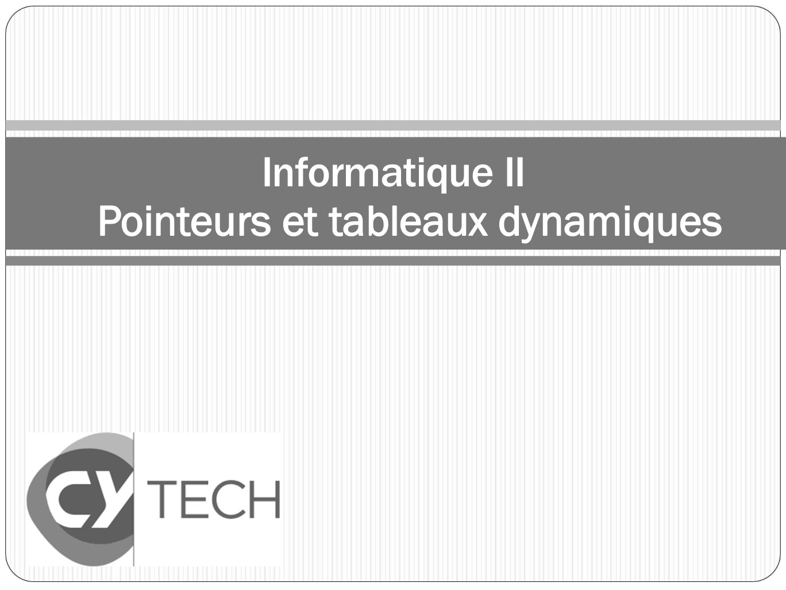

# CM03-tableaux-dynamiques_2023-2024_Informatique2_P1S2_EAnsermin-RGrignon.pdf

[Ouvrir l’original](https://drive.google.com/open?id=19UVIY3tEhnHOKgV2ygdMtkrGrtRd0F1N) · Les pages signalées comprennent du texte reconnu automatiquement ou des éléments graphiques. Le fac-similé permet de vérifier chaque lecture.

**Pages avec fac-similé ou lecture OCR** — 1.

## Page 1

~~~text
        Informatique II
Pointeurs et tableaux dynamiques
~~~

**Lecture OCR à contrôler**

~~~text
Informatique II

Pointeurs et tableaux dynamiques

€ TECH
Nt Id
~~~

## Page 2

~~~text
       Rappel
• Les valeurs d’un tableau sont à la suite dans la mémoire.
• Lorsqu’un tableau est déclaré:
        • Un espace mémoire de la bonne taille est réservé
        • Un pointeur constant (lecture seule) portant le nom du tableau est créé.
           Il pointe sur la première case du tableau.

                       Adresse              Valeur

              tab[0]   1154                 1

              tab[1]                        3

              tab[2]                        0

              tab[3]                        0

              tab[4]                        0

                       …
                       …
                       …
                       …
               tab     22 222               1154
~~~

## Page 3

~~~text
        Un petit test
•   Que devrait afficher le code suivant ?

    // Programme d'exemple
    int main(){

         int tab[10]={0}; // déclaration du tableau
         printf("&tab[0] =%p \n", &tab[0]);
         printf("&tab[1] =%p \n", &tab[1]);
         printf("&tab[2] =%p \n", &tab[2]);
         return 0;
    }
~~~

## Page 4

~~~text
        Un petit test
•   Que devrait afficher le code suivant ?

    // Programme d'exemple
    int main(){

         int tab[10]={0}; // déclaration du tableau
         printf("&tab[0] =%p \n", &tab[0]);
         printf("&tab[1] =%p \n", &tab[1]);
         printf("&tab[2] =%p \n", &tab[2]);
         return 0;
    }

                          4 numéros d’adresse d’écart entre chaque case !
~~~

## Page 5

~~~text
        Un petit test
•   Que devrait afficher le code suivant ?

    // Programme d'exemple
    int main(){

         char tab[10]={0}; // déclaration du tableau
         printf("&tab[0] =%p \n", &tab[0]);
         printf("&tab[1] =%p \n", &tab[1]);
         printf("&tab[2] =%p \n", &tab[2]);
         return 0;
    }

                          1 numéro d’adresse d’écart entre chaque case !
~~~

## Page 6

~~~text
        Un petit test
•   Que devrait afficher le code suivant ?

    // Programme d'exemple
    int main(){

         double tab[10]={0}; // déclaration du tableau
         printf("&tab[0] =%p \n", &tab[0]);
         printf("&tab[1] =%p \n", &tab[1]);
         printf("&tab[2] =%p \n", &tab[2]);
         return 0;
    }

                          8 numéros d’adresse d’écart entre chaque case !
~~~

## Page 7

~~~text
          Stockage des variable
•       Une variable peut – être stockée sur plusieurs cases mémoire selon
        son type.
•       Une adresse mémoire contient 1 octet.

               Type                       Taille (octet)
               char                       1
               short (entier)             2
               int/ float                 4
               long/double                8
               …                          …

    •    Rmq: ces valeurs sont valables pour des processeur 64 bits. En
         fonction de la cible certaines de ces valeurs peuvent varier.
~~~

## Page 8

~~~text
          Stockage des variable
•       Une variable peut – être stockée sur plusieurs cases mémoire selon
        son type.
•       Une adresse mémoire contient 1 octet.

               Type                       Taille (octet)
               char                       1
               short (entier)             2
               int/ float                 4
               long/double                8
               …                          …

    •    La fonction sizeof() donne le nombre d’octet sdu type passé en
         argument:
              Exemple : sizeof(int) retourne 4
~~~

## Page 9

~~~text
      Stockage des variable
•   Une variable peut – être stockée sur plusieurs cases mémoire selon
    son type.
•   Une adresse mémoire contient 1 octet.

    int   a = 1000;

    char b = ‘b’; //98
~~~

## Page 10

~~~text
      Stockage des variable
•   Une variable peut – être stockée sur plusieurs cases mémoire selon
    son type.
•   Une adresse mémoire contient 1 octet.

                                   Adresse              Valeur
                                   1154                 0000 0000
    int   a = 1000;                1155                 0000 0000
                               a
    char b = ‘b’; //98             1156                 0000 0011
                                   1157                 1110 1000
                                   …
                               b   10 028               0110 0010
~~~

## Page 11

~~~text
        Stockage des variable
•     Un tableau en mémoire:            Adresse   Valeur
                                        1154      0000 0000
                                        1155      0000 0000
                               tab[0]
    int tab[5]={1,2,3,4,5};             1156      0000 0000
                                        1157      0000 0001
                                        1158      0000 0000
                                        1159      0000 0000
                               tab[1]
                                        1160      0000 0000
                                        1161      0000 0010
                                        1162      0000 0000
                                        1163      0000 0000
                               tab[2]
                                        1164      0000 0000
                                        1165      0000 0011
                                        ….        ….
~~~

## Page 12

~~~text
        Stockage des variable
•     Un tableau en mémoire:            Adresse   Valeur
                                        1154      0000 0000
                                        1155      0000 0000
                               tab[0]
    int tab[5]={1,2,3,4,5};             1156      0000 0000
                                        1157      0000 0001
                                        1158      0000 0000
                                        1159      0000 0000
                               tab[1]
                                        1160      0000 0000
                                        1161      0000 0010
                                        1162      0000 0000
                                        1163      0000 0000
                               tab[2]
                                        1164      0000 0000
                                        1165      0000 0011
                                        ….        ….
                                        tab       1554
~~~

## Page 13

~~~text
      Gestion des pointeurs
•   Nous avons vu que:                            Adresse   Valeur
                                                  1154      0000 0000
         tab[i] <=> *(tab+i)                      1155      0000 0000
                                         tab[0]
                                                  1156      0000 0000
                                                  1157      0000 0001
                                                  1158      0000 0000
                                                  1159      0000 0000
                                         tab[1]
                                                  1160      0000 0000
•   &tab[0]+1 = tab+1 (ici 1155) n’est
    pas l’adresse de tab[1] !!!                   1161      0000 0010
•   Il y a une opération cachée                   1162      0000 0000
    derrière l'arithmétique des                   1163      0000 0000
                                         tab[2]
    pointeurs                                     1164      0000 0000
                                                  1165      0000 0011
                                                  ….        ….
                                                  tab       1554
~~~

## Page 14

~~~text
        Arithmétique du pointeur
•  Un pointeur n’indique pas simplement une adresse mais un espace
   mémoire.
• Le type donné au pointeur indique la taille de l’espace sur lequel il
   pointe.
 • Exemple :
                                                Adresse       Valeur
                                                1154
int     a;                                      …
char    b;
int*    p1; // pointeur sur int                 …
char*   p2; // pointeur sur char                …
a = 5;                                          …
p1 = &a;     // prend l'adresse de a            10 028
b = A;       //65                               …
p2 = &b;     // prend l'adresse de b            15 000
                                                …
                                                22 222
~~~

## Page 15

~~~text
      Arithmétique du pointeur
•   Les pointeurs sont des variables entières (adresses mémoire).
•   On peut donc lui appliquer un certain nombre d’opérateurs
    arithmétiques classiques:

          1. l’addition (+) d’un entier à un pointeur. Le résultat est
          un pointeur de même type que le pointeur de départ.

          2. la soustraction (-) d’un entier à un pointeur. Le résultat
          est un pointeur de même type que le pointeur de
          départ.

          3. la différence (-) de deux pointeurs pointant tous deux
          vers des données de même type. Le résultat est un entier.

          4. Les opérateurs de comparaison.
~~~

## Page 16

~~~text
  Arithmétique du pointeur : addition
  Si i est un entier et p est un pointeur sur un objet de type type,
  l’expression p+i désigne un pointeur de valeur:

                  p + i <=> p + ( i * sizeof(type) )

• Le décalage du bon nombre d’adresses mémoire se fait automatiquement.
~~~

## Page 17

~~~text
  Arithmétique du pointeur : addition
 Si i est un entier et p est un pointeur sur un objet de type type,
 l’expression p+i désigne un pointeur de valeur:

               p + i <=> p + ( i * sizeof(type) )

Exemple                                       Adresse        Valeur
                                              1100
   int a = 1;
                                              …
   int *p = NULL;
   p = &a;                                    …
   p = p+1;                                   …
   p = p+2;
                                              10 028
   *p= 10;
                                              …
                                              15 000
                                              …
                                              22 222
~~~

## Page 18

~~~text
  Arithmétique du pointeur : addition
 Si i est un entier et p est un pointeur sur un objet de type type,
 l’expression p+i désigne un pointeur de valeur:

                   p + i <=> p + ( i * sizeof(type) )

Exemple                                       Adresse        Valeur
                                              1100           1
   int a = 1;                            a    …
   int *p = NULL;
   p = &a;                                    …
   p = p+1;                                   …
   p = p+2;
                                              10 028
   *p= 10;
                                              …
                                              15 000
                                              …
                                              22 222
~~~

## Page 19

~~~text
  Arithmétique du pointeur : addition
 Si i est un entier et p est un pointeur sur un objet de type type,
 l’expression p+i désigne un pointeur de valeur:

                   p + i <=> p + ( i * sizeof(type) )

Exemple                                       Adresse        Valeur
                                              1100           1
   int a = 1;                            a    …
   int *p = NULL;
   p = &a;                                    …
   p = p+1;                                   …
   p = p+2;
                                              10 028
   *p= 10;
                                              …
                                              15 000
                                              …
                                          p   22 222         NULL
~~~

## Page 20

~~~text
  Arithmétique du pointeur : addition
 Si i est un entier et p est un pointeur sur un objet de type type,
 l’expression p+i désigne un pointeur de valeur:

                   p + i <=> p + ( i * sizeof(type) )

Exemple                                       Adresse        Valeur
                                              1100           1
   int a = 1;                            a    …
   int *p = NULL;
   p = &a;                                    …
   p = p+1;                                   …
   p = p+2;
                                              10 028
   *p= 10;
                                              …
                                              15 000
                                              …
                                          p   22 222         1100
~~~

## Page 21

~~~text
  Arithmétique du pointeur : addition
 Si i est un entier et p est un pointeur sur un objet de type type,
 l’expression p+i désigne un pointeur de valeur:

                   p + i <=> p + ( i * sizeof(type) )

Exemple                                       Adresse        Valeur
                                              1100           1
   int a = 1;                            a    …
   int *p = NULL;
   p = &a;                                    …
   p = p+1;                                   …
   p = p+2;
                                              10 028
   *p= 10;
                                              …
                                              15 000
                                              …
                                          p   22 222         1104
~~~

## Page 22

~~~text
  Arithmétique du pointeur : addition
 Si i est un entier et p est un pointeur sur un objet de type type,
 l’expression p+i désigne un pointeur de valeur:

                   p + i <=> p + ( i * sizeof(type) )

Exemple                                       Adresse        Valeur
                                              1100           1
   int a = 1;                            a    …
   int *p = NULL;
   p = &a;                                    …
   p = p+1;                                   …
   p = p+2;
                                              10 028
   *p= 10;
                                              …
                                              15 000
                                              …
                                          p   22 222         1112
~~~

## Page 23

~~~text
     Arithmétique du pointeur : addition
     Si i est un entier et p est un pointeur sur un objet de type type,
     l’expression p+i désigne un pointeur de valeur:

                          p + i <=> p + ( i * sizeof(type) )

  Exemple                                                 Adresse   Valeur
                                                          1100      1
       int a = 1;                                   a     …
       int *p = NULL;
       p = &a;                                            …
       p = p+1;                                           …
       p = p+2;
                                                          10 028
       *p= 10;
                                                          …
> On ne modifie pas a ! mais une donnée plus loin!
> Une Erreur de segmentation est possible, et c'est       15 000
  d'ailleurs la meilleure chose qu'il puisse arriver.     …
> Si l'instruction *p=10; n'échoue pas, il sera
                                                      p   22 222    1112
  peut-être difficile de trouver d'où vient le
  problème lorsque le symptôme se manifestera.
~~~

## Page 24

~~~text
  Arithmétique du pointeur : addition
  Si i est un entier et p est un pointeur sur un objet de type type,
  l’expression p+i désigne un pointeur de valeur:

                    p + i <=> p + ( i * sizeof(type) )

Application aux tableaux

    int tab[10]; // tableau d’entier
    int *p;
    p = tab;     // &tab[0] adresse première case
    p = p+1;     // ajoute sizeof(int) -> 2eme case du tableau.
    p = p+2;     // adresse de la quatrième case.

On a donc bien :   tab[i] <=> *(tab+i)
~~~

## Page 25

~~~text
  Arithmétique du pointeur : addition
  Si i est un entier et p est un pointeur sur un objet de type type,
  l’expression p+i désigne un pointeur de valeur:

                    p + i <=> p + ( i * sizeof(type) )

Application aux tableaux

    int tab[10]; // tableau d’entier
    int *p = NULL;

    for(p=&tab[0]; p<&tab[10]; p++){ //parcours du tableau
          *p=0;
    }

On a donc bien :   tab[i] <=> *(tab+i)
~~~

## Page 26

~~~text
Arithmétique du pointeur : soustraction
 Si i est un entier et p est un pointeur sur un objet de type type,
 l’expression p-i désigne un pointeur de valeur:

                   p - i <=> p - ( i * sizeof(type) )

Exemple

   int tab[10]; // tableau d’entier
   int *p;
   p = &tab[6]; // adresse 5eme case
   p = p-1;     // adresse 4eme case
   p = p-3;     // adresse 1ere case
~~~

## Page 27

~~~text
  Arithmétique du pointeur : différence
• La différence de deux pointeurs portant tous deux vers des objets de
  même type. Le résultat est un entier.

• Pertinent que si les pointeurs pointent sur des éléments d’un
  même tableau.

• La différences indique

           p1-p2  nombre d’élements du tableau entre p1 et p2

 Exemple

  int tab[10]; // tableau d’entier
  int *p1,*p2;
  p1=&tab[2];
  p2=&tab[4];

  p2-p1=        p1-p2=        p1-p1=          (p2+3)-p1=
~~~

## Page 28

~~~text
  Algorithme du pointeur : comparaison
• La comparaison entre deux pointeurs équivaut à comparer les
  adresses contenues par ces pointeurs.

     p1==p2 indiquent si les pointeurs pointent sur la même
   adresse mémoire.
~~~

## Page 29

~~~text
  Algorithme du pointeur : comparaison
• La comparaison entre deux pointeurs équivaut à comparer les
  adresses contenues par ces pointeurs.

     p1==p2 indiquent si les pointeurs pointent sur la même
   adresse mémoire.

   Question : quelle différence entre p1==p2 et *p1==*p2?
                                           Adresse     Valeur
                                           1100
                                           …
                                           …
                                           …
                                           10 028
                                           …
                                           15 000
                                           …
~~~

## Page 30

~~~text
  Algorithme du pointeur : comparaison
• La comparaison entre deux pointeurs équivaut à comparer les
  adresses contenues par ces pointeurs.

     p1==p2 indiquent si les pointeurs pointent sur la même
   adresse mémoire.

• La comparaison de deux pointeurs qui pointent dans le même tableau
  est équivalente à la comparaison des indices correspondants.

• On peut utiliser =!, ==, <, >, <=, >=
~~~

## Page 31

~~~text
    Allocation dynamique
Rappel:

•    La taille d’un tableau doit être connue lors de sa déclaration. On
    peut écrire :
     • int tab[10] : directement le nombre de cases
     • int tab[CONST] : utiliser une constante

Mais:
• La taille d’un tableau n’est pas forcement connue lors de la
  compilation.
   • La taille peut-être passée en paramètre ou donnée par
      l’utilisateur.
   • La taille d’une chaîne de caractère dépend de son contenu.

Jusqu’à maintenant : On déclare des tableaux très (trop) grands.
~~~

## Page 32

~~~text
    Allocation dynamique : malloc
•     Il est possible d’allouer (réserver) un espace mémoire d’un
     nombre souhaité d’octets grâce à la fonction malloc. C’est
     l’allocation dynamique.
                           malloc(nombre_d’octets)

Exemple:

    malloc(3); //alloue l’espace mémoire de 3 octets

                              Adresse   Valeur
                              1100
         Espace alloué !      1101
                              1102
                              …
                              10 028
~~~

## Page 33

~~~text
    Allocation dynamique : malloc
•    Il est possible d’allouer (réserver) un espace mémoire d’un
    nombre souhaité d’octets grâce à la fonction malloc. C’est
    l’allocation dynamique.
                    malloc(nombre_d’octets)

• La fonction retourne l’adresse de la première case mémoire de
  l’espace alloué (donc un pointeur).

• Le pointeur retourné n’a pas de type. C’est un pointeur universel.
• Le prototype de la fonction malloc s’écrit :
                  void * malloc(nombre_d’octets)

• On peut donc attribuer au retour de la fonction un pointeur de
  n’import quel type:
      int* p1;             float* p2;           char* p3;
      p1=malloc(…);        p2=malloc(…);        p3=malloc(…);
~~~

## Page 34

~~~text
    Allocation dynamique : test
•   Il est possible que l’allocation échoue. Il y a deux possibilités:
     • 1. Si l'allocation a marché, le pointeur retourné contient une adresse.
     • 2. Si l’allocation a échoué le pointeur retourné contient NULL .

•   Il faut donc toujours vérifier que l’allocation a fonctionné avant d’utiliser
    la mémoire allouée:

     #include<sdtlib.h> // malloc et exit
     int main(){
         int* p1;
         p=malloc(nmb_octet_souhaites);
         \\test
         if(p==NULL){
             printf("Allocation échouée !")
             exit(1); // On quitte le programme
         }
     }
~~~

## Page 35

~~~text
    Allocation dynamique : tableau
•   On peut allouer dynamiquement l’espace pour un tableau:

Exemple :                                    Adresse          Valeur
                                             1154
int* tab=NULL;
                                             1155
int nb;
//on demande la taille                       1156
printf("Taille du tableau ? ");              1157
//on récupère la taille
                                             1158
scanf("%d",&nb);
//on alloue la place pour nb int             1159
tab = malloc(nb*sizeof(int));                1160
                                             1161
                                             …
                                             ?
                                             ….               ….
                                             tab              1554
~~~

## Page 36

~~~text
    Allocation dynamique : tableau
•   On peut allouer dynamiquement l’espace pour un tableau:

Exemple :                                    Adresse          Valeur
                                             1154
int* tab=NULL;
                                             1155
int nb;
//on demande la taille                       1156
printf("Taille du tableau ? ");              1157
//on récupère la taille
                                             1158
scanf("%d",&nb);
//on alloue la place pour nb int             1159
tab = malloc(nb*sizeof(int));                1160
                                             1161
                                             …
    tab +1 =
                                             ?
    tab +2 =                                 ….               ….
                                             tab              1554
~~~

## Page 37

~~~text
    Allocation dynamique : tableau
•    On peut allouer dynamiquement l’espace pour un tableau de type type
    et de taille taille. C’est l’allocation dynamqiue.

                  tab = malloc(taille*sizeof(type))

•   Le pointeur obtenu pointe sur la première case du tableau. Le tableau
    peut être géré comme un tableau à déclaration statique.
~~~

## Page 38

~~~text
    Allocation dynamique : tableau
•    On peut allouer dynamiquement l’espace pour un tableau de type type
    et de taille taille. C’est l’allocation dynamqiue.

                  type tab = NULL;
                  tab = malloc(taille*sizeof(type));

•   Le pointeur obtenu pointe sur la première case du tableau. Le tableau
    peut être géré comme un tableau à déclaration statique.

•          Points importants:

             •   Le type du pointeur doit être du même type que les
                 éléments du tableau.
             •   Toujours vérifier que l’allocation mémoire a été réalisée
             •   Une fois l’allocation faite, la taille de la mémoire allouée
                 est fixée : on ne peut pas modifier la taille du tableau à
                 postériori.
             •   malloc appartient à la bibliothèque stdlib !
~~~

## Page 39

~~~text
    Allocation dynamique : calloc
•    La fonction calloc permet également d’allouer un espace mémoire et de
    retourner un pointeur sur la première adresse de cet espace.

•   Contrairement à malloc, la fonction calloc demande le nombre
    d’élément et la taille de chaque élément à allouer:

                calloc(nombre_elements, taille_element)

•   Exemple
              float *p;
              //allocation mémoire pour 10 réels
              p = calloc(10, sizeof(float));
~~~

## Page 40

~~~text
    Allocation dynamique : calloc
•    La fonction calloc permet également d’allouer un espace mémoire et de
    retourner un pointeur sur la première adresse de cet espace.

•   Contrairement à malloc, la fonction calloc demande le nombre
    d’élément et la taille de chaque élément à allouer:

                calloc(nombre_elements, taille_element)

•   En plus d’allouer l’espace mémoire, la fonction calloc initialise tous les
    elements de cet espace à 0. (peut prendre du temps!)

•   calloc appartient également à stdlib.
~~~

## Page 41

~~~text
    Allocation dynamique : free
•   Une bonne pratique pour éviter une utilisation inutile de l’espace
    mémoire est de librerer la mémoire allouée lorsqu’on en a plus besoin.

•   La procédure free permet de libérer l’espace alloué: il peut donc être
    utilisé à nouveau pour stocker d’autres données. Elle prend en
    paramètre le pointeur pointant sur la zone allouée.

•   Exemple

              float *p;
              // allocation de l’espace mémoire.
              p=malloc(10*sizeof(float));
              …
              free(p); // restitution de l’espace mémoire.
~~~

## Page 42

~~~text
    Allocation dynamique : free
•   Une bonne pratique pour éviter une utilisation inutile de l’espace
    mémoire est de librerer la mémoire allouée lorsqu’on en a plus besoin.

•   La procédure free permet de libérer l’espace alloué: il peut donc être
    utilisé à nouveau pour stocker d’autres données. Elle prend en
    paramètre le pointeur pointant sur la zone allouée.

•            Points importants:

         •   On ne peut libérer qu’un espace qui a, au préalable, été alloué
             dynamiquement (avec malloc ou calloc).
         •   Ne pas libérer l’espace mémoire c’est risquer une fuite
             mémoire.
~~~

## Page 43

~~~text
    Les doubles pointeurs
•     Il est possible de déclarer un pointeur qui pointe sur un autre pointeur.
     La déclaration se fait avec le double caractère *

                        Type **nomPointeur;

•    Exemple:                                        Adresse       Valeur
                                                 a   1100          5
      int a = 5;                                     …
      int *pa;                                       …
      int **ppa;                                     …
      pa = &a;
      ppa = &pa;                                pa   10 028
                                                     …
                                                     …
    pa=      ppa=           **ppa=                   …
                                               ppa   22 222
    *pa=     *ppa=
~~~

## Page 44

~~~text
    Les doubles pointeurs
•    Il est possible de déclarer un pointeur qui pointe sur un autre pointeur.
    La déclaration se fait avec le double caractère *

                       Type **nomPointeur;

•   Exemple: qu’affiche le code suivant ?           Adresse       Valeur
                                                    1100          5
     int a=5, b=10;                                 …
     int *pa = &a;// raccourcit !                   1500
     int **ppa;                                     …
     ppa = &pa;
     *pa = 1;                                       10 028
     *ppa = &b;                                     …
     *pa = b + *pa;                                 20 000
     printf("a=%d b=%d ",a,b);
                                                    …
                                                    22 222
~~~

## Page 45

~~~text
    Les doubles pointeurs: application
•   Les doubles pointeurs permettent de créer des tableaux de tableaux.

•   Rappel:
     • Les tableaux à 2 (ou plus) dimensions peuvent être vu comme des
       tableaux contenant des sous-tableaux:

Exemple : int tab[3][5] peut être visualisé comme un tableau contenant 3
sous tableau de 5 cases.

              [ [0,0,0,0,0],[1,1,1,1,1],[2,2,2,2,2] ]
          0          0           0            0         0
          1          1           1            1         1
          2          2           2            2         2
~~~

## Page 46

~~~text
    Les doubles pointeurs: application
•   Les doubles pointeurs permettent de créer des tableaux de tableaux.

•   Rappel:
     • Les tableaux à 2 (ou plus) dimensions peuvent être vu comme des
       tableaux contenant des sous-tableau.
     • En pratique, tous les éléments sont à la suite dans la mémoire.
     • On ne peux pas construire des sous-tableaux qui auraient des
       tailles différentes. (ex: un tableau de chaîne de caractère de
       différentes tailles).

•   La solution est de créer différents tableau et d’indiquer leur
    emplacement (leur adresse) dans un tableau de pointeur.

•   Le pointeur sur la première case d’un tableau de pointeur sera un
    double pointeur (un pointeur sur pointeur).
~~~

## Page 47

~~~text
      Les doubles pointeurs: application
  •   Les doubles pointeurs permettent de créer des tableau de tableau.

  •   Illustration:                                 Adresse      Valeur

 int tab1[5], tab2[10], tab3[3];
 int* tab2tab[3];
 tab2tab[0]=tab1;
 tab2tab[1]=tab2;
 tab2tab[2]=tab3;

A quoi sont équivalentes les commandes suivantes?

**(tab2tab)=1;

*(*(tab2tab+2)+1)=3;

tab2tab[1][9]=4;
~~~

## Page 48

~~~text
    Les doubles pointeurs: application
•   Les doubles pointeurs permettent de créer des tableau de tableau.

•   remarque:

                int tab1[5], tab2[10], tab3[3];
                int *tab2tab[3];

                                 <=>

                int tab1[5], tab2[10], tab3[3];
                int **tab2tab;
                tab2tab=malloc(3*sizeof(int*));
~~~

## Page 49

~~~text
    Les doubles pointeurs: application
•   Révélation : la fonction main() peux prendre des arguments!

•   On peut communiquer au programme des arguments lors de
    l’exécution.

Exemples
~~~

## Page 50

~~~text
    Les doubles pointeurs: application
•   Révélation : la fonction main() peux prendre des arguments!

•   On peut communiquer au programme des arguments lors de
    l’exécution.

•   Ces arguments seront traités comme des chaînes de caractères.

•   Le prototype de la fonction main:

                 int main(int argc, char **argv)

     •   argc est le nombre d’argument +1
     •   argv est un tableau de chaines de caractères contenant les
         différents argument.
~~~

## Page 51

~~~text
    Les doubles pointeurs: application
•   Le prototype de la fonction main:

                   int main(int argc, char **argv)

     •   argc est le nombre d’arguments +1
     •   argv est un tableau de chaines de caractères contenant les
         différents arguments.

•    On peut donc récupérer les différents arguments grâce au
    tableau argv.

•          Attention:

     •    Les nombres passés en arguments sont considérés comme des
         chaînes de caractères!
     •   argv[0] est la commande d’exécution.
~~~

## Page 52

~~~text
    Les doubles pointeurs: application
•   Le prototype de la fonction main:

                   int main(int argc, char **argv)

     •   argc est le nombre d’arguments +1
     •   argv est un tableau de chaines de caractères contenant les
         différents arguments.

•   Exemple :

                   ./prog zoro sanji 42
~~~

## Page 53

~~~text
    Les doubles pointeurs: application
•   Le prototype de la fonction main:

                    int main(int argc, char **argv)

     •   argc est le nombre d’argument +1
     •   argv est un tableau de chaines de caractères contenant les
         différents argument.

•   Exemple :

                    ./prog zoro sanji 42

             nom                   argument 2
                                              argument 3
             executable   argument 1
~~~

## Page 54

~~~text
    Les doubles pointeurs: application
•   Le prototype de la fonction main:

                   int main(int argc, char **argv)

     •   argc est le nombre d’argument +1
     •   argv est un tableau de chaines de caractères contenant les
         différents argument.

•   Exemple :

                   ./prog zoro sanji 42

•   argv[0] <=> "./prog"
•   argv[1] <=> "zoro"
•   argv[2] <=> "sanji"
•   argv[3] <=> "42"
•   argc    <=> 4
~~~

## Page 55

~~~text
    Les doubles pointeurs: application
•   Exemple d’application:

    #include <stdio.h>
    #include <stdlib.h>

    int main(int argc, char **argv){ // obligatoire
        int a,b;
        printf("Il y a %d arguments \n", argc-1);
        printf("Le premier argument est %s\n", argv[0]);
        a = atoi(argv[2]);//converti une chaîne en entier
        b = atoi(argv[3]);
        printf("Somme des deux arguments = %d \n", a+b);
        return 0;
    }
~~~

## Page 56

~~~text
    Les doubles pointeurs: application
•   Exemple d’application:

    #include <stdio.h>
    #include <stdlib.h>

    int main(int argc, char **argv){ // obligatoire
        int a,b;
        printf("Il y a %d arguments \n", argc-1);
        printf("Le premier argument est %s\n", argv[1]);
        a = atoi(argv[2]);//converti une chaîne en entier
        b = atoi(argv[3]);
        printf("Somme des deux arguments = %d \n", a+b);
        return 0;
    }

./prog coucou 15 20

    > Il y a 3 arguments
      Le premier argument est coucou
      Somme des deux arguments = 35
~~~

## Page 57

~~~text
    Conclusion / résumé
•   Les pointeurs sont très utiles et leurs applications nombreuses

•   Le type de pointeur indique l’espace mémoire total sur lequel il pointe. Il
    permet d’effectuer le bon « saut » de mémoire pour passer d’une
    variable à l’autre.

•   Il est possible de réserver manuellement un espace mémoire dont la
    première case sera indiquée par un pointeur : c’est l’allocation
    dynamique. Cela permet (entre autres) de créer des tableaux dont la
    taille n’est pas connue à l’avance.

•   On peut utiliser des pointeurs de pointeurs. Cela offre une plus grande
    liberté de gestion de tableau, notamment pour des tableaux de chaînes
    de caractères. Ce concept est à la base de l’exploitation des arguments
    de la fonction main().
~~~

## Page 58

~~~text
Bonus : conversion d’une chaîne vers
un nombre
•   La fonction atoi (dans stdlib) permet de convertir une chaîne de
    caractère en int. Cependant si la chaîne est vide, elle ne renvoie pas
    une erreur mais 0. Il faut donc faire attention lors de son utilisation.

•   Certaines fonctions permettent de gérer les erreurs et peuvent traduire
    une chaîne en d’autre types :
     • strtol : permet de convertir une chaîne vers un long
     • strtod : permet de convertir une chaîne vers un double
     • strtof : permet de convertir une chaîne vers un f l o a t
     • …

•   La fonction sprintf fait l’inverse : elle peut convertir n’importe quel type en
    chaîne de caractères (comme le ferait printf)
~~~
