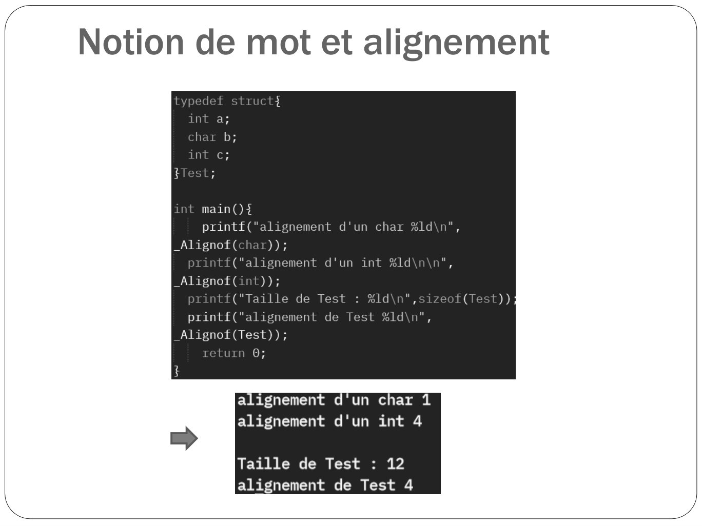

# CM04-Tableaux-Structures_2024-2025_Informatique2_P1S2_EAnsermin-RGrignon.pdf

[Ouvrir l’original](https://drive.google.com/open?id=1UTUrHjlLtx_Jx4hGfZZcu27JCDbOnd_Z) · Les pages signalées comprennent du texte reconnu automatiquement ou des éléments graphiques. Le fac-similé permet de vérifier chaque lecture.

**Pages avec fac-similé ou lecture OCR** — 34.

## Page 1

~~~text
        Informatique II
Pointeurs et tableaux de structures
~~~

## Page 2

~~~text
  Rappels
• Les types de base (int, float, char, etc...) ne sont pas toujours suffisants pour
  modéliser des objets/ phénomènes de la réalité.
• La construction de ces nouveaux types de variables peut être faite en combinant
  tous les types de base et les types déjà définis. Ce sont les structures.
• Par exemple, on pourra avoir :
  ➢ Un type Date qui contiendra le jour, le mois, l’année, le jour de la
      semaine et du mois en lettres.

   ➢ Un type Personne qui contiendra un nom, un prénom, une adresse,
     une date de naissance (avec le type Date car on peut imbriquer les
     structures), un numéro de téléphone, etc…

   ➢ Un type Classe, qui contiendra un tableau de type Matière, un tableau de
     type Personne qui seront les élèves, un tableau de type Note, etc…

   ➢ Un type PaquetIP qui contiendra tous les champs d’une trame de données
     du protocole IP
~~~

## Page 3

~~~text
  Rappels
• Les types de bases (int, float ect.) ne sont pas toujours suffisant pour modéliser
  des objets/ phénomènes de la réalité.
• La construction de ces nouveaux types de variables peut être faite en combinant
  tous les types de base et les types déjà définis. Ce sont les structures.

                              Toujours une majuscule !

     STRUCTURE Etudiant

           nom : chaîne de caractères
           prenom : chaîne de caractères                   Champs (ou attributs
           num : entier                                    ou membres) de la structure
                                                           Etudiant
           groupe : entier
           note[N] : tableau de rééls

     FIN STRUCTURE
~~~

## Page 4

~~~text
  Rappels
• Une fois définie, la structure peut être utilisée comme un type : c’est un type
  structuré.
                                                            On peut aussi écrire:
                                                            struct _Point {
                                                                 float abscisse;
                                                                 float ordonnee;
   typedef struct {                                         };
       float t abscisse;                                    …
       float t ordonnee;                                    struct _Point x;
   } Point;

   Point constructeurPoint(... ){ // fonction retournant un Point
       …
   }

   int main(){
       Point x; // declaration d’un Point x         typedef permet de redéfinir un type :
       Point y; //declaration d’un Point y          plus besoin d’écrire "struct _Point"
       …                                            Pour déclarer une variable
       return 0; ;
   }
~~~

## Page 5

~~~text
  Rappels
• On peut manipuler les différents champs d’une variable de type structuré avec
  le caractère '.'
      typedef struct {
          float abscisse;
          float ordonnee;
      } Point;

      Point constructeurPoint(){ // fonction retournant un Point
          Point z;
          scanf("%f", &(z.abscisse) );
          scanf("%f" ,&(z.ordonnee) );
          return z;
      }

      int main(){
          Point x; // declaration d’un Point x
          Point y; //declaration d’un Point y
          x.abscisse = 10;
          x.ordonnee = 2.5;
          y = constructeurPoint();
          return 0;
      }
~~~

## Page 6

~~~text
  Structures et tableaux
• Les tableaux permettent de gérer des données de même type avec une seule
  variable.
• Les types structurés permettent d’avoir des champs différentes (différents
  types) dans une seule variable.
                               Structure Etudiant

                chaîne chaîne entier chaîne             tableau

                 nom      prénom     num adresse          notes
                                   etudiant
~~~

## Page 7

~~~text
  Structures et tableaux
• Les tableaux permettent de gérer des données de même type avec une seule
  variable.
• Les types structurés permettent d’avoir des champs différentes (différents
  types) dans une seule variable.
                               Structure Etudiant

                chaîne chaîne entier chaîne                tableau

                 nom      prénom     num adresse            notes
                                   etudiant

            notes[0]    notes[1]    notes[2]    notes[3]     …

➢ Les champs d’une structure ne prennent pas tous la même place en mémoire
~~~

## Page 8

~~~text
      Stockage d’une structure
                                           Adresse   Valeur
                                           …
                                           1154      0000 0000
                              x.abscisse   1155      0000 0000
typedef struct {
    int abscisse;
                                           1156      0000 0000
    int ordonnee;                          1157      0000 0001
}Point;                  x
                                           1158      0000 0000
int main(){                  x.ordonnee
    Point x;                               1159      0000 0000
    x.abscisse = 1;
                                           1160      0001 0001
    x.ordonnee = 4500;
    return 0;                              1161      1001 0100
}
                                           …
~~~

## Page 9

~~~text
Stockage d’une structure
                            Adresse          Valeur
                            …
                            &x
               x.abscisse                    ???

                            &x+sizeof(int)
              x.ordonnee
                                             ???

                            …
~~~

## Page 10

~~~text
       Stockage d’une structure
• Les différents champs d’une structure sont à la suite dans la mémoire (comme
  les éléments d’un tableau). Mais contrairement au tableau, il n’y a pas de
  pointeur qui pointe sur la première adresse de la structure.

• L’accès aux différents champs de la structure se fait automatiquement: le
  compilateur connait le « saut de mémoire » à effectuer.

• Une structure étant un type, on peut connaître sa place en mémoire avec la
  fonction sizeof().
~~~

## Page 11

~~~text
       Stockage d’une structure
• Une structure étant un type, on peut connaître sa place en mémoire avec la
  fonction sizeof().
~~~

## Page 12

~~~text
       Stockage d’une structure
• Une structure étant un type, on peut connaître sa place en mémoire avec la
  fonction sizeof().
~~~

## Page 13

~~~text
       Stockage d’une structure
• Une structure étant un type, on peut connaître sa place en mémoire avec la
  fonction sizeof().

                       Pourtant un char ne fait qu’un octet !
~~~

## Page 14

~~~text
       Stockage d’une structure
• Une structure étant un type, on peut connaître sa place en mémoire avec la
  fonction sizeof().

                                         Le champs b prends 4 octets malgré le
                                         fait qu'il soit de type char !
~~~

## Page 15

~~~text
      Notion de mot et alignement
• La mémoire est divisée en octets indiqués par des adresses mémoires.
• La mémoire communique avec le processeur qui effectue les instructions.

                                  adresse

                                 instruction

                RAM                                    processeur
                                  adresse

                                valeur à stocker
~~~

## Page 16

~~~text
       Notion de mot et alignement
• La mémoire est divisée en octets indiqués par des adresses mémoires.
• La mémoire communique avec le processeur qui effectue les instructions.
• Le processeur ne travaille pas sur des octets mais sur des mots dont la taille
  varie selon son architecture : 32 bits, 64 bits, 128 bits

                                      adresse (64 bit)

                                    Instruction (64 bits)

                 RAM                                          processeur
                                   adresse (64 bits)

                               valeur à stocker (64 bits)
~~~

## Page 17

~~~text
       Notion de mot et alignement
• Pour assurer la rétrocompatibilité des programmes, GCC travaille avec des mots
  de 32 bits (4 octets).
• Illustration de la mémoire :

                 num
                 octet
                         0       1          2        3
    adresse du mot
             0           10      55         A3       B6
            4            FF      E5             87   09
            8            12      5C         89       77
            16           45      2F         BA       DB

                                      mot
~~~

## Page 18

~~~text
       Notion de mot et alignement
• Pour assurer la rétrocompatibilité des programmes, GCC travaille avec des mots
  de 32 bits (4 octets).
• Illustration de la mémoire :

                 num
                 octet
                           0     1          2        3
    adresse du mot
             0             10    55         A3       B6
            4              FF    E5             87   09
            8              12    5C         89       77
            16             45    2F         BA       DB

                                      mot

    adresse de 12 ? => 8
~~~

## Page 19

~~~text
       Notion de mot et alignement
• Pour assurer la rétrocompatibilité des programmes, GCC travaille avec des mots
  de 32 bits (4 octets).
• Illustration de la mémoire :

                 num
                 octet
                          0      1          2        3
    adresse du mot
             0            10     55         A3       B6
            4             FF     E5             87   09
            8             12     5C         89       77
            16            45     2F         BA       DB

                                      mot

    adresse de 87? => 6
~~~

## Page 20

~~~text
      Notion de mot et alignement
• Conséquence : un mot est toujours à une adresse multiple de 4.
• Une variable ne doit pas être stockée sur deux mots différents:

                num
                octet
                        0       1           2        3
    adresse du mot
             0          10       55         A3       B6
            4           FF       E5             87   09
            8           12       5C         89       77
           16           45       2F         BA       DB

                                      mot
~~~

## Page 21

~~~text
       Notion de mot et alignement
• Conséquence : un mot est toujours à une adresse multiple de 4.
• Une variable ne doit pas être stockée sur deux mots différents:

• Rappel : un int est sur 4 octets:

                 num
                 octet
                          0           1          2        3
    adresse du mot
             0           10           55         A3       B6
             4            FF          E5             87   09   un int a la taille d’un mot
             8           12           5C         89       77
            16           45           2F         BA       DB

                                           mot
~~~

## Page 22

~~~text
       Notion de mot et alignement
• Conséquence : un mot est toujours à une adresse multiple de 4.
• Une variable ne doit pas être stockée sur deux mots différents:

• Rappel : un double est sur 8 octets:

                 num
                 octet
                         0        1            2        3
    adresse du mot
             0           10        55          A3       B6
            4            FF        E5              87   09   Un double a la taille de
            8            12       5C           89       77   deux mots
            16           45       2F           BA       DB

                                         mot
~~~

## Page 23

~~~text
       Notion de mot et alignement
• Conséquence : un mot est toujours à une adresse multiple de 4.
• Une variable ne doit pas être stockée sur deux mots différents:

• Rappel : un char est sur 1 octets:

                 num
                 octet
                         0         1          2        3
    adresse du mot
             0           10        55         A3       B6
             4           FF        E5             87   09    Un char est compris
                                                             dans un mot
             8           12        5C         89       77
            16           45        2F         BA       DB

                                        mot
~~~

## Page 24

~~~text
       Notion de mot et alignement
• Conséquence : un mot est toujours à une adresse multiple de 4.
• Une variable ne doit pas être stockée sur deux mots différents:

• Rappel : un int est sur 4 octets:

                 num
                 octet
                           0          1          2        3
    adresse du mot
             0            10          55         A3        B6
             4            FF          E5             87    09
             8            12          5C         89        77
            16            45          2F         BA        DB

                                           mot
                 Une même variable ne doit pas être à cheval sur deux mots !
~~~

## Page 25

~~~text
      Notion de mot et alignement
• Retour sur les structures :

                 num
                 octet
                            0       1          2    3
    adresse du mot
             0             10       55         A3   B6
             4             FF       E5         87   09
             8             12       5C         89   77
            16             45       2F         BA   DB

                                         mot
                         typedef struct {
                              float abscisse;
                              float ordonnee;
                         } Point;

                         Point x;
~~~

## Page 26

~~~text
      Notion de mot et alignement
• Retour sur les structures :

                 num
                 octet
                            1       2          3        4
    adresse du mot
             0             10       55         A3       B6   x.abscisse
             4             FF       E5             87   09
             8             12       5C         89       77
            16             45       2F         BA       DB

                                         mot
                         typedef struct {
                              float abscisse;
                              float ordonnee;
                         } Point;

                         Point x;
~~~

## Page 27

~~~text
      Notion de mot et alignement
• Retour sur les structures :

                 num
                 octet
                            1       2          3        4
    adresse du mot
             0             10       55         A3       B6   x.abscisse
             4             FF       E5             87   09   x.ordonnee
             8             12       5C         89       77
            16             45       2F         BA       DB

                                         mot
                         typedef struct {
                              float abscisse;
                              float ordonnee;
                         } Point;

                         Point x;
~~~

## Page 28

~~~text
      Notion de mot et alignement
• Retour sur les structures :

                 num
                 octet
                           1       2         3        4
    adresse du mot
             0             10      55        A3       B6
             4             FF      E5            87   09
             8             12      5C        89       77
            16             45      2F        BA       DB

                                       mot
                         typedef struct {
                             int a;
                             char b;
                             int c;
                         } Test;

                         Test x;
~~~

## Page 29

~~~text
      Notion de mot et alignement
• Retour sur les structures :

                 num
                 octet
                           1       2         3        4
    adresse du mot
             0             10      55        A3       B6   x.a
             4             FF      E5            87   09
             8             12      5C        89       77
            16             45      2F        BA       DB

                                       mot
                         typedef struct {
                             int a;
                             char b;
                             int c;
                         } Test;

                         Test x;
~~~

## Page 30

~~~text
      Notion de mot et alignement
• Retour sur les structures :

                 num
                 octet
                           1       2         3        4
    adresse du mot
             0             10      55        A3       B6   x.a
             4             FF      E5            87   09   x.b
             8             12      5C        89       77
            16             45      2F        BA       DB

                                       mot
                         typedef struct {
                             int a;
                             char b;
                             int c;
                         } Test;

                         Test x;
~~~

## Page 31

~~~text
      Notion de mot et alignement
• Retour sur les structures :

                 num
                 octet
                           1       2         3        4
    adresse du mot
             0             10      55        A3       B6        x.a
             4             FF      E5            87   09        x.b
             8             12      5C        89       77        x.c
            16             45      2F        BA       DB

                                       mot
                         typedef struct {
                             int a;
                             char b;
                             int c;
                                                      x.c est sur deux mots différents!
                         } Test;

                         Test x;
~~~

## Page 32

~~~text
      Notion de mot et alignement
• Pour éviter le problème de champs d’une occurrence d’une structure qui peut
  être sur plusieurs mots différents, les compilateurs ajoutent du bourrage
  (padding): des octets non utilisés.

 adresse du mot          1        2          3        4
            0           10        55         A3        B6      x.a
            4           FF        E5             87    09      x.b    bourrage
            8           12        5C         89        77       x.c
            16          45        2F         BA       DB

                                       mot
                     typedef struct {
                                   int a;
                                   char b;
                                   int c;
                                   }Test;
                     Test x;
~~~

## Page 33

~~~text
      Notion de mot et alignement
• Pour éviter le problème de champs d’une occurrence d’une structure qui peut
  être sur plusieurs mots différents, les compilateurs ajoutent du bourrage
  (padding): des octets non utilisés.

• Le compilateur sait combien d’octets de bourrage il doit rajouter car il est
  nécessaire que l’adresse mémoire d’un type de variable soit multiple de sa
  taille. (Ex; l’adresse d’un int doit être un multiple de 4).

• C’est la contrainte d’alignement.

• Il est possible de connaître les contraintes d’alignement d’un type avec
  _Alignof()

• Les valeurs d’alignement dépendent de la machine.
~~~

## Page 34

~~~text
Notion de mot et alignement
~~~

**Lecture OCR à contrôler**

~~~text
Notion de mot et alignement

int main()f

printf("alignement d'un char %ld\n",
_Alignof(char));

rintf("alignement d'un int %ld
_Alignof(in

intf("Taille de Test : %ld

printf("alignement de Te
_Alignof(Test));
turn 0;

$

alignement d'un char 1
alignement d'un int 4

Taille de Test : 12
alignement de Test 4
~~~

## Page 35

~~~text
      Notion de mot et alignement
• Autre exemple : taille de la structure suivante?
~~~

## Page 36

~~~text
      Notion de mot et alignement
• Autre exemple : taille de la structure suivante?

                        a           a           a         a
                        b           /           /         /
                                                              bourrage
                        c           c           c         c
                        d

                            La structure fait 13 octets
~~~

## Page 37

~~~text
      Notion de mot et alignement
• Autre exemple : taille de la structure suivante?
~~~

## Page 38

~~~text
      Notion de mot et alignement
• Autre exemple : taille de la structure suivante?

                       a            a            a         a
                       a            a            a         a   bourrage
                      b[0]         b[1]        b[2]        /
                       c             c           c         c

                             La structure fait 16 octets
~~~

## Page 39

~~~text
Pointeur sur structure

•   Il est possible de définir un pointeur vers l’occurrence d’une structure:
    le pointeur aura donc le type de cette structure et indiquera l’adresse de
    la première case de l’occurrence.

              Type_structure* nomPointeur;
~~~

## Page 40

~~~text
Pointeur sur structure

•   Il est possible de définir un pointeur vers l’occurrence d’une structure:
    le pointeur aura donc le type de cette structure et indiquera l’adresse de
    la première case de l’occurrence.

              Type_structure* nomPointeur;

•   Exemple
                      typedef struct {
                          float abscisse;
                          float ordonnee;
                      } Point;

                      int main(){
                          Point x;
                          Point* px;
                          px = &x;
                      }
~~~

## Page 41

~~~text
Pointeur sur structure
                                            Adresse   Valeur
•   Exemple                                 …
                                            1154      0000 0000
    typedef struct {           x.abscisse   1155      0000 0000
        float abscisse;                     1156      0000 0000
        float ordonnee;
                          x                 1157      0000 0001
    } Point;
                                            1158      0000 0000
                              x.ordonnee    1159      0000 0000
    int main(){
        Point x;                            1160      0001 0001
        Point* px;                          1161      1001 0100
        px = &x;
                                            …
    }
                                      px    20 000    1154
~~~

## Page 42

~~~text
Pointeur sur structure

•   Il est possible de définir un pointeur vers l’occurrence d’une structure:
    le pointeur aura donc le type de cette structure et indiquera l’adresse de
    la première case de l’occurrence.

              Type_structure* nomPointeur;

•   Pour accéder aux différents champs :

                 (*nomPointeur).nom_champ

•   On peut également écrire :

                nomPointeur->nom_champ
~~~

## Page 43

~~~text
Pointeur sur structure
                                                Adresse   Valeur
•   Exemple                                     …
                                                1154
                                   x.abscisse   1155
                                                1156
typedef struct {              x                 1157
    float abscisse;
    float ordonnee;                             1158
} Point;                          x.ordonnee    1159
int main(){                                     1160
    Point x;                                    1161
    Point* px;
    px = &x;                                    …
    x.abscisse = 5,5;                     px    20 000    1154
    px->ordonnee = 2;
    px->abscisse = px->abscisse + x.ordonnee;
    return 0;
}
~~~

## Page 44

~~~text
Pointeur sur structure
                                                Adresse   Valeur
•   Exemple                                     …
                                                1154      5,5
                                   x.abscisse   1155
                                                1156
typedef struct {              x                 1157
    float abscisse;
    float ordonnee;                             1158
} Point;                          x.ordonnee    1159
int main(){                                     1160
    Point x;                                    1161
    Point* px;
    px = &x;                                    …
    x.abscisse = 5,5;                     px    20 000    1154
    px->ordonnee = 2;
    px->abscisse = px->abscisse + x.ordonnee;
    return 0;
}
~~~

## Page 45

~~~text
Pointeur sur structure
                                                Adresse   Valeur
•   Exemple                                     …
                                                1154      5,5
                                   x.abscisse   1155
                                                1156
typedef struct {              x                 1157
    float abscisse;
    float ordonnee;                             1158      2
} Point;                          x.ordonnee    1159
int main(){                                     1160
    Point x;                                    1161
    Point* px;
    px = &x;                                    …
    x.abscisse = 5,5;                     px    20 000    1154
    px->ordonnee = 2;
    px->abscisse = px->abscisse + x.ordonnee;
    return 0;
}
~~~

## Page 46

~~~text
Pointeur sur structure
                                                Adresse   Valeur
•   Exemple                                     …
                                                1154      7,5
                                   x.abscisse   1155
                                                1156
typedef struct {              x                 1157
    float abscisse;
    float ordonnee;                             1158      2
} Point;                          x.ordonnee    1159
int main(){                                     1160
    Point x;                                    1161
    Point* px;
    px = &x;                                    …
    x.abscisse = 5,5;                     px    20 000    1154
    px->ordonnee = 2;
    px->abscisse = px->abscisse + x.ordonnee;
    return 0;
}
~~~

## Page 47

~~~text
Tableaux statiques de structures

•   On peut définir des tableaux de structures :

         Type_structure nom_Tableau[taille];

•   Comme pour les tableaux classiques, les différents éléments (ici des
    occurrences d’une structure) seront à la suite dans la mémoire.

•   Un pointeur constant est créé et initialisé avec l'adresse de la première
    case du tableau. Ce pointeur pointe donc sur la première occurrence du
    type structuré.
~~~

## Page 48

~~~text
Pointeur sur structure
                                                     Adresse    Valeur
 •   Exemple                                         …
                                                     1154
                                       tab_test[0]
typedef struct {                                     …
    int a;
    char b;                            tab_test[1]
    float c;
} Test;
                                       tab_test[2]
int main(){
    // tableau de 10 structures Test
    Test tab_test[10];
    return 0;
}
                                                     …
                                                px   tab_test   1154
~~~

## Page 49

~~~text
Pointeur sur structure
                                                     Adresse    Valeur
 •   Exemple                                         …
                                                     1154
                                       tab_test[0]
typedef struct {                                     …
    int a;
    char b;                            tab_test[1]
    float c;
} Test;
                                       tab_test[2]
int main(){
    // tableau de 10 structures Test
    Test tab_test[10];
    return 0;
}
                                                     …
  Question :                                    px   tab_test   1154
  Comment accéder au champ b du 3 ème élément du tableau?

  En format pointeur?
~~~

## Page 50

~~~text
Pointeur sur structure
                                                     Adresse    Valeur
 •   Exemple                                         …
                                                     1154
                                       tab_test[0]
typedef struct {                                     …
    int a;
    char b;                            tab_test[1]
    float c;
} Test;
                                       tab_test[2]
int main(){
    // tableau de 10 structures Test
    Test tab_test[10];
    return 0;
}
                                                     …
  Question :                                    px   tab_test   1154
  Comment accéder au champ b du 3 ème élément du tableau?
  tab_test[2].b
  En format pointeur ? (*(tab_test+2)).b  (tab_test+2)->b
~~~

## Page 51

~~~text
Pointeur sur structure
                                                        Adresse           Valeur
 •   Exemple                                            …
                                                        1154
                                         tab_test[0]
typedef struct {                                        …
    int a;
    char b;                              tab_test[1]
    float c;
} Test;
                                         tab_test[2]
int main(){
    // tableau de 10 structures Test
    Test tab_test[10];
    return 0;
}
                                                        …
                                                  px    tab_test          1154
  Question :

  De combien d'octets se déplace-t-on en mémoire lorsque l’on fait tab_test+4 ?
~~~

## Page 52

~~~text
Pointeur sur structure
                                                        Adresse           Valeur
 •   Exemple                                            …
                                                        1154
                                         tab_test[0]
typedef struct {                                        …
    int a;
    char b;                              tab_test[1]
    float c;
} Test;
                                         tab_test[2]
int main(){
    // tableau de 10 structures Test
    Test tab_test[10];
    return 0;
}
                                                        …
                                                  px    tab_test          1154
  Question :

  De combien d'octets se déplace-t-on en mémoire lorsque l’on fait tab_test+4 ?
  On se déplace de 4*sizeof(Test), soit de 4*12=48 octets.
~~~

## Page 53

~~~text
Tableaux statiques de structures
•   On peut définir des tableaux de structures :

         Type_structure nom_Tableau[taille];
•   Comme pour les tableaux classiques, les différents éléments (ici des
    occurrences d’une structure) seront à la suite dans la mémoire.

•   Un pointeur constant est créé et initialisé avec l'adresse de la
    première case du tableau. Ce pointeur pointe donc sur la première
    occurrence du type structuré.

•   Pour accéder aux différents champs :
                      nom_Tableau[ind].nom_champ
                                     

                    *(nom_tableau+ind).nom_champ
                                     

                    (nom_tableau+ind)->nom_champ
~~~

## Page 54

~~~text
Tableaux dynamiques de structures
•   Pour allouer en mémoire un tableau de structures il faut connaître la
    taille totale de ce tableau. Il faut donc connaître:
     • 1. Le nombre d’elements à stocker
     • 2. La taille de la structure

•   Les commandes pour allour dynamiquement un tableau de structure est
    donc :
            Type_structure* tab = NULL;
            int nb_elements = 7;
            tab = malloc( nb_elements * sizeof(Type_structure) );
•   Le tableau peut ensuite être utilisé comme un tableau statique

•   Toujours vérifier que l’allocation mémoire a bien eu lieu.

•   Ne pas oublier de libérer (free) l’espace mémoire alloué !
~~~

## Page 55

~~~text
   Tableaux dynamiques de structure
   •   Exemple

 #include<stdio.h>      int main(){
 #include<stdlib.h>         int nb_etu, i;
                            Etudiant* tab_etu = NULL;
 typedef struct{
                            printf("Nb étudiants dans la classe?\n");
     char nom[50];
                            scanf("%d", &nb_etu);
     char prenom[50];       tab_etu = malloc( nb_etu*sizeof(Etudiant) );
     int num;               if(tab_etu == NULL){
     int groupe;                printf("Problème allocation mémoire! \n ");
     int note[10];              exit (1);
 } Etudiant;                }
                            printf("Quel est le nom du : \n");
                            for (i=0; i<nb_etu; i++){
                                printf(" > %d ieme eleve?\n", i+1);
                                scanf("%s", tab_etu[i].nom);
                            }
                            return 0;
                        }
Comment modifier la 4eme note du 5eme étudiant?
tab_etu[4].note[3]  (tab_etu+4)->note[3]  (tab_etu+4)->*(note+3)
~~~

## Page 56

~~~text
Recherche et parcours d’un tableau de structures
•   La recherche dans un tableau de structure se fait généralement en
    recherchant des valeurs de champs (ex: quels étudiants sont dans le
    groupe 4?).

•   Si l’on souhaite faire des opérations sur les éléments recherchés, il
    existe plusieurs approches :

         •   1. On sauvegarde chaque occurrences recherchées puis on
             leur applique des opérations
         •   2. On effectue des opérations sur les occurrences recherchées
             à mesure que l’on parcours le tableau
~~~

## Page 57

~~~text
Recherche et parcours d’un tableau de structures
•   La recherche et le traitement de donnée se bases donc sur ces deux
    principe. On va choisir la méthode selon notre priorité:
     • 1.On parcours une fois le tableau et on sauvegarde les
         occurrences recherchée.
          -> Un seul parcours => rapidité
          -> sauvegarde de donnée => utilisation d’espace
          On peut optimiser le parcours et l’espace utilisé en travaillant sur
          un tableau trié, mais le tri prend beaucoup de temps !

     •   2. On parcourt une fois l'ensemble des données pour chaque
         information à récupérer. Celles‐ci n'ont donc pas besoin d'être
         retenues, mais le temps d'exécution peut être beaucoup plus long.
           ->pas de sauvegarde : minimum d’espace utilisé
           -> plusieurs parcours : algorithme lent
~~~

## Page 58

~~~text
    Recherche et parcours d’un tableau de structures
• Exemple:
On stocke dans une structure les chiffres d’affaires de commerciaux d’une entreprise.

STRUCTURE Commercial
       nom : chaine de caractère
       region : Entier       // 0=Est ; 1=Nord ; 2=Ouest ; 3=Sud
        ca : Entier   // chiffre d’affaires
FIN STRUCTURE

     Tcom : Tableau de taille n de Commercial

•    Objectif: afficher le chiffre d’affaire par région.
~~~

## Page 59

~~~text
    Recherche et parcours d’un tableau de structures
•    Exemple:

                Indice        Nom      Région    Chiffre d’Affaires
                  0      Néo           Nord                       500
                  1      Yoda           Sud                      2500
                  2      Cobb           Est                      1000
                  3      Ripley        Ouest                     4000
                  4      McFly         Nord                       900
                  5      Spock          Sud                       600
                  6      Lilou          Est                      2000
                  7      Atréide       Ouest                     1500
                  8      Neytiri       Nord                      3000
                  9      Connor         Sud                       800

                         CA de la région Est   : 3000
                         CA de la région Nord : 4400
                         CA de la région Ouest : 5500
                         CA de la région Sud   : 3900
~~~

## Page 60

~~~text
Recherche et parcours d’un tableau de structures
•   Algorithme 1:
     •   On trie au préalable le tableau selon le champs recherchée (ici la région)
     •   On parcourt le tableau et on affiche le résultat à chaque changement de région .
            PROCEDURE ALGO1(Tcom: tableau de taille n de Commercial)
            VARIABLE
                  somme, reg, i: ENTIER
            DEBUT
                  Tri(Tcom, region) // On trie le tableau avant par rapport à la région
                  somme <- Tcom[0].ca // On initialise la somme et la région à la valeur de la 1ere case
                  reg <- Tcom[0].region //1 ere region
                  POUR i DE 1 A N FAIRE
                       SI Tcom[i].region = reg ALORS
                             somme <- somme + Tcom[i].ca
                       SINON          // Changement de région on affiche la précédente
                             ECRIRE ("CA de la Région" + reg + " : " +somme)
                             somme <- Tcom[i].ca // On réinitialise la somme et la région
                             reg <- Tcom[i].region
                     FIN SI
                  FIN POUR
                  ECRIRE ("CA de la Région" + reg + " : " +somme)    // pour la dernière région
            FIN
     •   Avantage: 1 seul parcours, pas d’espace mémoire supplémentaire
     •   Inconvénient : il faut trier le tableau
     •   Complexite : O(n+n*log(n))
~~~

## Page 61

~~~text
Recherche et parcours d’un tableau de structures
•   Algorithme 2:
     •   On fait un parcours du tableau par régions

           PROCEDURE ALGO2(Tcom: tableau de taille n de Commercial)
           VARIABLE
                 somme, reg, i: ENTIER
           DEBUT
                 POUR reg DE 0 A NB_REGION FAIRE   // parcours d’une région
                    somme <- 0
                    POUR i DE 0 A n FAIRE // parcours du tableau entier
                        SI Tcom[i].region = reg ALORS // somme si c’est la bonne région
                               somme <- somme + Tcom[i].ca
                            FIN SI
                    FIN POUR
                      ECRIRE ("CA de la Région" + reg + " : " +somme)
                 FIN POUR
           FIN

     •   Avantage: pas d’espace mémoire supplémentaire
     •   Inconvénient : Temps dépendant du nombre de région.
     •   Complexité : O(n*NB_REGION)
~~~

## Page 62

~~~text
Recherche et parcours d’un tableau de structures
•   Algorithme 3:
     •   Un compromis: on sauvegarde les différentes sommes dans un tableau -> un seul parcours.

           PROCEDURE ALGO3(Tcom: tableau de taille n de Commercial)
           VARIABLE
                 reg, i: ENTIER
                 somme : tableau de taille NB_REGION d’ENTIER
           DEBUT
                 POUR i DE 0 A NB_REGION FAIRE   // initialiser le tableau resultat
                    somme[i]<-0-0
                 FIN POUR
                 POUR i DE 0 A n FAIRE E // parcours du tableau entier
                    somme[Tcom[i].region] = somme[Tcom[i].region] + Tcom[i].ca
                 FIN POUR
                 POUR i DE 0 A NB_REGION FAIRE
                    // Affichage des resultats
                      ECRIRE ("CA de la Région" + i + " : " +somme[i])
                 FIN POUR
           FIN

     •   Avantage: Un seul parcours de tableau
     •   Inconvénient : 1 tableau supplémentaire
     •   Complexité : O(n+2*NB_REGION)
~~~

## Page 63

~~~text
Conclusion et résumé
• Les structures permettent de créer de nouveaux types en combinant des types
  existants.

• Les différents champs d’une structure sont à la suite dans la mémoire. Le
  compilateur peut ajouter du bourrage dans la mémoire afin de conserver un
  alignement correct en mémoire. Un ordre des champs défini par l'utilisateur
  (avec la connaissance de l'alignement mémoire) permet de gagner de l'espace
  mémoire.

• On peut créer des pointeurs sur structures: l’accès aux différents champs se
  faite avec l’opérateur ->

• La gestion d’un tableau de structures se fait de la même façon que pour les
  tableaux de types classiques. L'arithmétique des pointeurs est la même.

• Les opérations de recherches et d’opérations sur ces tableaux nécessitent de
  trouver un compromis entre rapidité et espace mémoire selon la situation
  (mais ce compromis existe dans tous les aspects du développement logiciel).
~~~
