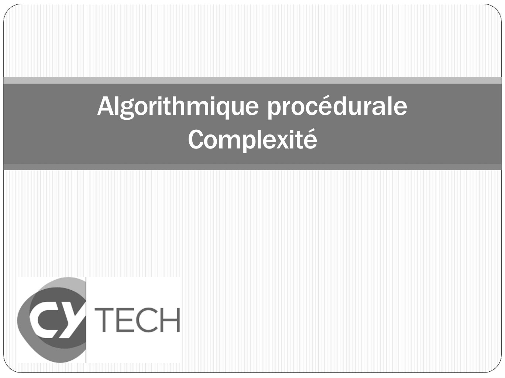

# CM06-Complexite_2024-2025_Informatique2_P1S2_EAnsermin-RGrignon.pdf

[Ouvrir l’original](https://drive.google.com/open?id=1ELLk6bIhZfSgGooPrKtJ-ZcWqIgnUoLh) · Les pages signalées comprennent du texte reconnu automatiquement ou des éléments graphiques. Le fac-similé permet de vérifier chaque lecture.

**Pages avec fac-similé ou lecture OCR** — 1.

## Page 1

~~~text
Algorithmique procédurale
        Complexité
~~~

**Lecture OCR à contrôler**

~~~text
Algorithmique procédurale

Complexité

€ TECH
Nt
~~~

## Page 2

~~~text
Question
Deux algorithmes qui pour les mêmes données d’entrée
donnent le même résultat sont-ils équivalents?
~~~

## Page 3

~~~text
  Notion de complexité
• La complexité algorithmique permet de mesurer les
  performances d’un algorithme et de le comparer avec
  d’autres algorithmes réalisant les mêmes fonctionnalités.

• Un bon algorithme :
  • répond correctement au problème posé
  • est rapide (complexité temporelle)
  • utilise peu de mémoire (complexité spatiale)

• On s'intéresse surtout à la complexité temporelle (ce qui
  n'était pas forcément le cas quand les mémoires coutaient
  cher).
~~~

## Page 4

~~~text
 Complexité temporelle vs. spatiale
Règle de l'espace-temps informatique :
Pour gagner du temps de calcul, on doit dépenser de
l’espace mémoire.

Exemple 1: stockage de calcul intermédiaire

  x, y: REEL;                        x, y, z: REEL;

 x -> 3.7;                           x -> 3.7;
 y -> sin(x)*sin(x);                 z -> sin(x);
                                     y -> z*z;

 Cette méthode n‘a pas de variable   Cette méthode investit une variable
 supplémentaire et calcule sin(x)    pour stocker sinus(x).
 deux fois.
~~~

## Page 5

~~~text
Complexité temporelle vs. spatiale
Règle de l'espace-temps informatique :
Pour gagner du temps de calcul, on doit dépenser de
l’espace mémoire.
Exemple 2: échange de deux variables entières
   x, y: ENTIER;                      x, y, z: ENTIER;

  X ->0 y->1                          x ->0 y ->1
  x -> y-x                            z -> x
  x -> y-x                            x -> y
  x -> y+x                            x -> z

  Cette méthode n‘a pas de variable   Cette méthode investit une variable z
  supplémentaire mais réalise 3       et réalise uniquement 3 affectations.
  opérations arithmétiques.
~~~

## Page 6

~~~text
 Opérations élémentaires

• Toute opération élémentaire s’exécute en temps
  constant (ou presque):
    • opérations arithmétiques
    • affectations
    • comparaisons

• La performance d’un algorithme dépend typiquement de
  la taille des données en entrée.

• Plus la taille de l’entrée est grande, plus il faudra du
  temps pour trouver la solution.
~~~

## Page 7

~~~text
   Exemple 1
Comment ouvrir un cadenas de N chiffres
dont on ne connait pas la combinaison?
~~~

## Page 8

~~~text
   Exemple 1
Comment ouvrir un cadenas de N chiffres
dont on ne connait pas la combinaison?

a) Tester toutes les combinaisons

b) Trouver chaque molette independement

c) Le casser
~~~

## Page 9

~~~text
   Exemple 1
Comment ouvrir un cadenas de N chiffres
dont on ne connait pas la combinaison?

a) Tester toutes les combinaisons

Meilleur des cas : 1 essais
Pire cas : 10𝑁 essais
Esperance : 5 ∗ 10𝑁−1 essais

-> lien exponentiel entre le nombre de
chiffres du cadenas et ne nombre d’essais
~~~

## Page 10

~~~text
    Exemple 1
Comment ouvrir un cadenas de N chiffres
dont on ne connait pas la combinaison?

b) Trouver chaque molette independament

Meilleur des cas : 1 essais
Pire cas : 10 ∗ 𝑁 essais
Esperance : 5 ∗ 𝑁 essais

-> lien linéaire entre le nombre de chiffres
du cadenas et ne nombre d’essais
~~~

## Page 11

~~~text
  Exemple 1
Comment ouvrir un cadenas de N chiffres
dont on ne connait pas la combinaison?

c)Casser le cadenas

Nombre d’essais : 1

Pas de lien entre N et le nombre d’essais !

Mais le cadenas est cassé …
~~~

## Page 12

~~~text
 Exemple 2
Quel est le temps estimatif pour trouver un mot
dans un dictionnaire d’un million de mots, en
supposant qu’une comparaison prend une
milliseconde ?
~~~

## Page 13

~~~text
 Exemple 2
Quel est le temps estimatif pour trouver un mot
dans un dictionnaire d’un million de mots, en
supposant qu’une comparaison prend une
milliseconde ?

  a) Recherche séquentielle:
  On regarde tous les mots un par un dans
  l’ordre.
  b) Recherche dichotomique:
  On regarde « au milieu » du dictionnaire, en
  fonction de la lettre au recommence sur la
  bonne moitié du dictionnaire.
~~~

## Page 14

~~~text
 Exemple 2
Quel est le temps estimatif pour trouver un mot
dans un dictionnaire d’un million de mots, en
supposant qu’une comparaison prend une
milliseconde ?

  a) Recherche séquentielle:
  Meilleur cas: 1 𝑚𝑠
  Pire cas :10−3 ∗ 106 = 103 𝑠 > 16 𝑚𝑖𝑛
  Esperance : 500 𝑠 > 8 𝑚𝑖𝑛

  Lien linéaire entre nombre de mots et temps
  de recherche.
~~~

## Page 15

~~~text
Exemple 2
Quel est le temps estimatif pour trouver un mot dans un dictionnaire d'un
million de mots, en supposant qu'une comparaison prend 1 milliseconde ?

b) Recherche dichotomique

• Le nombre de mots à vérifier est divisé par deux à chaque tour : 106 /2𝑘 (k
   nombre de tours de recherche)

• Meilleur cas : 1 tour
• Dans le pire cas, on ne trouve le mot que lorsque l'on a terminé de diviser
   l'ensemble des mots restants par 2 et qu'il ne reste plus qu'un seul mot à
   comparer:

                                      106
                                    1≤ 𝑘
                                      2

                            𝑘 ≤ log 2 106 ≃ 20 ms
~~~

## Page 16

~~~text
 Exemple 2
Quel est le temps estimatif pour trouver un
mot dans un dictionnaire d’un million de mots,
en supposant qu’une comparaison prend
une milliseconde ?

  a) Recherche séquentielle : < 16 min
  b) Recherche dichotomique: < 20 ms
~~~

## Page 17

~~~text
    Configurations caractéristiques
•   Soit d une donnée de taille n et C(i) un nombre
    d'opérations élémentaires pour exécuter l'algorithme sur i.

•   On distingue

    •    Le pire des cas :         Max C (i)
                             i donnéede taille n

    •    Le meilleur des cas : Min C (i )
                               i donnée de taille n

    •    Le cas moyen :    
                    i donnée de taille n
                                           p(i )C(i)

        où p(i) est la probabilité d’avoir en entrée la donnée i

    Rmq: Le calcul du meilleur cas n’est pas très utile dans la pratique.
    Le cas moyen est souvent difficile à calculer.
    On s’intéresse surtout au pire cas car on
    souhaite borner le temps d'exécution.
~~~

## Page 18

~~~text
Calcul des opérations élémentaires

Pour déterminer la complexité d’un
algorithme, on recense toutes les opérations
élémentaires:
    • opérations arithmétiques
    • affectations
    • comparaisons

On distingue deux types d’algorithme:
   • algorithme itératif
   • algorithme récursif
~~~

## Page 19

~~~text
Exemple: Algorithme itératif
 FONCTION somme(n : ENTIER) : ENTIER
 VARIABLES i, s : ENTIER
 DEBUT
     s ← 0                           (1)
     POUR i DE 1 A n+1 F A I R E     (2)
         s ← s + i                   (3)
     FIN POUR                        (4)
     RETOURNER (s)                   (5)

 FIN
~~~

## Page 20

~~~text
Exemple: Algorithme itératif
 FONCTION somme(n : ENTIER) : ENTIER
 VARIABLES i, s : ENTIER
 DEBUT
     s ← 0                           (1)
     POUR i DE 1 A n+1 F A I R E     (2)
         s ← s + i                   (3)
     FIN POUR                        (4)
     RETOURNER (s)                   (5)

 FIN

 1 affectation
~~~

## Page 21

~~~text
Exemple: Algorithme itératif
 FONCTION somme(n : ENTIER) : ENTIER
 VARIABLES i, s : ENTIER
 DEBUT
     s ← 0                           (1)
     POUR i DE 1 A n+1 F A I R E     (2)
         s ← s + i                   (3)
     FIN POUR                        (4)
     RETOURNER (s)                   (5)

 FIN

 1 affectation
~~~

## Page 22

~~~text
Exemple: Algorithme itératif
 FONCTION somme(n : ENTIER) : ENTIER
 VARIABLES i, s : ENTIER
 DEBUT
     s ← 0                           (1)
     POUR i DE 1 A n+1 F A I R E     (2)
         s ← s + i                   (3)
     FIN POUR                        (4)
     RETOURNER (s)                   (5)

 FIN

 1 affectation
 1 addition
~~~

## Page 23

~~~text
Exemple: Algorithme itératif
 FONCTION somme(n : ENTIER) : ENTIER
 VARIABLES i, s : ENTIER
 DEBUT
     s ← 0                           (1)
     POUR i DE 1 A n+1 F A I R E     (2)
         s ← s + i                   (3)
     FIN POUR                        (4)
     RETOURNER (s)                   (5)

 FIN

 1 affectation   *n
 1 addition      *n
~~~

## Page 24

~~~text
   Exemple: Algorithme itératif
     FONCTION somme(n : ENTIER) : ENTIER
     VARIABLES i, s : ENTIER
     DEBUT
         s ← 0                           (1)
         POUR i DE 1 A n+1 F A I R E     (2)
             s ← s + i                   (3)
         FIN POUR                        (4)
         RETOURNER (s)                   (5)

     FIN
affectation : 1 stockage de n+1   addiction : n+1
~~~

## Page 25

~~~text
  Exemple: Algorithme itératif
     FONCTION somme(n : ENTIER) : ENTIER
     VARIABLES i, s : ENTIER
     DEBUT
         s ← 0                           (1)
         POUR i DE 1 A n+1 F A I R E     (2)
             s ← s + i                   (3)
         FIN POUR                        (4)
         RETOURNER (s)                   (5)

     FIN
affectation : 1 stockage de n+1 addiction : 1: n+1
              n+1 affectation de i          n : incrementation i
~~~

## Page 26

~~~text
   Exemple: Algorithme itératif
     FONCTION somme(n : ENTIER) : ENTIER
     VARIABLES i, s : ENTIER
     DEBUT
         s ← 0                           (1)
         POUR i DE 1 A n+1 F A I R E     (2)
             s ← s + i                   (3)
         FIN POUR                        (4)
         RETOURNER (s)                   (5)

      FIN
comparaison : n+1 (i<n+1)
~~~

## Page 27

~~~text
Exemple: Algorithme itératif
•    Nombre d'affectations
    • 1           ligne 1
    • 1           ligne 2 : stockage de n
                            dans une variable
    • n+1         ligne 2 : gestion de compteur
    • n           ligne 3 : boucle exécutée n fois
    • 1           ligne 5
•   Nombre de comparaisons
    • n+1         ligne 2 : gestion de compteur
•   Nombre d'additions
    • n           ligne 2 : gestion de compteur
    • n           ligne 3 : boucle exécutée n fois
    • 1           Ligne 2: n+1
~~~

## Page 28

~~~text
    Exercice
Combien d’opérations élémentaires
•   opérations arithmétiques
•   affectations
•   comparaisons
sont effectuées dans ces calculs (x2n) ?

VARIABLES                                  VARIABLES
i, X2, X : ENTIER                          i, X2, X : ENTIER
DEBUT                                      DEBUT
  X2 ← 1                                     X2 ← X*X;
  POUR I DE 1 A 2*N+1 FAIRE                  POUR i DE 1 A N +1 FAIRE
    X2 ← X2*X                                   X2 ← X2*X2
  FIN POUR                                   FIN POUR
                                           FIN
FIN
~~~

## Page 29

~~~text
Exercice
VARIABLES                      VARIABLES
i, X2, X : ENTIER              i, X2, X : ENTIER
DEBUT                          DEBUT
  X2 ← 1                         X2 ← X*X;
  POUR I DE 1 A 2*N+1 FAIRE      POUR i DE 1 A N +1 FAIRE
    X2 ← X2*X                       X2 ← X2*X2
  FIN POUR                       FIN POUR
                               FIN
FIN

     2*N tours de boucle      N tours de boucle
~~~

## Page 30

~~~text
      Exercice
     VARIABLES                      VARIABLES
     i, X2, X : ENTIER              i, X2, X : ENTIER
     DEBUT                          DEBUT
       X2 ← 1                         X2 ← X*X;
       POUR I DE 1 A 2*N+1 FAIRE      POUR i DE 1 A N +1 FAIRE
         X2 ← X2*X                       X2 ← X2*X2
       FIN POUR                       FIN POUR
                                    FIN
     FIN

            2*N tours de boucle    N tours de boucle

Op. arithm. (+,*)                   1
Affectations        1               1
Comparaisons
~~~

## Page 31

~~~text
      Exercice
     VARIABLES                      VARIABLES
     i, X2, X : ENTIER              i, X2, X : ENTIER
     DEBUT                          DEBUT
       X2 ← 1                         X2 ← X*X;
       POUR I DE 1 A 2*N+1 FAIRE      POUR i DE 1 A N +1 FAIRE
         X2 ← X2*X                       X2 ← X2*X2
       FIN POUR                       FIN POUR
                                    FIN
     FIN

            2*N tours de boucle    N tours de boucle

Op. arithm. (+,*)   2N              1+N
Affectations        1+2N            1+N
Comparaisons
~~~

## Page 32

~~~text
      Exercice
     VARIABLES                      VARIABLES
     i, X2, X : ENTIER              i, X2, X : ENTIER
     DEBUT                          DEBUT
       X2 ← 1                         X2 ← X*X;
       POUR I DE 1 A 2*N+1 FAIRE      POUR i DE 1 A N +1 FAIRE
         X2 ← X2*X                       X2 ← X2*X2
       FIN POUR                       FIN POUR
                                    FIN
     FIN

            2*N tours de boucle    N tours de boucle

Op. arithm. (+,*)   2N+2            1+N+1
Affectations        1+2N+1          1+N+1
Comparaisons
~~~

## Page 33

~~~text
      Exercice
     VARIABLES                      VARIABLES
     i, X2, X : ENTIER              i, X2, X : ENTIER
     DEBUT                          DEBUT
       X2 ← 1                         X2 ← X*X;
       POUR I DE 1 A 2*N+1 FAIRE      POUR i DE 1 A N +1 FAIRE
         X2 ← X2*X                       X2 ← X2*X2
       FIN POUR                       FIN POUR
                                    FIN
     FIN

            2*N tours de boucle    N tours de boucle

Op. arithm. (+,*)   2N+2+2N         1+N+1+N
Affectations        1+2N+1 +2N+1    1+N+1+N+1
Comparaisons        2N+1            N+1
~~~

## Page 34

~~~text
      Exercice
     VARIABLES                              VARIABLES
     i, X2, X : ENTIER                      i, X2, X : ENTIER
     DEBUT                                  DEBUT
       X2 ← 1                                 X2 ← X*X;
       POUR I DE 1 A 2*N+1 FAIRE              POUR i DE 1 A N +1 FAIRE
         X2 ← X2*X                               X2 ← X2*X2
       FIN POUR                               FIN POUR
                                            FIN
     FIN

            2*N tours de boucle            N tours de boucle

Op. arithm. (+,*)   2+2N+2N = 4N+2          2+N+N = 2N+2
Affectations        1+1+(2N+1)+2N = 4N+3    2+(N+1)+N = 2N+3
Comparaisons        2N+1                    N+1
~~~

## Page 35

~~~text
Exercice
Quelle est la complexité de cet algorithme
en nombre d'additions et de divisions ?

 resultat ← 0
 POUR i DE 1 à n+1 FAIRE                          (1)
           POUR j DE i A i + 3 FAIRE              (2)
                   resultat ← resultat +i/(i+j)   (3)
           FIN POUR                               (4)
 FIN POUR
~~~

## Page 36

~~~text
Exercice
Quelle est la complexité de cet algorithme
en nombre d'additions et de divisions ?

 resultat ← 0
 POUR i DE 1 à n+1 FAIRE                          (1)
           POUR j DE i A i + 3 FAIRE              (2)
                   resultat ← resultat +i/(i+j)   (3)
           FIN POUR                               (4)
 FIN POUR

2 additions 1 division : 3 opérations
~~~

## Page 37

~~~text
Exercice
Quelle est la complexité de cet algorithme
en nombre d'additions et de divisions ?

 resultat ← 0
 POUR i DE 1 à n+1 FAIRE                           (1)
           POUR j DE i A i + 3 FAIRE               (2)
                   resultat ← resultat +i/(i+j)    (3)
           FIN POUR                                (4)
 FIN POUR

2 additions 1 division : 3 operation
Boucle (2) est exécutée 3 fois (i à i+2 inclus):
       3*3 operations
       3 additions (j+1) + 1 additions (i+3)
       = 13
~~~

## Page 38

~~~text
Exercice
Quelle est la complexité de cet algorithme
en nombre d'additions et de divisions ?

 resultat ← 0
 POUR i DE 1 à n+1 FAIRE                           (1)
           POUR j DE i A i + 3 FAIRE               (2)
                   resultat ← resultat +i/(i+j)    (3)
           FIN POUR                                (4)
 FIN POUR

2 additions 1 division : 3 operation
Boucle (2) est exécutée 3 fois (i à i+2 inclus):
       12 opération
Boucle (1) exécutée n fois
       13 *n operation
       + n addition (i+1) + 1 addition (n+1)

->   13*n+n+1=14n+1 operations arithmétiques !
~~~

## Page 39

~~~text
Exemple: Algorithme récursif
Déterminer une équation de récurrence en fonction du nombre
d'opérations élémentaires et résoudre cette équation.

    FONCTION fact(n : ENTIER) :ENTIER
    DEBUT
      SI (n = 1) ALORS
            RETOURNER 1
      SINON
            RETURNER( n * fact(n-1))
      FIN SI
    FIN
~~~

## Page 40

~~~text
Exemple: Algorithme récursif
Déterminer une équation de récurrence en fonction du nombre
d'opérations élémentaires et résoudre cette équation.

   FONCTION fact(n : ENTIER) :ENTIER
   DEBUT
     SI (n = 1) ALORS
           RETOURNER 1
     SINON
           RETURNER( n * fact(n-1))
     FIN SI
   FIN
⚫ Nombre d'affectations (A)
~~~

## Page 41

~~~text
Exemple: Algorithme récursif
Déterminer une équation de récurrence en fonction du nombre
d'opérations élémentaires et résoudre cette équation.

   FONCTION fact(n : ENTIER) :ENTIER
   DEBUT
     SI (n = 1) ALORS
           RETOURNER 1
     SINON
           RETURNER( n * fact(n-1))
     FIN SI
   FIN
⚫ Nombre de comparaisons (C)
~~~

## Page 42

~~~text
Exemple: Algorithme récursif
Déterminer une équation de récurrence en fonction du nombre
d'opérations élémentaires et résoudre cette équation.

   FONCTION fact(n : ENTIER) :ENTIER
   DEBUT
     SI (n = 1) ALORS
           RETOURNER 1
     SINON
           RETURNER( n * fact(n-1))
     FIN SI
   FIN
⚫ Nombre d’opérations arithmétiques (OP)
~~~

## Page 43

~~~text
 Exemple: Algorithme récursif
⚫ Nombre d'affectations (A)
  • 𝑛=1∶𝐴 1 =1
  • 𝑛 >1∶𝐴 𝑛 =1+𝐴 𝑛−1 =1+1+
    𝐴 𝑛−2 =⋯=𝑛
⚫ Nombre de comparaisons (C)
  • 𝑛=1∶𝐶 1 =1
  • 𝑛 >1∶𝐶 𝑛 =1+𝐶 𝑛−1 =1+1+
    𝐶 𝑛−2 =⋯=𝑛
⚫ Nombre d’opérations arithmétiques (OP)
  • 𝑛 = 1 ∶ 𝑂𝑃 1 = 0
  • 𝑛 > 1 ∶ 𝑂𝑃 𝑛 = 2 + 𝑂𝑃 𝑛 − 1 = 2 + 2 +
    𝐶 𝑛 − 2 = ⋯ = 2 ∗ (𝑛 − 1)
~~~

## Page 44

~~~text
Ordres de complexité
• Dans la pratique, il n’est souvent pas
  nécessaire de comptabiliser chaque opération
  élémentaire d’un algorithme pour avoir une
  idée de sa complexité.

• Il suffira de trouver un ordre de complexité qui
  classifie la performance de l’algorithme en
  fonction de la taille des données d’entrée.
~~~

## Page 45

~~~text
    Notation de Landau
On dit qu'une fonction g est d'ordre f noté
 g(n) = O( f (n)) ou g O( f )
 si et seulement si :
~~~

## Page 46

~~~text
  Exemples
  f (n) = n3
  g(n) = n2 +12n
  h(n) = 5n3

Prouvez que
  f O(h), h O( f )
  g O( f ), g O(n 2 )
  f O(g)
~~~

## Page 47

~~~text
Classes de complexité

•   O(1) : temps constant
•   O(log n) : logarithmique
•   O(n) : linéaire
•   O(n * log n) : quasi-linéaire
•   O(na) : polynomial
•   O(2n) : exponentiel
•   …
~~~

## Page 48

~~~text
       Classes de complexité

En pratique
• Les algorithmes à complexité quasi-linéaire et en dessous sont
  très efficaces.
• Sur des données réduites, les algorithmes polynomiaux O(n^p) sont
  encore applicables.
• Un algorithme à complexité exponentielle est inutilisable.
~~~

## Page 49

~~~text
 Classes de complexité: exemple

• Tester toutes les combinaisons:
10𝑁 essais : complexité exponentielle O(10^n)

• Trouver chaque molette independement
10*N essais : complexité linéaire O(n)

• Le casser:
1 essais : complexité à temps constant O(1)
~~~

## Page 50

~~~text
Un algorithme à complexité exponentielle?
                                0 𝑠𝑖 𝑛 = 0
            𝐹𝑖𝑏𝑜 𝑛 = ቐ          1 𝑠𝑖 𝑛 = 1
                      𝐹𝑖𝑏𝑜 𝑛 − 1 + 𝐹𝑖𝑏𝑜 𝑛 − 2 𝑠𝑖𝑛𝑜𝑛

   FONCTION fibo(n: ENTIER) :ENTIER
   DEBUT
          SI (n<2) ALORS
   SINON          RETOURNER n
            RETOURNER ( fibo (n-1) + fibo (n-2)
   FIN SI

   FIN
~~~

## Page 51

~~~text
 Un algorithme à complexité exponentielle?
                  Arbre de récursivité de fibo(5):

                     fibo(3)+fibo(2)
                                                              fibo(2)+fibo(1)

         fibo(2)+fibo(1)        fibo(1)+fibo(0)      fibo(1)+fibo(0)            1

fibo(1)+fibo(0)     1            1        0               1       0

  1        0

Plus l’argument est grand, plus l’arbre va être large !
~~~

## Page 52

~~~text
  Un algorithme à complexité exponentielle?
  Choisissons l’affectation comme opération élémentaire.
  On note A(n) le nombre d’affectations au rang n
           A(0) = 0
           A(1) = 0
           A(n) = 1 + A(n-1) + A(n-2)
Estimation       <= 1 + 2*A(n-1)
simplifiée       = 1 + 2*(1 + 2*A(n-2)) = 2n-1
    On peut montrer
~~~

## Page 53

~~~text
    Complexité : conclusion
•   La notion de complexité permet de classer des algorithmes en
    fonction de leur perfomance.

•   La complexité temporelle indique le nombre d’operations à effectuer
    en fonction de la donnée d’entrée

•   On s’interesse à l’ordre des complexités (exponentielle, linéaire ect.)

•   Objectifs :
    • Banir la complexité exponentielle !
    • Choisir l’algorithme avec la meilleure complexité.
~~~
