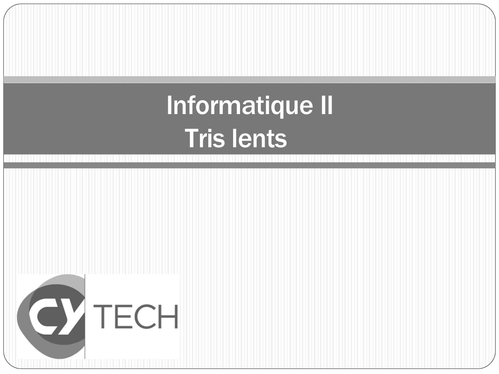
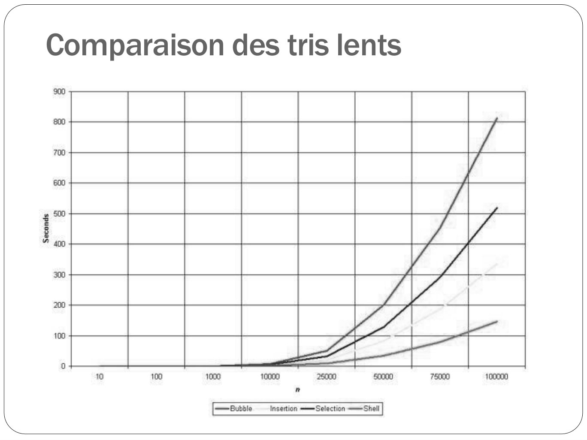

# CM07-Tris-lents_2024-2025_Informatique2_P1S2_EAnsermin-RGrignon.pdf

[Ouvrir l’original](https://drive.google.com/open?id=1chk2YUWLlQqGy8BalTeQJqM-r-zMW6YL) · Les pages signalées comprennent du texte reconnu automatiquement ou des éléments graphiques. Le fac-similé permet de vérifier chaque lecture.

**Pages avec fac-similé ou lecture OCR** — 1, 106.

## Page 1

~~~text
Informatique II
  Tris lents
~~~

**Lecture OCR à contrôler**

~~~text
Informatique II

Tris lents

€ TECH
Nt
~~~

## Page 2

~~~text
 Trier un tableaux
⚫ Un algorithme de tri permet de modifier un tableau afin de
  ranger ses éléments dans l’ordre croissant (ou
  décroissant).

              27 | 63 | 1 | 72 | 64 | 58 | 14 | 9

              1 | 9 | 14 | 27 | 58 | 63 | 64 | 72

⚫ Permet de faciliter la recherche (dichotomie possible).
~~~

## Page 3

~~~text
   Trier un tableaux
⚫ Problème très classique en algorithmie!

                   https://fr.wikipedia.org/wiki/Algorithme_de_tri
~~~

## Page 4

~~~text
3 algorithmes de tri « lents »

⚫Tri par sélection

⚫Tri à bulles

⚫Tri par insertion
~~~

## Page 5

~~~text
  Tri par sélection
⚫ Principe
  ⚫ Rechercher le plus petit élément et le placer à l’indice 0
  ⚫ Rechercher le second plus petit élément et le placer à l’indice 1
  ⚫ Continuer jusqu’à avoir trié tout le tableau

⚫ Exemple

                  27 | 63 | 1 | 72 | 64 | 58 | 14 | 9
~~~

## Page 6

~~~text
  Tri par sélection
⚫ Principe
  ⚫ Rechercher le plus petit élément et le placer à l’indice 0
  ⚫ Rechercher le second plus petit élément et le placer à l’indice 1
  ⚫ Continuer jusqu’à avoir trié tout le tableau

⚫ Exemple

                  27 | 63 | 1 | 72 | 64 | 58 | 14 | 9
~~~

## Page 7

~~~text
  Tri par sélection
⚫ Principe
  ⚫ Rechercher le plus petit élément et le placer à l’indice 0
  ⚫ Rechercher le second plus petit élément et le placer à l’indice 1
  ⚫ Continuer jusqu’à avoir trié tout le tableau

⚫ Exemple

                  1 | 63 | 27 | 72 | 64 | 58 | 14 | 9
~~~

## Page 8

~~~text
  Tri par sélection
⚫ Principe
  ⚫ Rechercher le plus petit élément et le placer à l’indice 0
  ⚫ Rechercher le second plus petit élément et le placer à l’indice 1
  ⚫ Continuer jusqu’à avoir trié tout le tableau

⚫ Exemple

                  1 | 63 | 27 | 72 | 64 | 58 | 14 | 9
~~~

## Page 9

~~~text
  Tri par sélection
⚫ Principe
  ⚫ Rechercher le plus petit élément et le placer à l’indice 0
  ⚫ Rechercher le second plus petit élément et le placer à l’indice 1
  ⚫ Continuer jusqu’à avoir trié tout le tableau

⚫ Exemple

                  1 | 9 | 27 | 72 | 64 | 58 | 14 | 63
~~~

## Page 10

~~~text
  Tri par sélection
⚫ Principe
  ⚫ Rechercher le plus petit élément et le placer à l’indice 0
  ⚫ Rechercher le second plus petit élément et le placer à l’indice 1
  ⚫ Continuer jusqu’à avoir trié tout le tableau

⚫ Exemple

                  1 | 9 | 27 | 72 | 64 | 58 | 14 | 63
~~~

## Page 11

~~~text
  Tri par sélection
⚫ Principe
  ⚫ Rechercher le plus petit élément et le placer à l’indice 0
  ⚫ Rechercher le second plus petit élément et le placer à l’indice 1
  ⚫ Continuer jusqu’à avoir trié tout le tableau

⚫ Exemple

                  1 | 9 | 14 | 72 | 64 | 58 | 27 | 63
~~~

## Page 12

~~~text
  Tri par sélection
⚫ Principe
  ⚫ Rechercher le plus petit élément et le placer à l’indice 0
  ⚫ Rechercher le second plus petit élément et le placer à l’indice 1
  ⚫ Continuer jusqu’à avoir trié tout le tableau

⚫ Exemple

                  1 | 9 | 14 | 27 | 64 | 58 | 72 | 63
~~~

## Page 13

~~~text
  Tri par sélection
⚫ Principe
  ⚫ Rechercher le plus petit élément et le placer à l’indice 0
  ⚫ Rechercher le second plus petit élément et le placer à l’indice 1
  ⚫ Continuer jusqu’à avoir trié tout le tableau

⚫ Exemple

                  1 | 9 | 14 | 27 | 58 | 64 | 72 | 63
~~~

## Page 14

~~~text
  Tri par sélection
⚫ Principe
  ⚫ Rechercher le plus petit élément et le placer à l’indice 0
  ⚫ Rechercher le second plus petit élément et le placer à l’indice 1
  ⚫ Continuer jusqu’à avoir trié tout le tableau

⚫ Exemple

                  1 | 9 | 14 | 27 | 58 | 63 | 72 | 64
~~~

## Page 15

~~~text
  Tri par sélection
⚫ Principe
  ⚫ Rechercher le plus petit élément et le placer à l’indice 0
  ⚫ Rechercher le second plus petit élément et le placer à l’indice 1
  ⚫ Continuer jusqu’à avoir trié tout le tableau

⚫ Exemple

                  1 | 9 | 14 | 27 | 58 | 63 | 64 | 72
~~~

## Page 16

~~~text
  Tri par sélection
⚫ Algorithme
  PROCEDURE TriSelection(A[n] :Tableau T de taille n)
  VARIABLE
    noEtape, noCase, indiceMin : ENTIER
    temp : T
  DEBUT
      POUR noEtape de 0 à n-1 FAIRE
          indiceMin ← noEtape
          POUR noCase de noEtape + 1 à n FAIRE
              SI A[noCase] < A[indiceMin] ALORS
                  indiceMin ← noCase
              FIN SI
          FIN POUR
          SI indiceMin ≠ noEtape Alors
              temp ← A[indiceMin]
              A[indiceMin] ← A[noEtape]
              A[noEtape] ← temp
          FIN SI
      FIN POUR
  FIN
~~~

## Page 17

~~~text
  Tri par sélection
⚫ Algorithme                                T: type quelconque
  PROCEDURE TriSelection(A[n] :Tableau T de taille n)
  VARIABLE
    noEtape, noCase, indiceMin : ENTIER
    temp : T
  DEBUT
      POUR noEtape de 0 à n-1 FAIRE
          indiceMin ← noEtape
          POUR noCase de noEtape + 1 à n FAIRE
              SI A[noCase] < A[indiceMin] ALORS
                  indiceMin ← noCase
              FIN SI
          FIN POUR
          SI indiceMin ≠ noEtape Alors
              temp ← A[indiceMin]
              A[indiceMin] ← A[noEtape]
              A[noEtape] ← temp
          FIN SI
      FIN POUR
  FIN
~~~

## Page 18

~~~text
  Tri par sélection
⚫ Algorithme
  PROCEDURE TriSelection(A[n] :Tableau T de taille n)
  VARIABLE
    noEtape, noCase, indiceMin : ENTIER
    temp : T
  DEBUT                             Recherche n fois du minimum dans le tableau
      POUR noEtape de 0 à n-1 FAIRE
          indiceMin ← noEtape
          POUR noCase de noEtape + 1 à n FAIRE
              SI A[noCase] < A[indiceMin] ALORS
                  indiceMin ← noCase
              FIN SI
          FIN POUR
          SI indiceMin ≠ noEtape Alors
              temp ← A[indiceMin]
              A[indiceMin] ← A[noEtape]
              A[noEtape] ← temp
          FIN SI
      FIN POUR
  FIN
~~~

## Page 19

~~~text
  Tri par sélection
⚫ Algorithme
  PROCEDURE TriSelection(A[n] :Tableau T de taille n)
  VARIABLE
    noEtape, noCase, indiceMin : ENTIER
    temp : T
  DEBUT
      POUR noEtape de 0 à n-1 FAIRE
          indiceMin ← noEtape
          POUR noCase de noEtape + 1 à n FAIRE
              SI A[noCase] < A[indiceMin] ALORS
                  indiceMin ← noCase
              FIN SI
                                     Recherche du minimum dans le sous-tableau
          FIN POUR
          SI indiceMin ≠ noEtape Alors
              temp ← A[indiceMin]
              A[indiceMin] ← A[noEtape]
              A[noEtape] ← temp
          FIN SI
      FIN POUR
  FIN
~~~

## Page 20

~~~text
  Tri par sélection
⚫ Algorithme
  PROCEDURE TriSelection(A[n] :Tableau T de taille n)
  VARIABLE
    noEtape, noCase, indiceMin : ENTIER
    temp : T
  DEBUT
      POUR noEtape de 0 à n-1 FAIRE
          indiceMin ← noEtape
          POUR noCase de noEtape + 1 à n FAIRE
              SI A[noCase] < A[indiceMin] ALORS
                  indiceMin ← noCase
              FIN SI
          FIN POUR
          SI indiceMin ≠ noEtape Alors
              temp ← A[indiceMin]          Echange des cases du tableau
              A[indiceMin] ← A[noEtape]
              A[noEtape] ← temp
          FIN SI
      FIN POUR
  FIN
~~~

## Page 21

~~~text
 Tri par sélection : complexité
⚫ Meilleur cas :
   ⚫ Nombre de comparaisons :
   ⚫ Nombre d’échanges :
~~~

## Page 22

~~~text
 Tri par sélection : complexité
⚫ Meilleur cas (tableau déjà trié):
   ⚫ Nombre de comparaisons : (n-1)+(n-2)+…+1 = n(n-1)/2
   ⚫ Nombre d’échanges : 0
~~~

## Page 23

~~~text
 Tri par sélection : complexité
⚫ Meilleur cas (tableau déjà trié):
   ⚫ Nombre de comparaisons : (n-1)+(n-2)+…+1 = n(n-1)/2
   ⚫ Nombre d’échanges : 0

   ➢ Complexité : O(n²)
~~~

## Page 24

~~~text
 Tri par sélection : complexité
⚫ Meilleur cas (tableau déjà trié):
   ⚫ Nombre de comparaisons : (n-1)+(n-2)+…+1 = n(n-1)/2
   ⚫ Nombre d’échanges : 0

    ➢ Complexité : O(n²)

⚫ Pire cas
   ⚫ Nombre de comparaisons :
   ⚫ Nombre d’échanges :
~~~

## Page 25

~~~text
  Tri par sélection : complexité
⚫ Meilleur cas (tableau déjà trié):
   ⚫ Nombre de comparaisons : (n-1)+(n-2)+…+1 = n(n-1)/2
   ⚫ Nombre d’échanges : 0

    ➢ Complexité : O(n²)

⚫ Pire cas (le tableau est de la forme [5 1 2 3 4 ]):
   ⚫ Nombre de comparaisons : (n-1)+(n-2)+…+1 = n(n-1)/2
   ⚫ Nombre d’échanges : n-1
~~~

## Page 26

~~~text
  Tri par sélection : complexité
⚫ Meilleur cas (tableau déjà trié):
   ⚫ Nombre de comparaisons : (n-1)+(n-2)+…+1 = n(n-1)/2
   ⚫ Nombre d’échanges : 0

    ➢ Complexité : O(n²)

⚫ Pire cas (le tableau est de la forme [5 1 2 3 4 ]):
   ⚫ Nombre de comparaisons : (n-1)+(n-2)+…+1 = n(n-1)/2
   ⚫ Nombre d’échanges : n-1

   ➢ Complexité : O(n²)
~~~

## Page 27

~~~text
  Tri par sélection : complexité
⚫ Meilleur cas (tableau déjà trié):
   ⚫ Nombre de comparaisons : (n-1)+(n-2)+…+1 = n(n-1)/2
   ⚫ Nombre d’échanges : 0

    ➢ Complexité : O(n²)

⚫ Pire cas (le tableau est de la forme [5 1 2 3 4 ]):
   ⚫ Nombre de comparaisons : (n-1)+(n-2)+…+1 = n(n-1)/2
   ⚫ Nombre d’échanges : n-1

   ➢ Complexité : O(n²)

⚫ Cas moyen : O(n²)
~~~

## Page 28

~~~text
  Tri à bulle
⚫ Principe
  ⚫ On compare les éléments deux à deux
  ⚫ Comparer chaque élément avec l’élément suivant et les permuter si
    besoin
  ⚫ Recommencer jusqu’à ce qu’il n’y ait plus d’échange à faire

⚫ Exemple

                 27 | 63 | 1 | 72 | 64 | 58 | 14 | 9
~~~

## Page 29

~~~text
  Tri à bulle
⚫ Principe
  ⚫ On compare les éléments deux à deux
  ⚫ Comparer chaque élément avec l’élément suivant et les permuter si
    besoin
  ⚫ Recommencer jusqu’à ce qu’il n’y ait plus d’échange à faire

⚫ Exemple

                 27 | 63 | 1 | 72 | 64 | 58 | 14 | 9
~~~

## Page 30

~~~text
  Tri à bulle
⚫ Principe
  ⚫ On compare les éléments deux à deux
  ⚫ Comparer chaque élément avec l’élément suivant et les permuter si
    besoin
  ⚫ Recommencer jusqu’à ce qu’il n’y ait plus d’échange à faire

⚫ Exemple

                 27 | 63 | 1 | 72 | 64 | 58 | 14 | 9

                          On échange !
~~~

## Page 31

~~~text
  Tri à bulle
⚫ Principe
  ⚫ On compare les éléments deux à deux
  ⚫ Comparer chaque élément avec l’élément suivant et les permuter si
    besoin
  ⚫ Recommencer jusqu’à ce qu’il n’y ait plus d’échange à faire

⚫ Exemple

                 27 | 1 | 63 | 72 | 64 | 58 | 14 | 9
~~~

## Page 32

~~~text
  Tri à bulle
⚫ Principe
  ⚫ On compare les éléments deux à deux
  ⚫ Comparer chaque élément avec l’élément suivant et les permuter si
    besoin
  ⚫ Recommencer jusqu’à ce qu’il n’y ait plus d’échange à faire

⚫ Exemple

                 27 | 1 | 63 | 72 | 64 | 58 | 14 | 9
~~~

## Page 33

~~~text
  Tri à bulle
⚫ Principe
  ⚫ On compare les éléments deux à deux
  ⚫ Comparer chaque élément avec l’élément suivant et les permuter si
    besoin
  ⚫ Recommencer jusqu’à ce qu’il n’y ait plus d’échange à faire

⚫ Exemple

                 27 | 1 | 63 | 72 | 64 | 58 | 14 | 9
~~~

## Page 34

~~~text
  Tri à bulle
⚫ Principe
  ⚫ On compare les éléments deux à deux
  ⚫ Comparer chaque élément avec l’élément suivant et les permuter si
    besoin
  ⚫ Recommencer jusqu’à ce qu’il n’y ait plus d’échange à faire

⚫ Exemple

                 27 | 1 | 63 | 64 | 72 | 58 | 14 | 9
~~~

## Page 35

~~~text
  Tri à bulle
⚫ Principe
  ⚫ On compare les éléments deux à deux
  ⚫ Comparer chaque élément avec l’élément suivant et les permuter si
    besoin
  ⚫ Recommencer jusqu’à ce qu’il n’y ait plus d’échange à faire

⚫ Exemple

                 27 | 1 | 63 | 64 | 72 | 58 | 14 | 9
~~~

## Page 36

~~~text
  Tri à bulle
⚫ Principe
  ⚫ On compare les éléments deux à deux
  ⚫ Comparer chaque élément avec l’élément suivant et les permuter si
    besoin
  ⚫ Recommencer jusqu’à ce qu’il n’y ait plus d’échange à faire

⚫ Exemple

                 27 | 1 | 63 | 64 | 58 | 72 | 14 | 9
~~~

## Page 37

~~~text
  Tri à bulle
⚫ Principe
  ⚫ On compare les éléments deux à deux
  ⚫ Comparer chaque élément avec l’élément suivant et les permuter si
    besoin
  ⚫ Recommencer jusqu’à ce qu’il n’y ait plus d’échange à faire

⚫ Exemple

                 27 | 1 | 63 | 64 | 58 | 72 | 14 | 9
~~~

## Page 38

~~~text
  Tri à bulle
⚫ Principe
  ⚫ On compare les éléments deux à deux
  ⚫ Comparer chaque élément avec l’élément suivant et les permuter si
    besoin
  ⚫ Recommencer jusqu’à ce qu’il n’y ait plus d’échange à faire

⚫ Exemple

                 27 | 1 | 63 | 64 | 58 | 14 | 72 | 9
~~~

## Page 39

~~~text
  Tri à bulle
⚫ Principe
  ⚫ On compare les éléments deux à deux
  ⚫ Comparer chaque élément avec l’élément suivant et les permuter si
    besoin
  ⚫ Recommencer jusqu’à ce qu’il n’y ait plus d’échange à faire

⚫ Exemple

                 27 | 1 | 63 | 64 | 58 | 14 | 72 | 9
~~~

## Page 40

~~~text
  Tri à bulle
⚫ Principe
  ⚫ On compare les éléments deux à deux
  ⚫ Comparer chaque élément avec l’élément suivant et les permuter si
    besoin
  ⚫ Recommencer jusqu’à ce qu’il n’y ait plus d’échange à faire

⚫ Exemple

                 27 | 1 | 63 | 64 | 58 | 14 | 9 | 72
~~~

## Page 41

~~~text
  Tri à bulle
⚫ Principe
  ⚫ On compare les éléments deux à deux
  ⚫ Comparer chaque élément avec l’élément suivant et les permuter si
    besoin
  ⚫ Recommencer jusqu’à ce qu’il n’y ait plus d’échange à faire

⚫ Exemple

                 27 | 1 | 63 | 64 | 58 | 14 | 9 | 72

            On recommence!
~~~

## Page 42

~~~text
  Tri à bulle
⚫ Principe
  ⚫ On compare les éléments deux à deux
  ⚫ Comparer chaque élément avec l’élément suivant et les permuter si
    besoin
  ⚫ Recommencer jusqu’à ce qu’il n’y ait plus d’échange à faire

⚫ Exemple

                 1 | 27 | 63 | 64 | 58 | 14 | 9 | 72

            On recommence!
~~~

## Page 43

~~~text
  Tri à bulle
⚫ Principe
  ⚫ On compare les éléments deux à deux
  ⚫ Comparer chaque élément avec l’élément suivant et les permuter si
    besoin
  ⚫ Recommencer jusqu’à ce qu’il n’y ait plus d’échange à faire

⚫ Exemple

                 1 | 27 | 63 | 64 | 58 | 14 | 9 | 72

            On recommence!
~~~

## Page 44

~~~text
  Tri à bulle
⚫ Principe
  ⚫ On compare les éléments deux à deux
  ⚫ Comparer chaque élément avec l’élément suivant et les permuter si
    besoin
  ⚫ Recommencer jusqu’à ce qu’il n’y ait plus d’échange à faire

⚫ Exemple

                 1 | 27 | 63 | 64 | 58 | 14 | 9 | 72

            On recommence!
~~~

## Page 45

~~~text
  Tri à bulle
⚫ Principe
  ⚫ On compare les éléments deux à deux
  ⚫ Comparer chaque élément avec l’élément suivant et les permuter si
    besoin
  ⚫ Recommencer jusqu’à ce qu’il n’y ait plus d’échange à faire

⚫ Exemple

                 1 | 27 | 63 | 64 | 58 | 14 | 9 | 72

            On recommence!
~~~

## Page 46

~~~text
  Tri à bulle
⚫ Principe
  ⚫ On compare les éléments deux à deux
  ⚫ Comparer chaque élément avec l’élément suivant et les permuter si
    besoin
  ⚫ Recommencer jusqu’à ce qu’il n’y ait plus d’échange à faire

⚫ Exemple

                 1 | 27 | 63 | 58 | 64 | 14 | 9 | 72

            On recommence!
~~~

## Page 47

~~~text
  Tri à bulle
⚫ Principe
  ⚫ On compare les éléments deux à deux
  ⚫ Comparer chaque élément avec l’élément suivant et les permuter si
    besoin
  ⚫ Recommencer jusqu’à ce qu’il n’y ait plus d’échange à faire

⚫ Exemple

                 1 | 27 | 63 | 58 | 64 | 14 | 9 | 72

            On recommence!
~~~

## Page 48

~~~text
  Tri à bulle
⚫ Principe
  ⚫ On compare les éléments deux à deux
  ⚫ Comparer chaque élément avec l’élément suivant et les permuter si
    besoin
  ⚫ Recommencer jusqu’à ce qu’il n’y ait plus d’échange à faire

⚫ Exemple

                 1 | 27 | 63 | 58 | 14 | 64 | 9 | 72

            On recommence!
~~~

## Page 49

~~~text
  Tri à bulle
⚫ Principe
  ⚫ On compare les éléments deux à deux
  ⚫ Comparer chaque élément avec l’élément suivant et les permuter si
    besoin
  ⚫ Recommencer jusqu’à ce qu’il n’y ait plus d’échange à faire

⚫ Exemple

                 1 | 27 | 63 | 58 | 14 | 64 | 9 | 72

            On recommence!
~~~

## Page 50

~~~text
  Tri à bulle
⚫ Principe
  ⚫ On compare les éléments deux à deux
  ⚫ Comparer chaque élément avec l’élément suivant et les permuter si
    besoin
  ⚫ Recommencer jusqu’à ce qu’il n’y ait plus d’échange à faire

⚫ Exemple

                 1 | 27 | 63 | 58 | 14 | 9 | 64 | 72

            On recommence!
~~~

## Page 51

~~~text
  Tri à bulle
⚫ Principe
  ⚫ On compare les éléments deux à deux
  ⚫ Comparer chaque élément avec l’élément suivant et les permuter si
    besoin
  ⚫ Recommencer jusqu’à ce qu’il n’y ait plus d’échange à faire

⚫ Exemple

                    1 | 27 | 63 | 58 | 14 | 9 | 64 | 72

   Pas besoin de tester la dernière case: la plus grande valeur est forcément à la fin!
~~~

## Page 52

~~~text
  Tri à bulle
⚫ Principe
  ⚫ On compare les éléments deux à deux
  ⚫ Comparer chaque élément avec l’élément suivant et les permuter si
    besoin
  ⚫ Recommencer jusqu’à ce qu’il n’y ait plus d’échange à faire

⚫ Exemple

                 1 | 27 | 63 | 58 | 14 | 9 | 64 | 72
~~~

## Page 53

~~~text
  Tri à bulle
⚫ Principe
  ⚫ On compare les éléments deux à deux
  ⚫ Comparer chaque élément avec l’élément suivant et les permuter si
    besoin
  ⚫ Recommencer jusqu’à ce qu’il n’y ait plus d’échange à faire

⚫ Exemple

                 1 | 27 | 63 | 58 | 14 | 9 | 64 | 72
~~~

## Page 54

~~~text
  Tri à bulle
⚫ Principe
  ⚫ On compare les éléments deux à deux
  ⚫ Comparer chaque élément avec l’élément suivant et les permuter si
    besoin
  ⚫ Recommencer jusqu’à ce qu’il n’y ait plus d’échange à faire

⚫ Exemple

                 1 | 27 | 63 | 58 | 14 | 9 | 64 | 72
~~~

## Page 55

~~~text
  Tri à bulle
⚫ Principe
  ⚫ On compare les éléments deux à deux
  ⚫ Comparer chaque élément avec l’élément suivant et les permuter si
    besoin
  ⚫ Recommencer jusqu’à ce qu’il n’y ait plus d’échange à faire

⚫ Exemple

                 1 | 27 | 58 | 63 | 14 | 9 | 64 | 72
~~~

## Page 56

~~~text
  Tri à bulle
⚫ Principe
  ⚫ On compare les éléments deux à deux
  ⚫ Comparer chaque élément avec l’élément suivant et les permuter si
    besoin
  ⚫ Recommencer jusqu’à ce qu’il n’y ait plus d’échange à faire

⚫ Exemple

                 1 | 27 | 58 | 63 | 14 | 9 | 64 | 72
~~~

## Page 57

~~~text
  Tri à bulle
⚫ Principe
  ⚫ On compare les éléments deux à deux
  ⚫ Comparer chaque élément avec l’élément suivant et les permuter si
    besoin
  ⚫ Recommencer jusqu’à ce qu’il n’y ait plus d’échange à faire

⚫ Exemple

                 1 | 27 | 58 | 14 | 63 | 9 | 64 | 72
~~~

## Page 58

~~~text
  Tri à bulle
⚫ Principe
  ⚫ On compare les éléments deux à deux
  ⚫ Comparer chaque élément avec l’élément suivant et les permuter si
    besoin
  ⚫ Recommencer jusqu’à ce qu’il n’y ait plus d’échange à faire

⚫ Exemple

                 1 | 27 | 58 | 14 | 63 | 9 | 64 | 72
~~~

## Page 59

~~~text
  Tri à bulle
⚫ Principe
  ⚫ On compare les éléments deux à deux
  ⚫ Comparer chaque élément avec l’élément suivant et les permuter si
    besoin
  ⚫ Recommencer jusqu’à ce qu’il n’y ait plus d’échange à faire

⚫ Exemple

                 1 | 27 | 58 | 14 | 9 | 63 | 64 | 72
~~~

## Page 60

~~~text
  Tri à bulle
⚫ Principe
  ⚫ On compare les éléments deux à deux
  ⚫ Comparer chaque élément avec l’élément suivant et les permuter si
    besoin
  ⚫ Recommencer jusqu’à ce qu’il n’y ait plus d’échange à faire

⚫ Exemple

                 1 | 27 | 58 | 14 | 9 | 63 | 64 | 72
~~~

## Page 61

~~~text
  Tri à bulle
⚫ Principe
  ⚫ On compare les éléments deux à deux
  ⚫ Comparer chaque élément avec l’élément suivant et les permuter si
    besoin
  ⚫ Recommencer jusqu’à ce qu’il n’y ait plus d’échange à faire

⚫ Exemple

                 1 | 27 | 58 | 14 | 9 | 63 | 64 | 72
~~~

## Page 62

~~~text
  Tri à bulle
⚫ Principe
  ⚫ On compare les éléments deux à deux
  ⚫ Comparer chaque élément avec l’élément suivant et les permuter si
    besoin
  ⚫ Recommencer jusqu’à ce qu’il n’y ait plus d’échange à faire

⚫ Exemple

                 1 | 27 | 58 | 14 | 9 | 63 | 64 | 72
~~~

## Page 63

~~~text
  Tri à bulle
⚫ Principe
  ⚫ On compare les éléments deux à deux
  ⚫ Comparer chaque élément avec l’élément suivant et les permuter si
    besoin
  ⚫ Recommencer jusqu’à ce qu’il n’y ait plus d’échange à faire

⚫ Exemple

                 1 | 27 | 14 | 58 | 9 | 63 | 64 | 72
~~~

## Page 64

~~~text
  Tri à bulle
⚫ Principe
  ⚫ On compare les éléments deux à deux
  ⚫ Comparer chaque élément avec l’élément suivant et les permuter si
    besoin
  ⚫ Recommencer jusqu’à ce qu’il n’y ait plus d’échange à faire

⚫ Exemple

                 1 | 27 | 14 | 58 | 9 | 63 | 64 | 72
~~~

## Page 65

~~~text
  Tri à bulle
⚫ Principe
  ⚫ On compare les éléments deux à deux
  ⚫ Comparer chaque élément avec l’élément suivant et les permuter si
    besoin
  ⚫ Recommencer jusqu’à ce qu’il n’y ait plus d’échange à faire

⚫ Exemple

                 1 | 27 | 14 | 9 | 58 | 63 | 64 | 72
~~~

## Page 66

~~~text
  Tri à bulle
⚫ Principe
  ⚫ On compare les éléments deux à deux
  ⚫ Comparer chaque élément avec l’élément suivant et les permuter si
    besoin
  ⚫ Recommencer jusqu’à ce qu’il n’y ait plus d’échange à faire

⚫ Exemple

                 1 | 27 | 14 | 9 | 58 | 63 | 64 | 72
~~~

## Page 67

~~~text
  Tri à bulle
⚫ Principe
  ⚫ On compare les éléments deux à deux
  ⚫ Comparer chaque élément avec l’élément suivant et les permuter si
    besoin
  ⚫ Recommencer jusqu’à ce qu’il n’y ait plus d’échange à faire

⚫ Exemple

                 1 | 27 | 14 | 9 | 58 | 63 | 64 | 72
~~~

## Page 68

~~~text
  Tri à bulle
⚫ Principe
  ⚫ On compare les éléments deux à deux
  ⚫ Comparer chaque élément avec l’élément suivant et les permuter si
    besoin
  ⚫ Recommencer jusqu’à ce qu’il n’y ait plus d’échange à faire

⚫ Exemple

                 1 | 14 | 27 | 9 | 58 | 63 | 64 | 72
~~~

## Page 69

~~~text
  Tri à bulle
⚫ Principe
  ⚫ On compare les éléments deux à deux
  ⚫ Comparer chaque élément avec l’élément suivant et les permuter si
    besoin
  ⚫ Recommencer jusqu’à ce qu’il n’y ait plus d’échange à faire

⚫ Exemple

                 1 | 14 | 27 | 9 | 58 | 63 | 64 | 72
~~~

## Page 70

~~~text
  Tri à bulle
⚫ Principe
  ⚫ On compare les éléments deux à deux
  ⚫ Comparer chaque élément avec l’élément suivant et les permuter si
    besoin
  ⚫ Recommencer jusqu’à ce qu’il n’y ait plus d’échange à faire

⚫ Exemple

                 1 | 14 | 9 | 27 | 58 | 63 | 64 | 72
~~~

## Page 71

~~~text
  Tri à bulle
⚫ Principe
  ⚫ On compare les éléments deux à deux
  ⚫ Comparer chaque élément avec l’élément suivant et les permuter si
    besoin
  ⚫ Recommencer jusqu’à ce qu’il n’y ait plus d’échange à faire

⚫ Exemple

                 1 | 14 | 9 | 27 | 58 | 63 | 64 | 72
~~~

## Page 72

~~~text
  Tri à bulle
⚫ Principe
  ⚫ On compare les éléments deux à deux
  ⚫ Comparer chaque élément avec l’élément suivant et les permuter si
    besoin
  ⚫ Recommencer jusqu’à ce qu’il n’y ait plus d’échange à faire

⚫ Exemple

                 1 | 14 | 9 | 27 | 58 | 63 | 64 | 72
~~~

## Page 73

~~~text
  Tri à bulle
⚫ Principe
  ⚫ On compare les éléments deux à deux
  ⚫ Comparer chaque élément avec l’élément suivant et les permuter si
    besoin
  ⚫ Recommencer jusqu’à ce qu’il n’y ait plus d’échange à faire

⚫ Exemple

                 1 | 9 | 14 | 27 | 58 | 63 | 64 | 72
~~~

## Page 74

~~~text
  Tri à bulle
⚫ Principe
  ⚫ On compare les éléments deux à deux
  ⚫ Comparer chaque élément avec l’élément suivant et les permuter si
    besoin
  ⚫ Recommencer jusqu’à ce qu’il n’y ait plus d’échange à faire

⚫ Exemple

                 1 | 9 | 14 | 27 | 58 | 63 | 64 | 72
~~~

## Page 75

~~~text
  Tri à bulle
⚫ Algorithme
   PROCEDURE TriBulle(A[n] :Tableau de T)
      desordre : BOOLEEN
      noEtape, noCase : ENTIER
      temp : T
   DEBUT
     noEtape ← n - 1
     Faire
         desordre ← FAUX
         Pour noCase de 0 à noEtape Faire
            Si A[noCase] > A[noCase + 1] Alors
               desordre ← VRAI
               temp ← A[noCase]
               A[noCase] ← A[noCase + 1] A[noCase + 1] ← temp
             FinSi
        FinPour
        noEtape ← noEtape - 1
     TantQue (noEtape > 0) et desordre
  Fin
~~~

## Page 76

~~~text
  Tri à bulle
⚫ Algorithme
   PROCEDURE TriBulle(A[n] :Tableau de T)
      desordre : BOOLEEN
      noEtape, noCase : ENTIER
      temp : T
   DEBUT
     noEtape ← n - 1
     Faire
         desordre ← FAUX
         Pour noCase de 0 à noEtape Faire
            Si A[noCase] > A[noCase + 1] Alors      Comparaison et échange
               desordre ← VRAI                      de cases voisines
               temp ← A[noCase]
               A[noCase] ← A[noCase + 1] A[noCase + 1] ← temp
             FinSi
        FinPour
        noEtape ← noEtape - 1
     TantQue (noEtape > 0) et desordre
  Fin
~~~

## Page 77

~~~text
  Tri à bulle
⚫ Algorithme
   PROCEDURE TriBulle(A[n] :Tableau de T)
      desordre : BOOLEEN
      noEtape, noCase : ENTIER
      temp : T
   DEBUT
     noEtape ← n - 1
     Faire
         desordre ← FAUX                             Parcours du tableau
         Pour noCase de 0 à noEtape Faire
            Si A[noCase] > A[noCase + 1] Alors
               desordre ← VRAI
               temp ← A[noCase]
               A[noCase] ← A[noCase + 1] A[noCase + 1] ← temp
             FinSi
        FinPour
        noEtape ← noEtape - 1
     TantQue (noEtape > 0) et desordre
  Fin
~~~

## Page 78

~~~text
  Tri à bulle
⚫ Algorithme
   PROCEDURE TriBulle(A[n] :Tableau de T)
      desordre : BOOLEEN
      noEtape, noCase : ENTIER
      temp : T
   DEBUT
     noEtape ← n-1
     Faire
         desordre ← FAUX
         Pour noCase de 0 à noEtape Faire
            Si A[noCase] > A[noCase + 1] Alors
               desordre ← VRAI
               temp ← A[noCase]
               A[noCase] ← A[noCase + 1] A[noCase + 1] ← temp
             FinSi
        FinPour
        noEtape ← noEtape - 1
     TantQue (noEtape > 0) et desordre
                                             Recommencer tant que le tableau
  Fin                                        n’est pas trié
~~~

## Page 79

~~~text
 Tri à bulle : complexité
⚫ Meilleur cas (tableau déjà trié):
   ⚫ Nombre de comparaisons :
   ⚫ Nombre d’échanges :

   ➢ Complexité : O(n)
~~~

## Page 80

~~~text
 Tri à bulle : complexité
⚫ Meilleur cas (tableau déjà trié):
   ⚫ Nombre de comparaisons : (n-1)
   ⚫ Nombre d’échanges : 0

   ➢ Complexité : O(n)
~~~

## Page 81

~~~text
 Tri à bulle : complexité
⚫ Meilleur cas (tableau déjà trié):
   ⚫ Nombre de comparaisons : (n-1)
   ⚫ Nombre d’échanges : 0

    ➢ Complexité : O(n)

⚫ Pire cas
   ⚫ Nombre de comparaisons :
   ⚫ Nombre d’échanges :
~~~

## Page 82

~~~text
 Tri à bulle : complexité
⚫ Meilleur cas (tableau déjà trié):
   ⚫ Nombre de comparaisons : (n-1)
   ⚫ Nombre d’échanges : 0

    ➢ Complexité : O(n)

⚫ Pire cas (le tableau est trié dans l’ordre inverse)[5,4,3,2,1]
   ⚫ Nombre de comparaisons : (n-1)+(n-2)+…+1 = n(n-1)/2
   ⚫ Nombre d’échanges : (n-1)+(n-2)+…+1 = n(n-1)/2

   ➢ Complexité : O(n²)
~~~

## Page 83

~~~text
  Tri à bulle : complexité
⚫ Meilleur cas (tableau déjà trié):
   ⚫ Nombre de comparaisons : (n-1)
   ⚫ Nombre d’échanges : 0

    ➢ Complexité : O(n)

⚫ Pire cas (le tableau est trié dans l’ordre inverse)
   ⚫ Nombre de comparaisons : (n-1)+(n-2)+…+1 = n(n-1)/2
   ⚫ Nombre d’échanges : (n-1)+(n-2)+…+1 = n(n-1)/2

   ➢ Complexité : O(n²)

⚫ Cas moyen : O(n²)
~~~

## Page 84

~~~text
  Tri par insertion
⚫ Principe
  ⚫ Prendre les éléments dans l’ordre et comparer chaque élément avec
    les éléments précédents du tableau pour déterminer son emplacement
  ⚫ Décaler les éléments du tableau pour faire l’insertion

⚫ Exemple

                 27 | 63 | 1 | 72 | 64 | 58 | 14 | 9

                     Pas d’element precedent
~~~

## Page 85

~~~text
  Tri par insertion
⚫ Principe
  ⚫ Prendre les éléments dans l’ordre et comparer chaque élément avec
    les éléments précédents du tableau pour déterminer son emplacement
  ⚫ Décaler les éléments du tableau pour faire l’insertion

⚫ Exemple

                 27 | 63 | 1 | 72 | 64 | 58 | 14 | 9

                  On passe à l’element suivant et on le
                  compare à ses éléments precedents
~~~

## Page 86

~~~text
  Tri par insertion
⚫ Principe
  ⚫ Prendre les éléments dans l’ordre et comparer chaque élément avec
    les éléments précédents du tableau pour déterminer son emplacement
  ⚫ Décaler les éléments du tableau pour faire l’insertion

⚫ Exemple

                 27 | 63 | 1 | 72 | 64 | 58 | 14 | 9

                  L’élément est déjà bien placé, on passe au suivant.
~~~

## Page 87

~~~text
  Tri par insertion
⚫ Principe
  ⚫ Prendre les éléments dans l’ordre et comparer chaque élément avec
    les éléments précédents du tableau pour déterminer son emplacement
  ⚫ Décaler les éléments du tableau pour faire l’insertion

⚫ Exemple

                 1 | 27| 63 | 72 | 64 | 58 | 14 | 9

                  On place l’element là où il faut par rapport à ses
                  éléments précédents
~~~

## Page 88

~~~text
  Tri par insertion
⚫ Principe
  ⚫ Prendre les éléments dans l’ordre et comparer chaque élément avec
    les éléments précédents du tableau pour déterminer son emplacement
  ⚫ Décaler les éléments du tableau pour faire l’insertion

⚫ Exemple

                 1 | 27| 63 | 72 | 64 | 58 | 14 | 9

                  On parcourt ainsi tous les éléments.
~~~

## Page 89

~~~text
  Tri par insertion
⚫ Principe
  ⚫ Prendre les éléments dans l’ordre et comparer chaque élément avec
    les éléments précédents du tableau pour déterminer son emplacement
  ⚫ Décaler les éléments du tableau pour faire l’insertion

⚫ Exemple

                 1 | 27| 63 | 72 | 64 | 58 | 14 | 9

                  On parcourt ainsi tous les éléments.
~~~

## Page 90

~~~text
  Tri par insertion
⚫ Principe
  ⚫ Prendre les éléments dans l’ordre et comparer chaque élément avec
    les éléments précédents du tableau pour déterminer son emplacement
  ⚫ Décaler les éléments du tableau pour faire l’insertion

⚫ Exemple

                 1 | 27| 63 | 64 | 72 | 58 | 14 | 9

                  On parcourt ainsi tous les éléments.
~~~

## Page 91

~~~text
  Tri par insertion
⚫ Principe
  ⚫ Prendre les éléments dans l’ordre et comparer chaque élément avec
    les éléments précédents du tableau pour déterminer son emplacement
  ⚫ Décaler les éléments du tableau pour faire l’insertion

⚫ Exemple

                 1 | 27| 63 | 64 | 72 | 58 | 14 | 9

                  On parcourt ainsi tous les éléments.
~~~

## Page 92

~~~text
  Tri par insertion
⚫ Principe
  ⚫ Prendre les éléments dans l’ordre et comparer chaque élément avec
    les éléments précédents du tableau pour déterminer son emplacement
  ⚫ Décaler les éléments du tableau pour faire l’insertion

⚫ Exemple

                 1 | 27| 58 | 63 | 64 | 72 | 14 | 9

                  On parcourt ainsi tous les éléments.
~~~

## Page 93

~~~text
  Tri par insertion
⚫ Principe
  ⚫ Prendre les éléments dans l’ordre et comparer chaque élément avec
    les éléments précédents du tableau pour déterminer son emplacement
  ⚫ Décaler les éléments du tableau pour faire l’insertion

⚫ Exemple

                 1 | 27| 58 | 63 | 64 | 72 | 14 | 9

                  On parcourt ainsi tous les éléments.
~~~

## Page 94

~~~text
  Tri par insertion
⚫ Principe
  ⚫ Prendre les éléments dans l’ordre et comparer chaque élément avec
    les éléments précédents du tableau pour déterminer son emplacement
  ⚫ Décaler les éléments du tableau pour faire l’insertion

⚫ Exemple

                 1 | 14 | 27 | 58 | 63 | 64 | 72 | 9

                  On parcourt ainsi tous les éléments.
~~~

## Page 95

~~~text
  Tri par insertion
⚫ Principe
  ⚫ Prendre les éléments dans l’ordre et comparer chaque élément avec
    les éléments précédents du tableau pour déterminer son emplacement
  ⚫ Décaler les éléments du tableau pour faire l’insertion

⚫ Exemple

                 1 | 14 | 27 | 58 | 63 | 64 | 72 | 9

                  On parcourt ainsi tous les éléments.
~~~

## Page 96

~~~text
  Tri par insertion
⚫ Principe
  ⚫ Prendre les éléments dans l’ordre et comparer chaque élément avec
    les éléments précédents du tableau pour déterminer son emplacement
  ⚫ Décaler les éléments du tableau pour faire l’insertion

⚫ Exemple

                 1 | 9 | 14 | 27 | 58 | 63 | 64 | 72

                  On parcourt ainsi tous les éléments.
~~~

## Page 97

~~~text
  Tri par insertion
⚫ Algorithme
     PROCEDURE TriInsertion(A[n] :Tableau de T)
     Variables
         noetape, decalage :ENTIER
         temp : T
     DEBUT
           POUR noetape de 1 à n FAIRE
              tmp ← A[noetape]
              decalage ← noetape -1
             TANT QUE (decalage >= 0) et (A[decalage] > tmp) FAIRE
                  A[decalage + 1] ← A[decalage]
                  decalage ← decalage - 1
               FIN TANT QUE
              A[decalage + 1] ← tmp
           FIN POUR
     FIN
~~~

## Page 98

~~~text
  Tri par insertion
⚫ Algorithme
     PROCEDURE TriInsertion(A[n] :Tableau de T)
     Variables
         noetape, decalage :ENTIER
         temp : T
     DEBUT                                 Gestion de l’element à traiter
           POUR noetape de 1 à n FAIRE
              tmp ← A[noetape]
              decalage ← noetape -1
             TANT QUE (decalage >= 0) et (A[decalage] > tmp) FAIRE
                  A[decalage + 1] ← A[decalage]
                  decalage ← decalage - 1
               FIN TANT QUE
              A[decalage + 1] ← tmp
           FIN POUR
     FIN
~~~

## Page 99

~~~text
  Tri par insertion
⚫ Algorithme
     PROCEDURE TriInsertion(A[n] :Tableau de T)
     Variables
         noetape, decalage :ENTIER
         temp : T
     DEBUT
           POUR noetape de 1 à n FAIRE
              tmp ← A[noetape]
              decalage ← noetape -1
             TANT QUE (decalage >= 0) et (A[decalage] > tmp) FAIRE
                  A[decalage + 1] ← A[decalage]
                  decalage ← decalage - 1
               FIN TANT QUE              Décalage des éléments du tableau
                                         avant placement
              A[decalage + 1] ← tmp
           FIN POUR
     FIN
~~~

## Page 100

~~~text
  Tri par insertion
⚫ Algorithme
     PROCEDURE TriInsertion(A[n] :Tableau de T)
     Variables
         noetape, decalage :ENTIER
         temp : T
     DEBUT
           POUR noetape de 1 à n FAIRE
              tmp ← A[noetape]
              decalage ← noetape -1
             TANT QUE (decalage >= 0) et (A[decalage] > tmp) FAIRE
                  A[decalage + 1] ← A[decalage]
                  decalage ← decalage - 1
               FIN TANT QUE
              A[decalage + 1] ← tmp
                                         Placement de l’élément à la bonne place
           FIN POUR
     FIN
~~~

## Page 101

~~~text
 Tri par insertion : complexité
⚫ Meilleur cas (tableau déjà trié):
   ⚫ Nombre de comparaisons :
   ⚫ Nombre d’échanges :

   ➢ Complexité :
~~~

## Page 102

~~~text
 Tri par insertion : complexité
⚫ Meilleur cas (tableau déjà trié):
   ⚫ Nombre de comparaisons : (n-1)
   ⚫ Nombre d’échanges : 0

   ➢ Complexité : O(n)
~~~

## Page 103

~~~text
 Tri par insertion : complexité
⚫ Meilleur cas (tableau déjà trié):
   ⚫ Nombre de comparaisons : (n-1)
   ⚫ Nombre d’échanges : 0

    ➢ Complexité : O(n)

⚫ Pire cas
   ⚫ Nombre de comparaisons :
   ⚫ Nombre d’échanges :

   ➢ Complexité :
~~~

## Page 104

~~~text
 Tri par insertion : complexité
⚫ Meilleur cas (tableau déjà trié):
   ⚫ Nombre de comparaisons : (n-1)
   ⚫ Nombre d’échanges : 0

    ➢ Complexité : O(n)

⚫ Pire cas (le tableau est trié dans l’ordre inverse)
   ⚫ Nombre de comparaisons : O(n²)
   ⚫ Nombre d’échanges : O(n²)

   ➢ Complexité : O(n²)
~~~

## Page 105

~~~text
  Tri par insertion : complexité
⚫ Meilleur cas (tableau déjà trié):
   ⚫ Nombre de comparaisons : (n-1)
   ⚫ Nombre d’échanges : 0

    ➢ Complexité : O(n)

⚫ Pire cas (le tableau est trié dans l’ordre inverse)
   ⚫ Nombre de comparaisons : O(n²)
   ⚫ Nombre d’échanges : O(n²)

   ➢ Complexité : O(n²)

⚫ Cas moyen : O(n²)
~~~

## Page 106

~~~text
Comparaison des tris lents
~~~

**Lecture OCR à contrôler**

~~~text
Comparaison des tris lents

8 8 8 8

Seconds
8 8

s 8 8 8
~~~

## Page 107

~~~text
    Trier un tableaux
⚫ Autres tris :

                  https://fr.wikipedia.org/wiki/Algorithme_de_tri
~~~
