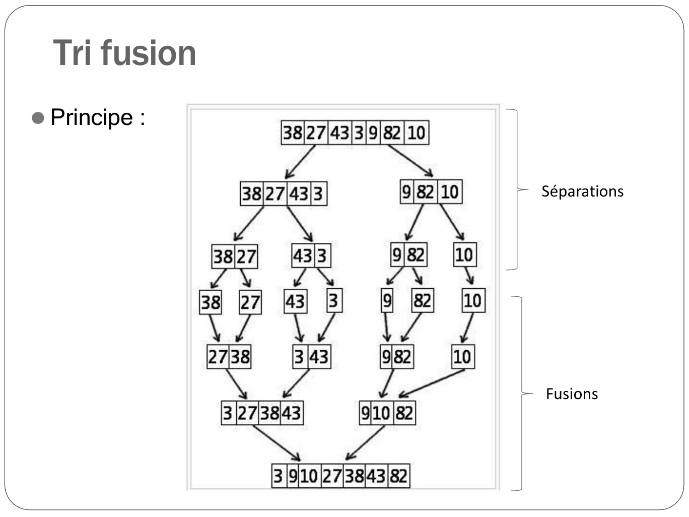
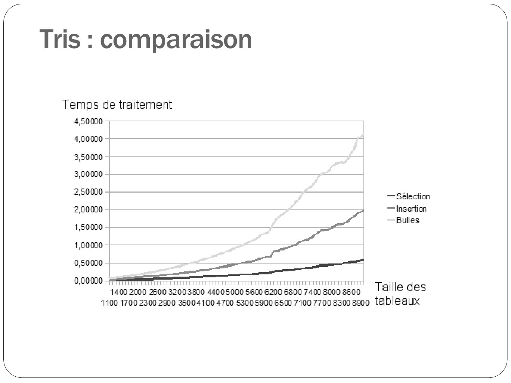
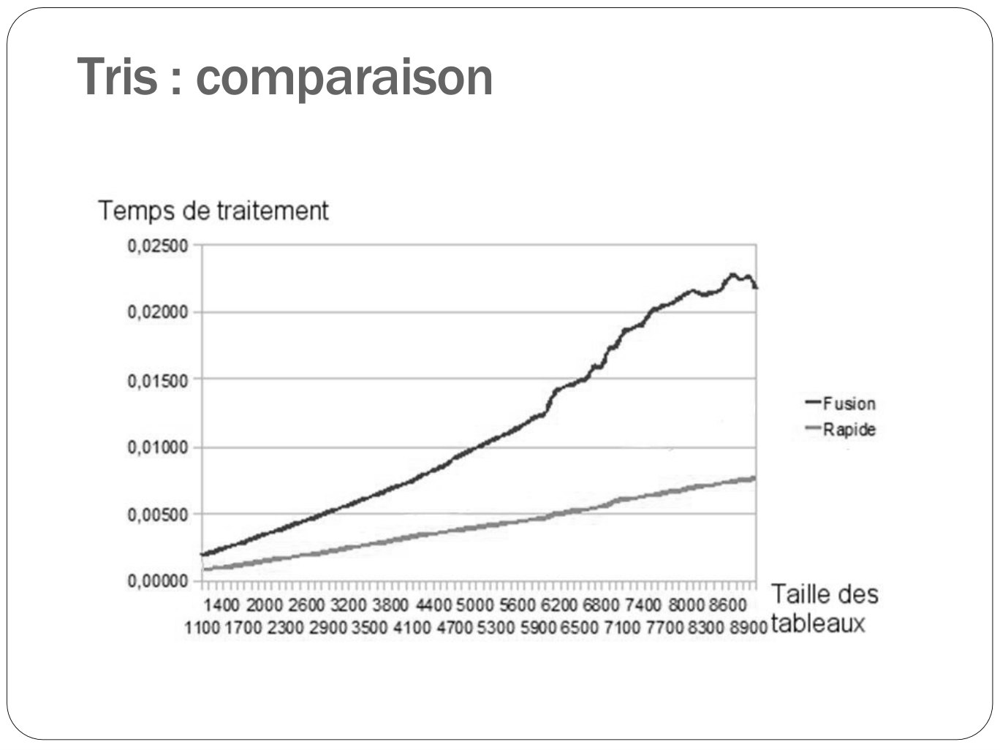

# CM08-tris-rapides_2023-2024_Informatique2_P1S2_EAnsermin-RGrignon.pdf

[Ouvrir l’original](https://drive.google.com/open?id=1MWdUZr91nrDwoxKGHkZOf3YAXuygnfNt) · Les pages signalées comprennent du texte reconnu automatiquement ou des éléments graphiques. Le fac-similé permet de vérifier chaque lecture.

**Pages avec fac-similé ou lecture OCR** — 1, 22, 69–70.

## Page 1

~~~text
Informatique II
  Tris rapides
~~~

**Lecture OCR à contrôler**

~~~text
Informatique II

Tris rapides

€ TECH
Nt
~~~

## Page 2

~~~text
     Rappel
⚫ Les tris vus au cours précédents étaient d’ordre de complexité 𝑂 𝑛2 .

                       https://fr.wikipedia.org/wiki/Algorithme_de_tri
~~~

## Page 3

~~~text
     Rappel
⚫ De meilleurs algorithme de tris?

                       https://fr.wikipedia.org/wiki/Algorithme_de_tri
~~~

## Page 4

~~~text
  Tri fusion
⚫ Diviser pour mieux régner!

⚫ Constat : il est facile d’obtenir un tableau trié à partir de
  deux tableaux déjà triés:

    27 | 32 | 45 | 53 | 64 |                       10| 15 | 60| 63 | 75 |
            A[n]                                            B[n]

                     |   |     |   |   |   |   |    |
                                   T[2n]
~~~

## Page 5

~~~text
  Tri fusion
⚫ Diviser pour mieux régner!

⚫ Il est facile d’obtenir un tableau trié à partir de deux tableaux
  déjà triés:

    27 | 32 | 45 | 53 | 64                          10| 15 | 60| 63 | 75

                   Le plus petit élément est forcement ici

                     |    |   |   |    |   |    |    |

             Case à remplir
~~~

## Page 6

~~~text
  Tri fusion
⚫ Diviser pour mieux régner!

⚫ Il est facile d’obtenir un tableau trié à partir de deux tableaux
  déjà triés:

    27 | 32 | 45 | 53 | 64                            10| 15 | 60| 63 | 75

                   Le plus petit élément est forcement ici

                   10 |       |   |   |   |   |   |     | |

             Case à remplir
~~~

## Page 7

~~~text
  Tri fusion
⚫ Diviser pour mieux régner!

⚫ Il est facile d’obtenir un tableau trié à partir de deux tableaux
  déjà triés:

    27 | 32 | 45 | 53 | 64                           10| 15 | 60| 63 | 75

   indexA                                             indexB

                  10 |       |   |   |   |   |   |     |   |

                         i
~~~

## Page 8

~~~text
  Tri fusion
⚫ Diviser pour mieux régner!

⚫ Il est facile d’obtenir un tableau trié à partir de deux tableaux
  déjà triés:

    27 | 32 | 45 | 53 | 64                        10| 15 | 60| 63 | 75

                                                          indexB
   indexA

                  10 | 15 |       |   |   |   |   |   |

                              i
~~~

## Page 9

~~~text
  Tri fusion
⚫ Diviser pour mieux régner!

⚫ Il est facile d’obtenir un tableau trié à partir de deux tableaux
  déjà triés:

    27 | 32 | 45 | 53 | 64                     10| 15 | 60| 63 | 75

                                                       indexB
   indexA

                  10 | 15 | 27 |   |   |   |   |   |

                             i
~~~

## Page 10

~~~text
  Tri fusion
⚫ Diviser pour mieux régner!

⚫ Il est facile d’obtenir un tableau trié à partir de deux tableaux
  déjà triés:

    27 | 32 | 45 | 53 | 64                      10| 15 | 60| 63 | 75

                                                      indexB
       indexA

                  10 | 15 | 27 | 32 |   |   |    |   | |    |

                                 i
~~~

## Page 11

~~~text
  Tri fusion
⚫ Diviser pour mieux régner!

⚫ Il est facile d’obtenir un tableau trié à partir de deux tableaux
  déjà triés:

    27 | 32 | 45 | 53 | 64                     10| 15 | 60| 63 | 75

                                                       indexB
           indexA

                    10 | 15 | 27 | 32 | 45 |   |   |   |   |

                                        i
~~~

## Page 12

~~~text
  Tri fusion
⚫ Diviser pour mieux régner!

⚫ Il est facile d’obtenir un tableau trié à partir de deux tableaux
  déjà triés:

    27 | 32 | 45 | 53 | 64                     10| 15 | 60| 63 | 75

                indexA                                 indexB

                  10 | 15 | 27 | 32 | 45 | 53 |    |    |   |

                                           i
~~~

## Page 13

~~~text
  Tri fusion
⚫ Diviser pour mieux régner!

⚫ Il est facile d’obtenir un tableau trié à partir de deux tableaux
  déjà triés:

    27 | 32 | 45 | 53 | 64                   10| 15 | 60| 63 | 75

                     indexA                               indexB

                  10 | 15 | 27 | 32 | 45 | 53 |       |    | |

                                                  i
~~~

## Page 14

~~~text
  Tri fusion
⚫ Diviser pour mieux régner!

⚫ Il est facile d’obtenir un tableau trié à partir de deux tableaux
  déjà triés:

    27 | 32 | 45 | 53 | 64                   10| 15 | 60| 63 | 75

                     indexA                            indexB

                  10 | 15 | 27 | 32 | 45 | 53 | 60 |   |

                                                i
~~~

## Page 15

~~~text
  Tri fusion
⚫ Diviser pour mieux régner!

⚫ Il est facile d’obtenir un tableau trié à partir de deux tableaux
  déjà triés:

    27 | 32 | 45 | 53 | 64                   10| 15 | 60| 63 | 75

                     indexA                                 indexB

                  10 | 15 | 27 | 32 | 45 | 53 | 60 | 63 | 64 |

                                                    i
~~~

## Page 16

~~~text
  Tri fusion
⚫ Diviser pour mieux régner!

⚫ Il est facile d’obtenir un tableau trié à partir de deux tableaux
  déjà triés:

    27 | 32 | 45 | 53 | 64                  10| 15 | 60| 63 | 75

                             indexA                         indexB

                  10 | 15 | 27 | 32 | 45 | 53 | 60 | 63 | 64 | 75

                                                    i
~~~

## Page 17

~~~text
  Tri fusion
⚫ Algorithme de fusion de deux tableaux triés:
  PROCEDURE fusion_2tab(A[n], B[n], C[2n] :Tableau de T)
  Variable
      indexA, indexB, i : ENTIER
  DEBUT
     indexA ← 0
     indexB ← 0
     POUR i de 0 à 2n FAIRE
         SI(A[indexA]<B[indexB]) ALORS
            C[i] ← A[indexA]
            indexA ← indexA +1
         SINON
            C[i] ← B[indexB]
            indexB ← indexB+1
         FIN SI
     FIN POUR
  FIN
~~~

## Page 18

~~~text
  Tri fusion
⚫ Algorithme de fusion de deux tableaux triés:
  PROCEDURE fusion_2tab(A[n], B[n], C[2n] :Tableau de T)
  Variable
      indexA, indexB, i : ENTIER
  DEBUT
     indexA ← 0
     indexB ← 0
     POUR i de 0 à 2n FAIRE
         SI(A[indexA]<B[indexB]) ALORS
            C[i] ← A[indexA]            Parcours et remplissage du tableau final
            indexA ← indexA +1
         SINON
            C[i] ← B[indexB]
            indexB ← indexB+1
         FIN SI
     FIN POUR
  FIN
~~~

## Page 19

~~~text
  Tri fusion
⚫ Algorithme de fusion de deux tableaux triés:
  PROCEDURE fusion_2tab(A[n], B[n], C[2n] :Tableau de T)
  Variable
      indexA, indexB, i : ENTIER
  DEBUT
     indexA ← 0
     indexB ← 0
     POUR i de 0 à 2n FAIRE
         SI(A[indexA]<B[indexB]) ALORS
            C[i] ← A[indexA]                  Parcours des tableaux
            indexA ← indexA +1
         SINON
            C[i] ← B[indexB]
            indexB ← indexB+1
         FIN SI
     FIN POUR
  FIN
~~~

## Page 20

~~~text
  Tri fusion
⚫ Algorithme de fusion de deux tableaux triés:
  PROCEDURE fusion_2tab(A[n], B[n], C[2n] :Tableau de T)
  Variable
      indexA, indexB, i : ENTIER
  DEBUT
     indexA ← 0
     indexB ← 0
     POUR i de 0 à 2n FAIRE
         SI(A[indexA]<B[indexB]) ALORS
            C[i] ← A[indexA]                     Exercice : rajouter les
            indexA ← indexA +1                   conditions sur les indices !
         SINON
            C[i] ← B[indexB]
            indexB ← indexB+1
         FIN SI
     FIN POUR
  FIN
~~~

## Page 21

~~~text
  Tri fusion
⚫ Principe :
   ⚫ Séparer les tableaux en deux
   ⚫ Recommencer sur chaque partie jusqu’à avoir des
     tableau de 1 cases.
   ⚫ Fusionner les tableaux
~~~

## Page 22

~~~text
  Tri fusion
⚫ Principe :

               Séparations

               Fusions
~~~

**Lecture OCR à contrôler**

~~~text
Tri fusion

r- Séparations

9[82|10]

38/27/43/3/9/82/10)

e Principe :

738 3143 a
— Fusions

3127138443 9/10 |82

2

319027384318
~~~

## Page 23

~~~text
  Tri fusion
⚫ Principe :
   ⚫ Séparer les tableaux en deux
   ⚫ Recommencer sur chaque partie jusqu’à avoir des
     tableau de 1 cases.
   ⚫ Fusionner les tableaux

   ⚫ La separation et la fusion se font par recursivité
   ⚫ En pratique, pas besoin de plusieurs tableaux différents :
     on travaille sur les sous-tableaux.
~~~

## Page 24

~~~text
Tri fusion
PROCEDURE triFusion(A[n] : Tableau de T)
Début
     triFusionRec(A, 0, n-1)
Fin

PROCEDURE triFusionRec(A[n] :Tableau de T; debut, fin : Entier)
VARIABLE
    milieu : ENTIER
DEBUT
    SI debut < fin ALORS
       milieu ← (deb+fin) DIV 2
       triFusionRec(A, debut, milieu)
       triFusionRec(A, milieu+1, fin)
       fusionner(A, debut, milieu, fin)
    FIN SI
FIN
~~~

## Page 25

~~~text
Tri fusion
PROCEDURE triFusion(A[n] : Tableau de T)
Début
     triFusionRec(A, 0, n-1)          Initialise les paramètres de triFusionRec
Fin

PROCEDURE triFusionRec(A[n] :Tableau de T; debut, fin : Entier)
VARIABLE
    milieu : ENTIER
DEBUT
    SI debut < fin ALORS
       milieu ← (deb+fin) DIV 2
       triFusionRec(A, debut, milieu)
       triFusionRec(A, milieu+1, fin)
       fusionner(A, debut, milieu, fin)
    FIN SI
FIN
~~~

## Page 26

~~~text
Tri fusion
PROCEDURE triFusion(A[n] : Tableau de T)
Début
     triFusionRec(A, 0, n-1)
Fin

PROCEDURE triFusionRec(A[n] :Tableau de T; debut, fin : Entier)
VARIABLE
    milieu : ENTIER
DEBUT
    SI debut < fin ALORS
       milieu ← (deb+fin) DIV 2             Indice du milieu du tableau
       triFusionRec(A, debut, milieu)
       triFusionRec(A, milieu+1, fin)
       fusionner(A, debut, milieu, fin)
    FIN SI
FIN
~~~

## Page 27

~~~text
Tri fusion
PROCEDURE triFusion(A[n] : Tableau de T)
Début
     triFusionRec(A, 0, n-1)
Fin

PROCEDURE triFusionRec(A[n] :Tableau de T; debut, fin : Entier)
VARIABLE
    milieu : ENTIER
DEBUT
    SI debut < fin ALORS
       milieu ← (deb+fin) DIV 2
       triFusionRec(A, debut, milieu)
                                      Recursivité sur les deux moitié du tableaux
       triFusionRec(A, milieu+1, fin)
       fusionner(A, debut, milieu, fin)
    FIN SI
FIN
~~~

## Page 28

~~~text
Tri fusion
PROCEDURE triFusion(A[n] : Tableau de T)
Début
     triFusionRec(A, 0, n-1)
Fin

PROCEDURE triFusionRec(A[n] :Tableau de T; debut, fin : Entier)
VARIABLE
    milieu : ENTIER
DEBUT
    SI debut < fin ALORS
       milieu ← (deb+fin) DIV 2
       triFusionRec(A, debut, milieu)     Division du tableau par la gauche
       triFusionRec(A, milieu+1, fin)
       fusionner(A, debut, milieu, fin)
    FIN SI
FIN
~~~

## Page 29

~~~text
Tri fusion
PROCEDURE triFusion(A[n] : Tableau de T)
Début
     triFusionRec(A, 0, n-1)
Fin

PROCEDURE triFusionRec(A[n] :Tableau de T; debut, fin : Entier)
VARIABLE
    milieu : ENTIER
DEBUT
    SI debut < fin ALORS
       milieu ← (deb+fin) DIV 2
       triFusionRec(A, debut, milieu)
       triFusionRec(A, milieu+1, fin)      Division du tableau par la droite
       fusionner(A, debut, milieu, fin)
    FIN SI
FIN
~~~

## Page 30

~~~text
Tri fusion
PROCEDURE triFusion(A[n] : Tableau de T)
Début
     triFusionRec(A, 0, n-1)
Fin

PROCEDURE triFusionRec(A[n] :Tableau de T; debut, fin : Entier)
VARIABLE
    milieu : ENTIER
DEBUT
    SI debut < fin ALORS
       milieu ← (deb+fin) DIV 2
       triFusionRec(A, debut, milieu)
       triFusionRec(A, milieu+1, fin)
       fusionner(A, debut, milieu, fin)     Fusion des sous tableau
    FIN SI
FIN
~~~

## Page 31

~~~text
Tri fusion

     A    27 | 32 | 45 | 53 | 64 |10| 15 | 60| 63 | 75 |

         début              millieu                fin
~~~

## Page 32

~~~text
Tri fusion

     A     27 | 32 | 45 | 53 | 64 |10| 15 | 60| 63 | 75 |

          début              millieu                fin

    AUX     27 | 32 | 45 | 53 | 64 |75| 63 | 60 | 15 | 10 |
~~~

## Page 33

~~~text
Tri fusion

     A    27 | 32 | 45 | 53 | 64 |10| 15 | 60| 63 | 75 |

          i

    AUX       27 | 32 | 45 | 53 | 64 |75| 63 | 60 | 15 | 10 |

          indexA                                        indexB
~~~

## Page 34

~~~text
Tri fusion

     A    10 | 32 | 45 | 53 | 64 |10| 15 | 60| 63 | 75 |

                   i

    AUX    27 | 32 | 45 | 53 | 64 |75| 63 | 60 | 15 | 10 |

                                                indexB
          indexA
~~~

## Page 35

~~~text
Tri fusion

     A    10 | 15 | 45 | 53 | 64 |10| 15 | 60| 63 | 75 |

                   i

    AUX    27 | 32 | 45 | 53 | 64 |75| 63 | 60 | 15 | 10 |

          indexA                          indexB
~~~

## Page 36

~~~text
Tri fusion

     A    10 | 15 | 27 | 53 | 64 |10| 15 | 60| 63 | 75 |

                    i

    AUX    27 | 32 | 45 | 53 | 64 |75| 63 | 60 | 15 | 10 |

               indexA                     indexB
~~~

## Page 37

~~~text
Tri fusion

     A    10 | 15 | 27 | 32 | 45 |53| 60 | 63| 64 | 75 |

                                                     i

    AUX    27 | 32 | 45 | 53 | 64 |75| 63 | 60 | 15 | 10 |

                                   indexA
                                   indexB
~~~

## Page 38

~~~text
 Tri fusion
PROCEDURE fusionner(A[n] :Tableau de T debut, milieu, fin : Entier)
VARIABLE
    indexA, indexB, i : Entier
    aux[n] :Tableau de T
DEBUT
    indexA ← début
    indexB ← fin
    POUR i de debut à milieu+1 FAIRE
        aux[i] ← A[i]
    FIN POUR
    POUR i de milieu+1 à fin+1 FAIRE
        aux[i] ← A[fin-i+milieu+1]
    FIN POUR
    POUR i de debut à fin+1 FAIRE
    SI aux[indexA] <= aux[indexB] ALORS
        A[i] ← aux[indexA]
        indexA ← indexA + 1
    SINON
       A[i] ← aux[indexB]
       indexB ← indexB - 1
    Fin Si
 FinPour
Fin
~~~

## Page 39

~~~text
 Tri fusion
PROCEDURE fusionner(A[n] :Tableau de T debut, milieu, fin : Entier)
VARIABLE
    indexA, indexB, i : Entier
    aux[n] :Tableau de T
DEBUT
    indexA ← début
    indexB ← fin
    POUR i de debut à milieu+1 FAIRE
        aux[i] ← A[i]                     Recopie du tableau. La
    FIN POUR                              seconde partie est
    POUR i de milieu+1 à fin+1 FAIRE
                                          recopiée “ à lenvers”
        aux[i] ← A[fin-i+milieu+1]
    FIN POUR
    POUR i de debut à fin+1 FAIRE
    SI aux[indexA] <= aux[indexB] ALORS
        A[i] ← aux[indexA]
        indexA ← indexA + 1
    SINON
       A[i] ← aux[indexB]
       indexB ← indexB - 1
    Fin Si
 FinPour
Fin
~~~

## Page 40

~~~text
 Tri fusion
PROCEDURE fusionner(A[n] :Tableau de T debut, milieu, fin : Entier)
VARIABLE
    indexA, indexB, i : Entier
    aux[n] :Tableau de T
DEBUT
    indexA ← début
    indexB ← fin
    POUR i de debut à milieu+1 FAIRE
        aux[i] ← A[i]
    FIN POUR
    POUR i de milieu+1 à fin+1 FAIRE
        aux[i] ← A[fin-i+milieu+1]
    FIN POUR
    POUR i de debut à fin+1 FAIRE
    SI aux[indexA] <= aux[indexB] ALORS
        A[i] ← aux[indexA]
        indexA ← indexA + 1                      Fusion/ tris du tableau
    SINON
       A[i] ← aux[indexB]
       indexB ← indexB - 1
    Fin Si
 FinPour
Fin
~~~

## Page 41

~~~text
 Tri fusion : complexité
⚫ Le nombre d’operation ne dépend pas de l’état du tableau
  ( pas de meilleur ou de pire cas).

⚫ Complexité de la fusion: O(n)

⚫ Comparaison de TriFusionRec:

              𝐶(0) = 1

              𝐶 𝑛 = 𝑛 + 𝐶(𝑛/2)

Complexité en 𝑂(𝑛 ∗ log(𝑛))
~~~

## Page 42

~~~text
 Tri rapide (quicksort)
• La méthode de tri la plus utilisée (voir algorithme)

• Principe:
   • Partitionner le tableau en deux parties séparées par un
       pivot :
        • Les éléments à la gauche du pivot doivent lui être
          inférieurs
        • Les éléments à sa droite doivent lui être supérieurs.
   •   Appliquer récursivement l’algorithme sur les deux sous
       parties.
~~~

## Page 43

~~~text
 Tri rapide (quicksort)
• Principe:
   • Partitionner le tableau en deux parties séparées par un
     pivot :
      • Les éléments à la gauche du pivot doivent lui être
        inférieurs
      • Les éléments à sa droite doivent lui être supérieurs.

Exemple :

       4 | 23 | 3 | 42 | 2 | 14 | 45 | 18 | 38 | 16

       4 | 14 | 3 | 2 | 16 | 23 | 45 | 18 | 38 | 42
~~~

## Page 44

~~~text
 Tri rapide (quicksort)
• Principe:
   • Partitionner le tableau en deux parties séparées par un
       pivot :
        • Les éléments à la gauche du pivot doivent lui être
          inférieurs
        • Les éléments à sa droite doivent lui être supérieurs.

   •   Appliquer récursivement l’algorithme sur les deux sous
       parties.
~~~

## Page 45

~~~text
    Tri rapide : partitionnement
⚫   1. Parcourir de gauche à droite jusqu’à trouver un élément supérieur au pivot.

                        <=
                        <=       >

        On isole le pivot en début du tableau
~~~

## Page 46

~~~text
Tri rapide : partitionnement
1. Parcourir de gauche à droite jusqu’à trouver un élément supérieur au pivot.

                    <=
                    ≤       >

2. Parcourir de droite à gauche jusqu’à trouver un élément inférieur au pivot

                    <=
                    ≤       >                        <     >=
                                                           ≥
~~~

## Page 47

~~~text
     Tri rapide : partitionnement
     1. Parcourir de gauche à droite jusqu’à trouver un élément supérieur au pivot.

                         <=
                         ≤       >

     2. Parcourir de droite à gauche jusqu’à trouver un élément inférieur au pivot

                         <=
                         ≤       >                        <     >=
                                                                ≥

     3. Echanger les deux elements

                        <=
                        ≤       <                       >      >=
                                                               ≥

     4 . Recommencer jusqu’à obtenir les deux parties (croisement des indices de
recherche)
~~~

## Page 48

~~~text
     Tri rapide : partitionnement
     1. Parcourir de gauche à droite jusqu’à trouver un élément supérieur au pivot.

     2. Parcourir de droite à gauche jusqu’à trouver un élément inférieur au pivot

     3. Echanger les deux elements

                         <=
                         ≤      <                        >       >=
                                                                 ≥

     4 . Recommencer jusqu’à obtenir les deux parties (croisement des indices de
recherche)
                        ≤ <=           ><               >= ≤

      5 . Placer le pivot au croisement.

                           ≤ <=            ><             >= ≤
~~~

## Page 49

~~~text
 Tri rapide : partitionnement
⚫ Exemple:
             27 | 63 | 1 | 72 | 64 | 58 | 14 | 9
~~~

## Page 50

~~~text
 Tri rapide : partitionnement
⚫ Exemple:
             27 | 63 | 1 | 72 | 64 | 58 | 14 | 9

             27 | 63 | 1 | 72 | 64 | 58 | 14 | 9

                 inf                         sup
~~~

## Page 51

~~~text
 Tri rapide : partitionnement
⚫ Exemple:
             27 | 63 | 1 | 72 | 64 | 58 | 14 | 9

             27 | 9 | 1 | 72 | 64 | 58 | 14 | 63

                 inf                         sup
~~~

## Page 52

~~~text
 Tri rapide : partitionnement
⚫ Exemple:
             27 | 63 | 1 | 72 | 64 | 58 | 14 | 9

             27 | 9 | 1 | 72 | 64 | 58 | 14 | 63

                     inf                sup
~~~

## Page 53

~~~text
 Tri rapide : partitionnement
⚫ Exemple:
             27 | 63 | 1 | 72 | 64 | 58 | 14 | 9

             27 | 9 | 1 | 72 | 64 | 58 | 14 | 63

                     inf                sup
~~~

## Page 54

~~~text
 Tri rapide : partitionnement
⚫ Exemple:
             27 | 63 | 1 | 72 | 64 | 58 | 14 | 9

             27 | 9 | 1 | 72 | 64 | 58 | 14 | 63

                         inf            sup
~~~

## Page 55

~~~text
 Tri rapide : partitionnement
⚫ Exemple:
             27 | 63 | 1 | 72 | 64 | 58 | 14 | 9

             27 | 9 | 1 | 14 | 64 | 58 | 72 | 63

                         inf            sup
~~~

## Page 56

~~~text
 Tri rapide : partitionnement
⚫ Exemple:
             27 | 63 | 1 | 72 | 64 | 58 | 14 | 9

             27 | 9 | 1 | 14 | 64 | 58 | 72 | 63

                              inf   sup
~~~

## Page 57

~~~text
 Tri rapide : partitionnement
⚫ Exemple:
             27 | 63 | 1 | 72 | 64 | 58 | 14 | 9

             27 | 9 | 1 | 14 | 64 | 58 | 72 | 63

                              inf sup
~~~

## Page 58

~~~text
 Tri rapide : partitionnement
⚫ Exemple:
             27 | 63 | 1 | 72 | 64 | 58 | 14 | 9

             27 | 9 | 1 | 14 | 64 | 58 | 72 | 63

                        sup inf
~~~

## Page 59

~~~text
 Tri rapide : partitionnement
⚫ Exemple:
             27 | 63 | 1 | 72 | 64 | 58 | 14 | 9

             14 | 9 | 1 | 27 | 64 | 58 | 72 | 63
~~~

## Page 60

~~~text
  Tri rapide
FONCTION partition(A[n] Tableau de T; debut, fin : Entier) : ENTIER
VARIABLE
    inf, sup, tmp : ENTIER
    DEBUT
    inf ← debut+1
    sup ← fin
    TANT QUE inf<=sup FAIRE
        TANT QUE(A[sup] > A[debut])
             sup ← sup-1
        FIN TANT QUE
        TANT QUE (A[inf] < A[debut])
          inf ← inf+1
        FIN TANT QUE
        SI inf A[debut])
             sup ← sup-1
                                       Ici le pivot est la première case du tableau
        FIN TANT QUE
        TANT QUE (A[inf] < A[debut])
          inf ← inf+1
        FIN TANT QUE
        SI inf A[debut])
             sup ← sup-1                 Gestion des indices inf et sup
        FIN TANT QUE
        TANT QUE (A[inf] < A[debut])
          inf ← inf+1
        FIN TANT QUE
        SI inf A[debut])
             sup ← sup-1
        FIN TANT QUE
        TANT QUE (A[inf] < A[debut])
          inf ← inf+1
        FIN TANT QUE                        Echange des éléments
        SI inf A[debut])
             sup ← sup-1
        FIN TANT QUE
        TANT QUE (A[inf] < A[debut])
          inf ← inf+1
        FIN TANT QUE
        SI inf A[debut])
             sup ← sup-1
        FIN TANT QUE
        TANT QUE (A[inf] < A[debut])
          inf ← inf+1
        FIN TANT QUE
        SI inf<sup ALORS
               tmp ← A[sup]; A[sup] ← A[inf]; A[inf] ← tmp
        FIN SI
    FIN TANT QUE
    tmp ← A[debut]; A[debut] ← A[sup]; A[sup] ← tmp
    RETOURNER sup
                               On retourne l’emplacement du pivot
FIN
~~~

## Page 66

~~~text
Tri rapide
PROCEDURE triRapide(Tableau de T)
Début
    triRapideRec(A, 0, n-1)
Fin

PROCEDURE triRapideRec(Tableau de T; debut, fin : ENTIER)
VARIABLE
    pivot : ENTIER
     DEBUT
    SI debut < fin ALORS
        pivot ← partition(A, debut, fin)
        triRapideRec(A, debut, pivot-1)
        triRapideRec(A, pivot+1, fin)
    FIN SI
FIN
~~~

## Page 67

~~~text
 Tri rapide : complexité
• Meilleur cas (tableau déjà trié):
  • Nombre de comparaisons : n
  • Nombre d’échanges : 0
  ➢ Complexité : O(n)

• Pire cas (le pivot choisit est la plus grande valeur)
   • Nombre de comparaisons : (n-1)+(n-2)+…+1 = n(n-1)/2
   ➢ Complexité : O(n²)
~~~

## Page 68

~~~text
 Tri rapide : complexité
• Meilleur cas (tableau déjà trié):
  • Nombre de comparaisons : n
  • Nombre d’échanges : 0
  ➢ Complexité : O(n)

• Pire cas (le pivot choisit est la plus grande valeur)
   • Nombre de comparaisons : (n-1)+(n-2)+…+1 = n(n-1)/2
   ➢ Complexité : O(n²)

• Cas moyen
   ➢ Complexité : O(n*log(n))
~~~

## Page 69

~~~text
Tris : comparaison
~~~

**Lecture OCR à contrôler**

~~~text
(—
Tris : comparaison

Temps de traitement
4.50000
400000
3,50000
3,00000
250000 — Sélection
2,00000 — Insertion
Bulles
1,50000
1,00000
0,50000

0,00000 ed
1400 2000 2600 32003800 44005000 560062006800 740080008600 | IIE Ges
1100 1700 2300 2900 35004100 4700 3005900 6500 7100 7700 8300 8900 tableaux
~~~

## Page 70

~~~text
Tris : comparaison
~~~

**Lecture OCR à contrôler**

~~~text
Tris : comparaison

Temps de traitement
0,02500

0,02000 —

0,01500
—Fusion
— Rapide
0,01000 -

0,00500

0,00000 ~ Taille d
1400 2000 2600 2200 3800 4400 5000 5600 6200 6800 7400 80008600 | alle des
1100 1700 2300 2900 3500 4100 4700 5300 5900 6500 7100 7700 8300 a900 tableaux
~~~
