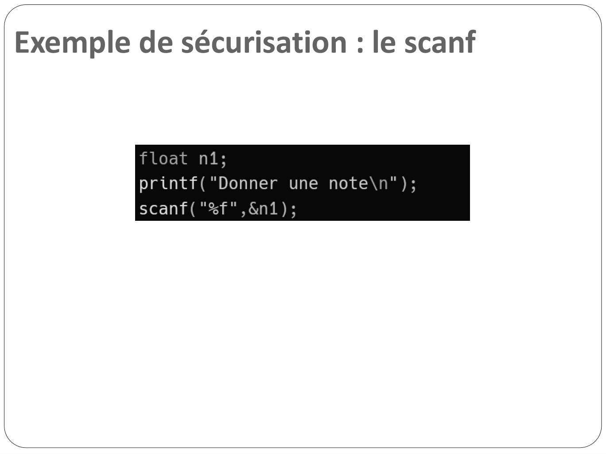
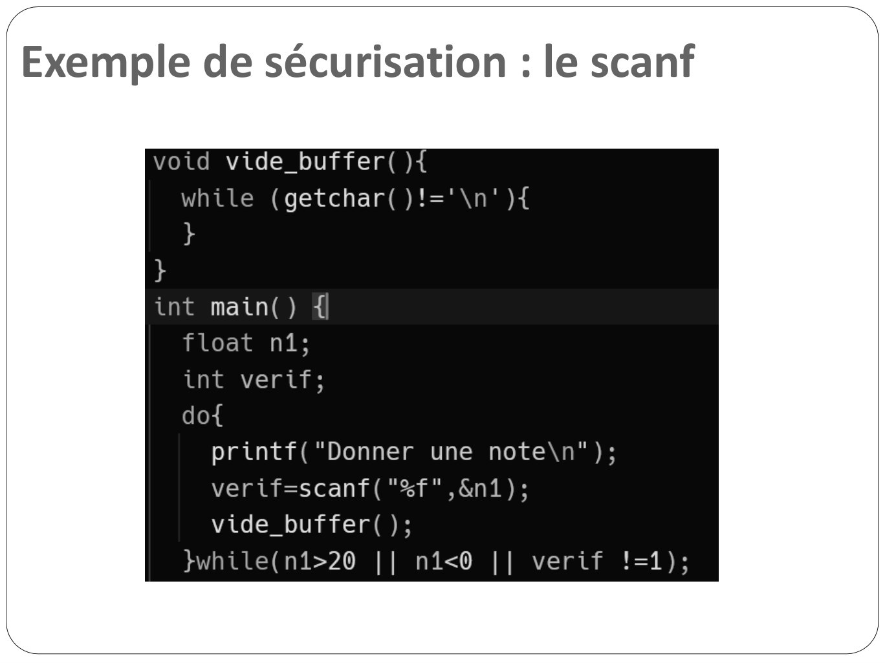

# CM10-Tests_2024-2025_Informatique2_P1S2_EAnsermin-RGrignon.pdf

[Ouvrir l’original](https://drive.google.com/open?id=1K4WhFwLu8d5oytacdm5D-B8xnpML19Pt) · Les pages signalées comprennent du texte reconnu automatiquement ou des éléments graphiques. Le fac-similé permet de vérifier chaque lecture.

**Pages avec fac-similé ou lecture OCR** — 1, 6–7.

## Page 1

~~~text
Informatique II
   Les tests
~~~

**Lecture OCR à contrôler**

~~~text
Informatique II

Les tests

€ TECH
Nt
~~~

## Page 2

~~~text
Pourquoi tester son code ?
 • Pour vérifier qu’il répond au cahier des charges.

 • Prouver que l’application ne crashe pas dans certaines conditions.

 • Avoir une vision Claire du niveau de qualité de son application :
    • Détecter/anticiper un bug au plus tôt
    • Afficher les indicateurs quantitatifs
    • Informer les personnes qui suivent le projet de la bonne tenu du
       planning et de la qualité du livrable

 • Comment tester son code et le securiser au mieux ?
~~~

## Page 3

~~~text
Pourquoi tester son code ?
 • Le niveau de sécurité et de test exigé dépend grandement de l’application.

 • Garantir l’absence de crash d’une application est plus critique dans certains
   domaines :
    • On peut autoriser un téléphone à s’éteindre
    • On ne peut pas autoriser un système de contrôle de vol d’avion de
       rebooter en plein vol…
    • Idem pour un cœur artificiel

 • Les risques associés dépendent également du champ d’application :
     • Risque pour les personnes
     • Risque pour les données (transactions bancaires, communication
        Internet sécurisée, données personnelles)
     • Respect des normes/standards en vigueurs (fiscalité, format de fichier,
        protocole de communication)
~~~

## Page 4

~~~text
Tester son code : un enjeu important
 • Tester son code est implicitement ET explicitement obligatoire quelles que
   soit les conditions :
     • Secteurs d’activité
     • Produits développés
     • Criticité des problèmes potentiels
     • Technologies utilisées
     • Type de clientèle

 • Le test est devenu une profession à part entière :
     • Groupe de travail / entreprises dédiées
     • Recommandations
     • Standards /normes (software quality assurance)
     • Outils informatiques conformes

 • Ce domaine est donc une matière à part entière.
~~~

## Page 5

~~~text
BUG ! : Radiothérapie de Multidata-
System (2000)
• Multidata-System développe et vend des
  logiciels de planification de radiothérapie
  qui calculent la dose exacte de radiation
  pour chaque patient.

• Les médecins l’ont utilisé de manière
  inappropriée pour gagner du temps et
  améliorer les thérapies.

• Problème : le logiciel envoyait alors le double du rayonnement adéquat.

• 8 morts et 20 patients ayant des problèmes de santé supplémentaires.
~~~

## Page 6

~~~text
Exemple de sécurisation : le scanf
~~~

**Lecture OCR à contrôler**

~~~text
Exemple de sécurisation : le scanf

float n1;

printf("Donner une note\n");
scanf("%f",&n1);
~~~

## Page 7

~~~text
Exemple de sécurisation : le scanf
~~~

**Lecture OCR à contrôler**

~~~text
Exemple de sécurisation : le scanf

void vide_buffer( ){
while (getchar()!='\n' ){
}

}

int main() {
float n1;

int verif;

do{
printf( "Donner une note\n");
verif=scanf("%f",&n1);
vide_buffer();

}while(n1>20 || n1<0 || verif !=1);
~~~

## Page 8

~~~text
 BUG ! : Mars climate orbiter (1999)
• La sonde Mars Orbiter est un projet de collaboration entre la NASA et une
  entreprise privée américaine. La sonde devait se poser sur Mars mais le signal a
  été perdu.

  • Problème : les deux collaborateurs utilisaient des systemes métriques
    différents!
~~~

## Page 9

~~~text
Les tests statiques
• Les test statiques se font sans exécuter le programme.

• Il existe différents outils et méthodes pour les test statistiques mais la plus
  basique est la revue de code.

• La revue de code consiste simplement à relire le code.
    • Au moins un des relecteurs ne doit pas être l’auteur du code.
    • Permet le passage de connaissance
    • Accroit la responsabilité mutuelle
    • Doit faire partie du processus de développement : le code doit être relu au
       fur et à mesure.

• Les tests statiques passent aussi par l’écriture préalable d’un code robuste
  faisant appel à de bonnes pratiques.
~~~

## Page 10

~~~text
Quelques bonnes pratiques : les
paramètres
• Comment sécuriser la fonction suivante?
~~~

## Page 11

~~~text
Quelques bonnes pratiques : les
paramètres
• Comment sécuriser la fonction suivante?
~~~

## Page 12

~~~text
Quelques bonnes pratiques : les
paramètres
 • Une fonction est un ensemble de code autonome
    • on ne préjuge pas des valeurs des variables passées en paramètre!
    • On teste TOUS les paramètres sur l’ensemble de la plage de valeurs
       possibles

 • Cette pratique permet de :
    • de vérifier que le fonctionnel demandé n’est pas possible : votre
       algorithme n’est donc pas exécuté
    • d’alerter la couche appelante que la fonction appelée ne se comporte
       pas bien : votre fonction est capable de tester une partie du reste de
       l’application
    • de faire une dichotomie sur l’origine des symptômes : c’est important
       de savoir vers quelle équipe rediriger le bug.
~~~

## Page 13

~~~text
Quelques bonnes pratiques : les retours
de fonctions
 • Il faut récupérer et tester les valeurs retournées par TOUTES les
   fonctions.

 • scanf retourne le nombre de valeurs récupérées : il faut
   toujours vérifier si ce retour n’est pas égal au nombre de
   paramètres à récupérer !

 • printf retourne le nombre de caractères affichés. On peut le
   verifier mais ce n’est pas très important… sauf si l’on souhaite
   effectuer un affichage dynamique en colonnes par exemple

 • Idem pour malloc, fopen etc…
~~~

## Page 14

~~~text
BUG ! : Ariane 5 (1996)

• Le 4 juin 1996 la fuse Ariane 5 décolle

• Problème : au décollage, les fortes
  accélérations provoquent un dépassement
  d’entier dans une variable, le système de
  guidage ne fonctionne plus correctement.

 • La fusé explose en vol
~~~

## Page 15

~~~text
Quelques bonnes pratiques : les variables

 • Toutes les variables sont déclarées au début du programme avant TOUTE
   instruction.

 • Les variables doivent être initialisées.

 • Attention au type ! (rajouter éventuellement des tests)

   int getMult(int n){
      int r=1, a;
      for(int i=0; i<n; i++){
          printf(“Entrez une 1ère valeur entière : ”);
          scanf(“%d”, &a);
          r *= a;
      }
      return r;
   }
~~~

## Page 16

~~~text
Quelques bonnes pratiques : les variables

 • Toutes les variables sont déclarées au début du programme avant TOUTE
   instruction.

 • Les variables doivent être initialisées.

 • Attention au type ! (rajouter éventuellement des tests)
   int getMult(int n){
      int r, a;
      r = 1;
      a = 0;
      for(int i=0; i<n; i++){
          printf(“Entrez une 1ère valeur entière : ”);
          scanf(“%d”, &a);
          r *= a;
      }
      return r;
   }
~~~

## Page 17

~~~text
BUG ! : Service d’ambulance (1992)
• 1996 : Londres met en place un logiciel pour traiter et dispatcher les
  appels aux services d’urgences.

• Problème : Le logiciel ne tolerait aucunne erreur et ralentissait peu à peu
  en raison de fuite mémoire.
• Des dizaines de morts et 2,5 millions d’euro.
~~~

## Page 18

~~~text
Quelques bonnes pratiques : les pointeurs

 • TOUS les pointeurs doivent avoir été comparés avec NULL
   avant d’être utilisés.

 • Si un pointeur n’a pas la bonne valeur, c’est le seg fault…

 • TOUJOURS vérifier la validité des indices lorsqu’on utilise un
   tableau.
~~~

## Page 19

~~~text
Quelques bonnes pratiques : les pointeurs

• La gestion de la mémoire est très importante.

• Allouer de la mémoire pour son programme n’est pas un dû :
  cette mémoire est mutualisée avec les autres applications qui
  tournent sur le même système et il faut penser à la libérer sous
  peine de créer des fuites mémoire.

• → Tout appel à malloc(…) doit être associé à un appel à free(…)
~~~

## Page 20

~~~text
Quelques bonnes pratiques : résumé
 • Code nominal

     int getMult(int n){
        int r=1, a;
        for(int i=0; i<n; i++){
            printf(“Entrez une 1ère valeur entière : ”);
            scanf(“%d”, &a);
            r *= a;
        }
        return r;
     }
~~~

## Page 21

~~~text
Quelques bonnes pratiques : résumé
• Code robuste:
   int getMult(int n){
       // déclaration
       int r, a, sc;
       // Vérification des paramètres
       if (n <= 0){
            exit(1);
       }
       // initialisation
       r = 1;
       a = 0;
       sc = 0;
       // Corps de la fonction
       for(int i=0; i<n; i++){
            printf(“Entrez une 1ère valeur entière : ”);
            sc = scanf(“%d”, &a);
            if(sc != 1){
                exit(2);
            }
            r *= a;
       }
       return r;
   }
~~~

## Page 22

~~~text
Tests statiques et bonnes pratiques

• Un code nominal est à la portée de tout développeur.

• Au contraire, un code robuste avec l’ensemble des bonnes pratiques
  est un bon indicateur du niveau du développeur.

• La revue de code ne doit pas être négligée: 1 heure de revue de
  code permettrait d’économiser 33h de maintenance (selon ifsq.org)

• Une revue de code permettrait de détecter 60% des problèmes
~~~

## Page 23

~~~text
BUG ! : Le lundi noir (1987)
• Les systèmes automatiques de ventes et d’achats d’actions existent déjà.

• L’indice boursier de New York perd plus de 4% de sa valeur en une journée.

• Les systèmes s’emballent et la bourse New-yorkaise finit à -22% mettant en
  péril les marchés financiers.

• En un mois : -26 % au Royaume-Uni, -45% à Hong Kong ….
~~~

## Page 24

~~~text
Tests dynamiques

 • Ce type de test se base sur l’exécution du code et donc de la
   visualisation empirique du comportement.

 • Il existe une multitude de tests dynamiques

 • Ces tests se font souvent en boite noire: on ne regarde pas le code en
   détails mais uniquement ses entrées/sorties.

 • Parmi les différents tests en boite noire, les tests unitaires sont les plus
   facile à mettre en place pour vous.
~~~

## Page 25

~~~text
Les tests unitaires : principe

 • Principe: tester des fonctions ou modules en utilisant une grande plage
   de valeur d’entrée

 • On décide au préalable d’une liste de valeurs à tester ainsi que des
   sorties associées qui sont attendues. Ces valeurs à tester doivent être :
     • des cas « normaux »
     • des cas « d’ erreurs » (pointeurs NULL, index de tableau en dehors
        de la plage utile, taille de tableau non-positive…).
     • Il est important de bien réfléchir aux valeur testées !

 •   Les valeurs de sorties obtenues sont comparées à celles attendues.
~~~

## Page 26

~~~text
Les tests unitaires : organisation

  • On teste d’abord les « petites » fonctions autonomes.

  • Puis on teste les fonctions plus « grandes » faisant appel aux
    fonctions déjà testées. Cela permet de cibler facilement l’origine
    des problèmes.

  • En pratique, ces tests se font en parallèle du développement. Un
    testeur et un codeur travaillent en collaboration.
~~~

## Page 27

~~~text
Les tests unitaires : exemple

  • Soit la fonction suivante:

           int abs( int x ) {
               if(x < 0){
                   x = -x;
               }
               return x;
           }
  • Quelles sont les valeurs importantes à tester ?
     • Les valeurs -1 et 0 (changement de comportement)
     • Les valeurs extremes (limites du int)
     • Des valeurs aléatoires
~~~

## Page 28

~~~text
Les tests unitaires : exemple
 • On écrit la fonction de test pour savoir si un test en particulier est
   réussi :

    int testFctAbs(int value, int expected) {
       int ok = 0; // résultat du test
       if( abs(value) == expected ){
          ok = 1;
       }
       if(ok == 0){
          printf(…);
       }
       return ok;
    }
~~~

## Page 29

~~~text
Les tests unitaires : exemple
 • On appelle cette fonction de test pour les valeurs importantes:
  int testAbs() { int
     ok=1;
     // Limite -1 et 0
     ok = ok && testFctAbs(-1,1);
     ok = ok && testFctAbs( 0,0);
     // limites de stockage d’un entier
     ok = ok && testFctAbs( -2147483647, 2147483647);
     ok = ok && testFctAbs( 2147483647, 2147483647);
     // Valeurs aléatoires (positives et negatives)
     for(int i=0;i<1000000;i++){
         int value = rand();
         ok = ok && testFctAbs( value, value);
         ok = ok && testFctAbs( -value, value);
     }
     return ok;
  }
~~~

## Page 30

~~~text
Les tests unitaires : pairwise
 • Si une fonction possède plusieurs paramètres, il faut :
     • tous les tester un par un
     • tester les combinaisons de paramètres car certains problèmes
        peuvent venir de l’interaction de deux paramètres.

 • Les tests dits « pairwise » permettent de tester les fonctions sans
   regarder toutes les combinaisons possibles mais en testant des
   « paires » de combinaisons.

 • Exemple:
    • URL : https://pairwise.teremokgames.com/21kj8/
        • Toutes les combinaisons : 360 tests
        • Combinaisons par paires : 49 tests
~~~

## Page 31

~~~text
 BUG ! : La pandémie WoW (2005)
• Une pandémie a eu lieu dans le MMORPG car les développeurs avaient oublié
  de retirer une alteration d’état à des familiers.
• Les familiers sont devenus des porteurs sains et l’alteration s’est propagé de
  joueur en joueur.

 • Un mois de pandémie dans le jeu !
~~~

## Page 32

~~~text
Conclusion
●   Tester son code est une obligation, c’est même devenu un métier complet,
    avec ses méthodes, normes, outils, et ses certifications/diplômes

●   Plusieurs niveaux d’obligation :

    ● Contractuelle : prouver au client que cela fonctionne
    ● Sécurité/Sûreté : vérifier que les données, le matériel, les personnes

      ne risquent rien
    ● Traçabilité : voir si le bug découvert est présent sur une autre version

      de code
    ● Développement : pouvoir avancer dans le code sereinement
~~~

## Page 33

~~~text
Conclusion
●   Appliquer les tests dans vos projets académiques

●   Bonnes pratiques :
            •   Nommage des variables
            •   Tests des paramètres de fonctions
            •   Initialisation des variables
            •   Tests de pointeurs
            •   Tests des retours de fonctions

●   Revues de code : Travailler en équipe, faire relire vos codes par vos camarades,
    relire les leurs également

●   Tests unitaires : Coder des fonctions de tests , lancer les tests et agréger les
    résultats
~~~
