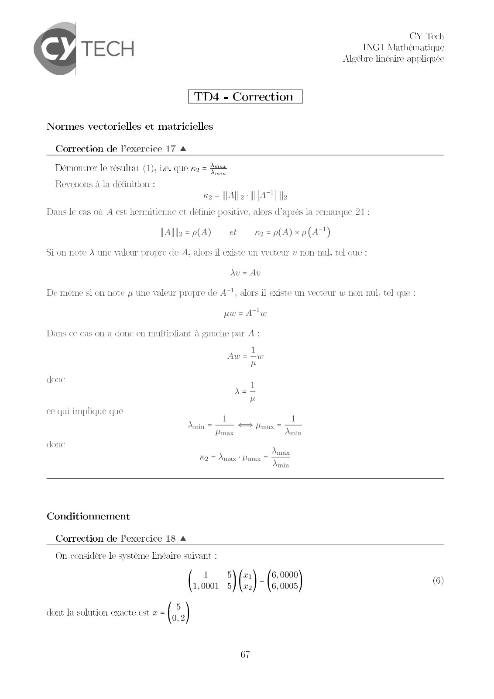
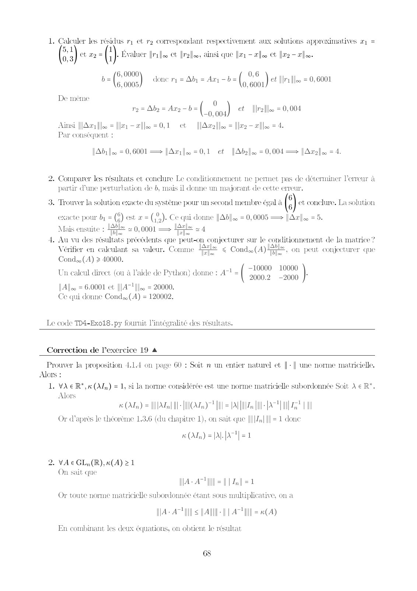
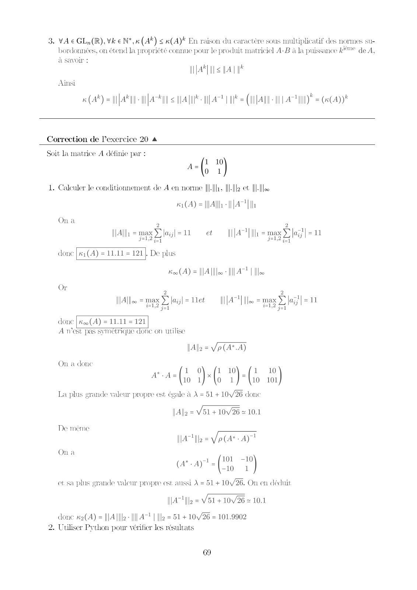
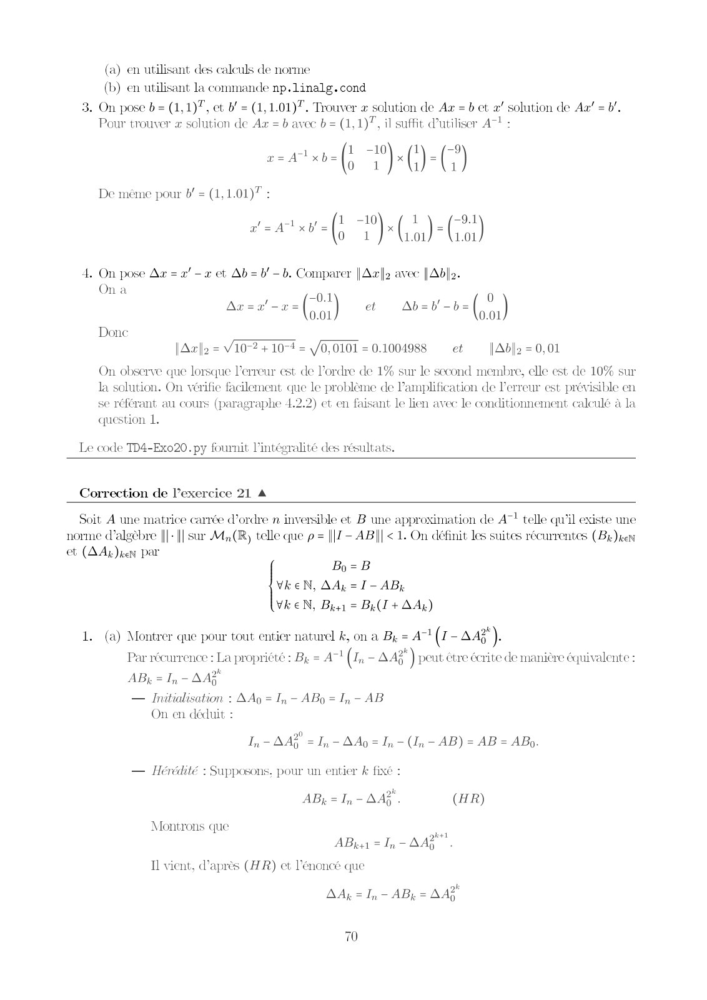
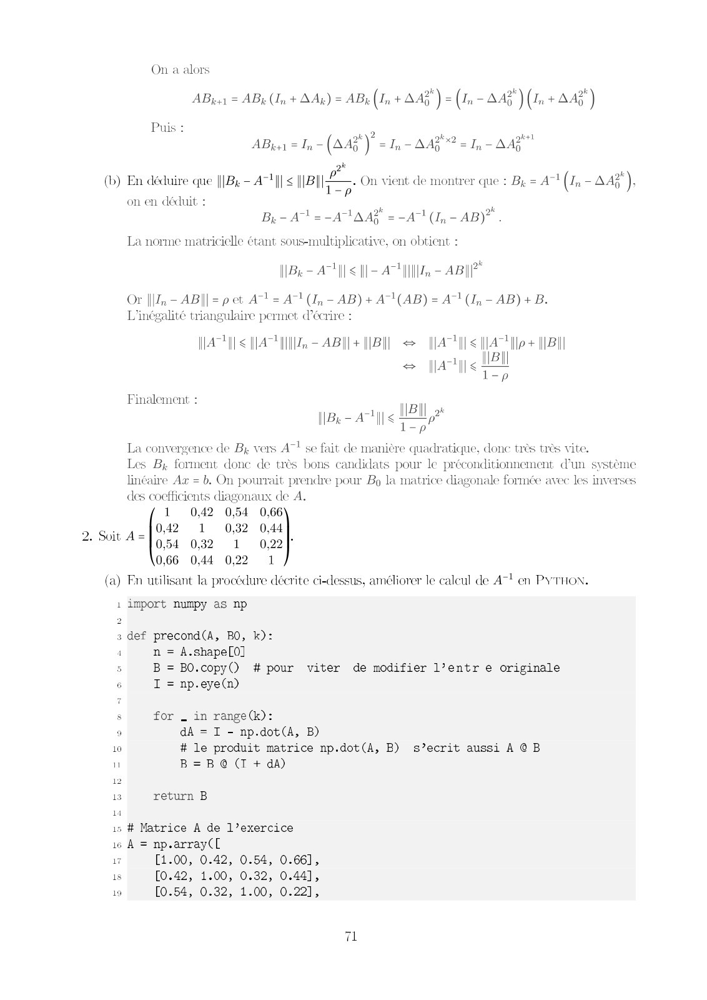
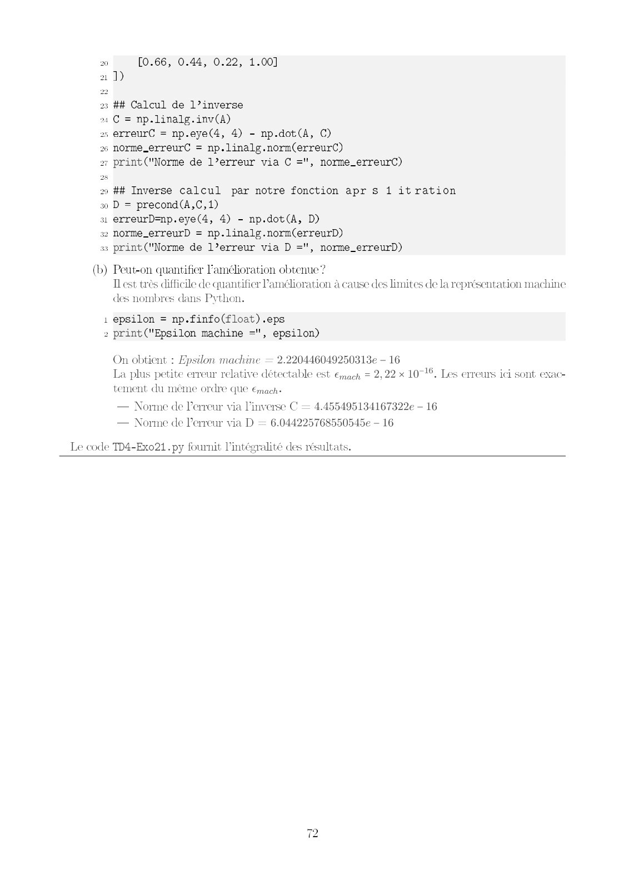

# ALGEBRE LINEAIRE CORRIGÉ TD4.pdf

[Ouvrir l’original](https://drive.google.com/open?id=1I7dFFqrrY4FXdG9bYJguYd-6TOiTKLGY) · Les pages signalées comprennent du texte reconnu automatiquement ou des éléments graphiques. Le fac-similé permet de vérifier chaque lecture.

**Pages avec fac-similé ou lecture OCR** — 1–6.

## Page 1

**Lecture OCR à contrôler**

~~~text
TECH

TD4 - Correction

Normes vectorielles et matricielles

Correction de l'exercice 17 A

CY Tech
ING1 Mathématique
Algèbre linéaire appliquée

Démontrer le résultat (1), Le. que k2 = eee

Min

Revenons à la définition :

A

2 [ll Ile

Dans le cas où A est hermitienne et définie positive, alors d’après la remarque 24 :

JAllz=p(A) et #2=p(4)xp(AT)

Si on note À une valeur propre de À, alors il existe un vecteur v non nul, tel que :

Av = Av

De méme si on note jr une valeur propre de A“, alors il existe un vecteur w non nul, tel que :

pw = Atw

Dans ce cas on a donc en multipliant à gauche par /
Aw

done

ce qui implique que

1 1
Amin = => Hmax = —
Hmax

donc

Amax

K2 = Amax * Hmax =

Amin

Conditionnement

Correction de l’exercice 18 A

On considère le système linéaire suivant :
1 5\ (21) _ (6,0000
1,0001 5/(x2/  \6,0005

: 5
dont la solution exacte est x = 02

67

(6)
~~~

## Page 2

**Lecture OCR à contrôler**

~~~text
1. Calculer les résidus r1 et rp correspondant respectivement aux solutions appreximatives æ1 =

1 1 2 a
(5) ct mp = (i L Évaluer files Ct Yralfee, ainsi que [ai - ælee ct [lr2 —aleo-

0,6

7 (nom
7 0, 6001

cos) done ry = Ab = Am -b= (

ea {ri loo = 0, 6001

De meme

ry Bia <dese-b= (oo) et [role = 0,004

ct |lAælle

Ainsi |||A21 [lo
Par conséquent :

{ra -ails

[Ads Joo = 0,6001 = |Arifoo=0,1 et [Ab] = 0,004 = |Atafe =

2. Comparer les résultats et conclure Le conditionnement ne permet pas de déterminer l'erreur à
partir d'une perturbation de b, mais il donne un majorant de cette erreur.

3. Trouver la solution exacte du système pour un second membre égal à ( 6} et conclure, La solution
exacte pour by = (8) est æ = (,9,). Ce qui donne | Able. = 0,0005 — Azo. = 5.

0,001 — LÊfle + 4

4. Au vu des résultats précédents que peut-on conjecturer sur le conditionnement de la matrice?

33 es 1 Abe :

Vérifier en calculant sa valeur. Comme < Cond (A) —- ; On peut conjecturer que
Cond, (A) > 40000.

Un calcul direct: (ou à l’aide de Python) donne : Al = (

IA = 6.0001 et |||A7} ||] = 20000.
Ce qui donne Cond, (A) = 120002.

Mais ensuite : Hts

Ta

—10000 10000
2000.2 -2000 }°

Le code TD4-Exo18. py fournit l'intégralité des résultats.

Correction de l'exercice 19 A

Prouver la proposition 4.14 on page 60 : Soit n un entier naturel et |: | une norme matricielle,
Alors :

L. VA R*,« (A) = 1, si la norme considérée est une norme matricielle subordonnée Soit À € R°.
Alors
(Mdm) = TAGS AE A AT ON

Or d’après le théorème 1.3.6 (du chapitre 1), on sait que |l| |Zp| {|| = 1 donc

k (Ah) = [AL [At] =

2. VAEeGL,(R),#(4) >1
On sait que
AAI =| [Za 2

Or toute norme matricielle subordonnée étant sous multiplicative, on a
rl: 1
IA + AN s TAM PLATT #4)

En combinant les deux équations, on obtient le résultat

6S
~~~

## Page 3

**Lecture OCR à contrôler**

~~~text
3. VA e GLA(R).Vk € N*, 6 (A*) < k(A) En raison du caractère sous multiplicatif des normes su-
bordonnées, on étend la propriété connue pour le produit matriciel A-B à la puissance k€ de A,
à savoir :

AN ALIS

Ainsi

(A) = AMI AMI < AUS UAH = (AVA HLL ATH) =

Correction de l’exercice 20 4

Soit la matrice A définie par :
a-(i 10
Vo 1
1. Calculer le conditionnement de A en norme |[|[f1, [lle et [lle
(A) = [All 1 A Th

On a
2 2
= ma = ot A1] [1 = ma il =
NA = metals et NA ame Xe len

done | #1(4) = 11.11 = 121], De plus

#00 (A) = [IA llloo - AT? | oo

Or

©

2
sana = ie We ame
NAIL = mpg Last Met | ||A | [loo ee la

done | (A) = 11.11 = 121
A west pas symétrique donc on utilise

|Al2 = Ve (A*-A)

2 4 ft 0) (1 10) fi 10
4 (5 (6 "(i in

La plus grande valeur propre est égale à À = 51 + 1026 donc

On a donc

Allo = V51 + 10V26 = 10.1
IA! ]le = Vo (At A)

+ gi flot -10
ua = (I 1)

et sa plus grande valeur propre est aussi À = 51 + 10/26. On en déduit.

De meme

On a

||A7 fo = V51 + 10026 + 10.1

donc #2(4) = ||A{|le- ||| A+ | [le = 51 + 1026 = 101.9902
2. Utiliser Python pour vérifier les résultats

69
~~~

## Page 4

**Lecture OCR à contrôler**

~~~text
(a) en utilisant des calculs de norme
(b) en utilisant la commande np.linalg. cond

3. On pose b= (1,1)7, et b! = (1,1.01)7. Trouver x solution de Ax = b ct 2" solution de Az’ = b'.
Pour trouver x solution de Aa = b avec 6 = (1,1)7, il suffit Putiliser AT :

cortan(s (6)

De meme pour b! = (1, 1.01)" :
. 1 -10 1 9.1
tr ( x(n) Ci
#20 1) (no) Gr
4. On pose Az = x! -x et Ab = b/- b. Comparer [Ar avec |Ab]2.

On a
-01 ; 0 )
C1 Ab=0b'-b=
(cor) a (oo

lAæ|2 = V10-2 + 10-4 = /0,0101 = 0.1004988 et [Abl2

On observe que lorsque l'erreur est de l'ordre de 1% sur le second membre, elle est de 10% sur
Ja solution. On vérifie facilement que le problème de Pamplification de l'erreur est prévisible en
se référant au cours (paragraphe 4.2.2) et en faisant le lien avec le conditionnement calculé à la
question L.

Az

Donc

0,01

Le code TD4-Exo20.py fournit l'intégralité des résultats.

Correction de l’exercice 21 A

Soit A une matrice carrée d'ordre n inversible et B une approximation de Aq! telle qu’il existe une
norme (algebre |j{- || sur MR, telle que p = ||| - AB|| < 1. On définit les suites récurrentes (Bx)xen
et (AAg) ken par

Bo=B
VkeN, AA, =I- AB,
Vk EN, Bust = Bel + Ag)

1. (a) Montrer que pour tout entier naturel k, on a By = A7! (2 - Aap).

Par recurrence : La propriété : By, = A7! (In - AA? ) peut être écrite de manière équivalente :
ABk = In - MAX
— Initialisation : AAo = I, - ABo = I, - AB
On en déduit :
In = AA = In - AAo = In - (In - AB) = AB = ABo.
— Hérédité : Supposons, pour un entier & fixé :
ABk=1,-AAË. (HR)

Montrons que ca
AB = In- AAS.
Il vient, d’après (AR) et l'énoncé que

AAg = In - ABg = AAŸ

70
~~~

## Page 5

**Lecture OCR à contrôler**

~~~text
On a alors

AByu = ABg (In + NAR) = ABy (In + AA) = (In = AA) (In + AA)

Puis :
okt

D 2
ABinsle (Aaz') = Iy- AAP? = I, - AA?

x
P

(b) En déduire que ||Bx- 47111 < |B]

on en déduit :

. On vient de montrer que : By = A“! (In - AA),
=p

B,- A? =-A7AA* = A (I, - AB)”.
La norme matricielle étant sous-multiplicative, on obtient :
É 2 x
[Bx AI < [|= An len - ABIP

Or [ln - AB||| = p et At = A“! (1, - AB) + A1(AB) = A) (I, - AB) + B.
L'inégalité triangulaire permet (écrire :

WAT < MATE + AB + [BI > YA] <A fos (BI

BI
ay < MEN
=
Finalement : Wall
By AT < HER
ne arty MEL,
La convergence de B;, vers A” se fait de manière quadratique, donc très très vite.

Les By forment donc de très bons candidats pour le préconditionnement d'un système
linéaire Az = b. On pourrait prendre pour Bo la matrice diagonale formée avec les inverses
des coefficients diagonaux de A.
1 0,42 0,54 0,66
0,42 1 0,32 0,44
0,54 0,32 1 0,227
0,66 0,44 0,22 1
(a) Fn utilisant la procédure décrite ci-dessus, améliorer le calcul de A7! en PYTHOX.

2. Suit A=

1 import numpy as np

: def precond(A, BO, k):

4 n = A.shape[0]

5 B = BO.copy() # pour viter de modifier l’entr e originale
6 I = np.eye(n)

8 for _ in range(k):

7 dA = I - np.dot(A, B)
10 # le produit matrice np.dot(A, B) s’ecrit aussi À @B
" B=B @ (I + dA)

13 return B

is # Matrice A de l’exercice
16 À = np.array(L

ai [1.00, 0.42, 0.54, 0.66],
1s [0.42, 1.00, 0.32, 0.44],
19 [0.54, 0.32, 1.00, 0.22],
~~~

## Page 6

**Lecture OCR à contrôler**

~~~text
20 [0.66, 0.44, 0.22, 1.00]

a 1)

23 ## Calcul de l’inverse

o1 © = np.linalg.inv(A)

2 erreurC = np.eye(4, 4) - np.dot(A, C)

26 norme_erreurC = np.linalg.norm(erreurC)

ov print("Norme de l’erreur via C =", norme_erreurC)
2 ## Inverse calcul par notre fonction apr s 1 itration
30 D = precond(A,C,1)

3 erreurD=np.eye(4, 4) - np.dot(A, D)

32 Norme_erreurD = np.linalg.norm(erreurD)

ss print("Norme de l’erreur via D =", norme_erreurD)

(b) Peut-on quantifier l'amélioration obtenu
IL est très difficile de quantifier Pamélioration à cause des limites de la représentation machine
des nombres dans Python.

1 epsilon = np.finfo(float) .eps
2 print ("Epsilon machine =", epsilon)

On obtient : Epsilon machine = 2.220446049250313e — 16

La plus petite erreur relative détectable est €mach = 2,22 x 10716, Les erreurs ici sont exac-
tement du même ordre que €mach+

— Norme de erreur via inverse C = 4.455495134167322e - 16

— Norme de erreur via D = 6.044225768550545e — 16

Le code TD4-Exo21.py fournit l'intégralité des résultats.
~~~
