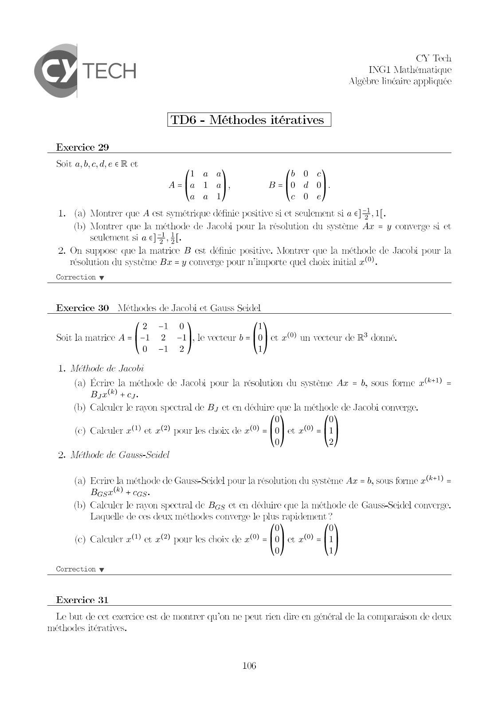
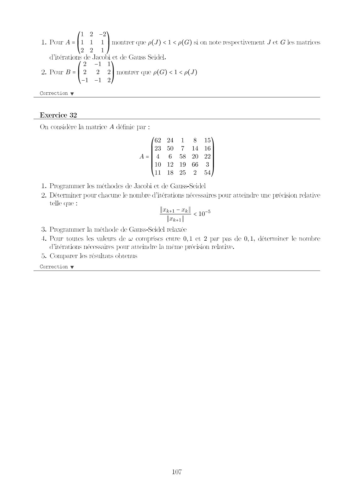
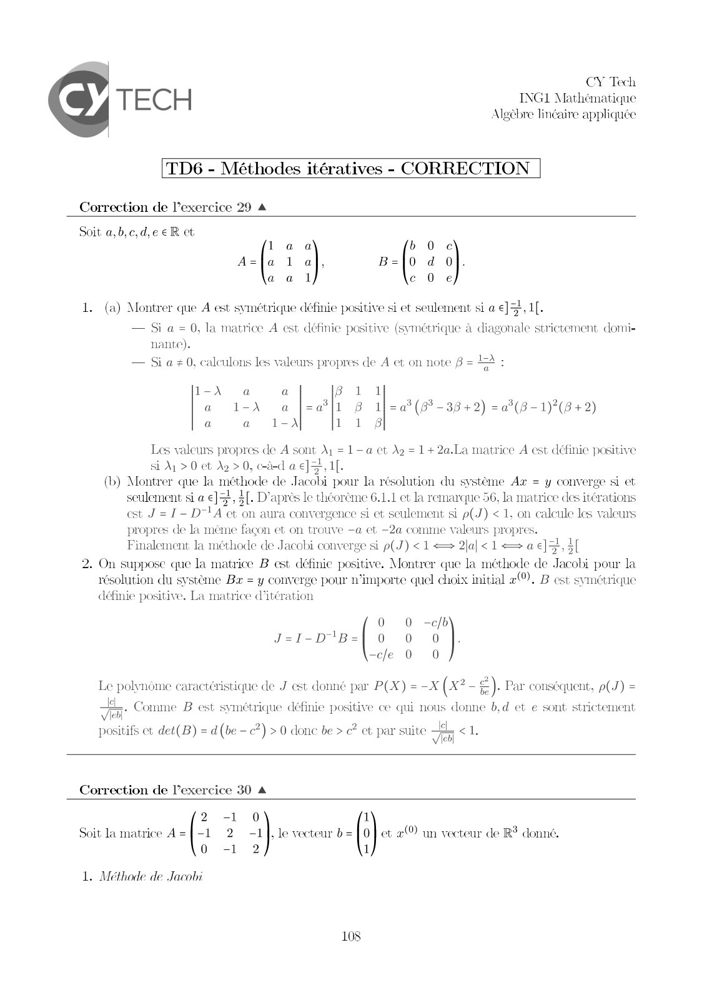
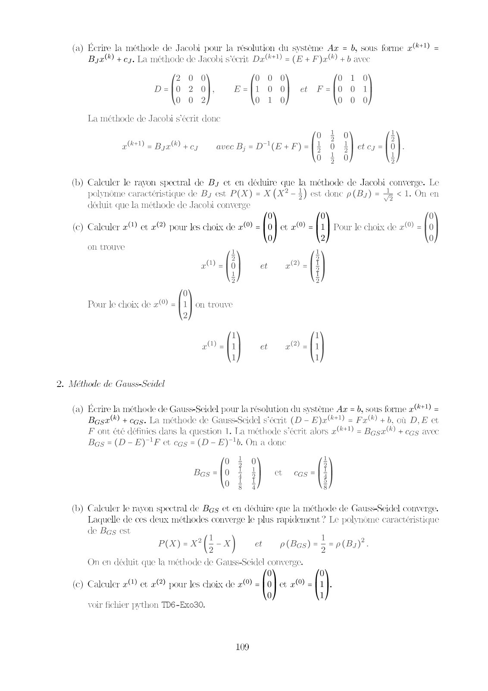
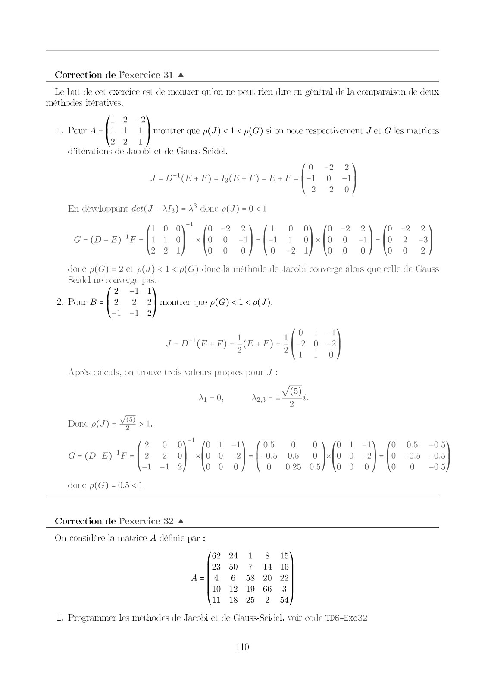
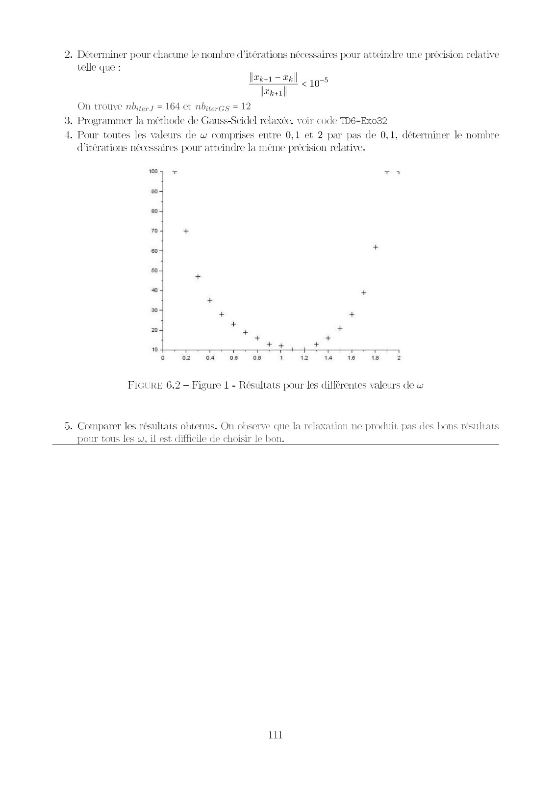

# ALGEBRE LINEAIRE CORRIGÉ TD6.pdf

[Ouvrir l’original](https://drive.google.com/open?id=1gf22k3W_fD6OBCSyGG7Bw_gAzKZDcEFb) · Les pages signalées comprennent du texte reconnu automatiquement ou des éléments graphiques. Le fac-similé permet de vérifier chaque lecture.

**Pages avec fac-similé ou lecture OCR** — 1–6.

## Page 1

**Lecture OCR à contrôler**

~~~text
CY Tech

TECH INGL Mathématique

Algèbre linéaire appliquée

TD6 - Méthodes itératives

Exercice 29

Soit a,b,c,d,

laa b 0 ©
A=la 1 a}, B=10 d 0
aal c 0e

1. (a) Montrer que A est symétrique définie positive si ct seulement si a €],1[.
(b) Montrer que la méthode de Jacobi pour la résolution du système Ax = y converge si et
seulement si a €]=, 3[-
2. On suppose que la matrice B est définie positive. Montrer que la méthode de Jacobi pour la
résolution du système Ba = y converge pour n'importe quel choix initial 2).

Correction w

Exercice 30 Méthodes de Jacobi et Gauss Seidel.

2 -1 0 ik
Soit la matrice A=}-1 2-1], le vocteur b=] 0} et 2 un vocteur de R? donné.
0 -1 2 1

1. Méthode de Jacobi
(a) Écrire la méthode de Jacobi pour la résolution du système Az = b, sous forme æ(%+1) =
Bye) +e).
(b) Calculer le rayon spectral de By et en déduire que la méthode de Jacobi converge.

(e) Calculer e& et 2@) pour les choix de #0 =] 0} et e 2 [1
0 2
2. Méthode de Gauss-Seidel

(a) Ecrire la méthode de Gauss-Seidel pour la résolution du systéme Az = b, sous forme a@t) =
Bost + cas.

(b) Calculer le rayon spectral de Beg et en déduire que la méthode de Gauss-Seidel converge.
Laquelle de ces deux méthodes converge le plus rapidement ?

0 0
(c) Calculer x™ et 2@ pour les choix de x =] 0} ct 2 2 [1
0 1

Correction w

Exercice 31

Le but de cet exercice est de montrer qu'on ne peut rien dire en général de la comparaison de deux
méthodes itératives.

106
~~~

## Page 2

**Lecture OCR à contrôler**

~~~text
1 2 -2
1. Pour A=}1 1 1 | montrer que p(J) < 1 < p(G) si on note respectivement J et G les matrices
2 2

d'itérations de Jacobi et de Gauss Seidel.

-1 1
2. Pour B=] 2 2 2} montrer que p(G) <1 < p(J)
“| #1, 2

Correction y

Exercice 32

On considère la matrice A définie par :

62 24 1 8 15
23 50 7 14 16
A=]4 6 58 20 22
10 12 19 66 3
11 18 25 2 54

1. Programmer les méthodes de Jacobi et de Gauss-Seidel

2. Déterminer pour chacune le nombre @itérations né
telle que :

saires pour atteindre une précision relative

[ter = tel)
[ener
3. Programmer la méthode de Gauss-Seidel relaxce
4. Pour toutes les valeurs de w comprises entre 0,1 et 2 par pas de 0,1, déterminer le nombre
iterations nécessaires pour atteindre la méme précision relative.

<10°

5. Comparer les résultats obtenus

Correction w

107
~~~

## Page 3

**Lecture OCR à contrôler**

~~~text
CY Tech

TECH INGL Mathématique

Algèbre linéaire appliquée

TD6 - Méthodes itératives - CORRECTION

Correction de l'exercice 29 4

Soit a,b,c,d,eeR ct

laa b 0 ©
A=la la B=10 d 0
aatl c 0e

1. (a) Montrer que A est symétrique définie positive si et seulement si a €]=,1[.
— Si a = 0, la matrice A est définie positive (symétrique à diagonale strictement domi-
nante).
— Si a # 0, calculons les valeurs propres de A et on note B = 12 :

1-À a a Br
a 1-X a |[=a|1 8 1|=a(#-38+2) =a*(8-1)(8+2)
a a 1-X 1 1 8

Les valeurs propres de A sont À
Si A > 0 et Az > 0, cad a JE, 1[.
(b) Montrer que la méthode de Jacobi pour la résolution du système Ax = y converge si et
seulement si a GE 3L- D'après le théorème 6.1.1 et la remarque 56, la matrice des itérations
est J = 1 - DTA ct on aura convergence si et seulement si p(J) < 1, on calcule les valeurs
propres de la méme façon et on trouve -a et -2a comme valeurs propres.
Finalement la méthode de Jacobi converge si p(J) <1 = 2al< 1 a €], À
2. On suppose que la matrice B est définie positive. Montrer que la méthode de Jacobi pour la
résolution du système Bx = y converge pour n'importe quel choix initial 2), B est symétrique
définie positive. La matrice d'itération

—a ot À2 = 1+2a.La matrice A est définie positive

0 0 -cb
J=I1-D'B=| 0 0 0
-cle 0 0

Le polynôme caractéristique de J est donné par P(X) = -X (x? = €). Par conséquent, p(J) =

re
|

Comme B est symétrique définie positive ce qui nous donne b,d et e sont strictement

cb]
positifs ct det(B) = d (be - c) > 0 done be > €? et par suite EL < 1.
Correction de l'exercice 30 A
2 -1 0 1
Soit la matrice A=}-1 2-1], le vecteur b= [0 | et æ(0) un vecteur de R? donné.
0 -1 2 1

thode de Jacobi

108
~~~

## Page 4

**Lecture OCR à contrôler**

~~~text
(a) Écrire la méthode de Jacobi pour la résolution du système A = b, sous forme a) =
Ba) +e. La méthode de Jacobi s'écrit Da*)) = (B+ F)x +b avec

2 0 0 0 0 0 0 1 0
D=10 2 Of, E=|1 0 O} et F=]0 01
0 0 2 0 1 0 0 0 0

La méthode de Jacobi s'écrit donc
| et CJ = |

(b) Calculer le rayon spectral de By et en déduire que la méthode de Jacobi converge. Le
polynôme caractéristique de By est P(X) = X (X?-$) est donc p(By) = 5 <1. On en
déduit que la méthode de Jacobi converge

0 0 0
(c) Calculer 2 et 2 pour les choix de x = (") ct 2 = (] Pour le choix de æ(0) = ("}
0.

0 2
1

«| ] a “9. |

0

Pour le choix de 2 =} 1] on trouve

a = Bye +e; avec By = D'(B + F) = (

Lie One
=

Suns
vie One
our ©

on trouve

Sie one

EE

2

2. Méthode de Gauss-Seidel

(a) Écrire la méthode de Gauss-Seidel pour la résolution du système Az = b, sous forme at) =
Bas) + cas. La méthode de GaussSeidel s'écrit (D - E)a@*) = Fax) +b, où D,E et
F ont été définies dans la question 1. Ta méthode s'écrit alors 240 = Baga) + cas avec
Bos = (D-E)'F et cas = (D -E) !b. On a donc

0 À 0 3
Bas =|0 Fa) « cas = i
ott 4

8 4 8

(b) Calculer le rayon spectral de Bag et en déduire que la méthode de Gauss-Seidel converge.
Laquelle de ces deux méthodes converge le plus rapidement ? Le polynome caractéristique
de Bas est | 7
ve à: 7 2
P«x)=x?(5-x) et p(Bes) = 5 = (Bu).

On en déduit que la méthode de Gauss-Seidel converge.
0 0
(c) Calculer «&™ et 2) pour les choix de « = () ct æ(0) = (')

0 1
voir fichier python TD6-Ex030.

109
~~~

## Page 5

**Lecture OCR à contrôler**

~~~text
Correction de l’exercice 31 4

Le but de cet exercice est de montrer qu'on ne peut rien dire en général de la comparaison de deux

méthodes itératives.

1 2 -2
1. Pour A=|1 1 1
2 2 1
(iterations de J.

acobi et de Gauss Seidel.

J=D\(E+F)=B(E+F)=E+F

En développant det(J - M3) = X donc

p(J)=0<1

=2
0
-2

2
=1
0

|

montrer que p(J) < 1 < p(G) si on note respectivement J et G les matrices

0 0\' fo -2 2 1 0 0) fo -2
1 0 x[0 O -lJ={-1 1 O[xX[0 0
2 1 0 0 0 o -2 1) \o o

donc p(G) = 2 ct p(J) < 1 < p(G) donc la méthode de Jacobi converge alors que celle de Gauss
Seidel ne converge pas.

c-w-rr.|

CES)

2 -1 1
2. Pour B = 2 2 1 montrer que p(G) < 1 < p(J).
el <1, 2

4 1
J=D"\(E+F)==(E+F)==
(E+ F)=S(E+F)=5

Après calculs, on trouve trois valeurs propres pour J :

Ay = 0, do3 = +
Done p(s) = VE
2 0 0 ! O 1 -1 0.5 0 0 01 -1 0 05 -0.5
G=(D-E)'F = 2 2 0 x[0 O -2}1=1-05 05 O |x 0 -2]=10 -05 -O.E
1-12) (oo o 0 025 05) lo o 0) \o o 0.

done p(G) =0.5<1

Correction de lexercice 32 4

On considère la matrice A définie par :

62 24 1 8 15
23 50 7 14 16
A=]4 6 58 20 22
10 12 19 66 3
11 18 25 2 54

1. Programmer les méthodes de Jacobi et de Gauss-Seidel. voir code TD6-Ex032

110
~~~

## Page 6

**Lecture OCR à contrôler**

~~~text
2. Déterminer pour chacune le nombre d’itérations nécessaires pour atteindre tme précision relative
telle que :
Ier = tell

<10
ren

On trouve nbiterg = 164 ct nbiteras = 12

3. Programmer la méthode de Gauss-Seidel relaxée. voir code TD6-Ex032

4. Pour toutes les valeurs de w comprises entre 0,1 et 2 par pas de 0,1, déterminer le nombre
(iterations nécessaires pour atteindre la méme précision relative.

10 + ES

204
70 %
eo

04

204
204 5

10

FIGURE 6.2 — Figure 1 - Résultats pour les différentes valeurs de w

5. Comparer les résultats obtenus. On observe que la relaxation ne produit pas des bons résultats
pour tous les w, il est difficile de choisir le bon.

11
~~~
