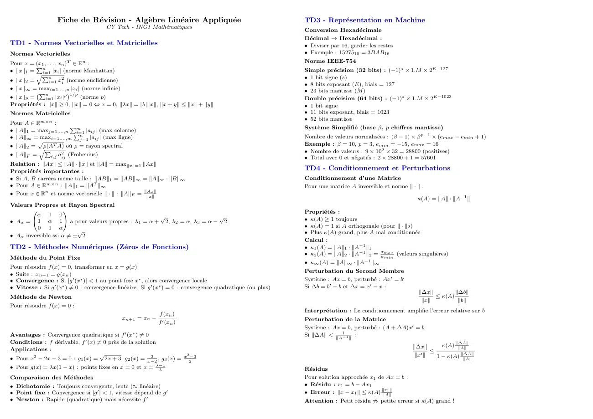
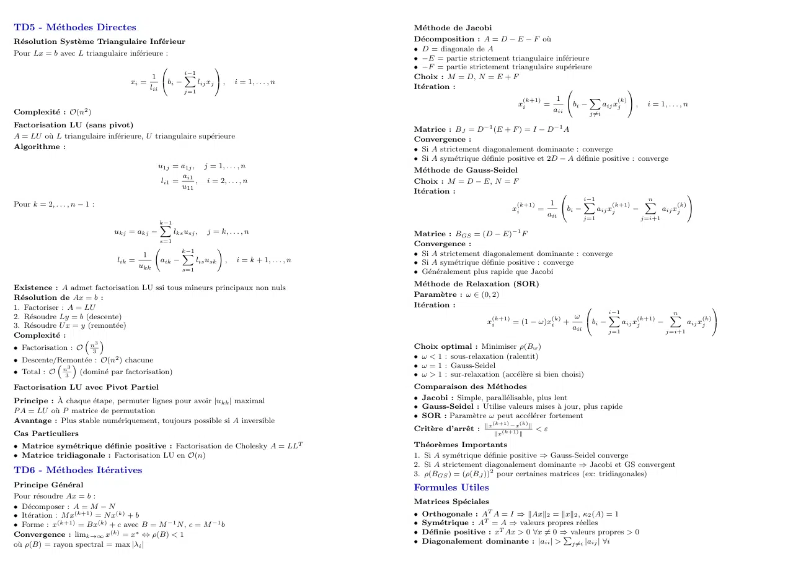

# Brouillon Algebre.pdf

[Ouvrir l’original](https://drive.google.com/open?id=1Q1gx7LW82y_a7xEwV2sC8NC2xuBFZkq-) · Les deux lectures automatiques du PDF divergent sur les pages indiquées. Leur fac-similé accompagne le texte.

**Pages présentant un écart entre les deux extractions** — 1–3.

## Page 1

~~~text
                   Fiche de Révision - Algèbre Linéaire Appliquée                                         TD3 - Représentation en Machine
                                       CY Tech - ING1 Mathématiques
                                                                                                              Conversion Hexadécimale
                                                                                                              Décimal → Hexadécimal :
TD1 - Normes Vectorielles et Matricielles                                                                     ˆ Diviser par 16, garder les restes
Normes Vectorielles                                                                                           ˆ Exemple : 1527510 = 3BAB16
Pour x = (x1 , . . . , xn )T ∈ Rn :                                                                           Norme IEEE-754
ˆ ∥x∥1 = q n                                                                                                  Simple précision (32 bits) : (−1)s × 1.M × 2E−127
          P
             i=1 |xi | (norme Manhattan)
ˆ ∥x∥2 =
            Pn          2                                                                                     ˆ 1 bit signe (s)
                i=1 xi (norme euclidienne)
                                                                                                              ˆ 8 bits exposant (E), biais = 127
ˆ ∥x∥∞ = maxi=1,...,n |xi | (norme infinie)                                                                   ˆ 23 bits mantisse (M )
ˆ ∥x∥p =                 p 1/p (norme p)
           Pn              
              i=1 |xi |                                                                                       Double précision (64 bits) : (−1)s × 1.M × 2E−1023
Propriétés : ∥x∥ ≥ 0, ∥x∥ = 0 ⇔ x = 0, ∥λx∥ = |λ|∥x∥, ∥x + y∥ ≤ ∥x∥ + ∥y∥                                   ˆ 1 bit signe
Normes Matricielles                                                                                           ˆ 11 bits exposant, biais = 1023
                                                                                                              ˆ 52 bits mantisse
Pour A ∈ Rm×n :
                                                                                                              Système Simplifié (base β, p chiffres mantisse)
ˆ ∥A∥1 = maxj=1,...,n P
                      Pm
                        i=1 |aij | (max colonne)
ˆ ∥A∥∞ = maxi=1,...,m n  j=1 |aij | (max ligne)
                                                                                                              Nombre de valeurs normalisées : (β − 1) × β p−1 × (emax − emin + 1)
ˆ ∥A∥2 = qρ(AT A) où ρ = rayon spectral                                                                      Exemple : β = 10, p = 3, emin = −15, emax = 16
         p
                                                                                                              ˆ Nombre de valeurs : 9 × 102 × 32 = 28800 (positives)
ˆ ∥A∥F =          2
           P
             i,j aij (Frobenius)                                                                              ˆ Total avec 0 et négatifs : 2 × 28800 + 1 = 57601
Relation : ∥Ax∥ ≤ ∥A∥ · ∥x∥ et ∥A∥ = max∥x∥=1 ∥Ax∥
Propriétés importantes :
                                                                                                              TD4 - Conditionnement et Perturbations
ˆ Si A, B carrées même taille : ∥AB∥1 = ∥AB∥∞ = ∥A∥∞ · ∥B∥∞                                                 Conditionnement d’une Matrice
ˆ Pour A ∈ Rm×n : ∥A∥1 = ∥AT ∥∞                                                                               Pour une matrice A inversible et norme ∥ · ∥ :
ˆ Pour x ∈ Rn et norme vectorielle ∥ · ∥ : ∥A∥F = ∥Ax∥
                                                   ∥x∥
                                                                                                                                                         κ(A) = ∥A∥ · ∥A−1 ∥
Valeurs Propres et Rayon Spectral
       
         α 1 0
                                                                                                             Propriétés :
                                                √                   √                                         ˆ κ(A) ≥ 1 toujours
ˆ Aα = 1 α 1  a pour valeurs propres : λ1 = α + 2, λ2 = α, λ3 = α − 2
       
          0 1 α                                                                                               ˆ κ(A) = 1 si A orthogonale (pour ∥ · ∥2 )
                          √                                                                                   ˆ Plus κ(A) grand, plus A mal conditionnée
ˆ Aα inversible ssi α ̸= ± 2
                                                                                                              Calcul :
TD2 - Méthodes Numériques (Zéros de Fonctions)                                                             ˆ κ1 (A) = ∥A∥1 · ∥A−1 ∥1
                                                                                                              ˆ κ2 (A) = ∥A∥2 · ∥A−1 ∥2 = σσmax (valeurs singulières)
Méthode du Point Fixe                                                                                                                       min
                                                                                                              ˆ κ∞ (A) = ∥A∥∞ · ∥A−1 ∥∞
Pour résoudre f (x) = 0, transformer en x = g(x)
                                                                                                              Perturbation du Second Membre
ˆ Suite : xn+1 = g(xn )
ˆ Convergence : Si |g ′ (x∗ )| < 1 au point fixe x∗ , alors convergence locale                                Système : Ax = b, perturbé : Ax′ = b′
ˆ Vitesse : Si g ′ (x∗ ) ̸= 0 : convergence linéaire. Si g ′ (x∗ ) = 0 : convergence quadratique (ou plus)   Si ∆b = b′ − b et ∆x = x′ − x :
                                                                                                                                                          ∥∆x∥        ∥∆b∥
Méthode de Newton                                                                                                                                             ≤ κ(A)
                                                                                                                                                           ∥x∥         ∥b∥
Pour résoudre f (x) = 0 :
                                                                                                              Interprétation : Le conditionnement amplifie l’erreur relative sur b
                                                             f (xn )
                                              xn+1 = xn −                                                     Perturbation de la Matrice
                                                             f ′ (xn )
                                                                                                              Système : Ax = b, perturbé : (A + ∆A)x′ = b
Avantages : Convergence quadratique si f ′ (x∗ ) ̸= 0                                                         Si ∥∆A∥ < ∥A−11
                                                                                                                              ∥
                                                                                                                                 :
Conditions : f dérivable, f ′ (x) ̸= 0 près de la solution                                                                                                               ∥∆A∥
                                                                                                                                                        ∥∆x∥       κ(A) ∥A∥
Applications :                                                                                                                                                 ≤
                                     √                                   2                                                                               ∥x′ ∥   1 − κ(A)
                                                                                                                                                                          ∥∆A∥
ˆ Pour x2 − 2x − 3 = 0 : g1 (x) = 2x + 3, g2 (x) = x−2    3
                                                             , g3 (x) = x 2−3                                                                                                ∥A∥

ˆ Pour g(x) = λx(1 − x) : points fixes en x = 0 et x = λ−1
                                                        λ                                                     Résidus
Comparaison des Méthodes                                                                                     Pour solution approchée x1 de Ax = b :
ˆ Dichotomie : Toujours convergente, lente (≈ linéaire)                                                      ˆ Résidu : r1 = b − Ax1
ˆ Point fixe : Convergence si |g ′ | < 1, vitesse dépend de g ′                                              ˆ Erreur : ∥x − x1 ∥ ≤ κ(A) ∥r 1∥
                                                                                                                                           ∥A∥
ˆ Newton : Rapide (quadratique) mais nécessite f ′                                                           Attention : Petit résidu ̸⇒ petite erreur si κ(A) grand !
~~~

## Page 2

~~~text
TD5 - Méthodes Directes                                                                            Méthode de Jacobi
Résolution Système Triangulaire Inférieur                                                        Décomposition : A = D − E − F où
                                                                                                    ˆ D = diagonale de A
Pour Lx = b avec L triangulaire inférieure :
                                                                                                    ˆ −E = partie strictement triangulaire inférieure
                                                                                                  ˆ −F = partie strictement triangulaire supérieure
                                                 i−1
                                        1       X                                                  Choix : M = D, N = E + F
                                  xi =      bi −     lij xj  ,              i = 1, . . . , n
                                       lii                                                          Itération :
                                                 j=1                                                                                                                
                                                                                                                                 (k+1)     1          X         (k) 
                                                                                                                                xi     =         bi −       aij xj     ,   i = 1, . . . , n
Complexité : O(n2 )                                                                                                                      aii          j̸=i
Factorisation LU (sans pivot)
                                                                                                    Matrice : BJ = D−1 (E + F ) = I − D−1 A
A = LU où L triangulaire inférieure, U triangulaire supérieure                                   Convergence :
Algorithme :                                                                                        ˆ Si A strictement diagonalement dominante : converge
                                                                                                    ˆ Si A symétrique définie positive et 2D − A définie positive : converge
                                            u1j = a1j , j = 1, . . . , n
                                                                                                    Méthode de Gauss-Seidel
                                                   ai1
                                             li1 =     , i = 2, . . . , n                           Choix : M = D − E, N = F
                                                   u11
                                                                                                    Itération :                                                                       
                                                                                                                                                        i−1                n
Pour k = 2, . . . , n − 1 :                                                                                                        (k+1)      1        X        (k+1)
                                                                                                                                                                          X         (k) 
                                                                                                                                  xi     =         bi −     aij xj     −       aij xj
                                                                                                                                             aii        j=1              j=i+1
                                            k−1
                                            X
                              ukj = akj −         lks usj ,   j = k, . . . , n                      Matrice : BGS = (D − E)−1 F
                                            s=1
                                                                                                    Convergence :
                                                     k−1
                                                                                                    ˆ Si A strictement diagonalement dominante : converge
                                                                     !
                                       1             X
                              lik =         aik −          lis usk       ,   i = k + 1, . . . , n   ˆ Si A symétrique définie positive : converge
                                      ukk            s=1                                            ˆ Généralement plus rapide que Jacobi
                                                                                                    Méthode de Relaxation (SOR)
Existence : A admet factorisation LU ssi tous mineurs principaux non nuls
Résolution de Ax = b :                                                                             Paramètre : ω ∈ (0, 2)
1. Factoriser : A = LU                                                                              Itération :                                                                              
                                                                                                                                                               i−1                n
2. Résoudre Ly = b (descente)                                                                                             (k+1)           (k)       ω        X        (k+1)
                                                                                                                                                                                 X         (k) 
                                                                                                                          xi     = (1 − ω)xi +            bi −     aij xj     −       aij xj
3. Résoudre U x = y (remontée)                                                                                                                    aii        j=1              j=i+1
Complexité :
                         n3
                     
ˆ Factorisation : O       3
                                                                                                    Choix optimal : Minimiser ρ(Bω )
ˆ Descente/Remontée : O(n2 ) chacune                                                               ˆ ω < 1 : sous-relaxation (ralentit)
            3                                                                                     ˆ ω = 1 : Gauss-Seidel
ˆ Total : O n3 (dominé par factorisation)                                                          ˆ ω > 1 : sur-relaxation (accélère si bien choisi)
Factorisation LU avec Pivot Partiel                                                                 Comparaison des Méthodes
Principe : À chaque étape, permuter lignes pour avoir |ukk | maximal                              ˆ Jacobi : Simple, parallélisable, plus lent
                                                                                                    ˆ Gauss-Seidel : Utilise valeurs mises à jour, plus rapide
P A = LU où P matrice de permutation
                                                                                                    ˆ SOR : Paramètre ω peut accélérer fortement
Avantage : Plus stable numériquement, toujours possible si A inversible
                                                                                                                          ∥x(k+1) −x(k) ∥
                                                                                                    Critère d’arrêt :                   <ε
Cas Particuliers                                                                                                             ∥x(k+1) ∥

ˆ Matrice symétrique définie positive : Factorisation de Cholesky A = LLT                         Théorèmes Importants
ˆ Matrice tridiagonale : Factorisation LU en O(n)                                                   1. Si A symétrique définie positive ⇒ Gauss-Seidel converge
                                                                                                    2. Si A strictement diagonalement dominante ⇒ Jacobi et GS convergent
TD6 - Méthodes Itératives                                                                         3. ρ(BGS ) = (ρ(BJ ))2 pour certaines matrices (ex: tridiagonales)
Principe Général                                                                                  Formules Utiles
Pour résoudre Ax = b :
                                                                                                    Matrices Spéciales
ˆ Décomposer : A = M − N
ˆ Itération : M x(k+1) = N x(k) + b                                                                ˆ Orthogonale : AT A = I ⇒ ∥Ax∥2 = ∥x∥2 , κ2 (A) = 1
ˆ Forme : x(k+1) = Bx(k) + c avec B = M −1 N , c = M −1 b                                           ˆ Symétrique : AT = A ⇒ valeurs propres réelles
Convergence : limk→∞ x(k) = x∗ ⇔ ρ(B) < 1                                                           ˆ Définie positive : xT Ax > 0 ∀x ̸= 0 ⇒
                                                                                                                                            Pvaleurs propres > 0
où ρ(B) = rayon spectral = max |λi |                                                               ˆ Diagonalement dominante : |aii | > j̸=i |aij | ∀i
~~~

## Page 3

~~~text
Valeurs Propres
ˆ det(A − λI) = 0 (équation caractéristique)
ˆ ρ(A) = maxi |λi | (rayon spectral)
ˆ ρ(A) ≤ ∥A∥ pour toute norme matricielle
Erreurs et Résidus
ˆ Erreur absolue : e = |x − x̃|
ˆ Erreur relative : er = |x−x̃|
                           |x|
ˆ Résidu : r = b − Ax̃
         ∥e∥         ∥r∥
ˆ Lien : ∥x̃∥ ≤ κ(A) ∥b∥
~~~
