# Chap1-slides.pdf

[Ouvrir l’original](https://drive.google.com/open?id=1vql9F4GixYkJWGn9l_pD6cjXD9VttLoE) · Les deux lectures automatiques du PDF divergent sur les pages indiquées. Leur fac-similé accompagne le texte.

**Pages présentant un écart entre les deux extractions** — 1–64.

## Page 1

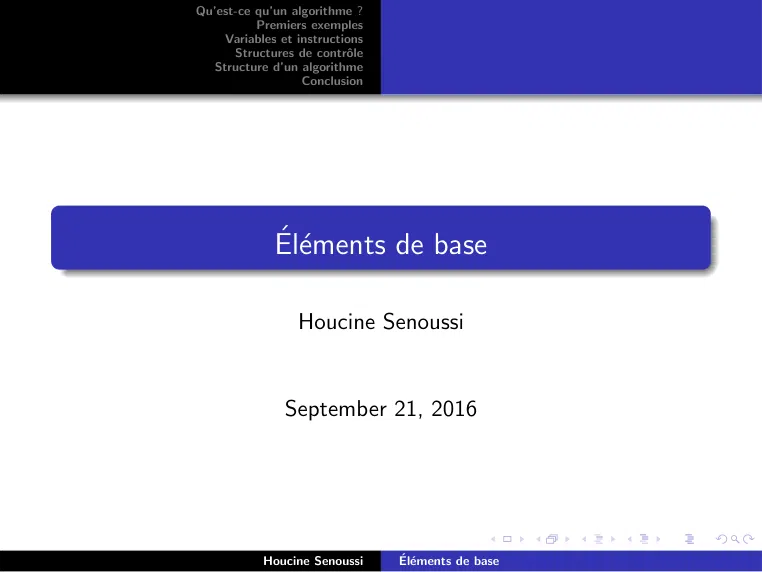

~~~text
Qu’est-ce qu’un algorithme ?
          Premiers exemples
    Variables et instructions
      Structures de contrôle
  Structure d’un algorithme
                  Conclusion

             Éléments de base

                 Houcine Senoussi

               September 21, 2016

           Houcine Senoussi     Éléments de base
~~~

## Page 2

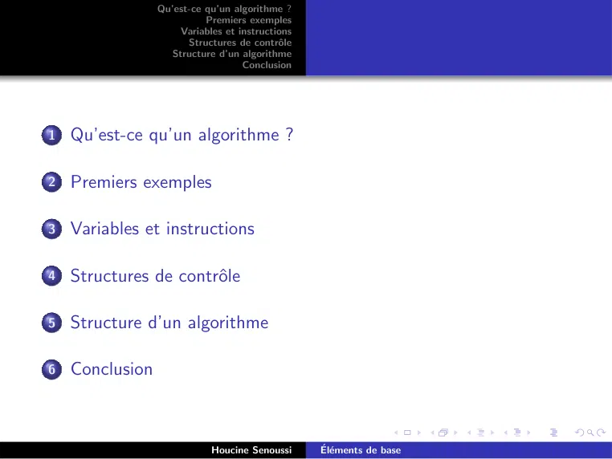

~~~text
                 Qu’est-ce qu’un algorithme ?
                           Premiers exemples
                     Variables et instructions
                       Structures de contrôle
                   Structure d’un algorithme
                                   Conclusion

1   Qu’est-ce qu’un algorithme ?

2   Premiers exemples

3   Variables et instructions

4   Structures de contrôle

5   Structure d’un algorithme

6   Conclusion

                            Houcine Senoussi     Éléments de base
~~~

## Page 3

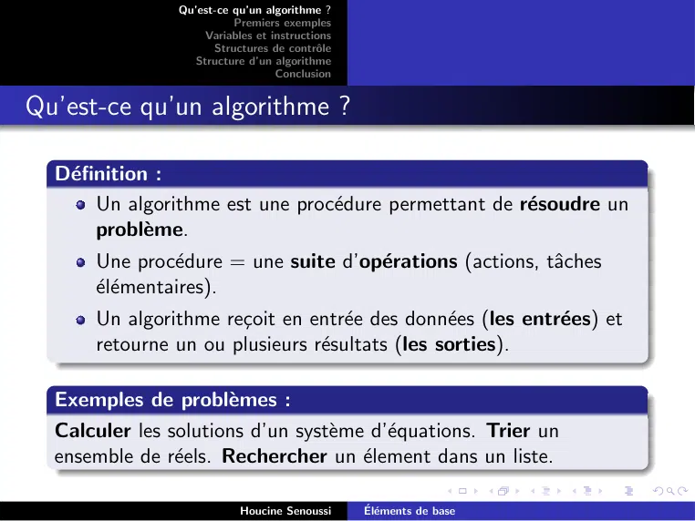

~~~text
                Qu’est-ce qu’un algorithme ?
                          Premiers exemples
                    Variables et instructions
                      Structures de contrôle
                  Structure d’un algorithme
                                  Conclusion

Qu’est-ce qu’un algorithme ?

  Définition :
       Un algorithme est une procédure permettant de résoudre un
       problème.
      Une procédure = une suite d’opérations (actions, tâches
      élémentaires).
      Un algorithme reçoit en entrée des données (les entrées) et
      retourne un ou plusieurs résultats (les sorties).

  Exemples de problèmes :
  Calculer les solutions d’un système d’équations. Trier un
  ensemble de réels. Rechercher un élement dans un liste.

                           Houcine Senoussi     Éléments de base
~~~

## Page 4

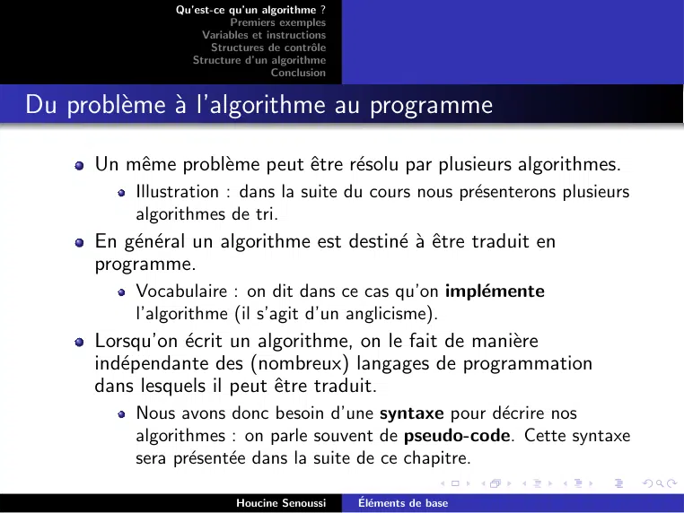

~~~text
                Qu’est-ce qu’un algorithme ?
                          Premiers exemples
                    Variables et instructions
                      Structures de contrôle
                  Structure d’un algorithme
                                  Conclusion

Du problème à l’algorithme au programme

      Un même problème peut être résolu par plusieurs algorithmes.
           Illustration : dans la suite du cours nous présenterons plusieurs
           algorithmes de tri.
      En général un algorithme est destiné à être traduit en
      programme.
           Vocabulaire : on dit dans ce cas qu’on implémente
           l’algorithme (il s’agit d’un anglicisme).
      Lorsqu’on écrit un algorithme, on le fait de manière
      indépendante des (nombreux) langages de programmation
      dans lesquels il peut être traduit.
           Nous avons donc besoin d’une syntaxe pour décrire nos
           algorithmes : on parle souvent de pseudo-code. Cette syntaxe
           sera présentée dans la suite de ce chapitre.

                           Houcine Senoussi     Éléments de base
~~~

## Page 5

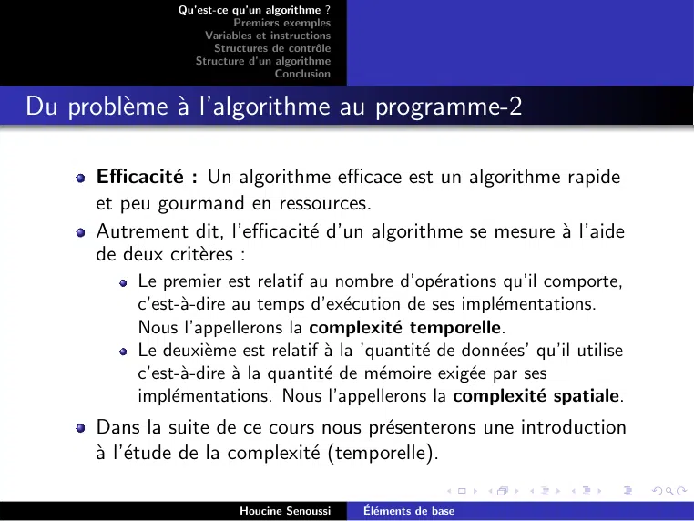

~~~text
                Qu’est-ce qu’un algorithme ?
                          Premiers exemples
                    Variables et instructions
                      Structures de contrôle
                  Structure d’un algorithme
                                  Conclusion

Du problème à l’algorithme au programme-2

      Efficacité : Un algorithme efficace est un algorithme rapide
      et peu gourmand en ressources.
      Autrement dit, l’efficacité d’un algorithme se mesure à l’aide
      de deux critères :
           Le premier est relatif au nombre d’opérations qu’il comporte,
           c’est-à-dire au temps d’exécution de ses implémentations.
           Nous l’appellerons la complexité temporelle.
           Le deuxième est relatif à la ’quantité de données’ qu’il utilise
           c’est-à-dire à la quantité de mémoire exigée par ses
           implémentations. Nous l’appellerons la complexité spatiale.
      Dans la suite de ce cours nous présenterons une introduction
      à l’étude de la complexité (temporelle).

                           Houcine Senoussi     Éléments de base
~~~

## Page 6

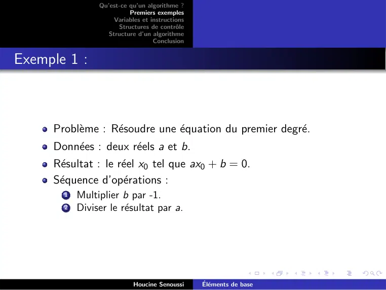

~~~text
                Qu’est-ce qu’un algorithme ?
                          Premiers exemples
                    Variables et instructions
                      Structures de contrôle
                  Structure d’un algorithme
                                  Conclusion

Exemple 1 :

     Problème : Résoudre une équation du premier degré.
     Données : deux réels a et b.
     Résultat : le réel x0 tel que ax0 + b = 0.
     Séquence d’opérations :
       1   Multiplier b par -1.
       2   Diviser le résultat par a.

                           Houcine Senoussi     Éléments de base
~~~

## Page 7

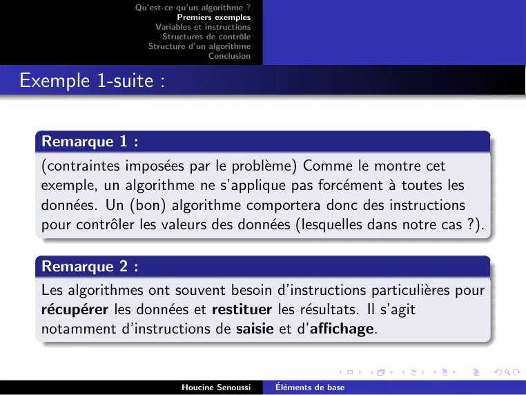

~~~text
                 Qu’est-ce qu’un algorithme ?
                           Premiers exemples
                     Variables et instructions
                       Structures de contrôle
                   Structure d’un algorithme
                                   Conclusion

Exemple 1-suite :

  Remarque 1 :
  (contraintes imposées par le problème) Comme le montre cet
  exemple, un algorithme ne s’applique pas forcément à toutes les
  données. Un (bon) algorithme comportera donc des instructions
  pour contrôler les valeurs des données (lesquelles dans notre cas ?).

  Remarque 2 :
  Les algorithmes ont souvent besoin d’instructions particulières pour
  récupérer les données et restituer les résultats. Il s’agit
  notamment d’instructions de saisie et d’affichage.

                            Houcine Senoussi     Éléments de base
~~~

## Page 8

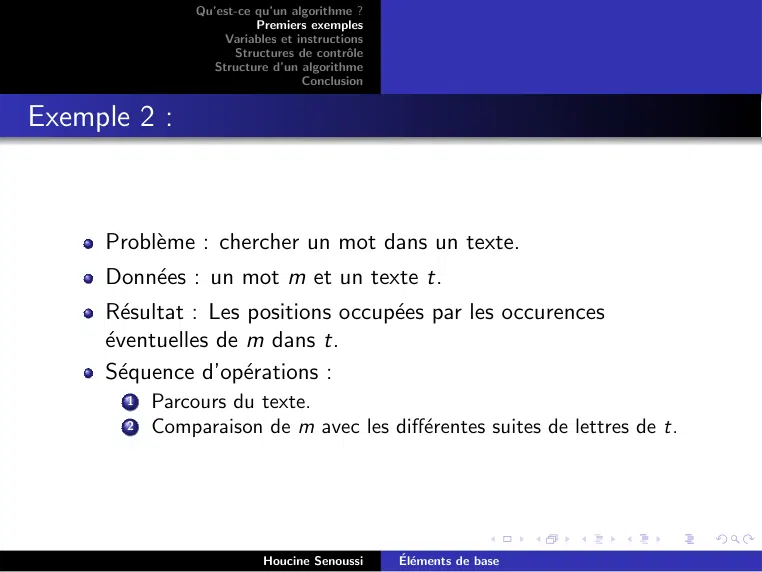

~~~text
                Qu’est-ce qu’un algorithme ?
                          Premiers exemples
                    Variables et instructions
                      Structures de contrôle
                  Structure d’un algorithme
                                  Conclusion

Exemple 2 :

     Problème : chercher un mot dans un texte.
     Données : un mot m et un texte t.
     Résultat : Les positions occupées par les occurences
     éventuelles de m dans t.
     Séquence d’opérations :
       1   Parcours du texte.
       2   Comparaison de m avec les différentes suites de lettres de t.

                           Houcine Senoussi     Éléments de base
~~~

## Page 9

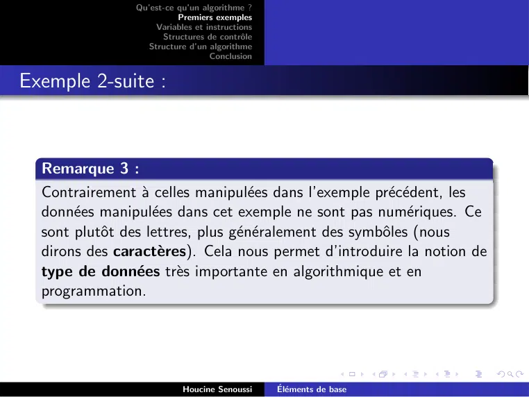

~~~text
                Qu’est-ce qu’un algorithme ?
                          Premiers exemples
                    Variables et instructions
                      Structures de contrôle
                  Structure d’un algorithme
                                  Conclusion

Exemple 2-suite :

  Remarque 3 :
  Contrairement à celles manipulées dans l’exemple précédent, les
  données manipulées dans cet exemple ne sont pas numériques. Ce
  sont plutôt des lettres, plus généralement des symbôles (nous
  dirons des caractères). Cela nous permet d’introduire la notion de
  type de données très importante en algorithmique et en
  programmation.

                           Houcine Senoussi     Éléments de base
~~~

## Page 10

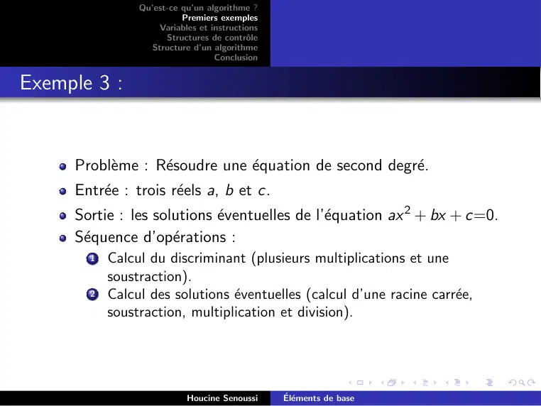

~~~text
                Qu’est-ce qu’un algorithme ?
                          Premiers exemples
                    Variables et instructions
                      Structures de contrôle
                  Structure d’un algorithme
                                  Conclusion

Exemple 3 :

     Problème : Résoudre une équation de second degré.
     Entrée : trois réels a, b et c.
     Sortie : les solutions éventuelles de l’équation ax 2 + bx + c=0.
     Séquence d’opérations :
       1   Calcul du discriminant (plusieurs multiplications et une
           soustraction).
       2   Calcul des solutions éventuelles (calcul d’une racine carrée,
           soustraction, multiplication et division).

                           Houcine Senoussi     Éléments de base
~~~

## Page 11

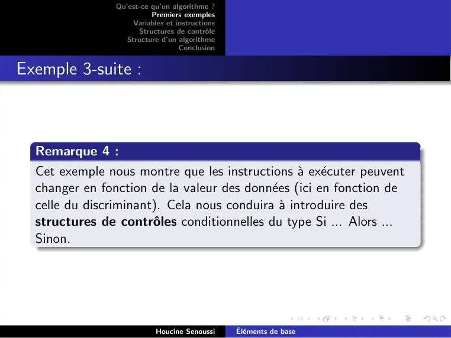

~~~text
                Qu’est-ce qu’un algorithme ?
                          Premiers exemples
                    Variables et instructions
                      Structures de contrôle
                  Structure d’un algorithme
                                  Conclusion

Exemple 3-suite :

  Remarque 4 :
  Cet exemple nous montre que les instructions à exécuter peuvent
  changer en fonction de la valeur des données (ici en fonction de
  celle du discriminant). Cela nous conduira à introduire des
  structures de contrôles conditionnelles du type Si ... Alors ...
  Sinon.

                           Houcine Senoussi     Éléments de base
~~~

## Page 12

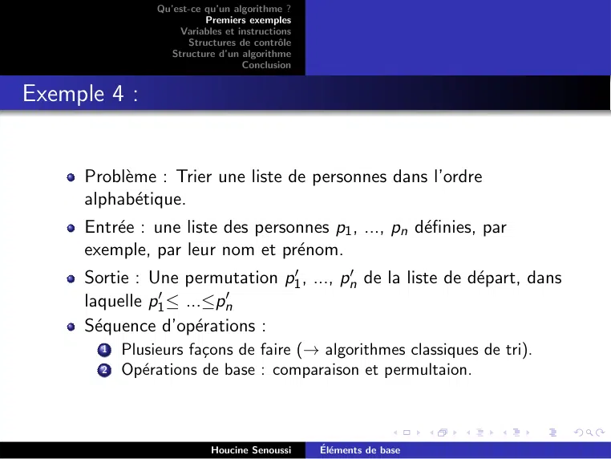

~~~text
                Qu’est-ce qu’un algorithme ?
                          Premiers exemples
                    Variables et instructions
                      Structures de contrôle
                  Structure d’un algorithme
                                  Conclusion

Exemple 4 :

     Problème : Trier une liste de personnes dans l’ordre
     alphabétique.
     Entrée : une liste des personnes p1 , ..., pn définies, par
     exemple, par leur nom et prénom.
     Sortie : Une permutation p10 , ..., pn0 de la liste de départ, dans
     laquelle p10 ≤ ...≤pn0
     Séquence d’opérations :
       1   Plusieurs façons de faire (→ algorithmes classiques de tri).
       2   Opérations de base : comparaison et permultaion.

                           Houcine Senoussi     Éléments de base
~~~

## Page 13

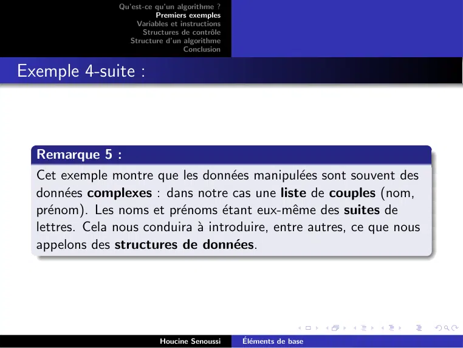

~~~text
                Qu’est-ce qu’un algorithme ?
                          Premiers exemples
                    Variables et instructions
                      Structures de contrôle
                  Structure d’un algorithme
                                  Conclusion

Exemple 4-suite :

  Remarque 5 :
  Cet exemple montre que les données manipulées sont souvent des
  données complexes : dans notre cas une liste de couples (nom,
  prénom). Les noms et prénoms étant eux-même des suites de
  lettres. Cela nous conduira à introduire, entre autres, ce que nous
  appelons des structures de données.

                           Houcine Senoussi     Éléments de base
~~~

## Page 14

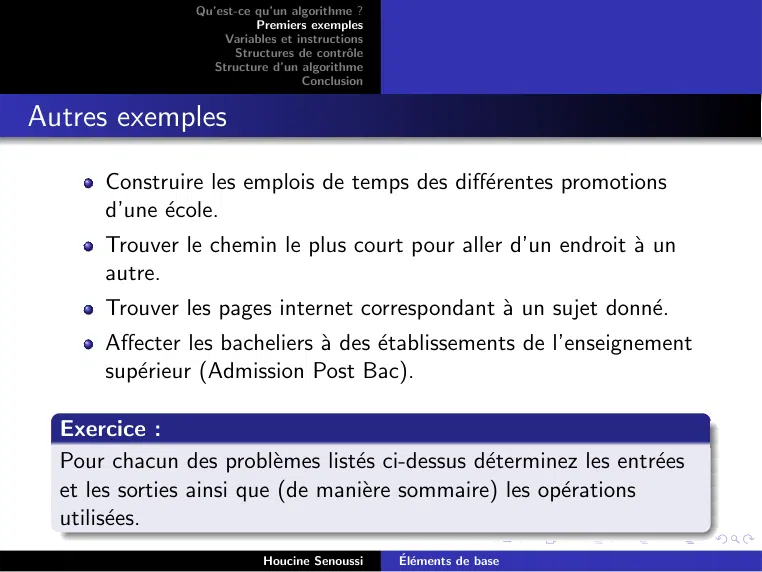

~~~text
                 Qu’est-ce qu’un algorithme ?
                           Premiers exemples
                     Variables et instructions
                       Structures de contrôle
                   Structure d’un algorithme
                                   Conclusion

Autres exemples

       Construire les emplois de temps des différentes promotions
       d’une école.
       Trouver le chemin le plus court pour aller d’un endroit à un
       autre.
       Trouver les pages internet correspondant à un sujet donné.
       Affecter les bacheliers à des établissements de l’enseignement
       supérieur (Admission Post Bac).

  Exercice :
  Pour chacun des problèmes listés ci-dessus déterminez les entrées
  et les sorties ainsi que (de manière sommaire) les opérations
  utilisées.
                            Houcine Senoussi     Éléments de base
~~~

## Page 15

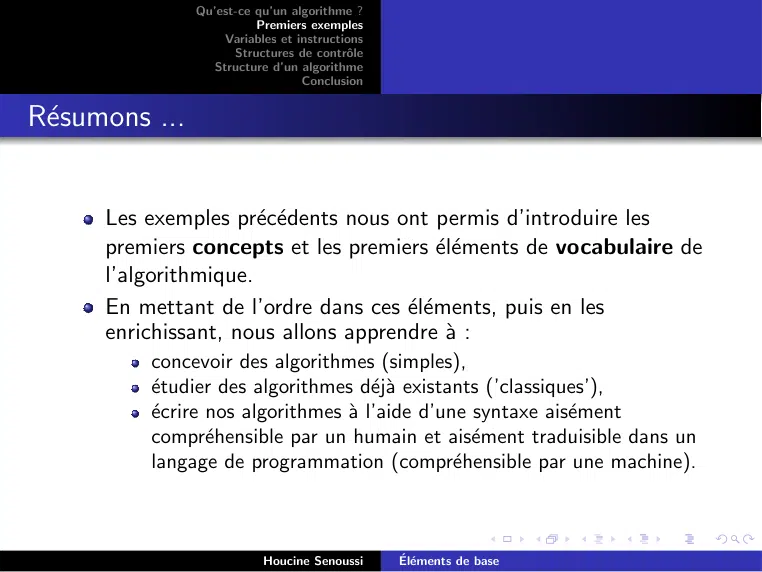

~~~text
                Qu’est-ce qu’un algorithme ?
                          Premiers exemples
                    Variables et instructions
                      Structures de contrôle
                  Structure d’un algorithme
                                  Conclusion

Résumons ...

      Les exemples précédents nous ont permis d’introduire les
      premiers concepts et les premiers éléments de vocabulaire de
      l’algorithmique.
      En mettant de l’ordre dans ces éléments, puis en les
      enrichissant, nous allons apprendre à :
          concevoir des algorithmes (simples),
          étudier des algorithmes déjà existants (’classiques’),
          écrire nos algorithmes à l’aide d’une syntaxe aisément
          compréhensible par un humain et aisément traduisible dans un
          langage de programmation (compréhensible par une machine).

                           Houcine Senoussi     Éléments de base
~~~

## Page 16

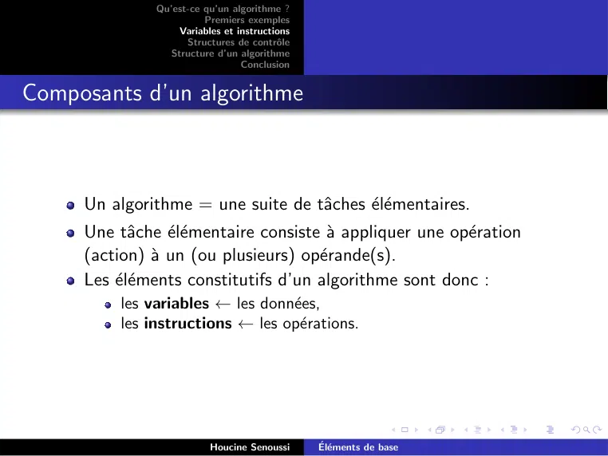

~~~text
               Qu’est-ce qu’un algorithme ?
                         Premiers exemples
                   Variables et instructions
                     Structures de contrôle
                 Structure d’un algorithme
                                 Conclusion

Composants d’un algorithme

     Un algorithme = une suite de tâches élémentaires.
     Une tâche élémentaire consiste à appliquer une opération
     (action) à un (ou plusieurs) opérande(s).
     Les éléments constitutifs d’un algorithme sont donc :
          les variables ← les données,
          les instructions ← les opérations.

                          Houcine Senoussi     Éléments de base
~~~

## Page 17

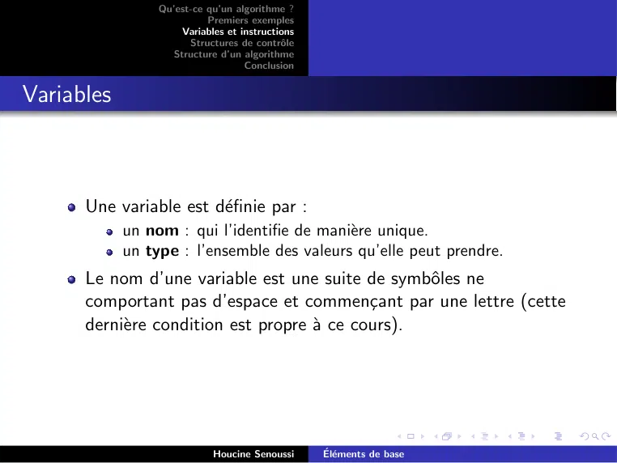

~~~text
                 Qu’est-ce qu’un algorithme ?
                           Premiers exemples
                     Variables et instructions
                       Structures de contrôle
                   Structure d’un algorithme
                                   Conclusion

Variables

      Une variable est définie par :
            un nom : qui l’identifie de manière unique.
            un type : l’ensemble des valeurs qu’elle peut prendre.
      Le nom d’une variable est une suite de symbôles ne
      comportant pas d’espace et commençant par une lettre (cette
      dernière condition est propre à ce cours).

                            Houcine Senoussi     Éléments de base
~~~

## Page 18

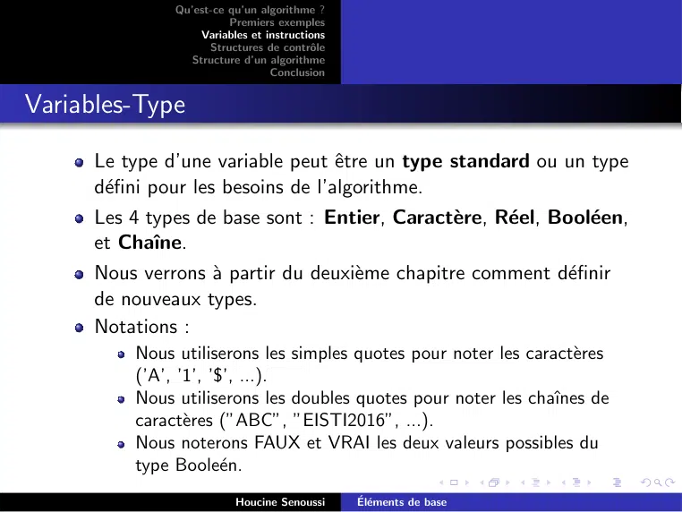

~~~text
               Qu’est-ce qu’un algorithme ?
                         Premiers exemples
                   Variables et instructions
                     Structures de contrôle
                 Structure d’un algorithme
                                 Conclusion

Variables-Type

      Le type d’une variable peut être un type standard ou un type
      défini pour les besoins de l’algorithme.
      Les 4 types de base sont : Entier, Caractère, Réel, Booléen,
      et Chaı̂ne.
      Nous verrons à partir du deuxième chapitre comment définir
      de nouveaux types.
      Notations :
          Nous utiliserons les simples quotes pour noter les caractères
          (’A’, ’1’, ’$’, ...).
          Nous utiliserons les doubles quotes pour noter les chaı̂nes de
          caractères (”ABC”, ”EISTI2016”, ...).
          Nous noterons FAUX et VRAI les deux valeurs possibles du
          type Booleén.
                          Houcine Senoussi     Éléments de base
~~~

## Page 19

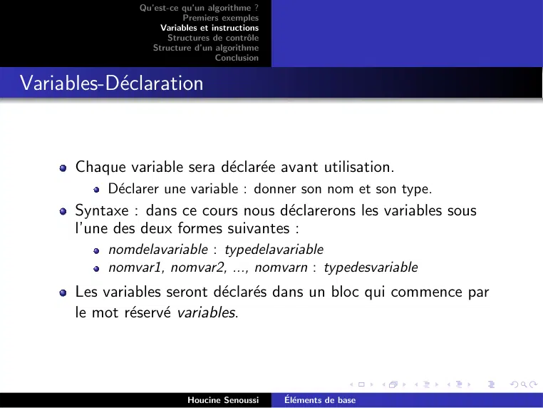

~~~text
                Qu’est-ce qu’un algorithme ?
                          Premiers exemples
                    Variables et instructions
                      Structures de contrôle
                  Structure d’un algorithme
                                  Conclusion

Variables-Déclaration

      Chaque variable sera déclarée avant utilisation.
           Déclarer une variable : donner son nom et son type.
      Syntaxe : dans ce cours nous déclarerons les variables sous
      l’une des deux formes suivantes :
           nomdelavariable : typedelavariable
           nomvar1, nomvar2, ..., nomvarn : typedesvariable
      Les variables seront déclarés dans un bloc qui commence par
      le mot réservé variables.

                           Houcine Senoussi     Éléments de base
~~~

## Page 20

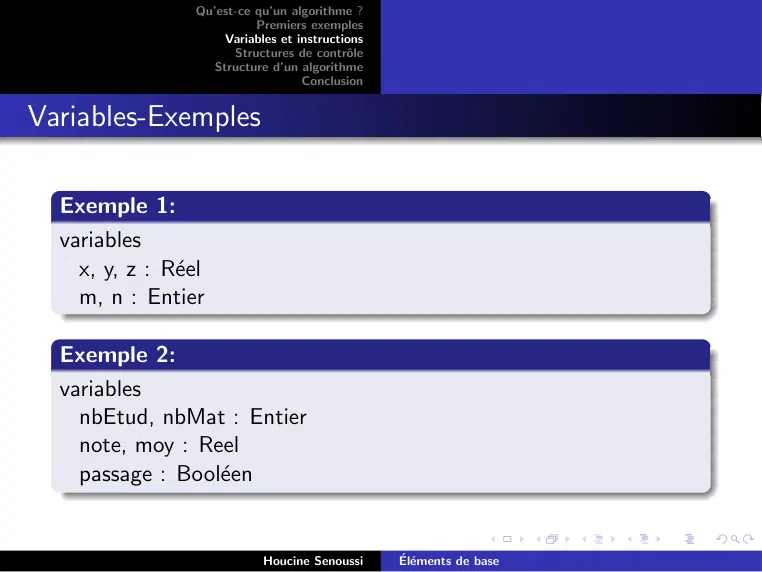

~~~text
                 Qu’est-ce qu’un algorithme ?
                           Premiers exemples
                     Variables et instructions
                       Structures de contrôle
                   Structure d’un algorithme
                                   Conclusion

Variables-Exemples

  Exemple 1:
  variables
    x, y, z : Réel
    m, n : Entier

  Exemple 2:
  variables
    nbEtud, nbMat : Entier
    note, moy : Reel
    passage : Booléen

                            Houcine Senoussi     Éléments de base
~~~

## Page 21

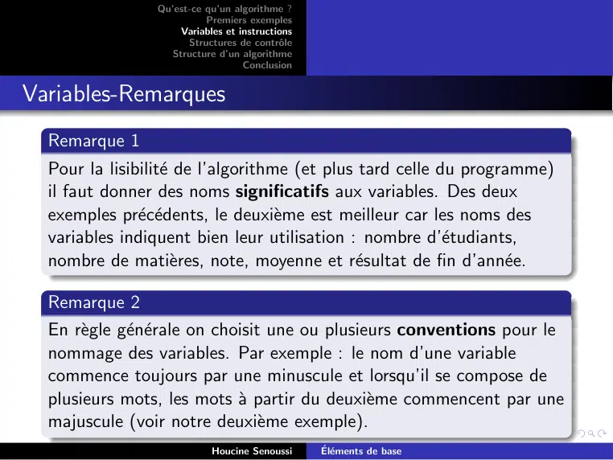

~~~text
                Qu’est-ce qu’un algorithme ?
                          Premiers exemples
                    Variables et instructions
                      Structures de contrôle
                  Structure d’un algorithme
                                  Conclusion

Variables-Remarques
  Remarque 1
  Pour la lisibilité de l’algorithme (et plus tard celle du programme)
  il faut donner des noms significatifs aux variables. Des deux
  exemples précédents, le deuxième est meilleur car les noms des
  variables indiquent bien leur utilisation : nombre d’étudiants,
  nombre de matières, note, moyenne et résultat de fin d’année.

  Remarque 2
  En règle générale on choisit une ou plusieurs conventions pour le
  nommage des variables. Par exemple : le nom d’une variable
  commence toujours par une minuscule et lorsqu’il se compose de
  plusieurs mots, les mots à partir du deuxième commencent par une
  majuscule (voir notre deuxième exemple).
                           Houcine Senoussi     Éléments de base
~~~

## Page 22

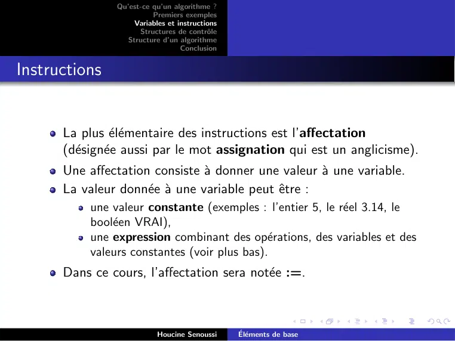

~~~text
               Qu’est-ce qu’un algorithme ?
                         Premiers exemples
                   Variables et instructions
                     Structures de contrôle
                 Structure d’un algorithme
                                 Conclusion

Instructions

      La plus élémentaire des instructions est l’affectation
      (désignée aussi par le mot assignation qui est un anglicisme).
      Une affectation consiste à donner une valeur à une variable.
      La valeur donnée à une variable peut être :
          une valeur constante (exemples : l’entier 5, le réel 3.14, le
          booléen VRAI),
          une expression combinant des opérations, des variables et des
          valeurs constantes (voir plus bas).
      Dans ce cours, l’affectation sera notée :=.

                          Houcine Senoussi     Éléments de base
~~~

## Page 23

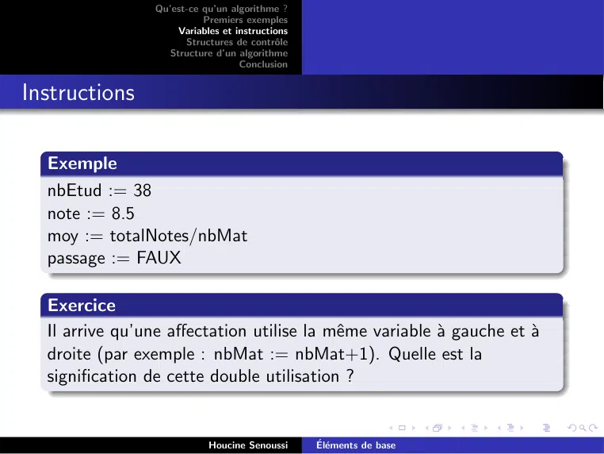

~~~text
                 Qu’est-ce qu’un algorithme ?
                           Premiers exemples
                     Variables et instructions
                       Structures de contrôle
                   Structure d’un algorithme
                                   Conclusion

Instructions

  Exemple
  nbEtud := 38
  note := 8.5
  moy := totalNotes/nbMat
  passage := FAUX

  Exercice
  Il arrive qu’une affectation utilise la même variable à gauche et à
  droite (par exemple : nbMat := nbMat+1). Quelle est la
  signification de cette double utilisation ?

                            Houcine Senoussi     Éléments de base
~~~

## Page 24

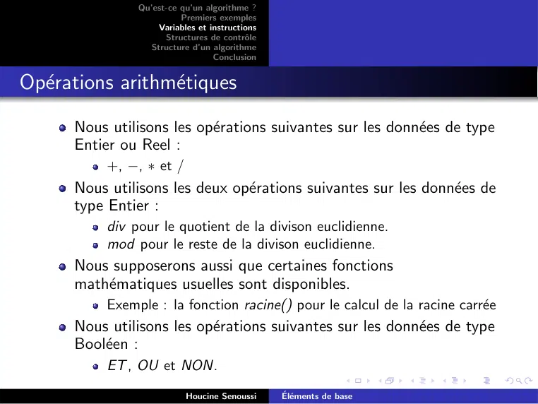

~~~text
                Qu’est-ce qu’un algorithme ?
                          Premiers exemples
                    Variables et instructions
                      Structures de contrôle
                  Structure d’un algorithme
                                  Conclusion

Opérations arithmétiques

      Nous utilisons les opérations suivantes sur les données de type
      Entier ou Reel :
           +, −, ∗ et /
      Nous utilisons les deux opérations suivantes sur les données de
      type Entier :
           div pour le quotient de la divison euclidienne.
           mod pour le reste de la divison euclidienne.
      Nous supposerons aussi que certaines fonctions
      mathématiques usuelles sont disponibles.
           Exemple : la fonction racine() pour le calcul de la racine carrée
      Nous utilisons les opérations suivantes sur les données de type
      Booléen :
           ET , OU et NON.
                           Houcine Senoussi     Éléments de base
~~~

## Page 25

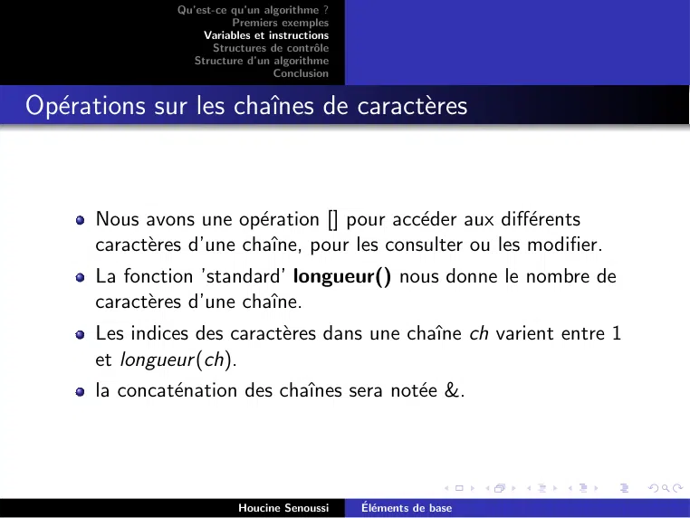

~~~text
               Qu’est-ce qu’un algorithme ?
                         Premiers exemples
                   Variables et instructions
                     Structures de contrôle
                 Structure d’un algorithme
                                 Conclusion

Opérations sur les chaı̂nes de caractères

      Nous avons une opération [] pour accéder aux différents
      caractères d’une chaı̂ne, pour les consulter ou les modifier.
      La fonction ’standard’ longueur() nous donne le nombre de
      caractères d’une chaı̂ne.
      Les indices des caractères dans une chaı̂ne ch varient entre 1
      et longueur (ch).
      la concaténation des chaı̂nes sera notée &.

                          Houcine Senoussi     Éléments de base
~~~

## Page 26

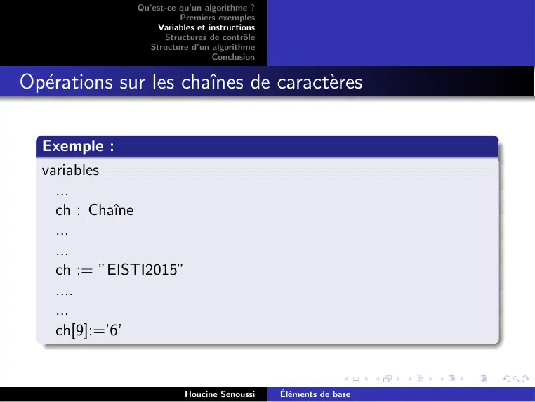

~~~text
              Qu’est-ce qu’un algorithme ?
                        Premiers exemples
                  Variables et instructions
                    Structures de contrôle
                Structure d’un algorithme
                                Conclusion

Opérations sur les chaı̂nes de caractères

  Exemple :
  variables
    ...
    ch : Chaı̂ne
    ...
    ...
    ch := ”EISTI2015”
    ....
    ...
    ch[9]:=’6’

                         Houcine Senoussi     Éléments de base
~~~

## Page 27

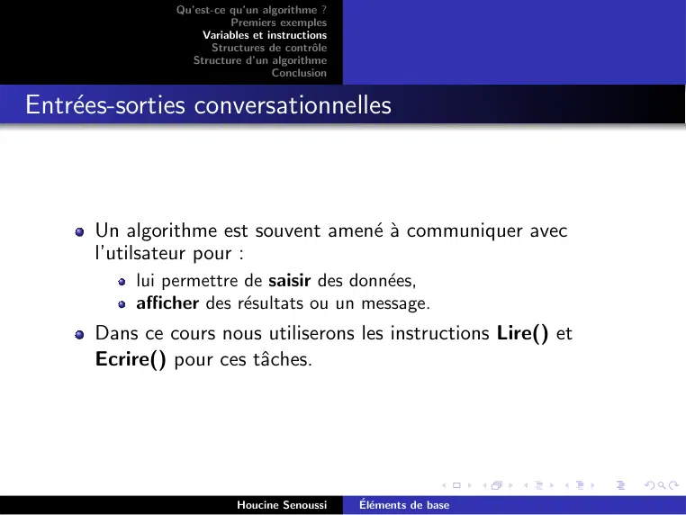

~~~text
               Qu’est-ce qu’un algorithme ?
                         Premiers exemples
                   Variables et instructions
                     Structures de contrôle
                 Structure d’un algorithme
                                 Conclusion

Entrées-sorties conversationnelles

      Un algorithme est souvent amené à communiquer avec
      l’utilsateur pour :
          lui permettre de saisir des données,
          afficher des résultats ou un message.
      Dans ce cours nous utiliserons les instructions Lire() et
      Ecrire() pour ces tâches.

                          Houcine Senoussi     Éléments de base
~~~

## Page 28

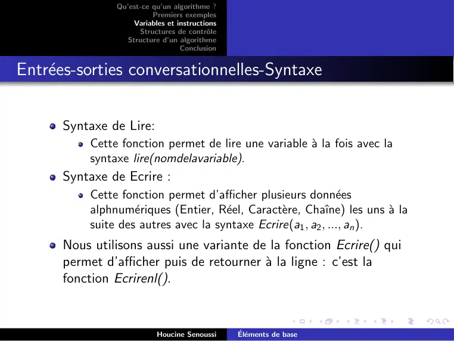

~~~text
               Qu’est-ce qu’un algorithme ?
                         Premiers exemples
                   Variables et instructions
                     Structures de contrôle
                 Structure d’un algorithme
                                 Conclusion

Entrées-sorties conversationnelles-Syntaxe

      Syntaxe de Lire:
          Cette fonction permet de lire une variable à la fois avec la
          syntaxe lire(nomdelavariable).
      Syntaxe de Ecrire :
          Cette fonction permet d’afficher plusieurs données
          alphnumériques (Entier, Réel, Caractère, Chaı̂ne) les uns à la
          suite des autres avec la syntaxe Ecrire(a1 , a2 , ..., an ).
      Nous utilisons aussi une variante de la fonction Ecrire() qui
      permet d’afficher puis de retourner à la ligne : c’est la
      fonction Ecrirenl().

                          Houcine Senoussi     Éléments de base
~~~

## Page 29

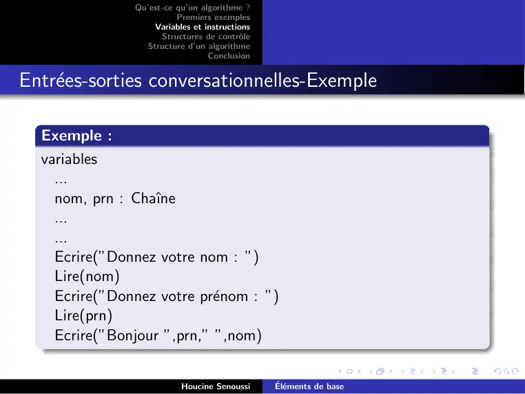

~~~text
               Qu’est-ce qu’un algorithme ?
                         Premiers exemples
                   Variables et instructions
                     Structures de contrôle
                 Structure d’un algorithme
                                 Conclusion

Entrées-sorties conversationnelles-Exemple

  Exemple :
  variables
    ...
    nom, prn : Chaı̂ne
    ...
    ...
    Ecrire(”Donnez votre nom : ”)
    Lire(nom)
    Ecrire(”Donnez votre prénom : ”)
    Lire(prn)
    Ecrire(”Bonjour ”,prn,” ”,nom)

                          Houcine Senoussi     Éléments de base
~~~

## Page 30

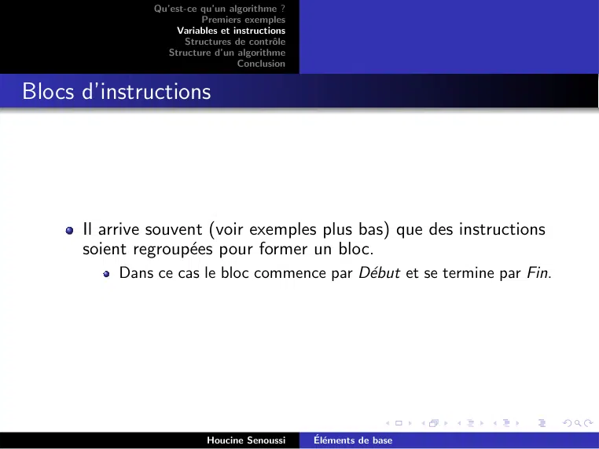

~~~text
               Qu’est-ce qu’un algorithme ?
                         Premiers exemples
                   Variables et instructions
                     Structures de contrôle
                 Structure d’un algorithme
                                 Conclusion

Blocs d’instructions

      Il arrive souvent (voir exemples plus bas) que des instructions
      soient regroupées pour former un bloc.
          Dans ce cas le bloc commence par Début et se termine par Fin.

                          Houcine Senoussi     Éléments de base
~~~

## Page 31

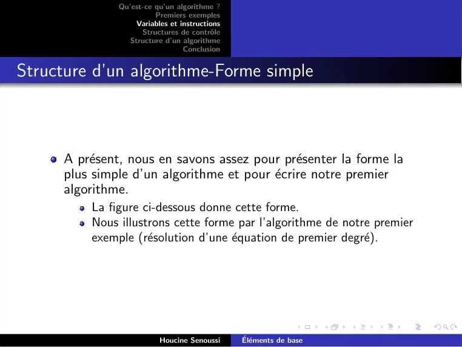

~~~text
               Qu’est-ce qu’un algorithme ?
                         Premiers exemples
                   Variables et instructions
                     Structures de contrôle
                 Structure d’un algorithme
                                 Conclusion

Structure d’un algorithme-Forme simple

      A présent, nous en savons assez pour présenter la forme la
      plus simple d’un algorithme et pour écrire notre premier
      algorithme.
          La figure ci-dessous donne cette forme.
          Nous illustrons cette forme par l’algorithme de notre premier
          exemple (résolution d’une équation de premier degré).

                          Houcine Senoussi     Éléments de base
~~~

## Page 32

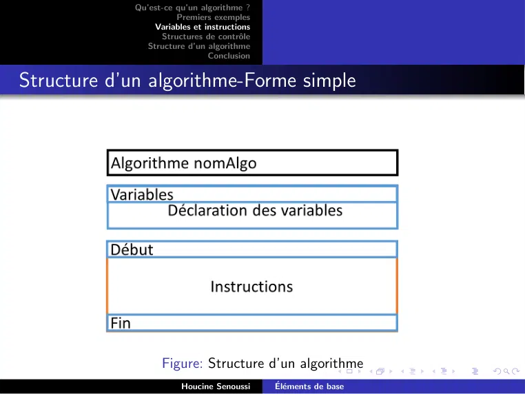

~~~text
             Qu’est-ce qu’un algorithme ?
                       Premiers exemples
                 Variables et instructions
                   Structures de contrôle
               Structure d’un algorithme
                               Conclusion

Structure d’un algorithme-Forme simple

                   Figure: Structure d’un algorithme
                        Houcine Senoussi     Éléments de base
~~~

## Page 33

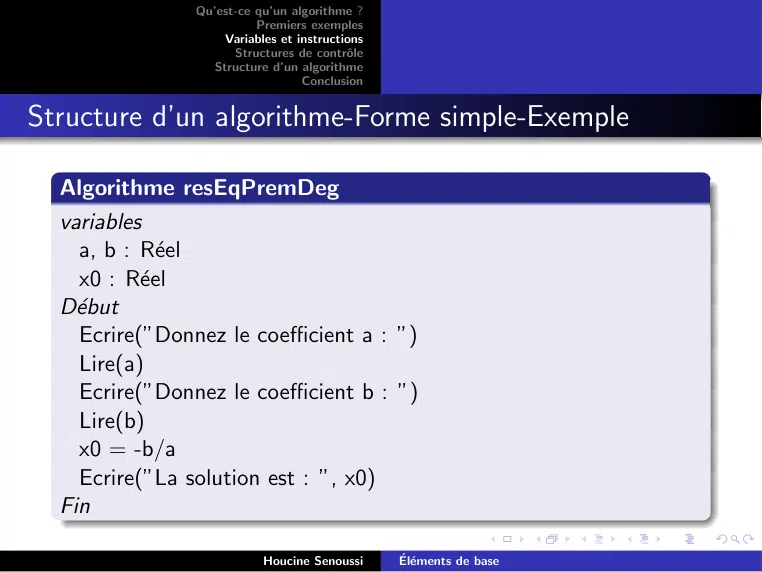

~~~text
                Qu’est-ce qu’un algorithme ?
                          Premiers exemples
                    Variables et instructions
                      Structures de contrôle
                  Structure d’un algorithme
                                  Conclusion

Structure d’un algorithme-Forme simple-Exemple

  Algorithme resEqPremDeg
  variables
    a, b : Réel
    x0 : Réel
  Début
    Ecrire(”Donnez le coefficient a : ”)
    Lire(a)
    Ecrire(”Donnez le coefficient b : ”)
    Lire(b)
    x0 = -b/a
    Ecrire(”La solution est : ”, x0)
  Fin

                           Houcine Senoussi     Éléments de base
~~~

## Page 34

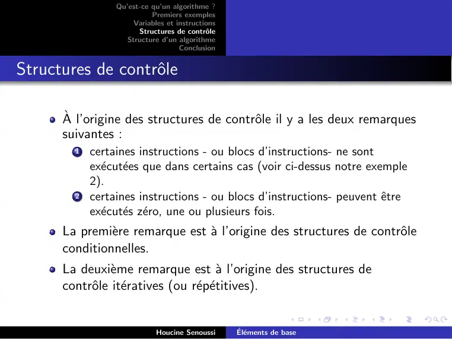

~~~text
                 Qu’est-ce qu’un algorithme ?
                           Premiers exemples
                     Variables et instructions
                       Structures de contrôle
                   Structure d’un algorithme
                                   Conclusion

Structures de contrôle

      À l’origine des structures de contrôle il y a les deux remarques
      suivantes :
        1   certaines instructions - ou blocs d’instructions- ne sont
            exécutées que dans certains cas (voir ci-dessus notre exemple
            2).
        2   certaines instructions - ou blocs d’instructions- peuvent être
            exécutés zéro, une ou plusieurs fois.
      La première remarque est à l’origine des structures de contrôle
      conditionnelles.
      La deuxième remarque est à l’origine des structures de
      contrôle itératives (ou répétitives).

                            Houcine Senoussi     Éléments de base
~~~

## Page 35

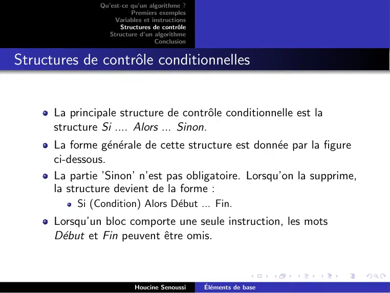

~~~text
                Qu’est-ce qu’un algorithme ?
                          Premiers exemples
                    Variables et instructions
                      Structures de contrôle
                  Structure d’un algorithme
                                  Conclusion

Structures de contrôle conditionnelles

      La principale structure de contrôle conditionnelle est la
      structure Si .... Alors ... Sinon.
      La forme générale de cette structure est donnée par la figure
      ci-dessous.
      La partie ’Sinon’ n’est pas obligatoire. Lorsqu’on la supprime,
      la structure devient de la forme :
           Si (Condition) Alors Début ... Fin.
      Lorsqu’un bloc comporte une seule instruction, les mots
      Début et Fin peuvent être omis.

                           Houcine Senoussi     Éléments de base
~~~

## Page 36

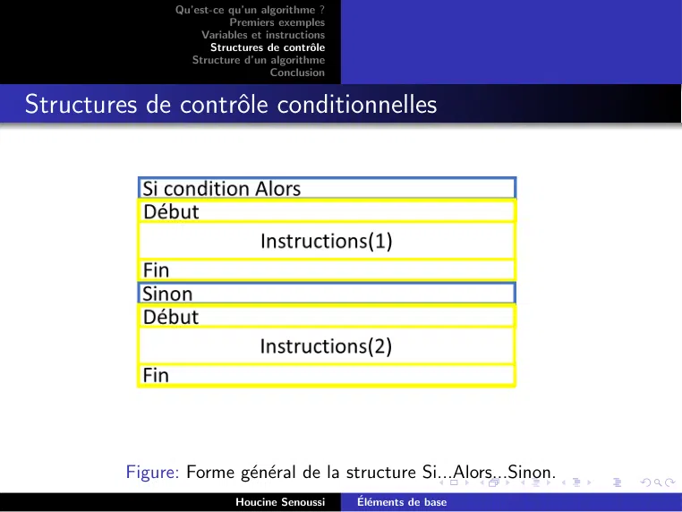

~~~text
               Qu’est-ce qu’un algorithme ?
                         Premiers exemples
                   Variables et instructions
                     Structures de contrôle
                 Structure d’un algorithme
                                 Conclusion

Structures de contrôle conditionnelles

         Figure: Forme général de la structure Si...Alors...Sinon.
                          Houcine Senoussi     Éléments de base
~~~

## Page 37

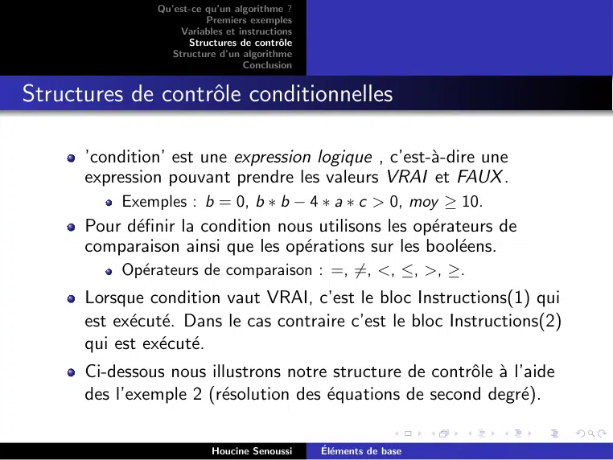

~~~text
                Qu’est-ce qu’un algorithme ?
                          Premiers exemples
                    Variables et instructions
                      Structures de contrôle
                  Structure d’un algorithme
                                  Conclusion

Structures de contrôle conditionnelles

      ’condition’ est une expression logique , c’est-à-dire une
      expression pouvant prendre les valeurs VRAI et FAUX .
           Exemples : b = 0, b ∗ b − 4 ∗ a ∗ c > 0, moy ≥ 10.
      Pour définir la condition nous utilisons les opérateurs de
      comparaison ainsi que les opérations sur les booléens.
           Opérateurs de comparaison : =, 6=, <, ≤, >, ≥.
      Lorsque condition vaut VRAI, c’est le bloc Instructions(1) qui
      est exécuté. Dans le cas contraire c’est le bloc Instructions(2)
      qui est exécuté.
      Ci-dessous nous illustrons notre structure de contrôle à l’aide
      des l’exemple 2 (résolution des équations de second degré).

                           Houcine Senoussi     Éléments de base
~~~

## Page 38

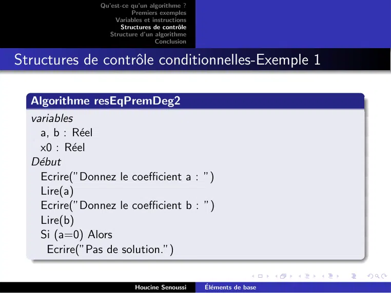

~~~text
                Qu’est-ce qu’un algorithme ?
                          Premiers exemples
                    Variables et instructions
                      Structures de contrôle
                  Structure d’un algorithme
                                  Conclusion

Structures de contrôle conditionnelles-Exemple 1

  Algorithme resEqPremDeg2
  variables
    a, b : Réel
    x0 : Réel
  Début
    Ecrire(”Donnez le coefficient a : ”)
    Lire(a)
    Ecrire(”Donnez le coefficient b : ”)
    Lire(b)
    Si (a=0) Alors
     Ecrire(”Pas de solution.”)

                           Houcine Senoussi     Éléments de base
~~~

## Page 39

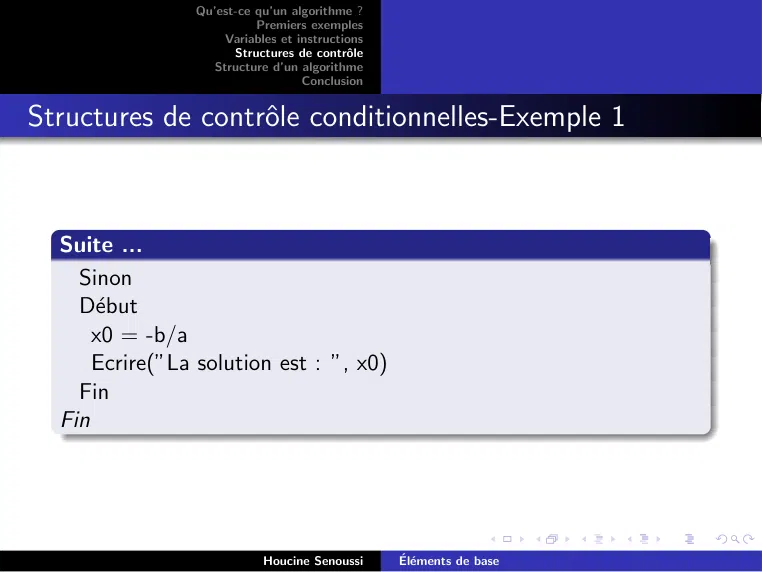

~~~text
                Qu’est-ce qu’un algorithme ?
                          Premiers exemples
                    Variables et instructions
                      Structures de contrôle
                  Structure d’un algorithme
                                  Conclusion

Structures de contrôle conditionnelles-Exemple 1

  Suite ...
    Sinon
    Début
      x0 = -b/a
      Ecrire(”La solution est : ”, x0)
    Fin
  Fin

                           Houcine Senoussi     Éléments de base
~~~

## Page 40

~~~text
                Qu’est-ce qu’un algorithme ?
                          Premiers exemples
                    Variables et instructions
                      Structures de contrôle
                  Structure d’un algorithme
                                  Conclusion

Structures de contrôle conditionnelles-Exemple 2
  Algorithme resEqSecDeg
  variables
    a, b, c : Réel
    delta : Réel
    x0, x1, x2 : Réel
  Début
    Ecrire(”Donnez le coefficient a : ”)
    Lire(a)
    Ecrire(”Donnez le coefficient b : ”)
    Lire(b)
    Ecrire(”Donnez le coefficient c : ”)
    Lire(c)
    delta := b*b-4*a*c
                           Houcine Senoussi     Éléments de base
~~~

## Page 41

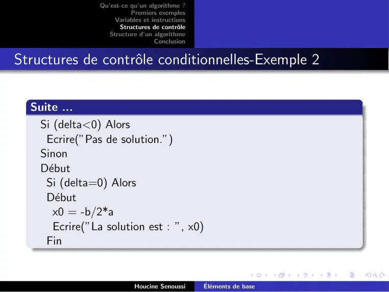

~~~text
                Qu’est-ce qu’un algorithme ?
                          Premiers exemples
                    Variables et instructions
                      Structures de contrôle
                  Structure d’un algorithme
                                  Conclusion

Structures de contrôle conditionnelles-Exemple 2

  Suite ...
   Si (delta<0) Alors
     Ecrire(”Pas de solution.”)
   Sinon
   Début
     Si (delta=0) Alors
     Début
      x0 = -b/2*a
      Ecrire(”La solution est : ”, x0)
     Fin

                           Houcine Senoussi     Éléments de base
~~~

## Page 42

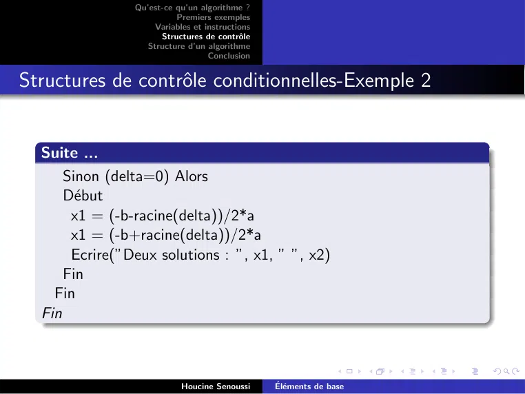

~~~text
                Qu’est-ce qu’un algorithme ?
                          Premiers exemples
                    Variables et instructions
                      Structures de contrôle
                  Structure d’un algorithme
                                  Conclusion

Structures de contrôle conditionnelles-Exemple 2

  Suite ...
      Sinon (delta=0) Alors
      Début
       x1 = (-b-racine(delta))/2*a
       x1 = (-b+racine(delta))/2*a
       Ecrire(”Deux solutions : ”, x1, ” ”, x2)
      Fin
    Fin
  Fin

                           Houcine Senoussi     Éléments de base
~~~

## Page 43

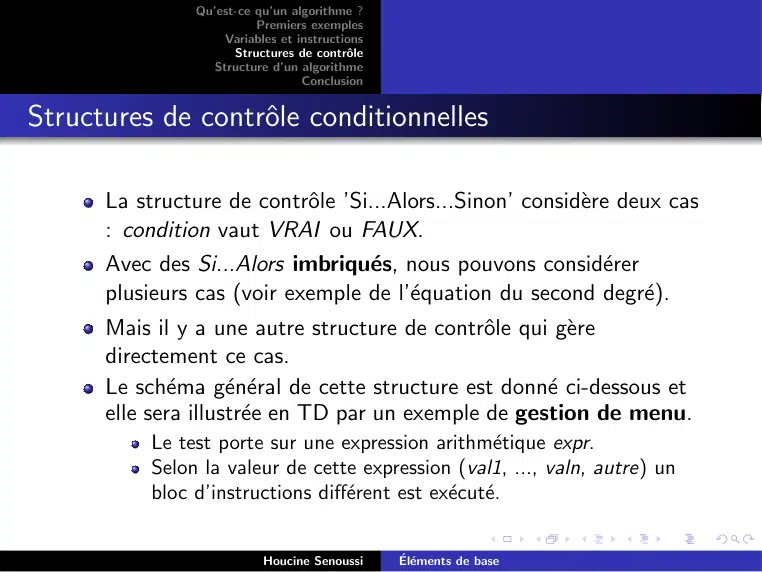

~~~text
                Qu’est-ce qu’un algorithme ?
                          Premiers exemples
                    Variables et instructions
                      Structures de contrôle
                  Structure d’un algorithme
                                  Conclusion

Structures de contrôle conditionnelles

      La structure de contrôle ’Si...Alors...Sinon’ considère deux cas
      : condition vaut VRAI ou FAUX.
      Avec des Si...Alors imbriqués, nous pouvons considérer
      plusieurs cas (voir exemple de l’équation du second degré).
      Mais il y a une autre structure de contrôle qui gère
      directement ce cas.
      Le schéma général de cette structure est donné ci-dessous et
      elle sera illustrée en TD par un exemple de gestion de menu.
           Le test porte sur une expression arithmétique expr.
           Selon la valeur de cette expression (val1, ..., valn, autre) un
           bloc d’instructions différent est exécuté.

                           Houcine Senoussi     Éléments de base
~~~

## Page 44

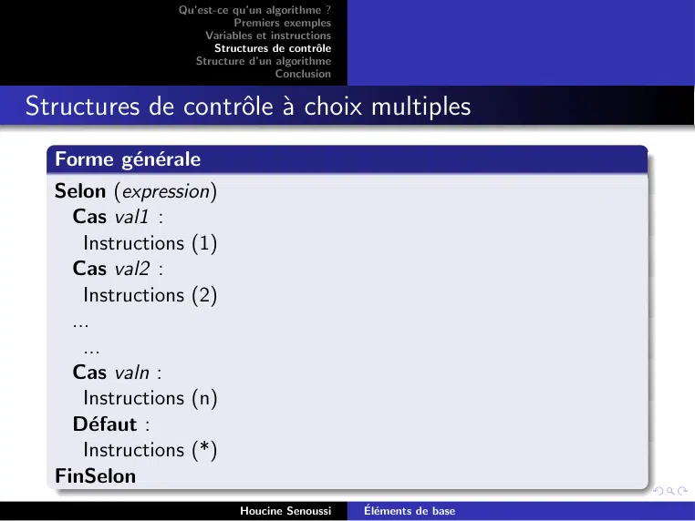

~~~text
                 Qu’est-ce qu’un algorithme ?
                           Premiers exemples
                     Variables et instructions
                       Structures de contrôle
                   Structure d’un algorithme
                                   Conclusion

Structures de contrôle à choix multiples
  Forme générale
  Selon (expression)
    Cas val1 :
      Instructions (1)
    Cas val2 :
      Instructions (2)
    ...
      ...
    Cas valn :
      Instructions (n)
    Défaut :
      Instructions (*)
  FinSelon
                            Houcine Senoussi     Éléments de base
~~~

## Page 45

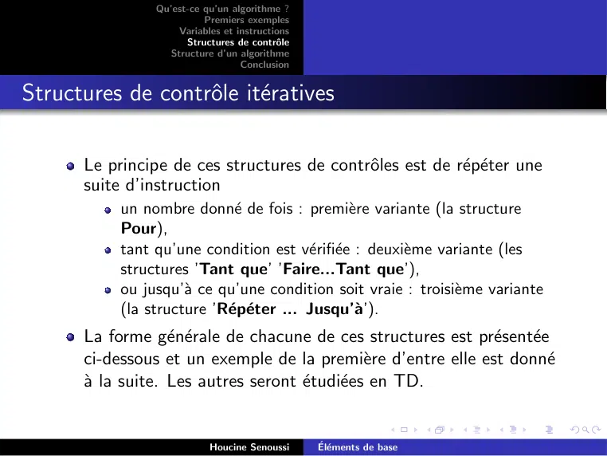

~~~text
                Qu’est-ce qu’un algorithme ?
                          Premiers exemples
                    Variables et instructions
                      Structures de contrôle
                  Structure d’un algorithme
                                  Conclusion

Structures de contrôle itératives

      Le principe de ces structures de contrôles est de répéter une
      suite d’instruction
           un nombre donné de fois : première variante (la structure
           Pour),
           tant qu’une condition est vérifiée : deuxième variante (les
           structures ’Tant que’ ’Faire...Tant que’),
           ou jusqu’à ce qu’une condition soit vraie : troisième variante
           (la structure ’Répéter ... Jusqu’à’).
      La forme générale de chacune de ces structures est présentée
      ci-dessous et un exemple de la première d’entre elle est donné
      à la suite. Les autres seront étudiées en TD.

                           Houcine Senoussi     Éléments de base
~~~

## Page 46

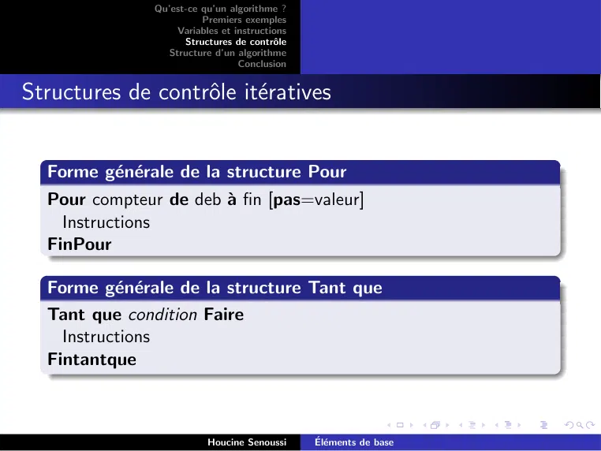

~~~text
               Qu’est-ce qu’un algorithme ?
                         Premiers exemples
                   Variables et instructions
                     Structures de contrôle
                 Structure d’un algorithme
                                 Conclusion

Structures de contrôle itératives

  Forme générale de la structure Pour
  Pour compteur de deb à fin [pas=valeur]
    Instructions
  FinPour

  Forme générale de la structure Tant que
  Tant que condition Faire
    Instructions
  Fintantque

                          Houcine Senoussi     Éléments de base
~~~

## Page 47

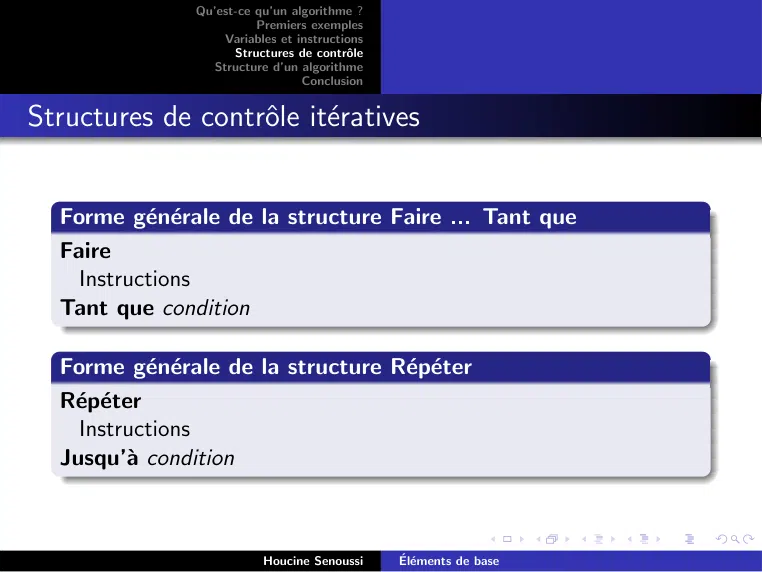

~~~text
               Qu’est-ce qu’un algorithme ?
                         Premiers exemples
                   Variables et instructions
                     Structures de contrôle
                 Structure d’un algorithme
                                 Conclusion

Structures de contrôle itératives

  Forme générale de la structure Faire ... Tant que
  Faire
    Instructions
  Tant que condition

  Forme générale de la structure Répéter
  Répéter
    Instructions
  Jusqu’à condition

                          Houcine Senoussi     Éléments de base
~~~

## Page 48

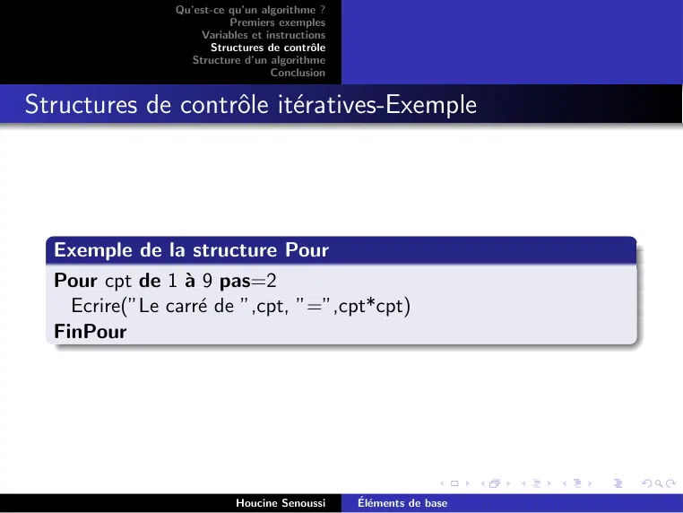

~~~text
                Qu’est-ce qu’un algorithme ?
                          Premiers exemples
                    Variables et instructions
                      Structures de contrôle
                  Structure d’un algorithme
                                  Conclusion

Structures de contrôle itératives-Exemple

  Exemple de la structure Pour
  Pour cpt de 1 à 9 pas=2
    Ecrire(”Le carré de ”,cpt, ”=”,cpt*cpt)
  FinPour

                           Houcine Senoussi     Éléments de base
~~~

## Page 49

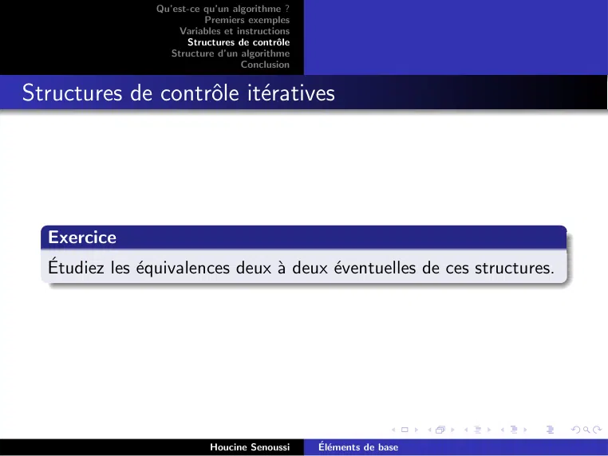

~~~text
                 Qu’est-ce qu’un algorithme ?
                           Premiers exemples
                     Variables et instructions
                       Structures de contrôle
                   Structure d’un algorithme
                                   Conclusion

Structures de contrôle itératives

  Exercice
  Étudiez les équivalences deux à deux éventuelles de ces structures.

                            Houcine Senoussi     Éléments de base
~~~

## Page 50

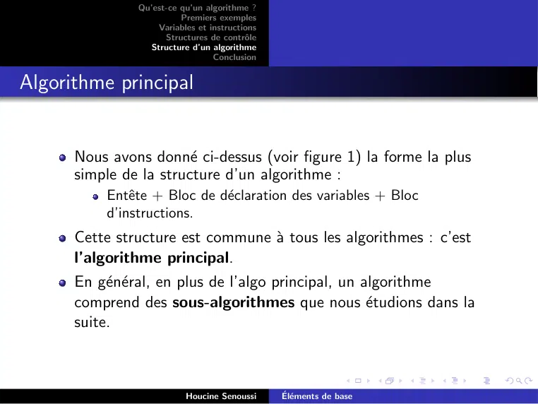

~~~text
               Qu’est-ce qu’un algorithme ?
                         Premiers exemples
                   Variables et instructions
                     Structures de contrôle
                 Structure d’un algorithme
                                 Conclusion

Algorithme principal

      Nous avons donné ci-dessus (voir figure 1) la forme la plus
      simple de la structure d’un algorithme :
          Entête + Bloc de déclaration des variables + Bloc
          d’instructions.
      Cette structure est commune à tous les algorithmes : c’est
      l’algorithme principal.
      En général, en plus de l’algo principal, un algorithme
      comprend des sous-algorithmes que nous étudions dans la
      suite.

                          Houcine Senoussi     Éléments de base
~~~

## Page 51

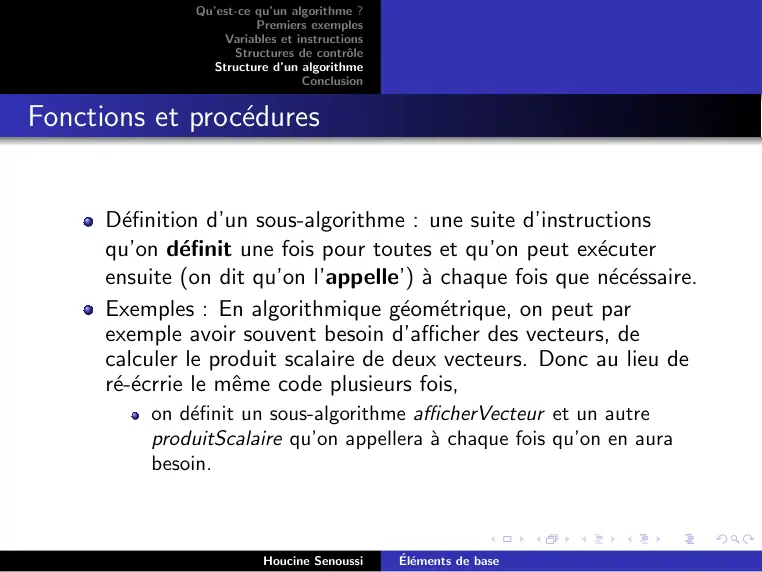

~~~text
                Qu’est-ce qu’un algorithme ?
                          Premiers exemples
                    Variables et instructions
                      Structures de contrôle
                  Structure d’un algorithme
                                  Conclusion

Fonctions et procédures

      Définition d’un sous-algorithme : une suite d’instructions
      qu’on définit une fois pour toutes et qu’on peut exécuter
      ensuite (on dit qu’on l’appelle’) à chaque fois que nécéssaire.
      Exemples : En algorithmique géométrique, on peut par
      exemple avoir souvent besoin d’afficher des vecteurs, de
      calculer le produit scalaire de deux vecteurs. Donc au lieu de
      ré-écrrie le même code plusieurs fois,
           on définit un sous-algorithme afficherVecteur et un autre
           produitScalaire qu’on appellera à chaque fois qu’on en aura
           besoin.

                           Houcine Senoussi     Éléments de base
~~~

## Page 52

~~~text
               Qu’est-ce qu’un algorithme ?
                         Premiers exemples
                   Variables et instructions
                     Structures de contrôle
                 Structure d’un algorithme
                                 Conclusion

Fonctions et procédures

      Il existe deux types de sous-algorithmes :
          les fonctions : Sous-algorithmes qui retournent un résultat,
          produitScalaire en est un exemple : retourne la valeur du
          produit scalaire.
          les procédures : Sous-algorithmes qui ne retournent pas un
          résultat, afficherVecteur en est un exemple : retourne la valeur
          du produit scalaire.
      La forme générale de la définition d’un sous-algorithme est
      donnée par la figure ci-dessous.

                          Houcine Senoussi     Éléments de base
~~~

## Page 53

~~~text
             Qu’est-ce qu’un algorithme ?
                       Premiers exemples
                 Variables et instructions
                   Structures de contrôle
               Structure d’un algorithme
                               Conclusion

Fonctions et procédures

            Figure: Forme générale d’un sous-algorithme.
                        Houcine Senoussi     Éléments de base
~~~

## Page 54

~~~text
                Qu’est-ce qu’un algorithme ?
                          Premiers exemples
                    Variables et instructions
                      Structures de contrôle
                  Structure d’un algorithme
                                  Conclusion

Fonctions et procédures

      Dans le cas d’une procédure l’entête se présente de la manière
      suivante :
           le mot réservé procédure,
           le nom de la procédure, exemple : afficherVecteur,
           la liste des paramètres, ce sont les entrées fournies à la
           procédure :
                chaque paramètre est donnée par une catégorie (voir plus
                bas), un type et un nom.
      le bloc des variables locales, qui commence par le mot réservé
      variable,
      le bloc des instructions qui décrit ce que fait la procédure, il
      est compris entre Début et Fin.

                           Houcine Senoussi     Éléments de base
~~~

## Page 55

~~~text
             Qu’est-ce qu’un algorithme ?
                       Premiers exemples
                 Variables et instructions
                   Structures de contrôle
               Structure d’un algorithme
                               Conclusion

Fonctions et procédures

              Figure: Forme générale d’une procédure.
                        Houcine Senoussi     Éléments de base
~~~

## Page 56

~~~text
                Qu’est-ce qu’un algorithme ?
                          Premiers exemples
                    Variables et instructions
                      Structures de contrôle
                  Structure d’un algorithme
                                  Conclusion

Fonctions et procédures-Exemple

  Procédure afficherMax(a : Réel, b : Réel)
  variables
    m : Réel
  Début
    Si (a>b) Alors
      m=a
    Sinon
      m=b
    FinSi
    Ecrire(”Le max est égal à : ”,m)
  Fin

                           Houcine Senoussi     Éléments de base
~~~

## Page 57

~~~text
                Qu’est-ce qu’un algorithme ?
                          Premiers exemples
                    Variables et instructions
                      Structures de contrôle
                  Structure d’un algorithme
                                  Conclusion

Fonctions et procédures

      Dans le cas d’une procédure l’entête se présente de la manière
      suivante :
           le mot réservé Fonction,
           le nom de la fonction, exemple : produitScalaire,
           la liste des paramètres, ce sont les entrées fournies à la
           fonction.
           le type du résultat retourné par la fonction.
      le bloc des variables locales,
      le bloc des instructions qui décrit ce que fait la fonction, il se
      termine par l’instruction :
           Retourner nomvariable

                           Houcine Senoussi     Éléments de base
~~~

## Page 58

~~~text
             Qu’est-ce qu’un algorithme ?
                       Premiers exemples
                 Variables et instructions
                   Structures de contrôle
               Structure d’un algorithme
                               Conclusion

Fonctions et procédures

               Figure: Forme générale d’une fonction.
                        Houcine Senoussi     Éléments de base
~~~

## Page 59

~~~text
               Qu’est-ce qu’un algorithme ?
                         Premiers exemples
                   Variables et instructions
                     Structures de contrôle
                 Structure d’un algorithme
                                 Conclusion

Fonctions et procédures-Exemple

  Fonction calculerMax(a : Réel, b : Réel) : Réel
  variables
    m : Réel
  Début
    Si (a>b) Alors
      m=a
    Sinon
      m=b
    FinSi
    Retourner m)
  Fin

                          Houcine Senoussi     Éléments de base
~~~

## Page 60

~~~text
                Qu’est-ce qu’un algorithme ?
                          Premiers exemples
                    Variables et instructions
                      Structures de contrôle
                  Structure d’un algorithme
                                  Conclusion

Fonctions et procédures

      Catégorie des paramètres :
           E (entrée) : fournie au sous algorithme qui ne peut pas la
           modifier. C’est la catégorie par défaut.
           E/S (entrée/sorte) : fournie au sous algorithme qui peut la
           modifier.
           S (sorte) : c’est le sous-algorithme qui lui donne sa valeur.
      Portée des variables :
           les variables définies dans les sous-algorithmes sont dites
           locales,
           elles ne sont ”vues” qu’à l’intérieur du sous-algorithme,
           leurs valeurs sont perdues une fois l’exécution du
           sous-algorithme terminée.

                           Houcine Senoussi     Éléments de base
~~~

## Page 61

~~~text
               Qu’est-ce qu’un algorithme ?
                         Premiers exemples
                   Variables et instructions
                     Structures de contrôle
                 Structure d’un algorithme
                                 Conclusion

Fonctions et Procédures

      Appel des sous-algorithmes :
          une procédure est appelée par nomprocédure(valeur des
          paramètres).
          une fonction est appelée par val := nomfonction(valeur des
          paramètres).

                          Houcine Senoussi     Éléments de base
~~~

## Page 62

~~~text
                Qu’est-ce qu’un algorithme ?
                          Premiers exemples
                    Variables et instructions
                      Structures de contrôle
                  Structure d’un algorithme
                                  Conclusion

Structure d’un algorithme-Forme complète

      Pour obtenir la forme générale d’un algorithme il suffit de
      prendre la forme simple donnée ci-dessus et d’y ajouter la
      définition des fonction et des procédures les unes à la suite
      des autres, entre l’entête et le début de la déclarationdes
      varaibales.
      Remarque : Ne jamais définir une fonction ou une procédure à
      l’intérieur d’une autre fonction ou procédure.

                           Houcine Senoussi     Éléments de base
~~~

## Page 63

~~~text
             Qu’est-ce qu’un algorithme ?
                       Premiers exemples
                 Variables et instructions
                   Structures de contrôle
               Structure d’un algorithme
                               Conclusion

Structure d’un algorithme-Forme complète

                   Figure: Structure d’un algorithme
                        Houcine Senoussi     Éléments de base
~~~

## Page 64

~~~text
              Qu’est-ce qu’un algorithme ?
                        Premiers exemples
                  Variables et instructions
                    Structures de contrôle
                Structure d’un algorithme
                                Conclusion

Conclusion

     Nous avons présenté les éléments permettant de
     débuter/”re-démarrer” en algorithmique.
     Prochain cours : Données complexes.

                         Houcine Senoussi     Éléments de base
~~~
