# Chap2_slides.pdf

[Ouvrir l’original](https://drive.google.com/open?id=1RD51nKmRyqHbcdv8JXxzUgjOJqoc6f74) · Les deux lectures automatiques du PDF divergent sur les pages indiquées. Leur fac-similé accompagne le texte.

**Pages présentant un écart entre les deux extractions** — 3–7, 11–12, 14, 16–18.

## Page 1

~~~text
     Introduction
  Enregistrements
         Tableaux
       Conclusion

 Données complexes

  Jean-Paul Forest 2018-
Houcine Senoussi 2016-2018

           2019-2020

                             1 / 19
~~~

## Page 2

~~~text
                         Introduction
                      Enregistrements
                             Tableaux
                           Conclusion

1   Introduction

2   Enregistrements

3   Tableaux

4   Conclusion

                                        2 / 19
~~~

## Page 3

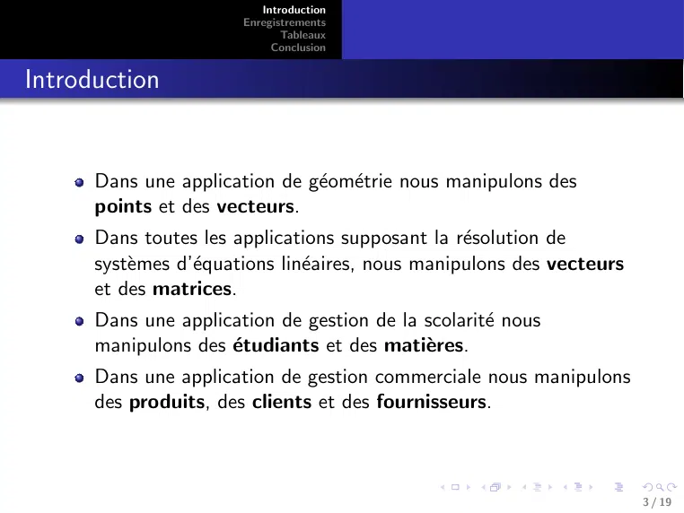

~~~text
                          Introduction
                       Enregistrements
                              Tableaux
                            Conclusion

Introduction

      Dans une application de géométrie nous manipulons des
      points et des vecteurs.
      Dans toutes les applications supposant la résolution de
      systèmes d’équations linéaires, nous manipulons des vecteurs
      et des matrices.
      Dans une application de gestion de la scolarité nous
      manipulons des étudiants et des matières.
      Dans une application de gestion commerciale nous manipulons
      des produits, des clients et des fournisseurs.

                                                                        3 / 19
~~~

## Page 4

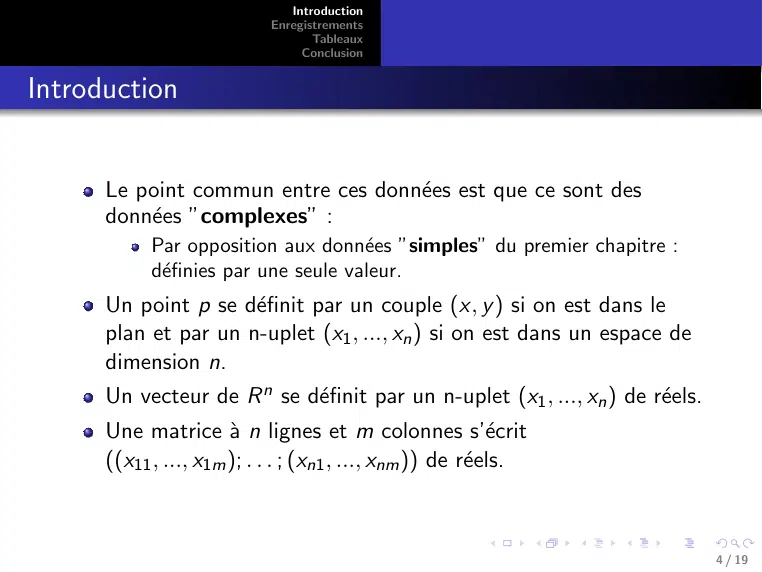

~~~text
                               Introduction
                            Enregistrements
                                   Tableaux
                                 Conclusion

Introduction

      Le point commun entre ces données est que ce sont des
      données ”complexes” :
            Par opposition aux données ”simples” du premier chapitre :
            définies par une seule valeur.
      Un point p se définit par un couple (x, y ) si on est dans le
      plan et par un n-uplet (x1 , ..., xn ) si on est dans un espace de
      dimension n.
      Un vecteur de R n se définit par un n-uplet (x1 , ..., xn ) de réels.
      Une matrice à n lignes et m colonnes s’écrit
      ((x11 , ..., x1m ); . . . ; (xn1 , ..., xnm )) de réels.

                                                                                4 / 19
~~~

## Page 5

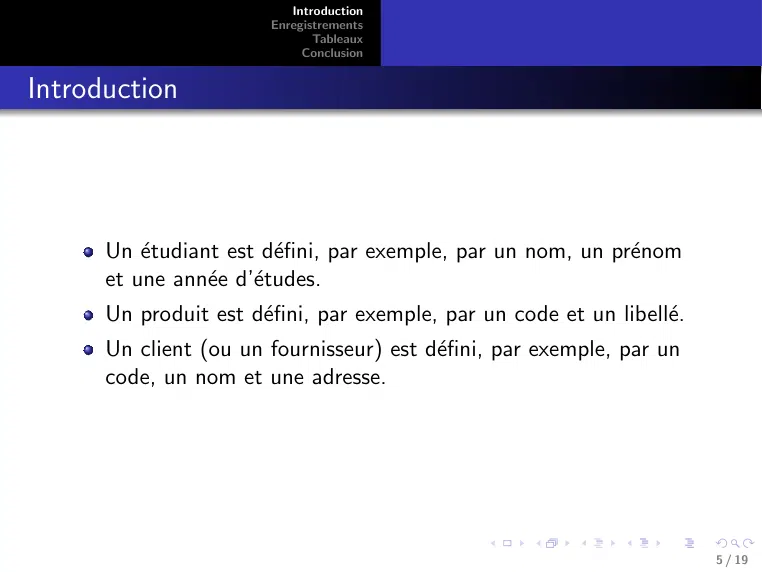

~~~text
                           Introduction
                        Enregistrements
                               Tableaux
                             Conclusion

Introduction

      Un étudiant est défini, par exemple, par un nom, un prénom
      et une année d’études.
      Un produit est défini, par exemple, par un code et un libellé.
      Un client (ou un fournisseur) est défini, par exemple, par un
      code, un nom et une adresse.

                                                                         5 / 19
~~~

## Page 6

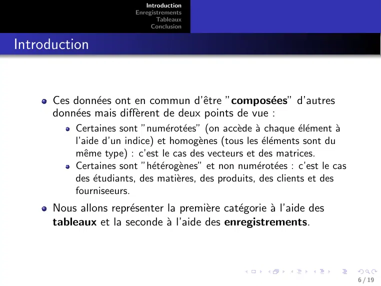

~~~text
                            Introduction
                         Enregistrements
                                Tableaux
                              Conclusion

Introduction

      Ces données ont en commun d’être ”composées” d’autres
      données mais diffèrent de deux points de vue :
           Certaines sont ”numérotées” (on accède à chaque élément à
           l’aide d’un indice) et homogènes (tous les éléments sont du
           même type) : c’est le cas des vecteurs et des matrices.
           Certaines sont ”hétérogènes” et non numérotées : c’est le cas
           des étudiants, des matières, des produits, des clients et des
           fourniseeurs.
      Nous allons représenter la première catégorie à l’aide des
      tableaux et la seconde à l’aide des enregistrements.

                                                                                6 / 19
~~~

## Page 7

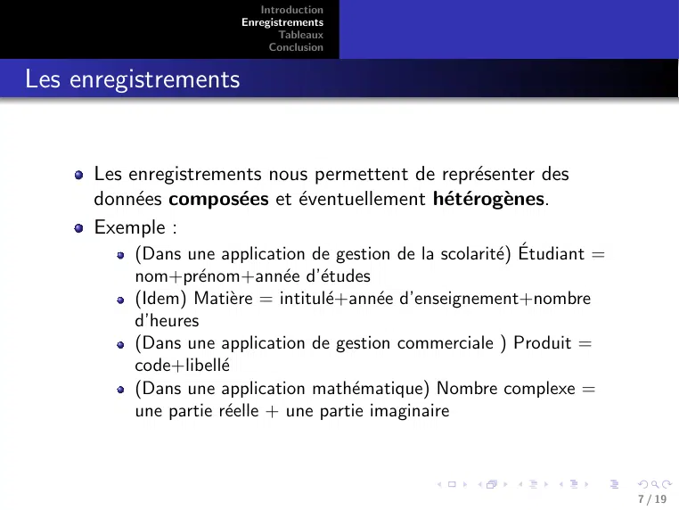

~~~text
                           Introduction
                        Enregistrements
                               Tableaux
                             Conclusion

Les enregistrements

      Les enregistrements nous permettent de représenter des
      données composées et éventuellement hétérogènes.
      Exemple :
          (Dans une application de gestion de la scolarité) Étudiant =
          nom+prénom+année d’études
          (Idem) Matière = intitulé+année d’enseignement+nombre
          d’heures
          (Dans une application de gestion commerciale ) Produit =
          code+libellé
          (Dans une application mathématique) Nombre complexe =
          une partie réelle + une partie imaginaire

                                                                           7 / 19
~~~

## Page 8

~~~text
                         Introduction
                      Enregistrements
                             Tableaux
                           Conclusion

Les enregistrements

  Définition
  Enregistrement nomEnreg
    nomChamps1 : typeChamps1
    ...
    nomChampsn : typeChampsn
  FinEnregistrement

  Déclaration
  nomvar : nomEnreg

  Manipulation
     L’accès au champs nomChamps d’une variable nomVar se fait
     par nomVar.nomChamps.
                                                                  8 / 19
~~~

## Page 9

~~~text
                           Introduction
                        Enregistrements
                               Tableaux
                             Conclusion

Les enregistrements

  Exemple
  Enregistrement Produit
      code : Entier
      libelle : Chaı̂ne
  FinEnregistrement
  ...
  vprod : Produit
  Ecrire(”Donnez le code du produit : ”)
  Lire(vProd.code)
  Ecrire(”Donnez la désignation du produit : ”)
  Lire(vProd.libelle)
  Ecrire(”Produit saisi : code=”,vProd.code,” libellé =
  ”,vProd.libelle)

                                                           9 / 19
~~~

## Page 10

~~~text
                          Introduction
                       Enregistrements
                              Tableaux
                            Conclusion

Les enregistrements

  Exercice
  Écrire un algorithme permettant de lire un nombre complexe saisi
  par l’utilisateur et afficher son module.

                                                                      10 / 19
~~~

## Page 11

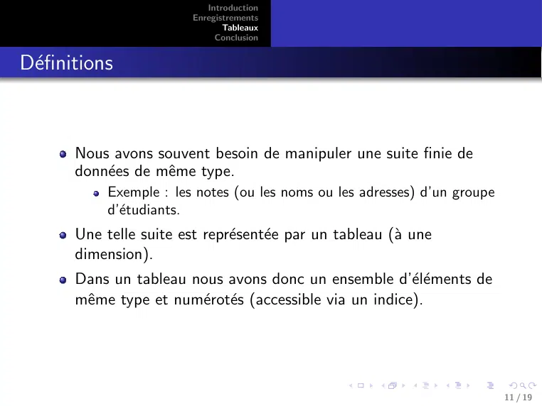

~~~text
                            Introduction
                         Enregistrements
                                Tableaux
                              Conclusion

Définitions

       Nous avons souvent besoin de manipuler une suite finie de
       données de même type.
            Exemple : les notes (ou les noms ou les adresses) d’un groupe
            d’étudiants.
       Une telle suite est représentée par un tableau (à une
       dimension).
       Dans un tableau nous avons donc un ensemble d’éléments de
       même type et numérotés (accessible via un indice).

                                                                            11 / 19
~~~

## Page 12

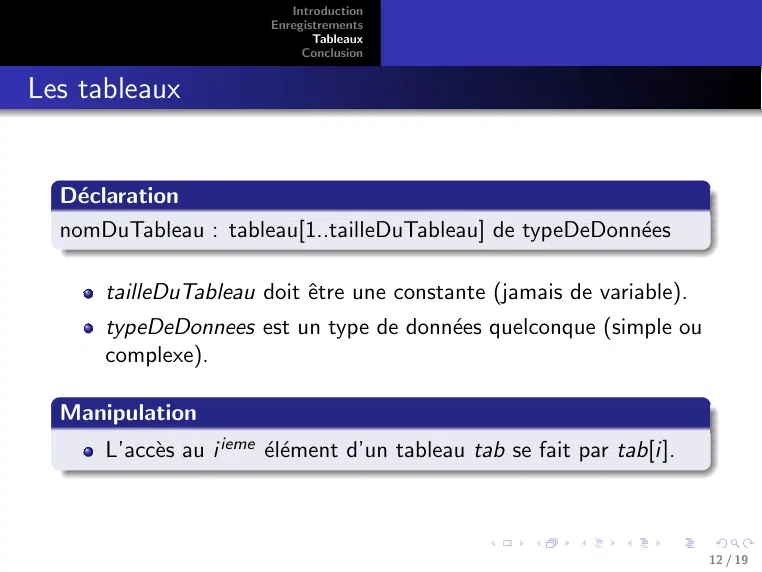

~~~text
                           Introduction
                        Enregistrements
                               Tableaux
                             Conclusion

Les tableaux

  Déclaration
  nomDuTableau : tableau[1..tailleDuTableau] de typeDeDonnées

      tailleDuTableau doit être une constante (jamais de variable).
      typeDeDonnees est un type de données quelconque (simple ou
      complexe).

  Manipulation
      L’accès au i ieme élément d’un tableau tab se fait par tab[i].

                                                                          12 / 19
~~~

## Page 13

~~~text
                          Introduction
                       Enregistrements
                              Tableaux
                            Conclusion

Les tableaux

      Exemples :
          notesEtudiants : tableau[1..150] de Réel
          nomsEtudiants : tableau[1..150] de Chaı̂ne
          listeProduits : tableau[1..10] de Produit

                                                       13 / 19
~~~

## Page 14

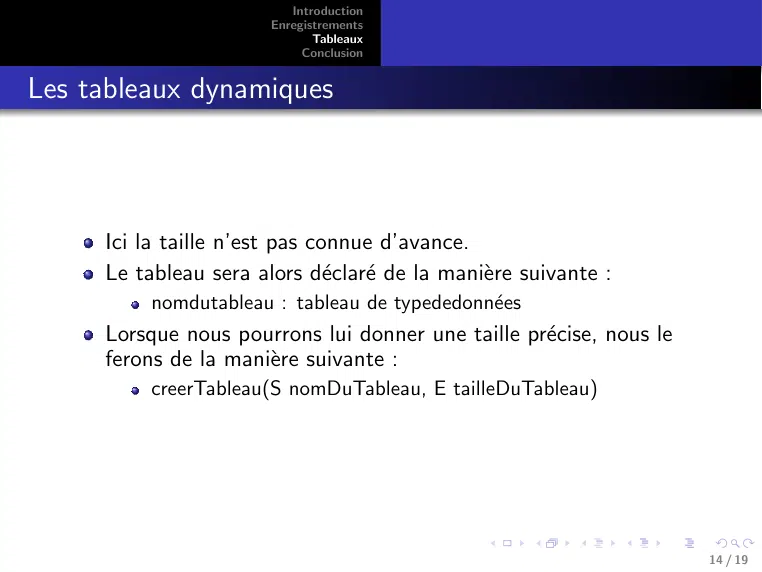

~~~text
                          Introduction
                       Enregistrements
                              Tableaux
                            Conclusion

Les tableaux dynamiques

     Ici la taille n’est pas connue d’avance.
     Le tableau sera alors déclaré de la manière suivante :
          nomdutableau : tableau de typededonnées
     Lorsque nous pourrons lui donner une taille précise, nous le
     ferons de la manière suivante :
          creerTableau(S nomDuTableau, E tailleDuTableau)

                                                                     14 / 19
~~~

## Page 15

~~~text
                           Introduction
                        Enregistrements
                               Tableaux
                             Conclusion

Les tableaux

  Algorithme inverserTableau
  variables
    i : Entier
    tab : tableau[1..10] de Entier
  Début
  //Lecture du tableau
  Pour i de 1 à 10
    Ecrire(”tab[”,i, ”]=”)
    Lire(tab[i])
  FinPour

                                          15 / 19
~~~

## Page 16

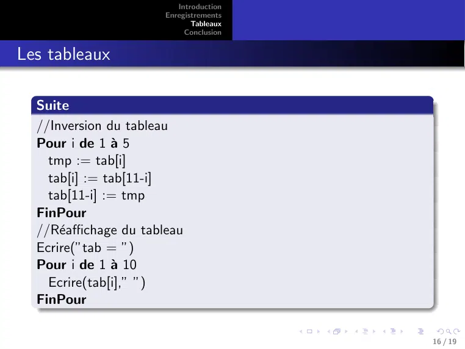

~~~text
                          Introduction
                       Enregistrements
                              Tableaux
                            Conclusion

Les tableaux

  Suite
  //Inversion du tableau
  Pour i de 1 à 5
    tmp := tab[i]
    tab[i] := tab[11-i]
    tab[11-i] := tmp
  FinPour
  //Réaffichage du tableau
  Ecrire(”tab = ”)
  Pour i de 1 à 10
    Ecrire(tab[i],” ”)
  FinPour

                                         16 / 19
~~~

## Page 17

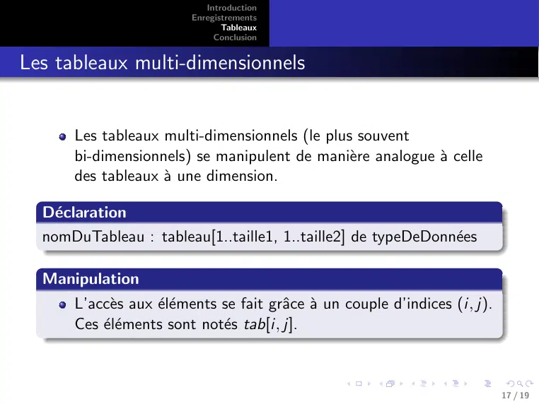

~~~text
                            Introduction
                         Enregistrements
                                Tableaux
                              Conclusion

Les tableaux multi-dimensionnels

      Les tableaux multi-dimensionnels (le plus souvent
      bi-dimensionnels) se manipulent de manière analogue à celle
      des tableaux à une dimension.

  Déclaration
  nomDuTableau : tableau[1..taille1, 1..taille2] de typeDeDonnées

  Manipulation
      L’accès aux éléments se fait grâce à un couple d’indices (i, j).
      Ces éléments sont notés tab[i, j].

                                                                              17 / 19
~~~

## Page 18

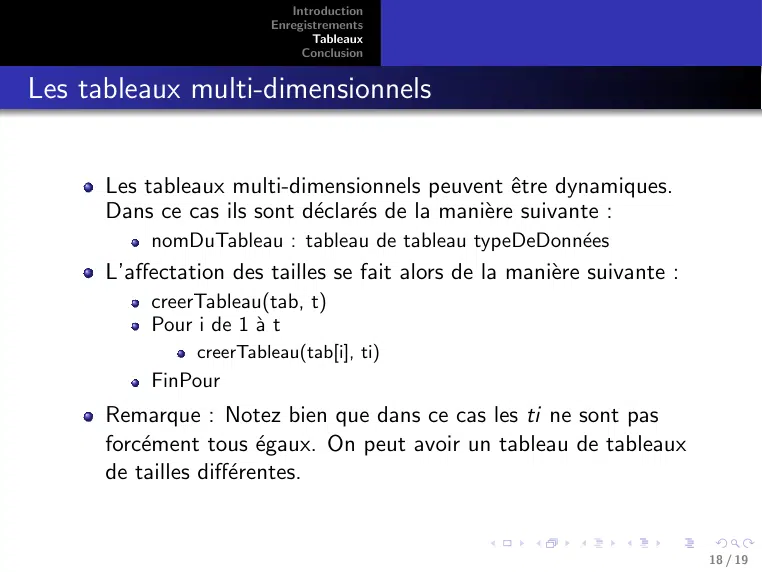

~~~text
                            Introduction
                         Enregistrements
                                Tableaux
                              Conclusion

Les tableaux multi-dimensionnels

      Les tableaux multi-dimensionnels peuvent être dynamiques.
      Dans ce cas ils sont déclarés de la manière suivante :
           nomDuTableau : tableau de tableau typeDeDonnées
      L’affectation des tailles se fait alors de la manière suivante :
           creerTableau(tab, t)
           Pour i de 1 à t
                creerTableau(tab[i], ti)
           FinPour
      Remarque : Notez bien que dans ce cas les ti ne sont pas
      forcément tous égaux. On peut avoir un tableau de tableaux
      de tailles différentes.

                                                                          18 / 19
~~~

## Page 19

~~~text
                          Introduction
                       Enregistrements
                              Tableaux
                            Conclusion

Conclusion

     Données complexes : enregistrements et tableaux.
     Chapitre suivant : structures de données (pile, file et liste).

                                                                        19 / 19
~~~
