# Chap3_slides.pdf

[Ouvrir l’original](https://drive.google.com/open?id=1JMdSnESSWlVSmccWkGFVchCkDCEcfNnL) · Les deux lectures automatiques du PDF divergent sur les pages indiquées. Leur fac-similé accompagne le texte.

**Pages présentant un écart entre les deux extractions** — 1–19.

## Page 1

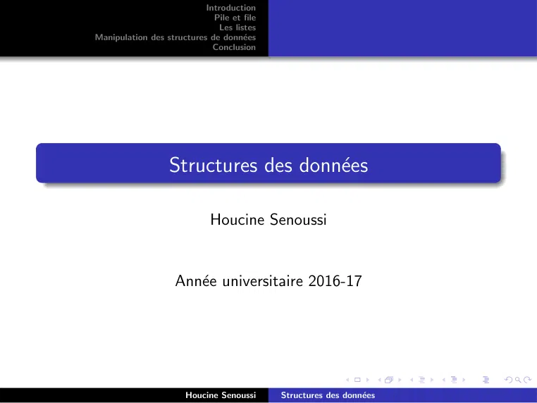

~~~text
                           Introduction
                             Pile et file
                              Les listes
Manipulation des structures de données
                             Conclusion

                  Structures des données

                             Houcine Senoussi

                    Année universitaire 2016-17

                       Houcine Senoussi     Structures des données
~~~

## Page 2

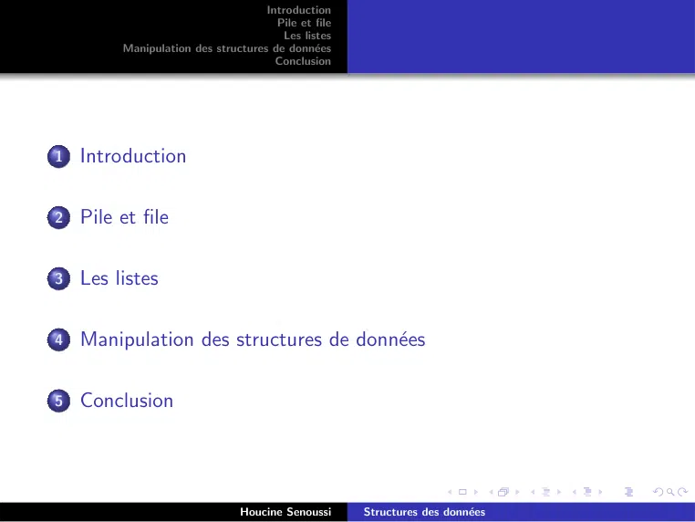

~~~text
                                    Introduction
                                      Pile et file
                                       Les listes
         Manipulation des structures de données
                                      Conclusion

1   Introduction

2   Pile et file

3   Les listes

4   Manipulation des structures de données

5   Conclusion

                                Houcine Senoussi     Structures des données
~~~

## Page 3

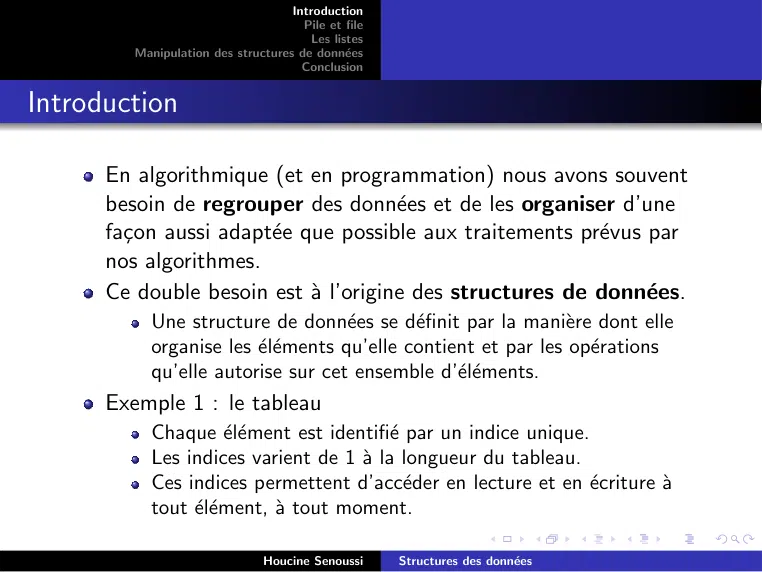

~~~text
                                    Introduction
                                      Pile et file
                                       Les listes
         Manipulation des structures de données
                                      Conclusion

Introduction

      En algorithmique (et en programmation) nous avons souvent
      besoin de regrouper des données et de les organiser d’une
      façon aussi adaptée que possible aux traitements prévus par
      nos algorithmes.
      Ce double besoin est à l’origine des structures de données.
            Une structure de données se définit par la manière dont elle
            organise les éléments qu’elle contient et par les opérations
            qu’elle autorise sur cet ensemble d’éléments.
      Exemple 1 : le tableau
            Chaque élément est identifié par un indice unique.
            Les indices varient de 1 à la longueur du tableau.
            Ces indices permettent d’accéder en lecture et en écriture à
            tout élément, à tout moment.

                                Houcine Senoussi     Structures des données
~~~

## Page 4

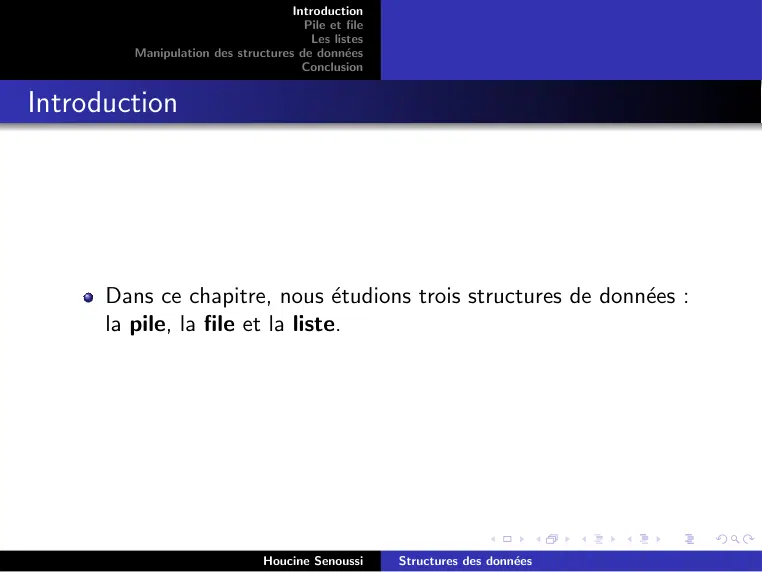

~~~text
                                    Introduction
                                      Pile et file
                                       Les listes
         Manipulation des structures de données
                                      Conclusion

Introduction

      Dans ce chapitre, nous étudions trois structures de données :
      la pile, la file et la liste.

                                Houcine Senoussi     Structures des données
~~~

## Page 5

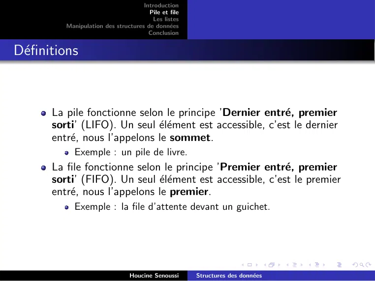

~~~text
                                     Introduction
                                       Pile et file
                                        Les listes
          Manipulation des structures de données
                                       Conclusion

Définitions

       La pile fonctionne selon le principe ’Dernier entré, premier
       sorti’ (LIFO). Un seul élément est accessible, c’est le dernier
       entré, nous l’appelons le sommet.
             Exemple : un pile de livre.
       La file fonctionne selon le principe ’Premier entré, premier
       sorti’ (FIFO). Un seul élément est accessible, c’est le premier
       entré, nous l’appelons le premier.
             Exemple : la file d’attente devant un guichet.

                                 Houcine Senoussi     Structures des données
~~~

## Page 6

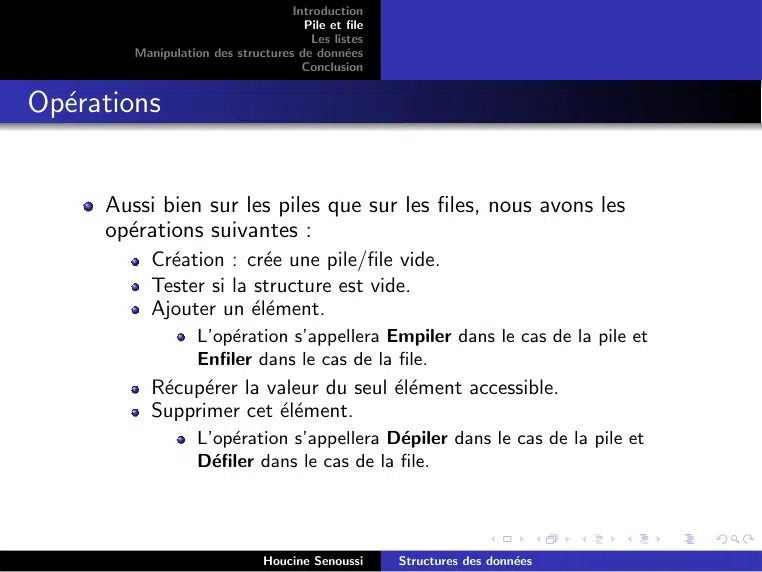

~~~text
                                    Introduction
                                      Pile et file
                                       Les listes
         Manipulation des structures de données
                                      Conclusion

Opérations

      Aussi bien sur les piles que sur les files, nous avons les
      opérations suivantes :
            Création : crée une pile/file vide.
            Tester si la structure est vide.
            Ajouter un élément.
                    L’opération s’appellera Empiler dans le cas de la pile et
                    Enfiler dans le cas de la file.
            Récupérer la valeur du seul élément accessible.
            Supprimer cet élément.
                    L’opération s’appellera Dépiler dans le cas de la pile et
                    Défiler dans le cas de la file.

                                Houcine Senoussi     Structures des données
~~~

## Page 7

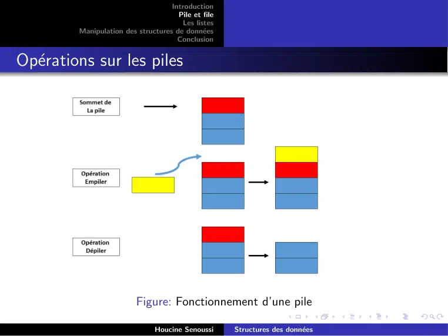

~~~text
                                    Introduction
                                      Pile et file
                                       Les listes
         Manipulation des structures de données
                                      Conclusion

Opérations sur les piles

                          Figure: Fonctionnement d’une pile

                                Houcine Senoussi     Structures des données
~~~

## Page 8

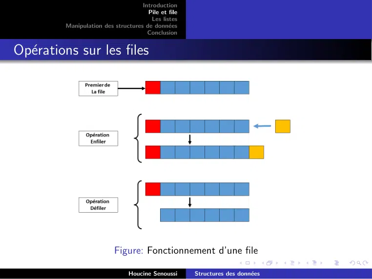

~~~text
                                    Introduction
                                      Pile et file
                                       Les listes
         Manipulation des structures de données
                                      Conclusion

Opérations sur les files

                          Figure: Fonctionnement d’une file

                                Houcine Senoussi     Structures des données
~~~

## Page 9

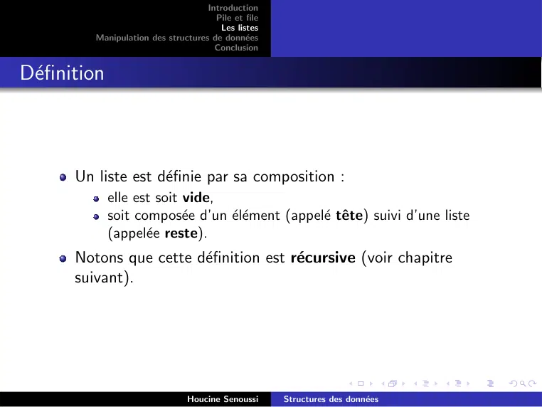

~~~text
                                     Introduction
                                       Pile et file
                                        Les listes
          Manipulation des structures de données
                                       Conclusion

Définition

       Un liste est définie par sa composition :
              elle est soit vide,
              soit composée d’un élément (appelé tête) suivi d’une liste
              (appelée reste).
       Notons que cette définition est récursive (voir chapitre
       suivant).

                                 Houcine Senoussi     Structures des données
~~~

## Page 10

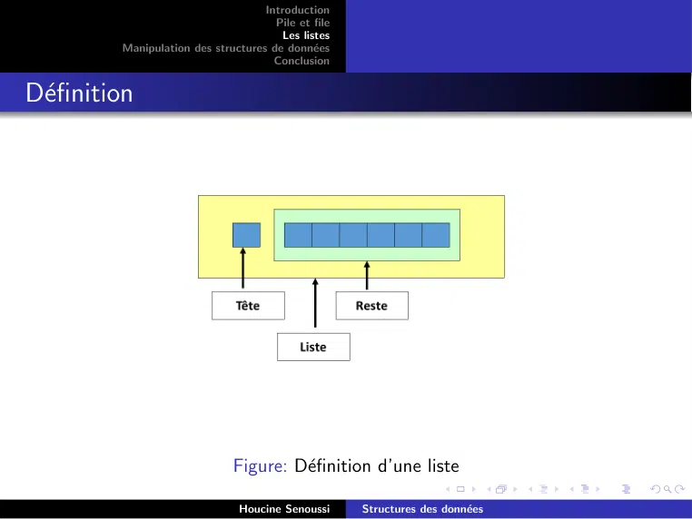

~~~text
                                    Introduction
                                      Pile et file
                                       Les listes
         Manipulation des structures de données
                                      Conclusion

Définition

                              Figure: Définition d’une liste

                                Houcine Senoussi     Structures des données
~~~

## Page 11

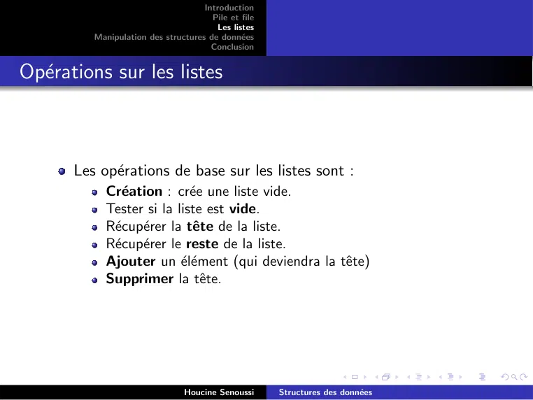

~~~text
                                    Introduction
                                      Pile et file
                                       Les listes
         Manipulation des structures de données
                                      Conclusion

Opérations sur les listes

      Les opérations de base sur les listes sont :
            Création : crée une liste vide.
            Tester si la liste est vide.
            Récupérer la tête de la liste.
            Récupérer le reste de la liste.
            Ajouter un élément (qui deviendra la tête)
            Supprimer la tête.

                                Houcine Senoussi     Structures des données
~~~

## Page 12

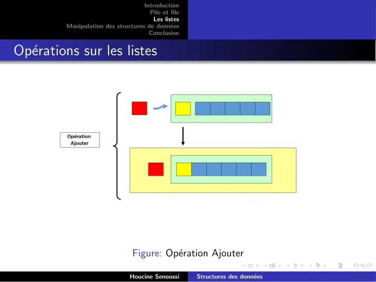

~~~text
                                    Introduction
                                      Pile et file
                                       Les listes
         Manipulation des structures de données
                                      Conclusion

Opérations sur les listes

                                Figure: Opération Ajouter

                                Houcine Senoussi     Structures des données
~~~

## Page 13

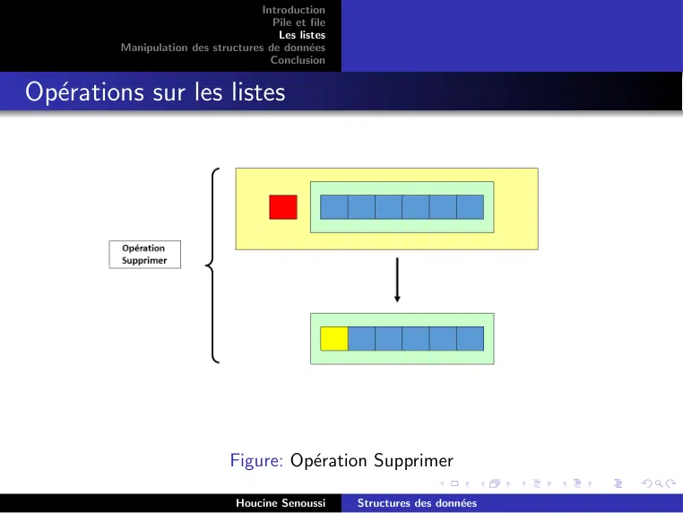

~~~text
                                    Introduction
                                      Pile et file
                                       Les listes
         Manipulation des structures de données
                                      Conclusion

Opérations sur les listes

                              Figure: Opération Supprimer

                                Houcine Senoussi     Structures des données
~~~

## Page 14

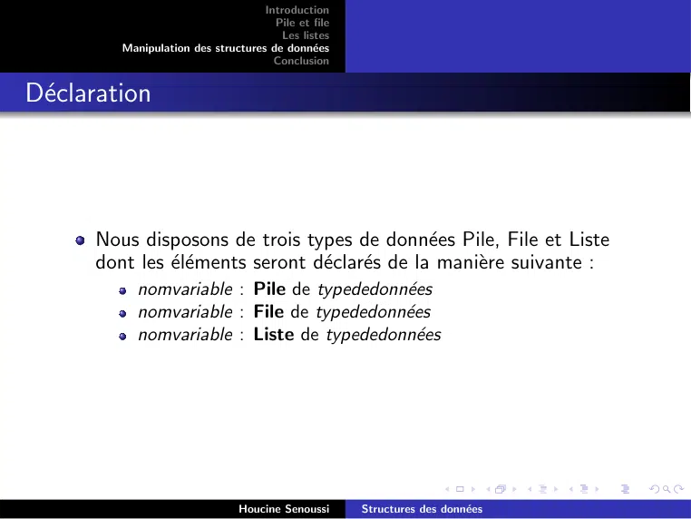

~~~text
                                    Introduction
                                      Pile et file
                                       Les listes
         Manipulation des structures de données
                                      Conclusion

Déclaration

      Nous disposons de trois types de données Pile, File et Liste
      dont les éléments seront déclarés de la manière suivante :
            nomvariable : Pile de typededonnées
            nomvariable : File de typededonnées
            nomvariable : Liste de typededonnées

                                Houcine Senoussi     Structures des données
~~~

## Page 15

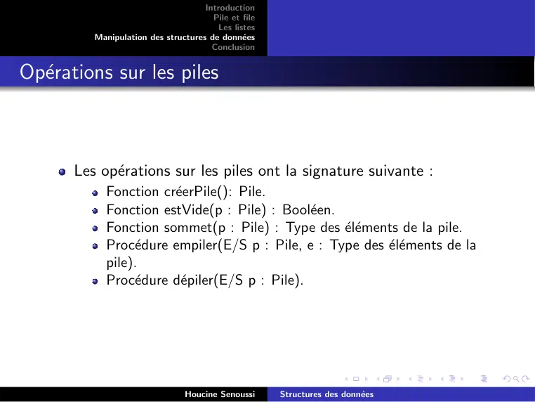

~~~text
                                    Introduction
                                      Pile et file
                                       Les listes
         Manipulation des structures de données
                                      Conclusion

Opérations sur les piles

      Les opérations sur les piles ont la signature suivante :
            Fonction créerPile(): Pile.
            Fonction estVide(p : Pile) : Booléen.
            Fonction sommet(p : Pile) : Type des éléments de la pile.
            Procédure empiler(E/S p : Pile, e : Type des éléments de la
            pile).
            Procédure dépiler(E/S p : Pile).

                                Houcine Senoussi     Structures des données
~~~

## Page 16

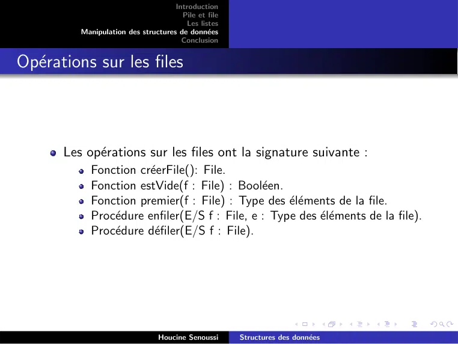

~~~text
                                    Introduction
                                      Pile et file
                                       Les listes
         Manipulation des structures de données
                                      Conclusion

Opérations sur les files

      Les opérations sur les files ont la signature suivante :
            Fonction créerFile(): File.
            Fonction estVide(f : File) : Booléen.
            Fonction premier(f : File) : Type des éléments de la file.
            Procédure enfiler(E/S f : File, e : Type des éléments de la file).
            Procédure défiler(E/S f : File).

                                Houcine Senoussi     Structures des données
~~~

## Page 17

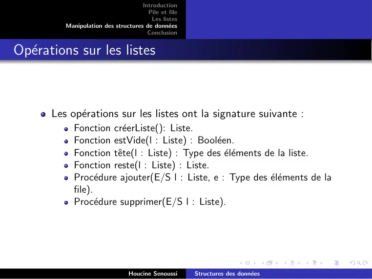

~~~text
                                    Introduction
                                      Pile et file
                                       Les listes
         Manipulation des structures de données
                                      Conclusion

Opérations sur les listes

      Les opérations sur les listes ont la signature suivante :
            Fonction créerListe(): Liste.
            Fonction estVide(l : Liste) : Booléen.
            Fonction tête(l : Liste) : Type des éléments de la liste.
            Fonction reste(l : Liste) : Liste.
            Procédure ajouter(E/S l : Liste, e : Type des éléments de la
            file).
            Procédure supprimer(E/S l : Liste).

                                Houcine Senoussi     Structures des données
~~~

## Page 18

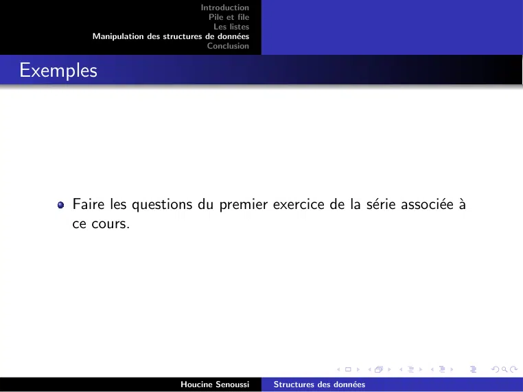

~~~text
                                   Introduction
                                     Pile et file
                                      Les listes
        Manipulation des structures de données
                                     Conclusion

Exemples

     Faire les questions du premier exercice de la série associée à
     ce cours.

                               Houcine Senoussi     Structures des données
~~~

## Page 19

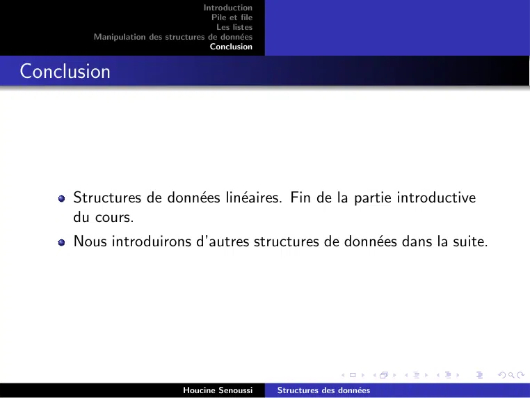

~~~text
                                   Introduction
                                     Pile et file
                                      Les listes
        Manipulation des structures de données
                                     Conclusion

Conclusion

     Structures de données linéaires. Fin de la partie introductive
     du cours.
     Nous introduirons d’autres structures de données dans la suite.

                               Houcine Senoussi     Structures des données
~~~
