# Chap4_slides.pdf

[Ouvrir l’original](https://drive.google.com/open?id=18_SxC6Bgz2UOmyJEj7JelKiouNv6GIpS) · Les deux lectures automatiques du PDF divergent sur les pages indiquées. Leur fac-similé accompagne le texte.

**Pages présentant un écart entre les deux extractions** — 1–13, 15–26.

## Page 1

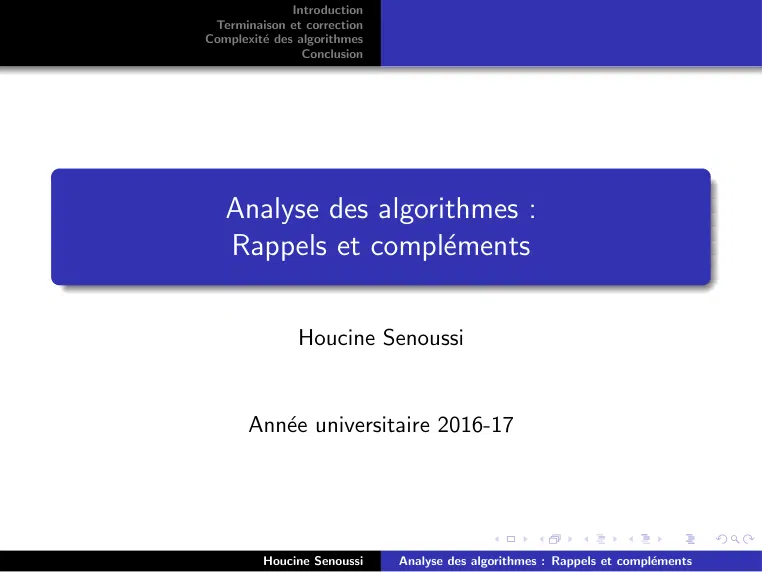

~~~text
               Introduction
 Terminaison et correction
Complexité des algorithmes
                 Conclusion

   Analyse des algorithmes :
   Rappels et compléments

               Houcine Senoussi

       Année universitaire 2016-17

         Houcine Senoussi     Analyse des algorithmes : Rappels et compléments
~~~

## Page 2

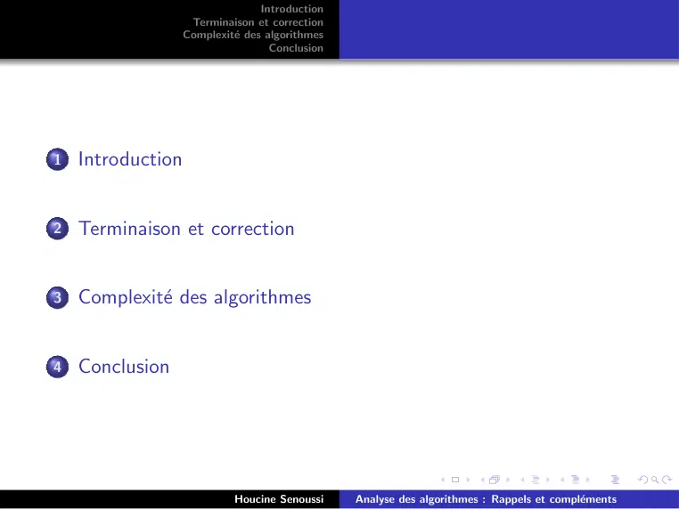

~~~text
                                  Introduction
                    Terminaison et correction
                   Complexité des algorithmes
                                    Conclusion

1   Introduction

2   Terminaison et correction

3   Complexité des algorithmes

4   Conclusion

                            Houcine Senoussi     Analyse des algorithmes : Rappels et compléments
~~~

## Page 3

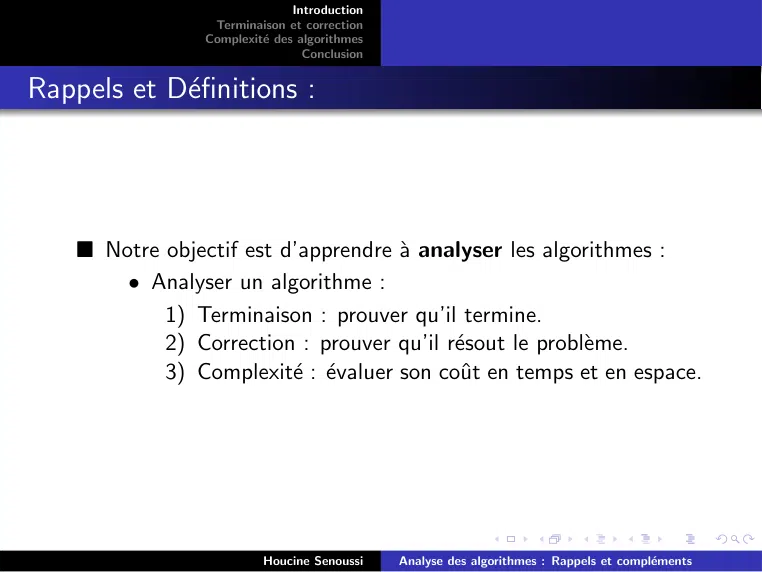

~~~text
                                Introduction
                  Terminaison et correction
                 Complexité des algorithmes
                                  Conclusion

Rappels et Définitions :

     Notre objectif est d’apprendre à analyser les algorithmes :
        • Analyser un algorithme :
            1) Terminaison : prouver qu’il termine.
            2) Correction : prouver qu’il résout le problème.
            3) Complexité : évaluer son coût en temps et en espace.

                          Houcine Senoussi     Analyse des algorithmes : Rappels et compléments
~~~

## Page 4

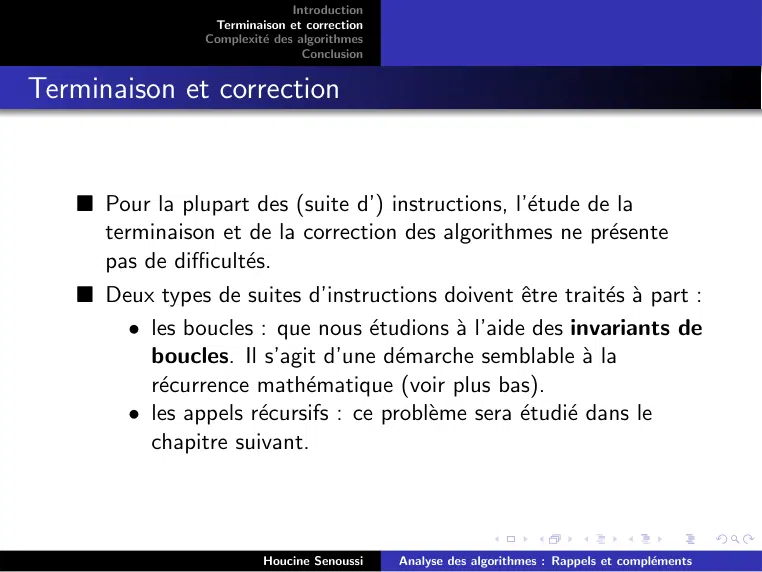

~~~text
                                Introduction
                  Terminaison et correction
                 Complexité des algorithmes
                                  Conclusion

Terminaison et correction

    Pour la plupart des (suite d’) instructions, l’étude de la
     terminaison et de la correction des algorithmes ne présente
     pas de difficultés.
    Deux types de suites d’instructions doivent être traités à part :
       • les boucles : que nous étudions à l’aide des invariants de
         boucles. Il s’agit d’une démarche semblable à la
         récurrence mathématique (voir plus bas).
       • les appels récursifs : ce problème sera étudié dans le
         chapitre suivant.

                          Houcine Senoussi     Analyse des algorithmes : Rappels et compléments
~~~

## Page 5

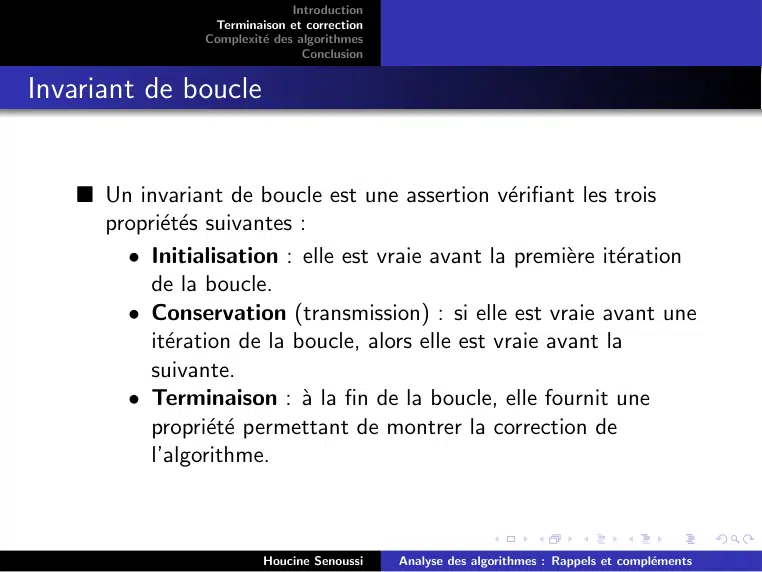

~~~text
                               Introduction
                 Terminaison et correction
                Complexité des algorithmes
                                 Conclusion

Invariant de boucle

    Un invariant de boucle est une assertion vérifiant les trois
     propriétés suivantes :
       • Initialisation : elle est vraie avant la première itération
          de la boucle.
       • Conservation (transmission) : si elle est vraie avant une
          itération de la boucle, alors elle est vraie avant la
          suivante.
       • Terminaison : à la fin de la boucle, elle fournit une
          propriété permettant de montrer la correction de
          l’algorithme.

                         Houcine Senoussi     Analyse des algorithmes : Rappels et compléments
~~~

## Page 6

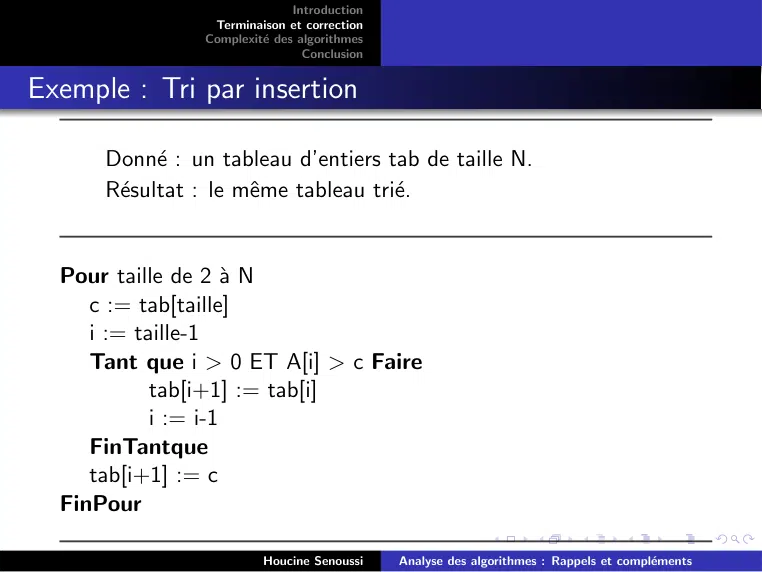

~~~text
                               Introduction
                 Terminaison et correction
                Complexité des algorithmes
                                 Conclusion

Exemple : Tri par insertion

      Donné : un tableau d’entiers tab de taille N.
      Résultat : le même tableau trié.

  Pour taille de 2 à N
     c := tab[taille]
     i := taille-1
     Tant que i > 0 ET A[i] > c Faire
            tab[i+1] := tab[i]
            i := i-1
     FinTantque
     tab[i+1] := c
  FinPour

                         Houcine Senoussi     Analyse des algorithmes : Rappels et compléments
~~~

## Page 7

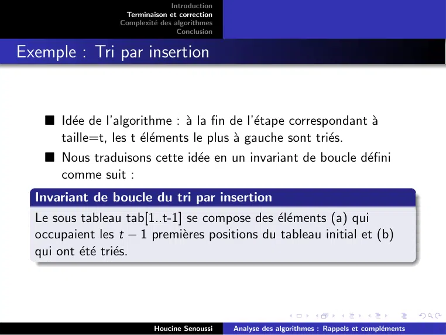

~~~text
                                Introduction
                  Terminaison et correction
                 Complexité des algorithmes
                                  Conclusion

Exemple : Tri par insertion

    Idée de l’algorithme : à la fin de l’étape correspondant à
     taille=t, les t éléments le plus à gauche sont triés.
    Nous traduisons cette idée en un invariant de boucle défini
     comme suit :
  Invariant de boucle du tri par insertion
  Le sous tableau tab[1..t-1] se compose des éléments (a) qui
  occupaient les t − 1 premières positions du tableau initial et (b)
  qui ont été triés.

                          Houcine Senoussi     Analyse des algorithmes : Rappels et compléments
~~~

## Page 8

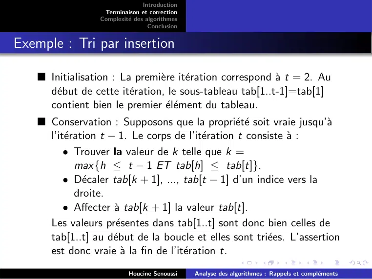

~~~text
                                Introduction
                  Terminaison et correction
                 Complexité des algorithmes
                                  Conclusion

Exemple : Tri par insertion

    Initialisation : La première itération correspond à t = 2. Au
     début de cette itération, le sous-tableau tab[1..t-1]=tab[1]
     contient bien le premier élément du tableau.
    Conservation : Supposons que la propriété soit vraie jusqu’à
     l’itération t − 1. Le corps de l’itération t consiste à :
         • Trouver la valeur de k telle que k =
            max{h ≤ t − 1 ET tab[h] ≤ tab[t]}.
         • Décaler tab[k + 1], ..., tab[t − 1] d’un indice vers la
            droite.
         • Affecter à tab[k + 1] la valeur tab[t].
     Les valeurs présentes dans tab[1..t] sont donc bien celles de
     tab[1..t] au début de la boucle et elles sont triées. L’assertion
     est donc vraie à la fin de l’itération t.
                          Houcine Senoussi     Analyse des algorithmes : Rappels et compléments
~~~

## Page 9

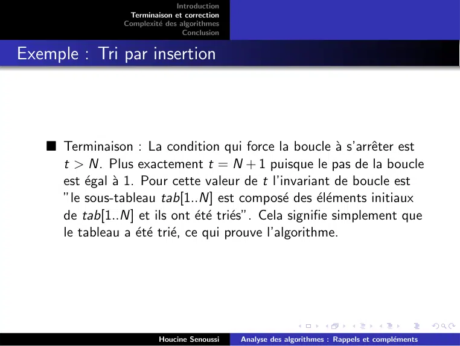

~~~text
                                Introduction
                  Terminaison et correction
                 Complexité des algorithmes
                                  Conclusion

Exemple : Tri par insertion

    Terminaison : La condition qui force la boucle à s’arrêter est
     t > N. Plus exactement t = N + 1 puisque le pas de la boucle
     est égal à 1. Pour cette valeur de t l’invariant de boucle est
     ”le sous-tableau tab[1..N] est composé des éléments initiaux
     de tab[1..N] et ils ont été triés”. Cela signifie simplement que
     le tableau a été trié, ce qui prouve l’algorithme.

                          Houcine Senoussi     Analyse des algorithmes : Rappels et compléments
~~~

## Page 10

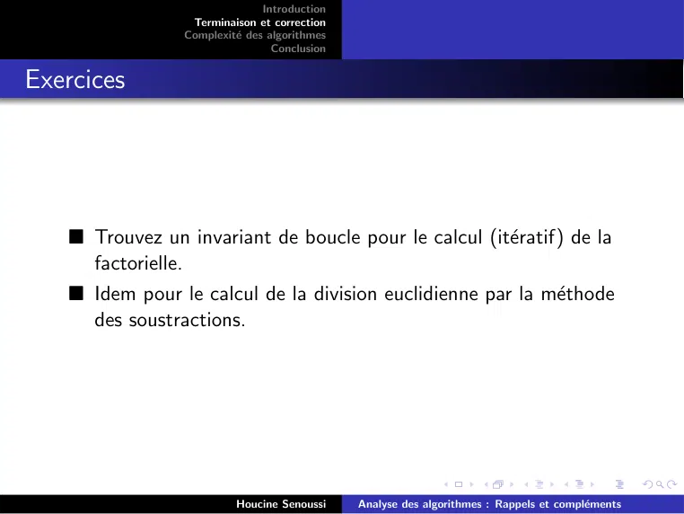

~~~text
                               Introduction
                 Terminaison et correction
                Complexité des algorithmes
                                 Conclusion

Exercices

    Trouvez un invariant de boucle pour le calcul (itératif) de la
     factorielle.
    Idem pour le calcul de la division euclidienne par la méthode
     des soustractions.

                         Houcine Senoussi     Analyse des algorithmes : Rappels et compléments
~~~

## Page 11

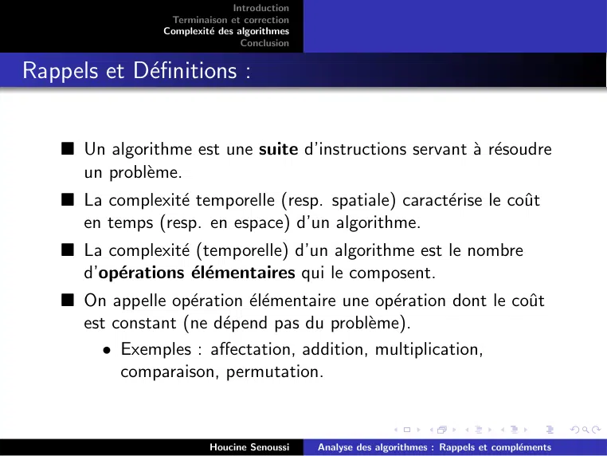

~~~text
                                 Introduction
                   Terminaison et correction
                  Complexité des algorithmes
                                   Conclusion

Rappels et Définitions :

     Un algorithme est une suite d’instructions servant à résoudre
      un problème.
     La complexité temporelle (resp. spatiale) caractérise le coût
      en temps (resp. en espace) d’un algorithme.
     La complexité (temporelle) d’un algorithme est le nombre
      d’opérations élémentaires qui le composent.
     On appelle opération élémentaire une opération dont le coût
      est constant (ne dépend pas du problème).
        • Exemples : affectation, addition, multiplication,
           comparaison, permutation.

                           Houcine Senoussi     Analyse des algorithmes : Rappels et compléments
~~~

## Page 12

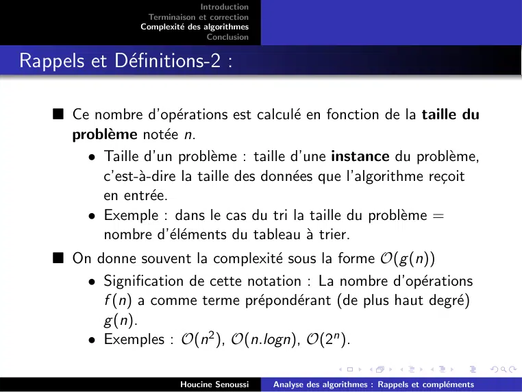

~~~text
                                Introduction
                  Terminaison et correction
                 Complexité des algorithmes
                                  Conclusion

Rappels et Définitions-2 :

     Ce nombre d’opérations est calculé en fonction de la taille du
      problème notée n.
        • Taille d’un problème : taille d’une instance du problème,
          c’est-à-dire la taille des données que l’algorithme reçoit
          en entrée.
        • Exemple : dans le cas du tri la taille du problème =
          nombre d’éléments du tableau à trier.
     On donne souvent la complexité sous la forme O(g (n))
        • Signification de cette notation : La nombre d’opérations
          f (n) a comme terme prépondérant (de plus haut degré)
          g (n).
        • Exemples : O(n2 ), O(n.logn), O(2n ).

                          Houcine Senoussi     Analyse des algorithmes : Rappels et compléments
~~~

## Page 13

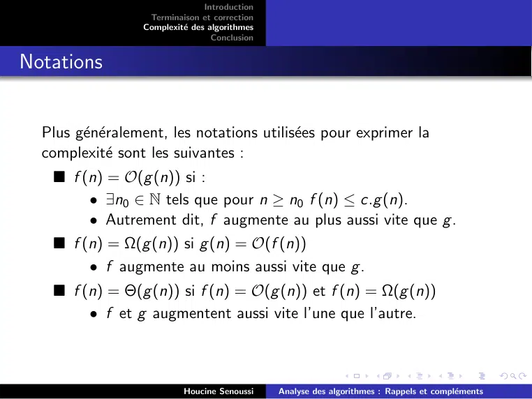

~~~text
                                 Introduction
                   Terminaison et correction
                  Complexité des algorithmes
                                   Conclusion

Notations

  Plus généralement, les notations utilisées pour exprimer la
  complexité sont les suivantes :
    f (n) = O(g (n)) si :
        • ∃n0 ∈ N tels que pour n ≥ n0 f (n) ≤ c.g (n).
        • Autrement dit, f augmente au plus aussi vite que g .
    f (n) = Ω(g (n)) si g (n) = O(f (n))
        • f augmente au moins aussi vite que g .
    f (n) = Θ(g (n)) si f (n) = O(g (n)) et f (n) = Ω(g (n))
        • f et g augmentent aussi vite l’une que l’autre.

                           Houcine Senoussi     Analyse des algorithmes : Rappels et compléments
~~~

## Page 14

~~~text
                              Introduction
                Terminaison et correction
               Complexité des algorithmes
                                Conclusion

Ordres de grandeur-exemples

    4n2 + 5n + 8 = Θ(n2 )
    4n2 + 5n + 8 = O(n3 )
    4n2 + 5n + 8 = O(n2 )
    nlogn = O(n2 )
    nlogn 6= Θ(n2 )
    n3 6= Θ(2n )
    n3 = O(2n )

                        Houcine Senoussi     Analyse des algorithmes : Rappels et compléments
~~~

## Page 15

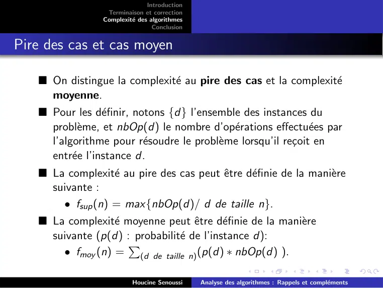

~~~text
                                Introduction
                  Terminaison et correction
                 Complexité des algorithmes
                                  Conclusion

Pire des cas et cas moyen

    On distingue la complexité au pire des cas et la complexité
     moyenne.
    Pour les définir, notons {d} l’ensemble des instances du
     problème, et nbOp(d) le nombre d’opérations effectuées par
     l’algorithme pour résoudre le problème lorsqu’il reçoit en
     entrée l’instance d.
    La complexité au pire des cas peut être définie de la manière
     suivante :
       • fsup (n) = max{nbOp(d)/ d de taille n}.
    La complexité moyenne peut être définie de la manière
     suivante (p(d) : probabilité de l’instance d):
                    P
       • fmoy (n) = (d de taille n) (p(d) ∗ nbOp(d) ).

                          Houcine Senoussi     Analyse des algorithmes : Rappels et compléments
~~~

## Page 16

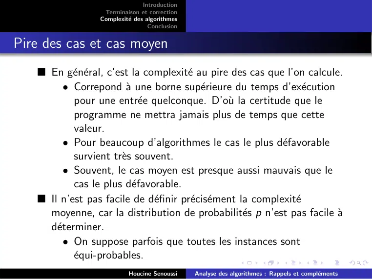

~~~text
                                Introduction
                  Terminaison et correction
                 Complexité des algorithmes
                                  Conclusion

Pire des cas et cas moyen
    En général, c’est la complexité au pire des cas que l’on calcule.
        • Correpond à une borne supérieure du temps d’exécution
           pour une entrée quelconque. D’où la certitude que le
           programme ne mettra jamais plus de temps que cette
           valeur.
        • Pour beaucoup d’algorithmes le cas le plus défavorable
           survient très souvent.
        • Souvent, le cas moyen est presque aussi mauvais que le
           cas le plus défavorable.
    Il n’est pas facile de définir précisément la complexité
     moyenne, car la distribution de probabilités p n’est pas facile à
     déterminer.
        • On suppose parfois que toutes les instances sont
           équi-probables.
                          Houcine Senoussi     Analyse des algorithmes : Rappels et compléments
~~~

## Page 17

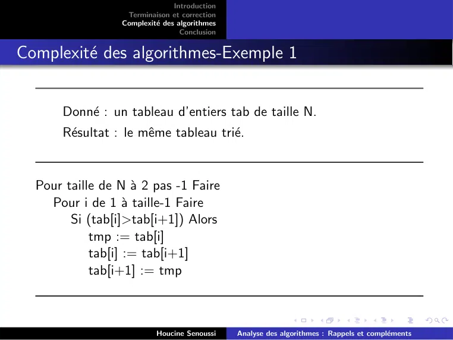

~~~text
                                 Introduction
                   Terminaison et correction
                  Complexité des algorithmes
                                   Conclusion

Complexité des algorithmes-Exemple 1

       Donné : un tableau d’entiers tab de taille N.
       Résultat : le même tableau trié.

  Pour taille de N à 2 pas -1 Faire
    Pour i de 1 à taille-1 Faire
        Si (tab[i]>tab[i+1]) Alors
            tmp := tab[i]
            tab[i] := tab[i+1]
            tab[i+1] := tmp

                           Houcine Senoussi     Analyse des algorithmes : Rappels et compléments
~~~

## Page 18

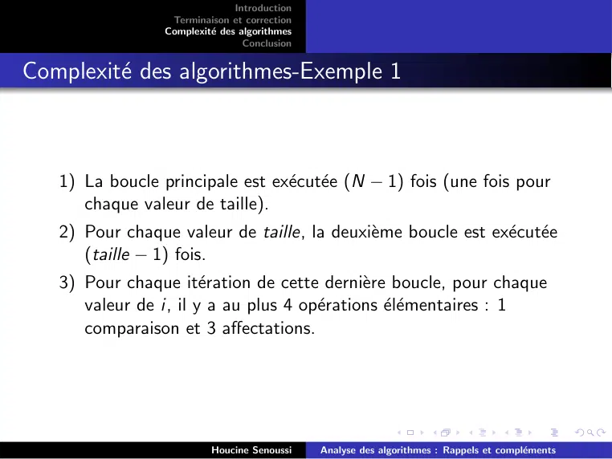

~~~text
                                Introduction
                  Terminaison et correction
                 Complexité des algorithmes
                                  Conclusion

Complexité des algorithmes-Exemple 1

   1) La boucle principale est exécutée (N − 1) fois (une fois pour
      chaque valeur de taille).
   2) Pour chaque valeur de taille, la deuxième boucle est exécutée
      (taille − 1) fois.
   3) Pour chaque itération de cette dernière boucle, pour chaque
      valeur de i, il y a au plus 4 opérations élémentaires : 1
      comparaison et 3 affectations.

                          Houcine Senoussi     Analyse des algorithmes : Rappels et compléments
~~~

## Page 19

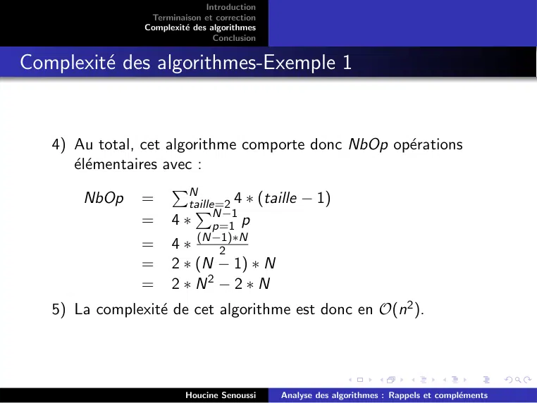

~~~text
                               Introduction
                 Terminaison et correction
                Complexité des algorithmes
                                 Conclusion

Complexité des algorithmes-Exemple 1

   4) Au total, cet algorithme comporte donc NbOp opérations
      élémentaires avec :
                      PN
        NbOp =           taille=2 4 ∗ (taille − 1)
                  = 4 ∗ N−1
                          P
                               p=1 p
                           (N−1)∗N
                  = 4∗          2
                  = 2 ∗ (N − 1) ∗ N
                  = 2 ∗ N2 − 2 ∗ N
   5) La complexité de cet algorithme est donc en O(n2 ).

                         Houcine Senoussi     Analyse des algorithmes : Rappels et compléments
~~~

## Page 20

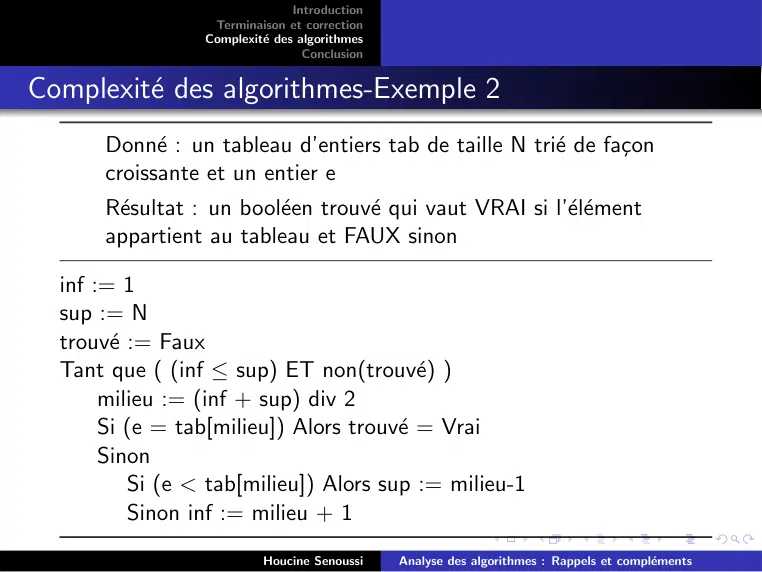

~~~text
                                Introduction
                  Terminaison et correction
                 Complexité des algorithmes
                                  Conclusion

Complexité des algorithmes-Exemple 2
      Donné : un tableau d’entiers tab de taille N trié de façon
      croissante et un entier e
      Résultat : un booléen trouvé qui vaut VRAI si l’élément
      appartient au tableau et FAUX sinon

  inf := 1
  sup := N
  trouvé := Faux
  Tant que ( (inf ≤ sup) ET non(trouvé) )
       milieu := (inf + sup) div 2
       Si (e = tab[milieu]) Alors trouvé = Vrai
       Sinon
          Si (e < tab[milieu]) Alors sup := milieu-1
          Sinon inf := milieu + 1
                          Houcine Senoussi     Analyse des algorithmes : Rappels et compléments
~~~

## Page 21

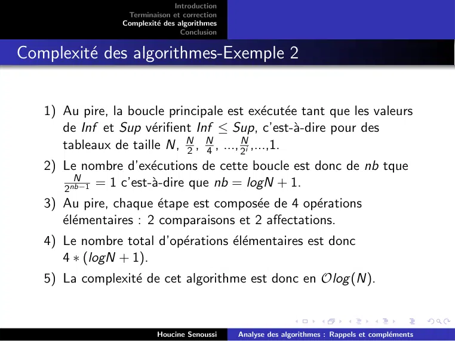

~~~text
                                Introduction
                  Terminaison et correction
                 Complexité des algorithmes
                                  Conclusion

Complexité des algorithmes-Exemple 2

   1) Au pire, la boucle principale est exécutée tant que les valeurs
      de Inf et Sup vérifient Inf ≤ Sup, c’est-à-dire pour des
      tableaux de taille N, N2 , N4 , ..., 2Ni ,...,1.
   2) Le nombre d’exécutions de cette boucle est donc de nb tque
        N
      2nb−1
            = 1 c’est-à-dire que nb = logN + 1.
   3) Au pire, chaque étape est composée de 4 opérations
      élémentaires : 2 comparaisons et 2 affectations.
   4) Le nombre total d’opérations élémentaires est donc
      4 ∗ (logN + 1).
   5) La complexité de cet algorithme est donc en Olog (N).

                          Houcine Senoussi     Analyse des algorithmes : Rappels et compléments
~~~

## Page 22

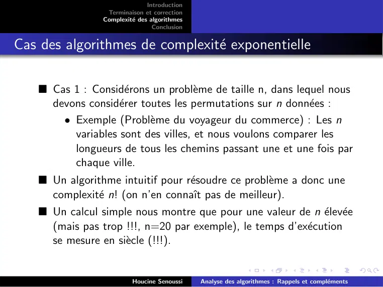

~~~text
                               Introduction
                 Terminaison et correction
                Complexité des algorithmes
                                 Conclusion

Cas des algorithmes de complexité exponentielle

    Cas 1 : Considérons un problème de taille n, dans lequel nous
     devons considérer toutes les permutations sur n données :
       • Exemple (Problème du voyageur du commerce) : Les n
         variables sont des villes, et nous voulons comparer les
         longueurs de tous les chemins passant une et une fois par
         chaque ville.
    Un algorithme intuitif pour résoudre ce problème a donc une
     complexité n! (on n’en connaı̂t pas de meilleur).
    Un calcul simple nous montre que pour une valeur de n élevée
     (mais pas trop !!!, n=20 par exemple), le temps d’exécution
     se mesure en siècle (!!!).

                         Houcine Senoussi     Analyse des algorithmes : Rappels et compléments
~~~

## Page 23

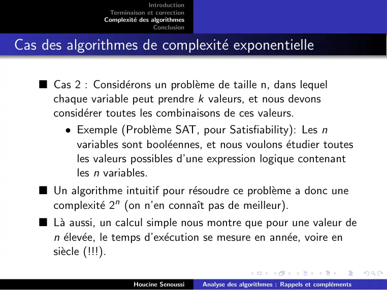

~~~text
                               Introduction
                 Terminaison et correction
                Complexité des algorithmes
                                 Conclusion

Cas des algorithmes de complexité exponentielle

    Cas 2 : Considérons un problème de taille n, dans lequel
     chaque variable peut prendre k valeurs, et nous devons
     considérer toutes les combinaisons de ces valeurs.
       • Exemple (Problème SAT, pour Satisfiability): Les n
          variables sont booléennes, et nous voulons étudier toutes
          les valeurs possibles d’une expression logique contenant
          les n variables.
    Un algorithme intuitif pour résoudre ce problème a donc une
     complexité 2n (on n’en connaı̂t pas de meilleur).
    Là aussi, un calcul simple nous montre que pour une valeur de
     n élevée, le temps d’exécution se mesure en année, voire en
     siècle (!!!).

                         Houcine Senoussi     Analyse des algorithmes : Rappels et compléments
~~~

## Page 24

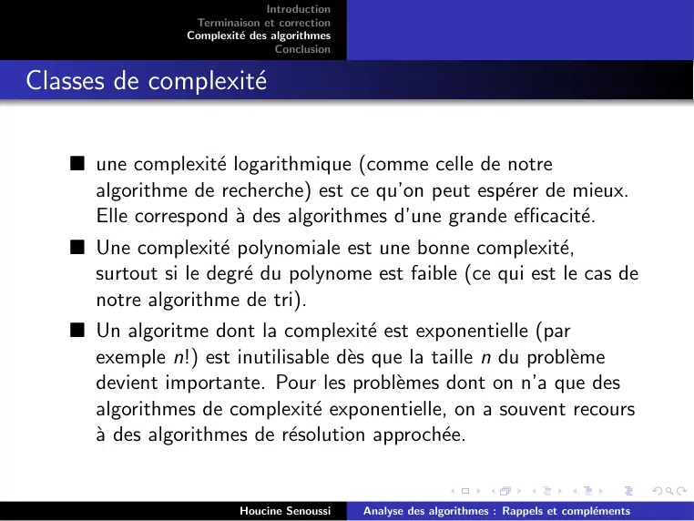

~~~text
                                Introduction
                  Terminaison et correction
                 Complexité des algorithmes
                                  Conclusion

Classes de complexité

     une complexité logarithmique (comme celle de notre
      algorithme de recherche) est ce qu’on peut espérer de mieux.
      Elle correspond à des algorithmes d’une grande efficacité.
     Une complexité polynomiale est une bonne complexité,
      surtout si le degré du polynome est faible (ce qui est le cas de
      notre algorithme de tri).
     Un algoritme dont la complexité est exponentielle (par
      exemple n!) est inutilisable dès que la taille n du problème
      devient importante. Pour les problèmes dont on n’a que des
      algorithmes de complexité exponentielle, on a souvent recours
      à des algorithmes de résolution approchée.

                          Houcine Senoussi     Analyse des algorithmes : Rappels et compléments
~~~

## Page 25

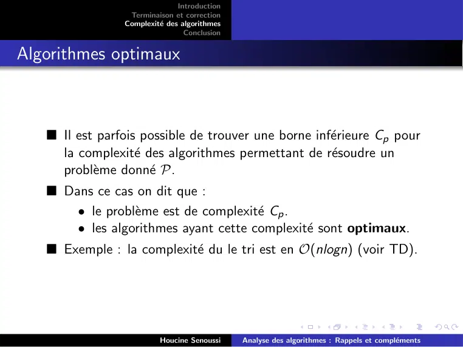

~~~text
                               Introduction
                 Terminaison et correction
                Complexité des algorithmes
                                 Conclusion

Algorithmes optimaux

    Il est parfois possible de trouver une borne inférieure Cp pour
     la complexité des algorithmes permettant de résoudre un
     problème donné P.
    Dans ce cas on dit que :
       • le problème est de complexité Cp .
       • les algorithmes ayant cette complexité sont optimaux.
    Exemple : la complexité du le tri est en O(nlogn) (voir TD).

                         Houcine Senoussi     Analyse des algorithmes : Rappels et compléments
~~~

## Page 26

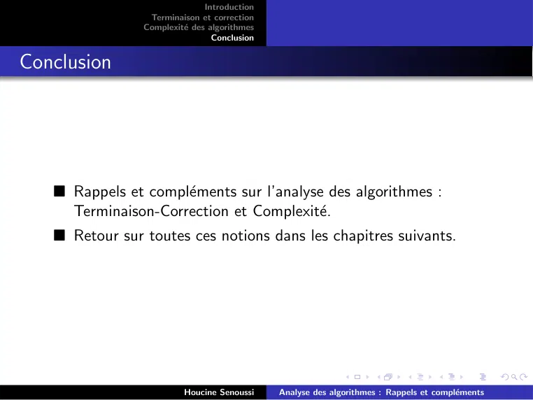

~~~text
                               Introduction
                 Terminaison et correction
                Complexité des algorithmes
                                 Conclusion

Conclusion

    Rappels et compléments sur l’analyse des algorithmes :
     Terminaison-Correction et Complexité.
    Retour sur toutes ces notions dans les chapitres suivants.

                         Houcine Senoussi     Analyse des algorithmes : Rappels et compléments
~~~
