# Chap5_slides.pdf

[Ouvrir l’original](https://drive.google.com/open?id=1K1KxGWdgS4eU_vBoI21FqqfV9BUtj6s_) · Les deux lectures automatiques du PDF divergent sur les pages indiquées. Leur fac-similé accompagne le texte.

**Pages présentant un écart entre les deux extractions** — 1–24.

## Page 1

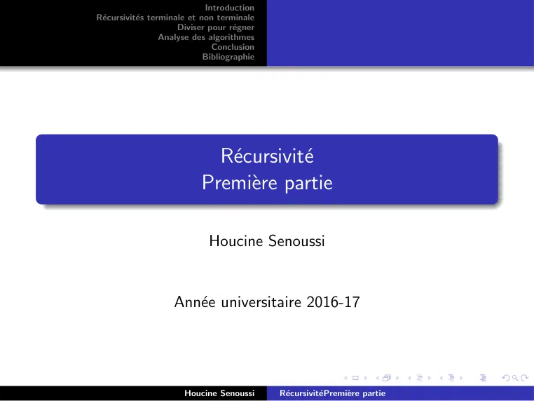

~~~text
                             Introduction
Récursivités terminale et non terminale
                      Diviser pour régner
                  Analyse des algorithmes
                               Conclusion
                             Bibliographie

                             Récursivité
                           Première partie

                             Houcine Senoussi

                    Année universitaire 2016-17

                       Houcine Senoussi      RécursivitéPremière partie
~~~

## Page 2

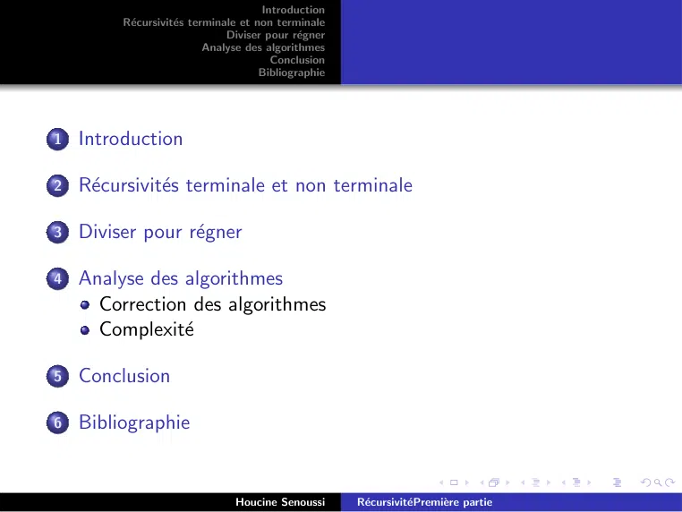

~~~text
                                      Introduction
         Récursivités terminale et non terminale
                               Diviser pour régner
                           Analyse des algorithmes
                                        Conclusion
                                      Bibliographie

1   Introduction

2   Récursivités terminale et non terminale

3   Diviser pour régner

4   Analyse des algorithmes
      Correction des algorithmes
      Complexité

5   Conclusion

6   Bibliographie

                                Houcine Senoussi      RécursivitéPremière partie
~~~

## Page 3

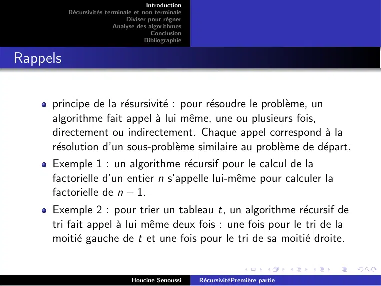

~~~text
                                       Introduction
          Récursivités terminale et non terminale
                                Diviser pour régner
                            Analyse des algorithmes
                                         Conclusion
                                       Bibliographie

Rappels

     principe de la résursivité : pour résoudre le problème, un
     algorithme fait appel à lui même, une ou plusieurs fois,
     directement ou indirectement. Chaque appel correspond à la
     résolution d’un sous-problème similaire au problème de départ.
     Exemple 1 : un algorithme récursif pour le calcul de la
     factorielle d’un entier n s’appelle lui-même pour calculer la
     factorielle de n − 1.
     Exemple 2 : pour trier un tableau t, un algorithme récursif de
     tri fait appel à lui même deux fois : une fois pour le tri de la
     moitié gauche de t et une fois pour le tri de sa moitié droite.

                                 Houcine Senoussi      RécursivitéPremière partie
~~~

## Page 4

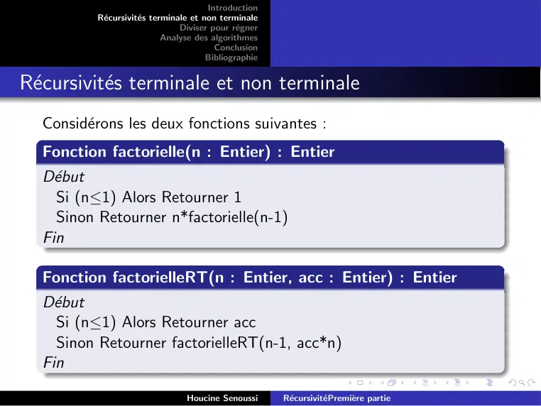

~~~text
                                       Introduction
          Récursivités terminale et non terminale
                                Diviser pour régner
                            Analyse des algorithmes
                                         Conclusion
                                       Bibliographie

Récursivités terminale et non terminale
  Considérons les deux fonctions suivantes :
  Fonction factorielle(n : Entier) : Entier
  Début
    Si (n≤1) Alors Retourner 1
    Sinon Retourner n*factorielle(n-1)
  Fin

  Fonction factorielleRT(n : Entier, acc : Entier) : Entier
  Début
    Si (n≤1) Alors Retourner acc
    Sinon Retourner factorielleRT(n-1, acc*n)
  Fin

                                 Houcine Senoussi      RécursivitéPremière partie
~~~

## Page 5

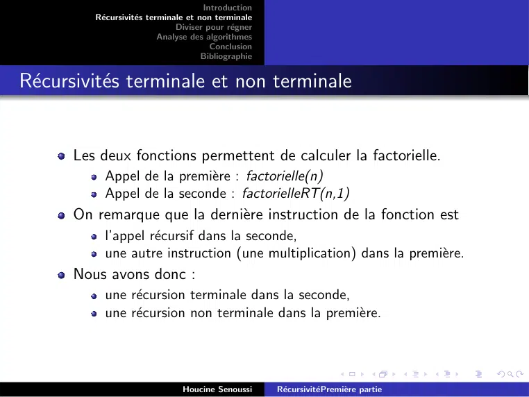

~~~text
                                      Introduction
         Récursivités terminale et non terminale
                               Diviser pour régner
                           Analyse des algorithmes
                                        Conclusion
                                      Bibliographie

Récursivités terminale et non terminale

      Les deux fonctions permettent de calculer la factorielle.
           Appel de la première : factorielle(n)
           Appel de la seconde : factorielleRT(n,1)
      On remarque que la dernière instruction de la fonction est
           l’appel récursif dans la seconde,
           une autre instruction (une multiplication) dans la première.
      Nous avons donc :
           une récursion terminale dans la seconde,
           une récursion non terminale dans la première.

                                Houcine Senoussi      RécursivitéPremière partie
~~~

## Page 6

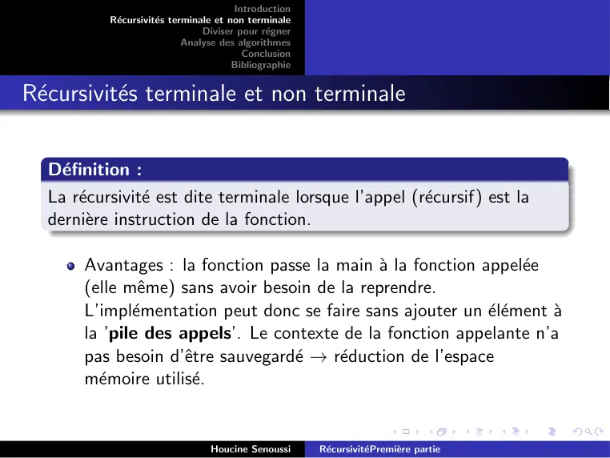

~~~text
                                        Introduction
           Récursivités terminale et non terminale
                                 Diviser pour régner
                             Analyse des algorithmes
                                          Conclusion
                                        Bibliographie

Récursivités terminale et non terminale

  Définition :
  La récursivité est dite terminale lorsque l’appel (récursif) est la
  dernière instruction de la fonction.

       Avantages : la fonction passe la main à la fonction appelée
       (elle même) sans avoir besoin de la reprendre.
       L’implémentation peut donc se faire sans ajouter un élément à
       la ’pile des appels’. Le contexte de la fonction appelante n’a
       pas besoin d’être sauvegardé → réduction de l’espace
       mémoire utilisé.

                                  Houcine Senoussi      RécursivitéPremière partie
~~~

## Page 7

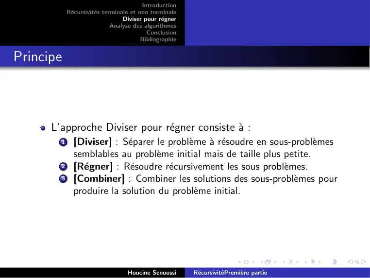

~~~text
                                         Introduction
            Récursivités terminale et non terminale
                                  Diviser pour régner
                              Analyse des algorithmes
                                           Conclusion
                                         Bibliographie

Principe

      L’approche Diviser pour régner consiste à :
        1     [Diviser] : Séparer le problème à résoudre en sous-problèmes
              semblables au problème initial mais de taille plus petite.
        2     [Régner] : Résoudre récursivement les sous problèmes.
        3     [Combiner] : Combiner les solutions des sous-problèmes pour
              produire la solution du problème initial.

                                   Houcine Senoussi      RécursivitéPremière partie
~~~

## Page 8

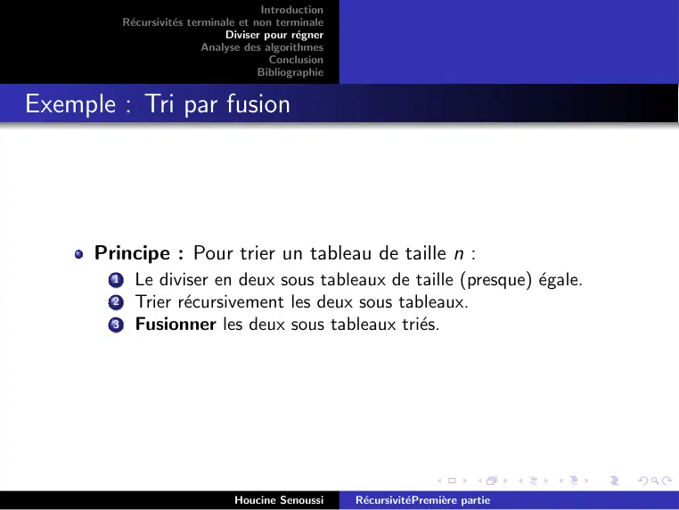

~~~text
                                         Introduction
            Récursivités terminale et non terminale
                                  Diviser pour régner
                              Analyse des algorithmes
                                           Conclusion
                                         Bibliographie

Exemple : Tri par fusion

      Principe : Pour trier un tableau de taille n :
        1     Le diviser en deux sous tableaux de taille (presque) égale.
        2     Trier récursivement les deux sous tableaux.
        3     Fusionner les deux sous tableaux triés.

                                   Houcine Senoussi      RécursivitéPremière partie
~~~

## Page 9

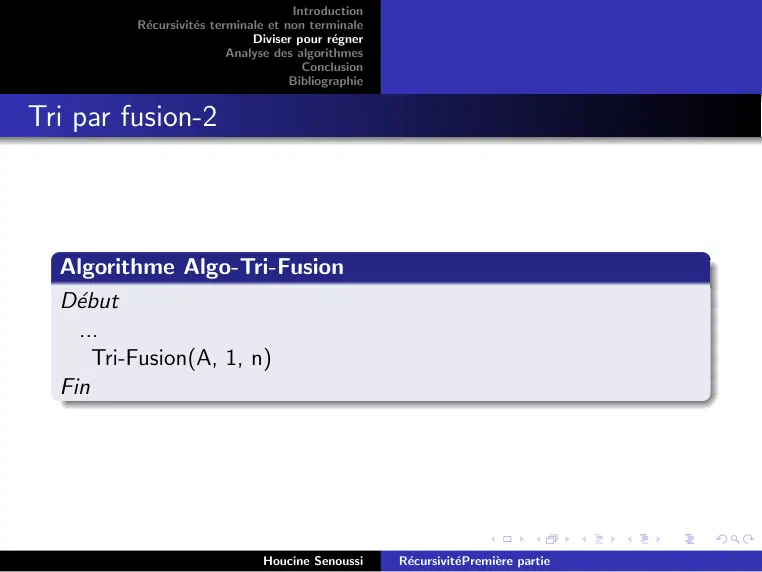

~~~text
                                      Introduction
         Récursivités terminale et non terminale
                               Diviser pour régner
                           Analyse des algorithmes
                                        Conclusion
                                      Bibliographie

Tri par fusion-2

  Algorithme Algo-Tri-Fusion
  Début
    ...
      Tri-Fusion(A, 1, n)
  Fin

                                Houcine Senoussi      RécursivitéPremière partie
~~~

## Page 10

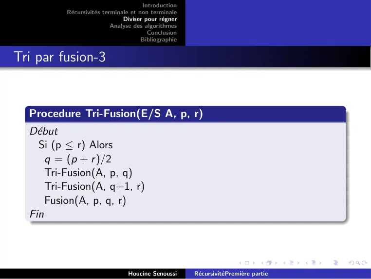

~~~text
                                       Introduction
          Récursivités terminale et non terminale
                                Diviser pour régner
                            Analyse des algorithmes
                                         Conclusion
                                       Bibliographie

Tri par fusion-3

  Procedure Tri-Fusion(E/S A, p, r)
  Début
    Si (p ≤ r) Alors
      q = (p + r )/2
      Tri-Fusion(A, p, q)
      Tri-Fusion(A, q+1, r)
      Fusion(A, p, q, r)
  Fin

                                 Houcine Senoussi      RécursivitéPremière partie
~~~

## Page 11

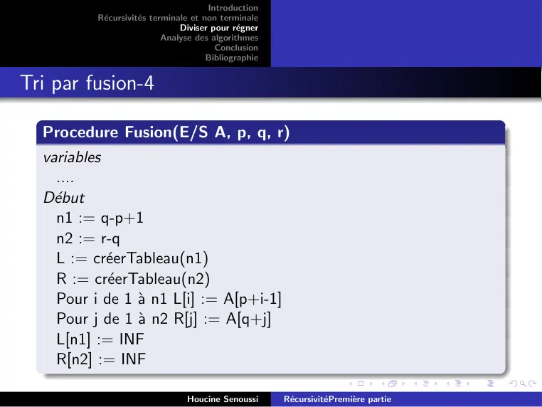

~~~text
                                       Introduction
          Récursivités terminale et non terminale
                                Diviser pour régner
                            Analyse des algorithmes
                                         Conclusion
                                       Bibliographie

Tri par fusion-4

  Procedure Fusion(E/S A, p, q, r)
  variables
    ....
  Début
    n1 := q-p+1
    n2 := r-q
    L := créerTableau(n1)
    R := créerTableau(n2)
    Pour i de 1 à n1 L[i] := A[p+i-1]
    Pour j de 1 à n2 R[j] := A[q+j]
    L[n1] := INF
    R[n2] := INF

                                 Houcine Senoussi      RécursivitéPremière partie
~~~

## Page 12

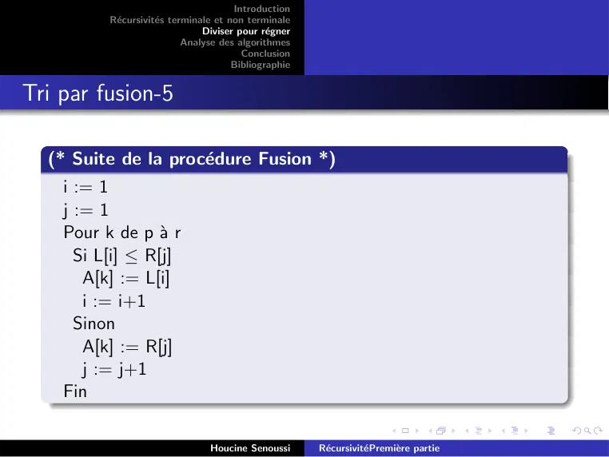

~~~text
                                       Introduction
          Récursivités terminale et non terminale
                                Diviser pour régner
                            Analyse des algorithmes
                                         Conclusion
                                       Bibliographie

Tri par fusion-5

  (* Suite de la procédure Fusion *)
    i := 1
    j := 1
    Pour k de p à r
      Si L[i] ≤ R[j]
       A[k] := L[i]
       i := i+1
      Sinon
       A[k] := R[j]
       j := j+1
    Fin

                                 Houcine Senoussi      RécursivitéPremière partie
~~~

## Page 13

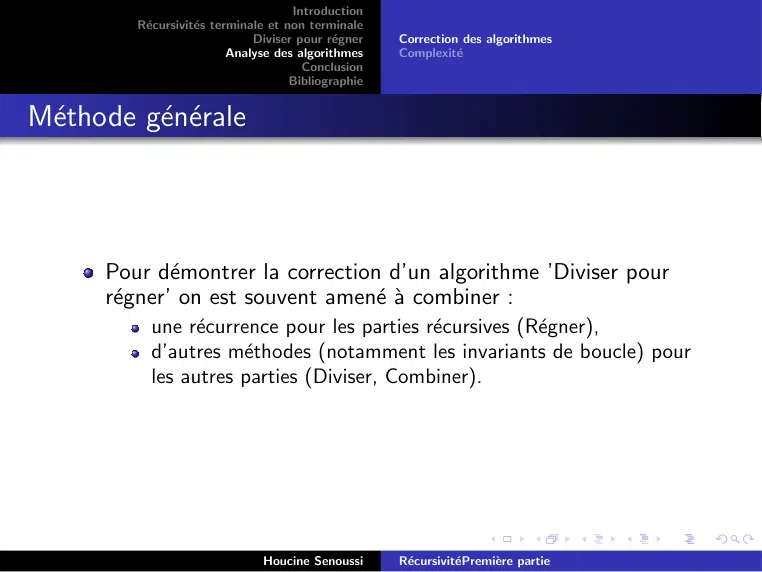

~~~text
                                      Introduction
         Récursivités terminale et non terminale
                               Diviser pour régner   Correction des algorithmes
                           Analyse des algorithmes    Complexité
                                        Conclusion
                                      Bibliographie

Méthode générale

      Pour démontrer la correction d’un algorithme ’Diviser pour
      régner’ on est souvent amené à combiner :
           une récurrence pour les parties récursives (Régner),
           d’autres méthodes (notamment les invariants de boucle) pour
           les autres parties (Diviser, Combiner).

                                Houcine Senoussi      RécursivitéPremière partie
~~~

## Page 14

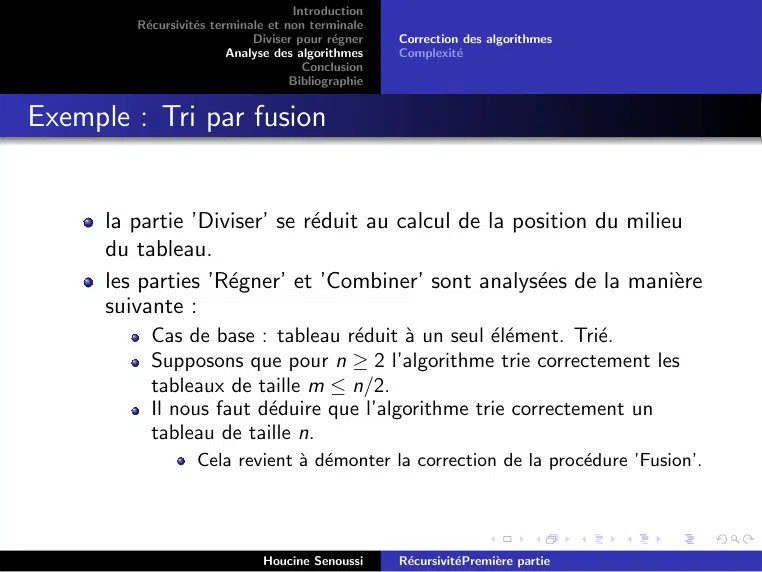

~~~text
                                      Introduction
         Récursivités terminale et non terminale
                               Diviser pour régner   Correction des algorithmes
                           Analyse des algorithmes    Complexité
                                        Conclusion
                                      Bibliographie

Exemple : Tri par fusion

      la partie ’Diviser’ se réduit au calcul de la position du milieu
      du tableau.
      les parties ’Régner’ et ’Combiner’ sont analysées de la manière
      suivante :
           Cas de base : tableau réduit à un seul élément. Trié.
           Supposons que pour n ≥ 2 l’algorithme trie correctement les
           tableaux de taille m ≤ n/2.
           Il nous faut déduire que l’algorithme trie correctement un
           tableau de taille n.
                    Cela revient à démonter la correction de la procédure ’Fusion’.

                                Houcine Senoussi      RécursivitéPremière partie
~~~

## Page 15

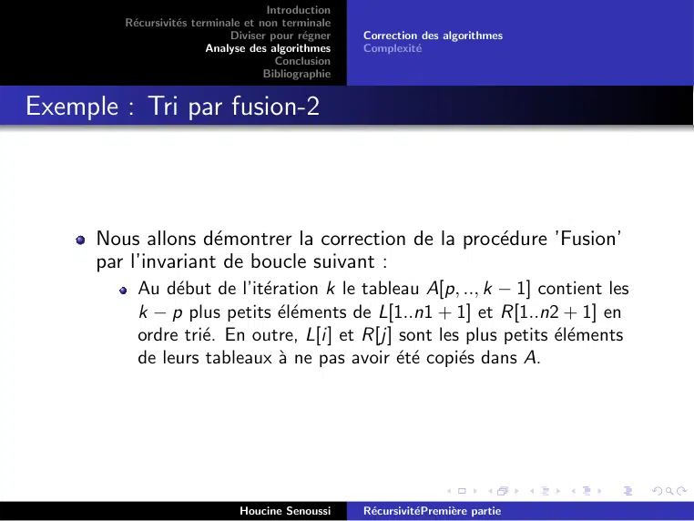

~~~text
                                      Introduction
         Récursivités terminale et non terminale
                               Diviser pour régner   Correction des algorithmes
                           Analyse des algorithmes    Complexité
                                        Conclusion
                                      Bibliographie

Exemple : Tri par fusion-2

      Nous allons démontrer la correction de la procédure ’Fusion’
      par l’invariant de boucle suivant :
           Au début de l’itération k le tableau A[p, .., k − 1] contient les
           k − p plus petits éléments de L[1..n1 + 1] et R[1..n2 + 1] en
           ordre trié. En outre, L[i] et R[j] sont les plus petits éléments
           de leurs tableaux à ne pas avoir été copiés dans A.

                                Houcine Senoussi      RécursivitéPremière partie
~~~

## Page 16

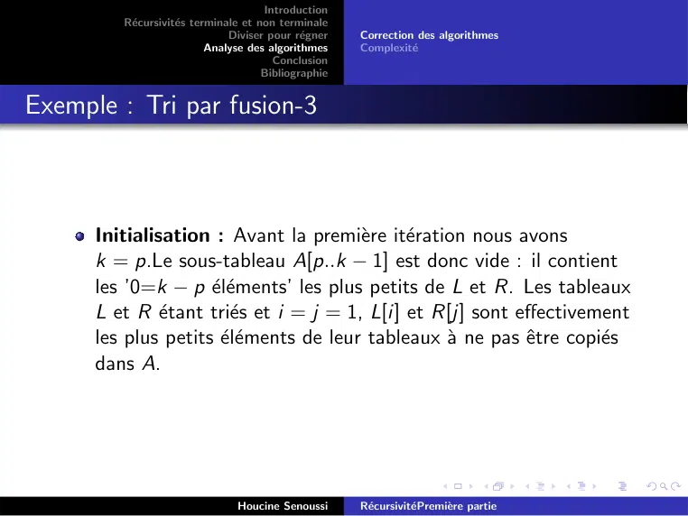

~~~text
                                      Introduction
         Récursivités terminale et non terminale
                               Diviser pour régner   Correction des algorithmes
                           Analyse des algorithmes    Complexité
                                        Conclusion
                                      Bibliographie

Exemple : Tri par fusion-3

      Initialisation : Avant la première itération nous avons
      k = p.Le sous-tableau A[p..k − 1] est donc vide : il contient
      les ’0=k − p éléments’ les plus petits de L et R. Les tableaux
      L et R étant triés et i = j = 1, L[i] et R[j] sont effectivement
      les plus petits éléments de leur tableaux à ne pas être copiés
      dans A.

                                Houcine Senoussi      RécursivitéPremière partie
~~~

## Page 17

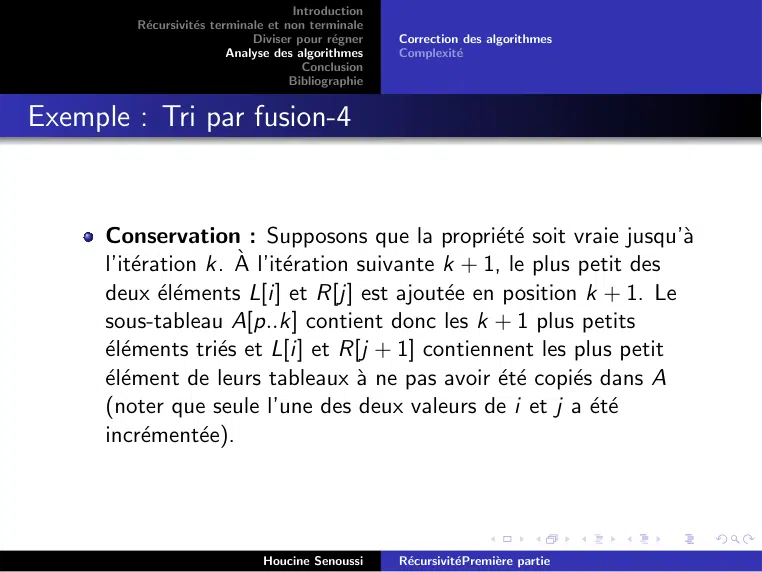

~~~text
                                      Introduction
         Récursivités terminale et non terminale
                               Diviser pour régner   Correction des algorithmes
                           Analyse des algorithmes    Complexité
                                        Conclusion
                                      Bibliographie

Exemple : Tri par fusion-4

      Conservation : Supposons que la propriété soit vraie jusqu’à
      l’itération k. À l’itération suivante k + 1, le plus petit des
      deux éléments L[i] et R[j] est ajoutée en position k + 1. Le
      sous-tableau A[p..k] contient donc les k + 1 plus petits
      éléments triés et L[i] et R[j + 1] contiennent les plus petit
      élément de leurs tableaux à ne pas avoir été copiés dans A
      (noter que seule l’une des deux valeurs de i et j a été
      incrémentée).

                                Houcine Senoussi      RécursivitéPremière partie
~~~

## Page 18

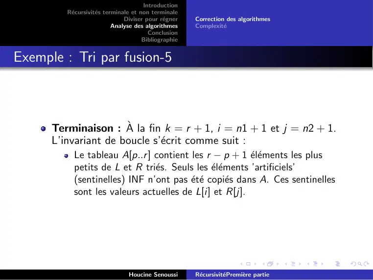

~~~text
                                      Introduction
         Récursivités terminale et non terminale
                               Diviser pour régner   Correction des algorithmes
                           Analyse des algorithmes    Complexité
                                        Conclusion
                                      Bibliographie

Exemple : Tri par fusion-5

      Terminaison : À la fin k = r + 1, i = n1 + 1 et j = n2 + 1.
      L’invariant de boucle s’écrit comme suit :
           Le tableau A[p..r ] contient les r − p + 1 éléments les plus
           petits de L et R triés. Seuls les éléments ’artificiels’
           (sentinelles) INF n’ont pas été copiés dans A. Ces sentinelles
           sont les valeurs actuelles de L[i] et R[j].

                                Houcine Senoussi      RécursivitéPremière partie
~~~

## Page 19

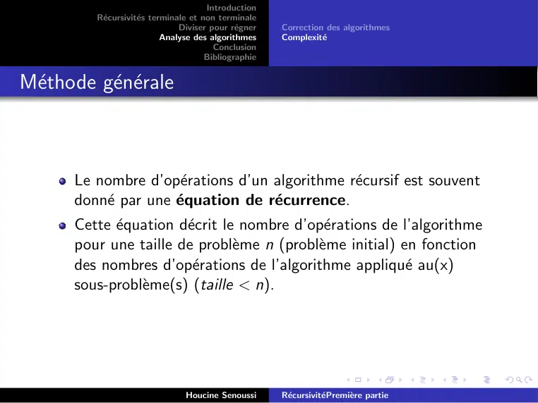

~~~text
                                      Introduction
         Récursivités terminale et non terminale
                               Diviser pour régner   Correction des algorithmes
                           Analyse des algorithmes    Complexité
                                        Conclusion
                                      Bibliographie

Méthode générale

      Le nombre d’opérations d’un algorithme récursif est souvent
      donné par une équation de récurrence.
      Cette équation décrit le nombre d’opérations de l’algorithme
      pour une taille de problème n (problème initial) en fonction
      des nombres d’opérations de l’algorithme appliqué au(x)
      sous-problème(s) (taille < n).

                                Houcine Senoussi      RécursivitéPremière partie
~~~

## Page 20

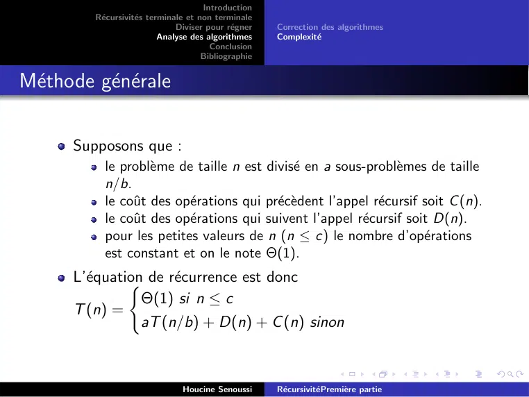

~~~text
                                      Introduction
         Récursivités terminale et non terminale
                               Diviser pour régner   Correction des algorithmes
                           Analyse des algorithmes    Complexité
                                        Conclusion
                                      Bibliographie

Méthode générale

      Supposons que :
           le problème de taille n est divisé en a sous-problèmes de taille
           n/b.
           le coût des opérations qui précèdent l’appel récursif soit C (n).
           le coût des opérations qui suivent l’appel récursif soit D(n).
           pour les petites valeurs de n (n ≤ c) le nombre d’opérations
           est constant et on le note Θ(1).
      L’équation
               ( de récurrence est donc
                 Θ(1) si n ≤ c
      T (n) =
                 aT (n/b) + D(n) + C (n) sinon

                                Houcine Senoussi      RécursivitéPremière partie
~~~

## Page 21

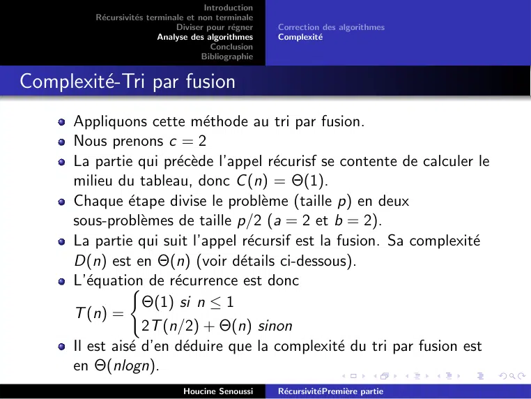

~~~text
                                      Introduction
         Récursivités terminale et non terminale
                               Diviser pour régner   Correction des algorithmes
                           Analyse des algorithmes    Complexité
                                        Conclusion
                                      Bibliographie

Complexité-Tri par fusion
      Appliquons cette méthode au tri par fusion.
      Nous prenons c = 2
      La partie qui précède l’appel récurisf se contente de calculer le
      milieu du tableau, donc C (n) = Θ(1).
      Chaque étape divise le problème (taille p) en deux
      sous-problèmes de taille p/2 (a = 2 et b = 2).
      La partie qui suit l’appel récursif est la fusion. Sa complexité
      D(n) est en Θ(n) (voir détails ci-dessous).
      L’équation
                ( de récurrence est donc
                   Θ(1) si n ≤ 1
      T (n) =
                   2T (n/2) + Θ(n) sinon
      Il est aisé d’en déduire que la complexité du tri par fusion est
      en Θ(nlogn).
                                Houcine Senoussi      RécursivitéPremière partie
~~~

## Page 22

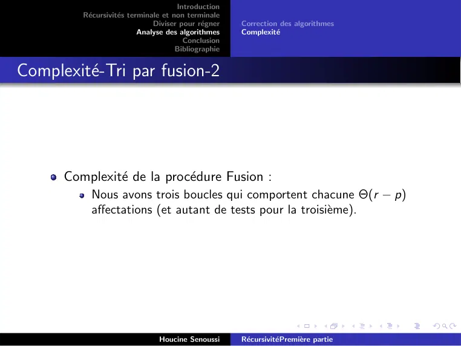

~~~text
                                      Introduction
         Récursivités terminale et non terminale
                               Diviser pour régner   Correction des algorithmes
                           Analyse des algorithmes    Complexité
                                        Conclusion
                                      Bibliographie

Complexité-Tri par fusion-2

      Complexité de la procédure Fusion :
           Nous avons trois boucles qui comportent chacune Θ(r − p)
           affectations (et autant de tests pour la troisième).

                                Houcine Senoussi      RécursivitéPremière partie
~~~

## Page 23

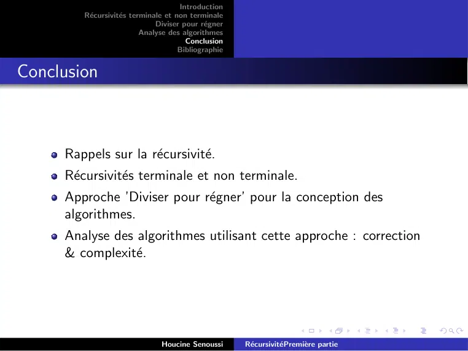

~~~text
                                     Introduction
        Récursivités terminale et non terminale
                              Diviser pour régner
                          Analyse des algorithmes
                                       Conclusion
                                     Bibliographie

Conclusion

     Rappels sur la récursivité.
     Récursivités terminale et non terminale.
     Approche ’Diviser pour régner’ pour la conception des
     algorithmes.
     Analyse des algorithmes utilisant cette approche : correction
     & complexité.

                               Houcine Senoussi      RécursivitéPremière partie
~~~

## Page 24

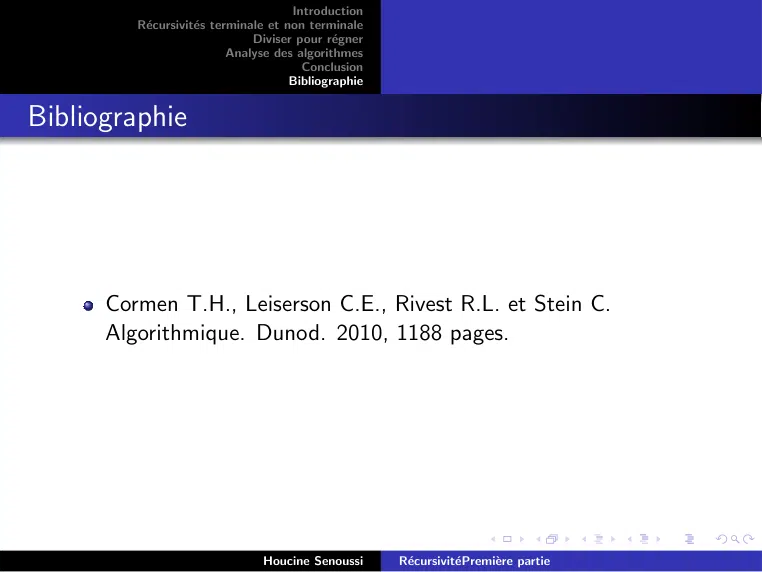

~~~text
                                      Introduction
         Récursivités terminale et non terminale
                               Diviser pour régner
                           Analyse des algorithmes
                                        Conclusion
                                      Bibliographie

Bibliographie

      Cormen T.H., Leiserson C.E., Rivest R.L. et Stein C.
      Algorithmique. Dunod. 2010, 1188 pages.

                                Houcine Senoussi      RécursivitéPremière partie
~~~
