# Chap6-slides.pdf

[Ouvrir l’original](https://drive.google.com/open?id=1HOnW6HwXfl7keAFRJOpJ5ByKNpHKM13x) · Les deux lectures automatiques du PDF divergent sur les pages indiquées. Leur fac-similé accompagne le texte.

**Pages présentant un écart entre les deux extractions** — 2–17, 19–24.

## Page 1

~~~text
                       Maps et tables de hachage

                             Algorithmique II
                              EISTI – ING1

                                   2012–2013

                                 Rémi Vernay
                              remi.vernay@eisti.eu

Rémi Vernay (EISTI)          Maps et tables de hachage   2012–2013   1 / 24
~~~

## Page 2

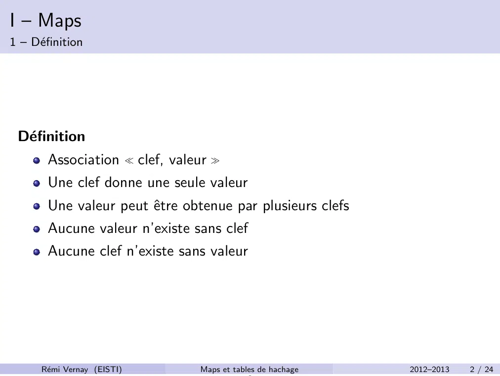

~~~text
I – Maps
1 – Définition

 Définition
       Association  clef, valeur 
       Une clef donne une seule valeur
       Une valeur peut être obtenue par plusieurs clefs
       Aucune valeur n’existe sans clef
       Aucune clef n’existe sans valeur

      Rémi Vernay (EISTI)     Maps et tables de hachage   2012–2013   2 / 24
~~~

## Page 3

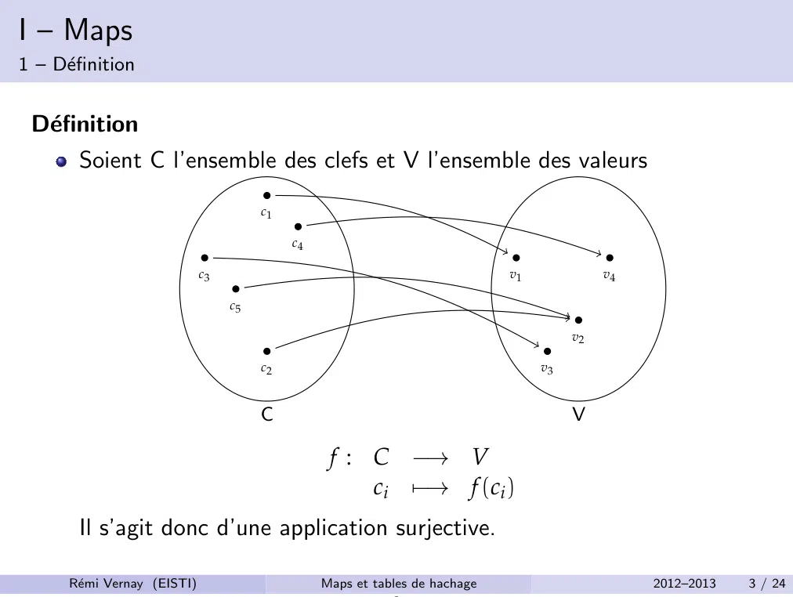

~~~text
I – Maps
1 – Définition

 Définition
       Soient C l’ensemble des clefs et V l’ensemble des valeurs

                                       c1

                                            c4

                             c3                                              v1             v4

                                  c5

                                                                                       v2

                                       c2                                         v3

                                       C                                               V

                                                  f : C −→ V
                                                      ci 7−→ f (ci )
       Il s’agit donc d’une application surjective.

      Rémi Vernay (EISTI)                       Maps et tables de hachage                       2012–2013   3 / 24
~~~

## Page 4

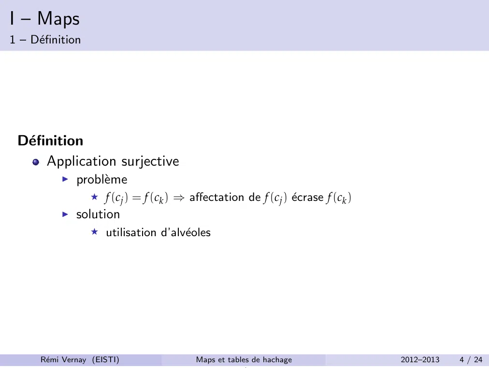

~~~text
I – Maps
1 – Définition

 Définition
      Application surjective
           I   problème
                  F   f (cj ) = f (ck ) ⇒ affectation de f (cj ) écrase f (ck )
           I   solution
                  F   utilisation d’alvéoles

      Rémi Vernay (EISTI)                 Maps et tables de hachage               2012–2013   4 / 24
~~~

## Page 5

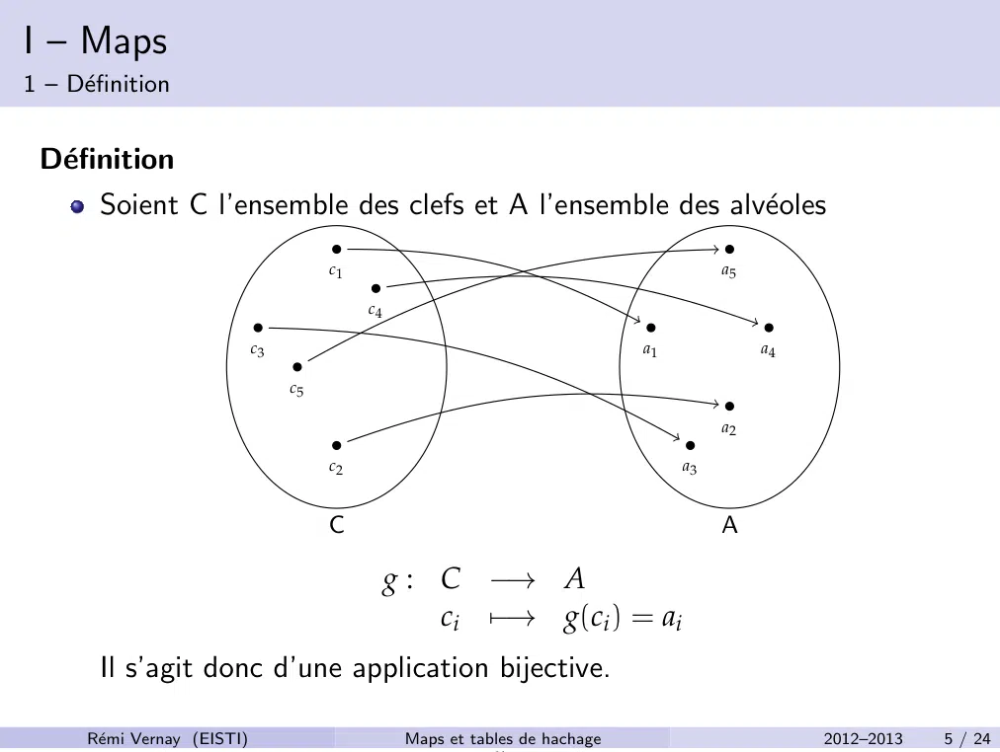

~~~text
I – Maps
1 – Définition

 Définition
       Soient C l’ensemble des clefs et A l’ensemble des alvéoles

                                       c1                                               a5

                                            c4

                             c3                                               a1             a4

                                  c5

                                                                                        a2

                                       c2                                          a3

                                       C                                                A

                                                 g : C −→ A
                                                     ci 7−→ g(ci ) = ai
       Il s’agit donc d’une application bijective.

      Rémi Vernay (EISTI)                        Maps et tables de hachage                       2012–2013   5 / 24
~~~

## Page 6

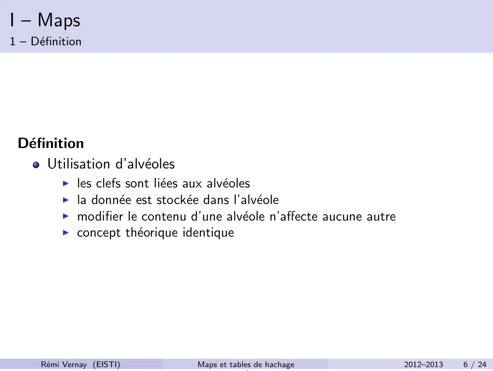

~~~text
I – Maps
1 – Définition

 Définition
      Utilisation d’alvéoles
           I les clefs sont liées aux alvéoles
           I la donnée est stockée dans l’alvéole
           I modifier le contenu d’une alvéole n’affecte aucune autre
           I concept théorique identique

      Rémi Vernay (EISTI)        Maps et tables de hachage              2012–2013   6 / 24
~~~

## Page 7

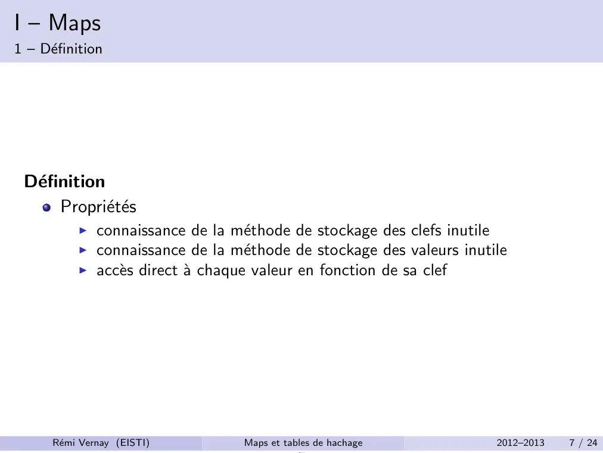

~~~text
I – Maps
1 – Définition

 Définition
      Propriétés
           I connaissance de la méthode de stockage des clefs inutile
           I connaissance de la méthode de stockage des valeurs inutile
           I accès direct à chaque valeur en fonction de sa clef

      Rémi Vernay (EISTI)        Maps et tables de hachage           2012–2013   7 / 24
~~~

## Page 8

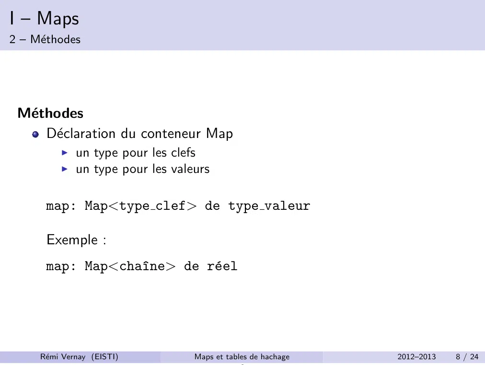

~~~text
I – Maps
2 – Méthodes

 Méthodes
     Déclaration du conteneur Map
          I un type pour les clefs
          I un type pour les valeurs

      map: Map<type clef> de type valeur

      Exemple :
      map: Map<cha^
                  ıne> de réel

     Rémi Vernay (EISTI)        Maps et tables de hachage   2012–2013   8 / 24
~~~

## Page 9

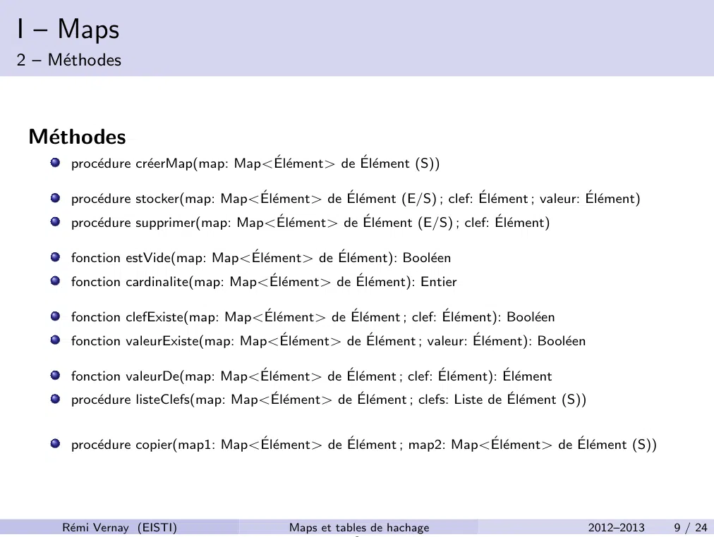

~~~text
I – Maps
2 – Méthodes

 Méthodes
      procédure créerMap(map: Map<Élément> de Élément (S))

      procédure stocker(map: Map<Élément> de Élément (E/S) ; clef: Élément ; valeur: Élément)
      procédure supprimer(map: Map<Élément> de Élément (E/S) ; clef: Élément)

      fonction estVide(map: Map<Élément> de Élément): Booléen
      fonction cardinalite(map: Map<Élément> de Élément): Entier

      fonction clefExiste(map: Map<Élément> de Élément ; clef: Élément): Booléen
      fonction valeurExiste(map: Map<Élément> de Élément ; valeur: Élément): Booléen

      fonction valeurDe(map: Map<Élément> de Élément ; clef: Élément): Élément
      procédure listeClefs(map: Map<Élément> de Élément ; clefs: Liste de Élément (S))

      procédure copier(map1: Map<Élément> de Élément ; map2: Map<Élément> de Élément (S))

     Rémi Vernay (EISTI)                 Maps et tables de hachage                             2012–2013   9 / 24
~~~

## Page 10

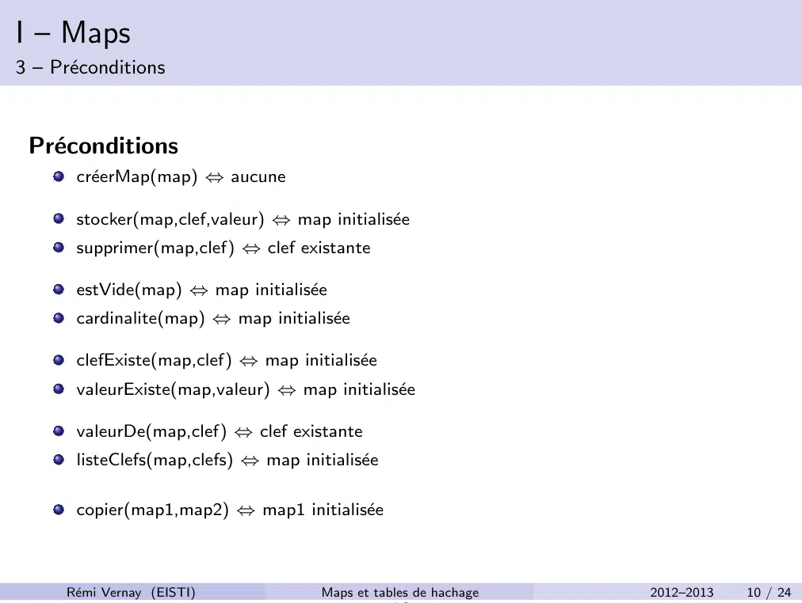

~~~text
I – Maps
3 – Préconditions

 Préconditions
       créerMap(map) ⇔ aucune

       stocker(map,clef,valeur) ⇔ map initialisée
       supprimer(map,clef) ⇔ clef existante

       estVide(map) ⇔ map initialisée
       cardinalite(map) ⇔ map initialisée

       clefExiste(map,clef) ⇔ map initialisée
       valeurExiste(map,valeur) ⇔ map initialisée

       valeurDe(map,clef) ⇔ clef existante
       listeClefs(map,clefs) ⇔ map initialisée

       copier(map1,map2) ⇔ map1 initialisée

      Rémi Vernay (EISTI)             Maps et tables de hachage   2012–2013   10 / 24
~~~

## Page 11

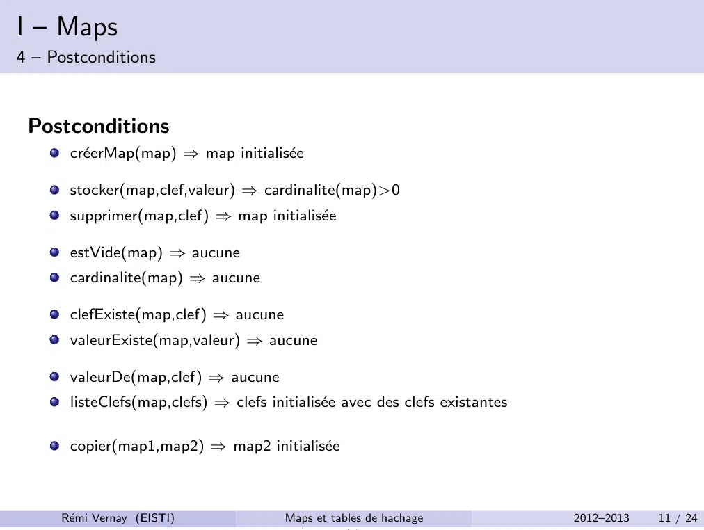

~~~text
I – Maps
4 – Postconditions

 Postconditions
      créerMap(map) ⇒ map initialisée

      stocker(map,clef,valeur) ⇒ cardinalite(map)>0
      supprimer(map,clef) ⇒ map initialisée

      estVide(map) ⇒ aucune
      cardinalite(map) ⇒ aucune

      clefExiste(map,clef) ⇒ aucune
      valeurExiste(map,valeur) ⇒ aucune

      valeurDe(map,clef) ⇒ aucune
      listeClefs(map,clefs) ⇒ clefs initialisée avec des clefs existantes

      copier(map1,map2) ⇒ map2 initialisée

     Rémi Vernay (EISTI)              Maps et tables de hachage             2012–2013   11 / 24
~~~

## Page 12

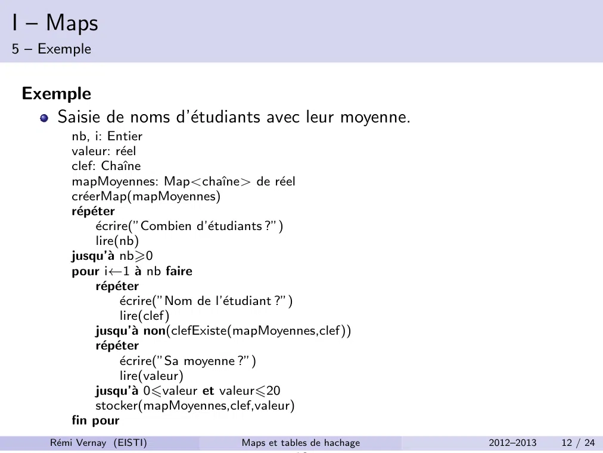

~~~text
I – Maps
5 – Exemple

 Exemple
    Saisie de noms d’étudiants avec leur moyenne.
          nb, i: Entier
          valeur: réel
          clef: Chaı̂ne
          mapMoyennes: Map<chaı̂ne> de réel
          créerMap(mapMoyennes)
          répéter
               écrire(”Combien d’étudiants ?”)
               lire(nb)
          jusqu’à nb⩾0
          pour i←1 à nb faire
               répéter
                     écrire(”Nom de l’étudiant ?”)
                     lire(clef)
               jusqu’à non(clefExiste(mapMoyennes,clef))
               répéter
                     écrire(”Sa moyenne ?”)
                     lire(valeur)
               jusqu’à 0⩽valeur et valeur⩽20
               stocker(mapMoyennes,clef,valeur)
          fin pour
          ...
     Rémi Vernay (EISTI)                  Maps et tables de hachage   2012–2013   12 / 24
~~~

## Page 13

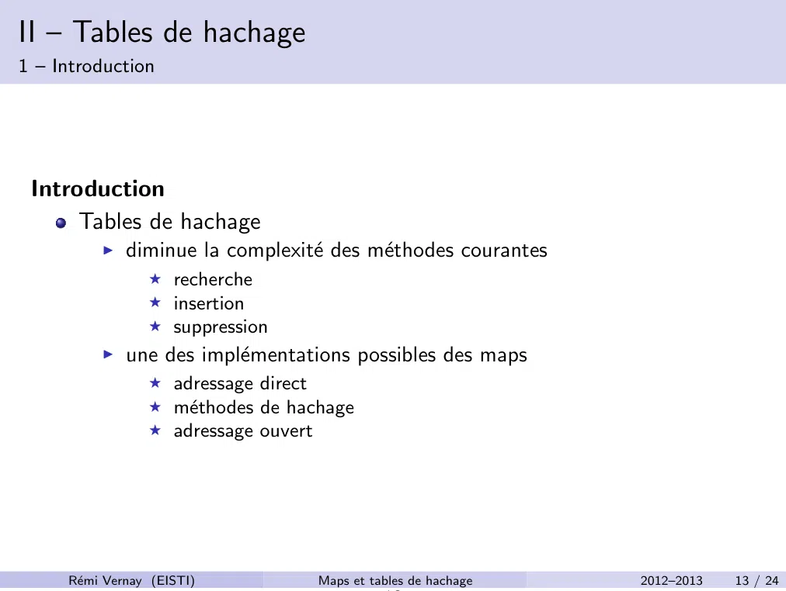

~~~text
II – Tables de hachage
1 – Introduction

 Introduction
      Tables de hachage
          I   diminue la complexité des méthodes courantes
                 F recherche
                 F insertion
                 F suppression

          I   une des implémentations possibles des maps
                 F adressage direct
                 F méthodes de hachage
                 F adressage ouvert

     Rémi Vernay (EISTI)          Maps et tables de hachage   2012–2013   13 / 24
~~~

## Page 14

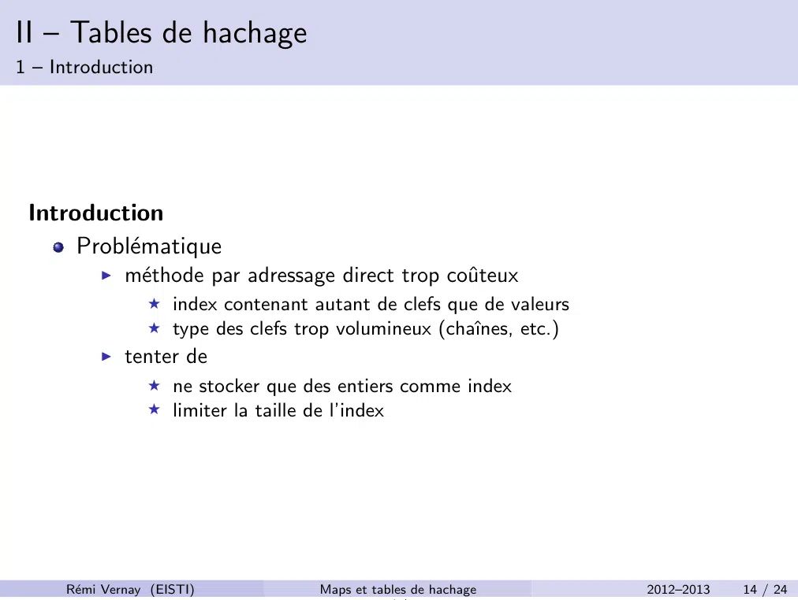

~~~text
II – Tables de hachage
1 – Introduction

 Introduction
      Problématique
          I   méthode par adressage direct trop coûteux
                 F index contenant autant de clefs que de valeurs
                 F type des clefs trop volumineux (chaı̂nes, etc.)

          I   tenter de
                 F   ne stocker que des entiers comme index
                 F   limiter la taille de l’index

     Rémi Vernay (EISTI)            Maps et tables de hachage       2012–2013   14 / 24
~~~

## Page 15

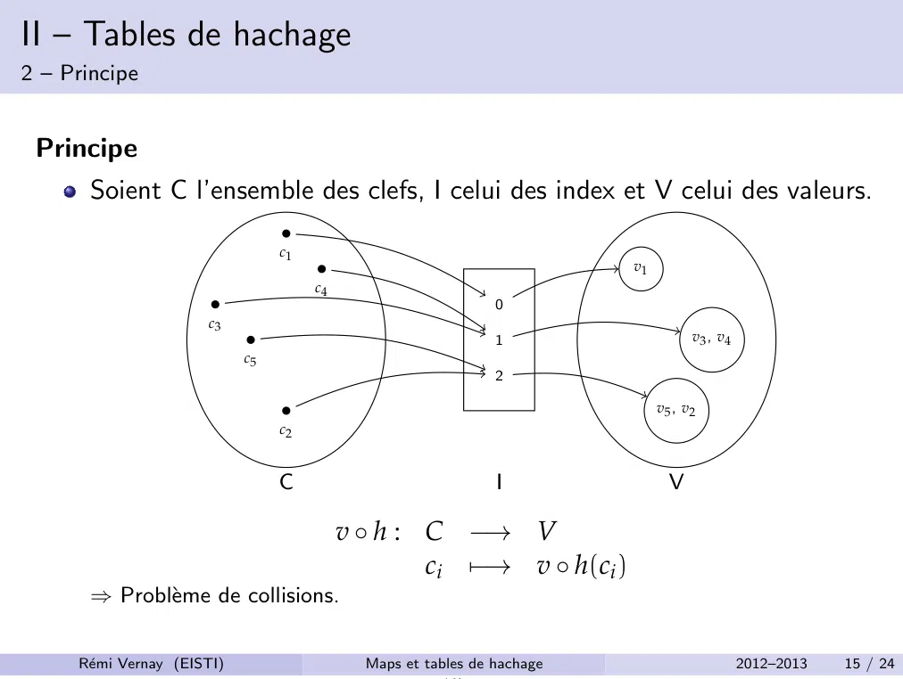

~~~text
II – Tables de hachage
2 – Principe

 Principe
       Soient C l’ensemble des clefs, I celui des index et V celui des valeurs.

                                 c1
                                                                         v1
                                      c4
                                                               0
                      c3
                                                               1                    v3 , v4
                            c5
                                                               2

                                                                              v5 , v2
                                 c2

                                 C                             I                V

                                           v ◦ h : C −→ V
                                                   ci 7−→ v ◦ h(ci )
       ⇒ Problème de collisions.

     Rémi Vernay (EISTI)                    Maps et tables de hachage                        2012–2013   15 / 24
~~~

## Page 16

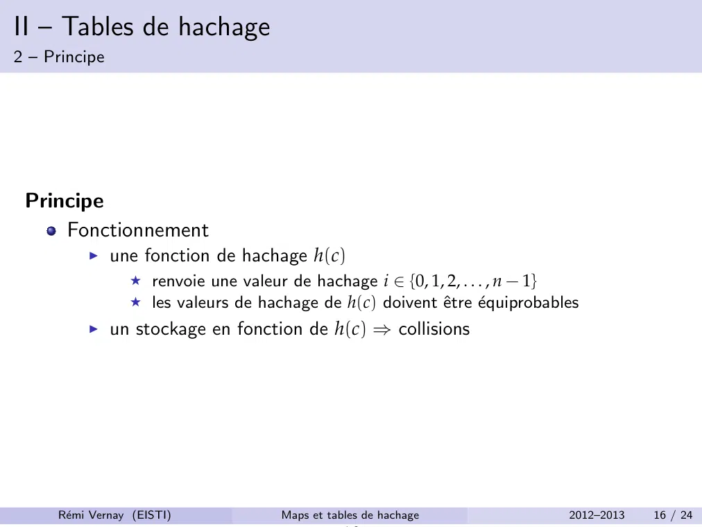

~~~text
II – Tables de hachage
2 – Principe

 Principe
     Fonctionnement
          I    une fonction de hachage h(c)
                 F   renvoie une valeur de hachage i ∈ {0, 1, 2, . . . , n − 1}
                 F   les valeurs de hachage de h(c) doivent être équiprobables
          I    un stockage en fonction de h(c) ⇒ collisions

     Rémi Vernay (EISTI)             Maps et tables de hachage               2012–2013   16 / 24
~~~

## Page 17

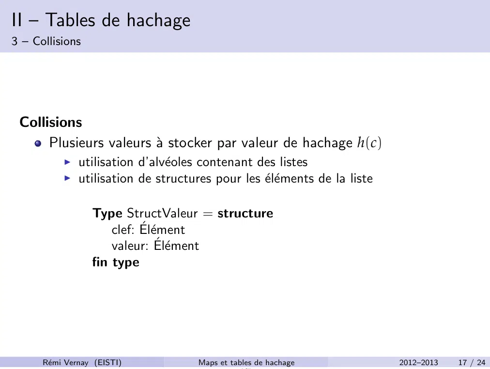

~~~text
II – Tables de hachage
3 – Collisions

 Collisions
      Plusieurs valeurs à stocker par valeur de hachage h(c)
           I utilisation d’alvéoles contenant des listes
           I utilisation de structures pour les éléments de la liste

                  Type StructValeur = structure
                      clef: Élément
                      valeur: Élément
                  fin type

      Rémi Vernay (EISTI)          Maps et tables de hachage            2012–2013   17 / 24
~~~

## Page 18

~~~text
II – Tables de hachage
3 – Collisions

 Collisions
       Utilisation de listes

                                  c1
                                                                        v1
                                       c4
                                                              0
                       c3
                                                              1                    v3 , v4
                             c5
                                                              2

                                                                             v5 , v2
                                  c2

                                  C                           I                A

      Rémi Vernay (EISTI)                  Maps et tables de hachage                        2012–2013   18 / 24
~~~

## Page 19

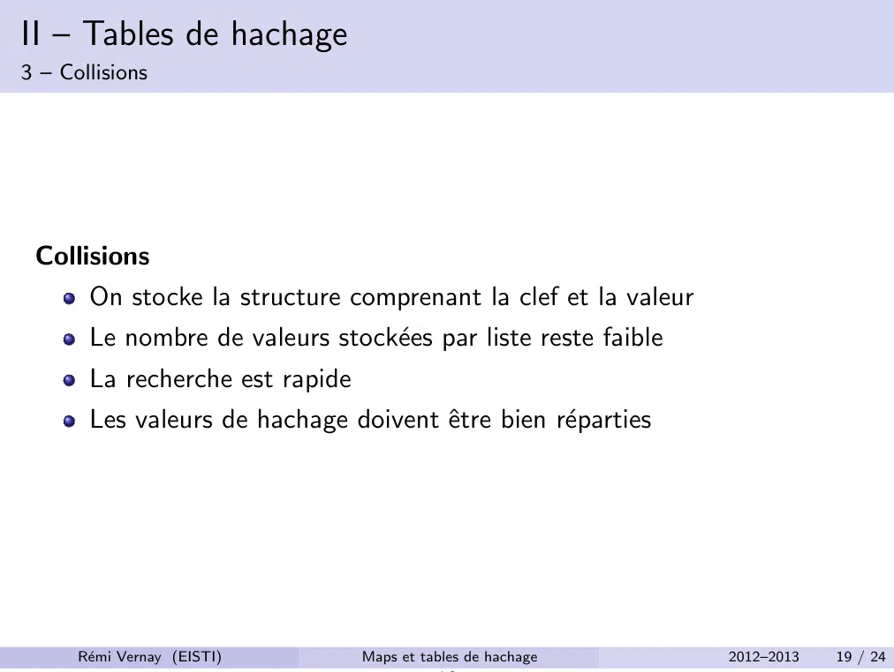

~~~text
II – Tables de hachage
3 – Collisions

 Collisions
       On stocke la structure comprenant la clef et la valeur
       Le nombre de valeurs stockées par liste reste faible
       La recherche est rapide
       Les valeurs de hachage doivent être bien réparties

      Rémi Vernay (EISTI)       Maps et tables de hachage      2012–2013   19 / 24
~~~

## Page 20

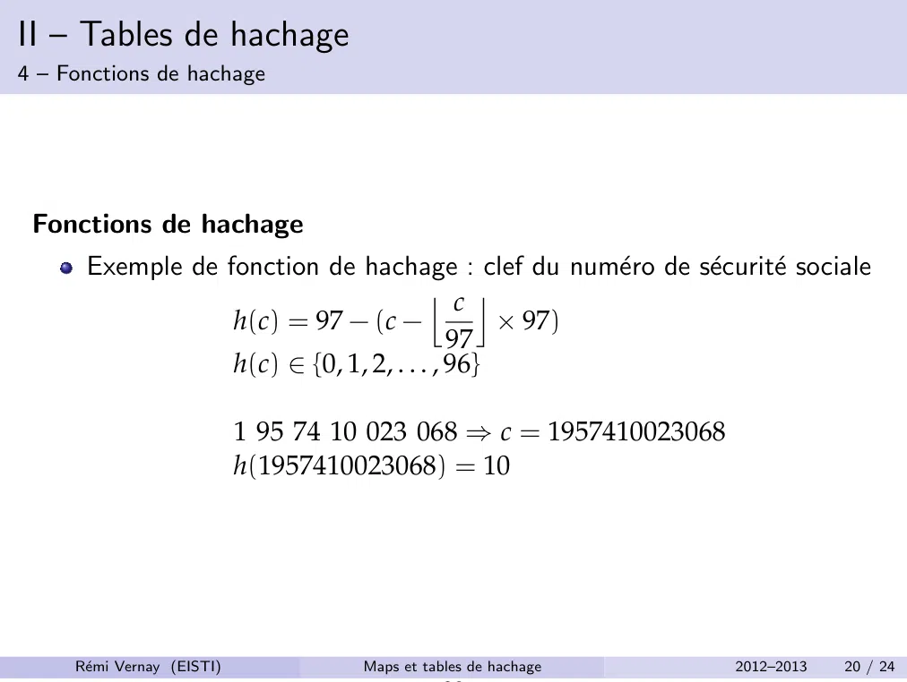

~~~text
II – Tables de hachage
4 – Fonctions de hachage

 Fonctions de hachage
      Exemple de fonction de hachage : clef du numéro de sécurité sociale
                                        j c k
                  h(c) = 97 − (c −             × 97)
                                           97
                  h(c) ∈ {0, 1, 2, . . . , 96}

                            1 95 74 10 023 068 ⇒ c = 1957410023068
                            h(1957410023068) = 10

     Rémi Vernay (EISTI)             Maps et tables de hachage      2012–2013   20 / 24
~~~

## Page 21

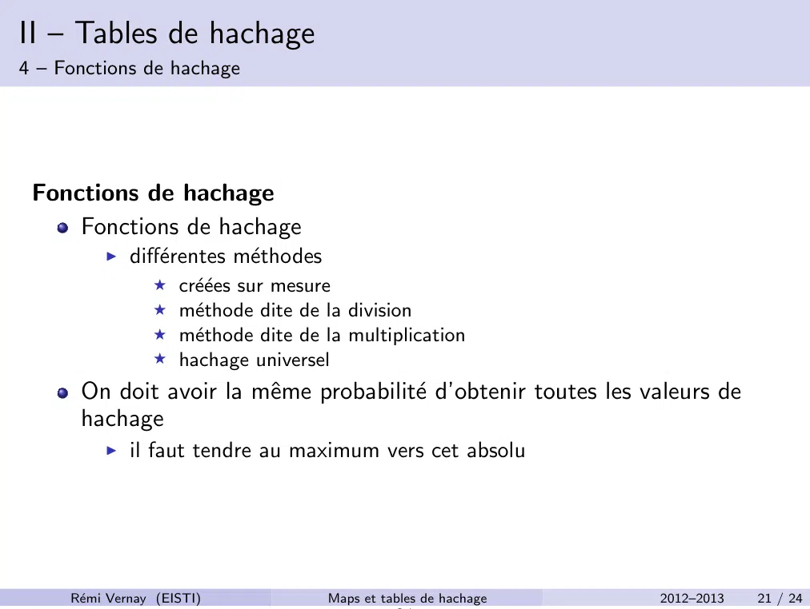

~~~text
II – Tables de hachage
4 – Fonctions de hachage

 Fonctions de hachage
     Fonctions de hachage
          I   différentes méthodes
                 F créées sur mesure
                 F méthode dite de la division
                 F méthode dite de la multiplication
                 F hachage universel

      On doit avoir la même probabilité d’obtenir toutes les valeurs de
      hachage
          I   il faut tendre au maximum vers cet absolu

     Rémi Vernay (EISTI)              Maps et tables de hachage   2012–2013   21 / 24
~~~

## Page 22

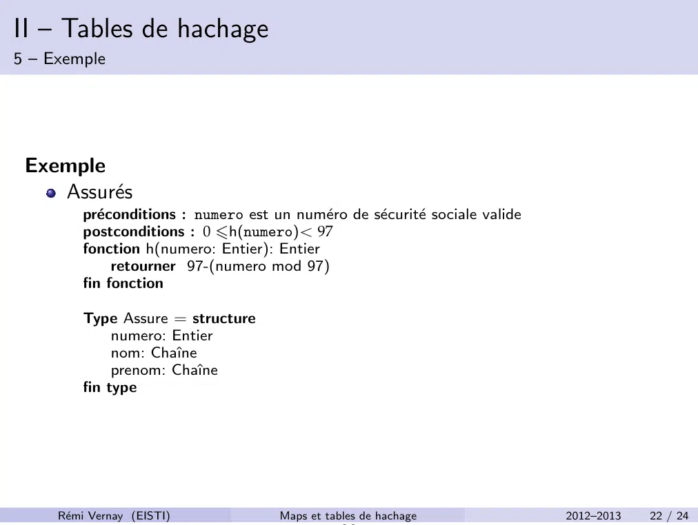

~~~text
II – Tables de hachage
5 – Exemple

 Exemple
    Assurés
         préconditions : numero est un numéro de sécurité sociale valide
         postconditions : 0 ⩽h(numero)< 97
         fonction h(numero: Entier): Entier
              retourner 97-(numero mod 97)
         fin fonction

         Type Assure = structure
              numero: Entier
              nom: Chaı̂ne
              prenom: Chaı̂ne
         fin type

     Rémi Vernay (EISTI)              Maps et tables de hachage               2012–2013   22 / 24
~~~

## Page 23

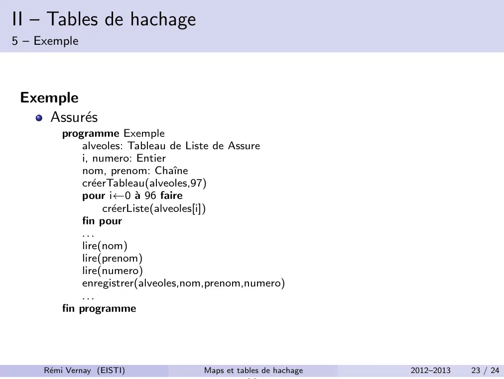

~~~text
II – Tables de hachage
5 – Exemple

 Exemple
    Assurés
         programme Exemple
              alveoles: Tableau de Liste de Assure
              i, numero: Entier
              nom, prenom: Chaı̂ne
              créerTableau(alveoles,97)
              pour i←0 à 96 faire
                   créerListe(alveoles[i])
              fin pour
              ...
              lire(nom)
              lire(prenom)
              lire(numero)
              enregistrer(alveoles,nom,prenom,numero)
              ...
         fin programme

     Rémi Vernay (EISTI)           Maps et tables de hachage   2012–2013   23 / 24
~~~

## Page 24

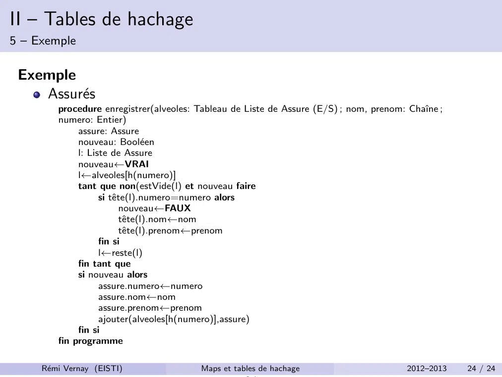

~~~text
II – Tables de hachage
5 – Exemple

 Exemple
    Assurés
         procedure enregistrer(alveoles: Tableau de Liste de Assure (E/S) ; nom, prenom: Chaı̂ne ;
         numero: Entier)
              assure: Assure
              nouveau: Booléen
              l: Liste de Assure
              nouveau←VRAI
              l←alveoles[h(numero)]
              tant que non(estVide(l) et nouveau faire
                    si tête(l).numero=numero alors
                          nouveau←FAUX
                          tête(l).nom←nom
                          tête(l).prenom←prenom
                    fin si
                    l←reste(l)
              fin tant que
              si nouveau alors
                    assure.numero←numero
                    assure.nom←nom
                    assure.prenom←prenom
                    ajouter(alveoles[h(numero)],assure)
              fin si
         fin programme

     Rémi Vernay (EISTI)                 Maps et tables de hachage                      2012–2013   24 / 24
~~~
