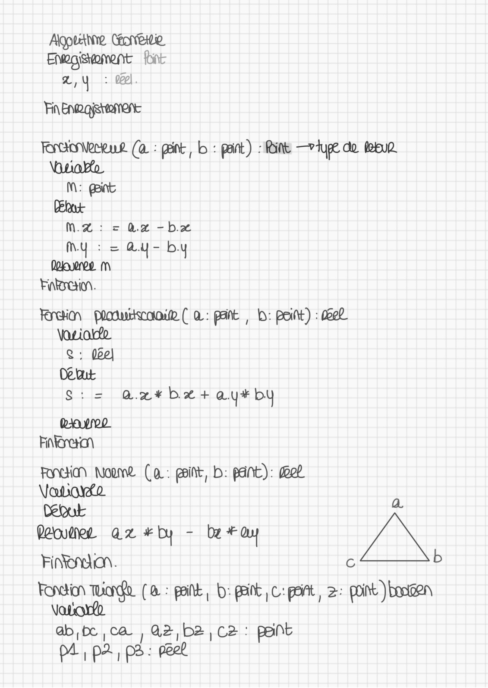
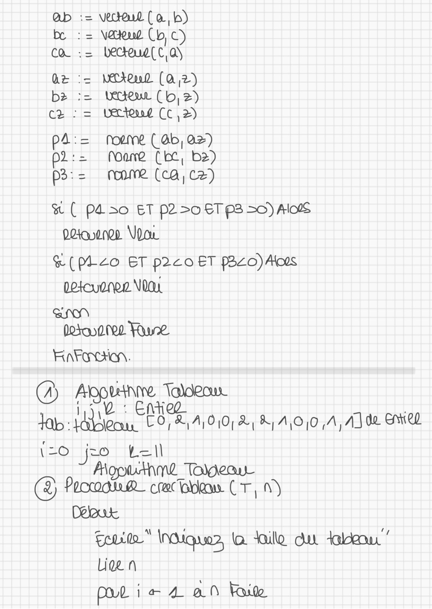
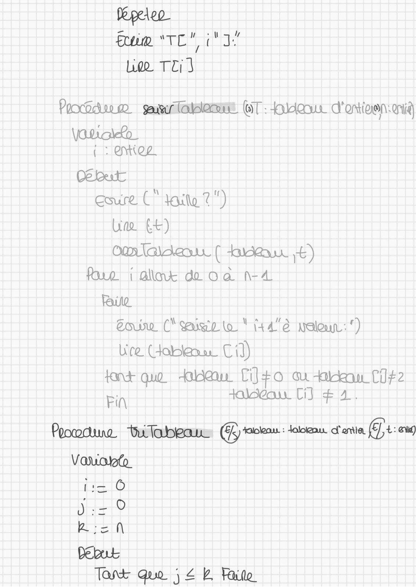
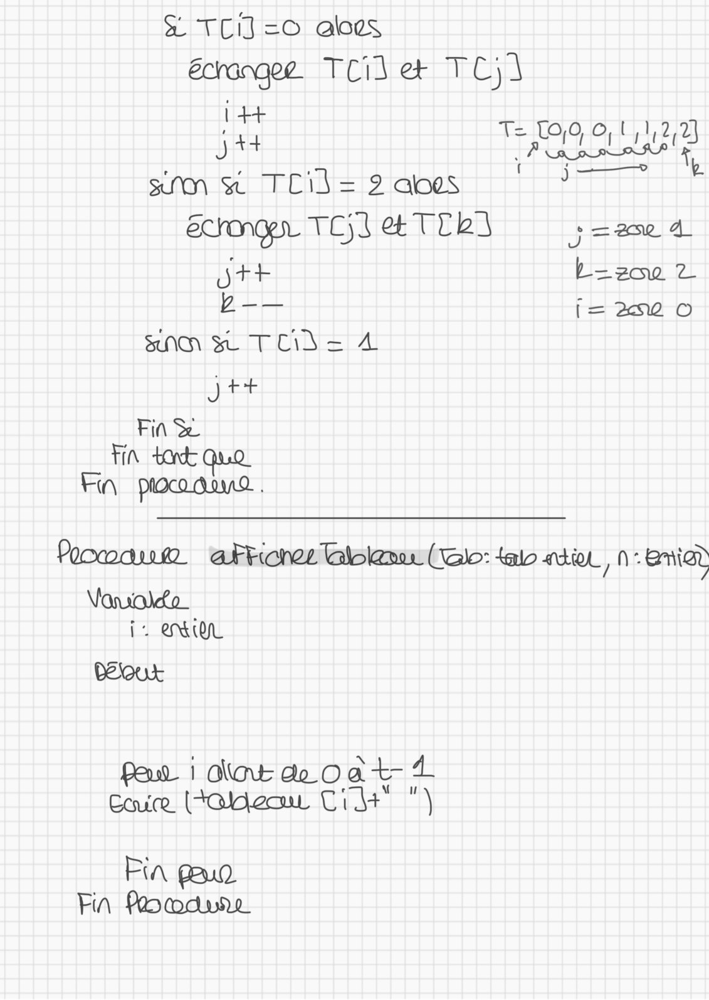
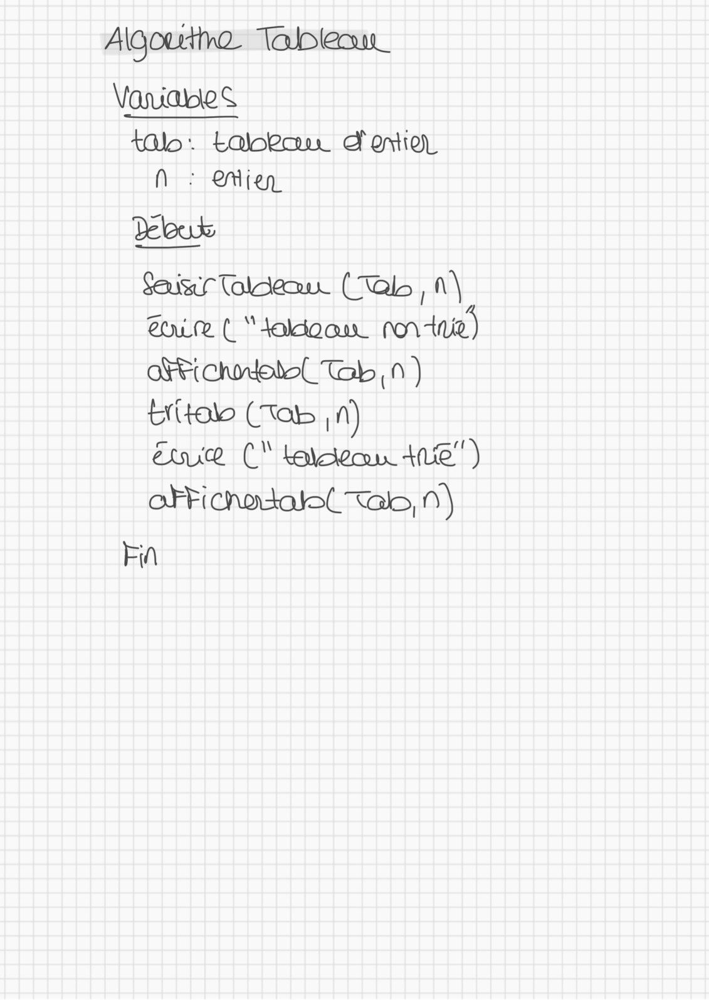
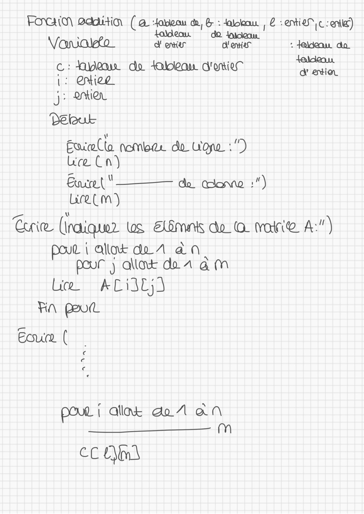

# TD2 CORRIGÉ.pdf

[Ouvrir l’original](https://drive.google.com/open?id=1_ohupGEZ4E0xz7reAawEWyS8hLY8pzRC) · Les pages signalées comprennent du texte reconnu automatiquement ou des éléments graphiques. Le fac-similé permet de vérifier chaque lecture.

**Pages avec fac-similé ou lecture OCR** — 1–7.

## Page 1

**Lecture OCR à contrôler**

~~~text
rich!
DE

OA
~~~

## Page 2

**Lecture OCR à contrôler**

~~~text
Algpuettine (one
Enwagiswoment {pint
x,\ : 0].
Fin Enpoÿettoment
Fear erkue (à : paint, b : pant) int —7lue do Meese
\buorto
M: int
Dante
M2: = Ox -b2w
my = au - by
eos m
Hagen.
Rein pouikcooip ( à: pant , D: point) : del
\aiotto
R : peel
Debut
8S: = Aaxwk*¥bet a.y* bu

DAT
Fintan

FONG Noone (a: paint, D: pane): dee
Voborelo x

debut

Fini. c P

Fonction Tiana. (@ : pit, b: paint C'poft, 2: point )bonen
PA RRNELEREHENE BURN ENRE SE el
ab,te ca ,Q2,b2;c2 : paint

p4 p>, ps: peek
~~~

## Page 3

**Lecture OCR à contrôler**

~~~text
ab := veceul (a,b)
be := \&kug (bc)
CO := Lecteug[c,o\

ae WAAL (A 2)
bz eur Clo, 2)
cz : = Lectend Cc ,2)

pa : Noume (ab, Q>)

p2: Moare (te, b2)

p3: Anne (ca, Cz)

& ( PA 30 ET £250 ETP3 30) AloNS
Pearson Vow

&(pico ET p2c0 ET P3240) Atos
petouenen V0du

tl ti i

i

(hoy

SN
to NL ue
Faracticn.
(A) SORERNE Taldecun
Tab Ui hane CRE 010, 2, K,A\O/0 A, A] de GWiR2
HO JE tell

godnm2d Todoeau
© SE AR U St ar Luna au CT, 9)

but
Suit" INdiqunr, à Wie du Hu”
Liee A
pot i& 4 an Faite
~~~

## Page 4

**Lecture OCR à contrôler**

~~~text
Pepeleo
fem *To" 3
Leo TE)

VaDoko
{ : OCZ
Det
coure (ait 2")
Une £4)

Poorcicne me snlasdemne (GT: Hu d'oniven:qnià

one ( Lieux €)
for i alla du oa n-4
RUL
Zou (‘eue to " 44'à
Lire Goble Cid)

font qua Hu TiJ+o ou in CI #2
Fin talaga Ci] AI

è Waleun :‘)

Poodue ‘twiabeaw (Grace: daigau Sonia (Ft ak)
Vario

MO)
DETO
BEN
Debut

Tart que ; 2b, Rite
~~~

## Page 5

**Lecture OCR à contrôler**

~~~text
& TC =0 aloes
écranee TCileæ TCj]
+
jt
sum & TCil= 2 aoes
ecrongn TC)S TEA ;=2 4
jth boace 2
b-— Î= 20 ©
SNM S TC) = 4
jtt
Fin St

T= (0,0, 0, L,1,2,2]

( j— kb

Porowanm aFticnez Glen (Glo: {al ati 70° eniad

\auol£o
i: EX

Deux
Paw | dut de oat 4
Cuir (Fades Ci+ ")

Pin pau
Fin Peomdune
~~~

## Page 6

**Lecture OCR à contrôler**

~~~text
Algourtna Tablet
animes
N : Mien
Xbux
Sa Taldeau. (Talo , 1\
Cone ( “ taldo ao non -tnie)
Fiche Tab ,n )
Etob (Tats ,n)
Eve (" baldern 412")
aFFichodal( tals, 1)
Fi
~~~

## Page 7

**Lecture OCR à contrôler**

~~~text
FOG) Badition (2. atom da, & : daboeou | 2 ei, c oie)
Vavalto_ done The : aideau do
; aldeau
Cc: Heu do tableam d'union ne
1: QNieg ee
GE OMIA
Delouk
Ewceolta nombaz do L'on :”)
ce Cn)
Entre t " ——— do canna :")
ue CM)
Corie (Inaiquer us Elimnis do @ varie A:")
pour i Allok di 1 an.
pour ) allant do A am
Lick ACSC;
FRA pot
Eouce (

€
73

LE

POUL | aliak 1 an
m

CC Ami
~~~
