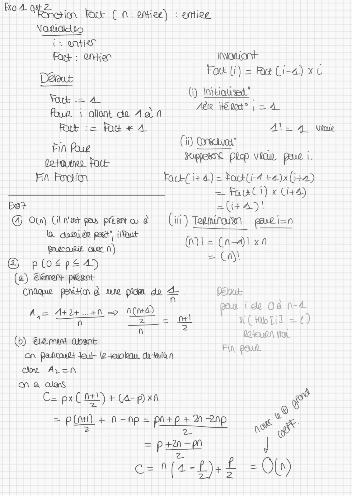
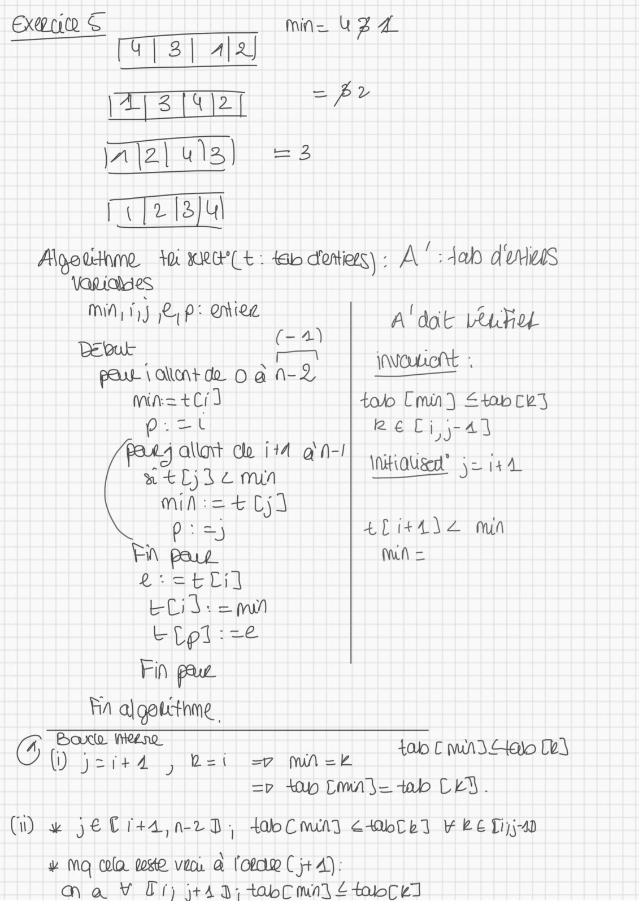
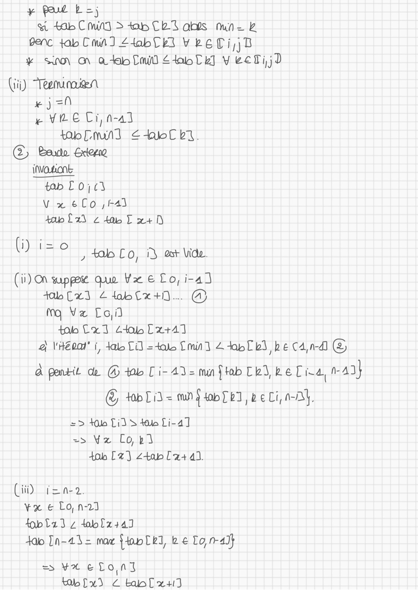
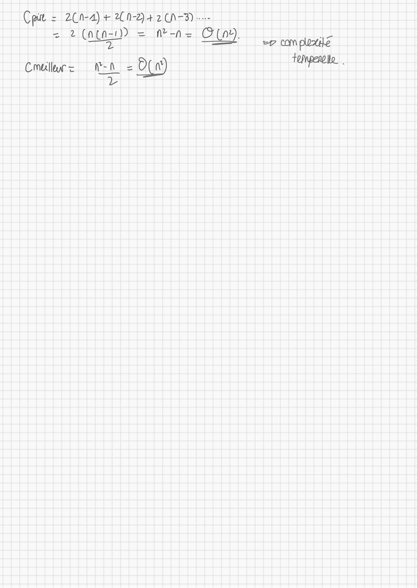

# TD5 CORRIGÉ.pdf

[Ouvrir l’original](https://drive.google.com/open?id=17l9xcDVMVydB6EcFq_KZPMVwly7t31cb) · Les pages signalées comprennent du texte reconnu automatiquement ou des éléments graphiques. Le fac-similé permet de vérifier chaque lecture.

**Pages avec fac-similé ou lecture OCR** — 1–4.

## Page 1

**Lecture OCR à contrôler**

~~~text
#04 OEE es fc CM: ontie’) : estiog
Natidldis

1. Otis
Fock : en INOLONE |
Délout Fox (7) = Ft Ci-4) x C
i (i) Initials
Fork := AL dents —
fur i allont do Aan ARR tt
Four := Rod + 4 AL= 4 Vie
L (ii) Contos?
Fin Fous et . r
do-tounen Patt: Fa Pee TRE
Fin Foi Fau-{ i+ 4) = tackli4 +a)x (+4)
LECCECEECECEECEEEEEEEE = FatxCi) « Ci+4)
bo? =(i449:

G Ota) Cit nor pew péato à (il) Teeminawn guvin
( donide pra ilfont

Paccowit Que N) (n)\ = (n—a)l xn
= \
& plogpead = Çn!
(a) Elément pégat
Chaque potion à sume ptm da À. Bb
BE Din LE tm ido Où n-4
tet due FF © aa a sbaneane: = {)
ñ t
(6) Bement apant - QD uPA Via.
Cr Paptorls Jak (2 ok do-taille n POW)
ane ArL=N\
on à alens
5 \ =
C= px( Mt!) + Ca- pan rw

{Phat FÉES PEAS RENE CS
PERTE d
c=n1(2-1)+£ = O{n)
~~~

## Page 2

**Lecture OCR à contrôler**

~~~text
Exe S

SESE!
AE

ru)

rr [2 ju

Algoudmne to RU € :
\aniohies
MAJ LP: OMiee
Debut oo
ee a ae oan-2
na: +Ci)

I

(= 4)

gag HA on
x <L)1e nun
EEE

FA ajgebtthme

Min = U34

EDR

tab dois) : À" :4ab d'uuus

A‘ dot Leute
too [min £tabcey
keCi;-41
NHQUE y= 144

4Li44\2 mn
Mn =

G DE [LATE

DEL EITEA y Bet =7 mek

talo C MAI Hao Ce]

=v top Doma = tab CEN.

(i) vw je Cr+a,n23,
# MQ Cola oe voor à loto C j+ A):

todo Cia <4Ob6bl LE Ti;-40

am à V Er) +41: +4+0bC mn] 4 4obC¢I
~~~

## Page 3

**Lecture OCR à contrôler**

~~~text
¥* Poul tes
wt tab C MAI > kb CET ads mn L
penc tab Cm] 44obT ey YeELI\B
¥ So GV à tb Cnil LT] ¥ eeTijD
Qi) Teemincuien
ej =f
k YLE Ci, n-a3
Lob Em] € LT.
C) Bardo Eten
tab £0;¢3
V x e Co ,1-41
too $2) 2 tT xD

seer fal Co, i est Vide.

(ii) On supper que tx € Lo, i-a)
fobCxI 4 dob x+9... @
M Va Coil
tab x1 ét Cx+11
à Veo" i, dab Ti) =4olo Cm] 4 top Lb) be (4nd &

à pontit de @ tab Ci-43= maf [h3,Le Lira, mA}
@& tobLid= mn SwbEET 2e Li, aD},
=> td Lids tab Li-4]

>> Va Cob)
tob [27 4taplat a.

(it) = n-2.
¥x € Lo,n-21
fobta3 z 4oolutad
dao [n-a d= mor {too Ce, be Lona

ES ELony
Rx) € tab xt
~~~

## Page 4

**Lecture OCR à contrôler**

~~~text
Cie = 2(N-4) + A2) + 2 CN-D
FERRER ES eae
Coils en = O(n) temple

L
~~~
