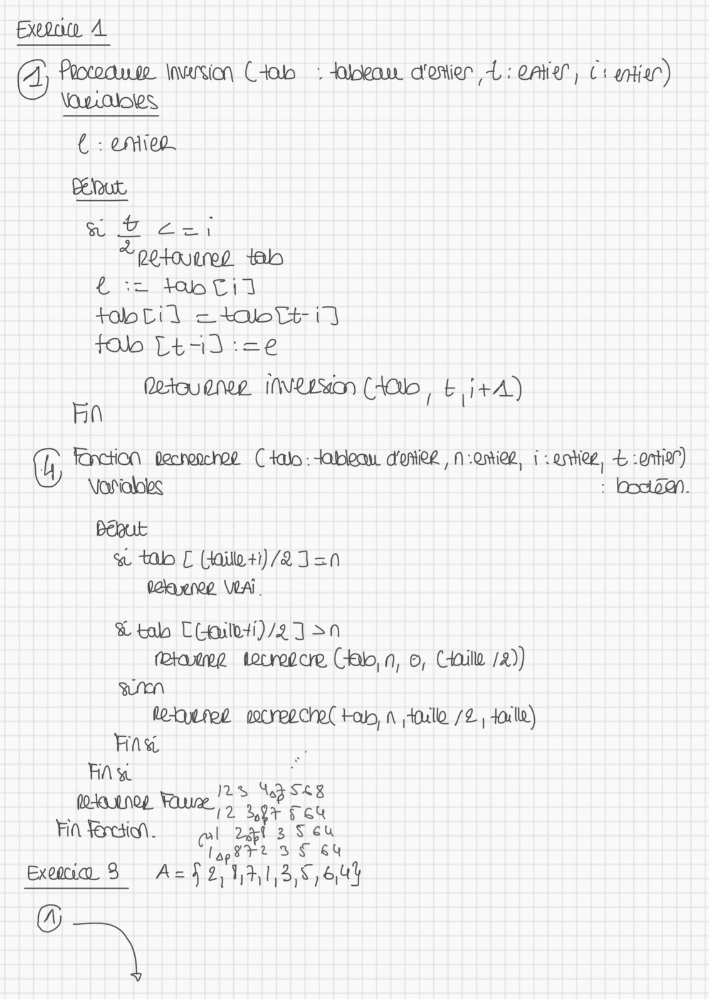
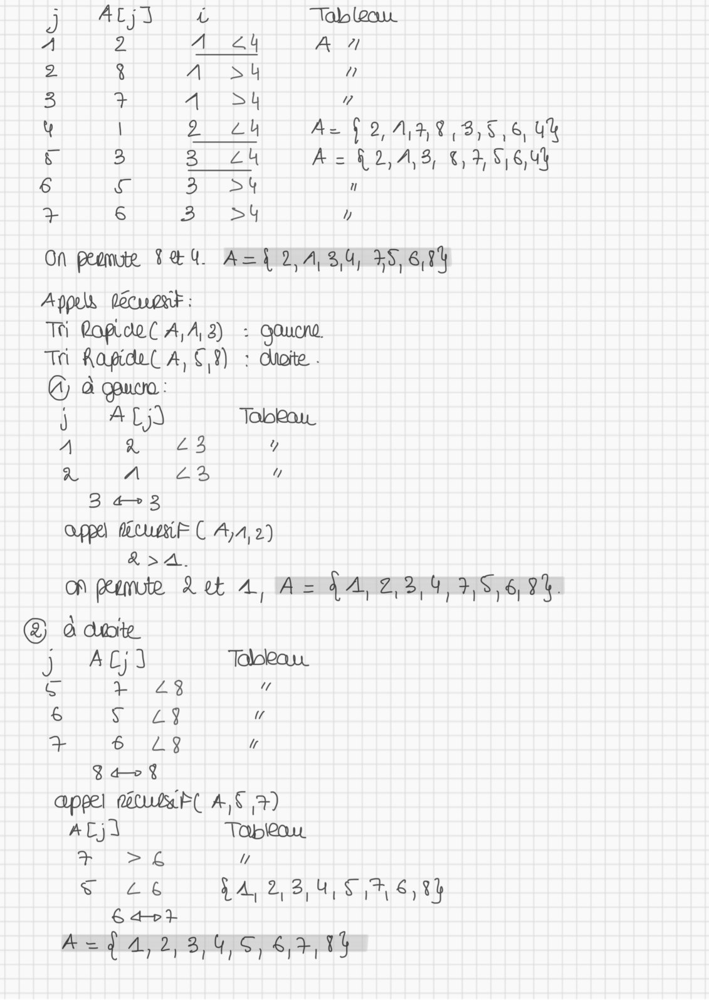
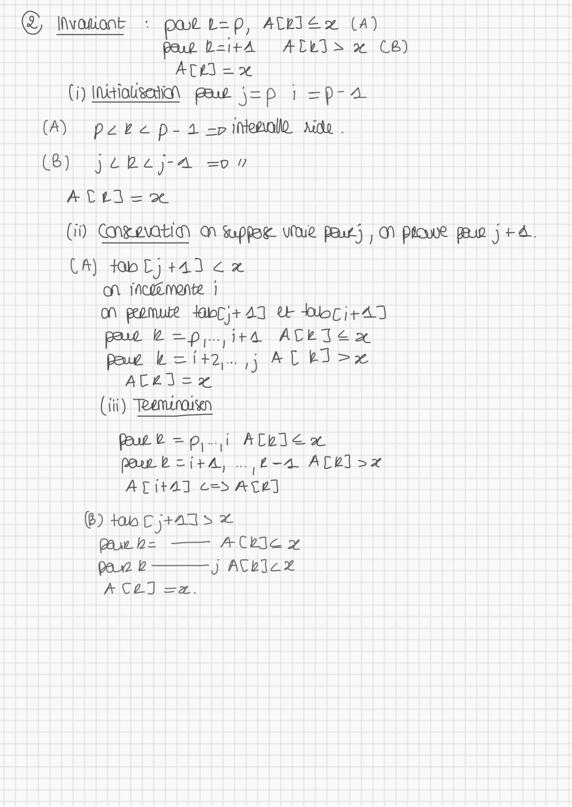

# TD6 CORRIGÉ.pdf

[Ouvrir l’original](https://drive.google.com/open?id=1xHSgUKUfoQEyxnEvhw9M5OAyioAMA48X) · Les pages signalées comprennent du texte reconnu automatiquement ou des éléments graphiques. Le fac-similé permet de vérifier chaque lecture.

**Pages avec fac-similé ou lecture OCR** — 1–3.

## Page 1

**Lecture OCR à contrôler**

~~~text
Eu A
AY Powause inversion Cab : dia d'onier L: 04", Cs nian)
VOLS

€ : emiep.

{Gel eV cia
dut = ko Ut 17)
flo L473 =e

etc Nee INLD COb, £ i+A)
En

p Fonction pecheochee Cal: tableau d'oRe , 1 .ontied, i : entier, Æ org”)
\jañialobs : bon.

Pégutk
& tab C (failoti)/2 I =0
Wane VA.
& tab C(-aulvti)/2 ] sn
rerateg Louredce (bn, ©, CHaill /2))
Sen
leur aocreechet tab, À toll /2 | 4oulle)
Faw |
ee 27s Peete
Roue Que ot rou
Fin si. att ret 3 S EU

pre 3 $ 64
Ex 3 A= je SA 13, 6,84

Sn
~~~

## Page 2

**Lecture OCR à contrôler**

~~~text
5 ACs À Tab lea

A 2 A 44 A 7

2 g ALT SIG 2

3 + ALLSU ”

y | wal Az §9,A,3,%,3,5,6, Ua
iS 3 3 24 A= &2,A,3, €,3,5,6,44
6 Aq 3 ot 1

+ 6 3 Sy y

On peomieg FEU ABP DA Sas Sry
Appus lecwoxk :

TS fopiou( A,A,2) : Qoucna.

Ti Aapidec A, CT) : dhoite .

© à quon
j AL) Tabou
A g11213 y
À A 413, 17
3 43
Oppel Etui C 4,4, 2)
&>A.
On peemute Let A, AAA en
© daar
CAT Tohkaur
ETS “
& Tay
ee 61179
Barge
appel matuleRl A, © +)
ACA Tapleou
+ Para Y
coal Ya A 2,3,4, 8 7,6,
ET

A=d 4,2, BPG IS] SF 1
~~~

## Page 3

**Lecture OCR à contrôler**

~~~text
© Mvasiont : par L=p, telex (4)
peur B=itA ALLIS x CB)
Arg = 5.
i) INitioUsetio pur j=p 1 =p-a
(A) pere p-a =p imeanld xd.
QU I ice et
ATtd = 20
ii) GNEAVOEID A Suppae Vue pat), N Pour paw j +4.
CA) toblj tad € x
on iNewemente |
On peomue dbri+49 Ue Hbci+4]
pau 2=p,..,i+4 ACETExX
paw L=i+2,. 1 AL bizx
ATEN #]
(iii) Teemenousen
Pare =p,.,i ACbIe x
Poet b=itA, .., £-4 ACL] >x
ATital c= ASE]

(@) tance jas x
Bue 2= ACh ay
par 2 J ACLTCX
ACAT Ex.
~~~
