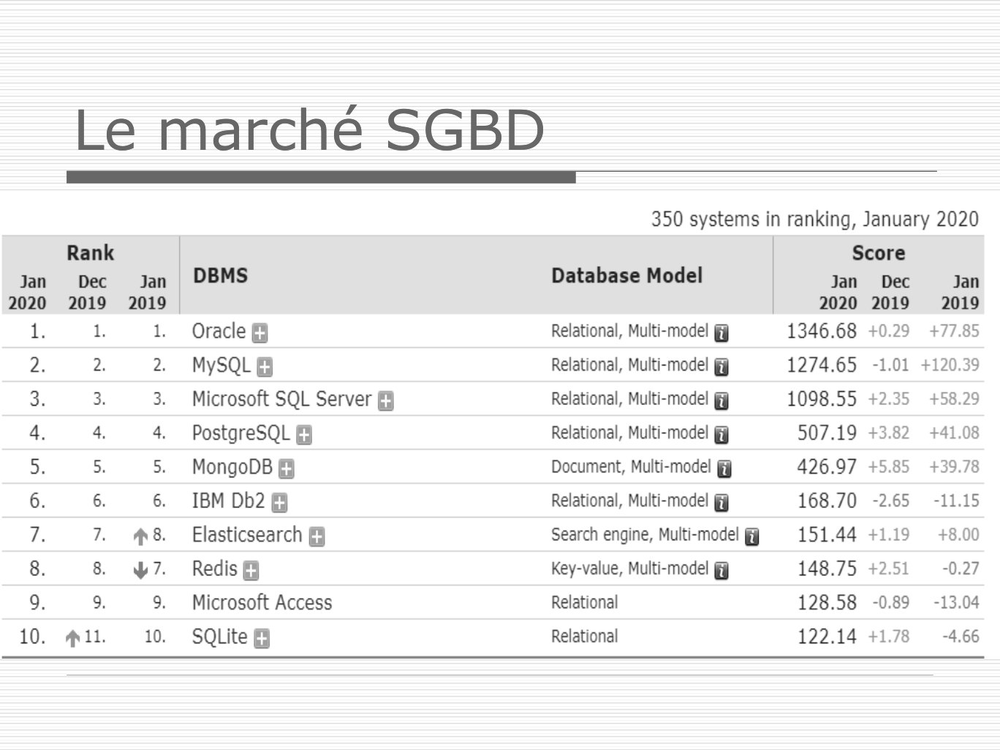
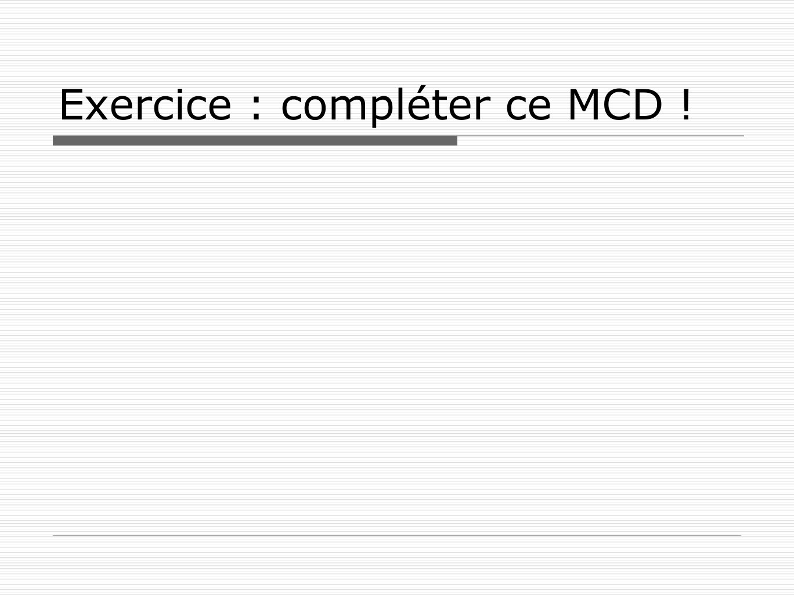

# BDD1Seance1MCD.pdf

[Ouvrir l’original](https://drive.google.com/open?id=1JxEYU2hckl8B8h7aXAH2ncR4LneYR5uQ) · Les pages signalées comprennent du texte reconnu automatiquement ou des éléments graphiques. Le fac-similé permet de vérifier chaque lecture.

**Pages avec fac-similé ou lecture OCR** — 9, 35.

## Page 1

~~~text
 Base de données

          Séance 1

     Présentation générale
Conception des bases de données
~~~

## Page 2

~~~text
Définition
Le concept de base de données comprend
essentiellement deux aspects :

 un ensemble structuré d'information
 un composant logiciel appelé système de
gestion de bases de données et qui permet
l’utilisation de ces données simultanément par
plusieurs utilisateurs et programmes
~~~

## Page 3

~~~text
Structure du système

          Réseau                    SGBD   Base de
                                           données

                   • Données
                   • Utilisateurs
                   • Réseau
                   • Logiciel
                   • Matériel
                   • Administration
~~~

## Page 4

~~~text
Modèles de base de données
 Modélisation : processus de description
  permettant de représenter l’information de
  manière compréhensible
 On utilise un modèle de données
 Les modèles les plus connus
  ◼   Le modèle hiérarchique
  ◼   Le modèle réseau
  ◼   Le modèle relationnel
  ◼   Le modèle objet
  ◼   NoSQL
~~~

## Page 5

~~~text
Modèle relationnel
 ◼ E. F. Codd (IBM, 1970)
 ◼ Principes de l'algèbre relationnelle
    indépendance de la structure de la base
     de données avec sa mise en œuvre
     physique
    intégrité des données
    redondance des données
 ◼ Modèle relationnel :
    relations + attributs + clés
 ◼ Base de données relationnelle :
    tables + colonnes + clés
~~~

## Page 6

~~~text
Système de gestion de bases de
données (SGBD)
 Programme gérant :
  ◼ la définition des données
  ◼ la manipulation des données
  ◼ l’intégrité des données
  ◼ la sécurité des données
  ◼ la concurrence d’accès
  ◼ la résistance aux pannes
~~~

## Page 7

~~~text
Système de gestion de bases de
données (SGBD) : suite
 Programme gérant :
  ◼ …
  ◼ l'indépendance physique :
     la façon dont les données sont définies doit
      être indépendante des structures de
      stockage utilisées
  ◼ l'indépendance logique
     un même ensemble de données peut être
      vu différemment par des utilisateurs
      différents
~~~

## Page 8

~~~text
 Niveaux de description des
 données ANSI/SPARC
Niveau externe               Schéma       Schéma     Schéma
                             externe      externe    externe
Vue utilisateur

Niveau conceptuel
Description des entités et             Schéma conceptuel
des relations
Niveau interne
Description de la façon dont             Schéma interne
les données sont stockées
~~~

## Page 9

~~~text
Le marché SGBD
~~~

**Lecture OCR à contrôler**

~~~text
Le marché SGBD

350 systems in ranking, January 2020

Rank Score

Jan Dec Jan DBMS Database Model Jan Dec Jan
2020 2019 2019 2020 2019 2019
1. 1 1. Oracle Relational, Multi-model 1346.68 +0.29 +77.85
2. 2 2 MySQL® Relational, Multi-model gj 1274.65 -1.01 +120.39
3. 3 3. Microsoft SQL Server Relational, Multi-mode 1098.55 +2.35 +58.29
4. 4 4. PostgreSQL Relational, Multi-model 507.19 +3.82 +41.08
5: 5 5. MongoDB Document, Multi-model 426.97 +5.85 +39.78
6. 6 6. IBM Db2 Relational, Multi-mode 168.70 -2.65 -11.15
7. 7. #8. Elasticsearch Search engine, Multi-model @ 151.44 +1.19 +8.00
8. 8 W7. Redis Key-value, Multi-mode 148.75 +2.51  -0.27
9. 9 9. Microsoft Access Relationa 128.58 -0.89 -13.04
10. @il. 10. SQLite Relational 122.14 +178  -4.66
~~~

## Page 10

~~~text
Conception des bases de données

     Modèle Entité–Association
   (Entity-Relationship Diagram)
~~~

## Page 11

~~~text
  Démarche de réalisation

             1. Étude préalable : on capte le contenu du
                « projet » et on étudie sa faisabilité, sa
ANALYSE

                pertinence, ...
             2. Étude détaillée : on décrit en détail la
                solution qui est à produire
             3. Réalisation : on écrit le code de la solution
PRODUCTION

                et les ressources techniques.
             4. Mise en œuvre / livraison : on
                empaquette la solution
~~~

## Page 12

~~~text
1. L’étude préalable
 Recueil des besoins grâce à des entretiens /
  documents …
  ◼ cerner le projet
  ◼ comprendre les besoins
  ◼ identifier des concepts (règles de gestion,
     règles d'organisation, …)
  ◼ proposer une évaluation quantitative et
     qualitative
 Produits :
  ◼ modèle conceptuel des données
~~~

## Page 13

~~~text
2. L’étude détaillée
 But
  ◼ Décrire complètement, au plan fonctionnel la
    solution à réaliser
  ◼ Identifier les difficultés techniques (objets
    compliqués)
  ◼ Identifier les endroits risqués (manque de
    compétences disponibles, manque de visibilité)
 Produits
  ◼ Des spécifications détaillées qui constituent le
    « plan de travail ».
~~~

## Page 14

~~~text
3. La réalisation
 Production du code informatique
  ◼ Codage des tables
  ◼ Codage des initialisations de données
  ◼ Codage des transformations (requêtes et
    procédures)
  ◼ Codage des interfaces de manipulation
     Codage des saisies (manuelles, imports)
     Codage des états (sorties de données)
  ◼ Codage des tests
~~~

## Page 15

~~~text
4. La mise en œuvre

 Mise en route, déploiement
  ◼ Installation
  ◼ Initialisation des données
 Formation
 Documentation
~~~

## Page 16

~~~text
Modèle entités-associations

   ◼ Entités
   ◼   Attributs (propriétés)
   ◼   Identifiants (clefs)
   ◼   Associations
   ◼   Cardinalités
~~~

## Page 17

~~~text
Les entités
 Définition
 ◼ Une entité représente un « objet identifiable et
 nommable » du problème.
 ◼ Une entité existe « en propre » (contrairement
 à un qualificatif qui n’existe que par rapport à ce
 qu’il qualifie)
 Elles peuvent être :
 ◼ un acteur : client, fournisseur
 ◼ un « objet » : produit, document, message
 ◼ un flux : livraison, commande, transport
~~~

## Page 18

~~~text
Les attributs (propriétés)
 Définition
    ◼ Un attribut désigne une valeur qui
    « qualifie » l’entité à laquelle il se rapporte.
 Caractéristiques
    ◼ Un nom qui désigne la propriété.
    ◼ Une occurrence est une valeur particulière de
    cette propriété
    ◼ Le domaine de définition est l’ensemble des
    valeurs possibles que peut prendre la propriété.
~~~

## Page 19

~~~text
Exemple : entité et attributs

         Personne

         nom
         prenom
         adresse
~~~

## Page 20

~~~text
Les identifiants (clés)
 Définition
    ◼ Propriété (ou ensemble de propriétés)
    particulière qui permet d’identifier de façon
    unique une occurrence de l’entité.
~~~

## Page 21

~~~text
Les identifiants (clés)
 Définition
    ◼ Propriété (ou ensemble de propriétés)
    particulière qui permet d’identifier de façon
    unique une occurrence de l’entité.

 Exemple
               Personne

               id
               nom
               prenom
               adresse
~~~

## Page 22

~~~text
Les associations
 Définition
  ◼ Lien « sémantique » reliant des entités et
    présentant un intérêt pour l’entreprise
~~~

## Page 23

~~~text
Les associations
 Définition
   ◼ Lien « sémantique » reliant des entités et
     présentant un intérêt pour l’entreprise
 Exemple
 Professeur                                 Matiere
 id
 nom                     enseigner
 prenom                                     id
 adresse                                    libelle
~~~

## Page 24

~~~text
Les associations

 Dimension d’une association
  ◼ Association réflexive : lien de l’entité sur elle-
    même
  ◼ Association binaire : lien entre deux entités
  ◼ Association ternaire : lien entre trois entités
  ◼ Association n-aire : lien entre n entités
 Association porteuse
  ◼ Association qui porte des propriétés
~~~

## Page 25

~~~text
Exemple : association binaire et porteuse

Personne                          Livre

numeroPersonne     emprunter      numeroLivre
nom                               titre
prenom             dateEmprunt    auteur
adresse                           editeur
~~~

## Page 26

~~~text
Les cardinalités
 Définition
  ◼ Elles quantifient le nombre d’occurrences d’une
    entité qui participent à une association.

 Cardinalités limites
  ◼ Combien d’occurrence au minimum? Typique : 0
    ou 1.
  ◼ Combien d’occurrence au maximum ? Typique :
     1 ou n.
~~~

## Page 27

~~~text
Exemple : cardinalité

Personne
                                       Livre
numeroPersonne   0,n             1,1
                        Ecrire         numeroLivre
nom
                                       titre
prenom
                                       editeur
adresse
~~~

## Page 28

~~~text
Problème classique : étudiants,
cours, enseignants, salles …
1. Il existe plusieurs matières (mathématiques, français,
   philosophie, …).
2. Plusieurs cours sont offerts et il peut y avoir plusieurs
   cours de la même matière.
3. Un cours est dispensé par un, et un seul, enseignant
   et correspond à une matière.
4. Un enseignant peut dispenser plusieurs cours dans la
   même matière ou dans des matières différentes.
5. Un étudiant peut s’inscrire à plusieurs cours.
6. Un cours est toujours dispensé dans une même salle,
   mais une salle peut recevoir plusieurs cours
   (successivement).
7. Chaque matière ne comporte qu’une seule évaluation.
~~~

## Page 29

~~~text
Problème classique : étudiants,
cours, enseignants, salles …
1. Il existe plusieurs matières (mathématiques,
   français, philosophie, …).
2. Plusieurs cours sont offerts et il peut y avoir plusieurs
   cours de la même matière.
3. Un cours est dispensé par un, et un seul, enseignant
   et correspond à une matière.
4. Un enseignant peut dispenser plusieurs cours dans la
   même matière ou dans des matières différentes.
5. Un étudiant peut s’inscrire à plusieurs cours.
6. Un cours est toujours dispensé dans une même salle,
   mais une salle peut recevoir plusieurs cours
   (successivement).
7. Chaque matière ne comporte qu’une seule évaluation.
~~~

## Page 30

~~~text
Problème classique : étudiants,
cours, enseignants, salles …
1. Il existe plusieurs matières (mathématiques,
   français, philosophie, …).
2. Plusieurs cours sont offerts et il peut y avoir plusieurs
   cours de la même matière.
3. Un cours est dispensé par un, et un seul, enseignant
   et correspond à une matière.
4. Un enseignant peut dispenser plusieurs cours dans la
   même matière ou dans des matières différentes.
5. Un étudiant peut s’inscrire à plusieurs cours.
6. Un cours est toujours dispensé dans une même salle,
   mais une salle peut recevoir plusieurs cours
   (successivement).
7. Chaque matière ne comporte qu’une seule évaluation.
~~~

## Page 31

~~~text
Problème classique : étudiants,
cours, enseignants, salles …
1. Il existe plusieurs matières (mathématiques,
   français, philosophie, …).
2. Plusieurs cours sont offerts et il peut y avoir plusieurs
   cours de la même matière.
3. Un cours est dispensé par un, et un seul, enseignant
   et correspond à une matière.
4. Un enseignant peut dispenser plusieurs cours dans la
   même matière ou dans des matières différentes.
5. Un étudiant peut s’inscrire à plusieurs cours.
6. Un cours est toujours dispensé dans une même salle,
   mais une salle peut recevoir plusieurs cours
   (successivement).
7. Chaque matière ne comporte qu’une seule évaluation.
~~~

## Page 32

~~~text
Problème classique : étudiants,
cours, enseignants, salles …
1. Il existe plusieurs matières (mathématiques,
   français, philosophie, …).
2. Plusieurs cours sont offerts et il peut y avoir
   plusieurs cours de la même matière.
3. Un cours est dispensé par un, et un seul, enseignant
   et correspond à une matière.
4. Un enseignant peut dispenser plusieurs cours dans la
   même matière ou dans des matières différentes.
5. Un étudiant peut s’inscrire à plusieurs cours.
6. Un cours est toujours dispensé dans une même salle,
   mais une salle peut recevoir plusieurs cours
   (successivement).
7. Chaque matière ne comporte qu’une seule évaluation.
~~~

## Page 33

~~~text
Problème classique : étudiants,
cours, enseignants, salles …
1. Il existe plusieurs matières (mathématiques,
   français, philosophie, …).
2. Plusieurs cours sont offerts et il peut y avoir
   plusieurs cours de la même matière.
3. Un cours est dispensé par un, et un seul,
   enseignant et correspond à une matière.
4. Un enseignant peut dispenser plusieurs cours dans la
   même matière ou dans des matières différentes.
5. Un étudiant peut s’inscrire à plusieurs cours.
6. Un cours est toujours dispensé dans une même salle,
   mais une salle peut recevoir plusieurs cours
   (successivement).
7. Chaque matière ne comporte qu’une seule évaluation.
~~~

## Page 34

~~~text
Modèle entité–association (MCD)
partiel

Enseignant
id
nom
prenom
      1,n

            dispenser   1,1   Cours   1,1                  1,n   Matière
                              id            correspondre         id
                              nom                                intitulé
~~~

## Page 35

~~~text
Exercice : compléter ce MCD !
~~~
