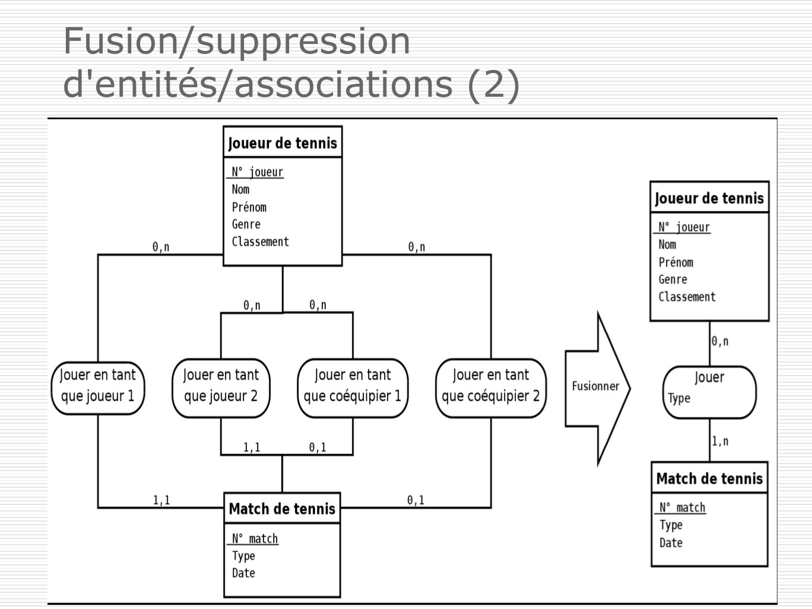
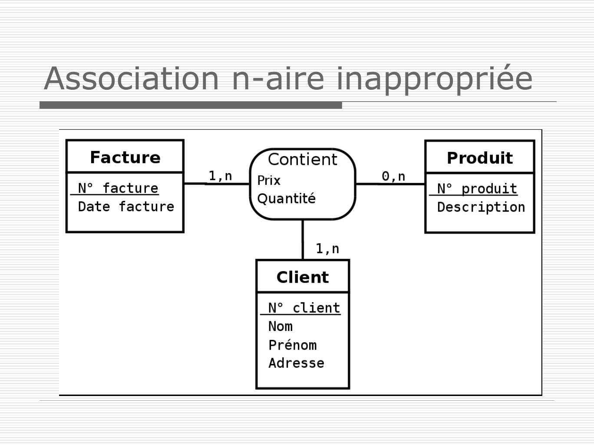
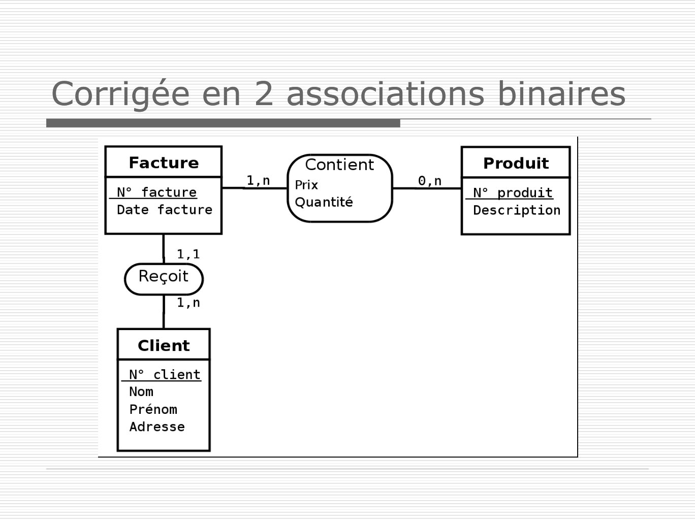
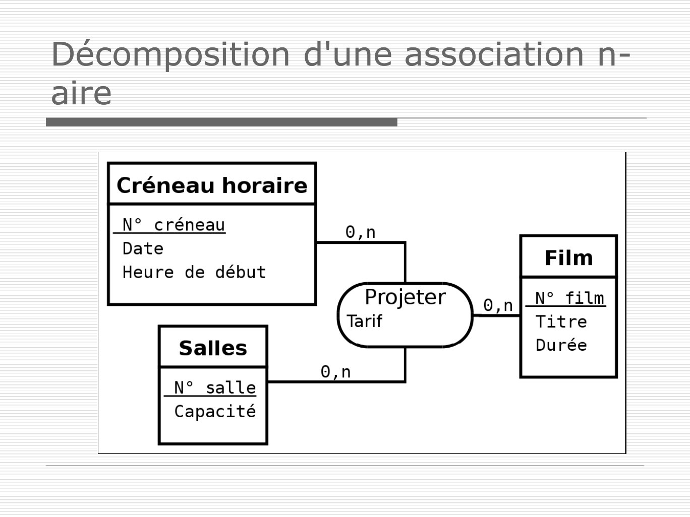

# BDD1Seance2MLD.pdf

[Ouvrir l’original](https://drive.google.com/open?id=1urQ1x6bODc_6gp6hIAeNvm-3pLa59_7_) · Les pages signalées comprennent du texte reconnu automatiquement ou des éléments graphiques. Le fac-similé permet de vérifier chaque lecture.

**Pages avec fac-similé ou lecture OCR** — 20, 23–25, 44.

## Page 1

~~~text
     Base de données

                 Séance 2

1. Modèle Conceptuel des Données (MCD)
2. Du Modèle Conceptuel des Données (MCD) au
   Modèle Logique des Données (MLD)
~~~

## Page 2

~~~text
La démarche pour construire le MCD

  ◼ Recherche des propriétés à gérer
  ◼ Regroupement des propriétés par
    entité
  ◼ Construction des entités
  ◼ Recherche des associations
  ◼ Recherche des cardinalités
  ◼ Vérification et validation du modèle
~~~

## Page 3

~~~text
Recherche des propriétés
 Dans les interviews / documents
  ◼ Les données peuvent être éparpillées dans le
    discours.
 Une donnée est caractérisée par :
  ◼ Un nom
  ◼ Une définition (explique à quoi elle sert)
  ◼ Un domaine de définition
  ◼ Un mode de calcul (si donnée calculée)
  ◼ Une décomposition (si donnée non
    atomique)
~~~

## Page 4

~~~text
Regroupement en entités
  Les données sont explicitement des
   propriétés d’entités nommées.
  Les données sont regroupables dans une
   entité non explicite, mais
   sémantiquement identifiables.
  Les données sont isolées, il faut
   construire des entités supplémentaires.
~~~

## Page 5

~~~text
Le dictionnaire de données
 Recense toutes les informations utiles au
  système considéré.
 Pourquoi ?
  ◼ Eviter les doubles définitions
  ◼ Rassembler des définitions très proches, ou
    concurrentes
 Formalisé par un tableau :
   Nom    Définition   Domaine   Type   Calculée
~~~

## Page 6

~~~text
Construction des entités
   ◼ Première ébauche du modèle
     conceptuel des données ne faisant
     apparaître que :
                         NomEntite
      Les entités       attributClef1
      Les propriétés    attribut2
                         attribut3
                         attribut4
                         attribut5
                         ...
~~~

## Page 7

~~~text
Clé
 Un ensemble d'attributs d'une entité est
  une clé si et seulement si :
  ◼ deux occurrences de l'entité ont des clés
    différentes
  ◼ la connaissance des valeurs des attributs clés
    implique de façon unique les valeurs des
    attributs non clé
  ◼ les valeurs des attributs clés sont toutes
    initialisées.
~~~

## Page 8

~~~text
Noms semblables
 Peut-on nommer deux attributs avec le même
  nom dans deux entités différentes ?
                        OUI
 Comment distingue t-on les données dans ce cas ?
            Etudiant          Examen
            id                id

    Etudiant.id                    Examen.id
On utilise ces formes surtout en cas d’ambigüité.
~~~

## Page 9

~~~text
Recherche des associations
 ◼ On écrit des phrases « en français » qui mettent
   en scène les relations entre les entités. On fait
   apparaître le « QUI dépend de QUOI »
 ◼ Caractéristiques :
     ◼ nom : désigne la nature de la dépendance
     ◼ dimension : désigne le nombre d’entités
     impliquées
     ◼ qualifiants : des attributs de la liaison
     ◼ cardinalité : donne les limites ordinales d’une
     association
~~~

## Page 10

~~~text
Identification des cardinalités
 Répondre à quatre questions :
  ◼ Une occurrence de A peut être en
    relation avec une occurrence de B
     ▪ combien de fois au minimum ?
     ▪ combien de fois au maximum?

  ◼ Une occurrence de B peut être en
    relation avec une occurrence de A
     ▪ combien de fois au minimum ?
     ▪ combien de fois au maximum?
~~~

## Page 11

~~~text
Matérialisation des associations et
des cardinalités

  Forum                                Message
                  -> contient

            0,n
                   apparaître
                                 1,1

             <- est écrit dans

                                                 11
~~~

## Page 12

~~~text
Vérification et validation du modèle
 Les entités et les propriétés doivent
  vérifier
  ◼ L’intégrité sur les entités
  ◼ L’intégrité référentielle
  ◼ Chaque propriété doit être élémentaire
  ◼ Chaque information ne doit apparaître
    une seule fois dans une entité donnée.
  ◼ Chaque propriété doit prendre une et
    une seule valeur pour une occurrence
    donnée
~~~

## Page 13

~~~text
Normalisation
 But
  ◼ Rendre le modèle le « plus propre possible ».
  ◼ Limiter la redondance de données.
  => Augmenter la fiabilité et diminuer la
    maintenance.
 Les règles de normalisation
  ◼ Semi-formelles (intuitives) sur le MCD
  ◼ Formelles sur le MLD (séance prochaine)
~~~

## Page 14

~~~text
Propriété élémentaire

Pavillon    Pavillon                            Personne
numero                    0,n             1,1
            numero                              numero
adresse                         occuper
            adresse                             nom
occupants
            codePostale                         prenom
            ville                               age

                                                           14
~~~

## Page 15

~~~text
Intégrité référentielle

Evaluation
               Matiere                         Etudiant
idEtudiant               1,n             1,n
idMatiere                      evaluer         id
               id
note                            note           nom
age                                            age

                                                      15
~~~

## Page 16

~~~text
Intégrité référentielle

 Etudiant                   Etudiant
 id
                                       1,1           0,n Provenance
 nom                        id
 prenom                     nom              venir       id
 idProvenance               prenom                       libelle
 libelleProvenance

libelleProvenance ne dépend pas
directement de la clé mais d’un autre attribut

                                                                   16
~~~

## Page 17

~~~text
Attribut multiple
 Remplacer un attribut multiple en
  association et entité supplémentaire

                                         17
~~~

## Page 18

~~~text
Attribut dérivé
 Il est déconseillé d’ajouter un attribut
  dérivé d'autres attributs

                                             18
~~~

## Page 19

~~~text
Fusion/suppression
d'entités/associations (1)
 Il faut factoriser les entités/associations
  quand c'est possible
~~~

## Page 20

~~~text
Fusion/suppression
d'entités/associations (2)
~~~

**Lecture OCR à contrôler**

~~~text
Fusion/suppression
d'entités/associations (2)

N°_joueur
Nom
Prénom
Genre
Classement

N°_joueur
Nom
Prénom
Genre
Classement

Jouer en tant
que joueur 1

Match de tennis

N° match
Type
Date
~~~

## Page 21

~~~text
Fusion/suppression
d'entités/associations (3)
 Lorsque les cardinalités d'une association sont
  toutes 1,1 c'est que l'association n'a pas lieu d'être
~~~

## Page 22

~~~text
Fusion/suppression
d'entités/associations (4)
 Mais pas cela …
~~~

## Page 23

~~~text
Association n-aire inappropriée
~~~

**Lecture OCR à contrôler**

~~~text
Association n-aire inappropriée

Contient
Prix
Quantité

N° produit
Description

N° client
Nom
Prénom
Adresse
~~~

## Page 24

~~~text
Corrigée en 2 associations binaires
~~~

**Lecture OCR à contrôler**

~~~text
Corrigée en 2 associations binaires

N° facture
Date facture

Contient
Prix
Quantité

N°_ produit
Description

1,1
1,n

N° client
Nom

Prénom
Adresse
~~~

## Page 25

~~~text
Décomposition d'une association n-
aire
~~~

**Lecture OCR à contrôler**

~~~text
Décomposition d'une association n-
aire

Créneau horaire

N° _ créneau
Date
Heure de début

N° salle
Capacité
~~~

## Page 26

~~~text
Transformation en 1 entité et 3
associations binaires
~~~

## Page 27

~~~text
Extension du formalisme entités
– associations
 But : de nouveaux opérateurs pour
  enrichir la modélisation et symboliser
  des situations plus complexes

 Introduction des concepts :
  ◼ généralisation/spécialisation
     représentation plus proche du monde réel
  ◼ de nouvelles contraintes
     inclusion, exclusion, ou exclusif, …
~~~

## Page 28

~~~text
 Du MCD à la base de données
Modèle conceptuel                               Diagramme
  de données                                    de classes
                      On peut appliquer
     (MCD)            des règles de
                      conversion

             Modèle logique de données
                       (MLD)
                 Transcription en langage SQL

           Script de création des tables
                       (BDD)
~~~

## Page 29

~~~text
Modèle logique de données (MLD)
 Reprend le contenu du MCD mais précise la
  structure et l'organisation des données telle
  qu'elles pourront être implémentées :
  ◼ fichiers simples
  ◼ modèle relationnel, …

 Modèle relationnel :
  ◼ Schéma de relation :
       Entite(id, propriete1, propriete2, #aid)
  ◼ Relation : clé primaire, attributs, #clé étrangère
~~~

## Page 30

~~~text
Définitions
 Clé candidate
  ◼ Une clé candidate d’une relation est un ensemble
     minimal des attributs de la relation dont les valeurs
     identifient à coup sûr une occurrence.
 Clé primaire
  ◼ La clé primaire d’une relation est une de ses clés
     candidates.
  ◼ Pour signaler la clé primaire, ses attributs sont
     généralement soulignés.
 Clé étrangère
  ◼ Une clé étrangère dans une relation est formée d’un
     ou plusieurs attributs qui constituent une clé primaire
     dans une autre relation.
~~~

## Page 31

~~~text
Règles de passage de MCD à MLD
➢   Règle 1 : Toute entité est représentée par une
    relation. Chaque attribut de l'entité devient un
    attribut de la relation. L'identifiant est
    conservé en tant que clé de la relation.

➢   Règle 2 : Toute association qui associe plus de
    deux entités (ternaire et au-delà) est
    représentée par une relation.
~~~

## Page 32

~~~text
Règles de passage de MCD à MLD
➢ Règle 3 : Toute association binaire dont les
  cardinalités maximales sont n de chaque côté
  est une relation (relation dont les attributs sont
  les attributs clefs des entités qu'elle relie ainsi
  que les éventuels attributs propres à
  l’association).

➢ Règle 4 : Une association de type père - fils,
  cardinalité maximum à n d’un côté et à 1 de
  l’autre, n’est pas représentée par une relation.
  On indique les attributs clefs de l’entité père
  (côté (.,n)) dans le fils (côté (.,1)).
~~~

## Page 33

~~~text
    Relation matricielle ou n..n
      Entite1      1,n                    1,n   Entite2
                   ou      Association    ou
      id1          0,n      propriete     0,n   id2
      propriete1                                propriete2

                               •Chaque entité devient une relation
                               •Les identifiants de chaque entité sont
                               les clés primaires
                               •Les attributs de chaque relation sont les
                               propriétés des entités
                               •L’association se traduit en créant une
                               relation Association dont la clé primaire
Entite1(id1, propriete1)       est formée des identifiants de chaque
                               entité participant à l’association- elles
Entite2(id2, propriete2)       sont des clés étrangères
Association(#id1,#id2, propriete)
~~~

## Page 34

~~~text
Exemple 1
 Un étudiant s'est inscrit en 1 ou plusieurs cours
 Un cours peut être inscrit par zéro ou plusieurs
  étudiants
 Pour chaque cours, un étudiant est évalué par une
  note
~~~

## Page 35

~~~text
Exemple 1 : Traduction du MCD vers MLD

 Etudiant(numEtudiant, nom, prenom)
 Cours(numCours, intitule)
 Inscription(#numEtudiant, #numCours, note)
~~~

## Page 36

~~~text
    Relation père-fils
      Entite1         1,1                 1,n   Entite2
                      ou    Association   ou
      id1             0,1                 0,n   id2
      propriete1                                propriete2

                              •Chaque entité devient une relation
                              •Les identifiants de chaque entité sont
                              les clés primaires
                              •Les attributs de chaque relation sont
                              les propriétés des entités
Entite1(id1, #id2, propriete1)
                              •L’association se traduit en rajoutant
Entite2(id2, propriete2)      dans la relation Entite1 l'attribut
                              correspondant à l'identifiant de Entite2,
                              id2 devient donc clé étrangère
~~~

## Page 37

~~~text
Exemple 2
 Un employé a une qualification
 Une qualification peut correspondre à
  plusieurs employés

  Qualification
                  1,n        1,1   Employe
  id                    a          id
  libelle                          nom
~~~

## Page 38

~~~text
Exemple 2 : Traduction du MCD vers MLD

 Qualification   1,n       1,1     Employe
 id                    a           id
 libelle                           nom

  ◼ Employe(id, nom, #id_qualif)
  ◼ Qualification(id, libelle)
~~~

## Page 39

~~~text
Cas particuliers (1)
 Association (0,1) – (1,1) : on déclare une clé
  étrangère du côté (1,1) pour éviter des champs NULL

      Citoyen(numCitoyen, nom, prenom, adresse)
      Candidat(numCandidat, parti, #numCitoyen)

 Association (0,1) – (0,1) : on a le choix entre les deux
  relations pour placer la clé étrangère
~~~

## Page 40

~~~text
Cas particuliers (2)
 Association réflexive : mêmes règles qu’une
  association binaire (avec renommage de la clé
  étrangère dans le cas d’une association père-
  fils)

 Exceptions : on pourra créer une relation
  supplémentaire pour une association (0,1)-
  (1,n) suivant la proportion d’occurrences de
  celle-ci, pour éviter une quantité trop importe
  de champs NULL
~~~

## Page 41

~~~text
Problème classique : étudiants,
cours, enseignants, salles …
1. Il existe plusieurs matières (mathématiques, français,
   philosophie, …).
2. Plusieurs cours sont offerts et il peut y avoir plusieurs
   cours de la même matière.
3. Un cours est dispensé par un, et un seul, enseignant
   et correspond à une matière.
4. Un enseignant peut dispenser plusieurs cours dans la
   même matière ou dans des matières différentes.
5. Un étudiant peut s’inscrire à plusieurs cours.
6. Un cours est toujours dispensé dans une même salle,
   mais une salle peut recevoir plusieurs cours
   (successivement).
7. Chaque matière ne comporte qu’une seule évaluation.
~~~

## Page 42

~~~text
Exercice !
 Proposez un MCD permettant de
  modéliser la situation décrite ci-
  dessus !
~~~

## Page 43

~~~text
MCD !
Enseignant                                              Salle
                                                  1,n
id                             derouler                 id
nom                                                     nbPlaces
prenom
      1,n
                                      1,1

            dispenser   1,1   Cours         1,1                    1,n   Matière
                              id                   correspondre          id
                              nom                                        intitule

                                                                             1,n
Etudiant
id             1,n             inscrire
nom                           evaluation
prenom
~~~

## Page 44

~~~text
Exercice !
 Proposez un MLD à partir du MCD
  précédent !
~~~

**Lecture OCR à contrôler**

~~~text
Exercice !

© Proposez un MLD à partir du MCD
précédent !
~~~

## Page 45

~~~text
MLD !

 ◼   Enseignant(id, nom, prenom)
 ◼   Etudiant(id, nom, prenom)
 ◼   Salle(id, nbPlaces)
 ◼   Matière(id, intitule)
 ◼   Cours(id, nom, #idEnseignant, #idMatiere, #idSalle)
 ◼   Inscription(#idEtudiant, #idMatiere, evaluation)
~~~
