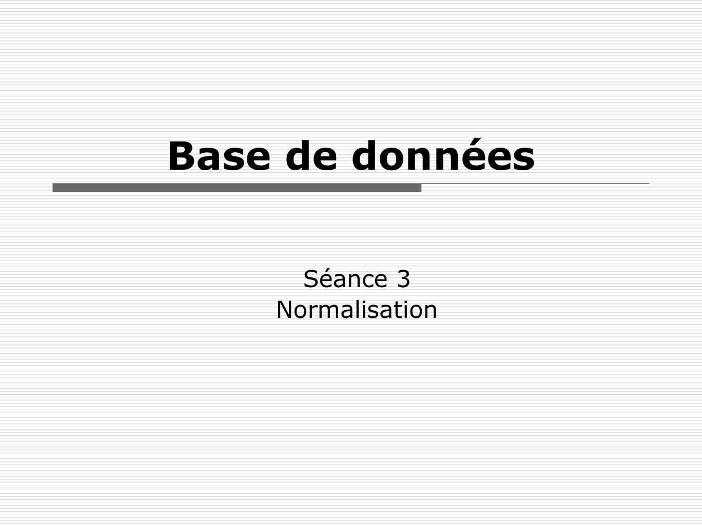
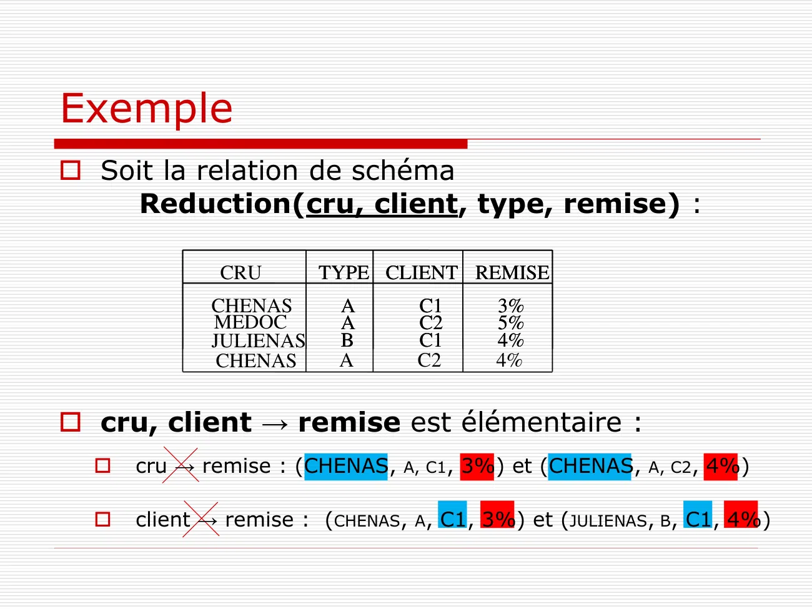
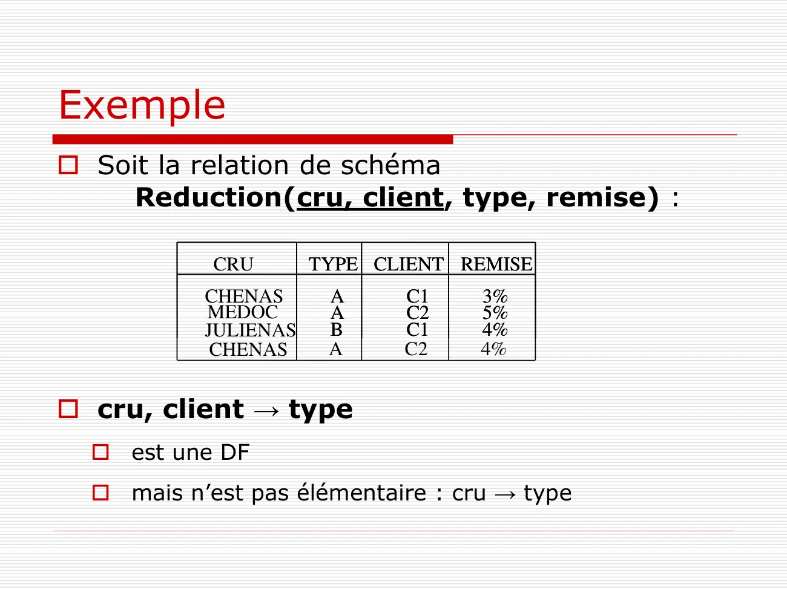
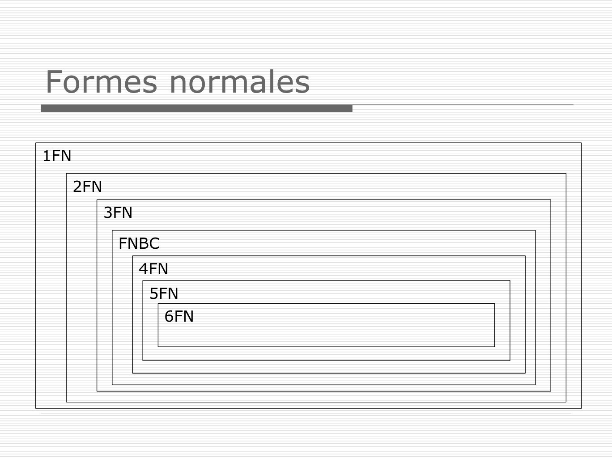
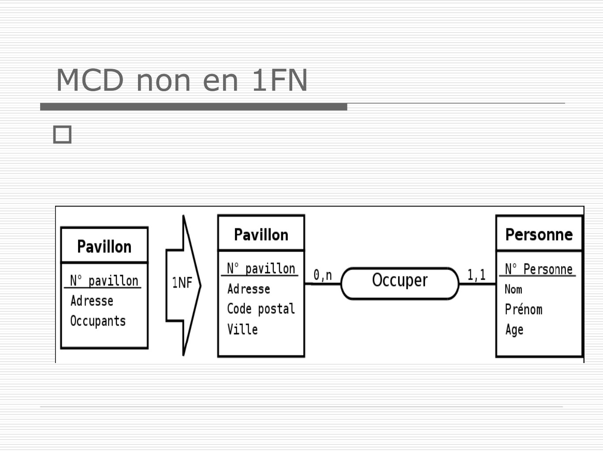
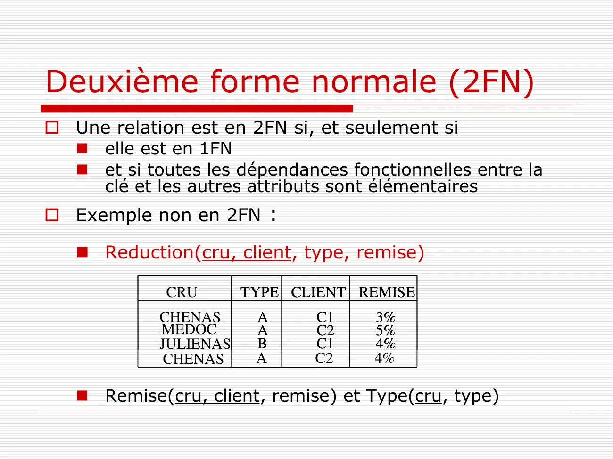
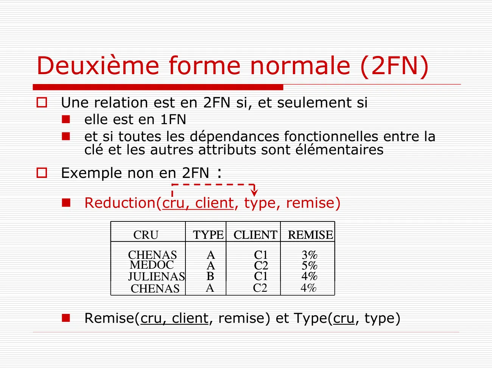
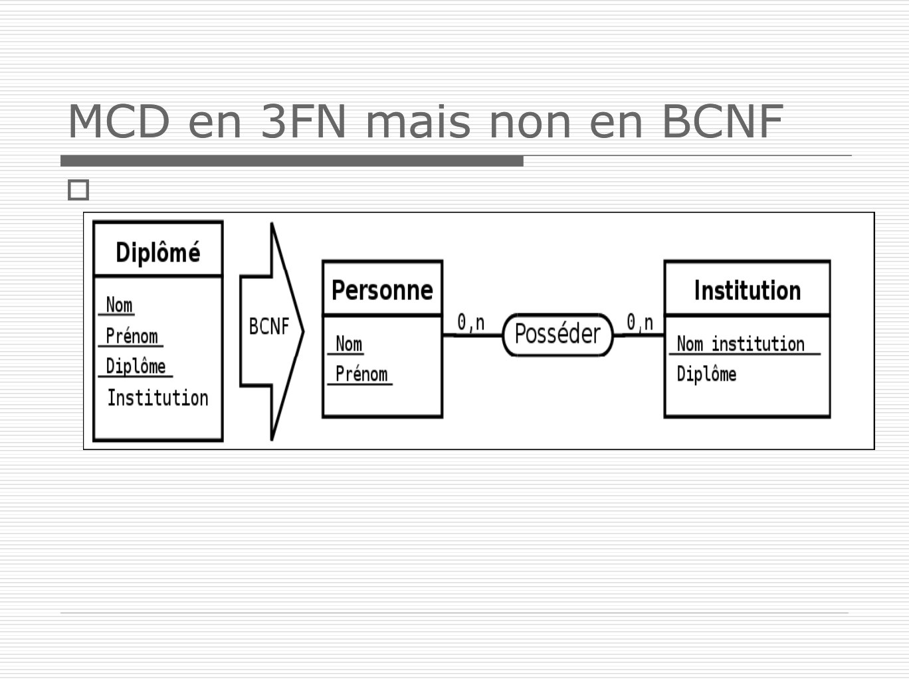

# BDD1Seance3Normalisation.pdf

[Ouvrir l’original](https://drive.google.com/open?id=1MDrf38zLBv-utJI_OFICS4sTwpTuNcDx) · Les pages signalées comprennent du texte reconnu automatiquement ou des éléments graphiques. Le fac-similé permet de vérifier chaque lecture.

**Pages avec fac-similé ou lecture OCR** — 1, 16, 18, 31.

**Pages présentant un écart entre les deux extractions** — 10–11, 19–20.

## Page 1

~~~text
Base de données

      Séance 3
    Normalisation
~~~

## Page 2

~~~text
Normalisation
 Dans la phase de conception sur le modèle
  entités-associations et dans le modèle
  relationnel pour éviter :
  ◼   la redondance de données
  ◼   la perte de données
  ◼   les incohérences
  ◼   l'effondrement de performance des traitements

 Dépendance fonctionnelle !
~~~

## Page 3

~~~text
Relation en extension (table)
 Soit R la relation définie sur les ensembles
  A1, A2, …, An
                   R  A1 x A2 x … x An
 L’extension de R est l’ensemble de tuples de la relation à
  une instance donnée :

      A1              A2              …               An
      a11             a21             …               an2
      a11             a21             …               ank
      …               …               …               …
      a12             a2j             …               ank
            (a11, a21, …, ank) est un n-uplet (ou tuple)
~~~

## Page 4

~~~text
Relation en intension (MLD)
 Schéma relationnel :

         R(A1:D1, A2:D2,…, An:Dn)

 avec :
 - R: nom de la relation
 - A1, A2, …, An : nom des attributs de la relation
 - D1, D2,…, Dn : domaine des attributs
 - et des contraintes d’intégrités éventuelles
~~~

## Page 5

~~~text
 Exemple
 Soit la relation de schéma
Voiture(nv, marque, type, puissance, couleur) :
        NV       MARQUE   TYPE PUISSANCE COULEUR
       AF234567 Renault   RME8    5      rouge
       XN228756 Citroën   4ZX2    7      grise
       DE998031 Peugeot   P307B   7      verte
       ANA22201 Opel      OCA6    5      noir
       FJ000075 Ford      FFI9    5      jaune
       SI141481 Citroën   4ZX2    7      verte
       BI151465 Renault   RME9    9      jaune
~~~

## Page 6

~~~text
Définition
 Dépendance fonctionnelle (DF):
  ◼ Soit R(A1,A2,… An) un schéma de relation,
    et X et Y des sous-ensembles de {A1, A2,…
    An}
  ◼ On dit que X détermine Y ou que Y
    dépend fonctionnellement de X si, et
    seulement si, des valeurs identiques de X
    impliquent des valeurs identiques de Y
  ◼ On le note : X → Y
~~~

## Page 7

~~~text
Exemple
 Ville(numville, nom, code_postal,
  population)

  ◼ numville → nom
  ◼ numville → code_postal
  ◼ numville → population

  ◼ code_postal → nom
  ◼ nom → code_postal
~~~

## Page 8

~~~text
Propriétés

  Dépendances triviales (réflexivité)
   ◼ A→A
   ◼ A, B → A
  Augmentation
   ◼ A→B     =>   A, C → B
  Transitivité
   ◼ A → B et B → C =>   A→C
~~~

## Page 9

~~~text
  Définition

 Dépendance fonctionnelle élémentaire
  ◼ Une DF élémentaire est une DF de la forme X → A
     où A est un attribut unique n’appartenant pas à X
     et où il n’existe pas X' inclus au sens strict dans X
      (i.e. X'  X) tel que X' → A
~~~

## Page 10

~~~text
Exemple
 Soit la relation de schéma
     Reduction(cru, client, type, remise) :

              CRU       TYPE CLIENT REMISE
             CHENAS      A       C1      3%
             MEDOC       A       C2      5%
             JULIENAS    B       C1      4%
              CHENAS     A       C2      4%

 cru, client → remise est élémentaire :
     cru → remise : (CHENAS, A, C1, 3%) et (CHENAS, A, C2, 4%)

     client → remise : (CHENAS, A, C1, 3%) et (JULIENAS, B, C1, 4%)
~~~

## Page 11

~~~text
Exemple
 Soit la relation de schéma
     Reduction(cru, client, type, remise) :

            CRU       TYPE CLIENT REMISE
           CHENAS      A     C1    3%
           MEDOC       A     C2    5%
           JULIENAS    B     C1    4%
            CHENAS     A     C2    4%

 cru, client → type
   est une DF
   mais n’est pas élémentaire : cru → type
~~~

## Page 12

~~~text
Définitions

 Dépendance fonctionnelle directe
  ◼ Une DF X → A est une DF directe s’il n’existe
    aucun attribut B tel que l’on puisse avoir
    X → B et B → A
~~~

## Page 13

~~~text
 Exemple
 On reprend la relation de schéma
Voiture(nv, marque, type, puissance, couleur) :
        NV       MARQUE   TYPE PUISSANCE COULEUR
       AF234567 Renault   RME8    5      rouge
       XN228756 Citroën   4ZX2    7      grise
       DE998031 Peugeot   P307B   7      verte
       ANA22201 Opel      OCA6    5      noir
       FJ000075 Ford      FFI9    5      jaune
       SI141481 Citroën   4ZX2    7      verte
       BI151465 Renault   RME9    9      jaune
~~~

## Page 14

~~~text
 Exemple
 On reprend la relation de schéma
Voiture(nv, marque, type, puissance, couleur) :
           NV        MARQUE     TYPE PUISSANCE COULEUR
          AF234567 Renault     RME8      5         rouge
          XN228756 Citroën     4ZX2      7         grise
          DE998031 Peugeot     P307B     7         verte
          ANA22201 Opel        OCA6      5         noir
          FJ000075 Ford        FFI9      5         jaune
          SI141481 Citroën     4ZX2      7         verte
          BI151465 Renault     RME9      9         jaune
   On a NV → MARQUE, NV → TYPE, NV → PUISSANCE, NV → COULEUR
   mais aussi TYPE → MARQUE et TYPE → PUISSANCE
   donc NV → MARQUE, NV → PUISSANCE ne sont pas directes
   et NV → TYPE, NV → COULEUR sont directes
~~~

## Page 15

~~~text
Règles de normalisation
 Quatre formes normales essentielles
  ◼ 1FN, 2FN, 3FN et BCNF.
 Définissent la façon d’utiliser les
  entités, les attributs ou certaines
  contraintes sur les dépendances.
 Pour les modèles complexes : 4FN,
  5FN, 6FN, FNDC
~~~

## Page 16

~~~text
Formes normales

1FN

      2FN
            3FN

             FNBC
                  4FN
                   5FN
                    6FN
~~~

## Page 17

~~~text
Première forme normale (1FN)
 Une relation est en 1FN si, et seulement si,
  tout attribut contient une valeur atomique (non
  multiple, non composée).

 Exemple non en 1FN :
  ◼ Personne(numPersonne, nom, prenom, rueEtVille,
    prenomsEnfants)

  ◼ Personne(numPersonne, nom, prenom, rue, ville)
  ◼ Prenom(numPrenom, prenom)
  ◼ Prenom_enfant(numPersonne, numPrenom)
~~~

## Page 18

~~~text
MCD non en 1FN

~~~

**Lecture OCR à contrôler**

~~~text
MCD non en 1FN
oO

Personne

; ; N° pavillon N° Personne
N° pavillon Adresse Occuper “OO

Adresse Code postal Prénom
Occupants Ville Age
~~~

## Page 19

~~~text
Deuxième forme normale (2FN)
 Une relation est en 2FN si, et seulement si
  ◼ elle est en 1FN
  ◼ et si toutes les dépendances fonctionnelles entre la
    clé et les autres attributs sont élémentaires
 Exemple non en 2FN :

   ◼ Reduction(cru, client, type, remise)

             CRU       TYPE CLIENT REMISE
            CHENAS      A     C1     3%
            MEDOC       A     C2     5%
            JULIENAS    B     C1     4%
             CHENAS     A     C2     4%

   ◼ Remise(cru, client, remise) et Type(cru, type)
~~~

## Page 20

~~~text
Deuxième forme normale (2FN)
 Une relation est en 2FN si, et seulement si
  ◼ elle est en 1FN
  ◼ et si toutes les dépendances fonctionnelles entre la
    clé et les autres attributs sont élémentaires
 Exemple non en 2FN :

   ◼ Reduction(cru, client, type, remise)

             CRU       TYPE CLIENT REMISE
            CHENAS      A     C1     3%
            MEDOC       A     C2     5%
            JULIENAS    B     C1     4%
             CHENAS     A     C2     4%

   ◼ Remise(cru, client, remise) et Type(cru, type)
~~~

## Page 21

~~~text
Relation non en 2FN

       R       K1   K2        X     Y

   Une telle relation doit être décomposée en
           R1(K1,K2,X) et R2(K2,Y)
~~~

## Page 22

~~~text
MCD non en 2FN


Evaluation   Matiere 1,n             Etudiant
                                 1,n
                         evaluer     Id
Etudiant     Id           note
Matiere                              Nom
Note                                 Age
Age
~~~

## Page 23

~~~text
Troisième forme normale (3FN)
 Une relation est en 3FN si, et seulement si
  ◼ elle est en 2FN
  ◼ et si toutes les dépendances fonctionnelles entre
    la clé et les autres attributs sont directes

 Exemple non en 3FN :
  ◼ Voiture(nv, marque, type, puissance, couleur)
~~~

## Page 24

~~~text
Troisième forme normale (3FN)
 Une relation est en 3FN si, et seulement si
  ◼ elle est en 2FN
  ◼ et si toutes les dépendances fonctionnelles entre
    la clé et les autres attributs sont directes

 Exemple non en 3FN :
  ◼ Voiture(nv, marque, type, puissance, couleur)
~~~

## Page 25

~~~text
Troisième forme normale (3FN)
 Une relation est en 3FN si, et seulement si
  ◼ elle est en 2FN
  ◼ et si toutes les dépendances fonctionnelles entre
    la clé et les autres attributs sont directes

 Exemple non en 3FN :
  ◼ Voiture(nv, marque, type, puissance, couleur)

  ◼ Vehicule(nv, type, couleur)
  ◼ Modele(type, marque, puissance)
~~~

## Page 26

~~~text
Relation non en 3FN

        R   K         X     Y     Z

   Une telle relation doit être décomposée en
            R1(K, X, Y) et R2(X,Z)
~~~

## Page 27

~~~text
MCD non en 3FN

Etudiant                    Etudiant
Id
                                       1,1           0,n Provenance
Nom                         Id
Prénom                      Nom              venir       Id
IdProvenance                Prénom                       Libelle
LibelleProvenance

libelleProvenance ne dépend pas directement de
la clé mais d’un autre attribut
~~~

## Page 28

~~~text
 Forme normale de Boyce-Codd
 (BCNF)
 Une relation est en BCNF si, et seulement si
  ◼ elle est en 3FN
  ◼ et si les seules dépendances fonctionnelles élémentaires
    sont celles dans lesquelles une clé détermine un attribut.

 Exemple
  ◼ Universite(numEtudiant, numMatiere, numEnseignant,note)
  ◼ Si un enseignant n’enseigne qu’une seule matière :
            numEnseignant → numMatiere
~~~

## Page 29

~~~text
Forme normale de Boyce-Codd
(BCNF)
 Universite(numEtudiant, numMatiere, numEnseignant,
  note) n'est pas en BCNF => redondances de données
      numEtudiant   numMatiere   numEnseignant   note

           1            5              4          8

           2            5              4         14

           3            5              4         9,5

           1            7             10         13

 Evaluation(numEtudiant, numMatiere, note)
 Enseignement(numEnseignant, numMatiere)
~~~

## Page 30

~~~text
Relation en 3FN mais non en BCNF

          R   K1    K2        X     Y

    Une telle relation peut être décomposée en
           R1(K1, K2, X) et R2(Y,K1)
~~~

## Page 31

~~~text
MCD en 3FN mais non en BCNF

~~~

**Lecture OCR à contrôler**

~~~text
MCD en 3FN mais non en BCNF

O

Personne

Diplômé
Non

Prénom _Nom Nom institution
Diplôme Prénom Diplôme
Institution
~~~

## Page 32

~~~text
Conclusion
 Mnémonique :
  "The key, the whole key, nothing but the key"
  Chris Date
 Historique :
  ◼ 1FN, 2FN et 3FN par Ted Codd (1971)
  ◼ BCNF par Chris Date (1974)
~~~

## Page 33

~~~text
   Exercice : normaliser cette relation !

 Commandes(numCommande, dateCommande, numClient,
  nomClient, adresseClient, nomVendeur, numProduit, nomProduit,
  prix, quantite, montant, total)

   ◼   numCommande : identifiant unique
   ◼   numClient : identifiant unique
   ◼   nomClient : doubles possibles
   ◼   adresseClient : doubles possibles
   ◼   nomVendeur : identifiant unique du vendeur qui passe la commande
   ◼   numProduit : identifiant unique
   ◼   nomProduit : doubles possibles
   ◼   prix : prix unitaire d'un produit
   ◼   quantite : quantité commandée d'un produit
   ◼   montant : montant pour la quantité commandée du produit
   ◼   total : montant total de la commande pour tous les produits commandés
~~~
