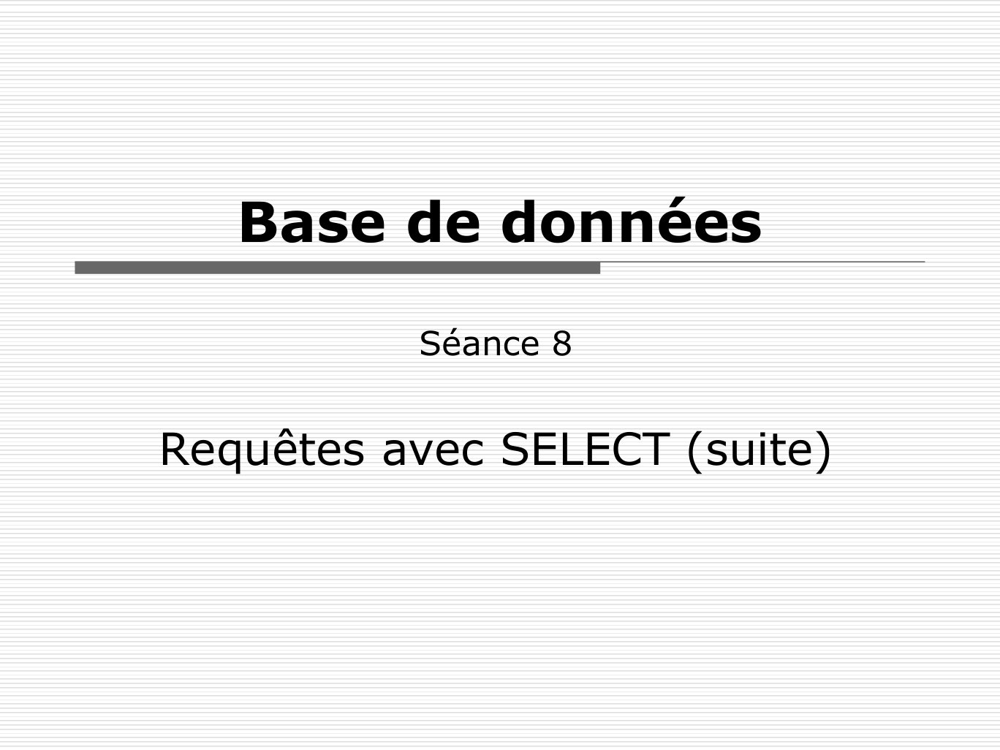

# BDD1Seance8LMD.pdf

[Ouvrir l’original](https://drive.google.com/open?id=12T_pHTGiQxEyzqRdH3AH-fO6VOl_AgJN) · Les pages signalées comprennent du texte reconnu automatiquement ou des éléments graphiques. Le fac-similé permet de vérifier chaque lecture.

**Pages avec fac-similé ou lecture OCR** — 1.

## Page 1

~~~text
   Base de données

          Séance 8

Requêtes avec SELECT (suite)
~~~

## Page 2

~~~text
Plan
 Jointure externe
  ◼ à gauche
  ◼ à droite
  ◼ complète
 Requêtes complexes
~~~

## Page 3

~~~text
Jointure à gauche
 Soit une table décrivant des commerciaux, et
  une autre décrivant des affaires.
 On veut établir le comptage du chiffre d’affaire
  de tous les commerciaux, y compris ceux qui
  n’ont rien fait.
                                  Affaire
        Commercial
                     id_affaire   ca        id_commercial
   id       nom
                     1            100               2
   1        John
                     2            350               1
   2        Henri
                     3            50                1       3
   3        Chuck
                     4            200               2
~~~

## Page 4

~~~text
L’echec de la jointure classique
SELECT c.id, SUM(ca)
FROM commercial c, affaire a
WHERE id_commercial = c.id
GROUP BY c.id;

 Ne donne pas le résultat escompté
 Il manque les commerciaux feignants

                                        4
~~~

## Page 5

~~~text
          Commercial                                       Affaire
     id           nom                       id_affaire     ca        id_commercial
     1            John                      1              100                 2
     2            Henri                     2              350                 1
     3            Chuck                     3              50                  1
                                            4              200                 2

R = Commercial            id = id_commercial Affaire

id        nom      id_affaire ca           id_commercial              idFid,SUM(ca)(R)

1         John     2             350                   1               id          SUM(ca)

1         John     3              50                   1               1           400

2         Henri    1             100                   2               2           300

2         Henri    4             200                   2

                                                                                         5
~~~

## Page 6

~~~text
Solution : la jointure gauche

SELECT c.id, SUM(ca)
FROM commercial c LEFT JOIN affaire a
ON id_commercial = c.id
GROUP BY c.id;

 Ajoute à la jointure interne les
  commerciaux qui n’ont pas d’affaire

                                        6
~~~

## Page 7

~~~text
          Commercial                                          Affaire
     id           nom                        id_affaire       ca        id_commercial
     1            John                       1                100                 2
     2            Henri                      2                350                 1
     3            Chuck                      3                50                  1
                                             4                200                 2

R = Commercial            id = id_commercial Affaire

id        nom      id_affaire ca            id_commercial
1         John     2              350                   1                idFid,SUM(ca)(R)

1         John     3               50                   1                 id          SUM(ca)
2         Henri    1              100                   2                 1           400
2         Henri    4              200                   2                 2           300
3         Chuck    NULL          NULL                  NULL               3           0

                                                                                            7
~~~

## Page 8

~~~text
La jointure externe : syntaxe SQL
SELECT ... FROM
  <table gauche>
     LEFT |RIGHT | FULL [OUTER] JOIN
  <table droite>
ON
  <condition de jointure>
WHERE … ;

                                       8
~~~

## Page 9

~~~text
  Les jointures externes : LEFT
       tab1          tab2
   col11 col12   col21 col22
   a     x       a     1
   b     y       b     2
   c     z       d     3
SELECT *                          axa     1
FROM tab1 LEFT OUTER JOIN tab2
                                  byb     2
ON tab1.col11 = tab2.col21;
                                  c z NULL NULL
                                              9
~~~

## Page 10

~~~text
   Les jointures externes : RIGHT
        tab1          tab2
    col11 col12   col21 col22
    a     x       a     1
    b     y       b     2
    c     z       d     3
SELECT *                            a    x    a 1
FROM tab1 RIGHT OUTER JOIN tab2
                                    b    y    b 2
ON tab1.col11 = tab2.col21;
                                  NULL NULL   d 3

                                              10
~~~

## Page 11

~~~text
  Les jointures externes : FULL
        tab1            tab2
    col11 col12     col21 col22
    a      x        a      1
    b      y        b      2
    c      z        d      3            a     x     a      1

SELECT *                                b     y     b      2
FROM tab1                               c     z   NULL NULL
FULL OUTER JOIN tab2
ON tab1.col11 = tab2.col21;           NULL NULL d          3

                                                          11
Attention, MySQL ne supporte pas FULL OUTER JOIN (LEFT UNION
   RIGHT)
~~~

## Page 12

~~~text
 Les jointures externes : exemple
Comptez pour chaque producteur le nombre de
vins qu'il a récolté, y compris ceux qui
n'ont rien produit :

SELECT p.id,COUNT(r.id_vin)
FROM producteur p LEFT OUTER JOIN recolte r
ON r.id_producteur = p.id
GROUP BY p.id ;

                                       12
~~~

## Page 13

~~~text
Les jointures externes : clauses WHERE

SELECT * FROM tab1
LEFT OUTER JOIN tab2
ON tab1.col11 = tab2.col21
AND tab1.col11 <> 'a';

          N’est pas identique à
SELECT * FROM tab1
LEFT OUTER JOIN tab2
ON tab1.col11 = tab2.col21
WHERE tab1.col11 <> 'a';
                                         13
~~~

## Page 14

~~~text
 Les jointures externes : clauses WHERE
       tab1          tab2
   col11 col12   col21 col22
   a     x       a     1                a x NULL NULL

   b     y       b     2                byb               2

   c     z       d     3                c z NULL NULL

SELECT * FROM tab1
LEFT OUTER JOIN tab2
ON col11 = col21               tab1   col11=col21 and col11≠'a'tab2

AND col11 <> 'a';
                                                                  14
~~~

## Page 15

~~~text
  Les jointures externes : clauses WHERE
       tab1          tab2
   col11 col12   col21 col22
   a     x       a     1              byb            2
   b     y       b     2              c z NULL NULL
   c     z       d     3
SELECT * FROM tab1
                               scol11≠'a'(tab1   col11=col21 tab2)
LEFT OUTER JOIN tab2
ON tab1.col11 = tab2.col21
WHERE tab1.col11 <> 'a' ;
                                                           15
~~~

## Page 16

~~~text
Requêtes complexes

 Décomposer le problème en sous-
  problèmes simples
 Relier les sous-résultats par :
  ◼ opérateur ensembliste
  ◼ jointure
  ◼ sous-requête
 Projeter les informations utiles

                                     16
~~~

## Page 17

~~~text
Sous-requêtes dépendantes

 Une sous-requête dépendante utilise
  une donnée de la requête principale.

                                         17
~~~

## Page 18

~~~text
WHERE EXISTS et WHERE NOT EXISTS
   SELECT
      c.id_client
   FROM                             Dépendance

      client c
   WHERE EXISTS
      (SELECT cde.id_client
      FROM commande cde
      WHERE cde.id_client = c.id_client);

 Cette    requête    utilise   une   sous-requête
  dépendante.
 Le prédicat est vrai quand le résultat de la sous-
  requête est non vide (contient au moins une ligne).
                                                   18
~~~

## Page 19

~~~text
Individu
     num_ind   nom          prenom
     01        Kidman       Nicole
     02        Bettany      Paul
     03        Watson       Emily
     04        Skarsgard    Stellan
     05        Travolta     John
     06        L. Jackson   Samuel
     07        Willis       Bruce
     08        Irons        Jeremy
     09        Spader       James
     10        Hunter       Holly
     11        Arquette     Rosanna
     12                     John
     13        von Trier    Lars
     14        Tarantino    Quentin
     15        Cronenberg   David
     16        Mazursky     Paul
     17        Jones        Grace
     18        Glen         John
~~~

## Page 20

~~~text
Film

  num_film   num_ind   titre                  genre        année
  05         13        Dogville               Drame        2002
  04         13        Breaking the waves     Drame        1996
  03         14        Pulp Fiction           Policier     1994
  02         15        Faux-Semblants         Epouvante    1988
  01         15        Crash                  Drame        1996
  06         12        Alamo                  Western      1960
  07         18        Dangereusement vôtre   Espionnage   1985
~~~

## Page 21

~~~text
Jouer
        num_ind   num_film   role
        01        05         Grace
        02        05         Tom Edison
        03        04         Bess
        04        04         Jan
        05        03         Vincent Vega
        06        03         Jules Winnfield
        07        03         Butch Coolidge
        08        02         Beverly & Elliot Mantle
        09        01         James Ballard
        10        01         Helen Remington
        11        01         Gabrielle
        04        05         Chuck
        16        07         May Day
~~~

## Page 22

~~~text
 Division : AR vers SQL
 Quels sont les acteurs qui ont joué dans tous
  les films de Lars von Trier ?
 En algèbre relationnelle :
     Individu(num_ind, nom, prenom)
     Jouer(#num_ind, #num_film, role)
     Film(num_film, #num_ind, titre, genre, annee)

Idée :
   Résultat = Jouer ÷ (films de Lars von Trier)
~~~

## Page 23

~~~text
 Les films de Lars von Trier :
R1 = snom='von Trier' and prenom='Lars'(Film   Individu)

num_film   num_ind titre      genre année nom prenom
  05         13    Dogville   Drame 2002 von Trier Lars
  04         13    Breaking … Drame 1996 von Trier Lars

R2 = Pnum_film(R1)
~~~

## Page 24

~~~text
Pnum_ind, num_film(Jouer)

num_ind      num_film                R2
                            ÷
                                  num_film
   01          05
                                     05
   02          05                    04
   03          04
   04          04           num_ind       num_ind
   05          03              01            03
   06          03              02     ∩      04
   07          03              04
   08          02
   09          01                    R3
                                  num_ind
   10          01
                                     04
   11          01
   04          05
   16          07
~~~

## Page 25

~~~text
Pnum_ind, num_film(Jouer)

num_ind      num_film                R2
                            ÷
                                  num_film
   01          05
                                     05
   02          05                    04
   03          04
   04          04           num_ind        num_ind
   05          03              01             03
   06          03              02     ∩       04
   07          03              04
   08          02
   09          01                    R3
                                  num_ind               Individu
   10          01
                                     04
   11          01
                                                      Pprenom,nom
   04          05
   16          07
                                                 R4
                                          prenom    nom
                                          Stellan Skarsgard
~~~

## Page 26

~~~text
Reformulation en SQL
 Quels sont les acteurs qui vérifient :
  le nombre de films réalisés par Lars
  von Trier dans lesquels l’acteur a joué
  est égal au nombre de films réalisés
  par Lars von Trier.
~~~

## Page 27

~~~text
Traduction SQL
SELECT i.nom, i.prenom
FROM individu i, jouer j, film f
WHERE i.num_ind = j.num_ind
AND    j.num_film = f.num_film
AND    f.num_film IN ( SELECT num_film
                       FROM film f, individu i
                       WHERE f.num_ind = i.num_ind
                       AND       i.nom = 'von Trier'
                       AND       i.prenom = 'Lars')
GROUP BY i.num_ind,i.nom, i.prenom
HAVING COUNT (DISTINCT f.num_film) = (SELECT COUNT(*)
               FROM film NATURAL JOIN individu
               WHERE nom = 'von Trier' AND prenom = 'Lars');
~~~
