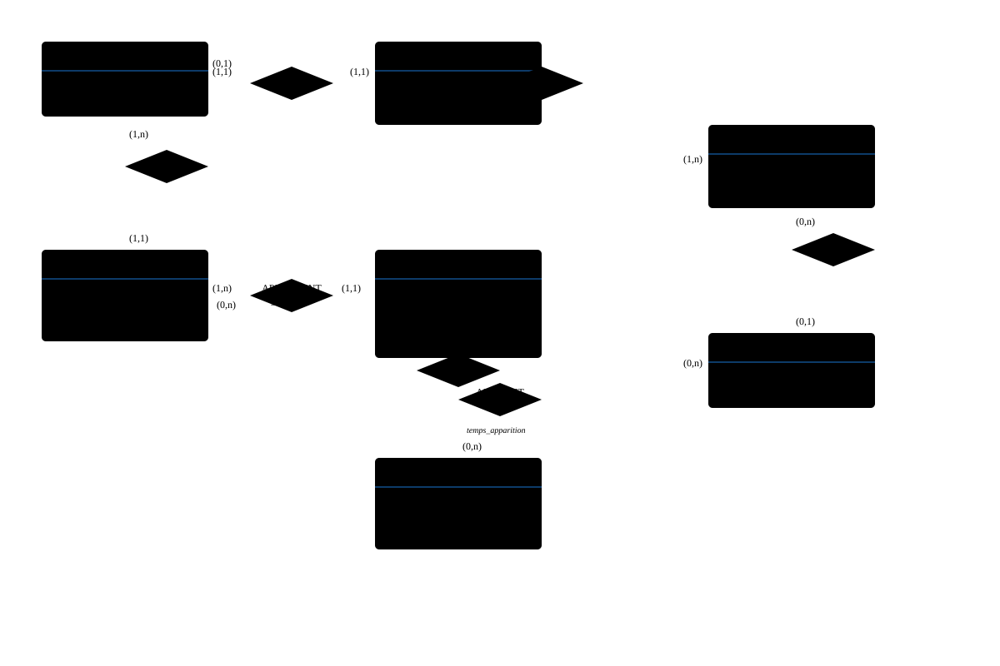

# td2_correction_partie1.html

[Ouvrir l’original](https://drive.google.com/open?id=1g_HHnGQwzNqX-cY_zgx_OGl08V5U0Pla) · Texte structuré depuis le fichier original. Les mises en page complexes peuvent nécessiter une vérification.

<div class="container">

<div>

# 📘 TD 02 - Du MCD au MLD

Dépendance Fonctionnelle - Correction Complète

ING1 - Bases de données - CyTech 2021-2022

</div>

<div class="content">

<div class="section">

### 📖 Introduction : Passage du MCD au MLD

<div class="note">

**Rappel important :** Le passage du Modèle Conceptuel de Données (MCD) au Modèle Logique de Données (MLD) consiste à transformer les entités et associations en tables relationnelles. Ce processus suit des règles précises selon les cardinalités des associations.

</div>

<div class="transformation-rule">

##### 📋 Règles de transformation MCD → MLD

<div class="rule-content">

**Règle 1 : Entités**

Chaque entité devient une table. La clé primaire de l'entité devient la clé primaire de la table.

**Règle 2 : Association (0,n)-(0,n) ou (1,n)-(1,n)**

L'association devient une table avec comme clés primaires les identifiants des deux entités (clé primaire composite). Les attributs de l'association deviennent des attributs de cette table.

**Règle 3 : Association (0,1)-(0,n) ou (1,1)-(1,n)**

On ajoute une clé étrangère dans la table du côté (0,1) ou (1,1) qui référence la clé primaire de l'autre table. Les attributs de l'association sont ajoutés à cette même table.

**Règle 4 : Association (0,1)-(0,1) ou (1,1)-(0,1)**

On choisit l'une des deux tables et on y ajoute une clé étrangère vers l'autre table (privilégier le côté (0,1) si possible).

**Règle 5 : Association (1,1)-(1,1)**

Les deux entités peuvent être fusionnées en une seule table, ou on applique la règle 3.

**Règle 6 : Héritage**

Plusieurs stratégies possibles : table unique, table par classe, ou table par sous-classe.

</div>

</div>

</div>

<div class="exercise">

## Partie I : MCD - MLD

<div class="section">

### Exercice 1 : Gestion d'un hôpital

<div class="mcd-section">

#### 🎨 Rappel du MCD (réalisé au TD1)

Le MCD comporte les entités suivantes :

- **EMPLOYE** : entité parent avec héritage
- **DOCTEUR** : hérite de EMPLOYE
- **INFIRMIER** : hérite de EMPLOYE
- **SERVICE**
- **SALLE** : entité faible (dépendante de SERVICE)
- **PATIENT**
- **DOSSIER**
- **MALADIE**

Et les associations suivantes :

- **DIRIGE** : DOCTEUR (0,n) - SERVICE (1,1)
- **AFFECTE_A** : INFIRMIER (1,1) - SERVICE (1,n)
- **SURVEILLE** : INFIRMIER (0,n) - SALLE (1,1)
- **CONTIENT** : SERVICE (1,n) - SALLE (1,1)
- **POSSEDE** : PATIENT (1,1) - DOSSIER (1,1)
- **RESPONSABLE_DE** : DOCTEUR (1,n) - DOSSIER (1,1)
- **SOUFFRE_DE** : DOSSIER (0,n) - MALADIE (0,n) avec attribut date_debut

</div>

<div class="mld-section">

#### ✅ Solution : MLD Complet

<div class="note">

**Stratégie pour l'héritage :** Nous utilisons la stratégie "table par sous-classe" où DOCTEUR et INFIRMIER ont leur propre table avec un lien vers EMPLOYE, car ils ont des attributs spécifiques différents.

</div>

<div class="table-definition">

<div class="table-name">

EMPLOYE

</div>

<div class="table-attributes">

<div>

<span class="primary-key">num_employe</span> : INTEGER

</div>

<div>

nom : VARCHAR(50)

</div>

<div>

prenom : VARCHAR(50)

</div>

<div>

adresse : VARCHAR(200)

</div>

<div>

telephone : VARCHAR(20)

</div>

</div>

</div>

<div class="table-definition">

<div class="table-name">

DOCTEUR

</div>

<div class="table-attributes">

<div>

<span class="primary-key">num_employe</span> : INTEGER

</div>

<div>

<span class="foreign-key">\#num_employe</span> → EMPLOYE(num_employe)

</div>

<div>

specialite : VARCHAR(50)

</div>

</div>

</div>

<div class="table-definition">

<div class="table-name">

INFIRMIER

</div>

<div class="table-attributes">

<div>

<span class="primary-key">num_employe</span> : INTEGER

</div>

<div>

<span class="foreign-key">\#num_employe</span> → EMPLOYE(num_employe)

</div>

<div>

rotation : VARCHAR(50)

</div>

<div>

<span class="foreign-key">\#code_service</span> → SERVICE(code_service)

</div>

</div>

</div>

<div class="note">

**Pourquoi code_service dans INFIRMIER ?** Car l'association AFFECTE_A a les cardinalités (1,1) du côté INFIRMIER et (1,n) du côté SERVICE. On applique donc la règle 3 : on ajoute la clé étrangère du côté (1,1).

</div>

<div class="table-definition">

<div class="table-name">

SERVICE

</div>

<div class="table-attributes">

<div>

<span class="primary-key">code_service</span> : VARCHAR(10)

</div>

<div>

nom : VARCHAR(100)

</div>

<div>

batiment : VARCHAR(50)

</div>

<div>

<span class="foreign-key">\#num_employe_directeur</span> → DOCTEUR(num_employe)

</div>

</div>

</div>

<div class="note">

**Pourquoi num_employe_directeur dans SERVICE ?** Car l'association DIRIGE a les cardinalités (1,1) du côté SERVICE. On ajoute donc la clé étrangère dans SERVICE.

</div>

<div class="table-definition">

<div class="table-name">

SALLE

</div>

<div class="table-attributes">

<div>

<span class="primary-key">code_service, num_salle</span> : (VARCHAR(10), INTEGER)

</div>

<div>

<span class="foreign-key">\#code_service</span> → SERVICE(code_service)

</div>

<div>

nb_lits : INTEGER

</div>

<div>

<span class="foreign-key">\#num_employe_surveillant</span> → INFIRMIER(num_employe)

</div>

</div>

</div>

<div class="note">

**Clé primaire composite :** SALLE a une clé primaire composite (code_service, num_salle) car le numéro de salle est local au service. code_service est aussi une clé étrangère (association CONTIENT). num_employe_surveillant est ajouté car SURVEILLE a les cardinalités (1,1) du côté SALLE.

</div>

<div class="table-definition">

<div class="table-name">

PATIENT

</div>

<div class="table-attributes">

<div>

<span class="primary-key">id_patient</span> : INTEGER

</div>

<div>

nom : VARCHAR(50)

</div>

<div>

adresse : VARCHAR(200)

</div>

</div>

</div>

<div class="table-definition">

<div class="table-name">

DOSSIER

</div>

<div class="table-attributes">

<div>

<span class="primary-key">id_dossier</span> : INTEGER

</div>

<div>

date_creation : DATE

</div>

<div>

<span class="foreign-key">\#id_patient</span> → PATIENT(id_patient)

</div>

<div>

<span class="foreign-key">\#num_employe_medecin</span> → DOCTEUR(num_employe)

</div>

</div>

</div>

<div class="note">

**Pourquoi ces clés étrangères ?**

- POSSEDE (1,1)-(1,1) : on peut choisir de mettre la FK dans l'une ou l'autre table. Ici, on met id_patient dans DOSSIER.
- RESPONSABLE_DE (1,1) du côté DOSSIER : on ajoute num_employe_medecin dans DOSSIER.

</div>

<div class="table-definition">

<div class="table-name">

MALADIE

</div>

<div class="table-attributes">

<div>

<span class="primary-key">code_maladie</span> : VARCHAR(10)

</div>

<div>

nom : VARCHAR(100)

</div>

<div>

description : TEXT

</div>

</div>

</div>

<div class="table-definition">

<div class="table-name">

SOUFFRE_DE

</div>

<div class="table-attributes">

<div>

<span class="primary-key">id_dossier, code_maladie, date_debut</span> : (INTEGER, VARCHAR(10), DATE)

</div>

<div>

<span class="foreign-key">\#id_dossier</span> → DOSSIER(id_dossier)

</div>

<div>

<span class="foreign-key">\#code_maladie</span> → MALADIE(code_maladie)

</div>

<div>

date_debut : DATE

</div>

</div>

</div>

<div class="warning">

**Attention :** La clé primaire de SOUFFRE_DE inclut date_debut car "une même maladie peut toucher le même patient à deux dates différentes". Cela permet de distinguer les différentes occurrences de la même maladie.

</div>

</div>

<div class="mld-section" style="background: #fce4ec; border-left-color: #c2185b;">

#### 📊 Résumé MLD - Format SQL

```
CREATE TABLE EMPLOYE (
    num_employe INTEGER PRIMARY KEY,
    nom VARCHAR(50) NOT NULL,
    prenom VARCHAR(50) NOT NULL,
    adresse VARCHAR(200),
    telephone VARCHAR(20)
);

CREATE TABLE DOCTEUR (
    num_employe INTEGER PRIMARY KEY,
    specialite VARCHAR(50) NOT NULL,
    FOREIGN KEY (num_employe) REFERENCES EMPLOYE(num_employe)
);

CREATE TABLE SERVICE (
    code_service VARCHAR(10) PRIMARY KEY,
    nom VARCHAR(100) NOT NULL,
    batiment VARCHAR(50),
    num_employe_directeur INTEGER NOT NULL,
    FOREIGN KEY (num_employe_directeur) REFERENCES DOCTEUR(num_employe)
);

CREATE TABLE INFIRMIER (
    num_employe INTEGER PRIMARY KEY,
    rotation VARCHAR(50),
    code_service VARCHAR(10) NOT NULL,
    FOREIGN KEY (num_employe) REFERENCES EMPLOYE(num_employe),
    FOREIGN KEY (code_service) REFERENCES SERVICE(code_service)
);

CREATE TABLE SALLE (
    code_service VARCHAR(10),
    num_salle INTEGER,
    nb_lits INTEGER NOT NULL,
    num_employe_surveillant INTEGER NOT NULL,
    PRIMARY KEY (code_service, num_salle),
    FOREIGN KEY (code_service) REFERENCES SERVICE(code_service),
    FOREIGN KEY (num_employe_surveillant) REFERENCES INFIRMIER(num_employe)
);

CREATE TABLE PATIENT (
    id_patient INTEGER PRIMARY KEY,
    nom VARCHAR(50) NOT NULL,
    adresse VARCHAR(200)
);

CREATE TABLE DOSSIER (
    id_dossier INTEGER PRIMARY KEY,
    date_creation DATE,
    id_patient INTEGER UNIQUE NOT NULL,
    num_employe_medecin INTEGER NOT NULL,
    FOREIGN KEY (id_patient) REFERENCES PATIENT(id_patient),
    FOREIGN KEY (num_employe_medecin) REFERENCES DOCTEUR(num_employe)
);

CREATE TABLE MALADIE (
    code_maladie VARCHAR(10) PRIMARY KEY,
    nom VARCHAR(100) NOT NULL,
    description TEXT
);

CREATE TABLE SOUFFRE_DE (
    id_dossier INTEGER,
    code_maladie VARCHAR(10),
    date_debut DATE,
    PRIMARY KEY (id_dossier, code_maladie, date_debut),
    FOREIGN KEY (id_dossier) REFERENCES DOSSIER(id_dossier),
    FOREIGN KEY (code_maladie) REFERENCES MALADIE(code_maladie)
);
                        
```

</div>

</div>

<div class="section">

### Exercice 2 : Pokémon Go, partie 2

<div class="mcd-section">

#### 🎨 Élaboration du MCD

**Analyse du cahier des charges :**

<div class="note">

**Éléments identifiés :**

- Joueur : pseudonyme (unique), niveau
- Personnage : nom, sexe (féminin/masculin) - chaque joueur incarne UN personnage
- Pokémon : nom, type, point_combat - appartient à une espèce
- Espèce : nom, rareté (détermine le temps d'apparition)
- Équipe : nom, couleur
- Arène : emplacement, équipe qui la défend
- Emplacement : coordonnées où un Pokémon peut apparaître

</div>

**Entités :**

- **JOUEUR** (#pseudo, niveau)
- **PERSONNAGE** (#id_personnage, nom, sexe)
- **POKEMON** (#id_pokemon, nom, point_combat)
- **ESPECE** (#id_espece, nom_espece, type, rarete)
- **EQUIPE** (#id_equipe, nom, couleur)
- **ARENE** (#id_arene, emplacement)
- **EMPLACEMENT** (#id_emplacement, coordonnees_x, coordonnees_y)

**Associations :**

- **INCARNE** : JOUEUR (1,1) - PERSONNAGE (1,1)
- **POSSEDE** : JOUEUR (1,n) - POKEMON (1,1) \[ou 0,1 si le Pokémon peut ne pas être possédé\]
- **APPARTIENT_ESPECE** : POKEMON (1,n) - ESPECE (1,1)
- **APPARAIT** : ESPECE (0,n) - EMPLACEMENT (0,n) avec attribut temps_apparition
- **MEMBRE_DE** : JOUEUR (0,1) - EQUIPE (1,n)
- **DEFEND** : EQUIPE (0,n) - ARENE (0,1)
- **PROTEGE** : POKEMON (0,n) - ARENE (0,n)

<div class="note">

**Précisions importantes :**

- Un joueur peut ne pas avoir choisi d'équipe (cardinalité 0,1)
- Une arène peut ne pas être défendue (cardinalité 0,1 pour DEFEND)
- Un Pokémon peut être en défense dans une arène (association PROTEGE)
- Le temps d'apparition dépend du couple (espèce, emplacement)

</div>

</div>

<div class="diagram-container">

<div class="diagram-title">

🎨 Schéma MCD - Pokémon Go

</div>



</div>

<div class="mld-section">

#### ✅ Solution : Passage au MLD

<div class="table-definition">

<div class="table-name">

JOUEUR

</div>

<div class="table-attributes">

<div>

<span class="primary-key">pseudo</span> : VARCHAR(50)

</div>

<div>

niveau : INTEGER

</div>

<div>

<span class="foreign-key">\#id_equipe</span> → EQUIPE(id_equipe) NULL

</div>

</div>

</div>

<div class="note">

**MEMBRE_DE (0,1)-(1,n) :** On ajoute id_equipe dans JOUEUR (côté 0,1). Il peut être NULL car un joueur peut ne pas avoir choisi d'équipe.

</div>

<div class="table-definition">

<div class="table-name">

PERSONNAGE

</div>

<div class="table-attributes">

<div>

<span class="primary-key">id_personnage</span> : INTEGER

</div>

<div>

nom : VARCHAR(50)

</div>

<div>

sexe : CHAR(1)

</div>

<div>

<span class="foreign-key">\#pseudo_joueur</span> → JOUEUR(pseudo) UNIQUE

</div>

</div>

</div>

<div class="note">

**INCARNE (1,1)-(1,1) :** On peut choisir de mettre la FK dans l'une ou l'autre table. Ici, on met pseudo_joueur dans PERSONNAGE. UNIQUE garantit qu'un joueur n'incarne qu'un seul personnage.

</div>

<div class="table-definition">

<div class="table-name">

EQUIPE

</div>

<div class="table-attributes">

<div>

<span class="primary-key">id_equipe</span> : INTEGER

</div>

<div>

nom : VARCHAR(50)

</div>

<div>

couleur : VARCHAR(30)

</div>

</div>

</div>

<div class="table-definition">

<div class="table-name">

ESPECE

</div>

<div class="table-attributes">

<div>

<span class="primary-key">id_espece</span> : INTEGER

</div>

<div>

nom_espece : VARCHAR(50)

</div>

<div>

type : VARCHAR(30)

</div>

<div>

rarete : INTEGER

</div>

</div>

</div>

<div class="table-definition">

<div class="table-name">

POKEMON

</div>

<div class="table-attributes">

<div>

<span class="primary-key">id_pokemon</span> : INTEGER

</div>

<div>

nom : VARCHAR(50)

</div>

<div>

point_combat : INTEGER

</div>

<div>

<span class="foreign-key">\#pseudo_proprietaire</span> → JOUEUR(pseudo)

</div>

<div>

<span class="foreign-key">\#id_espece</span> → ESPECE(id_espece)

</div>

</div>

</div>

<div class="note">

**Pourquoi ces FK ?**

- **POSSEDE (1,1)-(1,n) :** On ajoute pseudo_proprietaire dans POKEMON
- **APPARTIENT_ESPECE (1,1)-(1,n) :** On ajoute id_espece dans POKEMON

</div>

<div class="table-definition">

<div class="table-name">

ARENE

</div>

<div class="table-attributes">

<div>

<span class="primary-key">id_arene</span> : INTEGER

</div>

<div>

emplacement : VARCHAR(200)

</div>

<div>

<span class="foreign-key">\#id_equipe_defenseur</span> → EQUIPE(id_equipe) NULL

</div>

</div>

</div>

<div class="note">

**DEFEND (0,1)-(0,n) :** On ajoute id_equipe_defenseur dans ARENE (côté 0,1). NULL si l'arène n'est pas défendue.

</div>

<div class="table-definition">

<div class="table-name">

EMPLACEMENT

</div>

<div class="table-attributes">

<div>

<span class="primary-key">id_emplacement</span> : INTEGER

</div>

<div>

coordonnees_x : DECIMAL(10,6)

</div>

<div>

coordonnees_y : DECIMAL(10,6)

</div>

</div>

</div>

<div class="table-definition">

<div class="table-name">

APPARAIT

</div>

<div class="table-attributes">

<div>

<span class="primary-key">id_espece, id_emplacement</span> : (INTEGER, INTEGER)

</div>

<div>

<span class="foreign-key">\#id_espece</span> → ESPECE(id_espece)

</div>

<div>

<span class="foreign-key">\#id_emplacement</span> → EMPLACEMENT(id_emplacement)

</div>

<div>

temps_apparition : INTEGER

</div>

</div>

</div>

<div class="note">

**APPARAIT (0,n)-(0,n) :** Association many-to-many, donc on crée une table avec les deux clés étrangères comme clé primaire composite.

</div>

<div class="table-definition">

<div class="table-name">

PROTEGE

</div>

<div class="table-attributes">

<div>

<span class="primary-key">id_pokemon, id_arene</span> : (INTEGER, INTEGER)

</div>

<div>

<span class="foreign-key">\#id_pokemon</span> → POKEMON(id_pokemon)

</div>

<div>

<span class="foreign-key">\#id_arene</span> → ARENE(id_arene)

</div>

</div>

</div>

<div class="note">

**PROTEGE (0,n)-(0,n) :** Association many-to-many pour gérer quels Pokémons défendent quelle arène.

</div>

</div>

<div class="mld-section" style="background: #fce4ec; border-left-color: #c2185b;">

#### 📊 Résumé MLD - Format SQL

```
CREATE TABLE EQUIPE (
    id_equipe INTEGER PRIMARY KEY,
    nom VARCHAR(50) NOT NULL UNIQUE,
    couleur VARCHAR(30) NOT NULL
);

CREATE TABLE JOUEUR (
    pseudo VARCHAR(50) PRIMARY KEY,
    niveau INTEGER NOT NULL DEFAULT 1,
    id_equipe INTEGER,
    FOREIGN KEY (id_equipe) REFERENCES EQUIPE(id_equipe)
);

CREATE TABLE PERSONNAGE (
    id_personnage INTEGER PRIMARY KEY,
    nom VARCHAR(50) NOT NULL,
    sexe CHAR(1) CHECK (sexe IN ('M', 'F')),
    pseudo_joueur VARCHAR(50) UNIQUE NOT NULL,
    FOREIGN KEY (pseudo_joueur) REFERENCES JOUEUR(pseudo)
);

CREATE TABLE ESPECE (
    id_espece INTEGER PRIMARY KEY,
    nom_espece VARCHAR(50) NOT NULL,
    type VARCHAR(30) NOT NULL,
    rarete INTEGER NOT NULL
);

CREATE TABLE POKEMON (
    id_pokemon INTEGER PRIMARY KEY,
    nom VARCHAR(50) NOT NULL,
    point_combat INTEGER NOT NULL,
    pseudo_proprietaire VARCHAR(50) NOT NULL,
    id_espece INTEGER NOT NULL,
    FOREIGN KEY (pseudo_proprietaire) REFERENCES JOUEUR(pseudo),
    FOREIGN KEY (id_espece) REFERENCES ESPECE(id_espece)
);

CREATE TABLE ARENE (
    id_arene INTEGER PRIMARY KEY,
    emplacement VARCHAR(200) NOT NULL,
    id_equipe_defenseur INTEGER,
    FOREIGN KEY (id_equipe_defenseur) REFERENCES EQUIPE(id_equipe)
);

CREATE TABLE EMPLACEMENT (
    id_emplacement INTEGER PRIMARY KEY,
    coordonnees_x DECIMAL(10,6) NOT NULL,
    coordonnees_y DECIMAL(10,6) NOT NULL
);

CREATE TABLE APPARAIT (
    id_espece INTEGER,
    id_emplacement INTEGER,
    temps_apparition INTEGER NOT NULL,
    PRIMARY KEY (id_espece, id_emplacement),
    FOREIGN KEY (id_espece) REFERENCES ESPECE(id_espece),
    FOREIGN KEY (id_emplacement) REFERENCES EMPLACEMENT(id_emplacement)
);

CREATE TABLE PROTEGE (
    id_pokemon INTEGER,
    id_arene INTEGER,
    PRIMARY KEY (id_pokemon, id_arene),
    FOREIGN KEY (id_pokemon) REFERENCES POKEMON(id_pokemon),
    FOREIGN KEY (id_arene) REFERENCES ARENE(id_arene)
);
                        
```

</div>

</div>

</div>

<div class="section">

### 📋 Tableau Récapitulatif des Règles de Transformation

<table class="comparison-table">
<colgroup>
<col style="width: 33%" />
<col style="width: 33%" />
<col style="width: 33%" />
</colgroup>
<thead>
<tr class="header">
<th>Cardinalités</th>
<th>Règle de transformation</th>
<th>Exemple</th>
</tr>
</thead>
<tbody>
<tr class="odd">
<td><strong>(0,n) - (0,n)</strong><br />
ou<br />
<strong>(1,n) - (1,n)</strong></td>
<td>Créer une table pour l'association avec les deux clés étrangères comme clé primaire composite</td>
<td>SOUFFRE_DE (Dossier-Maladie)<br />
APPARAIT (Espèce-Emplacement)<br />
PROTEGE (Pokemon-Arene)</td>
</tr>
<tr class="even">
<td><strong>(0,1) - (0,n)</strong><br />
ou<br />
<strong>(1,1) - (1,n)</strong></td>
<td>Ajouter une clé étrangère dans la table du côté (0,1) ou (1,1)</td>
<td>INFIRMIER.code_service<br />
DOSSIER.num_employe_medecin<br />
POKEMON.pseudo_proprietaire</td>
</tr>
<tr class="odd">
<td><strong>(0,1) - (0,1)</strong><br />
ou<br />
<strong>(1,1) - (0,1)</strong></td>
<td>Choisir une table et y ajouter une FK vers l'autre (privilégier le côté 0,1 si possible)</td>
<td>ARENE.id_equipe_defenseur<br />
JOUEUR.id_equipe</td>
</tr>
<tr class="even">
<td><strong>(1,1) - (1,1)</strong></td>
<td>Fusionner les deux tables OU appliquer la règle (1,1)-(0,n)</td>
<td>PERSONNAGE.pseudo_joueur<br />
DOSSIER.id_patient</td>
</tr>
<tr class="odd">
<td><strong>Héritage</strong></td>
<td>Plusieurs stratégies : table unique, table par classe, table par sous-classe</td>
<td>EMPLOYE → DOCTEUR, INFIRMIER<br />
(table par sous-classe)</td>
</tr>
<tr class="even">
<td><strong>Entité faible</strong></td>
<td>Clé primaire composite incluant la clé de l'entité forte</td>
<td>SALLE(code_service, num_salle)</td>
</tr>
</tbody>
</table>

</div>

<div class="section">

### 💡 Conseils Pratiques pour le Passage MCD → MLD

<div class="note">

**Méthodologie :**

1.  **Transformer toutes les entités** en tables (une entité = une table)
2.  **Identifier les cardinalités** de chaque association
3.  **Appliquer la règle appropriée** selon les cardinalités
4.  **Nommer correctement les clés étrangères** (préfixer avec le nom de la table référencée)
5.  **Vérifier la cohérence** : chaque FK doit référencer une PK existante
6.  **Gérer les contraintes** : NOT NULL, UNIQUE, CHECK selon le besoin

</div>

<div class="warning">

**Erreurs fréquentes à éviter :**

- Oublier de créer une table pour les associations (n,n)
- Mettre la FK du mauvais côté pour les associations (1,1)-(1,n)
- Ne pas gérer correctement les entités faibles (clé primaire composite)
- Oublier les attributs portés par les associations
- Ne pas respecter les contraintes NULL/NOT NULL selon les cardinalités minimales

</div>

</div>

</div>

</div>
