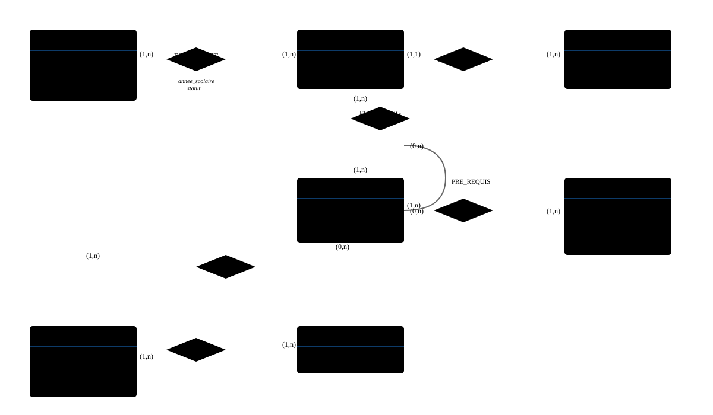
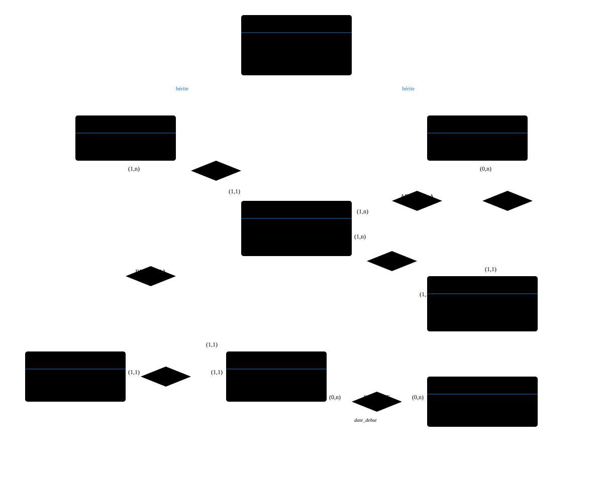

# td_complet_correction.html

[Ouvrir l’original](https://drive.google.com/open?id=1d3sivIHdkcHLOOpff8Cv4z8lHriPK_mT) · Texte structuré depuis le fichier original. Les mises en page complexes peuvent nécessiter une vérification.

# 📘 TD 01 - Modèle Entités-Associations

ING1 - Bases de données - Correction Complète

CyTech - 2021-2022

## Exercice 1 : CyTech

### Section 1 : Les simples entités

#### Question 1 : Modélisation d'un Livre

**Énoncé :** Un livre de la bibliothèque de CyTech est renseigné par le titre, l'éditeur, l'année d'édition, le numéro ISBN (unique et normalisé) et un numéro de livre pour l'identifier dans la base.

##### ✅ Solution :

LIVRE

\#num_livre

titre

editeur

annee_edition

ISBN

**Note :** Le `num_livre` est choisi comme clé primaire car il identifie de manière unique chaque exemplaire dans la base. L'ISBN, bien qu'unique, identifie l'édition du livre et non chaque exemplaire physique.

#### Question 2 : Modélisation d'un Professeur

**Énoncé :** Un professeur à CyTech est renseigné par son nom, prénom, e-mail CyTech, spécialité principale et adresse (rue, ville, code postal).

##### ✅ Solution :

PROFESSEUR

\#id_prof

nom

prenom

email

specialite

rue

ville

code_postal

**Note :** On crée un `id_prof` comme identifiant artificiel plutôt que d'utiliser l'email, pour plus de flexibilité (changement d'email possible). L'adresse est décomposée en trois attributs distincts.

#### Question 3 : Modélisation d'un Étudiant

**Énoncé :** Un étudiant à CyTech est renseigné par son nom, prénom, date de naissance, e-mail CyTech et adresse (rue, ville, code postal).

##### ✅ Solution :

ETUDIANT

\#id_etudiant

nom

prenom

date_naissance

email

rue

ville

code_postal

#### Question 4 : Modélisation d'une Promotion

**Énoncé :** Une promotion (PréIng1, Ing1, ...) est renseignée par son libellé et son cycle.

##### ✅ Solution :

PROMOTION

\#libelle

cycle

**Note :** Le `libelle` peut servir de clé primaire car il est unique (PréIng1, Ing1, Ing2, etc.). Le cycle pourrait être (Prépa, Ingénieur, etc.).

#### Question 5 : Modélisation d'une Matière

**Énoncé :** Une matière est renseignée par son libellé, sa durée et son syllabus.

##### ✅ Solution :

MATIERE

\#id_matiere

libelle

duree

syllabus

### Section 2 : Des associations simples

#### Question 1 : Une matière est enseignée dans une promotion

##### ✅ Solution :

Association **EST_ENSEIGNEE_DANS** entre MATIERE et PROMOTION

Cardinalités : (1,n) côté MATIERE et (1,n) côté PROMOTION

Une matière peut être enseignée dans plusieurs promotions (ex: Mathématiques en Ing1 et Ing2), et une promotion a plusieurs matières.

#### Question 2 : Un professeur enseigne un certain nombre de matières

##### ✅ Solution :

Association **ENSEIGNE** entre PROFESSEUR et MATIERE

Cardinalités : (1,n) côté PROFESSEUR et (1,n) côté MATIERE

Un professeur peut enseigner plusieurs matières, et une matière peut être enseignée par plusieurs professeurs.

#### Question 3 : Un livre de la bibliothèque concerne un certain nombre de matières

##### ✅ Solution :

Association **CONCERNE** entre LIVRE et MATIERE

Cardinalités : (1,n) côté LIVRE et (0,n) côté MATIERE

Un livre concerne au moins une matière (mais peut en concerner plusieurs), et une matière peut avoir 0 ou plusieurs livres associés.

#### Question 4 : Un livre de la bibliothèque est associé à un ou plusieurs mots-clés

##### ✅ Solution :

Il faut créer une nouvelle entité **MOT_CLE** avec l'attribut `mot`

MOT_CLE

\#mot

Association **EST_ASSOCIE_A** entre LIVRE et MOT_CLE

Cardinalités : (1,n) côté LIVRE et (1,n) côté MOT_CLE

### Section 3 : Des associations un peu plus compliquées

#### Question 1 : Une matière nécessite un certain nombre de pré-requis d'autres matières

##### ✅ Solution :

Association **PRE_REQUIS** réflexive sur l'entité MATIERE

Cardinalités : (0,n) pour "nécessite" et (0,n) pour "est pré-requis de"

**Association réflexive :** MATIERE est reliée à elle-même. Par exemple, "Analyse 2" nécessite "Analyse 1" comme pré-requis.

#### Question 2 : Pour une année scolaire, un étudiant est dans une promotion avec statut en fin d'année

##### ✅ Solution :

Association **EST_INSCRIT** entre ETUDIANT et PROMOTION

Attributs de l'association :

- `annee_scolaire` (ex: "2021-2022")
- `statut` (redoublant, admis, exclus, diplômé)

Cardinalités : (1,n) côté ETUDIANT et (1,n) côté PROMOTION

**Important :** L'année scolaire et le statut sont des attributs de l'association car ils dépendent du couple (étudiant, promotion).

#### Question 3 : Gestion des cycles avec ordre des promotions

##### ✅ Solution :

Créer une nouvelle entité **CYCLE** :

CYCLE

\#nom_cycle

description

Modifier l'entité **PROMOTION** :

PROMOTION

\#libelle

ordre

Association **APPARTIENT_A** entre PROMOTION et CYCLE

Cardinalités : (1,1) côté PROMOTION et (1,n) côté CYCLE

L'attribut `ordre` dans PROMOTION permet de spécifier la séquence (1 pour PréIng1, 2 pour PréIng2, etc.).

#### Question 4 : Évaluation des étudiants avec pondération

##### ✅ Solution :

Plusieurs associations sont nécessaires :

1.  **Association EST_ENSEIGNEE_DANS** entre MATIERE et PROMOTION
    - Attribut : `annee_scolaire`
    - Attribut : `ponderation`
2.  **Association EST_EVALUE** ternaire entre ETUDIANT, MATIERE et PROMOTION
    - Attribut : `note`
    - Attribut : `annee_scolaire`

**Explication :** La pondération dépend de la matière, de la promotion et de l'année scolaire. La note dépend de l'étudiant, de la matière, de la promotion et de l'année scolaire.

🎨 Schéma Entité-Association Complet - Exercice 1 (Simplifié)

## Exercice 2 : Pokémon Go, partie 1

### Énoncé

Construire une base de données pour gérer les jeux vidéo en ligne. Pour chaque jeu, on connait son nom, son genre et sa date de sortie, ainsi que les plateformes sur lesquels on peut jouer (iOS, Android). Un jeu peut être écrit par un seul ou plusieurs développeurs, et géré par une société. Il peut être téléchargé sur plusieurs sites tels que 01net, topito, etc. Le nombre de téléchargements est utilisé pour mesurer la popularité du jeu. Nous collectons les données des joueurs comme leur adresse mail, leur date de naissance et leur niveau.

### Analyse et Solution

##### 🔍 Entités identifiées :

JEU

\#id_jeu

nom

genre

date_sortie

DEVELOPPEUR

\#id_dev

nom

prenom

SOCIETE

\#id_societe

nom

adresse

SITE

\#id_site

nom

url

JOUEUR

\#email

date_naissance

niveau

PLATEFORME

\#id_plateforme

nom

##### 🔗 Associations :

1.  **DEVELOPPE** (DEVELOPPEUR, JEU)  
    Cardinalités : (1,n) - (1,n)
2.  **GERE** (SOCIETE, JEU)  
    Cardinalités : (1,n) - (1,1)
    

    Un jeu est géré par une seule société, mais une société peut gérer plusieurs jeux.

    

3.  **DISPONIBLE_SUR** (JEU, SITE)  
    Attribut : `nb_telechargements`  
    Cardinalités : (1,n) - (1,n)
4.  **JOUE** (JOUEUR, JEU)  
    Cardinalités : (0,n) - (0,n)
5.  **COMPATIBLE** (JEU, PLATEFORME)  
    Cardinalités : (1,n) - (1,n)

🎨 Schéma Entité-Association Complet - Exercice 2

## Exercice 3 : Gestion d'un hôpital

### Énoncé et contraintes

- L'hôpital a des employés qui sont des docteurs et des infirmières
- Chaque employé a : numéro d'employé, nom, prénom, adresse, téléphone
- L'hôpital est composé de plusieurs services (code, nom, bâtiment, directeur)
- Le directeur d'un service est un docteur
- Chaque service contient plusieurs salles (numéro local, surveillant, nombre de lits)
- Le surveillant d'une salle est un infirmier
- Un infirmier est affecté à un seul service
- Les docteurs ne sont pas affectés à un service particulier, mais ont une spécialité
- On connaît la rotation pour chaque infirmier
- Les patients ont un nom et une adresse
- Le suivi médical de chaque patient est dans un dossier sous la responsabilité d'un unique médecin
- Le dossier contient la liste des maladies du patient avec leur date de début
- Une même maladie peut toucher le même patient à deux dates différentes

### Solution

##### 🔍 Entités identifiées :

EMPLOYE

\#num_employe

nom, prenom

adresse

telephone

DOCTEUR

\#num_employe

specialite

INFIRMIER

\#num_employe

rotation

SERVICE

\#code_service

nom

batiment

SALLE

\#code_service, \#num_salle

nb_lits

PATIENT

\#id_patient

nom

adresse

DOSSIER

\#id_dossier

date_creation

MALADIE

\#code_maladie

nom

description

##### 🔗 Associations :

1.  **Héritage :** DOCTEUR et INFIRMIER héritent de EMPLOYE
2.  **DIRIGE** (DOCTEUR, SERVICE)  
    Cardinalités : (0,n) - (1,1)
    

    Un docteur peut diriger 0 ou plusieurs services (dans le temps), un service a un seul directeur.

    

3.  **AFFECTE_A** (INFIRMIER, SERVICE)  
    Cardinalités : (1,1) - (1,n)
    

    Un infirmier est affecté à un seul service, un service a plusieurs infirmiers.

    

4.  **SURVEILLE** (INFIRMIER, SALLE)  
    Cardinalités : (0,n) - (1,1)
    

    Un infirmier peut surveiller plusieurs salles (dans le temps), une salle a un seul surveillant.

    

5.  **CONTIENT** (SERVICE, SALLE)  
    Cardinalités : (1,n) - (1,1)
    

    Un service contient plusieurs salles, une salle appartient à un seul service.

    

6.  **POSSEDE** (PATIENT, DOSSIER)  
    Cardinalités : (1,1) - (1,1)
7.  **RESPONSABLE_DE** (DOCTEUR, DOSSIER)  
    Cardinalités : (1,n) - (1,1)
    

    Un docteur est responsable de plusieurs dossiers, un dossier a un seul médecin responsable.

    

8.  **SOUFFRE_DE** (DOSSIER, MALADIE)  
    Attribut : `date_debut`  
    Cardinalités : (0,n) - (0,n)
    

    Un dossier peut avoir plusieurs maladies, une maladie peut être dans plusieurs dossiers. La date de début permet de gérer les récidives.

    

**Points importants :**

- SALLE a une clé primaire composite (code_service, num_salle) car le numéro de salle est local au service
- L'héritage entre EMPLOYE, DOCTEUR et INFIRMIER permet de factoriser les attributs communs
- L'attribut `date_debut` dans SOUFFRE_DE permet de gérer le fait qu'un patient peut avoir la même maladie à différentes dates

🎨 Schéma Entité-Association Complet - Exercice 3

#### 📖 Légende Générale

**Rectangle bleu** : Entité

**Losange orange** : Association

**Texte souligné (#)** : Clé primaire (identifiant unique)

**Texte italique** : Attribut d'association

**(min, max)** : Cardinalités - indique le nombre minimum et maximum de participations

**Ligne pointillée** : Relation d'héritage

**Association réflexive** : Association d'une entité avec elle-même

### 💡 Notes Pédagogiques

**Choix des clés primaires :**

- Privilégier les identifiants artificiels (id_xxx) pour plus de flexibilité
- Utiliser des clés naturelles quand elles sont stables et significatives (ISBN, email)
- Attention aux clés composites pour les entités faibles (comme SALLE)

**Cardinalités courantes :**

- (1,1) : Participation obligatoire et unique
- (0,1) : Participation optionnelle et unique
- (1,n) : Participation obligatoire et multiple
- (0,n) : Participation optionnelle et multiple

**Attributs d'association :**

Placez un attribut dans une association quand il dépend du couple d'entités et non d'une seule entité. Exemples : note (étudiant, matière), date_debut (patient, maladie), nb_telechargements (jeu, site).

