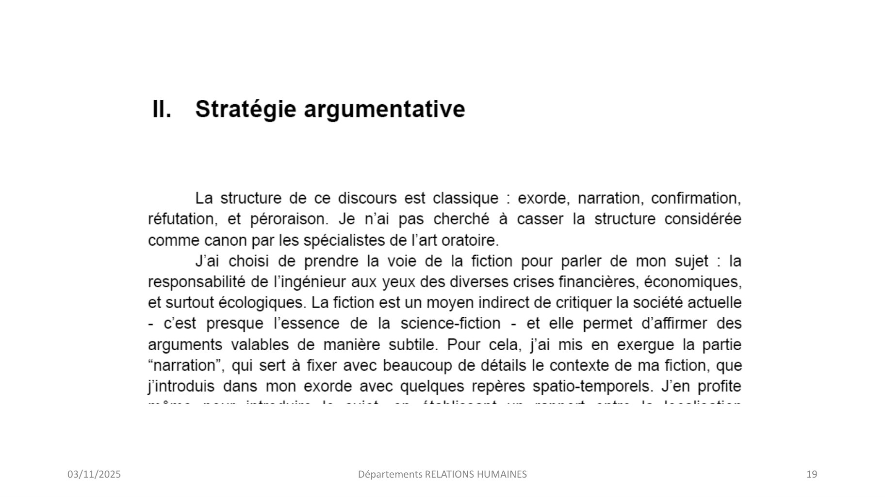
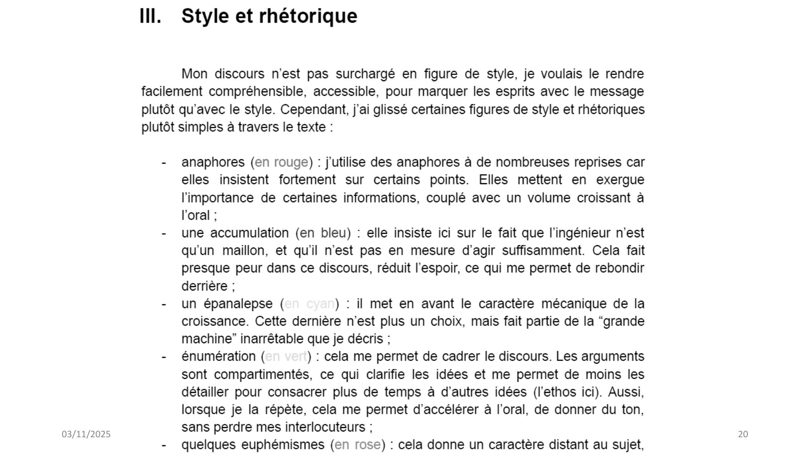
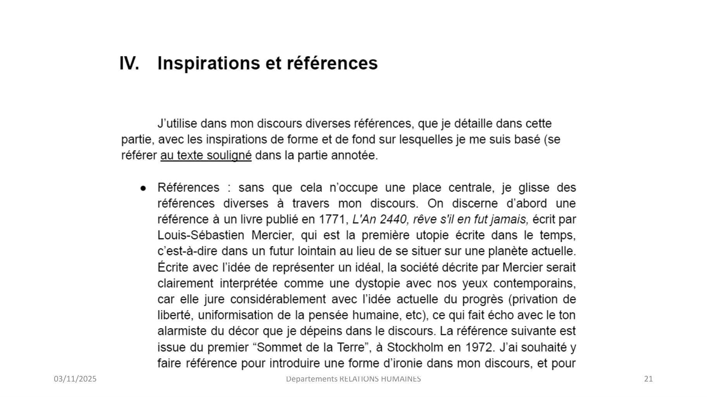
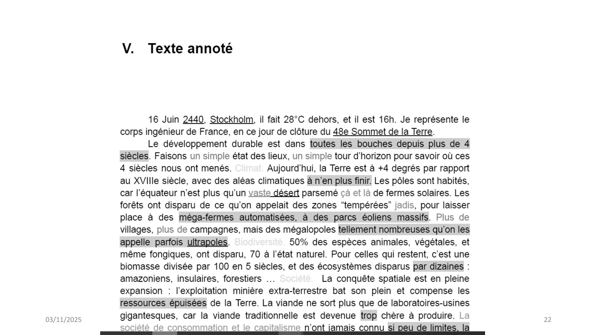
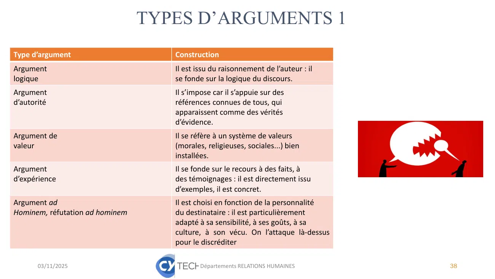
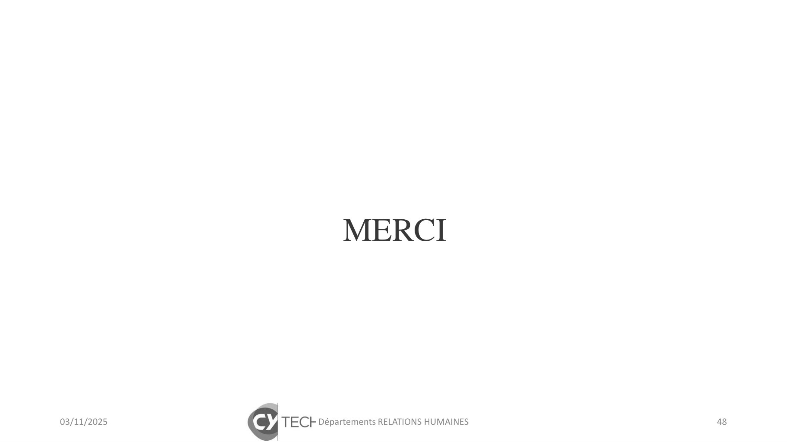

# Cours CEF 3 25-26.pdf

[Ouvrir l’original](https://drive.google.com/open?id=1FJK-KZ8cSz38BXMl7VkIG2MY8LY2bghJ) · Les pages signalées comprennent du texte reconnu automatiquement ou des éléments graphiques. Le fac-similé permet de vérifier chaque lecture.

**Pages avec fac-similé ou lecture OCR** — 19–22, 48.

**Pages présentant un écart entre les deux extractions** — 38.

## Page 1

~~~text
                 MODULE ING1-2025/26

             Communication et Expression: les
                  Fondamentaux III

03/11/2025
                          Séance 1
                       Départements RELATIONS HUMAINES   1
~~~

## Page 2

~~~text
                                Points abordés

1°           Contexte général du module
2°           Le département Relations Humaines
3°           Les règles du jeu dans le groupe
4°           Objectifs et positionnement du module: compétences
             développées
4°           Le découpage des séances
5°           Validation du Module

03/11/2025                      Départements RELATIONS HUMAINES   2
~~~

## Page 3

~~~text
    Un changement de paradigme dans
    l’enseignement: de l’académique au professionnel

                                              Secondaire:
                                             Fondamentaux,
                                            culture générale et
                                                scientifique

                                       Cycle
                                   préparatoire:
                                   Fondamentaux,
                                  culture générale et
                                      scientifique

                                            Cycle ingénieur:
                                            vers la pratique et
                                             le professionnel

                                                                  De la passivité à l’activité
De la théorie à la pratique
    03/11/2025                Départements RELATIONS HUMAINES                                    3
~~~

## Page 4

~~~text
  Pourquoi ce module?
• H. Cross (1885-1959), ingénieur et professeur d’université Engineering
  and Ivory Towers, soutient que les ingénieurs ne sont pas principalement
  des scientifiques :
• « S’ils devaient être classés, ils devraient être considérés davantage
  comme des humanistes que comme des scientifiques. Ceux qui dédient
  leur vie à l’ingénierie se sentent probablement en contact avec presque
  toutes les sphères de l’activité humaine. Ils doivent non seulement
  prendre des décisions importantes sur la conception mécanique
  d’ensemble de structures et de machines, mais ils sont aussi confrontés
  aux problèmes des réactions humaines, de l’environnement et
  constamment impliqués dans des problèmes juridiques, économiques
  et sociologiques. »

  03/11/2025                 Départements RELATIONS HUMAINES            4
~~~

## Page 5

~~~text
L’ingénieur: un expert technique?

                                   Prédominance des formes
                                   verbales et écrites de la
                                   communication en
                                   entreprise: 78% du temps
                                   et 67% des activités des
                                   cadres. Et de plus en
                                   plus…..

Mais aussi un grand communicant et un individu imbriqué
        dans un panel d’interactions humaines !
03/11/2025                Départements RELATIONS HUMAINES      5
~~~

## Page 6

~~~text
             Conséquence: prise de conscience et changement de
             mentalités dans les grandes écoles: formation,
             CTI=recrudescence des Humanités

• Et les Humanités, c’est notre métier! Pôle Humanités et Design et département Relations
  Humaines

    03/11/2025                            Départements RELATIONS HUMAINES                   6
~~~

## Page 7

~~~text
       Un enseignement à 3 dimensions décliné sur les 3
       années du cycle ingénieur et au sein des Mastères
                          Spécialisés

  Communication                                                             Relations
                                     Ouverture et                          humaines et
             Sensibilisation à la      cultures                          professionnelles
              communication
      Expression écrite et orale       Ouverture culturelle               Travail en équipe, Ecoute et
             Projet personnel et       Communication et                 conduite d’entretien, Animation
                professionnel       management interculturels              de réunion, Management
                                                                                  d’équipe, RPS

03/11/2025                            Départements RELATIONS HUMAINES                                     7
~~~

## Page 8

~~~text
                            Une progression sur 3 ans ING1-ING2-ING3
▪ Environ 50h de cours par année CM /TD / hybridation présentiel-distanciel (contexte actuel + cours
   pendant les vacances)

▪ ING1 : Projet personnel et professionnel, CEF3, Interaction et coopération 3, Communication
   interculturelle

▪ ING2 : Ecoute et conduite d’entretien, Animation de réunion

▪ ING3 : Risque Psychosociaux, Management d'équipe

                     Ajout d’une matière transversale sur toutes les années
                                           ETHIQUE

      03/11/2025                         Départements RELATIONS HUMAINES
~~~

## Page 9

~~~text
               Les objectifs du département Relations humaines

Développer vos compétences personnelles pour optimiser vos performances professionnelles.

 A compétences égales, c’est votre sens des relations humaines qui fera la différenc e

                                                                      Votre interlocuteur: ABDELMOULA Nejib. Où
                                                                      me trouver? Sur Teams, en CT206, mail:
                                                                      nejib.abdelmoula@cyu.fr

  03/11/2025                        Départements RELATIONS HUMAINES
~~~

## Page 10

~~~text
                   Les règles du jeu au sein de nos cours

▪ Présence et ponctualité: la règle des -25% + l’apprentissage
▪ Respect de chacun et bienveillance
▪ Écoute et attention envers l’autre
▪ Non-jugement et ouverture d’esprit
▪ Confidentialité
▪ Participation active et respect des deadlines de rendus
▪ Créativité
▪ Liberté d’expression

  03/11/2025                  Départements RELATIONS HUMAINES
~~~

## Page 11

~~~text
Quel module pour quel contenu? Qu’avez-vous appris?
Qu’allez-vous apprendre?

             CEF3: le couronnement

             CEF2 : problématique et Oral

             CEF1 : écriture et imaginaire

03/11/2025                 Départements RELATIONS HUMAINES   11
~~~

## Page 12

~~~text
             Rhétorique et Argumentation: le concours
                     d’éloquence de CYTECH!

03/11/2025                 Départements RELATIONS HUMAINES   12
~~~

## Page 13

~~~text
             https://eloquence.pantheonsorbonne.fr/

03/11/2025             Départements RELATIONS HUMAINES   13
~~~

## Page 14

~~~text
             La parole est un support de combat
La parole est un support de combat
https://www.google.com/search?client=firefox-b-
d&q=la+parole+est+un+support+de+combat#fpstate=ive&vld=cid:41d2
33d1,vid:eHmC5XkA25g,st:0
A voix haute
https://tube-arts-lettres-sciences-
humaines.apps.education.fr/w/dDkmXyBeQ8byZm1MGZb5ei

03/11/2025               Départements RELATIONS HUMAINES      14
~~~

## Page 15

~~~text
Déroulé et validation
             Séances                                     Thèmes

             Séance 1 : TD                               L’argumentation : définition et méthodologie 1
                                                                                                                FOND

             Séance 2 : TD                               L’argumentation : définition et méthodologie 2

             Séance 3 : TD                               Atelier
             Séance 4 : TD                               Atelier                                                 FORME
             Séance 5 : TD – 2/12/2025                   Déclamation, élection du meilleur texte et exercices

             Séance 6 : TD – 9/12/2025                   Déclamation, élection du meilleur texte et exercices
                                                                                                                 Les 2
             Séance 7 : TD – 16/12/2025                  Déclamation, élection du meilleur texte et exercices

03/11/2025                                Départements RELATIONS HUMAINES                                                15
~~~

## Page 16

~~~text
                     Evaluation
  PHASE PRÉPARATOIRE DU CONCOURS D’ÉLOQUENCE!!!

• Choisir un sujet libre
• Travail préparatoire et établissement d’une stratégie
  argumentative (consultation des documents fournis, slides et
  documents recherchés en autonomie)
• Construire LE TEXTE le plus riche en procédés rhétoriques de votre
  vie: plaidoyer, réquisitoire… (5 mn)
• Déclamer devant le groupe, séances du 2/9/16 décembre 2025
• Election du/des meilleurs orateurs du groupe = vers le concours 26
  mars 2026,
   03/11/2025                Départements RELATIONS HUMAINES           16
~~~

## Page 17

~~~text
Evaluation

 03/11/2025   Départements RELATIONS HUMAINES   17
~~~

## Page 18

~~~text
Rendu écrit

  03/11/2025   Départements RELATIONS HUMAINES   18
~~~

## Page 19

~~~text
03/11/2025   Départements RELATIONS HUMAINES   19
~~~

**Lecture OCR à contrôler**

~~~text
03/11/2025

ll. Stratégie argumentative

La structure de ce discours est classique : exorde, narration, confirmation,
réfutation, et péroraison. Je n’ai pas cherché a casser la structure considérée
comme canon par les spécialistes de l’art oratoire.

J'ai choisi de prendre la voie de la fiction pour parler de mon sujet : la
responsabilité de l'ingénieur aux yeux des diverses crises financières, économiques,
et surtout écologiques. La fiction est un moyen indirect de critiquer la société actuelle
- c'est presque l'essence de la science-fiction - et elle permet d'affirmer des
arguments valables de manière subtile. Pour cela, j'ai mis en exergue la partie
“narration”, qui sert à fixer avec beaucoup de détails le contexte de ma fiction, que
Jineroaais vas mon exorde avec quelques repels’ ae ae J'en profite

Eau ete 2 Dita 2 aan is PT CES

Départements RELATIONS HUMAINES

19
~~~

## Page 20

~~~text
03/11/2025   Départements RELATIONS HUMAINES   20
~~~

**Lecture OCR à contrôler**

~~~text
03/11/2025

lll. Style et rhétorique

Mon discours n'est pas surchargé en figure de style, je voulais le rendre
facilement compréhensible, accessible, pour marquer les esprits avec le message
plutôt qu'avec le style. Cependant, j'ai glissé certaines figures de style et rhétoriques
plutôt simples à travers le texte :

- anaphores (en rouge) : j'utilise des anaphores à de nombreuses reprises car
elles insistent fortement sur certains points. Elles mettent en exergue
l'importance de certaines informations, couplé avec un volume croissant à
l'oral ;

- une accumulation (en bleu) : elle insiste ici sur le fait que l'ingénieur n'est
qu'un maillon, et qu'il n’est pas en mesure d'agir suffisamment. Cela fait
presque peur dans ce discours, réduit l'espoir, ce qui me permet de rebondir
derrière ;

- un épanalepse ( ) : il met en avant le caractère mécanique de la
croissance. Cette dernière n'est plus un choix, mais fait partie de la “grande
machine” inarrétable que je décris ;

-  énumération ( ) : cela me permet de cadrer le discours. Les arguments
sont compartimentés, ce qui clarifie les idées et me permet de moins les
détailler pour consacrer plus de temps à d'autres idées (l'ethos ici). Aussi,
lorsque je la répète, cela me permet d'accélérer à l'oral, de donner du ton,
sans perdre mes interlocuteurs ;

- quelques euphémismes (en rose) : cela donne un caractère distant au sujet,

20
~~~

## Page 21

~~~text
03/11/2025   Départements RELATIONS HUMAINES   21
~~~

**Lecture OCR à contrôler**

~~~text
03/11/2025

IV.

Inspirations et références

J'utilise dans mon discours diverses références, que je détaille dans cette

partie, avec les inspirations de forme et de fond sur lesquelles je me suis basé (se
référer au texte souligné dans la partie annotée.

e Références : sans que cela n’occupe une place centrale, je glisse des

références diverses à travers mon discours. On discerne d'abord une
référence à un livre publié en 1771, L'An 2440, rêve s'il en fut jamais, écrit par
Louis-Sébastien Mercier, qui est la première utopie écrite dans le temps,
c'est-à-dire dans un futur lointain au lieu de se situer sur une planète actuelle.
Écrite avec l'idée de représenter un idéal, la société décrite par Mercier serait
clairement interprétée comme une dystopie avec nos yeux contemporains,
car elle jure considérablement avec l’idée actuelle du progrès (privation de
liberté, uniformisation de la pensée humaine, etc), ce qui fait écho avec le ton
alarmiste du décor que je dépeins dans le discours. La référence suivante est
issue du premier “Sommet de la Terre”, à Stockholm en 1972. J'ai souhaité y
faire référence pour introduire une forme d'ironie dans mon discours, et pour

Départements RELAIIONS HUMAINES

21
~~~

## Page 22

~~~text
03/11/2025   Départements RELATIONS HUMAINES   22
~~~

**Lecture OCR à contrôler**

~~~text
03/11/2025

V. Texte annoté

16 Juin 2440, Stockholm, il fait 28°C dehors, et il est 16h. Je représente le
corps ingénieur de France, en ce jour de clôture du 48e Sommet de la Terre.

Le développement durable est dans toutes les bouches depuis plus de 4
siècles. Faisons un simple état des lieux, un simple tour d'horizon pour savoir où ces
4 siècles nous ont menés. Aujourd'hui, la Terre est à +4 degrés par rapport
au XVIIIe siècle, avec des aléas climatiques à n'en plus finir. Les pôles sont habités,
car l'équateur n'est plus qu'un vaste désert parsemé ca et là de fermes solaires. Les
forêts ont disparu de ce qu'on appelait des zones “tempérées” jadis, pour laisser
place à des méga-fermes automatisées, à des parcs éoliens massifs. Plus de
villages, plus de campagnes, mais des mégalopoles tellement nombreuses qu'on les
appelle parfois ultrapoles. 50% des espèces animales, végétales, et
même fongiques, ont disparu, 70 à l'état naturel. Pour celles qui restent, c'est une
biomasse divisée par 100 en 5 siècles, et des écosystèmes disparus par dizaines :
amazoniens, insulaires, forestiers ... La conquête spatiale est en pleine
expansion : l'exploitation minière extra-terrestre bat son plein et compense les
ressources épuisées de la Terre. La viande ne sort plus que de laboratoires-usines
gigantesques, car la wands traditionnelle est devenue trop chere a produire. La

22
~~~

## Page 23

~~~text
Votre classe Teams

• ING1 – GI4 : g5k87nr

• ING1 – GM4 : ikm1jyw

03/11/2025               Départements RELATIONS HUMAINES   23
~~~

## Page 24

~~~text
« L’homme politique voudrait montrer la justesse de ses
idées, le publicitaire souhaite promouvoir un produit,
l’avocat de la défense doit démontrer l’innocence de son
client, l’adolescente veut convaincre ses parents de la
laisser sortir ce soir, l’intellectuel voudrait convaincre le
monde entier de la justesse de ses vues, etc. La rhétorique
est partout ».                                                         Raphaël, l’Ecole d’Athènes

J. F. Dortier

 03/11/2025                          Départements RELATIONS HUMAINES                           24
~~~

## Page 25

~~~text
             LES ORIGINES: le système rhétorique, 3 genres
                             « … donc on parlera sans doute de trois types de
                             discours, du discours délibératif, du discours judiciaire
                             et du discours démonstratif. » (Aristote, Rhétorique)
                             Aristote associe ainsi des situations de parole à des
                             objets de discours, des visées spécifiques et des
                             procédés rhétoriques et argumentatifs appropriés.
                             ❖Le genre délibératif est celui de l’assemblée, où sont
                                discutées les décisions touchant à l’avenir de la cité
                             ❖Le genre judiciaire est celui du tribunal, où il s’agit
                                de se prononcer sur des faits passés, selon les
  Ecclésia ATHENES              catégories du juste et de l’injuste.
                             ❖Le genre épidictique enfin est celui de l’éloge et du
                                blâme, selon que l’objet de discours relève du bien
                                ou du mal
03/11/2025                  Départements RELATIONS HUMAINES                    25
~~~

## Page 26

~~~text
                LOGOS, PATHOS, ETHOS
LES TROIS AXES DE L’ART DE CONVAINCRE PAR ARISTOTE,
       LES TROIS TYPES DE PREUVE RHÉTORIQUE

  03/11/2025        Départements RELATIONS HUMAINES   26
~~~

## Page 27

~~~text
             ARGUMENTER:
C’EST CONVAINCRE, PERSUADER, DÉLIBÉRER
• Pour convaincre, on fait appel à la raison, aux facultés d’analyse et de
  raisonnement, à l’esprit critique du destinataire: le logos

• Pour persuader, on fait appel aux sentiments, aux émotions, à
  l’empathie

• Délibérer, c’est examiner les différents aspects d’une question, en
  débattre, y réfléchir avant de prendre une décision. Exercice « phare »
  de la réunion!!!

03/11/2025                        Départements RELATIONS HUMAINES       27
~~~

## Page 28

~~~text
                UNE NÉCESSITÉ TANT PERSONNELLE…
                     QUE PROFESSIONNELLE…

Exercice omniprésent dans une vie

• En tant qu’étudiant
• En tant que citoyen
• En tant que demandeur de stage ou d’emploi
• En tant que professionnel et qu’ingénieur

   03/11/2025                Départements RELATIONS HUMAINES   28
~~~

## Page 29

~~~text
               CERTAINS SONT MEILLEURS QUE D’AUTRES
« Comment l’église a inventé le marketing »               Evangiles en grec et pas en araméen= sous influence de la
                                                          rhétorique antique

Promesse (paradis pour demain)                            Les canons de la tragédie grecque: récit efficace: un héros
                                                          solitaire, fils d’un dieu et d’une mortelle, porte une grande
                                                          mission : sauver le monde. Il réalise des prodiges (les miracles),
                                                          affronte les forces du mal (Satan, les marchands du Temple, les
                                                          ignorants). Au terme de ses pérégrinations, ponctuées de
                                                          nombreux épisodes, il sera mis à mort selon un scénario dont
                                                          les ressorts dramatiques – suspens, trahison, torture.
Slogans (« les premiers seront les derniers »)            Métaphore: « sauveur », « messie », « fils de Dieu » qui
                                                          renforce la nature divine

Logo (croix)                                              Storytelling: remplacement d’un discours abstrait par une
                                                          bonne histoire

Charte graphique (architecture romane puis gothique)      =Pas de manipulation cynique mais inspiration quasi
                                                          inconsciente

Mythes et légendes (récits de miracle)

=Captation des esprits, séduction et enrôlement

                                                               •   B. Ballardini, Jésus lave plus blanc! Et B. Delorme, Christ grec=rhétorique du christianisme
       03/11/2025                                      Départements RELATIONS HUMAINES                                                                  29
~~~

## Page 30

~~~text
   SE FAMILIARISER AVEC LA NOTION D’ARGUMENTATION

1) Toute argumentation est une tentative visant à influencer son
interlocuteur

2) Toute argumentation est dialogue. Mode de confrontation d’un
discours à un contre-discours. Au centre de l’argumentation: le
désaccord.

3) Toute argumentation est justification et explication

4) Toute argumentation est rhétorique

      03/11/2025                               Départements RELATIONS HUMAINES   30
~~~

## Page 31

~~~text
PRINCIPE DE BASE: SITUATION DE COMMUNICATION

 • Facteurs sociologiques
 (situation professionnelle)

 • Facteurs psychologiques et affectifs
 (mieux toucher le récepteur)

 • Facteurs intellectuels
 (code verbal, idéologies, motivations)

    03/11/2025                       Départements RELATIONS HUMAINES   31
~~~

## Page 32

~~~text
    UNE ADAPTATION AU PUBLIC: LA CLÉ DU SUCCÈS

Dans l’Antiquité, les Grecs avaient déjà compris que le discours (le logos)
dépendait à la fois de l’image que l’orateur voulait donner de lui-même
(l’éthos) et des passions de l’auditoire (le pathos).
Et Aristote de dépeindre les arguments qui toucheront:
LES JEUNES (« ils sont enclins à la colère et à l’emportement »)
 LES VIEUX (« ils ont l’esprit étroit, ayant été rabaissés par la pratique de la
vie »)
 LES RICHES (« on devient arrogant et hautain »)
 LES NOUVEAUX RICHES (« un penchant tantôt à l’arrogance, tantôt à
l’intempérance, qui les porte soit aux voies de fait, soit au libertinage ») !

03/11/2025                    Départements RELATIONS HUMAINES                 32
~~~

## Page 33

~~~text
TRAQUER LES IDÉES:
OPTIMISATION DE LA RECHERCHE D’ARGUMENTS

• Brainstorming
• « Méthode essentielle» et loi des «5 W»
• « Méthode des domaines » ou des « points de vue »
• Méthode du « comment le sait-on? »

    03/11/2025                 Départements RELATIONS HUMAINES   33
~~~

## Page 34

~~~text
ORGANISER UNE RÉFLEXION COHÉRENTE: CLASSER
 LES IDÉES, CONCEVOIR UNE STRUCTURE: la trame
        classique de la séquence argumentative

  03/11/2025      Départements RELATIONS HUMAINES   34
~~~

## Page 35

~~~text
   ORGANISER UNE RÉFLEXION COHÉRENTE:
CLASSER LES IDÉES, CONCEVOIR UNE STRUCTURE:
        la trame de la séquence argumentative

Plan linéaire     Plan binaire   Plan analytique            Plan professionnel
                                                            /aide à la décision
Enumératif,       Opposition     Journalistique             Plan SPRI
chronologique

     03/11/2025                   Départements RELATIONS HUMAINES                 35
~~~

## Page 36

~~~text
        CONCEVOIR UNE UNITÉ DE RÉFLEXION:
LE PARAGRAPHE ET SAVOIR DÉVELOPPER DES ARGUMENTS:
          bien ficeler votre séquence argumentative
Les principaux axes du raisonnement logique
dans la séquence argumentative
Déduction
Induction
Recherche des causes
But
Opposition et contradiction
Hypothèse
Elimination
Alternative
Addition et succession
Cause Conséquence

      03/11/2025                        Départements RELATIONS HUMAINES   36
~~~

## Page 37

~~~text
CRITÈRES DE FORMULATION ET NOMBRE D’ARGUMENTS

• Un argument porteur, à développer, se formule en une phrase concise et
  percutante. Il se détache ainsi nettement de son développement et gagne
  ainsi en force et en clarté.

• Un paragraphe par argument

• Un nombre limité d’arguments

                                                                 Argumenter pour Convaincre _ Nombre limité d_#39;arguments.mp4

   03/11/2025                  Départements RELATIONS HUMAINES                                                             37
~~~

## Page 38

~~~text
                                 TYPES D’ARGUMENTS 1
Type d’argument                     Construction
Argument                            Il est issu du raisonnement de l’auteur : il
logique                             se fonde sur la logique du discours.
Argument                            Il s’impose car il s’appuie sur des
d’autorité                          références connues de tous, qui
                                    apparaissent comme des vérités
                                    d’évidence.
Argument de                         Il se réfère à un système de valeurs
valeur                              (morales, religieuses, sociales...) bien
                                    installées.
Argument                            Il se fonde sur le recours à des faits, à
d’expérience                        des témoignages : il est directement issu
                                    d’exemples, il est concret.
Argument ad                         Il est choisi en fonction de la personnalité
hominem
Hominem, réfutation ad hominem      du destinataire : il est particulièrement
                                    adapté à sa sensibilité, à ses goûts, à sa
                                    culture, ààsonsonvécu.
                                                       vécu. On l’attaque là-dessus
                                    pour le discréditer

       03/11/2025                           Départements RELATIONS HUMAINES           38
~~~

## Page 39

~~~text
TYPES
Type d’argument
                  D’ARGUMENTS
Argument par la menace
                                    2
                           = Les conséquences négatives
                                                         Construction

Argument de direction                                    =prévenir d’une pente savonneuse

L’argument par comparaison (ou par analogie « au         établir un parallèle entre ce dont on est en train de
sens large »)                                            parler (le thème) et un autre objet ou une autre
                                                         situation

Argument par le précédent                                Référence au passé
Argument a fortiori                                      Cet argument pose que si l’on admet (ou refuse) une
                                                         proposition A, alors on accepte (ou refuse), à plus
                                                         forte raison, une proposition B.

Argument par la cause / par l’effet                      On parle d’argument par la cause lorsqu’un état de fait
                                                         E est en discussion, et qu’on utilise l’affirmation de
                                                         l’existence de sa cause C pour renforcer l’affirmation
                                                         de la réalité de E : « E doit être le cas, puisque C est le
                                                         cas, et que C provoque/fait advenir/cause E ».

03/11/2025                               Départements RELATIONS HUMAINES                                          39
~~~

## Page 40

~~~text
                      GESTION DES EXEMPLES

Types d’exemples        Fonction
Exemple illustratif     Cas particulier qui vérifie l’idée
(le plus courant)       générale de l’argument
Exemple                 On se sert du cas particulier
démonstratif ou         pour en induire une idée
argumentatif            générale. À la base du
                        raisonnement, ce type
                        d’exemple peut être considéré
                        comme un argument à lui seul.

       03/11/2025                  Départements RELATIONS HUMAINES   40
~~~

## Page 41

~~~text
             QUELS REGISTRES DE L’ARGUMENTATION?
   Registre                                              Effet voulu
   Polémique (du grec polemos, « guerre »)               Controverser vivement ou agressivement la
                                                         thèse adverse
   Pathétique (du grec pathein : « souffrir »)           Émouvoir fortement, provoquer la pitié, attendrir,
                                                         impressionner - Procédé de
                                                         persuasion.
   Lyrique                                               Susciter une émotion poétique, communiquer des
                                                         sentiments
                                                         personnels.
   Comique                                               Amuser, susciter ainsi l’intérêt d’un destinataire
                                                         mieux disposé à comprendre
                                                         une thèse
   Laudatif                                              Faire l’éloge de quelqu’un ou d’une
                                                         thèse.
   Didactique                                            Délivrer un enseignement, donner une leçon, qui
                                                         restera dans les mémoires

03/11/2025                                Départements RELATIONS HUMAINES                                     41
~~~

## Page 42

~~~text
   QUELQUES PROCÉDÉS DE STYLE À LA PORTÉE DE TOUS,
                     EN VRAC

• L’appel au récepteur, la question de l’émetteur, la bonne
  foi, le crédo sincère, le recours aux normes, la définition,
  l’appel aux valeurs, l’autorité, la connotation, la formule,
  le rythme binaire ou ternaire, la gradation de rythme, la
  gradation de sens, le parallélisme, l’opposition, l’ironie,
  l’analogie, la pétition de principe, l’itinéraire, le paradoxe,
  l’inversion, la formule détournée, répétition, jeu de mots,
  double sens, jeu de sonorités

    03/11/2025                         Départements RELATIONS HUMAINES   42
~~~

## Page 43

~~~text
             RETOUR AUX SOURCES: les 5 parties du système
                           rhétorique
Les cinq étapes de la rhétorique        Objectifs
(désignées par des termes latins)

Inventio / l’invention                  la recherche des idées, des arguments
Dispositio / l’organisation             l’organisation des éléments dans l’ordre le plus efficace, comprenant quatre
                                        parties :
                                        - l’exorde : destiné à capter l’attention
                                        - la narration : qui agit pour et contre
                                        - la récapitulation : qui reprend les éléments principaux
                                        - la péroraison : qui fait appel à l’émotion et prend un
                                        caractère pathétique

Elocutio / Le style                     le choix des formes les plus appropriées parmi les
                                        procédés, le travail du style
Memoria / La mémorisation               les moyens pour favoriser la mémorisation du
                                        discours
Prononciatio / L’actio / L’action       l’usage le plus efficace de la voix, des gestes, du
                                        corps.

     03/11/2025                     Départements RELATIONS HUMAINES                                                    43
~~~

## Page 44

~~~text
             L’ELOCUTIO ET LES FIGURES DE STYLE

                   Répertoire et énumération: cf tableau sur l’équipe teams.

03/11/2025                          Départements RELATIONS HUMAINES            44
~~~

## Page 45

~~~text
                ARGUMENTATION VS MANIPULATION

• Tout est-il « argumentable »?
• Tous les arguments sont-ils bons pour défendre une
  opinion?
• Y a-t-il des limites à l’action que l’on peut exercer sur un
  auditoire?
• Ou l’importance d’une argumentation éthique. L’exemple
  des Sophistes et bd…

   03/11/2025                    Départements RELATIONS HUMAINES   45
~~~

## Page 46

~~~text
EXEMPLE, PROCÉDÉS ET MÉTHODOLOGIE
             Pourquoi se mentir? Croyez-moi, vous ne gagnerez rien à
             répéter inlassablement des idées toutes faites qu'on vous
             inocule malgré vous au fil d'émissions formatées et
             conformistes. Réveillez-vous! jeunes de France, jeunes
             d'Europe, jeunes du monde! L'avenir est à ceux qui
             changeront le présent. Quittez le troupeau des faux rebelles,
             prenez ces chemins de traverses que la broussaille encombre,
             ces chemins buissonniers de l'opinion personnelle, libres et
             intactes que seuls vous, jeunes esprits, pourrez peut-être
             défricher encore... Le bruit des médias prolifère pour bientôt
             prendre toute la place dans vos vies infertiles. Le beau
             mensonge tue votre imaginaire et le remplace.

03/11/2025                         Départements RELATIONS HUMAINES            46
~~~

## Page 47

~~~text
                     POUR APPROFONDIR LE SUJET

         « A voix haute », 2016 = à voir
         obligatoirement pour
          le 18/11
         Bibliographie:
         - Clément Viktorovitch, Le
            Pouvoir rhétorique. Apprendre à
            convaincre et à décrypter les
            discours, Seuil, 2021
         - Bertrand Périer, La parole est un
            sport de combat, JC Lattès, 2017
         - Etc….

03/11/2025                            Départements RELATIONS HUMAINES   47
~~~

## Page 48

~~~text
                  MERCI

03/11/2025   Départements RELATIONS HUMAINES   48
~~~

**Lecture OCR à contrôler**

~~~text
03/11/2025

MERCI

TECH Départements RELATIONS HUMAINES

48
~~~
