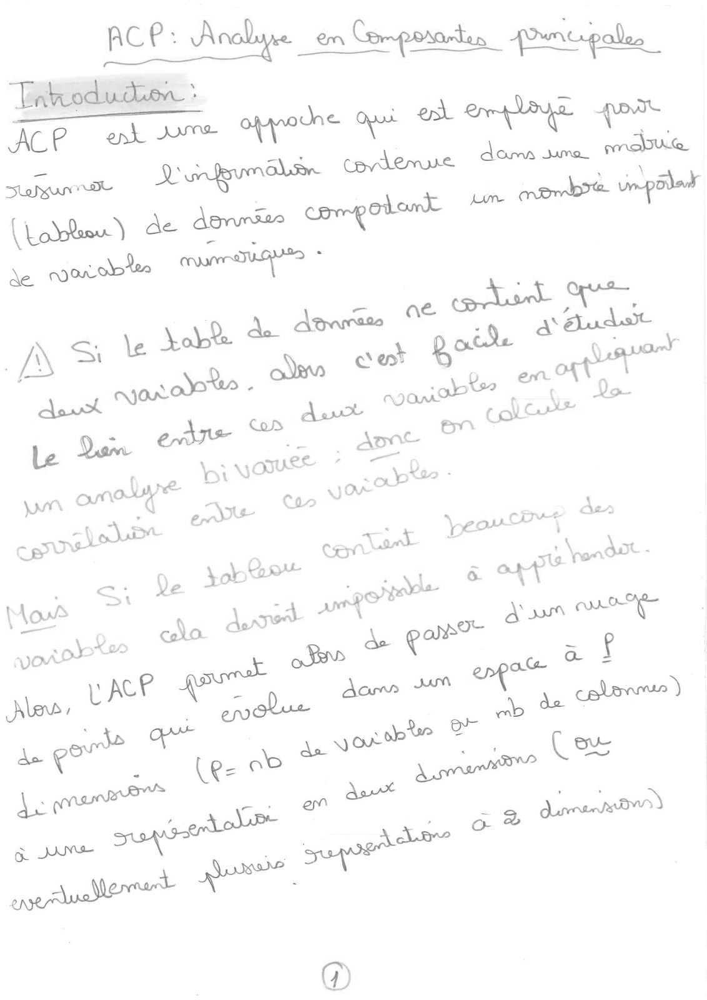
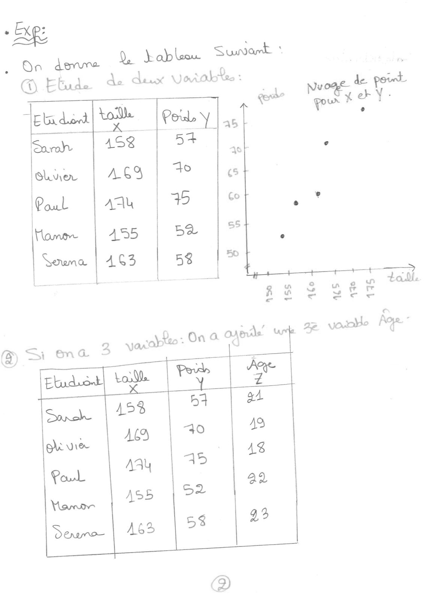
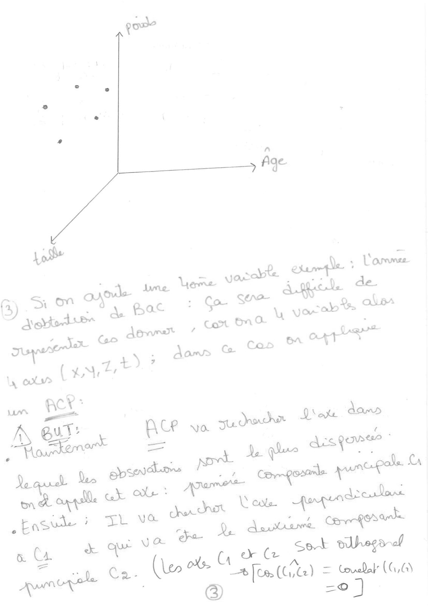
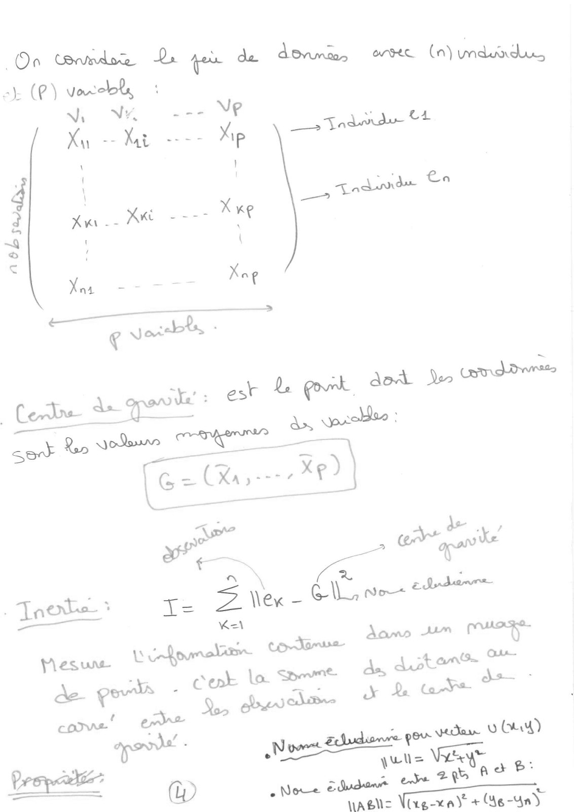
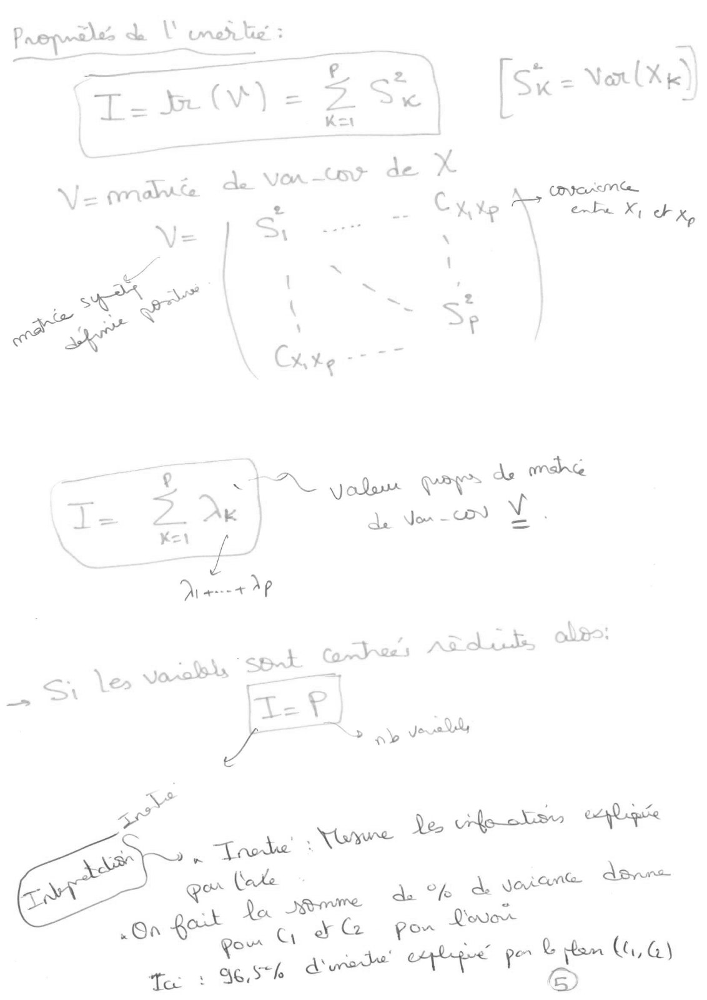
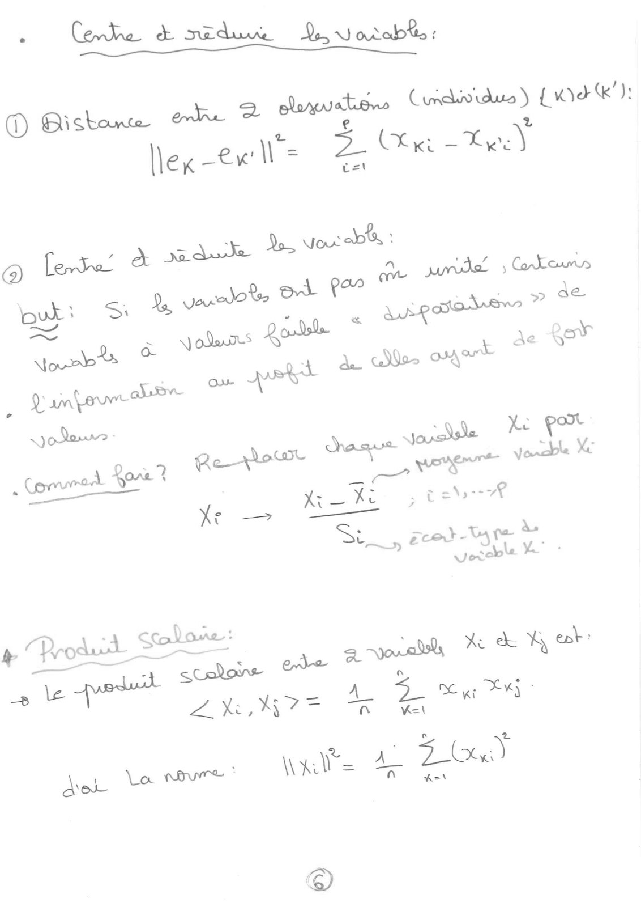
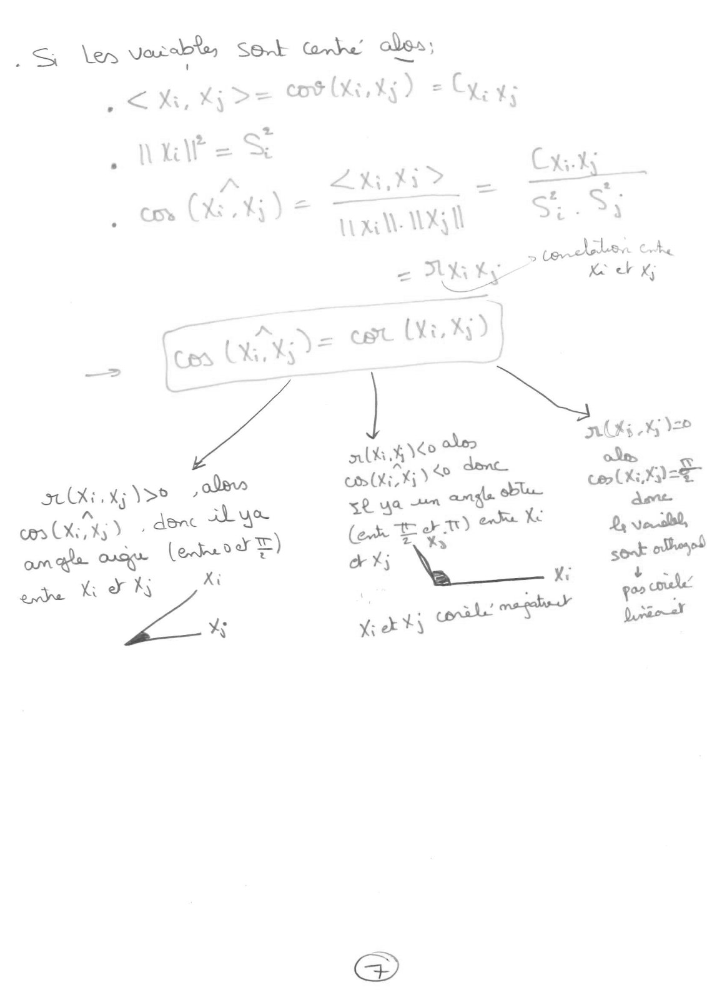
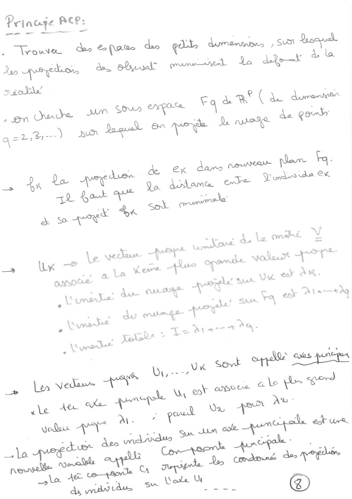
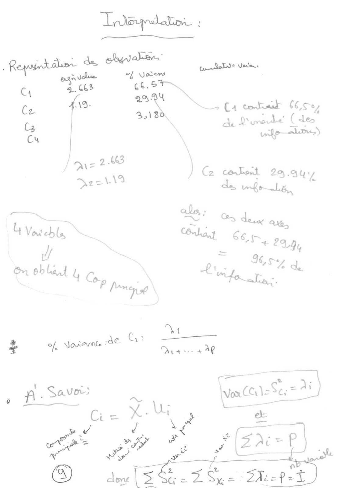
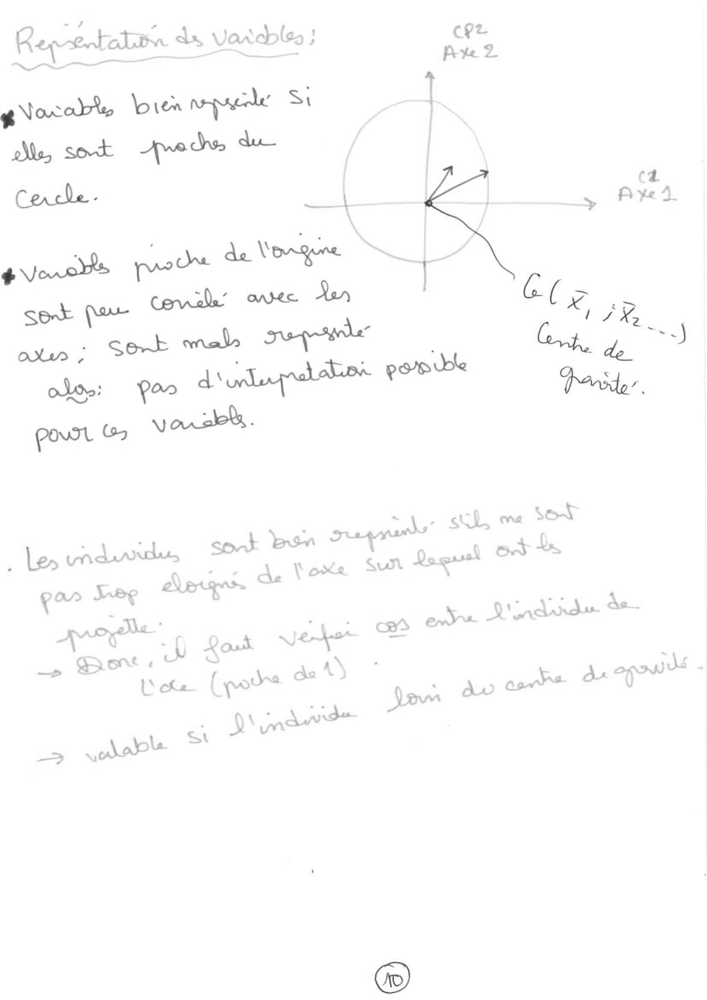

# ACP--COURS.pdf

[Ouvrir l’original](https://drive.google.com/open?id=1BVryTO7XMz9S9YJ-R9GFhOZmKznXU0TV) · Les pages signalées comprennent du texte reconnu automatiquement ou des éléments graphiques. Le fac-similé permet de vérifier chaque lecture.

**Pages avec fac-similé ou lecture OCR** — 1–11.

## Page 1

**ACP — Analyse en composantes principales. Introduction.** L’ACP est une approche employée pour résumer l’information contenue dans une matrice (tableau) de données comportant un nombre important de variables numériques.

Si le tableau de données ne contient que deux variables, il est facile d’étudier le lien entre elles par une analyse bivariée : on calcule leur corrélation. Si le tableau contient beaucoup de variables, cela devient impossible à appréhender.

L’ACP permet de passer d’un nuage de points dans un espace à $p$ dimensions ($p$ est le nombre de variables, ou de colonnes) à une représentation en deux dimensions, ou éventuellement à plusieurs représentations à deux dimensions.

## Page 2

**Lecture OCR à contrôler**

~~~text
Aig

. On

deve

Ela dod
nds
élver

Poul

_

toe
158
AGS
AAù
AD5

_K -

Lei y.
54

to
ce.

a ‘ab leon Sunamt ci
@ Etude de dur Vañalre:
~~~

## Page 3

**Lecture OCR à contrôler**

~~~text
1 ~ Set vlbegandd
ya Se
x

L 6 > | Couwlal’ (GQ)
ta)
(leo —# Cas ( [7 =

© tt. Ca
Be pole |
Arwen
~~~

## Page 4

**Lecture OCR à contrôler**

~~~text
Or CWomdoe Le qu de donna, eee (n) ded

=): (PF) vacebls

Ni NY asa NG
Xu -- Xi ---- Xp
‘ iJ

‘ ; à La
4 og Tad

3 _

=
~Q

a

€

__3 Tndmidu ot

tue

Ee oumolam Contin
bis | de, dutente
de pols - — +s oe
1. bd: < pou Vas vu G4)
Dropés b NT uns WY og.
Prop @) eNoce edad eye 2H SP!

waglc Virgen + Ae -4n)
~~~

## Page 5

**Propriétés de l’inertie.** $I=\operatorname{tr}(V)=\sum_{k=1}^{p}S_k^2$, avec $S_k^2=\operatorname{Var}(X_k)$. $V$ est la matrice de variance-covariance de $X$. La diagonale contient $S_1^2,\ldots,S_p^2$ ; les deux coins hors diagonale représentent la covariance de $X_1$ et $X_p$. La page la qualifie de « matrice symétrique définie positive ».

$I=\sum_{k=1}^{p}\lambda_k=\lambda_1+\cdots+\lambda_p$, où les $\lambda_k$ sont les valeurs propres de $V$. Si les variables sont centrées réduites, $I=p$ (nombre de variables).

**Interprétation.** L’inertie mesure l’information expliquée par l’axe. On somme les pourcentages de variance pour $C_1$ et $C_2$. Ici, 96,5 % de l’inertie est expliquée par le plan $(C_1,C_2)$.

## Page 6

**Lecture OCR à contrôler**

~~~text
+ Corte à sde Hesarebles
D Bisbone de à Bandes Crdividue) (Wek):
€ LA
llex-ew ll = "he i

; à — à Yo, Vor ab :

@ leve a me à Corto
3 AMIS
Duks Si 2, vastes Ot par - teeta # de
bts & Var? i : à ae ReT
Laure abe on pat à cathe SAT
| Paneer
Sedans: | Xe port
Jar ssle .
Comumed ove? Reo mene ene toate *
Si, Zeot- -
coy wt we
~~~

## Page 7

**Lecture OCR à contrôler**

~~~text
. S \es NRA Sek € Le ades:
gt CRTC

, < Ki, x
_hüb= Ss
Pa ZA Cats
en (XE _ Sei? = Sr
AAA is si
= AA > ekber Che
ok Le et Ki
= uy) cat Wt %) |
alk ge oles KG % VP
st. tj Y>° ola om (Xi, yy do done oles |
em (Xx) ¢ , dënt SL ue se ua 2" angl dl PTE
om as SK (etardE) ee ET) ee Ke a
nde ET ki ok Xj Ny Biel
~~~

## Page 8

**Lecture OCR à contrôler**

~~~text
Prinuge Ace:

2 route
Do doi ke bn eue de dpt À %
colle’ Ars
Ca à R (A duraver
Sor Ca
an Dee _ L de gon

2,2) AUX dope) CA more De more
NAN pr Fa.

grd du CK

a=

Aus OS Se dans
+ $8 his Qa dame ode À
mali ¥

ee A CC: a. Le
— Le ye deu Si opens est eye

es 0
se & Lo ere awe \| a
ONSOUL À een dee: wk RK.
Le du: ULI IVP _ :
i | Alass*AQ
t SUA 1

. LS une TU Ça et
\ 7 a \
. é du mue Les er
\ K
ai * mo} | . x
= ie + 80 :

. XLR *
ux So ep es penegen

Wiens
Ler Veda ns . we

_» Wx

ANS Oe a le
~~~

## Page 9

**Lecture OCR à contrôler**

~~~text
Los :

JR es
Q Le a
& Reprint L de. D ote cr delve Voters
ces 66.5
ts À 29 EN ¢
ts, AD wee NS Ça conkuead 6,5 32
bs PA, à Dots! (de
Ch | ileal)
} \
/ _ 2.663
/ ME ~~ ) C2 coord 20), ‘au,
D>z=* da wrfr——Lé
= 218 due aa
YW Vatebly Ne Cat Ge
y 7 +239
wv L 7 I gry a
GS eblat 4 Cory 1 - .
Frome" ,
7
of Norme 4€ Gq: ——
+ l. Mas 4 AP
A. Savor: . once Ses :

a: = Là 7
LE pe # MES

@) SS. 5G e Sheps A
~~~

## Page 10

**Lecture OCR à contrôler**

~~~text
Req-sotatinin de Verde: =
oS Ae

avocate bien pad Si

Cercle
| =
pores pods de Ong
~~~

## Page 11

Page sans texte, avec quelques marques ponctuelles.
