# Analyse-Univariée-Mes Resumés.pdf

[Ouvrir l’original](https://drive.google.com/open?id=1r3ANYobG42RNhfXUlicxJRYJkW-Nz23t) · Les pages signalées comprennent du texte reconnu automatiquement ou des éléments graphiques. Le fac-similé permet de vérifier chaque lecture.

**Pages avec fac-similé ou lecture OCR** — 1–16.

## Page 1

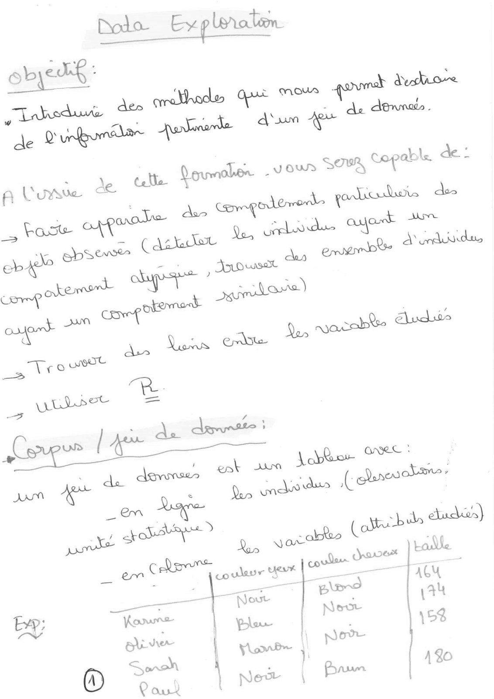

**Lecture OCR à contrôler**

~~~text
Dolo Exploratin

“ahold den cratthades G4

é En oui mous oun do
de D'une jw veer din Age de dr
te Dournoben vou» Soun Copable ee:

w

A Lune de

_, Fase &
eb EbS eee (ak node overt
kernal claps , Aout ds Eraermiotse d'éiidu
Trovit da Lens ere Qu, rvacnbe ads
_ ytbLiet TR.
Pr mes
Ju Je de denses est va Jobo —
_'em ape Qo undue (clsevolar
poe ero 2
CS Los Yor (obribi da)
a | couleur eu coude (hove Ladle
bee fees ia
; Pa Neo es
we | | Ne 158
a) Sor | Yor \ Nowe
Cound New Pau 130
~~~

## Page 2

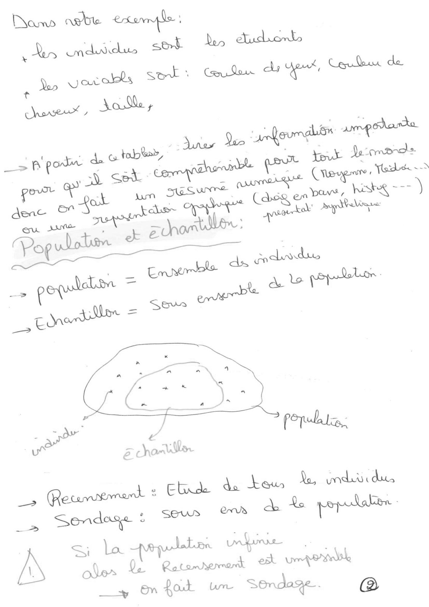

**Dans notre exemple**, les individus sont les étudiants. Les variables sont la couleur des yeux, la couleur des cheveux, la taille… À partir du tableau, on tire les informations importantes pour les rendre compréhensibles à tout le monde. On fait un résumé numérique (moyenne, médiane…) ou une représentation graphique (diagramme en barres, histogramme…).

**Population et échantillon.** La population est l’ensemble des individus ; l’échantillon en est un sous-ensemble. Sur le schéma, chaque point représente un individu, le contour intérieur l’échantillon et le contour extérieur la population.

**Recensement** : étude de tous les individus. **Sondage** : sous-ensemble de la population. Si la population est infinie, le recensement est impossible : on fait un sondage.

## Page 3

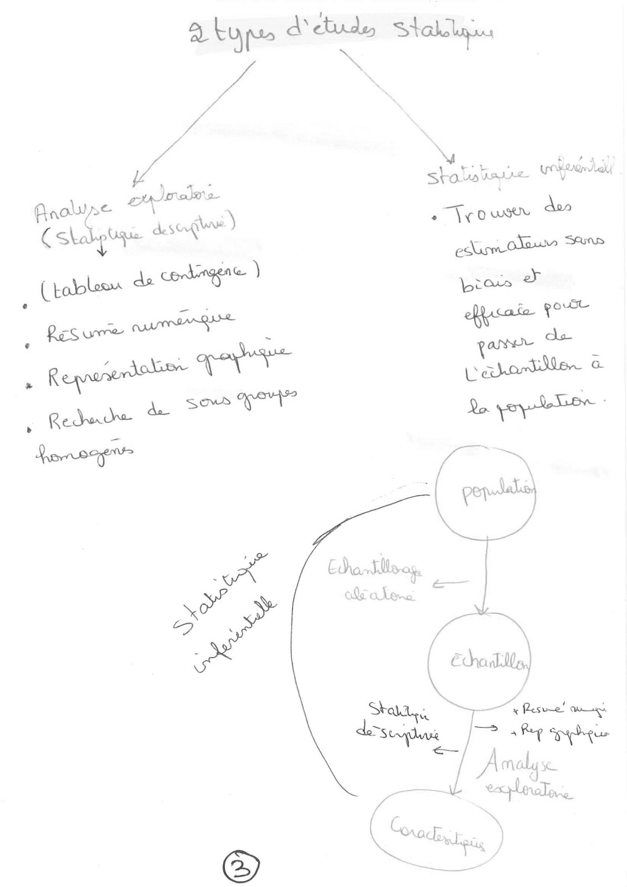

**Lecture OCR à contrôler**

~~~text
\

M

creme als | Awa
finale di) a. heer
Cskabpope at ein pias Same
phoblos de coinage à pres ©
L cale. qe
= Qu QE bys As
~~~

## Page 4

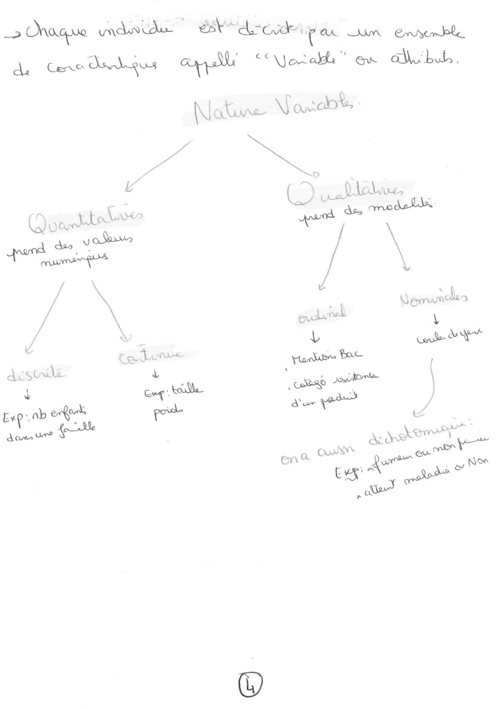

**Lecture OCR à contrôler**

~~~text
Ons 2 Ce
> Onague ee ere
ae Cenc Ong DAS ipa _
ape etat able * gin oor
Nate Sowa’,

Y

Yoabtabve _

Quart (D usbidlan,
de, me

url aus ds. valu
/ \ / \
oul \Wemume Ney
v V
code BYES

12
-_ we és. Sian
PACS
Ep Lab ed cn: ite ves
Pe | i ple ‘ef _ :
an, wr? ,
Sur wae
A
em Owdy ae Re
É ie apron OE
os . S ev Nor
ue) ore’
~~~

## Page 5

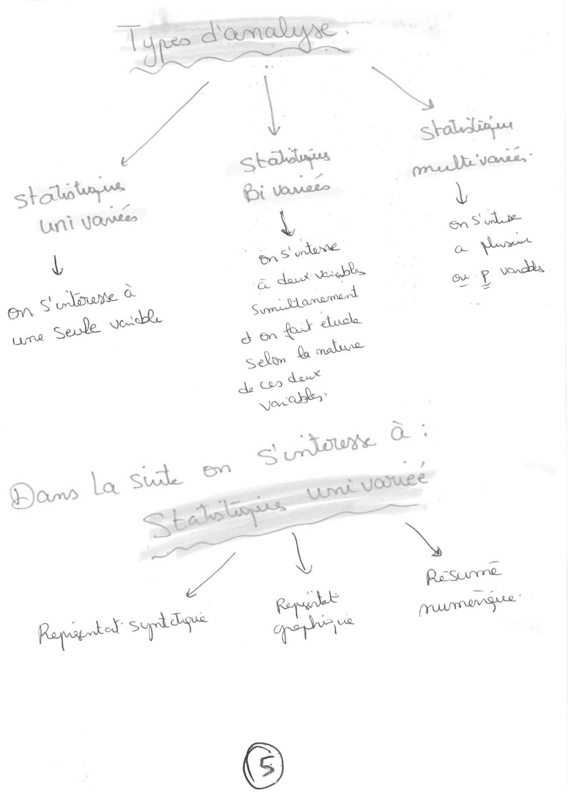

**Types d’analyse**

- Statistiques univariées : on s’intéresse à une seule variable.
- Statistiques bivariées : on s’intéresse à deux variables simultanément et on fait l’étude selon leur nature.
- Statistiques multivariées : on s’intéresse à plusieurs variables ($p$ variables).

Dans la suite, on s’intéresse à la statistique univariée : représentation synthétique, représentation graphique et résumé numérique.

## Page 6

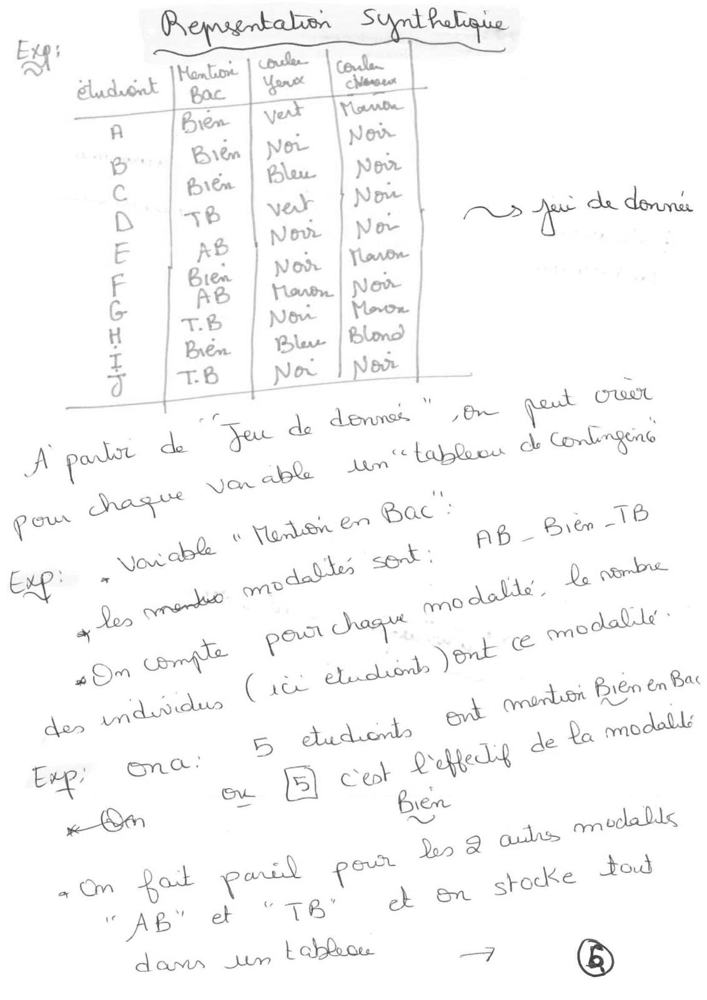

**Représentation synthétique — exemple de jeu de données**

| Étudiant | Mention au bac | Couleur des yeux | Couleur des cheveux |
|---|---|---|---|
| A | Bien | Vert | Marron |
| B | Bien | Noir | Noir |
| C | Bien | Bleu | Noir |
| D | TB | Vert | Noir |
| E | AB | Noir | Noir |
| F | Bien | Noir | Marron |
| G | AB | Marron | Noir |
| H | TB | Noir | Marron |
| I | Bien | Bleu | Blond |
| J | TB | Noir | Noir |

À partir du jeu de données, on peut créer pour chaque variable un « tableau de contingence ». Exemple de variable : la mention au bac. Les modalités sont AB, Bien et TB. Pour chaque modalité, on compte le nombre d’individus (ici les étudiants) ayant cette modalité. Cinq étudiants ont eu la mention Bien au bac : 5 est l’effectif de la modalité Bien. On fait de même pour AB et TB et on stocke tout dans un tableau.

## Page 7

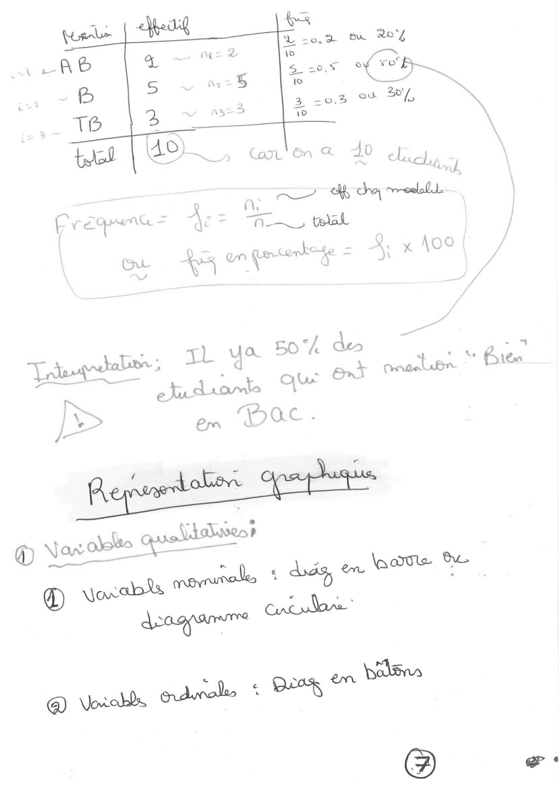

| Mention | Effectif | Fréquence |
|---|---:|---:|
| AB | $n_1=2$ | $2/10=0,2$, soit 20 % |
| B | $n_2=5$ | $5/10=0,5$, soit 50 % |
| TB | $n_3=3$ | $3/10=0,3$, soit 30 % |
| Total | 10 | |

Il y a 10 étudiants. Fréquence : $f_i=n_i/n$, où $n_i$ est l’effectif de chaque modalité et $n$ le total. Fréquence en pourcentage : $f_i\times100$. Interprétation : 50 % des étudiants ont la mention Bien au bac.

**Représentations graphiques — variables qualitatives.** Variables nominales : diagramme en barres ou diagramme circulaire. Variables ordinales : diagramme en bâtons.

## Page 8

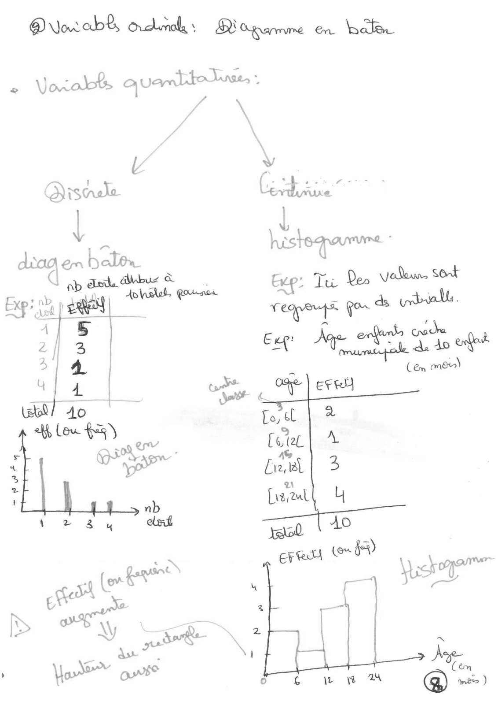

**Lecture OCR à contrôler**

~~~text
F6
7 \

\
\
~~~

## Page 9

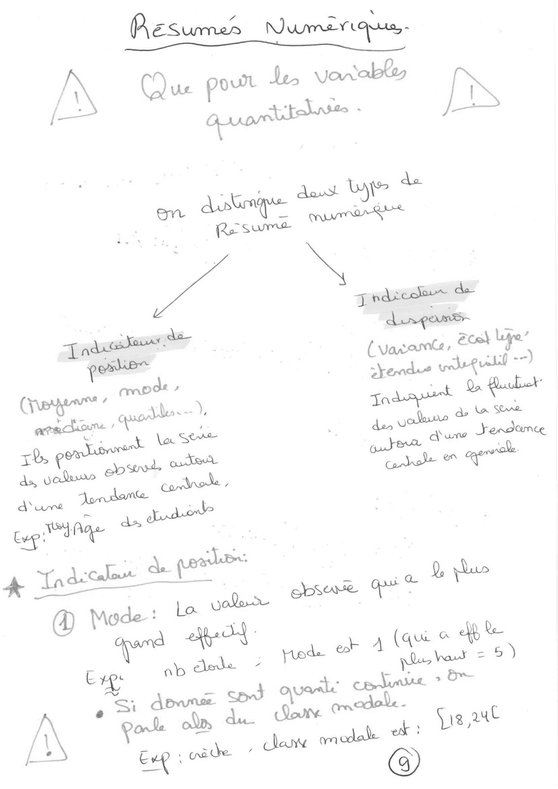

**Lecture OCR à contrôler**

~~~text
Pesumer
Resumes Numerique

[\ Qu por tr Varia
nl
Sr : Re sure oran et
Lo jade te
+ ae mr
3 =
(varomt, Ecsi
( ps ; a | syendes een
acracdiane PA asprt fait
rh por La SU de, vole © D Da
ds, veu pan ee an oe ae
d'ure (os cnhode , dell un
expe ada
| ebpsuse que & Le pe
~~~

## Page 10

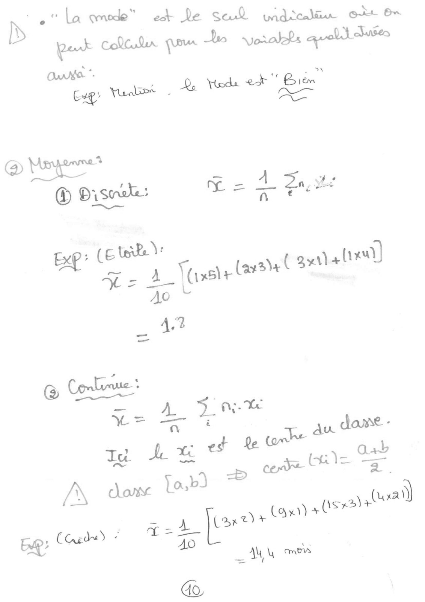

**Lecture OCR à contrôler**

~~~text
D" Le Fes md'oiu Crt Om
pep atin gon \osalehs qual cases

Exp: (ER)
- SC - À Traie (avo ( quatre)
AO
4.2
(© Cenlunue :
Y= AL ni
ia’ e
aw dame
+ Le nh
AE tte
VAN do La,b) 2
. ( (9x1) 4 ÛS #3)+
5 € = À_ (3x2) x
ER: Cede) 7
Au comes
~~~

## Page 11

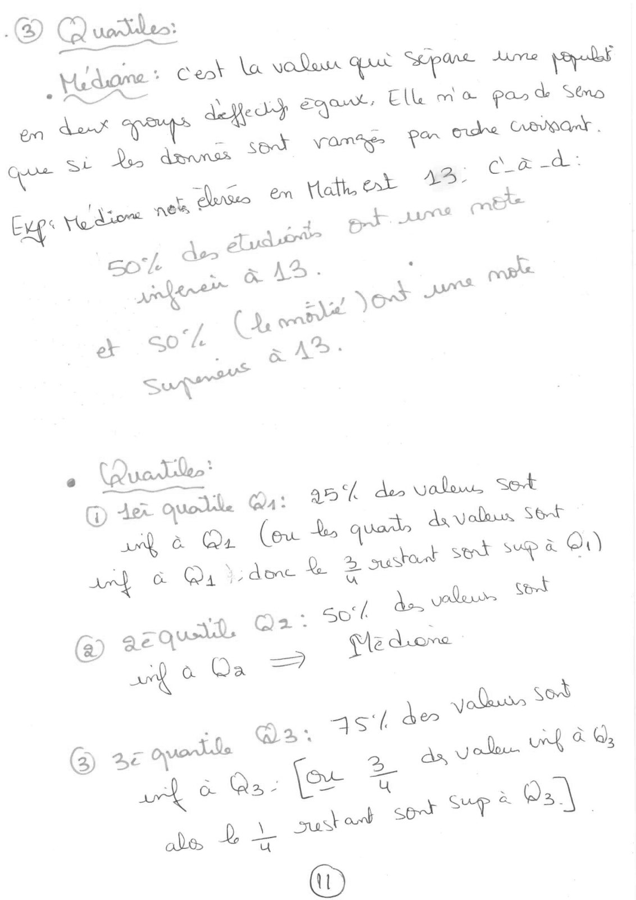

**Lecture OCR à contrôler**

~~~text
—_—
_Vedane * Cenk la valeur qui Sparte are 18 LE
Eqns, Clk mo pa de Stan

\ me)

e Quad
@ Act qvorte Qa 25% de volo Sot
a à Ot ou 2s quod da riatns. Sto
ar à Qu de & % astral sot ~ Ou)
~~~

## Page 12

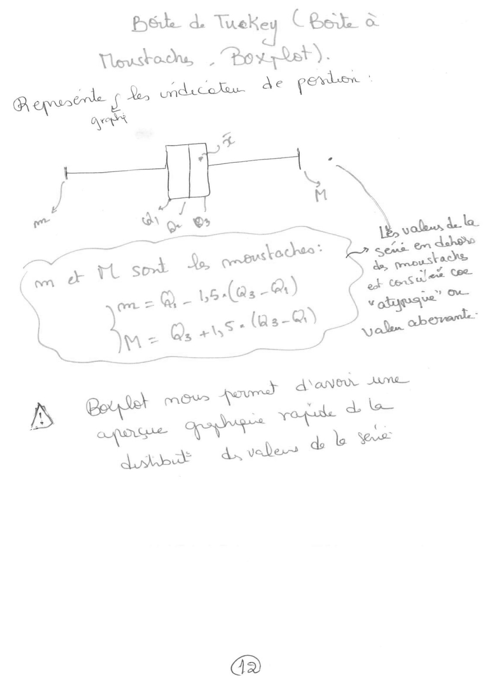

**Lecture OCR à contrôler**

~~~text
Pete
_ A. Tuskeu © Bet
oo, . Bowrdst). |

ar
ir -
| :
Or d i
i
(om a Ft son ae
\ Xs, qmeuskocrss * ee
soe
. (a. a : y kae
tubes
ow
~~~

## Page 13

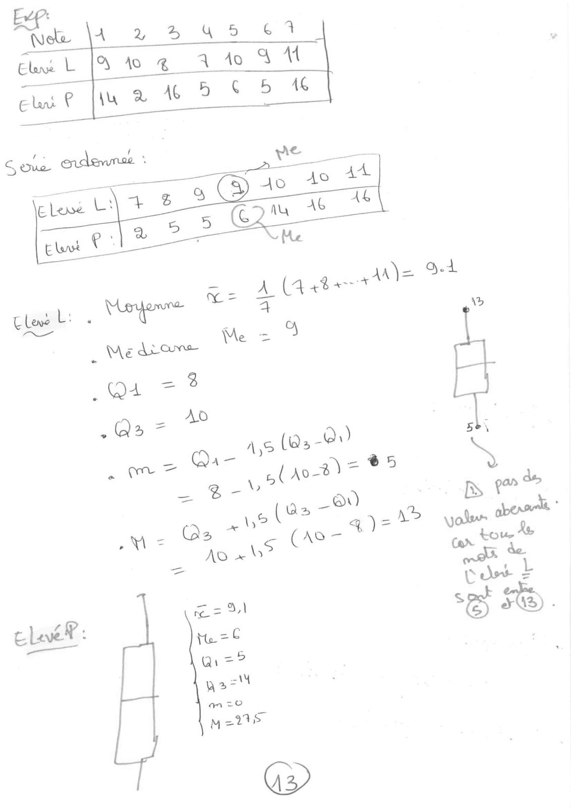

**Lecture OCR à contrôler**

~~~text
clé À
~~~

## Page 14

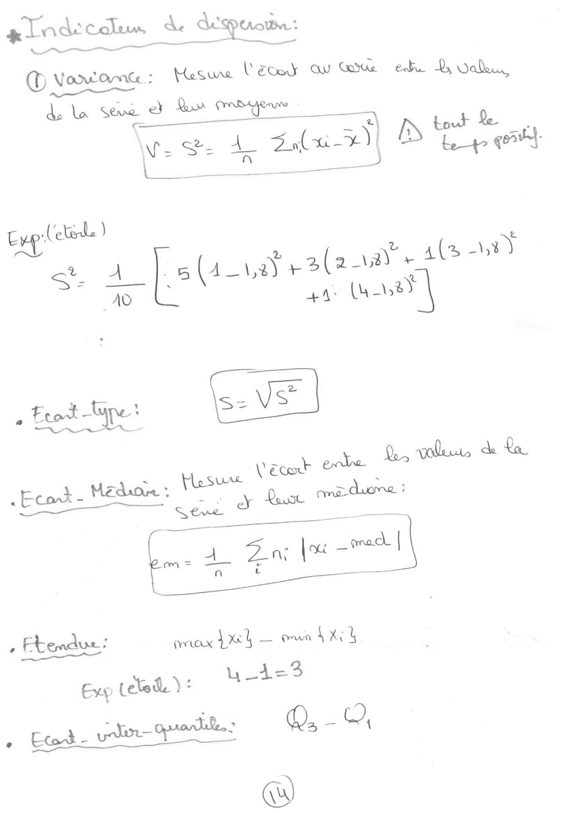

**Lecture OCR à contrôler**

~~~text
rod, | es
D Voxan: Masure (eta Oy adda ede By Vallu,

PO
do La Seve ey Raw Crab yeas

put Le
\- ge. À Zu si ps tet a

aa

wl 5 (A 2) al 2 aay Als 4)
D age Lu A |

Medion + Hise ~ |
—— Len eÿ Rouse cma cone :

» Etendue: cane) Ml qua 4X64
apitteate YX?

amie. — Qs 1
@)
~~~

## Page 15

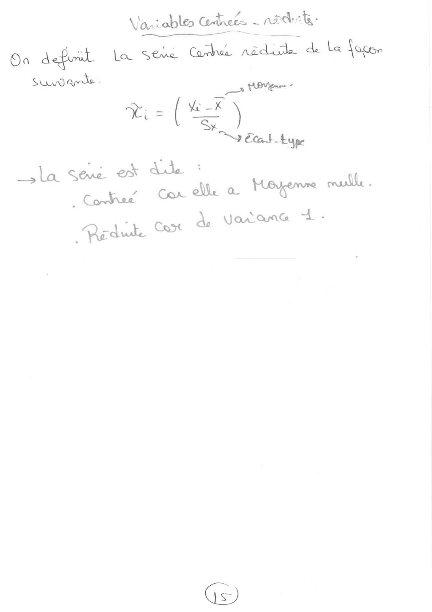

**Lecture OCR à contrôler**

~~~text
Variables Gers ~ nt
is ts Cech, nédich da La degen
sua on Wile -

Se
~~~

## Page 16

Page blanche.
