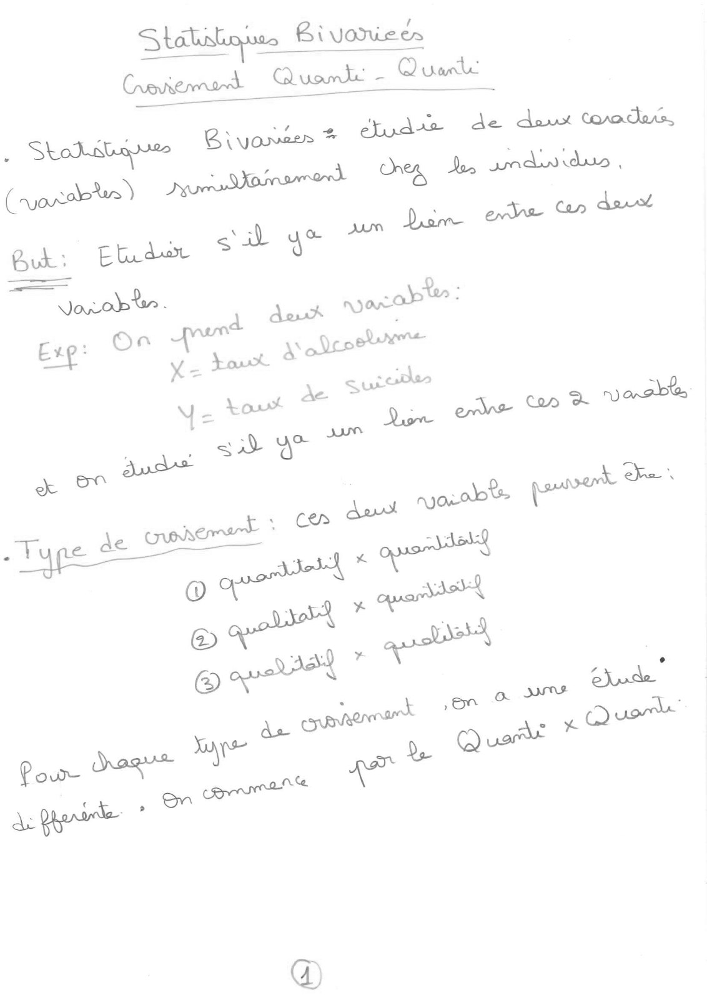
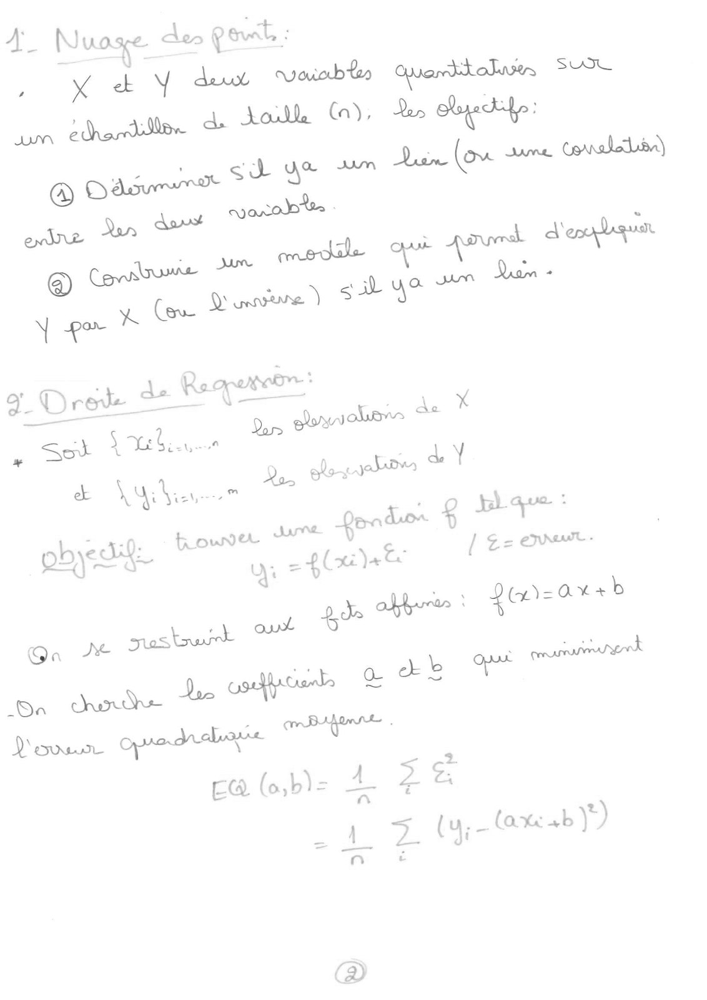
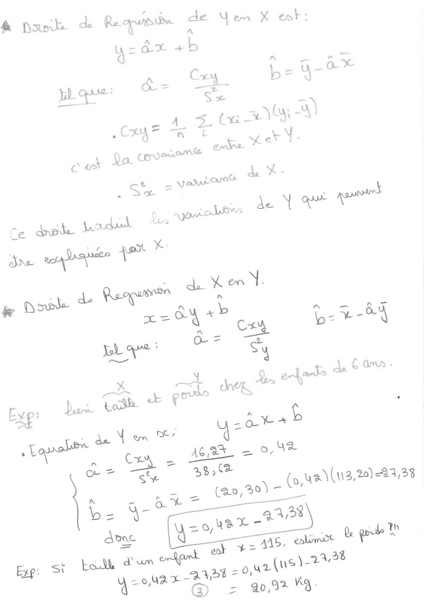
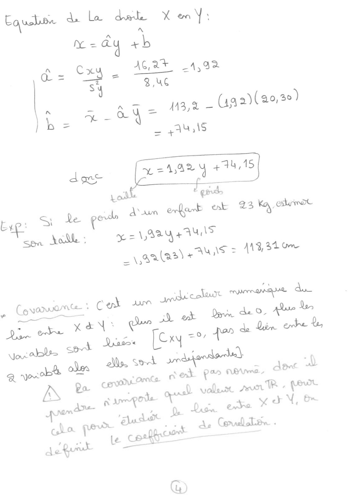
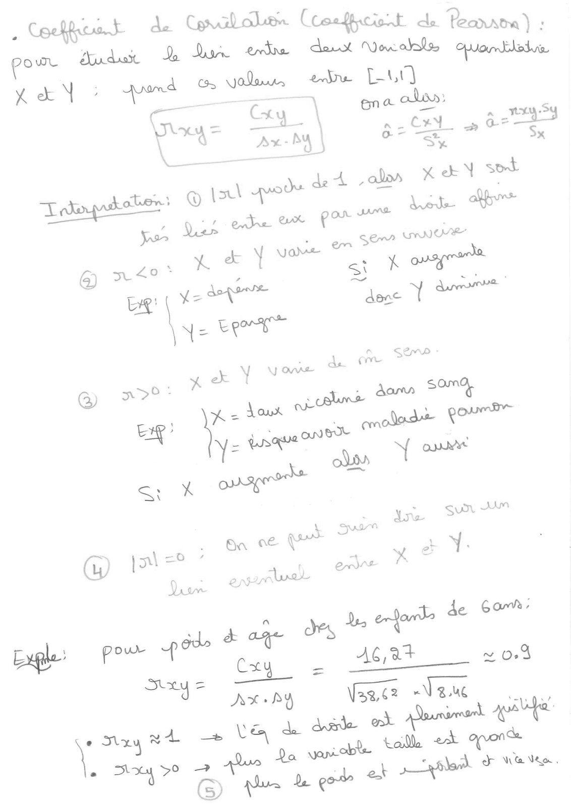
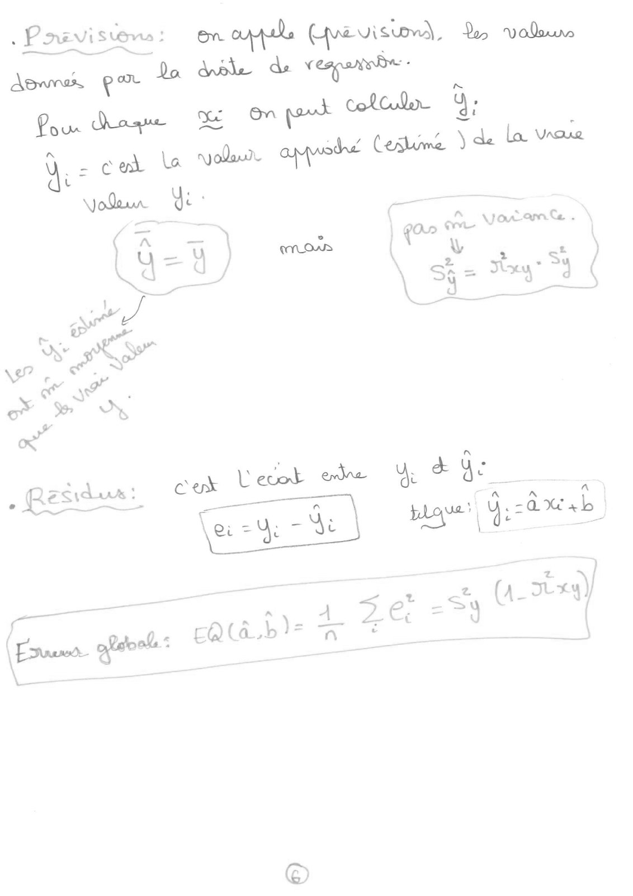
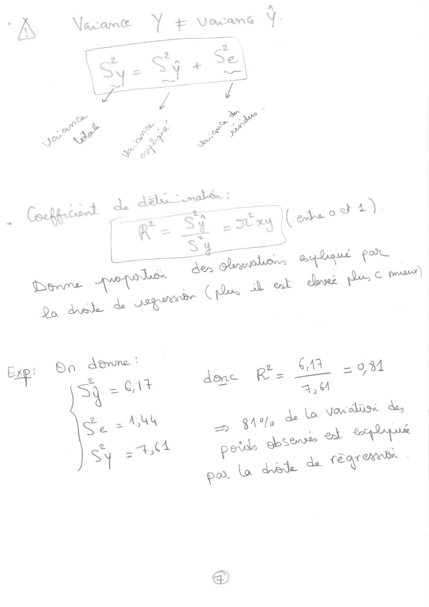
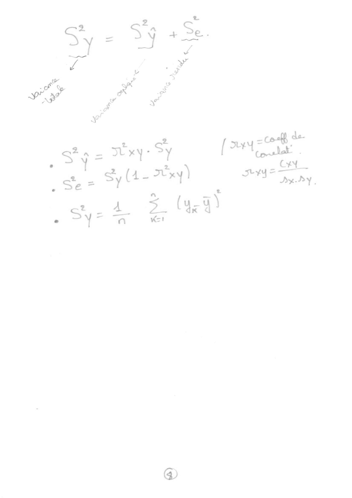
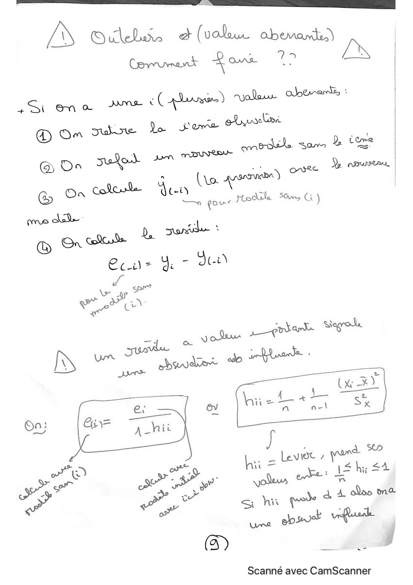
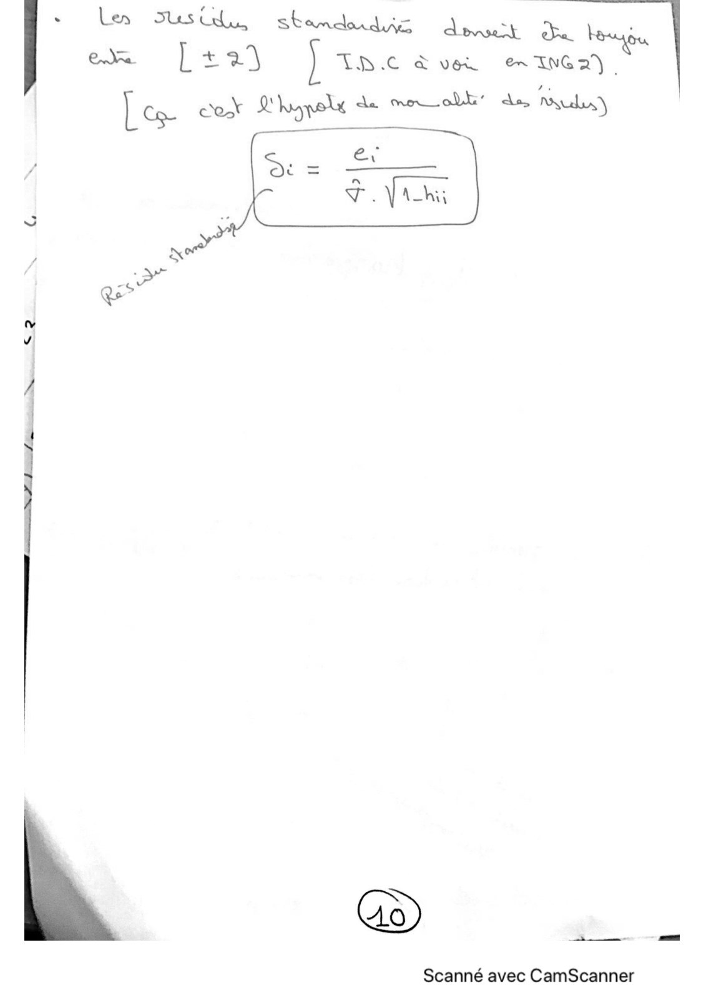

# Cours Perso QantiQanti-.pdf

[Ouvrir l’original](https://drive.google.com/open?id=12KtcNCQiIVVEzk1NiPtaU-diIE-mE1Q_) · Les pages signalées comprennent du texte reconnu automatiquement ou des éléments graphiques. Le fac-similé permet de vérifier chaque lecture.

**Pages avec fac-similé ou lecture OCR** — 1–10.

## Page 1

**Lecture OCR à contrôler**

~~~text
Crenermard Quake - Quarts

F aa de aux Conacdens
Ni 20 R \ vouvees 2 eload .
. Skool ~
(va sos ) yore loins Ones, des and dus ,

LC ‘ ab yo JAM Dom
Buk: E tu dur
~~~

## Page 2

**Lecture OCR à contrôler**

~~~text
A Nuose des pout :

, (Ko ek Y des viable Quanditabwre UT
ehardilen a. toe (a), 2, tp:

JM gd yo 4m Qian (ou me Corelle)

, aot Sub. | a
æ Oy Vies . do, leva |
= =: eG / Ge anew
= : Yi =f lc) |
bre : LOS
dune Le osdusd & be %
-Oa
L'on opradrsaee cm Bont |
EQ (o,b)= bs 2 SG.
1 2 (u-tax+bY)
~~~

## Page 3

**Lecture OCR à contrôler**

~~~text
à Doane de Requis bn ru Yen X ent:
w= ax ab |
y be GO

&
= CE aa

ce
en 38,04
_ _ tao,30)- (ua \(u3,20)-41,33
QA

avc zou x
oy +211 eme up

yr(ue)-28
~~~

## Page 4

**Lecture OCR à contrôler**

~~~text
G
À ee
Me = ay re
d = “= AG A* 4,92
sy 3,uc
\ - Age 134% _({a2)(20,3)
he %- OM
_ quis

Joe = +441

= eo

cag: SMe goo Ban EH SET
soa oe: oo = 19344 AUS

= aa (as) AUS = 119,34 0m

» Cevoowont : Col iin

— ab
Qin ode yey: Ce
Na cot Naso [Cry .
La oles le Sot rade sert
AS £a cons Ames ne a

repo voles AUN TR - (OVE
rae een ae ese YON, &
qe fe ioe CulLin -
spa * conne S* — ———

A Vo

pe
~~~

## Page 5

**Lecture OCR à contrôler**

~~~text
. Cockieat de Covalolen Coseficient de Pearson) :
pour tude L dun ed dant Vocale œuanblale
X &N : avan d Bis Ki ebu L-U]

alos:
Gey = “Gy. | ur Cx En er.
+ | Ax ay | Om &, Se

4
4
[as
\)

\

Ah ene Beer -Nau su
2 ay edt — LA de dite od onieer t

sian wnat Oo
À 50 — \ vides.
7 GB win bee ©
~~~

## Page 6

**Lecture OCR à contrôler**

~~~text
. Pare vise : en ol FRE D valu
~~~

## Page 7

**Lecture OCR à contrôler**

~~~text
A

A \Vacame- Y ra
VA
am @ VE

(2 a =
Ca Sy + "=
yor or
J ry
are #7
: Coetgresd ER
ETS cos
= = SLAY (eed *)
Aen x
Slaurleon a por

GE ‘
EP ba Ame:
Zs
an = ENT den
| . ne pe. ÇA 5
AM au =e
4 gt aver aon -
P dose 2 ee Lap anie
por La dede de caen |
~~~

## Page 8

**Décomposition de la variance.** $S_y^2=S_{\hat y}^2+S_e^2$ (variance totale = variance expliquée + variance résiduelle).

- $S_{\hat y}^2=r_{xy}^2 S_y^2$.
- $S_e^2=S_y^2(1-r_{xy}^2)$.
- $S_y^2=\frac1n\sum_{k=1}^{n}(y_k-\bar y)^2$.

$r_{xy}$ est le coefficient de corrélation : $r_{xy}=C_{xy}/(s_xs_y)$.

## Page 9

**Lecture OCR à contrôler**

~~~text
JS Gels & (valu had)

Li en à Jam à (pla) polar opens :

Lo ei woelra |
suine Lo Sore mi |
@ On _ onee D CBUNILANL.
& Orn col — pus Hedile Sm Gi)
me Aske |
© me ©
Ce. = oe ~ Jt i)
xa = iad
we Co
P ye poiank. agro.
oy
À LE La = LEVEL / a
te) 3 At 5a a eS
ye D BP ye! oles wre de

or”
a sh ps

(3) es

Scanné avec CamScanner
~~~

## Page 10

**Lecture OCR à contrôler**

~~~text
Len Ses Uda,
em [+21

st amd dirs Ask te in

Fine

à ver en ING2) |

Les Cok L'hypolé de mel de Rudy)

—

(to)

s CE

Scanné avec CamScanner
~~~
