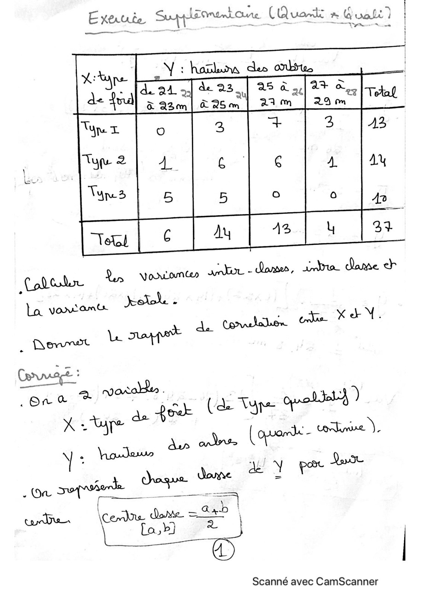
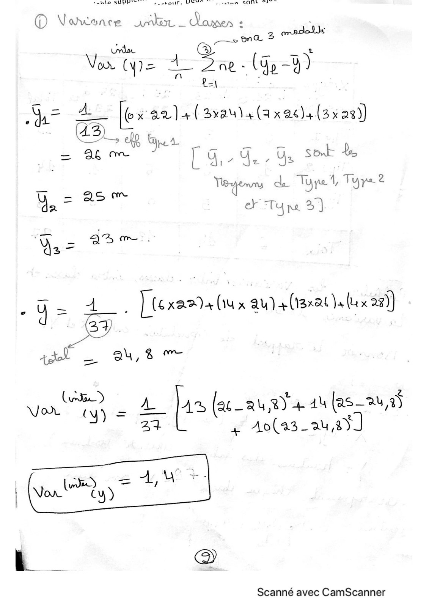
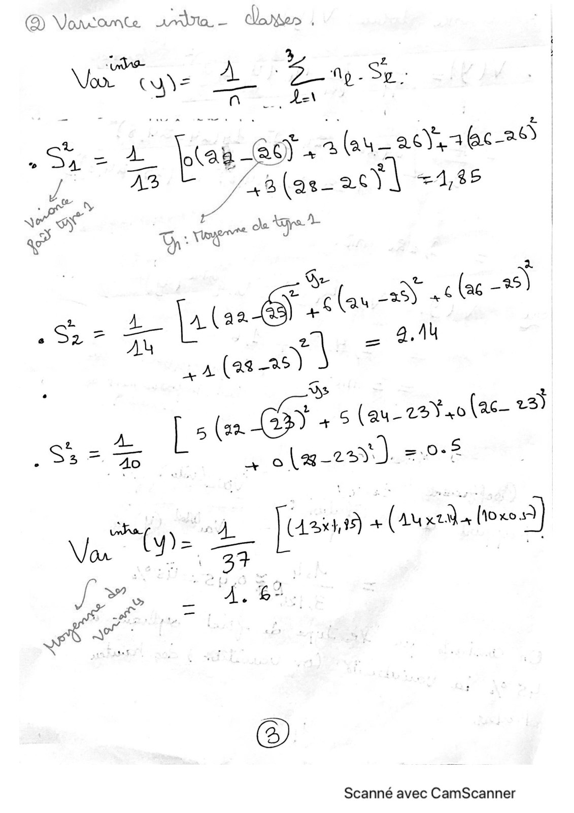
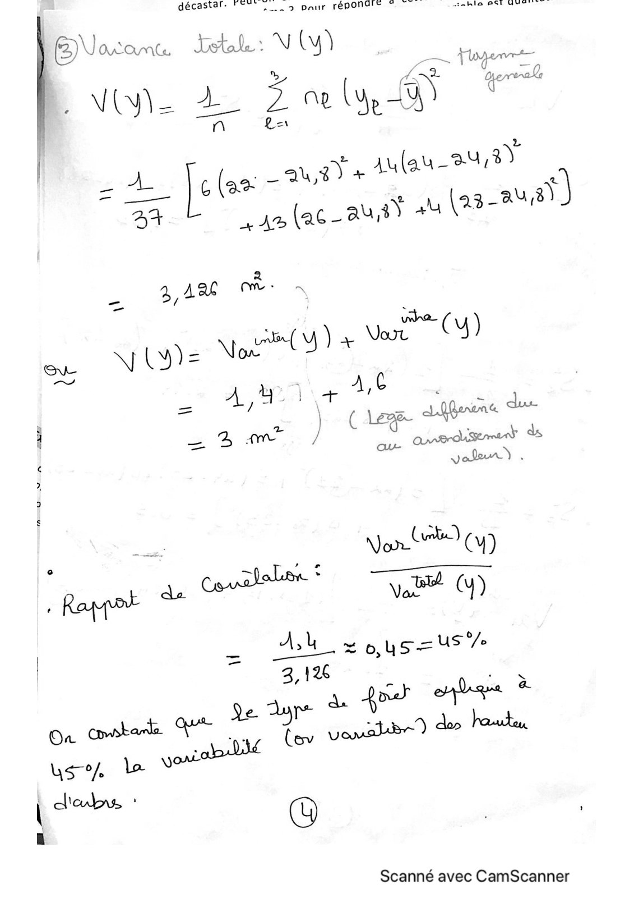

# Ex-Supp+correction.pdf

[Ouvrir l’original](https://drive.google.com/open?id=1gKUxElwslVycU0b9JxtCmRW73ugVfdF_) · Les pages signalées comprennent du texte reconnu automatiquement ou des éléments graphiques. Le fac-similé permet de vérifier chaque lecture.

**Pages avec fac-similé ou lecture OCR** — 1–4.

## Page 1

**Lecture OCR à contrôler**

~~~text
edited Sarl

Typ x
Tue 2
Von 3

are

| Rennet Le ut de
ru ote à 43
haa ” a Pow: (a Var FEU :
| .Ure te ( opronde- Corban
Mis howlews & QoL
4 daqua dome a Y pee
Or soporte | —__— =

Scanné avec CamScanner
~~~

## Page 2

**Lecture OCR à contrôler**

~~~text
ble SOUPE

ie ANG — Jonette
© v a
> na
urdoe

Votre 4 Due. (e-D)

= ALES fes aa Lasaula(axeds{3x 26)

a SEO [a Ge Ys set te

0 = 25 de: get rer
= me

da oF Tyne 3]

- Y= À. } (6x20 (iu x au) + (1322 ux 29) :

>
tt _ 24,8 ~~

End 2.2 E (2c_ Qu 2) 444 las— 24,95
: ay 4 Ao(a3_au à)

Scanné avec CamScanner
~~~

## Page 3

**Lecture OCR à contrôler**

~~~text
@ Vanconte ra - does .

Von CUN= os Be -Sr.

' y au_a0),1@c-2
. Sa = À ag 29) 2 ( a
.3(as- 26) =4,35

ye ty
N or
we
| oh ~ ol 38)
y La) 46 (a6 -
2 À ACT
2922 a Jala . : an
À (28-25
Ds |
F 5 PCs , 5 (au-22Ÿ40 (ac_ 23)
pe Be as Lee) =.0-5
ae ) À Js’ + (au los)
is FOURS,

@

Scanné avec CamScanner
~~~

## Page 4

**Lecture OCR à contrôler**

~~~text
décastars PO ue pair FPE ET ie See END À ot

ENacans tal: V ly) ail
; es 7 Dereale
Vite 2 Zoely
no ka
] ua)
z À |cler Canada Aulau- 84 .
a Lam (ace ausy +4 (23-24
SAR NÉ A
\} y= AE CU) + Var y
292 À À D | ae A,C | |
/ e | ( Lege Lidherone due
4 2 wm J seal

L Now) (M)

= Ash eo, ee

Es

| 3,126 : ne
ale. Ye dye À er nie?
Où cot que ar heu
uso la Vow oualbe
derby, :
©)

Scanné avec CamScanner
~~~
