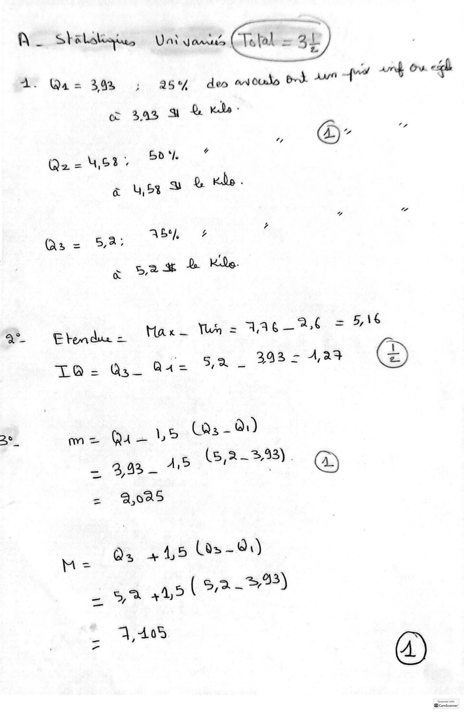
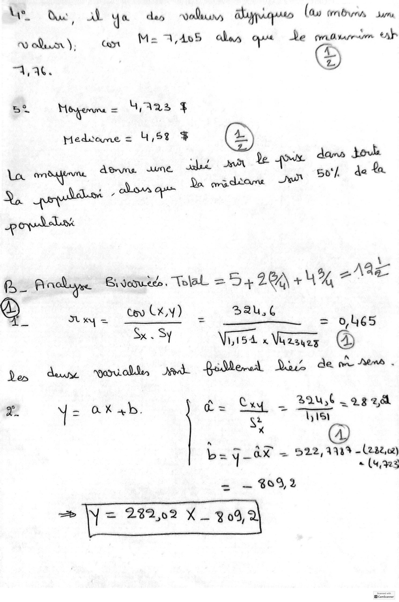
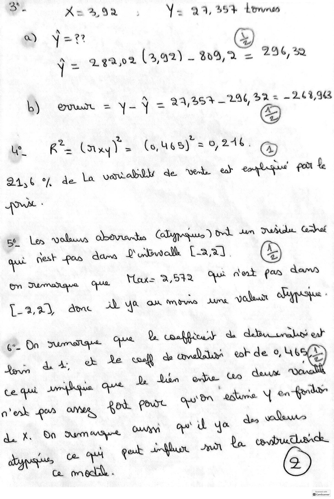
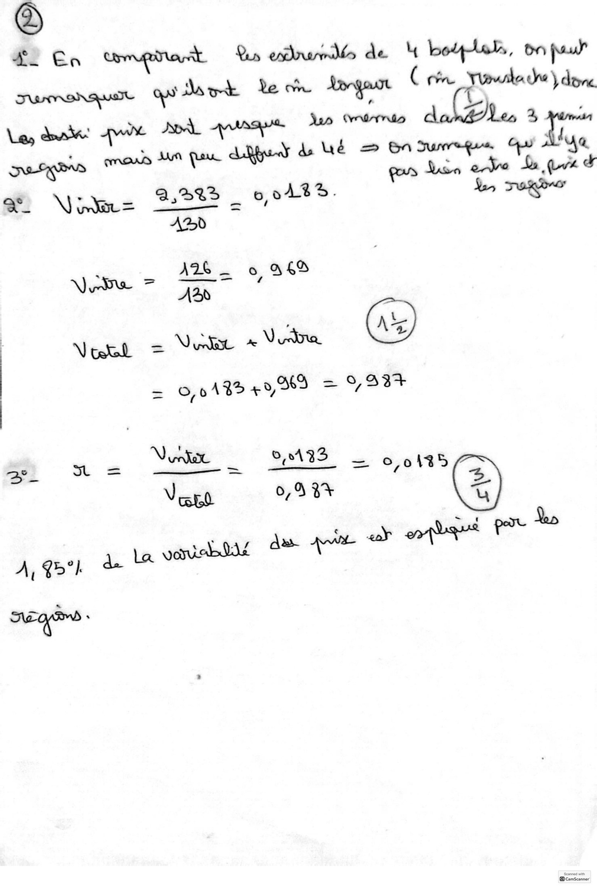
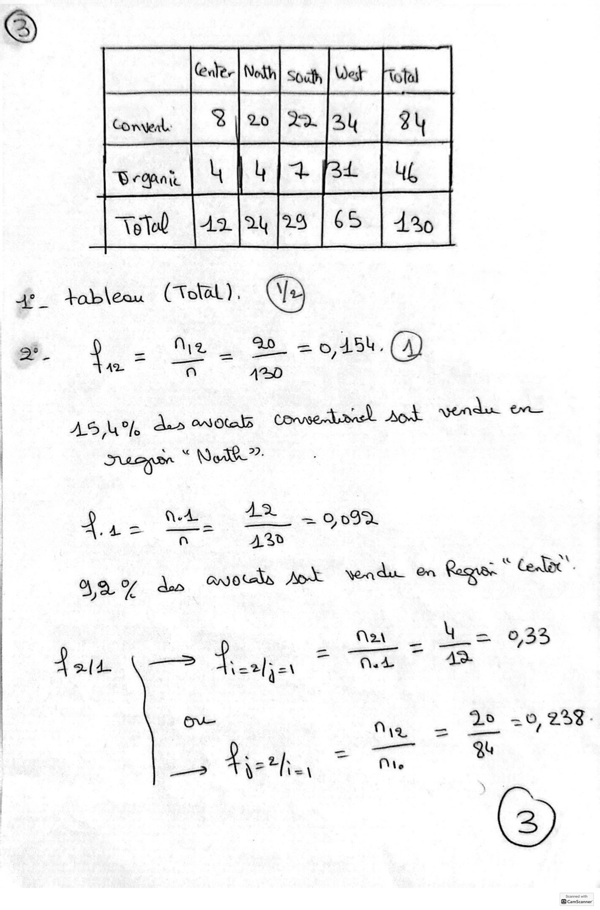
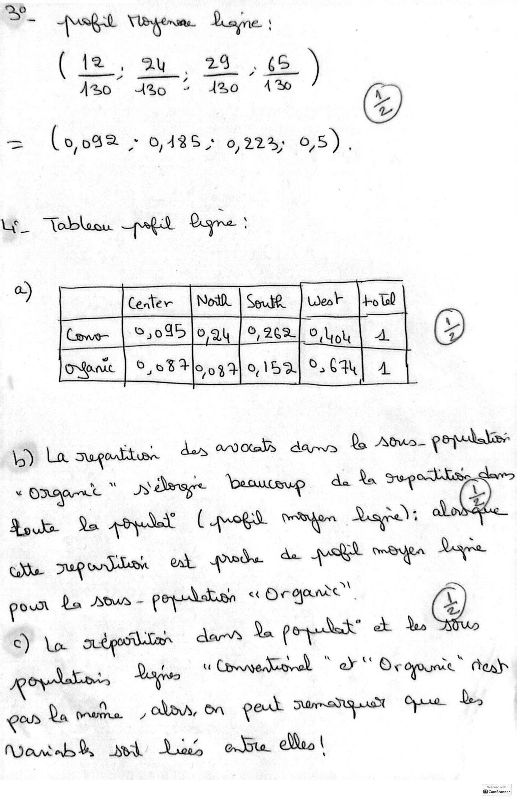
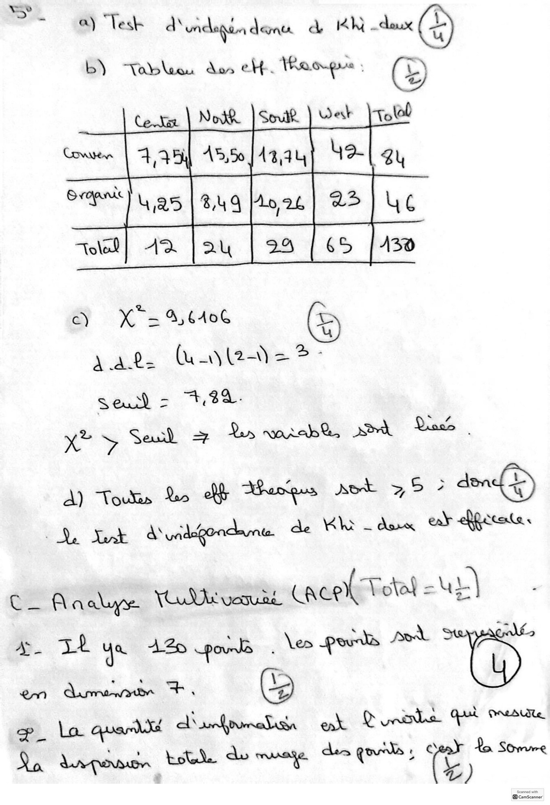
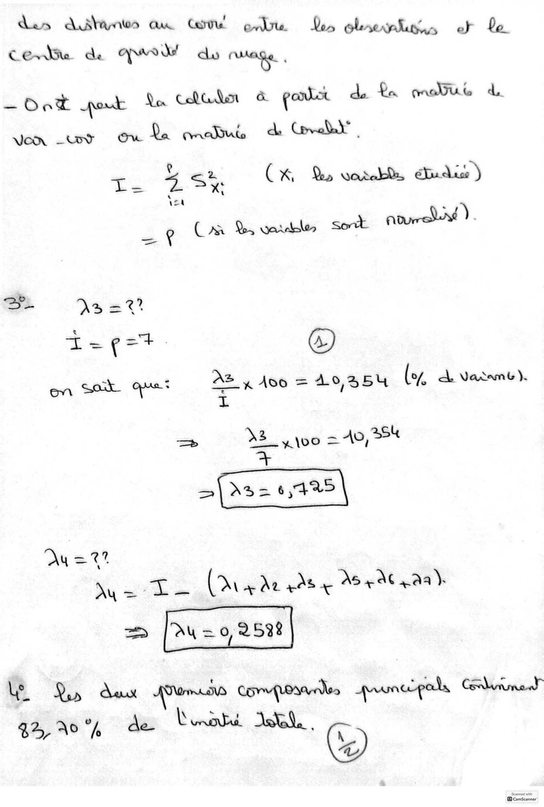
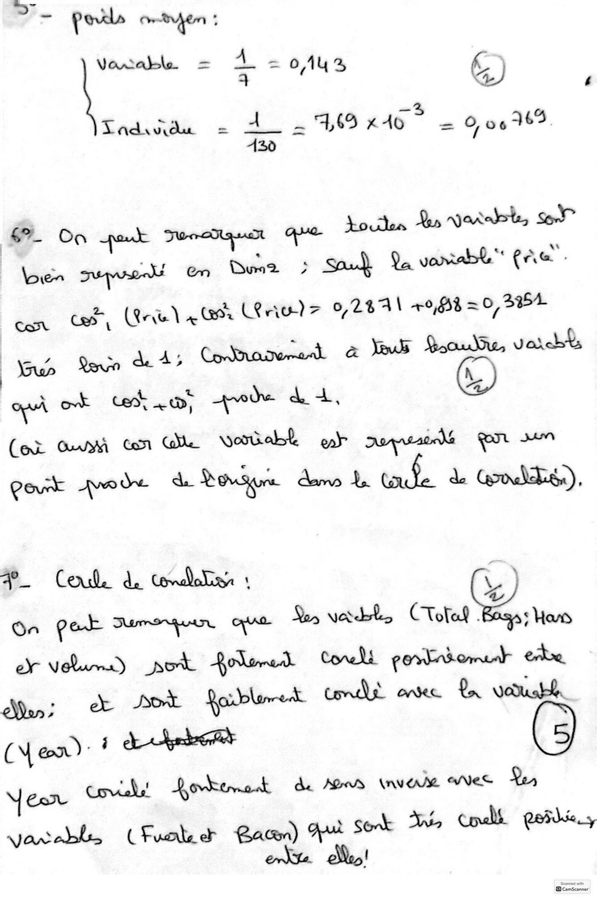
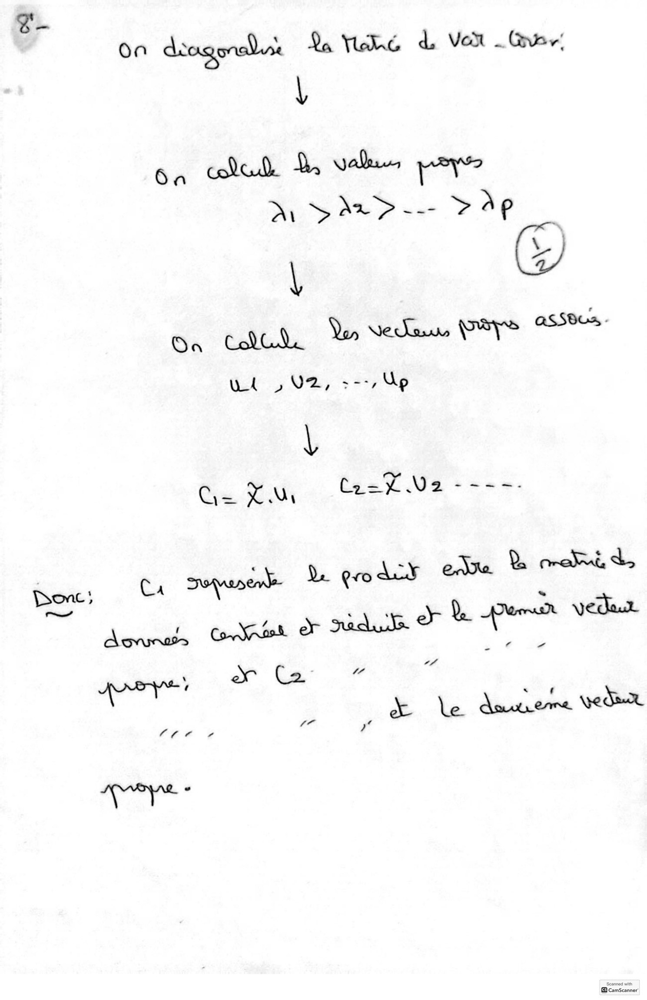

# MesCorr-DataExplo2024-2025.pdf

[Ouvrir l’original](https://drive.google.com/open?id=1Yjp9praG9yMsUDNcA0sgGpQPKe5J87su) · Les pages signalées comprennent du texte reconnu automatiquement ou des éléments graphiques. Le fac-similé permet de vérifier chaque lecture.

**Pages avec fac-similé ou lecture OCR** — 1–10.

## Page 1

**Lecture OCR à contrôler**

~~~text
A _ Shilaks ———
lesa Vat Janus Total ~ aE)
ae 7%
as% des anol Ort AW fs sung Ov. «4

À. Qa = 3,0%
oc 343 a & Kido »
Q2 = 4,53" 5D ‘/. d 2 @ ‘

iu 453 % e, Kido.

CE = 5,à; AS), +
52% & Ke.
a°_ Etendue = Ha x — Tu) = 4146-74 = 5,16
hs Os. de wa PS 1,23 eo
a.

=

m= Qu 15 (a: - &)

= 60. 1 (,2-398). @

es 2,685

Os + 45 (os - di)

( 5,2 .3)

4 =
- 42 449

. 7,405
~~~

## Page 2

**Lecture OCR à contrôler**

~~~text
a. Qu, Al. 1% des Dal diyuqueo (ay rnin sum
0 dum): an Mas 4,405 clo ope de ss erp
AY, ZL)

= A Mere = GAs 4

Medsoame = ly ,58 +t

Ng
(_ fade Bivoruté. TolaL 25426 44% 2/\4&
Q) They = tev (X,Y) we LEARN

Sx. Sy

154 x Vuzsueg oy
Yon dene oovialtes Kod. Podderwd Dare de mre ems .

Bau,6 a
+ = ak a &. a Cxy = 5° +23 2,
Lis
si

b= q-ax - 522,119 - (222,02)

« (4,323
= — 809,2

=> N = 232,02 X — 309, 2

|CamScanner
~~~

## Page 3

**Lecture OCR à contrôler**

~~~text
>.
X = 2,9% 4 ÿ = a 4, 364. L'rines

Q) } = 22 1
<—
Ÿ = 292,02 (2,92) - 809,2 = 296,2
b) QUIL = y-Y = — oe
Le

" + 2
We RK = (ayy) = (o,46s) = 8,246. Gp
94,6 % de La yantabilly de web eh etage gen Le
PE :
of Les vols oran Ccbupeques) DL ten Duel Cobre £
gt nest pas dams Deuwwolk Lana).
En Jumaïaue opus Maz= 2,542 Ops Ant eos dams
Lat eS Awe dL ua ax mms JU. ay odoust bay :
ge On sumerae AE Q coffér de eB onohné eal
Us de ex Le tof de adm et de "Ne
Ce qui dique Oe Qe Lan erase. (to Anum
n'enk por OMR, Rot Pde on oats Y en Rod
ds. he Da Sumanage OM ow bk yo deo wales
iy ay ce A gent hu ni Us ibid

Co.

@ CamScanner
~~~

## Page 4

**Lecture OCR à contrôler**

~~~text
SL En Compact Us eur de 4 botlels, bnfuu
Le ue A qua de (rés due à |
dk: Ldgedy de Ld = En sunreqgen Gy Aye

: iy An qu
moi Lin ee La ged
GO Vos 123 2: mu. 2
ADD
: fae. S
4 _ ABs o, A6
Ned = Vaux + Vire
= 0,334

©, 0A8S 49,69 =

\) N
FRA a 2 =. ARE = k hits
Vacs 0,9 3% (4)

CamScanner
~~~

## Page 5

**Lecture OCR à contrôler**

~~~text
E -

-

AS lo
Taper © gdh?
À, 4 = ate = ae

VAUX

ETC

Je avouls Anke vendue On Rage ‘Ce

nu _ Ys 033

Ou Wa « 20 29, 2353
ET — |
Dr Lie, ai Mie a
~~~

## Page 6

**Lecture OCR à contrôler**

~~~text
D Ab Vege Dayne:

(12, 20,29 ,6 )
150" Jo : 130 41%

>
%
= (0,042 fy 0,485: 622% 0,5) ;

_

oo fon fasse | à

poux Le ous pop <« Orga” e)
Du apr dan Le pope’ +

R vee Deaton Canada) “ 2k Oropounie” exh
genta Piha clas, on geuh samanguitt Sie
anti sh Line eu el!

CamScanner
~~~

## Page 7

**Lecture OCR à contrôler**

~~~text
ey

~ 0) Tesh d\éidigindenx à hi dave (À)

®

b) “Tob ou dos eH . Mao

“ol AD | & u ET

c) x = A, LAG .
G

k ote (u wat} (2 a Da
Seu = >, See.
y Seul > Lys wiab& ee Oak
A) Tous Lo ohh Berges aot ,5 2 donb)
D Tak diuégondune de Kk daa eb fitate,
C- Analyse YORE vosune ante BE
en dm FH, de
pe { Dinhrunabsn eal D nena qui onesette

sania, ogee eee des qe 5 |:
©)

Sconnad with
Bcamscanner
~~~

## Page 8

**Lecture OCR à contrôler**

~~~text
ds dufanes an Got ou Le olrernbuvws of Le
C ev Ye a. Ops de! do WON. .
— Ook pork Qa colada à gover de La orale d
Jon uy Ou da maïlut de Gal”,

g * dit
t. 25% Cx, Qs ware, cides )

Le Cr Boule Sort noue).

BS 3 = 2?

I=¢=+ @)

Az x 466 = 249354 (02 A Vartamt ).

dE =
= X3_ vo ~ A0, 25%
>
>\A\s= 6,425
du =!

Ay = Le e\ + à 4À8 + AS AC LAA)

= DW = 0, 2532

Ue Qe» Aux Porn Convposaale gesnccgals Cain. y
42,0% de Lei Xl,

À

Scanned with
~~~

## Page 9

**Lecture OCR à contrôler**

~~~text
> fall own:

Vortable = + = 04% €) |
—%
TLadividu = A = 7,69 x Ao = % 06 36%
A430

‘ ble, Soe”
6 On pork Jurcquit AN DT *
Lien Tepe En Duo? J Sou} Q. varrabl FAG -
Cost CS (ne \ x BA APTE 0,281 0,638 = 0, 3354
i ‘
à Bou), var
af , 4; Cofnaderard à Yous

A ok Ce L®, ode Pe as À
Part ave de Borsa dame À bin, Ye de Conder),

7. Cenk. d. nd : À.)
On ONE: Pumnesquun, Que D, verdes, CTofaf - : Hors
ey Volume) pot Rolered Conli pores ce
Mr À Dm Ros Wbleneat uns ontec “hi

Yer cori! Rokenodk de Ars inverse wes Ry
‘ 4 x y
arebl, (Fualer Ra ) qu Sent née Coal poil
. a er!

|CamScanner
~~~

## Page 10

**Lecture OCR à contrôler**

~~~text
Donc;
Le. 4

On doagorabise Qa RC d Ver - Gun
|

Ba cold. à, Vaden, a Pi
M > At? -— > ae

\
CoO Yon Neca, PSPS assez.

wi >; VE; :--, Up

v

Oa

Scanner
~~~
