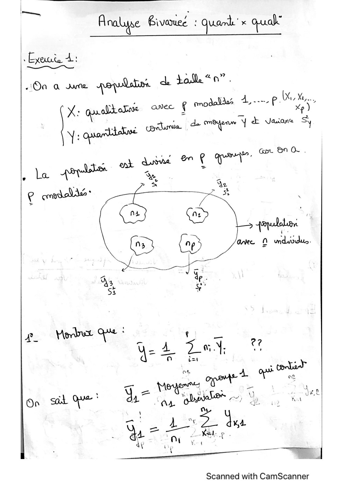
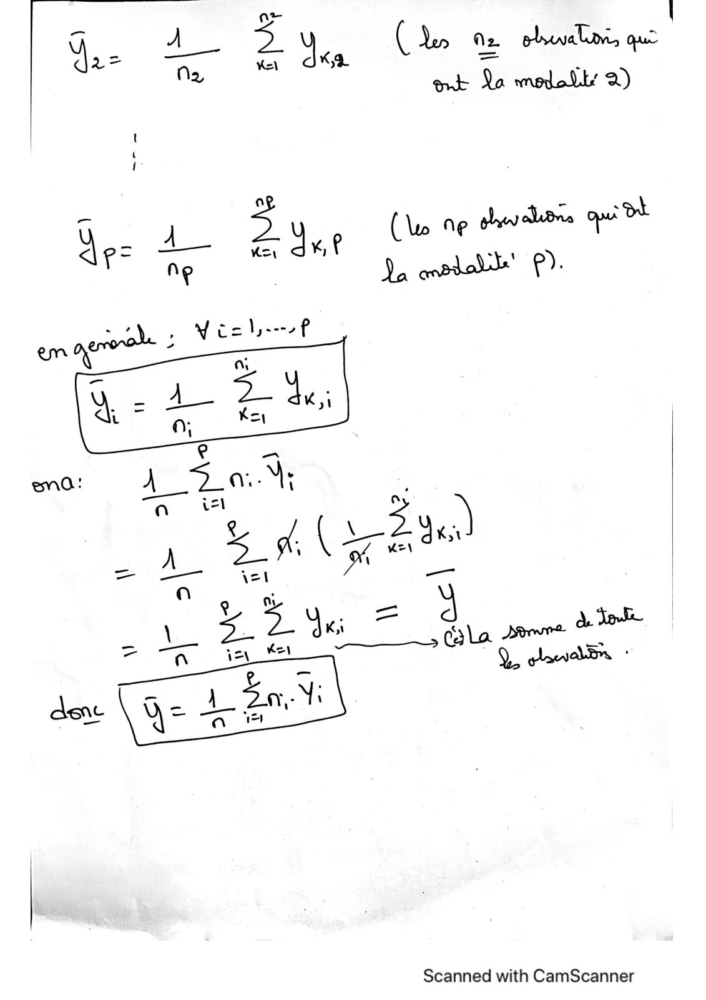
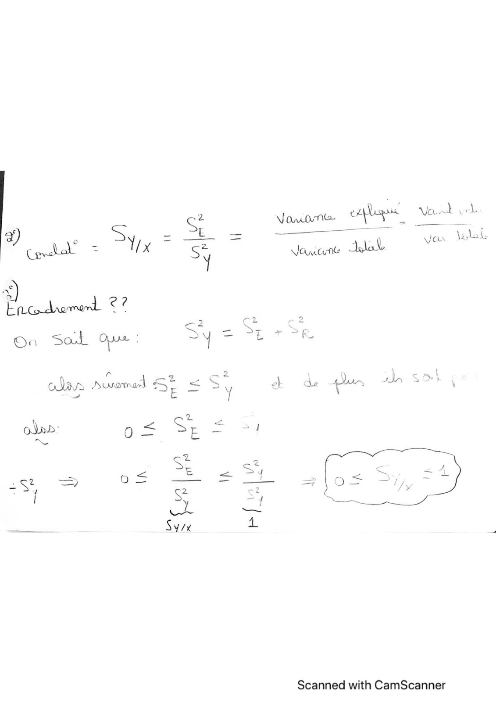
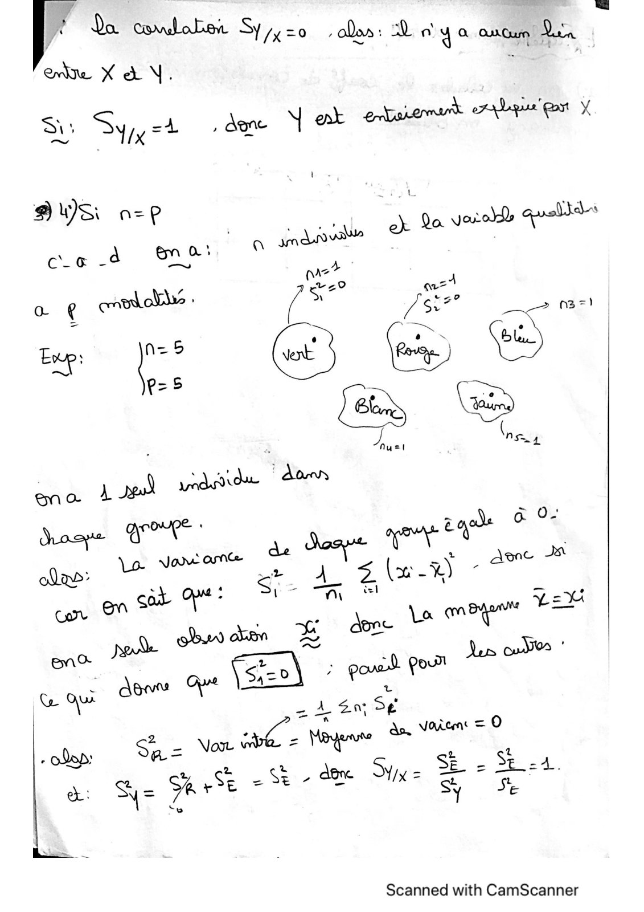

# MesCorr-Ex1-Quanti x Quali.pdf

[Ouvrir l’original](https://drive.google.com/open?id=1cOsi5kYC9v5V2hFjia4Qobx84oF2RJXU) · Les pages signalées comprennent du texte reconnu automatiquement ou des éléments graphiques. Le fac-similé permet de vérifier chaque lecture.

**Pages avec fac-similé ou lecture OCR** — 1–4.

## Page 1

**Lecture OCR à contrôler**

~~~text
|—s,

Analyse Giveoued ! Quark x quak

Oa a ame poplars ck tole “0”.

Yi gpa"

dad (x...
avec & models À. p. Xp)

corde. de meen YE Vasans Sy

Scanned with CamScanner
~~~

## Page 2

**Lecture OCR à contrôler**

~~~text
Scanned with CamScanner
~~~

## Page 3

**Lecture OCR à contrôler**

~~~text
Vaunnt- ele Vow un

=
. E es
7 ~ = 0 var led
Vanne lab

On Sal Ouse :

lit timed = S;
22 E _— 4

\
ae = E
Se a
/ = 6e  & FY -
=S4 => : us =
| iS a
we a!
Sy A.

Scanned with CamScanner
~~~

## Page 4

**Lecture OCR à contrôler**

~~~text
Pa Sie ados: Diol ya ancre Vea
ee X à \. ;
Si: Syjy=4 , dene N ent enbsiemart i *

BUS a= | ; Jet
) a=P _ eajovatle ek da vero) aus}
ce 4 ne ve? i |
> ued Que
ao € cmekabls : c= JS°° > m3

oe pe © & ©
1 Es
ss ras vasa don

Mose Bre’ NE ago ©

: + ce JA
Va vor am“ æ À (x %) , ane

* LE x k done’ La em oy =
en: rode Ve’ Py ol POM hee

L due pe | À
Co QUE DER S¢

Scanned with CamScanner
~~~
