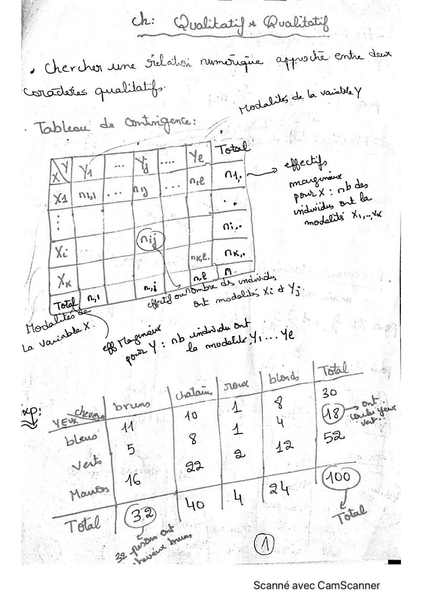
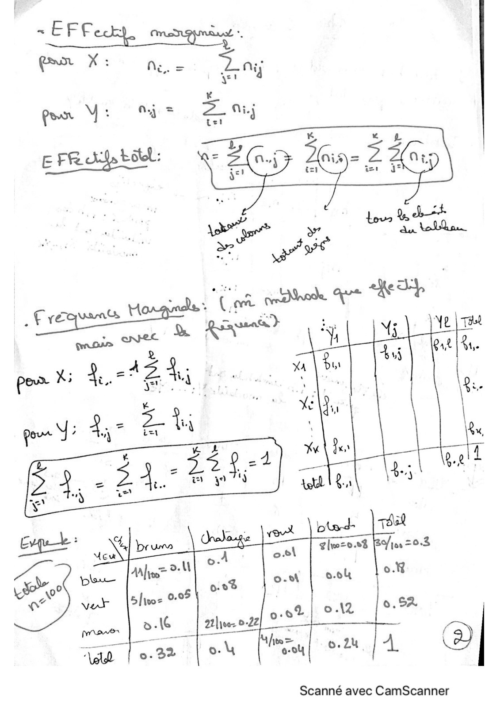
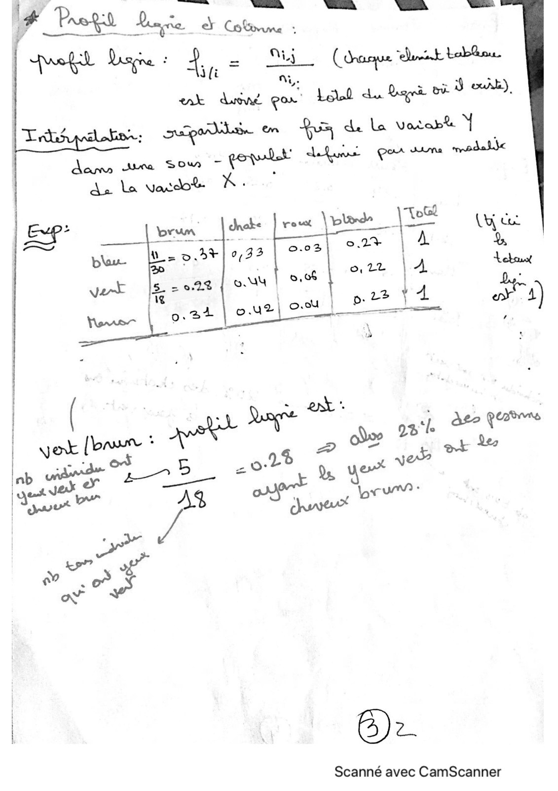
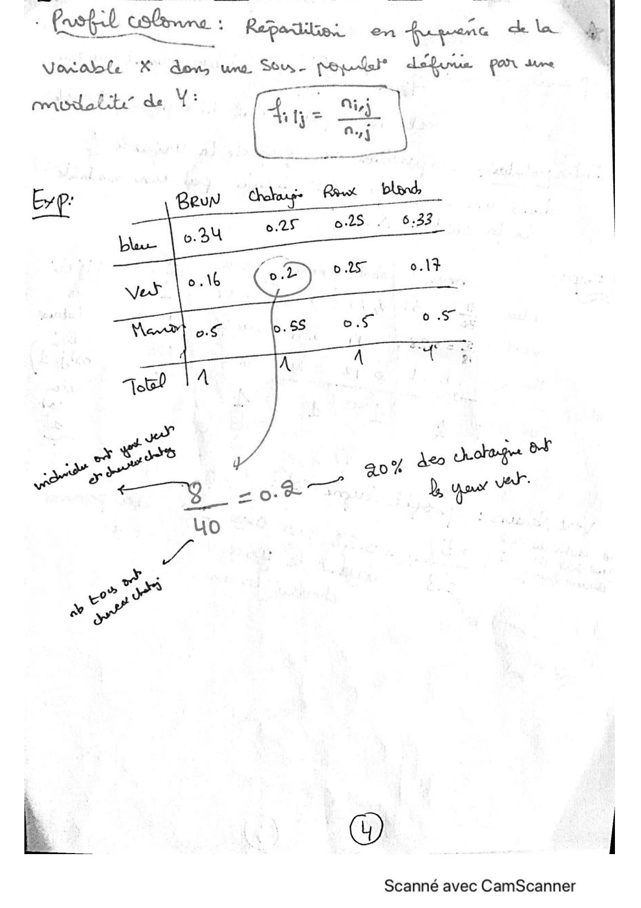
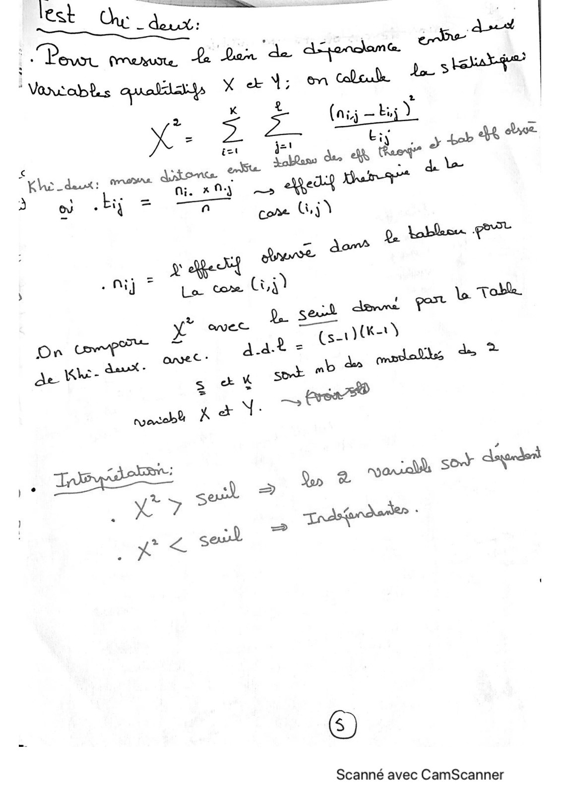

# Qualitatif x Qualitatif-Cours.pdf

[Ouvrir l’original](https://drive.google.com/open?id=16p_oQHsuiFuPBDB0h7h3y8OADRW0QEkg) · Les pages signalées comprennent du texte reconnu automatiquement ou des éléments graphiques. Le fac-similé permet de vérifier chaque lecture.

**Pages avec fac-similé ou lecture OCR** — 1–5.

## Page 1

**Lecture OCR à contrôler**

~~~text
Seti quel

a Channels © Subakos numéuque 4°

de ere Aaux

Scanné avec CamScanner
~~~

## Page 2

**Lecture OCR à contrôler**

~~~text
Scanné avec CamScanner
~~~

## Page 3

**Lecture OCR à contrôler**

~~~text
Yet Lise : de = (aaque vist bobos.
Ns, Lele du Reged ad our).

separa en Fa ele Vorab& Y
us Qi \ ni | ps modali

dam ra SOM

de La Vardo® K.
« J row pl
Exp: brun [dre | reset ed
A ni beoalen(es| cs |E
: Ps 3,06 oO, 22 |A ie.
- ) D: Le y4 oo 4)
[es

wk fp sons
| ; oe ORE
| = Synge dso Pa"
| Ane ae 1a 2 où pe Leo

= DA a ex V
ob ror — ort Bunn
a oe At duvet

à À
kr?
W
TS ms

Scanné avec CamScanner
~~~

## Page 4

**Lecture OCR à contrôler**

~~~text
> fusfil cale : Repair en fupenc dla 4
Vorolole “KX don, un Sou. popdsl? dsfuue par se

masi” de V: “A ee Dj l
ai
Eve: Reun Ge Ree | blond

6.25 o2S . 6.33

es 20% a a
ne PT gr à you
4o
Pa
D

à , be

Scanné avec CamScanner
~~~

## Page 5

**Lecture OCR à contrôler**

~~~text
SRE

dl
\ancabs os one =

(nig — bij) =
Lis. y tab che Se
X a wee à
lo At mea A tb 5 gel Berar
D ee rr
oe Ga dabthen 4
nj ae GA L'en  te
a avec Le nike}
ro S-
On cope aa? = Ladi, de >
oe. ai ay sot fer
Ss

Scanné avec CamScanner
~~~
