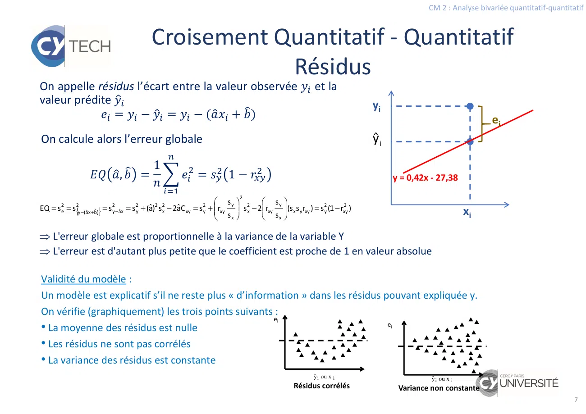

# Slides Quanti-Quanti.pdf

[Ouvrir l’original](https://drive.google.com/open?id=1jCvv5wCEyRt9dFUJlxRVICOYr6SEh9XF) · Les deux lectures automatiques du PDF divergent sur les pages indiquées. Leur fac-similé accompagne le texte.

**Pages présentant un écart entre les deux extractions** — 7.

## Page 1

~~~text
                                                                       CM 2 : Analyse bivariée quantitatif-quantitatif

                 Data exploration
        Statistiques descriptives bivariées
    Observer simultanément des individus d'une population sur deux
    caractères
    Mesurer un lien éventuel entre deux caractères en utilisant un
    résumé chiffré qui traduit l'importance de ce lien
    Qualifier ce lien :
–      en cherchant une relation numérique approchée entre deux caractères quantitatifs
–      en cherchant des correspondances entre les modalités de deux caractères qualitatifs

                                                     • qualitatif ×qualitatif
2 types de variables  3 types de croisements :      • qualitatif ×quantitatif
                                                     • quantitatif ×quantitatif
~~~

## Page 2

~~~text
                                                                               CM 2 : Analyse bivariée quantitatif-quantitatif

                             Croisement Quantitatif - Quantitatif
                                     Nuage de points
On considère X et Y deux variables quantitatives sur un échantillon de taille n. Les objectifs sont :
    • Déterminer s’il y a un lien (corrélation) entre les deux variables.
    • Construire un modèle permettant d’expliquer Y par X (ou vice-versa) s’il y a un lien.
Le modèle pourra alors servir à faire de la prévision, c-a-d prévoir des valeurs de Y pour de
nouvelles valeurs de X.

                 Etude du lien entre la taille (X) et le
                 poids (Y) chez les enfants de 6 ans
 Enfant    1     2     3     4      5       6      7        8     9    10
 Taille   121   123   108   118    111    109     114      103   110   115
 Poids    25    22    19     24     19     18     20       15    20    21

 La première étape consiste à constater visuellement
 si ce lien existe. La représentation graphique
 appropriée est le nuage de points.

 On cherche à repérer une forme particulière dans le
 nuage qui traduirai le lien entre X et Y. En particulier,
 une forme allongée traduit une relation de droite
 entre les deux variables.
                                                                                                                           2
~~~

## Page 3

~~~text
                                                                                                      CM 2 : Analyse bivariée quantitatif-quantitatif

                                    Croisement Quantitatif - Quantitatif
                                           Droite de régression
   On note {xi}i=1,…,n la série observée pour X et {yi}i=1,…,n la série observée pour Y.

    L’objectif est de trouver une fonction f telle que

                              yi = f(xi) + εi                                                                           εi
    où ε représente l’erreur.

    On se restreint aux fonctions affines :

                              f(x) = ax + b

    Et on cherche les coefficients a et b qui
    minimisent l’erreur quadratique moyenne

                                      1
                          ,       =

                                  = ∑           −(       +     ²

                                                                                                                                                  3
N.B. L’erreur quadratique moyenne est aussi appelée fonction de coût en machine learning et peut prendre d’autres formes.
~~~

## Page 4

~~~text
                                                                                                     CM 2 : Analyse bivariée quantitatif-quantitatif

                                    Croisement Quantitatif - Quantitatif
                                   Coefficients de la droite de régression
Par minimisation de l’erreur quadratique moyenne, on obtient les coefficients :
   On résout le système :                                                            Le « chapeau » au dessus de a et b
                                                   =              =   −       ̅
$               $
$%
   EQ(a,b)=0 et $&EQ(a,b)=0                               et                       signifie que la valeur obtenue est une
                                                                                        estimation sur un échantillon

où    !" =       ∑                 − ̅     −     est la covariance entre X et Y.       La covariance empirique garde les mêmes
                                                                                        propriétés que la covariance théorique

  =     + est appelée droite de régression de Y en X. Elle traduit les variations de Y qui peuvent
être expliquées par X. Attention la droite de régression de X en Y n'est nécessairement la même
que celle de Y en X

Exemple : Etude du lien entre l'âge et le poids chez les enfants de 6 ans

                               ̅                  #!       #"          !"
                            113,20       20,30   38,62     8,46       16,27

           L’équation de la droite de Y en X : y=0,42 x – 27,38

           L’équation de la droite de X en Y : y=1,92 x – 74,15                                                                                  4
~~~

## Page 5

~~~text
                                                                                              CM 2 : Analyse bivariée quantitatif-quantitatif

                       Croisement Quantitatif - Quantitatif
                      Covariance et coefficient de corrélation
La covariance est un indicateur numérique du lien entre X et Y : plus il est éloigné de 0, plus les
variables sont liées. Le coefficient directeur de la droite est proportionnel à la covariance

L’inconvénient est qu’il n’est par normé. Pour pallier ce problème, on définit le coefficient de
corrélation linéaire (coefficient de Pearson) à valeurs dans [-1,1]
                                                 '!" =        .          Le coefficient de corrélation correspond à la covariance
                                                                                      des séries centrées et réduites

On a alors
                                            =             = '!"     .

          •   |r| est proche de 1 alors X et Y sont très liés entre eux par une droite affine.
          •   r < 0 : globalement X et Y varient en sens inverse .
          •   r > 0 : globalement X et Y varient dans le même sens .
                                                                                                         !!! Cela ne signifie pas qu’il
          •   |r| ≅ 0 : on ne peut rien dire sur un lien éventuel entre X et Y.                         n’y a pas de lien entre X et Y

Exemple : Etude du lien entre l'âge et le poids chez les enfants de 6 ans
On trouve
                                          rxy=0,90
•     rxy ≅1  L’équation de droite est donc pleinement justifiée
•     rxy >0  plus la taille est grande et plus le poids est important (et vice-versa)
                                                                                                                                          5
~~~

## Page 6

~~~text
                                                                                                       CM 2 : Analyse bivariée quantitatif-quantitatif

                                      Croisement Quantitatif - Quantitatif
                                                 Prévisions
On appelle prévisions les valeurs données par la droite de régression. Pour chaque point xi de la série
observée, on peut calculer la prévision (i.e. une valeur approchée de yi par la droite de régression)

                                =            +
                                                                           25

                                                                           23
                                                                                            y = 0,42x - 27,38
 Propriétés :
                                                                 ŷ21i

                                                              Poids (kg)
 La variable Y et la partie de cette variable
 expliquée par la droite de régression ont la                              19
 même moyenne :
                     =       Démonstration en TD                           17

 mais pas la même variance :                                               15

               #" = #" × '!"                                                    100   105   110           xi115
                                                                                                  Taille (cm)
                                                                                                                       120          125

                                              2
                                   s 
  ŷ = âx + b̂    s = (â) s =  rxy y  s 2x = rxy s2y
                     2
                     ŷ
                             2 2
                               x
                                   sx 

    La variance de Y expliquée la droite de régression est plus petite que la variance de Y
    La variance de Y expliquée la droite de régression est d'autant meilleure que le coefficient
   de Pearson est proche de 1 en valeur absolue.

                                                                                                                                                   6
~~~

## Page 7

~~~text
                                                                                                                                                                    CM 2 : Analyse bivariée quantitatif-quantitatif

                                                   Croisement Quantitatif - Quantitatif
                                                               Résidus
On appelle résidus l’écart entre la valeur observée                                                                             et la
valeur prédite                                                                                                                                      yi
            ) = − = −(                 + )                                                                                                                                              ei
On calcule alors l’erreur globale                                                                                                                   ŷ i
                                                   1
                                     ,        =                 ) = #" 1 − '!"                                                                             y = 0,42x - 27,38
                                                                                            2
                                                                                  sy                    sy 
EQ = s 2e = s 2y −(âx +b̂)
                {         }   = s 2y −âx = s 2y + (â)2 s2x − 2âC xy = s 2y +  rxy        s 2x − 2 rxy (s x s yrxy ) = s 2y (1 − rxy2 )                                  xi
                                                                                  sx                    sx 

 L'erreur globale est proportionnelle à la variance de la variable Y
 L'erreur est d'autant plus petite que le coefficient est proche de 1 en valeur absolue

Validité du modèle :
Un modèle est explicatif s’il ne reste plus « d’information » dans les résidus pouvant expliquée y.
On vérifie (graphiquement) les trois points suivants :
                                                      ei
                                                                                ei
• La moyenne des résidus est nulle
• Les résidus ne sont pas corrélés
• La variance des résidus est constante
                                                                                                                               ŷ i ou x i                           ŷ i ou x i
                                                                                                                      Résidus corrélés                      Variance non constante
                                                                                                                                                                                                                7
~~~

## Page 8

~~~text
                                                                                    CM 2 : Analyse bivariée quantitatif-quantitatif

                        Croisement Quantitatif - Quantitatif
                           Décomposition de la variance
Nous avons vu que la variance de la variable Y n’est pas égale à la variance des valeurs prédites.
Cependant elle peut se décomposer comme suit :

                                          s2y = s2ŷ + s2e
                                          {     {      {                       Démonstration en TD
                                        variance   variance    variance
                                        totale     expliquée   résiduelle

En divisant cette égalité par la variance totale, on obtient le pourcentage de variance de y
expliquée par le modèle, ce qu’on appelle encore le coefficient de détermination,
                                        #"
                                   + =     = '!" ∈ 0,1
                                        #"

Dans l’exemple précédent, on a la décomposition de la variance suivante :

                         Variances                 D’où R²=6,17/7,61=0,81. Cela signifie
 Régression                          6,17          que 81% de la variation des poids
 Résidus                             1,44          observés est expliquée par la droite de
 Total                               7,61          régression : poids = 0,42×taile - 27,38

                                                                                                                                8
~~~

## Page 9

~~~text
                                                                                         CM 2 : Analyse bivariée quantitatif-quantitatif

                          Croisement Quantitatif - Quantitatif
                                      Outliers
 Un modèle peut s’avérer très précis pour ajuster les valeurs observées mais très mauvais en ce qui
 concerne la prévision de nouvelles valeurs.
 Observation est influente si une faible variation entraine une modification importante des
 caractéristiques du modèle.
 Détection des observations influentes (atypiques/outliers)
    • On retire la ième observation de l’ensemble des données
    • On ajuste un nouveau modèle sans la ième donnée
    • On calcule y(-i) la prévision de yi avec le nouveau modèle
    • On calcule le résidus , e(-i)=yi-y(-i)                            Un levier
    Un résidus important signale une observation influente                     1/n≤hii≤1
              e                           (xi − x)  2                   proche de 1 indique une
On a e(-i) = i où          hii = 1 + 1                                  observation influente
            1 - hii              n (n − 1) s2x

  Le PRESS (predicted residual sum of squares)                Sous l’hypothèse de normalité des
  donne une indication sur les qualités                       résidus, les résidus standardisés,
  prédictives du modèle                                                        ei
                                                                     δi =
                 n              n
                                      e2i                                   σˆ 1 − hii
    PRESS = 1  e2(−i) = 1 
            n i=1        n i=1 (1 - h ) 2
                                         ii
                                                              doivent être compris (IDC) entre ±2
                                                                                                9
                                                                                                                                     9
~~~

## Page 10

~~~text
                                                                                       CM 2 : Analyse bivariée quantitatif-quantitatif

                      Croisement Quantitatif - Quantitatif
                               transformation
•    Les droites de régression n'explique que les liaisons linéaires.
•    Si X et Y sont liées par une relation de la forme Y=aX² alors rXY=0
     Le coefficient de corrélation linéaire de Pearson ne peut pas détecter cette liaison.
•    Il n'existe pas de mesure universelle pour détecter des relations quelconques
•    On essaie par des transformations de se ramener à une droite affine

       Famille            Fonctions                  Transformation             Forme affine
                              y = a.e bx                  y' = log( y)          y' = log(a) + b. x
    exponentielle

     puissance                y = ax b               y' = log( y) x' = log(x)   y' = log(a) + b. x'

                                           b                       1
                            y=a+                             x'=                  y' = a + b.x '
       inverse                             x                       x
                                   1                              y 
     logistique          y=                             y' = log              y' = a. x + b
                              1 + e −( a . x + b )               1 − y                                                          10
~~~
