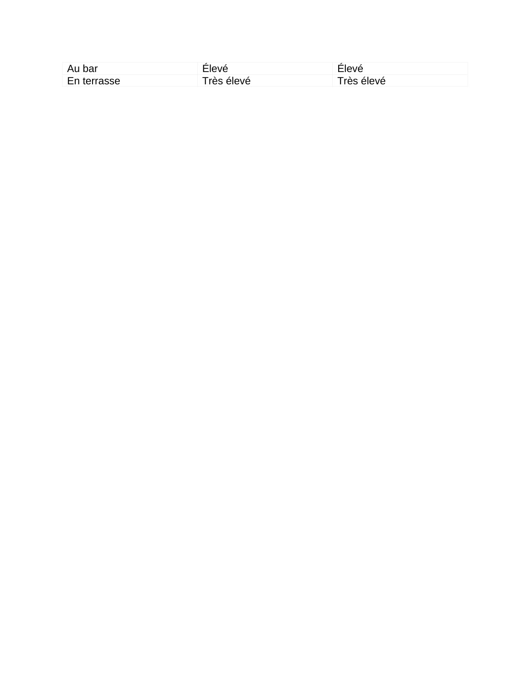

# Fiche_Revision_Design_COMPLETE.pdf

[Ouvrir l’original](https://drive.google.com/open?id=1_xEMVlftgpgqMib2ni4O6jh1RUp7_YqP) · Les pages signalées comprennent du texte reconnu automatiquement ou des éléments graphiques. Le fac-similé permet de vérifier chaque lecture.

**Pages avec fac-similé ou lecture OCR** — 4.

## Page 1

~~~text
                       FICHE DE RÉVISION
                        Introduction au Design - DST

PARTIE I : SYNTHÈSE DES 6 TD

TD1 : PRODUITS
1. Définition du design
   ● "Le design est une pratique de projet dont la finalité est l'amélioration de
     l'habitabilité du monde dans le respect des humains et des non-humains"
     (Findeli, 2015)
   ● Pratique de projet pluridisciplinaire
   ● Considère les dimensions fonctionnelles ET formelles
   ● De la conception d'idées à la post-production du prototype

2. Design & Ingénierie = Conception
   ● LE CONTEXTE EST ROI
   ● Invention + Contexte = Innovation
     ○ Invention seule ≠ innovation
     ○ Il faut que le contexte permette l'adoption de l'invention

3. Conception innovante (triangle)
   ● Désir / Peuple (Empathie) :
     ○ → Innovation émotionnelle
   ● Business / Viabilité (Créativité) :
     ○ → Innovation fonctionnelle
   ● Technologie / Faisabilité (Rationalité) :
     ○ → Innovation d'expérience
   ● Au centre : l'INNOVATION

4. Les révolutions industrielles
Période        Révolution     Technologies clés      Organisation du       Design
                                                     travail
1794-1870      1ère           Machine à vapeur,      Travail en usine      Naissance
                              éclairage au gaz,
                              télégraphe
1870-1969      2ème           Moteur à               Travail à la chaîne   Production
~~~

## Page 2

~~~text
                          combustion,                               de masse
                          électricité,
                          téléphone
1969-2000    3ème         Automation,          Responsabilisation   Produit +
                          électronique,        des travailleurs     Service
                          ordinateurs
2000-2015    4ème         Internet, IA, Big    Numérique            Systèmes
                          Data, robotique
2015-...     Transition   Réchauffement        Sens du travail      TES
                          climatique, crises

5. Concepts clés du TD1
  ● Paradoxe de Jevons (premier effet rebond) :
    ○ Efficience des machines à vapeur x3
    ○ Mais consommation de charbon x10
    ○ → Amélioration technique ≠ réduction consommation

  ● La règle des 3R :
    ○ Réduire
    ○ Réutiliser
    ○ Recycler

  ● Naissance du design :
    ○ Passage de l'artisanat à la production en série
    ○ Exemples : chaise gondole empire → chaises Cantilever Bauhaus
~~~

## Page 3

~~~text
TD2 : SERVICES
1. Évolution : Produit → Service + Produit → Système
  ● 3ème révolution industrielle : introduction de l'informatique
  ● Révolutionne la conception des produits dans leur rapport aux utilisateurs
  ● Émergence de la dimension [PRODUIT / SERVICE]

2. Le modèle du service physique
  ● 3 cercles interconnectés :
    ○ PRODUIT
    ○ LIEU
    ○ UTILISATEUR
  ● Au centre : SERVICE

  ● Exemple McDonald's (1955) :
    ○ PRODUIT = Hamburger
    ○ LIEU = Restaurant drive
    ○ UTILISATEUR = Automobiliste
    ○ → Première offre globale de service + produit

3. Expérience de service (Customer Journey)
  ● Points de contact (touchpoints) :
    ○ Visibilité → Accueil → Enregistrement → Emballage → Remerciement

  ● Ligne d'interaction :
    ○ Sépare ce qui est visible (frontline) de ce qui est invisible (backstage)

  ● Parcours utilisateur (exemple Drive) :
    ○ Faim → File d'attente → Enregistrement commande → Communication
       cuisines → Acheminement → Réception

  ● Preuves concrètes (feedback) :
    ○ Ticket de caisse, emballage, etc.

4. Valeur Produit + Service
  ● Principe :
    ○ Plus le niveau de service augmente, plus le prix augmente

  ● Exemple café Nespresso :
Lieu de consommation    Niveau de service                  Prix / tasse
À la maison             Faible                             Faible
Machine Nespresso       Moyen                              Moyen
~~~

## Page 4

~~~text
Au bar        Élevé        Élevé
En terrasse   Très élevé   Très élevé
~~~

## Page 5

~~~text
TD3 : DU SERVICE À L'INTERFACE
1. Design numérique vs Design d'interaction
  ● Design numérique (années 1980) :
    ○ En opposition au "design numériquement assisté"
    ○ La matière informatisée comme matière à modeler en elle-même

  ● Design d'interaction (années 1990) :
    ○ Faire émerger des usages
    ○ Donner forme aux matériaux informatisés

  ● Citation clé :
    ○ "From atoms to bits" (Nicholas Negroponte, Being Digital, 1995)

2. Interface Homme-Machine (IHM)
  ● Définition :
    ○ Dispositifs matériels + logiciels
    ○ Permettent l'interaction utilisateur ↔ système

  ● Conception centrée utilisateur :
    ○ Prendre en compte les besoins
    ○ Exigences des tâches
    ○ Environnement d'utilisation

3. Analyse fonctionnelle IHM (processus en 4 étapes)
1. Unité              2. Contraintes         3. Système        4. Solution
fonctionnelle                                produit           technique
Quelles fonctions     Quels sont les         Quels éléments    Quelles
intéressent           besoins du             répondent aux     technologies
l'utilisateur ?       contexte ?             contraintes ?     intègrent la
                                                               solution ?
Ex Walkman:           Nomade, solide,        Lecteur +         Miniaturiser
"Écouter K7 en        son personnel,         Amplificateur +   composants,
jouant au golf"       autonomie              Casque            protéger des chocs

4. Expérience Utilisateur (UX)
  ● PERCEPTION :
    ○ Comment l'utilisateur perçoit le produit/service
    ○ Ex : haute technologie, formes géométriques, tons sobres

  ● EXPÉRIENCE :
    ○ Ce que l'utilisateur apprécie lors de l'utilisation
~~~

## Page 6

~~~text
     ○ Ex : utilisation simple "sans couture" (seamless)

  ● SATISFACTION :
    ○ Pourquoi l'utilisateur réutilise / recommande
    ○ Ex : fonctions inédites, qualité sonore

5. Exemple : du Produit au Service numérique
  ● Produit seul :
    ○ Sony Walkman (1979)

  ● Produit + Service numérique :
    ○ Apple iPod (2001) + iTunes (2003)
    ○ → Intégration produit-interface-service
~~~

## Page 7

~~~text
TD4 : SYSTÈMES
1. Qu'est-ce qu'un système ?
  ● Définition :
    ○ "Ensemble d'éléments en interrelation organisé pour répondre à une finalité"

  ● Caractéristiques :
    ○ Souvent appelé "boîte noire" (connu par entrants/sortants)
    ○ Aucun système complètement ouvert ni complètement fermé
    ○ Met l'accent sur le caractère global

2. Systèmes compliqués vs Systèmes complexes
Systèmes COMPLIQUÉS                        Systèmes COMPLEXES
Nombreux éléments                          Nombreux éléments
Relations prévisibles                      Émergence, non-linéarité
Comportement déterministe                  Comportement imprévisible
Exemple : Avion de chasse                  Exemples : Corps humain, IA

3. Analyse du Cycle de Vie (ACV)
  ● Objectif :
    ○ Connaître et comparer les impacts environnementaux d'un système artificiel
    ○ Tout au long de son cycle de vie

  ● Étapes de l'ACV :
 1. Matières    2. Fabrication    3. Transport        4. Usage /    5. Fin de vie
  premières                                           Entretien
Extraction     Production        Distribution      Utilisation     Décharge /
                                                                   Recyclage

  ● Principe de Lavoisier :
    ○ Conservation de la masse
    ○ L'énergie comptabilisée en masse de combustibles (pas valeur énergétique)

4. Service numérique et matérialité
  ● Composition d'un service numérique :
    ○ Serveurs d'hébergement
    ○ Terminaux des utilisateurs
    ○ Équipements réseaux (transport données)
    ○ Autres services numériques

  ● Impact environnemental :
    ○ La high tech n'est PAS "virtuelle"
~~~

## Page 8

~~~text
     ○ IA augmente de 20-40% par an
     ○ Consommation centres de données > consommation ménages (ex: Irlande)
     ○ Consommation énergétique numérique = 1-1,3% électricité mondiale

5. Les systèmes sociaux
  ● Issus de l'instinct grégaire (humains et non-humains)
  ● Composants :
    ○ Récepteurs :
       1. Moyens qui entrent
    ○ Capteurs :
       1. Informations de l'environnement
    ○ Affecteurs :
       1. Influencent le système

6. Réseaux sociaux et Web
  ● Web 2.0 (années 2000) :
    ○ Espaces de partage
    ○ Circulation bidirectionnelle de l'information

  ● Web 3.0 / IoT :
    ○ Environnement → Captation → Données → Partage → Traitement →
      Information → Action → Interactions sociales
~~~

## Page 9

~~~text
TD5 : ÉCOSYSTÈMES
1. Définition
   ● Écosystème :
     ○ Ensemble d'êtres vivants
     ○ Vivant dans un milieu/environnement spécifique
     ○ Interagissant entre eux et avec ce milieu
     ○ → Ce sont des systèmes NATURELS

   ● La Biosphère :
     ○ Atmosphère
        1. Air
     ○ Hydrosphère
        1. Eau
     ○ Lithosphère
        1. Terre

2. Systèmes socio-économiques
   ● Fonctionnement de la société :
     ○ Prélèvement de ressources naturelles
     ○ Émission de rejets
     ○ → Conséquences sur les milieux

   ● Symétriquement :
     ○ Caractéristiques des milieux naturels
     ○ → Influence sur les sociétés (économie, cadre de vie, services)

   ● Métabolisme territorial :
     ○ Analyse des flux de matières
     ○ Basée sur principe conservation masse (Lavoisier)

3. Parties prenantes
   ● Exemple McDonald's France (Rapport 2025) :
     ○ Partenaires agricoles
     ○ Fournisseurs
     ○ Clients
     ○ Collaborateurs
     ○ Associations / ONG
     ○ Acteurs institutionnels
     ○ Partenaires financiers
     ○ Restaurants / Franchisés
~~~

## Page 10

~~~text
4. Ville low-tech
   ● Principe :
     ○ Faible intensité matérielle
     ○ Haute intensité relationnelle

   ● Exemple : Appartement "biosphère urbaine" (juillet 2024)
     ○ Sobre en eau et en énergie
     ○ Vise la neutralité carbone
     ○ "Il faut un monde fou pour faire tourner un appartement low tech"

5. Hiérarchie des systèmes (TRÈS IMPORTANT)
Niveau 1 (ENGLOBANT)         Biosphère, Écosystèmes
Niveau 2                     Systèmes sociaux
Niveau 3 (ENGLOBÉ)           Systèmes artificiels

   ● Citation clé (D.H. Meadows, 2008) :
     ○ "Le but original d'une hiérarchie est toujours d'aider les sous-systèmes qui
        l'ont créée à mieux faire leur travail"

6. Transition Écologique et Sociale (TES)
   ● Approche systémique :
     ○ De la conception à la fin d'utilisation
     ○ Solutions globales et pérennes
     ○ Enjeux environnementaux ET sociétaux
~~~

## Page 11

~~~text
TD6 : MISE EN APPLICATION
1. Le design systémique
  ● CYCLES :
    ○ Usage : cycle de l'usage
    ○ Conception : ACV (Refuser, Réutiliser, Recycler, Réduire)

  ● ÉCHELLES :
    ○ Carte des parties prenantes (personnel / social / sociétal)
    ○ Hiérarchie (artificiel → social → environnemental)

2. Exemple d'évolution : la restauration
Année        Lieu        Innovation           Caractéristiques      Contexte
1765         Paris       Restaurant           Tables                vs auberges (plat
                         moderne              individuelles, menu   unique, table
                                              à choix               d'hôte)
1880         Paris       Brasseries           N'importe quelle      Alsaciens fuyant
                         alsaciennes          heure,                annexion
                                              choucroute/huîtres,   allemande
                                              décor alsacien
1955         USA         McDonald             Restauration rapide   Culture
                                              à emporter en         automobile
                                              voiture
1990         Bruxelles   Le Pain Quotidien    "Endroit me sentir    200 restaurants
                                              maison loin           monde (2024)
                                              maison"
2015         Paris       UberEATS             Centaines             Économie
                                              restaurants,          plateforme
                                              livraison rapide IA

3. Recommandations pour le partiel
  ●    ❌✅ NIFocaliser
              hors sujet NI anachronisme
  ●
  ●     ✅○ Annoncer    sur utilisateurs SANS oublier parties prenantes
           Équilibrer analyse / diagnostic / recommandations
                      le POURQUOI et le QUOI
       ○ Décrire le COMMENT
~~~

## Page 12

~~~text
PARTIE II : MÉTHODOLOGIE EXAMEN

1. FORMAT DE L'EXAMEN
DURÉE                                      1h30 (90 minutes)
VOLUME                                     5 pages RECTO/VERSO = 10 PAGES
STRUCTURE                                  Introduction + Développement +
                                           Conclusion
DOCUMENTS                                  AUCUN autorisé

Barème (sur 20 points)
Critère                                                           Points
Liens entre design et ingénierie                                    3
Conception du produit/service en lien avec la TES                   3
Raison d'être, IHM et cycle de vie                                  3
Rédaction (lisibilité, orthographe, syntaxe)                        5
Références aux cours et cas étudiés en TD                           6
TOTAL                                                              20

2. GESTION DU TEMPS (90 minutes)
Phase               Action                                        Temps
Lecture             Lire TOUS les documents + sujet               10 min
                    attentivement
Analyse             Identifier mots-clés, périodes, évolutions,   10 min
                    concepts à mobiliser
Plan                Structurer : Intro + 2-3 parties +            10 min
                    Conclusion AU BROUILLON
Rédaction           Écrire les 10 pages (5 min/page)              50 min
Relecture           Corriger fautes, vérifier cohérence et        10 min
                    références
~~~

## Page 13

~~~text
3. STRUCTURE DE LA COPIE
A. INTRODUCTION (1 à 1,5 page)
  1. Accroche (2-3 lignes)
     ○ Phrase générale sur le contexte historique/social du sujet
     ○ Exemple :
       1. "Depuis la première révolution industrielle, la relation entre design et
          ingénierie n'a cessé d'évoluer..."

  2. Présentation du sujet (5-6 lignes)
     ○ Présenter brièvement les documents fournis
     ○ Identifier les périodes/évolutions principales
     ○ Exemple :
        1. "Les documents proposés illustrent l'évolution du dispositif de lavage du
           linge du XIXe siècle à aujourd'hui, en passant par..."

  3. Problématique (3-4 lignes)
     ○ REFORMULER la question posée (NE PAS COPIER)
     ○ Montrer que vous avez compris les enjeux

  4. Annonce du plan (2-3 lignes)
     ○ "Dans une première partie, nous analyserons... Puis, nous étudierons...
       Enfin, nous examinerons..."

B. DÉVELOPPEMENT (6 à 7 pages)
  ● Structure recommandée : 2 à 3 grandes parties
  ● Chaque partie = 2 à 3 pages

  ● PLAN TYPE (historique + analytique) :

  ● PARTIE I : Évolution historique (DIACHRONIE)
    ○ A. Les premières formes (Document 1)
      1. Contexte initial, raison d'être
      2. Lien avec révolution industrielle correspondante
    ○ B. L'industrialisation (Documents 2-3)
      1. Évolution technique
      2. Production de masse
      3. → Référence aux révolutions industrielles TD1

  ● PARTIE II : Analyse contemporaine (SYNCHRONIE)
    ○ A. Exemple high-tech (Document 4)
      1. IHM :
      2. Analyse fonctionnelle (Unité fonctionnelle → Contraintes → Système →
         Solution)
~~~

## Page 14

~~~text
       3. UX :
       4. Perception / Expérience / Satisfaction
       5. ACV :
       6. Impacts environnementaux (extraction → fin de vie)
     ○ B. Exemple low-tech (Document 5)
       1. Approche TES
       2. Raison d'être
       3. Parties prenantes

  ● PARTIE III : Enjeux actuels et perspectives
    ○ A. Attentes utilisateurs (dimension sociale)
      1. Besoins contemporains
      2. Service + produit
    ○ B. Enjeux écologiques (hiérarchie des systèmes)
      1. Systèmes artificiels → sociaux → environnementaux
      2. Design systémique et TES

C. CONCLUSION (1 à 1,5 page)
  5. Synthèse (5-6 lignes)
     ○ Résumer les grandes idées développées
     ○ Rappeler les points clés de chaque partie

  6. Réponse à la question (3-4 lignes)
     ○ RÉPONDRE CLAIREMENT à la problématique
     ○ Prendre position

  7. Ouverture (2-3 lignes)
     ○ Élargir vers des enjeux futurs
     ○ Exemple : "Face aux défis de la transition écologique, le design devra..."
~~~

## Page 15

~~~text
4. GRILLE D'ANALYSE DES DOCUMENTS
  ● Pour CHAQUE document, posez-vous ces questions :

Question             Ce qu'il faut chercher
QUAND ?              Période historique, contexte, quelle révolution industrielle ?
OÙ ?                 Lieu d'usage, géographie, contexte socio-culturel
QUI ?                Utilisateurs, parties prenantes (fournisseurs, fabricants,
                     distributeurs...)
QUOI ?               Le dispositif, ses caractéristiques, ses fonctions
POURQUOI ?           Raison d'être, besoin, problème résolu
COMMENT ?            Technologies, solutions techniques, IHM, processus de
                     fabrication

5. CONCEPTS CLÉS À MOBILISER
  ● TD1 (Produits) :
    ○ Révolutions industrielles, Paradoxe de Jevons, Règle des 3R, Contexte roi

  ● TD2 (Services) :
    ○ Modèle service physique (Produit/Lieu/Utilisateur), Points de contact, Ligne
      d'interaction, Valeur produit+service

  ● TD3 (Interfaces) :
    ○ Design numérique vs design d'interaction, IHM, Analyse fonctionnelle, UX
      (Perception/Expérience/Satisfaction)

  ● TD4 (Systèmes) :
    ○ Systèmes compliqués vs complexes, ACV, Matérialité du numérique,
      Systèmes sociaux, Web 2.0/3.0

  ● TD5 (Écosystèmes) :
    ○ Biosphère, Systèmes socio-économiques, Hiérarchie des systèmes, Parties
      prenantes, TES, Low-tech

  ● TD6 (Mise en application) :
    ○ Design systémique, Cycles et Échelles, Évolution dispositifs

6. ASTUCES POUR RÉUSSIR
  ●   ✅✅ Lire  TOUS les documents avant de commencer
  ●
  ●
  ●
       ✅✅ Faire
          Souligner les mots-clés de la question
                un plan détaillé au brouillon
          Citer les documents ("comme le montre le document 3...")
~~~

## Page 16

~~~text
  ● ✅concepts)
        Mobiliser le vocabulaire des TD (montrer que vous connaissez les

  ● ✅ Faire des phrases courtes et claires
  ● ✅ Aérer la copie (sauter des lignes entre parties)
  ● ✅ Garder 10 minutes pour relire

7. PIÈGES À ÉVITER
  ●   ❌❌ Hors-sujet    (ne pas répondre à la question)
  ●
  ●    ❌❌ Anachronisme      (mélanger les périodes)
           Paraphrase (redire les documents sans analyser)
  ●
  ●
  ●
        ❌❌ Oublier
           Oublier les références aux cours
                    les parties prenantes
           Copie illisible

                       L'ESSENTIEL À RETENIR
 → 10 pages = 1,5 page intro + 6-7 pages développement + 1,5 page
 conclusion
 → Analyser CHAQUE document avec TOUS les TD en tête
 → Mobiliser le vocabulaire des cours (IHM, ACV, TES, hiérarchie...)
 → Dimension DIACHRONIQUE (évolution) + SYNCHRONIQUE (analyse)
 → Faire des liens design/ingénierie/TES

                         BON COURAGE !             🎯
~~~
