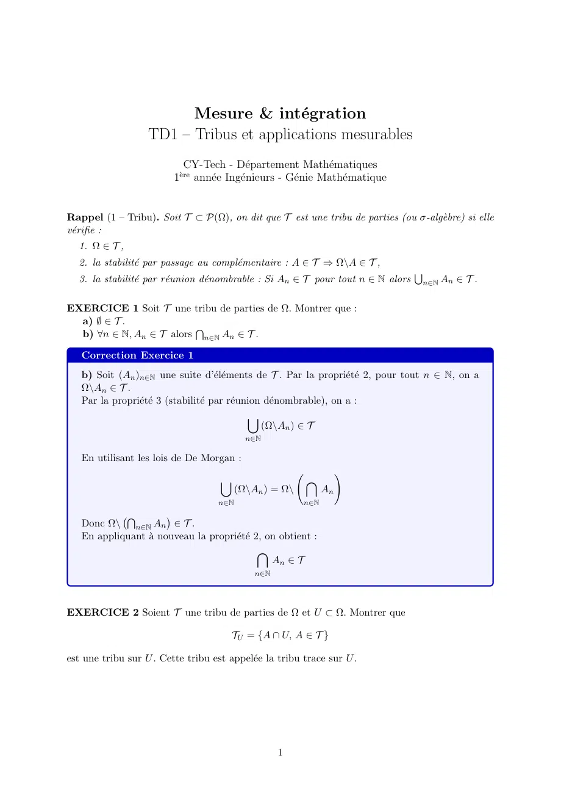
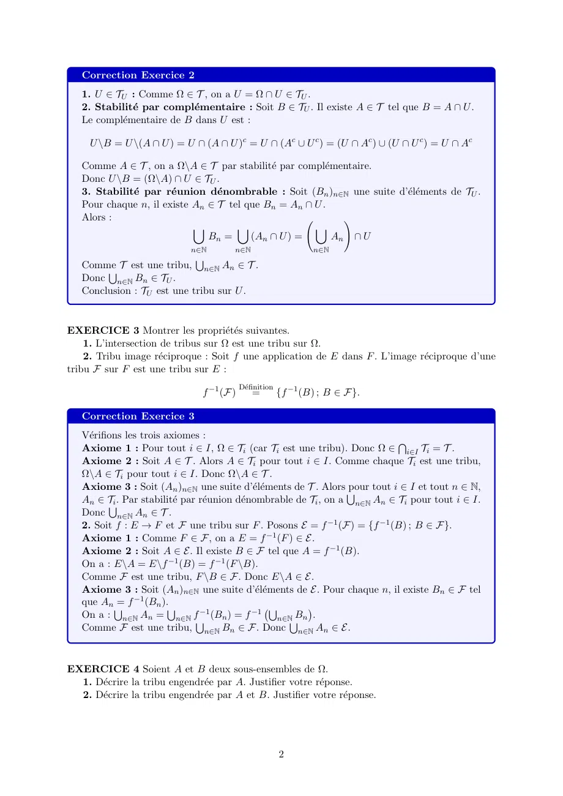
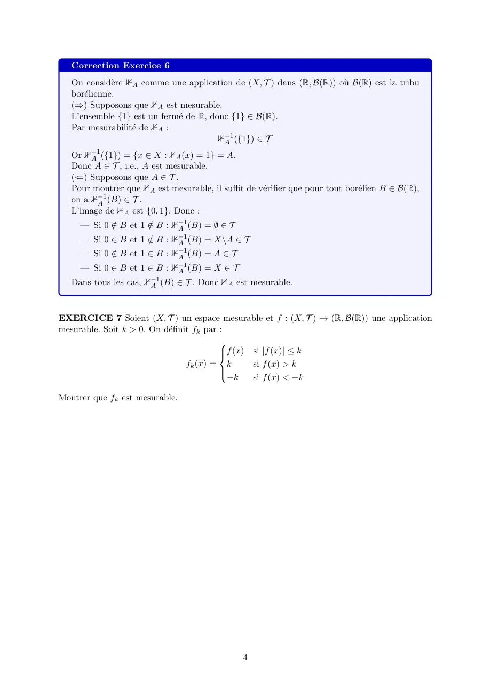
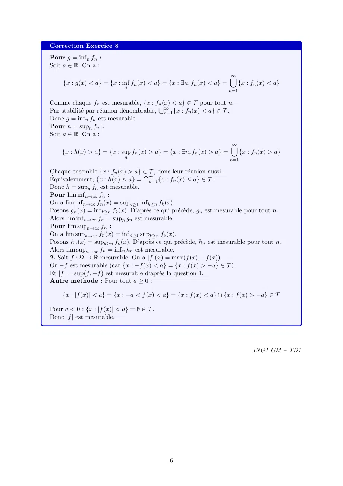

# CLAUDE MESURE TD1.pdf

[Ouvrir l’original](https://drive.google.com/open?id=1XyLsznLdzMmgM_MOFlWJUVDO98_ozozR) · Les deux lectures automatiques du PDF divergent sur les pages indiquées. Leur fac-similé accompagne le texte.

**Pages présentant un écart entre les deux extractions** — 1–2, 4, 6.

## Page 1

~~~text
                         Mesure & intégration
                   TD1 – Tribus et applications mesurables
                            CY-Tech - Département Mathématiques
                         1ère année Ingénieurs - Génie Mathématique

Rappel (1 – Tribu). Soit T ⊂ P(Ω), on dit que T est une tribu de parties (ou σ-algèbre) si elle
vérifie :
  1. Ω ∈ T ,
  2. la stabilité par passage au complémentaire : A ∈ T ⇒ Ω\A ∈ T ,
                                                                                 S
  3. la stabilité par réunion dénombrable : Si An ∈ T pour tout n ∈ N alors   n∈N An ∈ T .

EXERCICE 1 Soit T une tribu de parties de Ω. Montrer que :
  a) ∅ ∈ T .             T
  b) ∀n ∈ N, An ∈ T alors n∈N An ∈ T .

   Correction Exercice 1
   b) Soit (An )n∈N une suite d’éléments de T . Par la propriété 2, pour tout n ∈ N, on a
   Ω\An ∈ T .
   Par la propriété 3 (stabilité par réunion dénombrable), on a :
                                             [
                                                (Ω\An ) ∈ T
                                            n∈N

   En utilisant les lois de De Morgan :
                                                                    !
                                    [                    \
                                          (Ω\An ) = Ω\         An
                                    n∈N                  n∈N
            T         
   Donc Ω\ n∈N An ∈ T .
   En appliquant à nouveau la propriété 2, on obtient :
                                            \
                                               An ∈ T
                                              n∈N

EXERCICE 2 Soient T une tribu de parties de Ω et U ⊂ Ω. Montrer que

                                       TU = {A ∩ U, A ∈ T }

est une tribu sur U . Cette tribu est appelée la tribu trace sur U .

                                                    1
~~~

## Page 2

~~~text
   Correction Exercice 2
   1. U ∈ TU : Comme Ω ∈ T , on a U = Ω ∩ U ∈ TU .
   2. Stabilité par complémentaire : Soit B ∈ TU . Il existe A ∈ T tel que B = A ∩ U .
   Le complémentaire de B dans U est :

     U \B = U \(A ∩ U ) = U ∩ (A ∩ U )c = U ∩ (Ac ∪ U c ) = (U ∩ Ac ) ∪ (U ∩ U c ) = U ∩ Ac

   Comme A ∈ T , on a Ω\A ∈ T par stabilité par complémentaire.
   Donc U \B = (Ω\A) ∩ U ∈ TU .
   3. Stabilité par réunion dénombrable : Soit (Bn )n∈N une suite d’éléments de TU .
   Pour chaque n, il existe An ∈ T tel que Bn = An ∩ U .
   Alors :                                                 !
                            [        [               [
                               Bn =     (An ∩ U ) =      An ∩ U
                            n∈N        n∈N                      n∈N
                             S
   CommeS T est une tribu, n∈N An ∈ T .
   Donc n∈N Bn ∈ TU .
   Conclusion : TU est une tribu sur U .

EXERCICE 3 Montrer les propriétés suivantes.
    1. L’intersection de tribus sur Ω est une tribu sur Ω.
    2. Tribu image réciproque : Soit f une application de E dans F . L’image réciproque d’une
tribu F sur F est une tribu sur E :
                                          Définition
                               f −1 (F)       =         {f −1 (B) ; B ∈ F}.

   Correction Exercice 3
   Vérifions les trois axiomes :                                             T
   Axiome 1 : Pour tout i ∈ I, Ω ∈ Ti (car Ti est une tribu). Donc Ω ∈ i∈I Ti = T .
   Axiome 2 : Soit A ∈ T . Alors A ∈ Ti pour tout i ∈ I. Comme chaque Ti est une tribu,
   Ω\A ∈ Ti pour tout i ∈ I. Donc Ω\A ∈ T .
   Axiome 3 : Soit (An )n∈N une suite d’éléments de T . Alors S  pour tout i ∈ I et tout n ∈ N,
   An ∈ TSi . Par stabilité par réunion dénombrable de Ti , on a n∈N An ∈ Ti pour tout i ∈ I.
   Donc n∈N An ∈ T .
   2. Soit f : E → F et F une tribu sur F . Posons E = f −1 (F) = {f −1 (B) ; B ∈ F}.
   Axiome 1 : Comme F ∈ F, on a E = f −1 (F ) ∈ E.
   Axiome 2 : Soit A ∈ E. Il existe B ∈ F tel que A = f −1 (B).
   On a : E\A = E\f −1 (B) = f −1 (F \B).
   Comme F est une tribu, F \B ∈ F. Donc E\A ∈ E.
   Axiome 3 : Soit (An )n∈N une suite d’éléments de E. Pour chaque n, il existe Bn ∈ F tel
   que AnS  = f −1 (Bn ).S
   On a : n∈N An = n∈N fS−1 (Bn ) = f −1
                                                 S        
                                                   n∈NSBn .
   Comme F est une tribu, n∈N Bn ∈ F. Donc n∈N An ∈ E.

EXERCICE 4 Soient A et B deux sous-ensembles de Ω.
  1. Décrire la tribu engendrée par A. Justifier votre réponse.
  2. Décrire la tribu engendrée par A et B. Justifier votre réponse.

                                                        2
~~~

## Page 3

~~~text
   Correction Exercice 4
   Elle est donnée par :
                                       σ(A) = {∅, A, Ω\A, Ω}
   Justification :
     — Cette collection contient Ω (axiome 1).
     — Elle est stable par complémentaire : (Ω)c = ∅, (∅)c = Ω, (A)c = Ω\A, (Ω\A)c = A.
     — Elle est stable par réunion dénombrable (toutes les réunions donnent un des quatre
       ensembles).
     — C’est la plus petite car toute tribu contenant A doit aussi contenir ∅, Ω et Ω\A.
   2. La tribu engendrée par A et B, notée σ(A, B), est la plus petite tribu contenant A et
   B.
   Elle contient au maximum 16 éléments :

               σ(A, B) = {∅, A, B, A ∩ B, A ∪ B, A\B, B\A, (A ∪ B)c , (A ∩ B)c ,

                      A ∩ B c , Ac ∩ B, Ac ∩ B c , A ∪ B c , Ac ∪ B, Ac ∪ B c , Ω}
   En pratique, certains de ces ensembles peuvent coı̈ncider selon les relations entre A et B.
   La tribu engendrée contient tous les ensembles qui peuvent être construits à partir de A
   et B par les opérations booléennes (union, intersection, complémentaire).
   On peut aussi l’exprimer comme :

          σ(A, B) = {A ∩ B, A ∩ B c , Ac ∩ B, Ac ∩ B c } et toutes leurs réunions finies

   Ces quatre ensembles forment une partition de Ω (s’ils sont non vides).

Rappel (2 – Application mesurable). Soient (Ω1 , T1 ) et (Ω2 , T2 ) deux espaces mesurables. Soit
f : Ω1 → Ω2 . On dit que f est (T1 , T2 )-mesurable si l’image réciproque de tout élément de T2
par f appartient à T1 :
                                  ∀B ∈ T2 , f −1 (B) ∈ T1 .

EXERCICE 5 Soient (Ω1 , T1 ), (Ω2 , T2 ) et (Ω3 , T3 ) trois espaces mesurables. Soient g : Ω2 → Ω3
une application continue, f : Ω1 → Ω2 une application mesurable, h = g ◦ f . Montrer que h est
une application mesurable.

   Correction Exercice 5
   On veut montrer que h : Ω1 → Ω3 est (T1 , T3 )-mesurable.
   Soit C ∈ T3 . On doit montrer que h−1 (C) ∈ T1 .
   On a :
                           h−1 (C) = (g ◦ f )−1 (C) = f −1 (g −1 (C))
   Comme g est (T2 , T3 )-mesurable et C ∈ T3 , on a g −1 (C) ∈ T2 .
   Comme f est (T1 , T2 )-mesurable et g −1 (C) ∈ T2 , on a f −1 (g −1 (C)) ∈ T1 .
   Donc h−1 (C) ∈ T1 , ce qui prouve que h est mesurable.
   Conclusion : La composition de deux applications mesurables est mesurable.

EXERCICE 6 Soit (X, T ) un espace mesurable. On note ⊮A la fonction indicatrice sur A.
Montrer que ⊮A est mesurable si et seulement si A est mesurable.

                                                   3
~~~

## Page 4

~~~text
   Correction Exercice 6
   On considère ⊮A comme une application de (X, T ) dans (R, B(R)) où B(R) est la tribu
   borélienne.
   (⇒) Supposons que ⊮A est mesurable.
   L’ensemble {1} est un fermé de R, donc {1} ∈ B(R).
   Par mesurabilité de ⊮A :
                                        ⊮−1
                                         A ({1}) ∈ T

   Or ⊮−1
        A ({1}) = {x ∈ X : ⊮A (x) = 1} = A.
   Donc A ∈ T , i.e., A est mesurable.
   (⇐) Supposons que A ∈ T .
   Pour montrer que ⊮A est mesurable, il suffit de vérifier que pour tout borélien B ∈ B(R),
   on a ⊮−1
         A (B) ∈ T .
   L’image de ⊮A est {0, 1}. Donc :
     — Si 0 ∈        / B : ⊮−1
            / B et 1 ∈      A (B) = ∅ ∈ T
                     / B : ⊮−1
     — Si 0 ∈ B et 1 ∈      A (B) = X\A ∈ T
            / B et 1 ∈ B : ⊮−1
     — Si 0 ∈               A (B) = A ∈ T
     — Si 0 ∈ B et 1 ∈ B : ⊮−1
                            A (B) = X ∈ T
   Dans tous les cas, ⊮−1
                       A (B) ∈ T . Donc ⊮A est mesurable.

EXERCICE 7 Soient (X, T ) un espace mesurable et f : (X, T ) → (R, B(R)) une application
mesurable. Soit k > 0. On définit fk par :
                                          
                                          f (x) si |f (x)| ≤ k
                                          
                                 fk (x) = k      si f (x) > k
                                          
                                            −k   si f (x) < −k
                                          

Montrer que fk est mesurable.

                                               4
~~~

## Page 5

~~~text
   Correction Exercice 7
   Pour montrer que fk est mesurable, on utilise le fait que f est mesurable et que les
   opérations min et max préservent la mesurabilité.
   Méthode directe : Soit a ∈ R. On doit montrer que {x ∈ X : fk (x) < a} ∈ T .
   On distingue trois cas :
   Cas 1 : a ≤ −k
   {x : fk (x) < a} = ∅ ∈ T car fk (x) ≥ −k pour tout x.
   Cas 2 : −k < a ≤ k
   {x : fk (x) < a} = {x : f (x) < a} ∈ T car f est mesurable.
   En effet, si f (x) < a < k, alors |f (x)| < k ou f (x) < −k < a, donc fk (x) = f (x) < a ou
   fk (x) = −k < a.
   Plus précisément :

                {x : fk (x) < a} = {x : f (x) < a et |f (x)| ≤ k} ∪ {x : f (x) < −k}

                        = {x : f (x) < a et f (x) ≥ −k} ∪ {x : f (x) < −k}
                                         = {x : f (x) < a}
   Cas 3 : a > k
   {x : fk (x) < a} = X ∈ T car fk (x) ≤ k < a pour tout x.
   Dans tous les cas, {x : fk (x) < a} ∈ T .
   Comme les ensembles de la forme {x : fk (x) < a} engendrent la tribu borélienne, fk est
   mesurable.
   Conclusion : La fonction tronquée fk est mesurable.

EXERCICE 8
    1. Soient fn : Ω → R des fonctions mesurables. Montrer que inf n fn , supn fn , lim inf n fn et
lim supn fn sont mesurables à valeurs dans R.
    2. Soit f : Ω → R une fonction mesurable. Montrer que |f | est une fonction mesurable.

                                                 5
~~~

## Page 6

~~~text
Correction Exercice 8
Pour g = inf n fn :
Soit a ∈ R. On a :
                                                                      ∞
                                                                      [
     {x : g(x) < a} = {x : inf fn (x) < a} = {x : ∃n, fn (x) < a} =       {x : fn (x) < a}
                            n
                                                                      n=1

Comme chaque fn est mesurable, {x : fnS(x) < a} ∈ T pour tout n.
Par stabilité par réunion dénombrable, ∞
                                          n=1 {x : fn (x) < a} ∈ T .
Donc g = inf n fn est mesurable.
Pour h = supn fn :
Soit a ∈ R. On a :
                                                                      ∞
                                                                      [
    {x : h(x) > a} = {x : sup fn (x) > a} = {x : ∃n, fn (x) > a} =          {x : fn (x) > a}
                            n
                                                                      n=1

Chaque ensemble {x : fn (x) > a} ∈  TT , donc leur réunion aussi.
Équivalemment, {x : h(x) ≤ a} = ∞     n=1 {x : fn (x) ≤ a} ∈ T .
Donc h = supn fn est mesurable.
Pour lim inf n→∞ fn :
On a lim inf n→∞ fn (x) = supn≥1 inf k≥n fk (x).
Posons gn (x) = inf k≥n fk (x). D’après ce qui précède, gn est mesurable pour tout n.
Alors lim inf n→∞ fn = supn gn est mesurable.
Pour lim supn→∞ fn :
On a lim supn→∞ fn (x) = inf n≥1 supk≥n fk (x).
Posons hn (x) = supk≥n fk (x). D’après ce qui précède, hn est mesurable pour tout n.
Alors lim supn→∞ fn = inf n hn est mesurable.
2. Soit f : Ω → R mesurable. On a |f |(x) = max(f (x), −f (x)).
Or −f est mesurable (car {x : −f (x) < a} = {x : f (x) > −a} ∈ T ).
Et |f | = sup(f, −f ) est mesurable d’après la question 1.
Autre méthode : Pour tout a ≥ 0 :

    {x : |f (x)| < a} = {x : −a < f (x) < a} = {x : f (x) < a} ∩ {x : f (x) > −a} ∈ T

Pour a < 0 : {x : |f (x)| < a} = ∅ ∈ T .
Donc |f | est mesurable.

                                                                                 ING1 GM – TD1

                                             6
~~~
