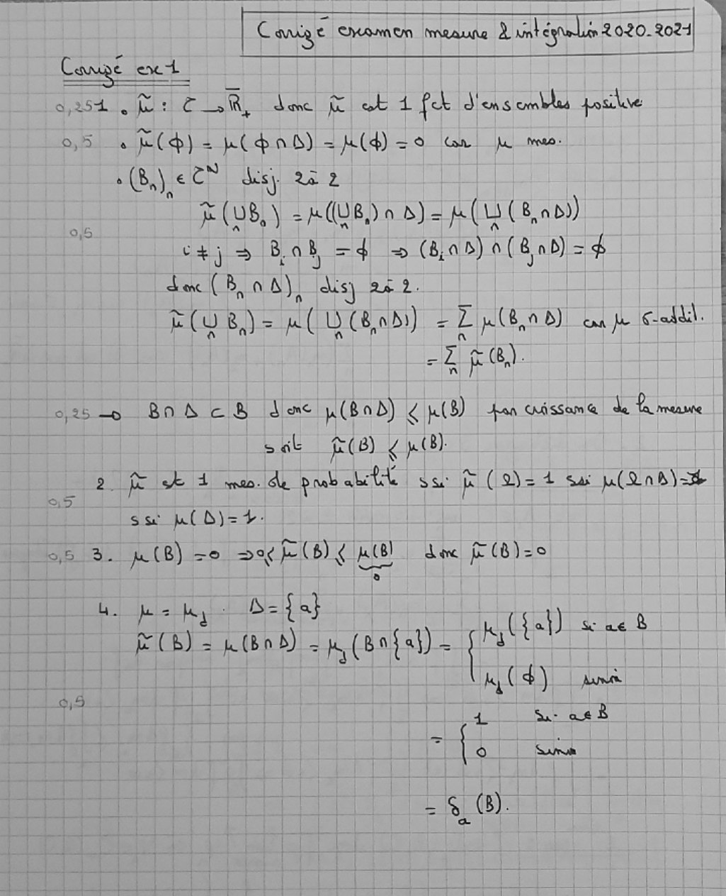
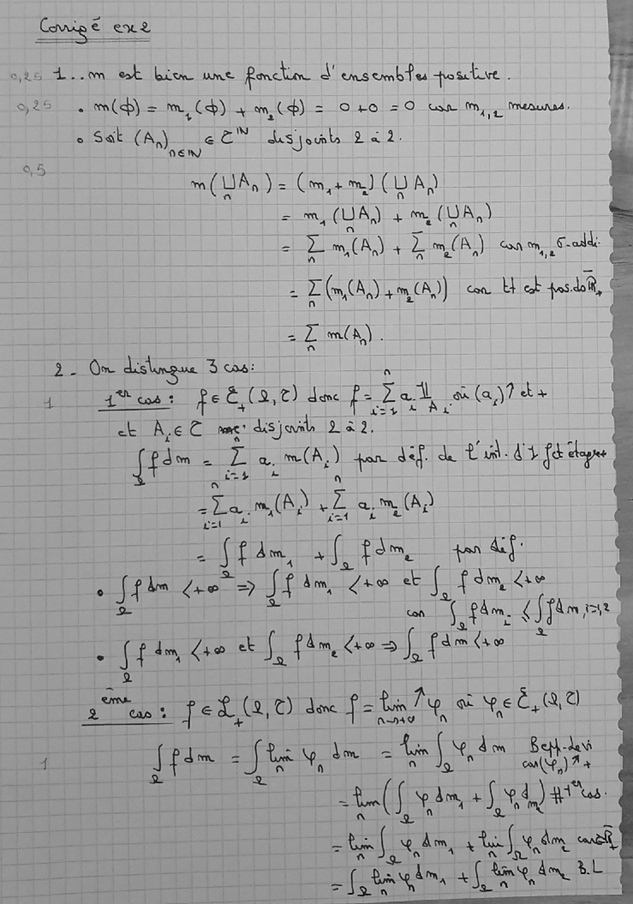
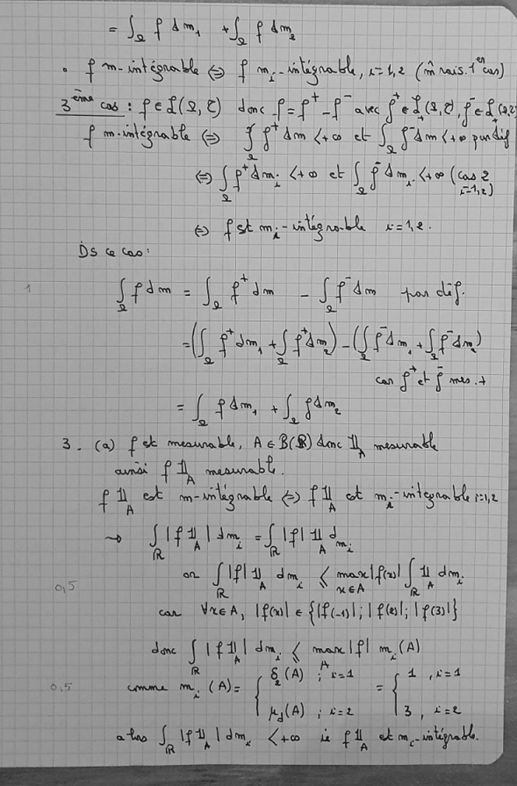
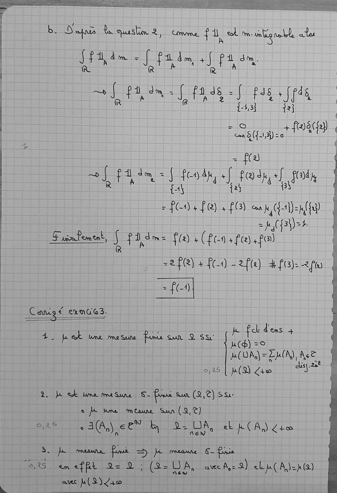
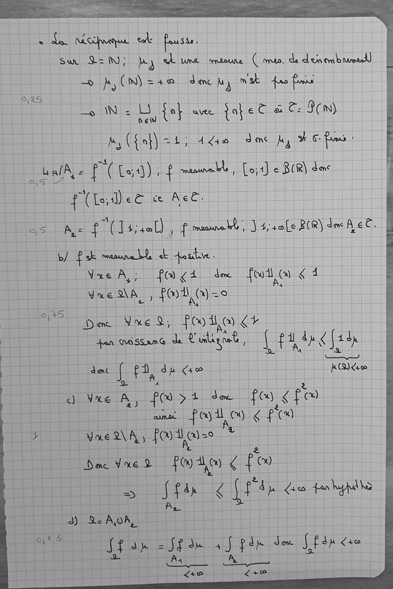
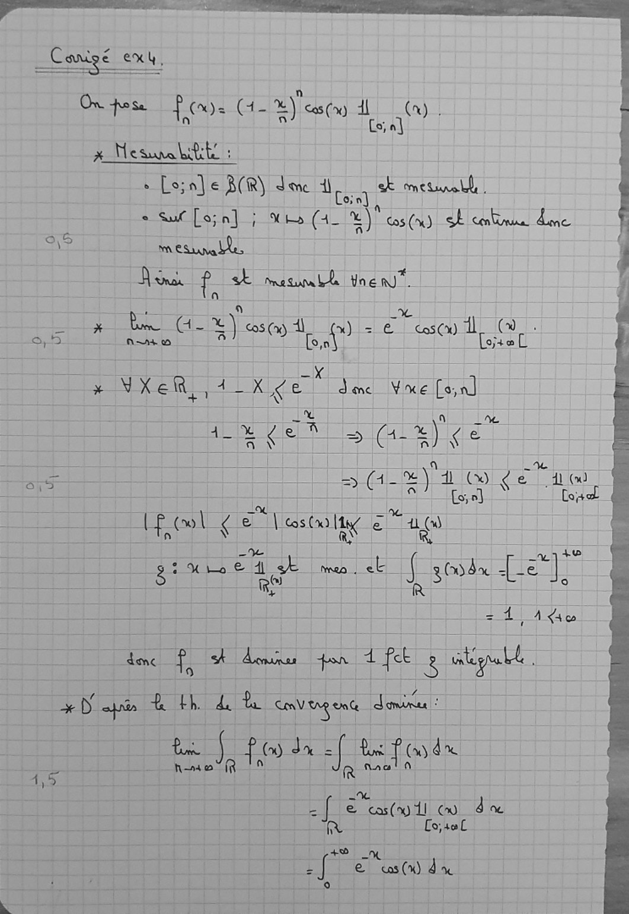
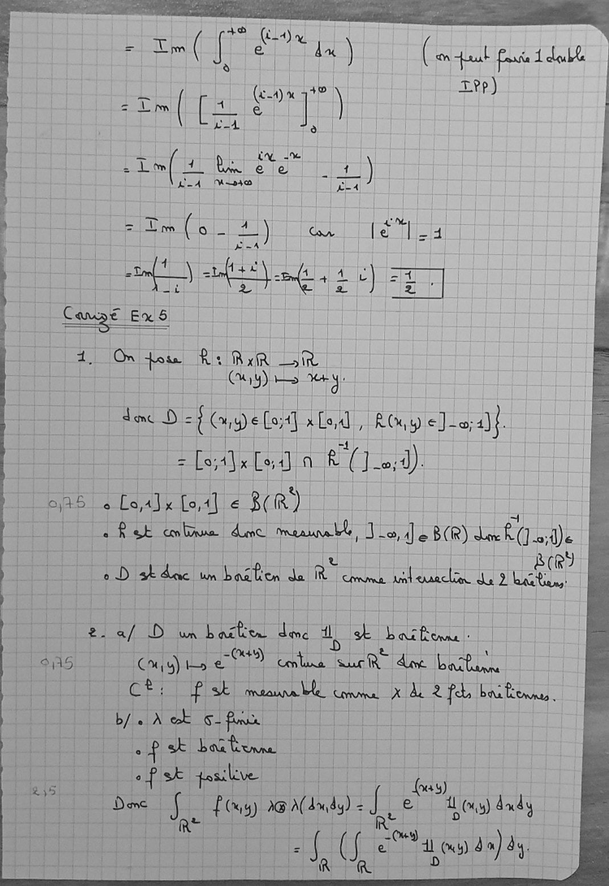
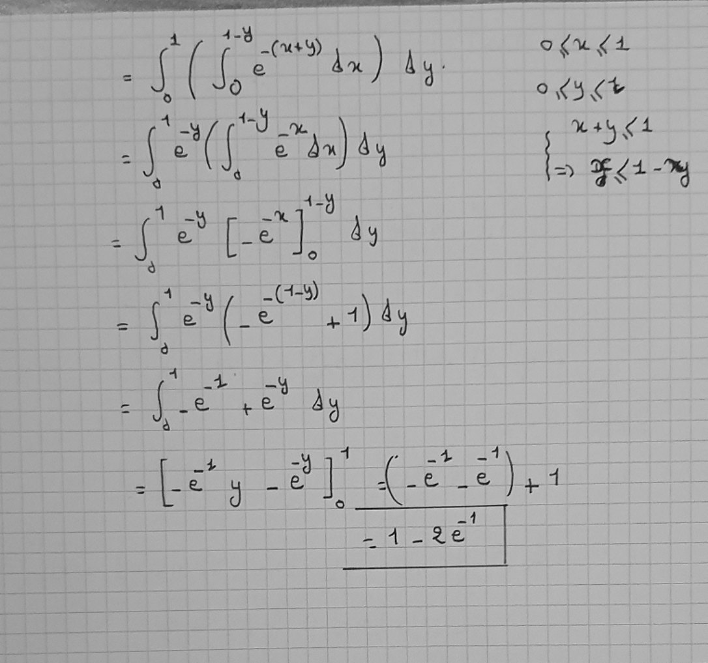

# Corrigé éxamen_mesure_2020_2021[2703].pdf

[Ouvrir l’original](https://drive.google.com/open?id=1Bx-HIFC_e1gq0gYqwTvklueURSk8C5VA) · Les pages signalées comprennent du texte reconnu automatiquement ou des éléments graphiques. Le fac-similé permet de vérifier chaque lecture.

**Pages avec fac-similé ou lecture OCR** — 1–8.

## Page 1

**Lecture OCR à contrôler**

~~~text
Cange SUR ER imeaua 2 antépeLe 2020. +024
Compe ext. iol]

a,251/. 0: ER dene! fic] et 4 feck Jens cmbles pale |
0,5 à (>) = (dan) = K(d)=e Gr pe me.
» (8) ¢ lax des) 2a 2
Fe (08) = A (UE) 9 d)= (13 (8,00)

tjs Bob =4 0 (600) 0(8ad)=4

dnc (Bob) dis) 242.

ECO B= eC UCR rd) =D pod) up call |

2 Fa).

3255 Boh CE d mc (Bod) < (8) Jan CMissem @ Late
sak (8) ¢ HU)
_ 2. ite © HEURE UE prb abit Su fp (924 Er MEME
ss bi D)=+-
5 3. p(B) =o sof (B)¢ Kel dee fe (B)=°

I PORTS à}
E(B). i (B05) =H (84al)~ ne see
HS) ane

À ee Son ace RD

ASE
~~~

## Page 2

**Lecture OCR à contrôler**

~~~text
Cm exe re
SL Le. et bien une Recto d'ensembtu toute . 4
925. ml) = me, Cp) " om, CS) =_O+0 =O tan M, Menus:

2 Sak Ce EN Lsjouls 22:
Acgdua Cm, +m) (U A)
mA) 4 fm, (UA, )
= cay 1 m,(A,) coq om, Calle

- 5
= 2 L (CA) 4m CA) cs Et co os do, Es

2 ZL m(h,) . }

22 On Her 3 co:

4 des: fe E (3, t) dene f= VS À (ates \
ek Na em Dre MARIE 3

fes. = L'a,mA) pon dif de LA. =

we m(A,) vi a, (A

Lt

2 [tn sie foes ef
ite Rm =} Sf Am +e & Ane die
con fhm. (Sfam ee à

cert rer a Pi fam, hoof fam de ss
Betta Cap % fed, ©) doe fatale où peë Ro
1 js He atn| xin 8 Sale
tn fae +S, ob) ja

Es De
= [ès sql A [nn BL
~~~

## Page 3

**Lecture OCR à contrôler**

~~~text
> Tint te CREER RE ee ee ===.
= ie j Na oh f Em,

i $e smb ue ble fo) f mm, -tiligoa ble ve 4,2 (om hais. À tan)
Bas PeL(9,0) dec epi nad flee, fete
mm inl ego = i m ¢4o eb TAGS ade
{ gult © See raise) Clelrwdiy
© (p'âm Go + REC ECK: que
r (3) fist omj- ligne lhe eohe.
Ds @ tan!
i fas E 5 pin pi Ar Fron dif.
cf, Jam xl fam) (Fe fan)

can ft frs
= rR fam, +f fem
SCA) fe tmtasane bbe , À 6 B(R) doc 1, US
ont 1, muaumbt
PA ok mm wolag oll, © fi ot me vategnn LA FL
~ ete po

a me A ipl) dm, € mate! [A de

ISS ES SNZ'IESSSE ee mm er ee

can VreA, [fol e {fcol; 1 eel; \pesl}
due § iftl du, € man | PI m (A)
À My 4 SE
0,5 eee i (A)= a cre = | eae
fylA) ; ee RB fst

ate §. aa ae de à fi bm raked,
~~~

## Page 4

**Lecture OCR à contrôler**

~~~text
he mm cf

b. Ds À qusbn 2, Crome {1 et tsa be anes
si dm = mn + ©
fi À RFA , DH en

af palm (Pads. (Pas (pag
R À Rien? re Ji

RAF NEPTR LS |

= fa (

— À dm = { fondu sf fade, +f pad |
ff A a Hy a ka ae k

=f ({3\)=4-
© im lement, S ja f(a) is (fc-9 + f(z) fe)

=2f(2) + PCA -2f(e) 4fe) 2 fo

- Fos)

= C4) 4 FQ) + FC) «a GP an(fy |

Cams € exnue3.
4. Del une mesune fare cur 9 ss ANNEES

B(UA)= ZA), Ree
2,25 | B(Q) Cre oder

2. Ja Sk me mt Sune S- fi sun (2,2) Si
o A wane ment Sun (2,2)
0,25 e AG, ee" ky i. DA, ek H CAS) Lto

Bp amet Pos Es au Le pra

385 em ef ft 02 01: (25 DA, TAN) ch aC A= (8)

avec (2) a0
~~~

## Page 5

**Lecture OCR à contrôler**

~~~text
Su 2=hN) My ek ne meaune Conta, de dein omb mneard)
— hy CN) = +0 Sec My mist foo finds
LS. ANT LA {ot avec taper aw Cs 8 cm)

yew
By (fof) a4, 44e deme fy HE: ams»
À LA e f (Lod) sf meek, Loir] e Bem) der
17 (Clo, I eG ce Ace:
ae) SE FD | fmmuvebl, J 4;s0Le BOR) dut A ee.

b/ PE meuble d +ubve.
Wie AL | fo ÇA de | foot O < 4
vaca, FOI, a)=0

Dee Niel OG Foo ton <4
an Ma SSamG@ i) Lulu, i fat du & fad
S à 2

2 | eue
as [ fi. tt ae a OV

<) Vue SS fe 54 AVS foo, fo

fog don ¢ pied
| sel Ay
Pi Tae S\N. oi 30
Dane Vue 2 LES € Foo

SEE aire du de fan hepa hs
sca

3) 2 AA,
i joj2i5 mea =Sf de als Pap Joe [fs AE

(ARLES
~~~

## Page 6

**Lecture OCR à contrôler**

~~~text
On pose FC (4- x) cas (x) a Pate |
x ÉRAIRAASE
> Lo;n] e R(R) donc do ck meule.
° a [s;n] i Nhs (4_ KY" cas (x) SE ct me f

oS ARE
Din fst maui ne’. y
(er qu a
LE * be Ge za PE À ale RARES 1
+ VXehR,, Loge J enc Ve [on]

< Liu
de 1 ge A = Ge a dat
i G-œ) 4 & ge ae
He E SRE À Anne x Eh (a
Lo] Load

ce à

UE gi H Lo € ag mags Pele I 360% < ab

maka (ow | ge | estate a “aos

=i À 10

dame En st dons fon + fee 2 stgult .
xD BR dd cavergene die!
Le a fo da =f tos foo dre

LACS te Nac
=f Saswtl ow dx
p Co,400
+O nn
lft Se cas (x) de

9
~~~

## Page 7

**Lecture OCR à contrôler**

~~~text
i HO “ie Raman
Tm ( [et SOCTE)

à

y

tn ne
e

meer |)
LAA Mo TE

x

1 DRE SRE REC ot tcl

her
Cage Ex 6 Ex § |
qe On pes Rs RR LEP
SE CNE
donc D = { Cielo] Lod, ROY) eJ-o;)}. É
= RP Ibs; ap (al R (ed).

0/25 oon An hae aR)
Pe tolled. adel mauve, DER CR) Las eee DL

ARI
10 sh doc um bastion LR RER re.

2. a/ D un bastion dmc 4 sk baiftenne :
=Qu4) d
CE Cas) Lo GENE Clana surR Live. ARE
ER EE ct: fs Nr
b/. iN ok sf
“Hise pale il |
Dame HEL flay) An): da x no dudy

: Ha ie ta diay

À 235.
~~~

## Page 8

**Lecture OCR à contrôler**

~~~text
EEE

APE TS o{uçi
L(R His RER

vu DUR LEUR E
x | “(f ean) 4 e in
ate ret Hs

i)
Breet th ty
à

Het et,
Bees ci rt

a
Save
~~~
