# MESURE & INTÉ TD1 CORRIGÉ .pdf

[Ouvrir l’original](https://drive.google.com/open?id=1rFGrRVG1DC6GFtt5gx1dJuWZEYuGTg_Z) · Les deux lectures automatiques du PDF divergent sur les pages indiquées. Leur fac-similé accompagne le texte.

**Pages présentant un écart entre les deux extractions** — 1–12.

## Page 1

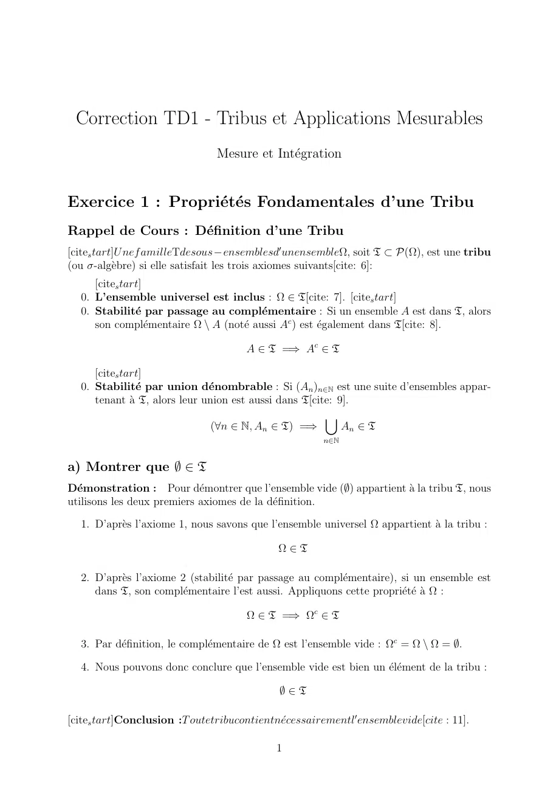

~~~text
 Correction TD1 - Tribus et Applications Mesurables
                               Mesure et Intégration

Exercice 1 : Propriétés Fondamentales d’une Tribu
Rappel de Cours : Définition d’une Tribu
[cites tart]U nef amilleTdesous−ensemblesd′ unensembleΩ, soit T ⊂ P(Ω), est une tribu
(ou σ-algèbre) si elle satisfait les trois axiomes suivants[cite: 6]:
     [cites tart]
  0. L’ensemble universel est inclus : Ω ∈ T[cite: 7]. [cites tart]
  0. Stabilité par passage au complémentaire : Si un ensemble A est dans T, alors
     son complémentaire Ω \ A (noté aussi Ac ) est également dans T[cite: 8].

                                     A ∈ T =⇒ Ac ∈ T

     [cites tart]
  0. Stabilité par union dénombrable : Si (An )n∈N est une suite d’ensembles appar-
     tenant à T, alors leur union est aussi dans T[cite: 9].
                                                       [
                               (∀n ∈ N, An ∈ T) =⇒         An ∈ T
                                                      n∈N

a) Montrer que ∅ ∈ T
Démonstration : Pour démontrer que l’ensemble vide (∅) appartient à la tribu T, nous
utilisons les deux premiers axiomes de la définition.
  1. D’après l’axiome 1, nous savons que l’ensemble universel Ω appartient à la tribu :

                                            Ω∈T

  2. D’après l’axiome 2 (stabilité par passage au complémentaire), si un ensemble est
     dans T, son complémentaire l’est aussi. Appliquons cette propriété à Ω :

                                     Ω ∈ T =⇒ Ωc ∈ T

  3. Par définition, le complémentaire de Ω est l’ensemble vide : Ωc = Ω \ Ω = ∅.

  4. Nous pouvons donc conclure que l’ensemble vide est bien un élément de la tribu :

                                            ∅∈T

[cites tart]Conclusion :T outetribucontientnécessairementl′ ensemblevide[cite : 11].

                                            1
~~~

## Page 2

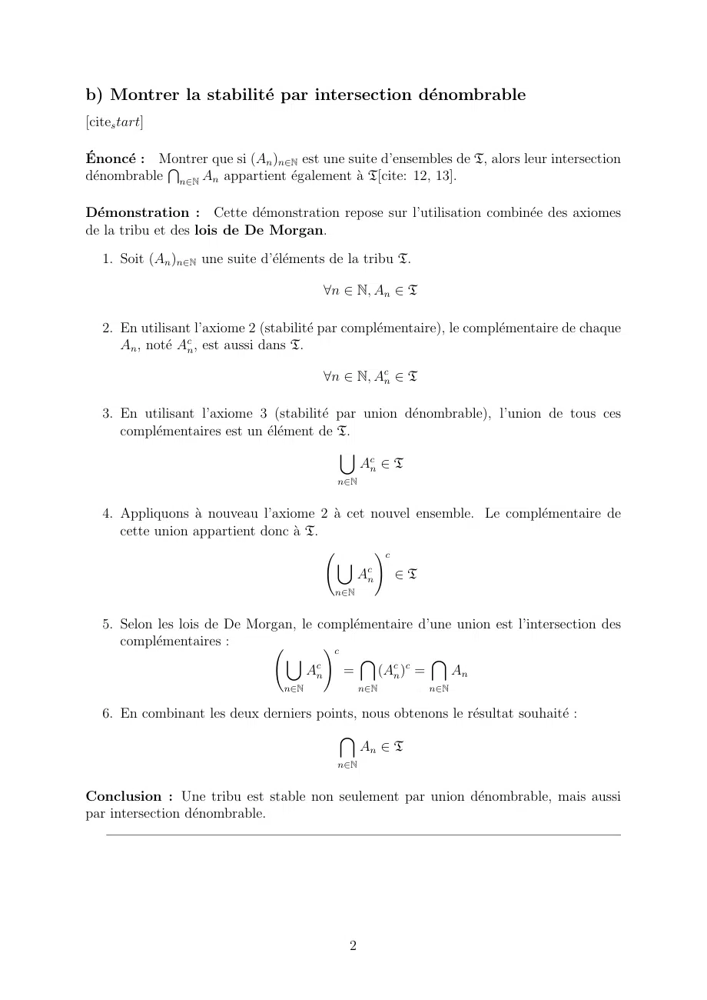

~~~text
b) Montrer la stabilité par intersection dénombrable
[cites tart]

Énoncé : Montrer
            T      que si (An )n∈N est une suite d’ensembles de T, alors leur intersection
dénombrable n∈N An appartient également à T[cite: 12, 13].

Démonstration : Cette démonstration repose sur l’utilisation combinée des axiomes
de la tribu et des lois de De Morgan.

   1. Soit (An )n∈N une suite d’éléments de la tribu T.

                                         ∀n ∈ N, An ∈ T

   2. En utilisant l’axiome 2 (stabilité par complémentaire), le complémentaire de chaque
      An , noté Acn , est aussi dans T.

                                         ∀n ∈ N, Acn ∈ T

   3. En utilisant l’axiome 3 (stabilité par union dénombrable), l’union de tous ces
      complémentaires est un élément de T.
                                           [
                                              Acn ∈ T
                                            n∈N

   4. Appliquons à nouveau l’axiome 2 à cet nouvel ensemble. Le complémentaire de
      cette union appartient donc à T.
                                               !c
                                        [
                                            Acn ∈ T
                                           n∈N

   5. Selon les lois de De Morgan, le complémentaire d’une union est l’intersection des
      complémentaires :               !c
                                [            \           \
                                    Acn =      (Acn )c =   An
                                  n∈N             n∈N       n∈N

   6. En combinant les deux derniers points, nous obtenons le résultat souhaité :
                                         \
                                             An ∈ T
                                            n∈N

Conclusion : Une tribu est stable non seulement par union dénombrable, mais aussi
par intersection dénombrable.

                                              2
~~~

## Page 3

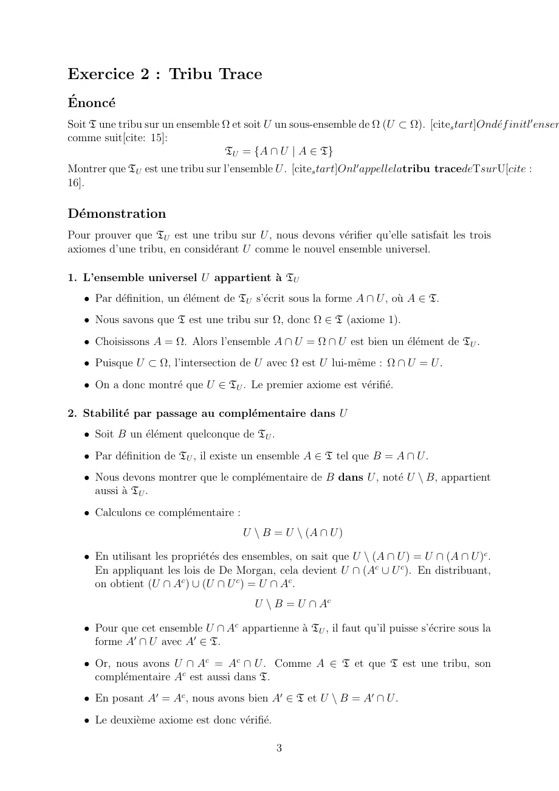

~~~text
Exercice 2 : Tribu Trace
Énoncé
Soit T une tribu sur un ensemble Ω et soit U un sous-ensemble de Ω (U ⊂ Ω). [cites tart]Ondéf initl′ ensem
comme suit[cite: 15]:
                                 TU = {A ∩ U | A ∈ T}
Montrer que TU est une tribu sur l’ensemble U . [cites tart]Onl′ appellelatribu tracedeTsurU[cite :
16].

Démonstration
Pour prouver que TU est une tribu sur U , nous devons vérifier qu’elle satisfait les trois
axiomes d’une tribu, en considérant U comme le nouvel ensemble universel.

1. L’ensemble universel U appartient à TU
   • Par définition, un élément de TU s’écrit sous la forme A ∩ U , où A ∈ T.
   • Nous savons que T est une tribu sur Ω, donc Ω ∈ T (axiome 1).
   • Choisissons A = Ω. Alors l’ensemble A ∩ U = Ω ∩ U est bien un élément de TU .
   • Puisque U ⊂ Ω, l’intersection de U avec Ω est U lui-même : Ω ∩ U = U .
   • On a donc montré que U ∈ TU . Le premier axiome est vérifié.

2. Stabilité par passage au complémentaire dans U
   • Soit B un élément quelconque de TU .
   • Par définition de TU , il existe un ensemble A ∈ T tel que B = A ∩ U .
   • Nous devons montrer que le complémentaire de B dans U , noté U \ B, appartient
     aussi à TU .
   • Calculons ce complémentaire :
                                      U \ B = U \ (A ∩ U )

   • En utilisant les propriétés des ensembles, on sait que U \ (A ∩ U ) = U ∩ (A ∩ U )c .
     En appliquant les lois de De Morgan, cela devient U ∩ (Ac ∪ U c ). En distribuant,
     on obtient (U ∩ Ac ) ∪ (U ∩ U c ) = U ∩ Ac .
                                        U \ B = U ∩ Ac

   • Pour que cet ensemble U ∩ Ac appartienne à TU , il faut qu’il puisse s’écrire sous la
     forme A′ ∩ U avec A′ ∈ T.
   • Or, nous avons U ∩ Ac = Ac ∩ U . Comme A ∈ T et que T est une tribu, son
     complémentaire Ac est aussi dans T.
   • En posant A′ = Ac , nous avons bien A′ ∈ T et U \ B = A′ ∩ U .
   • Le deuxième axiome est donc vérifié.

                                               3
~~~

## Page 4

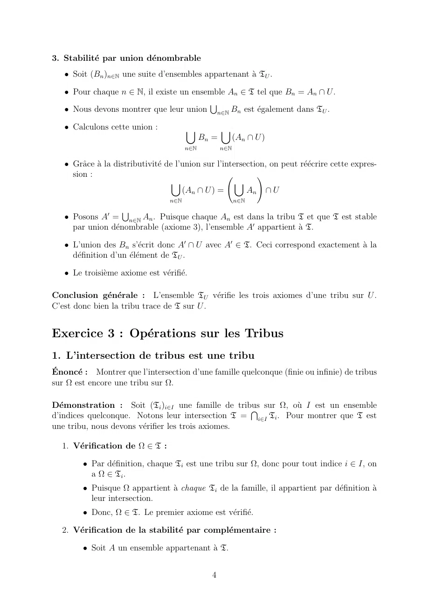

~~~text
3. Stabilité par union dénombrable
   • Soit (Bn )n∈N une suite d’ensembles appartenant à TU .

   • Pour chaque n ∈ N, il existe un ensemble An ∈ T tel que Bn = An ∩ U .

   • Nous devons montrer que leur union n∈N Bn est également dans TU .
                                         S

   • Calculons cette union :            [            [
                                              Bn =         (An ∩ U )
                                        n∈N          n∈N

   • Grâce à la distributivité de l’union sur l’intersection, on peut réécrire cette expres-
     sion :                                                  !
                                    [                  [
                                       (An ∩ U ) =        An ∩ U
                                  n∈N                      n∈N

   • Posons A′ = n∈N An . Puisque chaque An est dans la tribu T et que T est stable
                    S
     par union dénombrable (axiome 3), l’ensemble A′ appartient à T.

   • L’union des Bn s’écrit donc A′ ∩ U avec A′ ∈ T. Ceci correspond exactement à la
     définition d’un élément de TU .

   • Le troisième axiome est vérifié.

Conclusion générale : L’ensemble TU vérifie les trois axiomes d’une tribu sur U .
C’est donc bien la tribu trace de T sur U .

Exercice 3 : Opérations sur les Tribus
1. L’intersection de tribus est une tribu
Énoncé : Montrer que l’intersection d’une famille quelconque (finie ou infinie) de tribus
sur Ω est encore une tribu sur Ω.

Démonstration : Soit (Ti )i∈I une famille de tribusT sur Ω, où I est un ensemble
d’indices quelconque. Notons leur intersection T = i∈I Ti . Pour montrer que T est
une tribu, nous devons vérifier les trois axiomes.

  1. Vérification de Ω ∈ T :

        • Par définition, chaque Ti est une tribu sur Ω, donc pour tout indice i ∈ I, on
          a Ω ∈ Ti .
        • Puisque Ω appartient à chaque Ti de la famille, il appartient par définition à
          leur intersection.
        • Donc, Ω ∈ T. Le premier axiome est vérifié.

  2. Vérification de la stabilité par complémentaire :

        • Soit A un ensemble appartenant à T.

                                                4
~~~

## Page 5

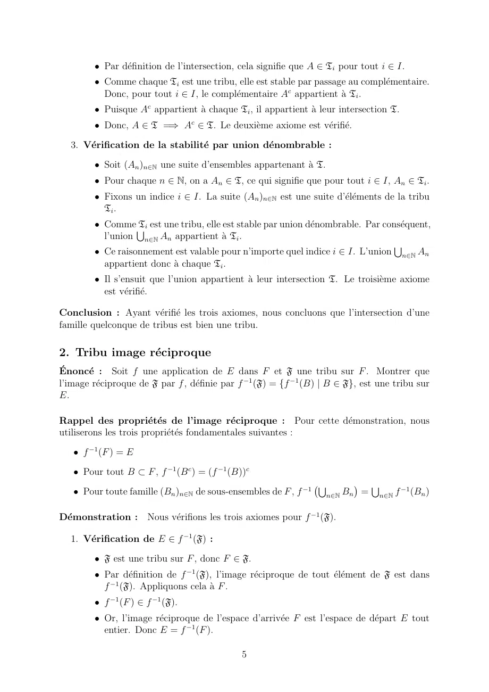

~~~text
         • Par définition de l’intersection, cela signifie que A ∈ Ti pour tout i ∈ I.
         • Comme chaque Ti est une tribu, elle est stable par passage au complémentaire.
           Donc, pour tout i ∈ I, le complémentaire Ac appartient à Ti .
         • Puisque Ac appartient à chaque Ti , il appartient à leur intersection T.
         • Donc, A ∈ T =⇒ Ac ∈ T. Le deuxième axiome est vérifié.

  3. Vérification de la stabilité par union dénombrable :

         • Soit (An )n∈N une suite d’ensembles appartenant à T.
         • Pour chaque n ∈ N, on a An ∈ T, ce qui signifie que pour tout i ∈ I, An ∈ Ti .
         • Fixons un indice i ∈ I. La suite (An )n∈N est une suite d’éléments de la tribu
           Ti .
         • CommeS  Ti est une tribu, elle est stable par union dénombrable. Par conséquent,
           l’union n∈N An appartient à Ti .
         • Ce raisonnement est valable pour n’importe quel indice i ∈ I. L’union n∈N An
                                                                                   S
           appartient donc à chaque Ti .
         • Il s’ensuit que l’union appartient à leur intersection T. Le troisième axiome
           est vérifié.

Conclusion : Ayant vérifié les trois axiomes, nous concluons que l’intersection d’une
famille quelconque de tribus est bien une tribu.

2. Tribu image réciproque
Énoncé : Soit f une application de E dans F et F une tribu sur F . Montrer que
l’image réciproque de F par f , définie par f −1 (F) = {f −1 (B) | B ∈ F}, est une tribu sur
E.

Rappel des propriétés de l’image réciproque : Pour cette démonstration, nous
utiliserons les trois propriétés fondamentales suivantes :
   • f −1 (F ) = E

   • Pour tout B ⊂ F , f −1 (B c ) = (f −1 (B))c

   • Pour toute famille (Bn )n∈N de sous-ensembles de F , f −1                                  −1
                                                                 S                 S
                                                                   n∈N Bn       =       n∈N f        (Bn )

Démonstration : Nous vérifions les trois axiomes pour f −1 (F).

  1. Vérification de E ∈ f −1 (F) :

         • F est une tribu sur F , donc F ∈ F.
         • Par définition de f −1 (F), l’image réciproque de tout élément de F est dans
           f −1 (F). Appliquons cela à F .
         • f −1 (F ) ∈ f −1 (F).
         • Or, l’image réciproque de l’espace d’arrivée F est l’espace de départ E tout
           entier. Donc E = f −1 (F ).

                                              5
~~~

## Page 6

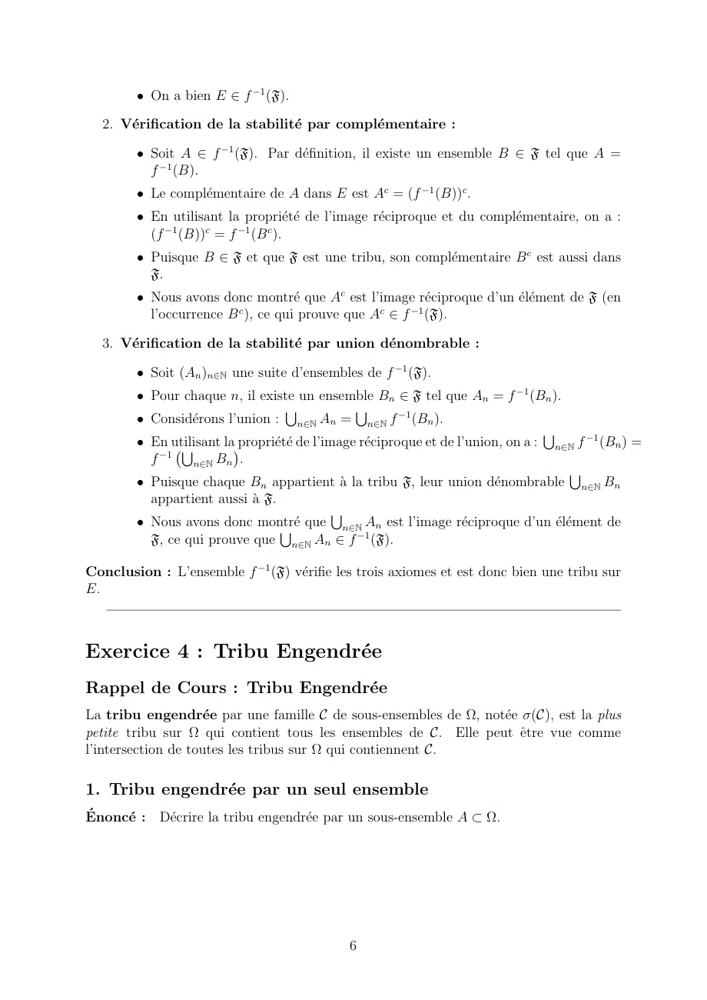

~~~text
        • On a bien E ∈ f −1 (F).

  2. Vérification de la stabilité par complémentaire :

        • Soit A ∈ f −1 (F). Par définition, il existe un ensemble B ∈ F tel que A =
          f −1 (B).
        • Le complémentaire de A dans E est Ac = (f −1 (B))c .
        • En utilisant la propriété de l’image réciproque et du complémentaire, on a :
          (f −1 (B))c = f −1 (B c ).
        • Puisque B ∈ F et que F est une tribu, son complémentaire B c est aussi dans
          F.
        • Nous avons donc montré que Ac est l’image réciproque d’un élément de F (en
          l’occurrence B c ), ce qui prouve que Ac ∈ f −1 (F).

  3. Vérification de la stabilité par union dénombrable :

        • Soit (An )n∈N une suite d’ensembles de f −1 (F).
        • Pour chaque n, il existe un ensemble Bn ∈ F tel que An = f −1 (Bn ).
        • Considérons l’union : n∈N An = n∈N f −1 (Bn ).
                                   S             S

        • En utilisant                                                                      −1
                                                                                    S
                       la propriété de l’image  réciproque et de l’union, on a :   n∈N f    (Bn ) =
            −1
               S         
          f      n∈N Bn .
        • Puisque chaque Bn appartient à la tribu F, leur union dénombrable n∈N Bn
                                                                                        S
          appartient aussi à F.
        • Nous avons donc montré
                                             S
                                       que     n∈N An est l’image réciproque d’un élément de
          F, ce qui prouve que n∈N An ∈ f −1 (F).
                                  S

Conclusion : L’ensemble f −1 (F) vérifie les trois axiomes et est donc bien une tribu sur
E.

Exercice 4 : Tribu Engendrée
Rappel de Cours : Tribu Engendrée
La tribu engendrée par une famille C de sous-ensembles de Ω, notée σ(C), est la plus
petite tribu sur Ω qui contient tous les ensembles de C. Elle peut être vue comme
l’intersection de toutes les tribus sur Ω qui contiennent C.

1. Tribu engendrée par un seul ensemble
Énoncé : Décrire la tribu engendrée par un sous-ensemble A ⊂ Ω.

                                               6
~~~

## Page 7

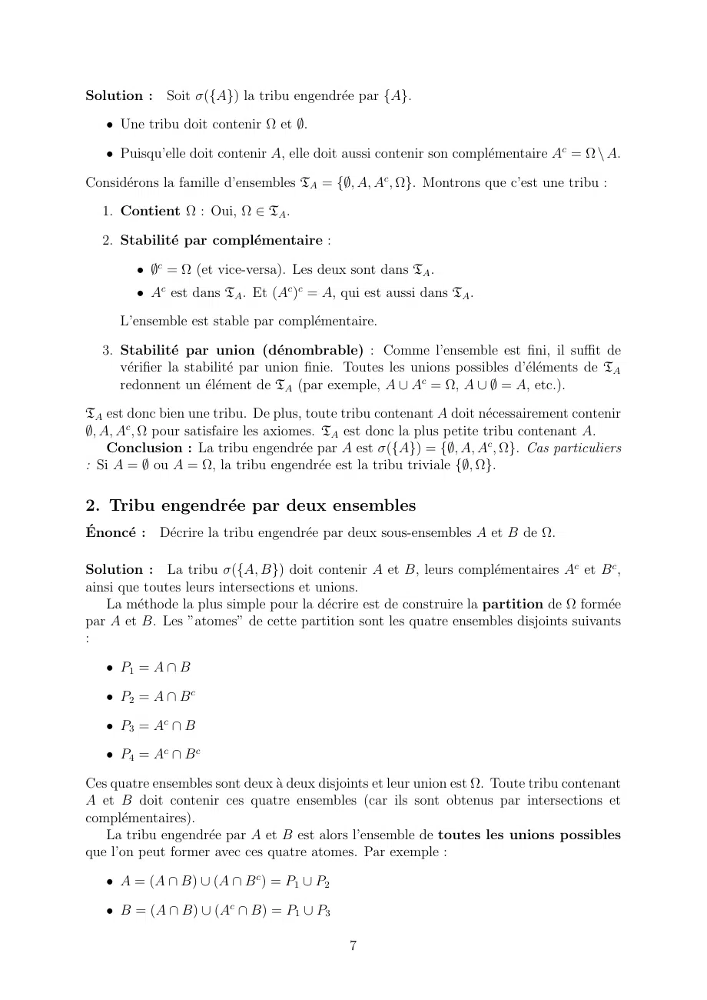

~~~text
Solution : Soit σ({A}) la tribu engendrée par {A}.

   • Une tribu doit contenir Ω et ∅.

   • Puisqu’elle doit contenir A, elle doit aussi contenir son complémentaire Ac = Ω \ A.

Considérons la famille d’ensembles TA = {∅, A, Ac , Ω}. Montrons que c’est une tribu :

  1. Contient Ω : Oui, Ω ∈ TA .

  2. Stabilité par complémentaire :

        • ∅c = Ω (et vice-versa). Les deux sont dans TA .
        • Ac est dans TA . Et (Ac )c = A, qui est aussi dans TA .

     L’ensemble est stable par complémentaire.

  3. Stabilité par union (dénombrable) : Comme l’ensemble est fini, il suffit de
     vérifier la stabilité par union finie. Toutes les unions possibles d’éléments de TA
     redonnent un élément de TA (par exemple, A ∪ Ac = Ω, A ∪ ∅ = A, etc.).

TA est donc bien une tribu. De plus, toute tribu contenant A doit nécessairement contenir
∅, A, Ac , Ω pour satisfaire les axiomes. TA est donc la plus petite tribu contenant A.
    Conclusion : La tribu engendrée par A est σ({A}) = {∅, A, Ac , Ω}. Cas particuliers
: Si A = ∅ ou A = Ω, la tribu engendrée est la tribu triviale {∅, Ω}.

2. Tribu engendrée par deux ensembles
Énoncé : Décrire la tribu engendrée par deux sous-ensembles A et B de Ω.

Solution : La tribu σ({A, B}) doit contenir A et B, leurs complémentaires Ac et B c ,
ainsi que toutes leurs intersections et unions.
   La méthode la plus simple pour la décrire est de construire la partition de Ω formée
par A et B. Les ”atomes” de cette partition sont les quatre ensembles disjoints suivants
:

   • P1 = A ∩ B

   • P2 = A ∩ B c

   • P3 = Ac ∩ B

   • P4 = Ac ∩ B c

Ces quatre ensembles sont deux à deux disjoints et leur union est Ω. Toute tribu contenant
A et B doit contenir ces quatre ensembles (car ils sont obtenus par intersections et
complémentaires).
   La tribu engendrée par A et B est alors l’ensemble de toutes les unions possibles
que l’on peut former avec ces quatre atomes. Par exemple :

   • A = (A ∩ B) ∪ (A ∩ B c ) = P1 ∪ P2

   • B = (A ∩ B) ∪ (Ac ∩ B) = P1 ∪ P3

                                            7
~~~

## Page 8

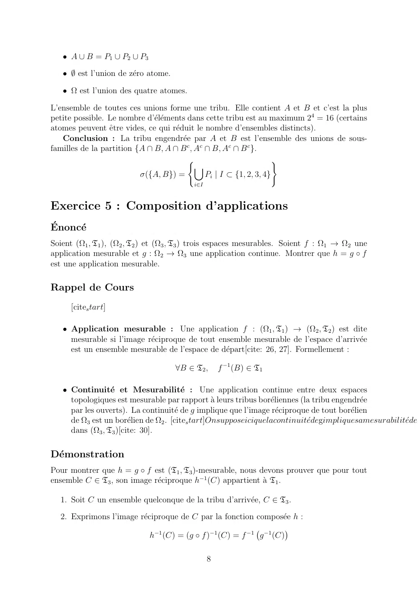

~~~text
   • A ∪ B = P1 ∪ P2 ∪ P3

   • ∅ est l’union de zéro atome.

   • Ω est l’union des quatre atomes.

L’ensemble de toutes ces unions forme une tribu. Elle contient A et B et c’est la plus
petite possible. Le nombre d’éléments dans cette tribu est au maximum 24 = 16 (certains
atomes peuvent être vides, ce qui réduit le nombre d’ensembles distincts).
   Conclusion : La tribu engendrée par A et B est l’ensemble des unions de sous-
familles de la partition {A ∩ B, A ∩ B c , Ac ∩ B, Ac ∩ B c }.
                                        (                          )
                                           [
                          σ({A, B}) =         Pi | I ⊂ {1, 2, 3, 4}
                                          i∈I

Exercice 5 : Composition d’applications
Énoncé
Soient (Ω1 , T1 ), (Ω2 , T2 ) et (Ω3 , T3 ) trois espaces mesurables. Soient f : Ω1 → Ω2 une
application mesurable et g : Ω2 → Ω3 une application continue. Montrer que h = g ◦ f
est une application mesurable.

Rappel de Cours
     [cites tart]

   • Application mesurable : Une application f : (Ω1 , T1 ) → (Ω2 , T2 ) est dite
     mesurable si l’image réciproque de tout ensemble mesurable de l’espace d’arrivée
     est un ensemble mesurable de l’espace de départ[cite: 26, 27]. Formellement :

                                     ∀B ∈ T2 ,      f −1 (B) ∈ T1

   • Continuité et Mesurabilité : Une application continue entre deux espaces
     topologiques est mesurable par rapport à leurs tribus boréliennes (la tribu engendrée
     par les ouverts). La continuité de g implique que l’image réciproque de tout borélien
     de Ω3 est un borélien de Ω2 . [cites tart]Onsupposeiciquelacontinuitédegimpliquesamesurabilitéde(
     dans (Ω3 , T3 )[cite: 30].

Démonstration
Pour montrer que h = g ◦ f est (T1 , T3 )-mesurable, nous devons prouver que pour tout
ensemble C ∈ T3 , son image réciproque h−1 (C) appartient à T1 .

  1. Soit C un ensemble quelconque de la tribu d’arrivée, C ∈ T3 .

  2. Exprimons l’image réciproque de C par la fonction composée h :

                           h−1 (C) = (g ◦ f )−1 (C) = f −1 g −1 (C)
                                                                   

                                                8
~~~

## Page 9

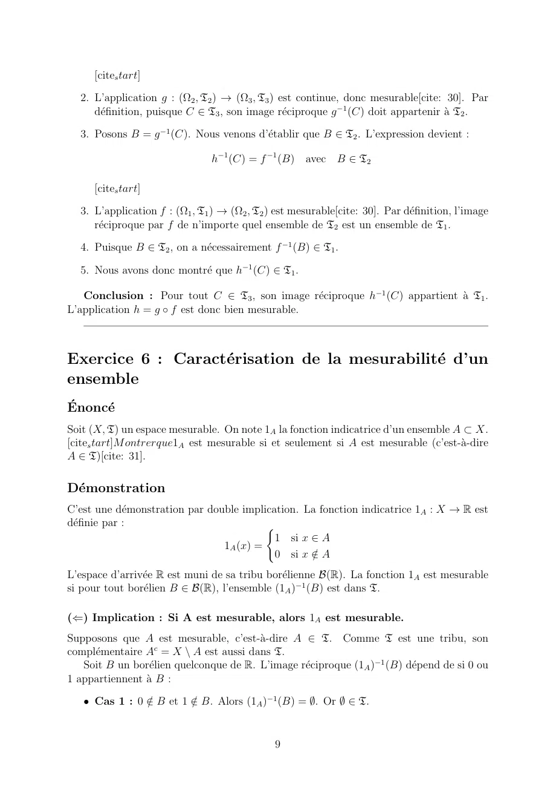

~~~text
     [cites tart]

  2. L’application g : (Ω2 , T2 ) → (Ω3 , T3 ) est continue, donc mesurable[cite: 30]. Par
     définition, puisque C ∈ T3 , son image réciproque g −1 (C) doit appartenir à T2 .

  3. Posons B = g −1 (C). Nous venons d’établir que B ∈ T2 . L’expression devient :

                                h−1 (C) = f −1 (B) avec B ∈ T2

     [cites tart]

  3. L’application f : (Ω1 , T1 ) → (Ω2 , T2 ) est mesurable[cite: 30]. Par définition, l’image
     réciproque par f de n’importe quel ensemble de T2 est un ensemble de T1 .

  4. Puisque B ∈ T2 , on a nécessairement f −1 (B) ∈ T1 .

  5. Nous avons donc montré que h−1 (C) ∈ T1 .

   Conclusion : Pour tout C ∈ T3 , son image réciproque h−1 (C) appartient à T1 .
L’application h = g ◦ f est donc bien mesurable.

Exercice 6 : Caractérisation de la mesurabilité d’un
ensemble
Énoncé
Soit (X, T) un espace mesurable. On note 1A la fonction indicatrice d’un ensemble A ⊂ X.
[cites tart]M ontrerque1A est mesurable si et seulement si A est mesurable (c’est-à-dire
A ∈ T)[cite: 31].

Démonstration
C’est une démonstration par double implication. La fonction indicatrice 1A : X → R est
définie par :                           (
                                           1 si x ∈ A
                                1A (x) =
                                           0 si x ∈
                                                  /A
L’espace d’arrivée R est muni de sa tribu borélienne B(R). La fonction 1A est mesurable
si pour tout borélien B ∈ B(R), l’ensemble (1A )−1 (B) est dans T.

(⇐) Implication : Si A est mesurable, alors 1A est mesurable.
Supposons que A est mesurable, c’est-à-dire A ∈ T. Comme T est une tribu, son
complémentaire Ac = X \ A est aussi dans T.
   Soit B un borélien quelconque de R. L’image réciproque (1A )−1 (B) dépend de si 0 ou
1 appartiennent à B :

   • Cas 1 : 0 ∈        / B. Alors (1A )−1 (B) = ∅. Or ∅ ∈ T.
               / B et 1 ∈

                                              9
~~~

## Page 10

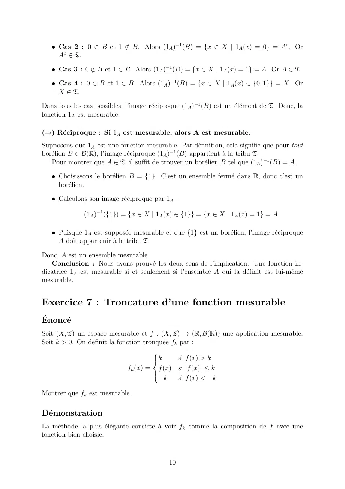

~~~text
   • Cas 2 : 0 ∈ B et 1 ∈
                        / B. Alors (1A )−1 (B) = {x ∈ X | 1A (x) = 0} = Ac . Or
     Ac ∈ T.

   • Cas 3 : 0 ∈
               / B et 1 ∈ B. Alors (1A )−1 (B) = {x ∈ X | 1A (x) = 1} = A. Or A ∈ T.

   • Cas 4 : 0 ∈ B et 1 ∈ B. Alors (1A )−1 (B) = {x ∈ X | 1A (x) ∈ {0, 1}} = X. Or
     X ∈ T.

Dans tous les cas possibles, l’image réciproque (1A )−1 (B) est un élément de T. Donc, la
fonction 1A est mesurable.

(⇒) Réciproque : Si 1A est mesurable, alors A est mesurable.
Supposons que 1A est une fonction mesurable. Par définition, cela signifie que pour tout
borélien B ∈ B(R), l’image réciproque (1A )−1 (B) appartient à la tribu T.
   Pour montrer que A ∈ T, il suffit de trouver un borélien B tel que (1A )−1 (B) = A.

   • Choisissons le borélien B = {1}. C’est un ensemble fermé dans R, donc c’est un
     borélien.

   • Calculons son image réciproque par 1A :

              (1A )−1 ({1}) = {x ∈ X | 1A (x) ∈ {1}} = {x ∈ X | 1A (x) = 1} = A

   • Puisque 1A est supposée mesurable et que {1} est un borélien, l’image réciproque
     A doit appartenir à la tribu T.

Donc, A est un ensemble mesurable.
   Conclusion : Nous avons prouvé les deux sens de l’implication. Une fonction in-
dicatrice 1A est mesurable si et seulement si l’ensemble A qui la définit est lui-même
mesurable.

Exercice 7 : Troncature d’une fonction mesurable
Énoncé
Soit (X, T) un espace mesurable et f : (X, T) → (R, B(R)) une application mesurable.
Soit k > 0. On définit la fonction tronquée fk par :
                                       
                                       k
                                                si f (x) > k
                               fk (x) = f (x) si |f (x)| ≤ k
                                       
                                         −k      si f (x) < −k
                                       

Montrer que fk est mesurable.

Démonstration
La méthode la plus élégante consiste à voir fk comme la composition de f avec une
fonction bien choisie.

                                            10
~~~

## Page 11

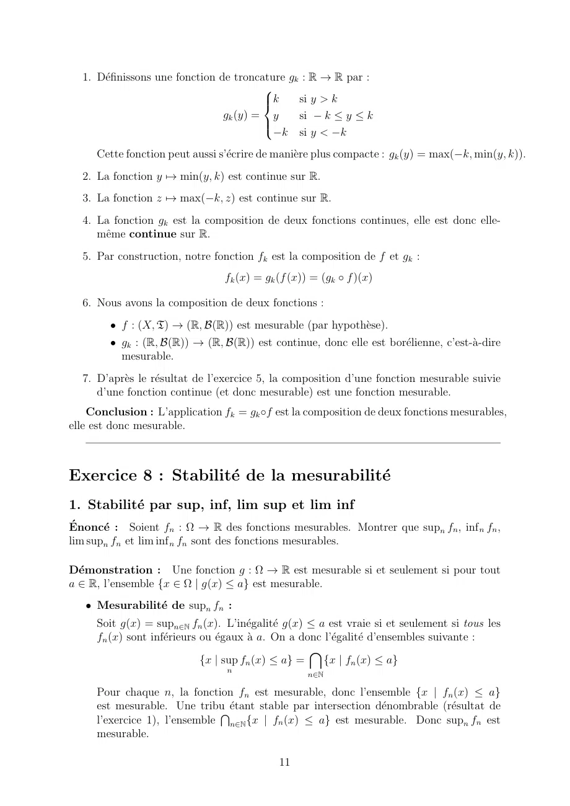

~~~text
  1. Définissons une fonction de troncature gk : R → R par :
                                        
                                        k
                                              si y > k
                                gk (y) = y     si − k ≤ y ≤ k
                                        
                                          −k si y < −k
                                        

     Cette fonction peut aussi s’écrire de manière plus compacte : gk (y) = max(−k, min(y, k)).
  2. La fonction y 7→ min(y, k) est continue sur R.
  3. La fonction z 7→ max(−k, z) est continue sur R.
  4. La fonction gk est la composition de deux fonctions continues, elle est donc elle-
     même continue sur R.
  5. Par construction, notre fonction fk est la composition de f et gk :
                                fk (x) = gk (f (x)) = (gk ◦ f )(x)

  6. Nous avons la composition de deux fonctions :
        • f : (X, T) → (R, B(R)) est mesurable (par hypothèse).
        • gk : (R, B(R)) → (R, B(R)) est continue, donc elle est borélienne, c’est-à-dire
          mesurable.
  7. D’après le résultat de l’exercice 5, la composition d’une fonction mesurable suivie
     d’une fonction continue (et donc mesurable) est une fonction mesurable.
    Conclusion : L’application fk = gk ◦f est la composition de deux fonctions mesurables,
elle est donc mesurable.

Exercice 8 : Stabilité de la mesurabilité
1. Stabilité par sup, inf, lim sup et lim inf
Énoncé : Soient fn : Ω → R des fonctions mesurables. Montrer que supn fn , inf n fn ,
lim supn fn et lim inf n fn sont des fonctions mesurables.

Démonstration : Une fonction g : Ω → R est mesurable si et seulement si pour tout
a ∈ R, l’ensemble {x ∈ Ω | g(x) ≤ a} est mesurable.
   • Mesurabilité de supn fn :
     Soit g(x) = supn∈N fn (x). L’inégalité g(x) ≤ a est vraie si et seulement si tous les
     fn (x) sont inférieurs ou égaux à a. On a donc l’égalité d’ensembles suivante :
                                                    \
                             {x | sup fn (x) ≤ a} =    {x | fn (x) ≤ a}
                                 n
                                                   n∈N

     Pour chaque n, la fonction fn est mesurable, donc l’ensemble {x | fn (x) ≤ a}
     est mesurable. Une tribuTétant stable par intersection dénombrable (résultat de
     l’exercice 1), l’ensemble n∈N {x | fn (x) ≤ a} est mesurable. Donc supn fn est
     mesurable.

                                            11
~~~

## Page 12

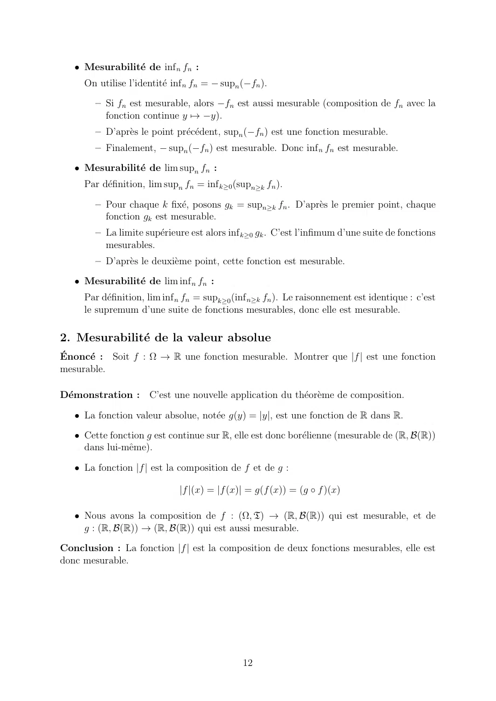

~~~text
   • Mesurabilité de inf n fn :
     On utilise l’identité inf n fn = − supn (−fn ).

        – Si fn est mesurable, alors −fn est aussi mesurable (composition de fn avec la
          fonction continue y 7→ −y).
        – D’après le point précédent, supn (−fn ) est une fonction mesurable.
        – Finalement, − supn (−fn ) est mesurable. Donc inf n fn est mesurable.

   • Mesurabilité de lim supn fn :
     Par définition, lim supn fn = inf k≥0 (supn≥k fn ).

        – Pour chaque k fixé, posons gk = supn≥k fn . D’après le premier point, chaque
          fonction gk est mesurable.
        – La limite supérieure est alors inf k≥0 gk . C’est l’infimum d’une suite de fonctions
          mesurables.
        – D’après le deuxième point, cette fonction est mesurable.

   • Mesurabilité de lim inf n fn :
     Par définition, lim inf n fn = supk≥0 (inf n≥k fn ). Le raisonnement est identique : c’est
     le supremum d’une suite de fonctions mesurables, donc elle est mesurable.

2. Mesurabilité de la valeur absolue
Énoncé : Soit f : Ω → R une fonction mesurable. Montrer que |f | est une fonction
mesurable.

Démonstration : C’est une nouvelle application du théorème de composition.

   • La fonction valeur absolue, notée g(y) = |y|, est une fonction de R dans R.

   • Cette fonction g est continue sur R, elle est donc borélienne (mesurable de (R, B(R))
     dans lui-même).

   • La fonction |f | est la composition de f et de g :

                             |f |(x) = |f (x)| = g(f (x)) = (g ◦ f )(x)

   • Nous avons la composition de f : (Ω, T) → (R, B(R)) qui est mesurable, et de
     g : (R, B(R)) → (R, B(R)) qui est aussi mesurable.

Conclusion : La fonction |f | est la composition de deux fonctions mesurables, elle est
donc mesurable.

                                              12
~~~
