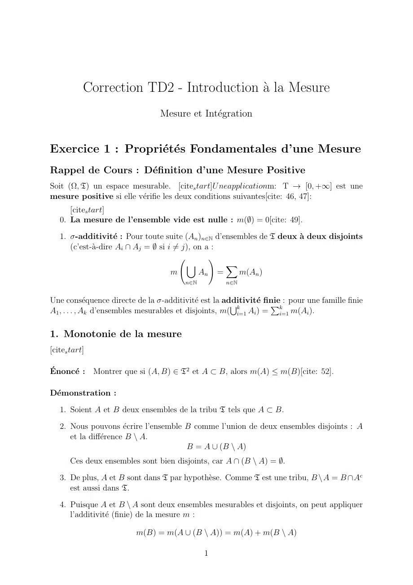
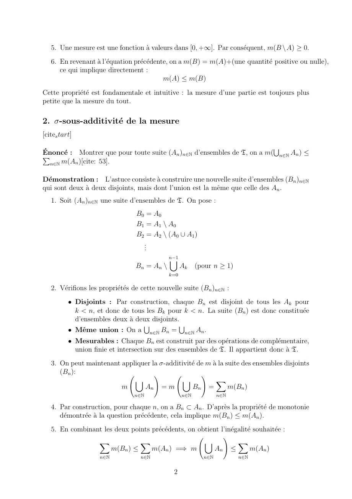
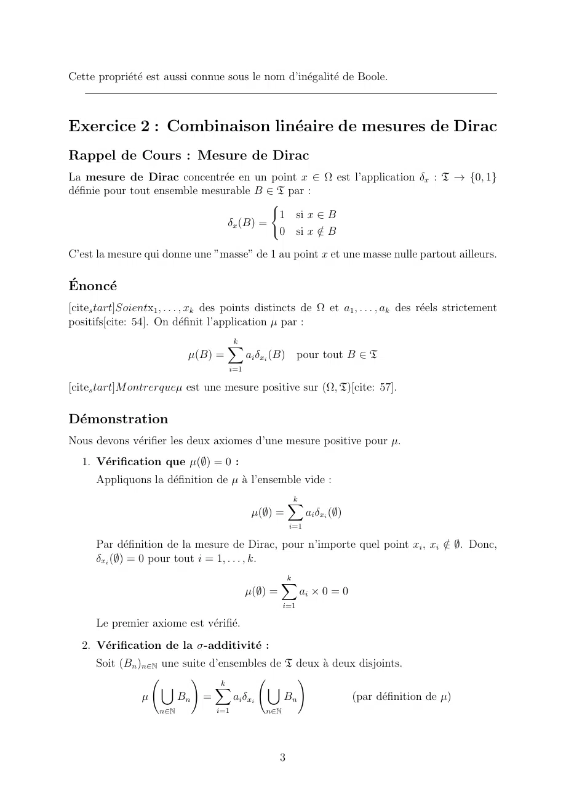
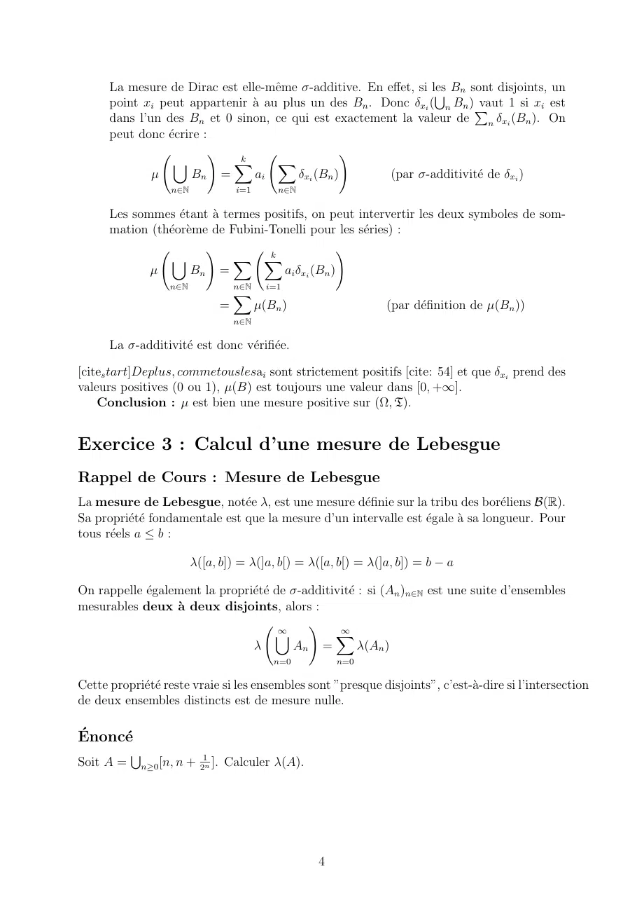
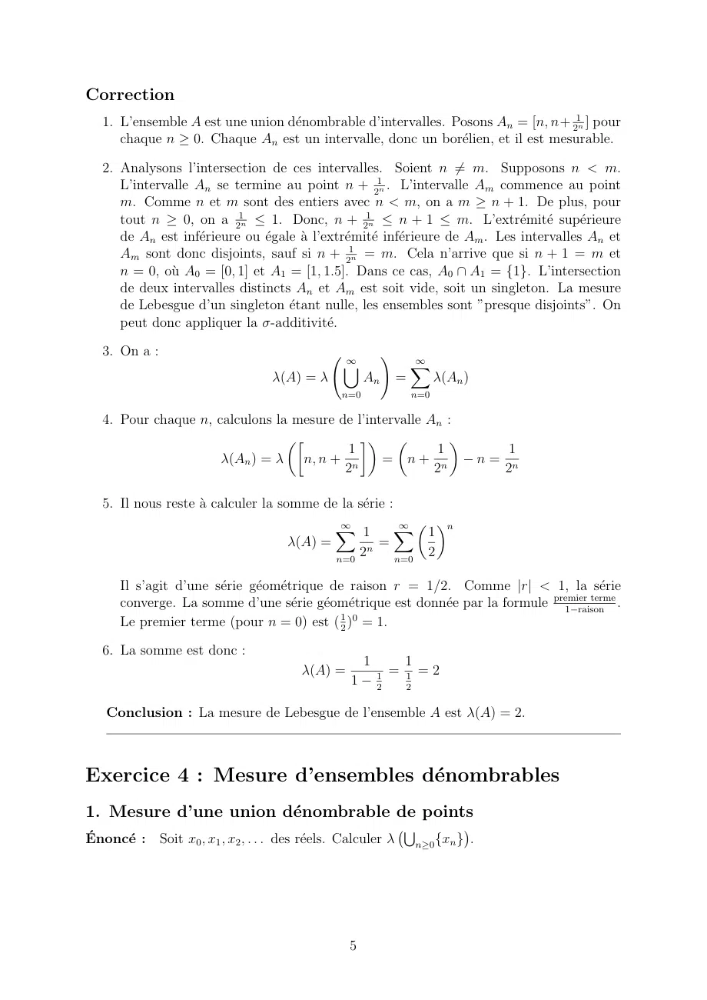
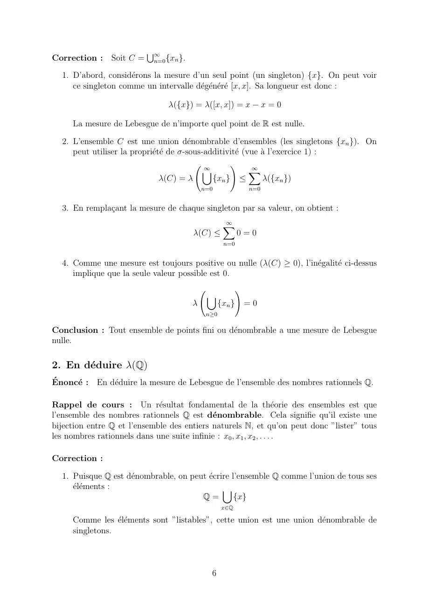
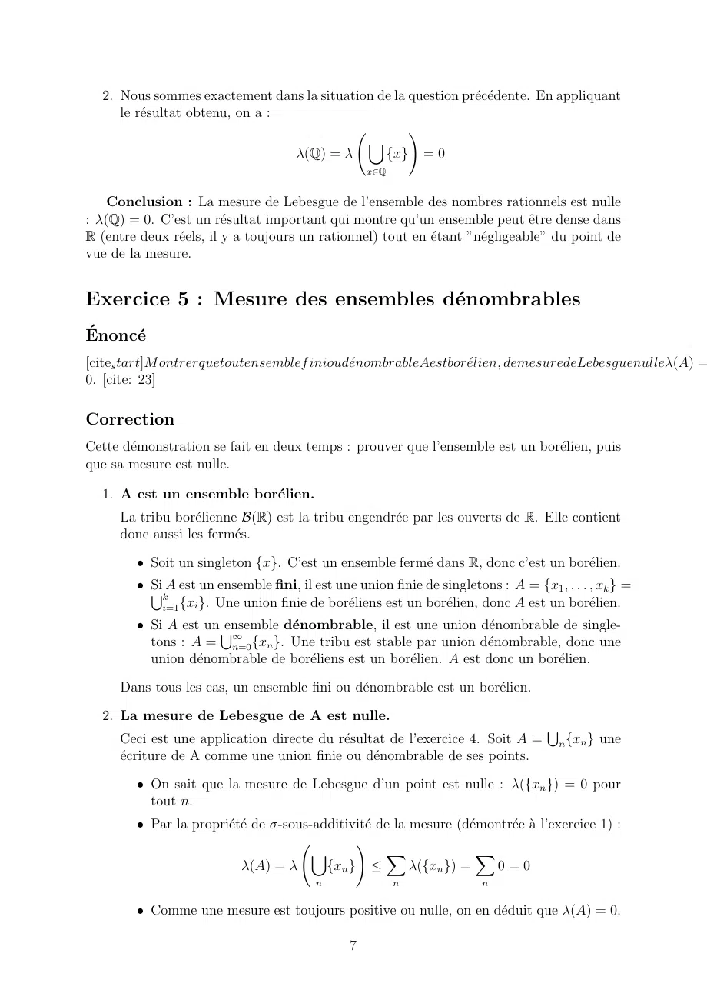
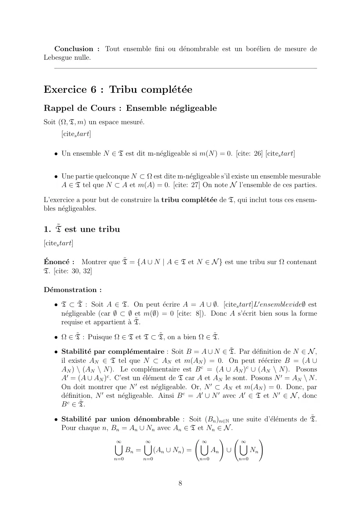
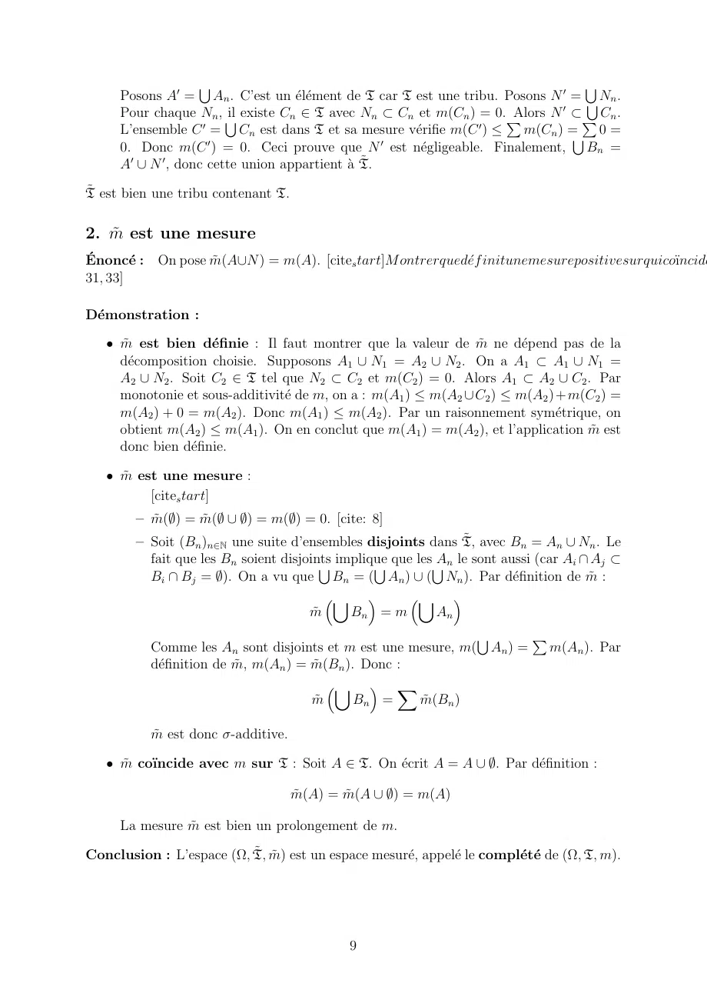

# MESURE & INTÉ TD2 CORRIGÉ.pdf

[Ouvrir l’original](https://drive.google.com/open?id=1U2mhliuE_StdPeoR6rx29ECMmIN_FLCE) · Les deux lectures automatiques du PDF divergent sur les pages indiquées. Leur fac-similé accompagne le texte.

**Pages présentant un écart entre les deux extractions** — 1–9.

## Page 1

~~~text
           Correction TD2 - Introduction à la Mesure
                                 Mesure et Intégration

Exercice 1 : Propriétés Fondamentales d’une Mesure
Rappel de Cours : Définition d’une Mesure Positive
Soit (Ω, T) un espace mesurable. [cites tart]U neapplicationm: T → [0, +∞] est une
mesure positive si elle vérifie les deux conditions suivantes[cite: 46, 47]:
      [cites tart]
   0. La mesure de l’ensemble vide est nulle : m(∅) = 0[cite: 49].

   1. σ-additivité : Pour toute suite (An )n∈N d’ensembles de T deux à deux disjoints
      (c’est-à-dire Ai ∩ Aj = ∅ si i ̸= j), on a :
                                                 !
                                          [         X
                                     m        An =    m(An )
                                        n∈N         n∈N

Une conséquence directe de la σ-additivité est la additivité   finie
                                                                    P : pour une famille finie
A1 , . . . , Ak d’ensembles mesurables et disjoints, m( ki=1 Ai ) = ki=1 m(Ai ).
                                                       S

1. Monotonie de la mesure
[cites tart]

Énoncé : Montrer que si (A, B) ∈ T2 et A ⊂ B, alors m(A) ≤ m(B)[cite: 52].

Démonstration :
   1. Soient A et B deux ensembles de la tribu T tels que A ⊂ B.

   2. Nous pouvons écrire l’ensemble B comme l’union de deux ensembles disjoints : A
      et la différence B \ A.
                                      B = A ∪ (B \ A)
       Ces deux ensembles sont bien disjoints, car A ∩ (B \ A) = ∅.

   3. De plus, A et B sont dans T par hypothèse. Comme T est une tribu, B \A = B ∩Ac
      est aussi dans T.

   4. Puisque A et B \ A sont deux ensembles mesurables et disjoints, on peut appliquer
      l’additivité (finie) de la mesure m :

                         m(B) = m(A ∪ (B \ A)) = m(A) + m(B \ A)

                                              1
~~~

## Page 2

~~~text
   5. Une mesure est une fonction à valeurs dans [0, +∞]. Par conséquent, m(B \A) ≥ 0.
   6. En revenant à l’équation précédente, on a m(B) = m(A)+(une quantité positive ou nulle),
      ce qui implique directement :
                                            m(A) ≤ m(B)
Cette propriété est fondamentale et intuitive : la mesure d’une partie est toujours plus
petite que la mesure du tout.

2. σ-sous-additivité de la mesure
[cites tart]
                                                                          S
Énoncé
P        : Montrer que pour toute suite (An )n∈N d’ensembles de T, on a m( n∈N An ) ≤
   n∈N m(An )[cite: 53].

Démonstration : L’astuce consiste à construire une nouvelle suite d’ensembles (Bn )n∈N
qui sont deux à deux disjoints, mais dont l’union est la même que celle des An .
   1. Soit (An )n∈N une suite d’ensembles de T. On pose :
                                  B0 = A0
                                  B1 = A1 \ A0
                                  B2 = A2 \ (A0 ∪ A1 )
                                    ..
                                     .
                                              n−1
                                              [
                                 Bn = An \          Ak    (pour n ≥ 1)
                                              k=0

   2. Vérifions les propriétés de cette nouvelle suite (Bn )n∈N :
          • Disjoints : Par construction, chaque Bn est disjoint de tous les Ak pour
            k < n, et donc de tous les Bk pour k < n. La suite (Bn ) est donc constituée
            d’ensembles deux à deux disjoints.
          • Même union : On a n∈N Bn = n∈N An .
                                  S            S

          • Mesurables : Chaque Bn est construit par des opérations de complémentaire,
            union finie et intersection sur des ensembles de T. Il appartient donc à T.
   3. On peut maintenant appliquer la σ-additivité de m à la suite des ensembles disjoints
      (Bn ):                        !                !
                             [                [            X
                         m      An = m            Bn =          m(Bn )
                                 n∈N                n∈N           n∈N

   4. Par construction, pour chaque n, on a Bn ⊂ An . D’après la propriété de monotonie
      démontrée à la question précédente, cela implique m(Bn ) ≤ m(An ).
   5. En combinant les deux points précédents, on obtient l’inégalité souhaitée :
                                                             !
                 X             X                      [            X
                      m(Bn ) ≤     m(An ) =⇒ m            An ≤          m(An )
                    n∈N            n∈N                      n∈N          n∈N

                                               2
~~~

## Page 3

~~~text
Cette propriété est aussi connue sous le nom d’inégalité de Boole.

Exercice 2 : Combinaison linéaire de mesures de Dirac
Rappel de Cours : Mesure de Dirac
La mesure de Dirac concentrée en un point x ∈ Ω est l’application δx : T → {0, 1}
définie pour tout ensemble mesurable B ∈ T par :
                                         (
                                          1 si x ∈ B
                                δx (B) =
                                          0 si x ∈/B

C’est la mesure qui donne une ”masse” de 1 au point x et une masse nulle partout ailleurs.

Énoncé
[cites tart]Soientx1 , . . . , xk des points distincts de Ω et a1 , . . . , ak des réels strictement
positifs[cite: 54]. On définit l’application µ par :
                                     k
                                     X
                            µ(B) =         ai δxi (B) pour tout B ∈ T
                                     i=1

[cites tart]M ontrerqueµ est une mesure positive sur (Ω, T)[cite: 57].

Démonstration
Nous devons vérifier les deux axiomes d’une mesure positive pour µ.
   1. Vérification que µ(∅) = 0 :
      Appliquons la définition de µ à l’ensemble vide :
                                                        k
                                                        X
                                            µ(∅) =            ai δxi (∅)
                                                        i=1

      Par définition de la mesure de Dirac, pour n’importe quel point xi , xi ∈
                                                                               / ∅. Donc,
      δxi (∅) = 0 pour tout i = 1, . . . , k.
                                                    k
                                                    X
                                           µ(∅) =         ai × 0 = 0
                                                    i=1

      Le premier axiome est vérifié.
   2. Vérification de la σ-additivité :
      Soit (Bn )n∈N une suite d’ensembles de T deux à deux disjoints.
                          !      k
                                                !
                    [          X          [
                µ      Bn =        ai δxi    Bn           (par définition de µ)
                     n∈N          i=1         n∈N

                                                    3
~~~

## Page 4

~~~text
      La mesure de Dirac est elle-même σ-additive. En effet, si les
                                                                  S Bn sont disjoints, un
      point xi peut appartenir à au plus un des Bn . Donc δxi ( n Bn ) Pvaut 1 si xi est
      dans l’un des Bn et 0 sinon, ce qui est exactement la valeur de n δxi (Bn ). On
      peut donc écrire :
                          !  k
                                                 !
                 [          X       X
              µ       Bn =      ai      δxi (Bn )       (par σ-additivité de δxi )
                    n∈N            i=1       n∈N

      Les sommes étant à termes positifs, on peut intervertir les deux symboles de som-
      mation (théorème de Fubini-Tonelli pour les séries) :
                        !          k
                                                  !
                 [           X X
             µ       Bn =             ai δxi (Bn )
                    n∈N            n∈N     i=1
                                   X
                               =         µ(Bn )                  (par définition de µ(Bn ))
                                   n∈N

      La σ-additivité est donc vérifiée.

[cites tart]Deplus, commetouslesai sont strictement positifs [cite: 54] et que δxi prend des
valeurs positives (0 ou 1), µ(B) est toujours une valeur dans [0, +∞].
    Conclusion : µ est bien une mesure positive sur (Ω, T).

Exercice 3 : Calcul d’une mesure de Lebesgue
Rappel de Cours : Mesure de Lebesgue
La mesure de Lebesgue, notée λ, est une mesure définie sur la tribu des boréliens B(R).
Sa propriété fondamentale est que la mesure d’un intervalle est égale à sa longueur. Pour
tous réels a ≤ b :

                          λ([a, b]) = λ(]a, b[) = λ([a, b[) = λ(]a, b]) = b − a

On rappelle également la propriété de σ-additivité : si (An )n∈N est une suite d’ensembles
mesurables deux à deux disjoints, alors :
                                       ∞
                                            !     ∞
                                      [          X
                                λ        An =          λ(An )
                                            n=0        n=0

Cette propriété reste vraie si les ensembles sont ”presque disjoints”, c’est-à-dire si l’intersection
de deux ensembles distincts est de mesure nulle.

Énoncé
                            1
           S
Soit A =       n≥0 [n, n + 2n ]. Calculer λ(A).

                                                   4
~~~

## Page 5

~~~text
Correction
   1. L’ensemble A est une union dénombrable d’intervalles. Posons An = [n, n+ 21n ] pour
      chaque n ≥ 0. Chaque An est un intervalle, donc un borélien, et il est mesurable.

   2. Analysons l’intersection de ces intervalles. Soient n ̸= m. Supposons n < m.
      L’intervalle An se termine au point n + 21n . L’intervalle Am commence au point
      m. Comme n et m sont des entiers avec n < m, on a m ≥ n + 1. De plus, pour
      tout n ≥ 0, on a 21n ≤ 1. Donc, n + 21n ≤ n + 1 ≤ m. L’extrémité supérieure
      de An est inférieure ou égale à l’extrémité inférieure de Am . Les intervalles An et
      Am sont donc disjoints, sauf si n + 21n = m. Cela n’arrive que si n + 1 = m et
      n = 0, où A0 = [0, 1] et A1 = [1, 1.5]. Dans ce cas, A0 ∩ A1 = {1}. L’intersection
      de deux intervalles distincts An et Am est soit vide, soit un singleton. La mesure
      de Lebesgue d’un singleton étant nulle, les ensembles sont ”presque disjoints”. On
      peut donc appliquer la σ-additivité.

   3. On a :
                                                 ∞
                                                           !       ∞
                                                 [                 X
                                   λ(A) = λ           An       =         λ(An )
                                                n=0                n=0

   4. Pour chaque n, calculons la mesure de l’intervalle An :
                                                       
                                          1               1   1
                      λ(An ) = λ n, n + n        = n+ n −n= n
                                          2               2   2

   5. Il nous reste à calculer la somme de la série :
                                               ∞               ∞  n
                                               X 1             X  1
                                      λ(A) =            =
                                               n=0
                                                   2n          n=0
                                                                       2

      Il s’agit d’une série géométrique de raison r = 1/2. Comme |r| < 1, la série
      converge. La somme d’une série géométrique est donnée par la formule premier terme
                                                                                 1−raison
                                                                                             .
                                             1 0
      Le premier terme (pour n = 0) est ( 2 ) = 1.

   6. La somme est donc :
                                                   1     1
                                         λ(A) =      1 = 1 = 2
                                                  1− 2   2

   Conclusion : La mesure de Lebesgue de l’ensemble A est λ(A) = 2.

Exercice 4 : Mesure d’ensembles dénombrables
1. Mesure d’une union dénombrable de points
                                                                S             
Énoncé : Soit x0 , x1 , x2 , . . . des réels. Calculer λ          n≥0 {xn } .

                                                  5
~~~

## Page 6

~~~text
                         S∞
Correction : Soit C =      n=0 {xn }.

  1. D’abord, considérons la mesure d’un seul point (un singleton) {x}. On peut voir
     ce singleton comme un intervalle dégénéré [x, x]. Sa longueur est donc :

                               λ({x}) = λ([x, x]) = x − x = 0

     La mesure de Lebesgue de n’importe quel point de R est nulle.

  2. L’ensemble C est une union dénombrable d’ensembles (les singletons {xn }). On
     peut utiliser la propriété de σ-sous-additivité (vue à l’exercice 1) :
                                            ∞
                                                   !      ∞
                                            [             X
                               λ(C) = λ       {xn } ≤         λ({xn })
                                            n=0              n=0

  3. En remplaçant la mesure de chaque singleton par sa valeur, on obtient :
                                                   ∞
                                                   X
                                        λ(C) ≤            0=0
                                                   n=0

  4. Comme une mesure est toujours positive ou nulle (λ(C) ≥ 0), l’inégalité ci-dessus
     implique que la seule valeur possible est 0.
                                                         !
                                             [
                                        λ         {xn }      =0
                                             n≥0

Conclusion : Tout ensemble de points fini ou dénombrable a une mesure de Lebesgue
nulle.

2. En déduire λ(Q)
Énoncé : En déduire la mesure de Lebesgue de l’ensemble des nombres rationnels Q.

Rappel de cours : Un résultat fondamental de la théorie des ensembles est que
l’ensemble des nombres rationnels Q est dénombrable. Cela signifie qu’il existe une
bijection entre Q et l’ensemble des entiers naturels N, et qu’on peut donc ”lister” tous
les nombres rationnels dans une suite infinie : x0 , x1 , x2 , . . . .

Correction :

  1. Puisque Q est dénombrable, on peut écrire l’ensemble Q comme l’union de tous ses
     éléments :                             [
                                       Q=         {x}
                                                   x∈Q

     Comme les éléments sont ”listables”, cette union est une union dénombrable de
     singletons.

                                              6
~~~

## Page 7

~~~text
  2. Nous sommes exactement dans la situation de la question précédente. En appliquant
     le résultat obtenu, on a :
                                                    !
                                            [
                                 λ(Q) = λ      {x} = 0
                                                   x∈Q

    Conclusion : La mesure de Lebesgue de l’ensemble des nombres rationnels est nulle
: λ(Q) = 0. C’est un résultat important qui montre qu’un ensemble peut être dense dans
R (entre deux réels, il y a toujours un rationnel) tout en étant ”négligeable” du point de
vue de la mesure.

Exercice 5 : Mesure des ensembles dénombrables
Énoncé
[cites tart]M ontrerquetoutensemblef inioudénombrableAestborélien, demesuredeLebesguenulleλ(A) =
0. [cite: 23]

Correction
Cette démonstration se fait en deux temps : prouver que l’ensemble est un borélien, puis
que sa mesure est nulle.

  1. A est un ensemble borélien.
      La tribu borélienne B(R) est la tribu engendrée par les ouverts de R. Elle contient
      donc aussi les fermés.

        • Soit un singleton {x}. C’est un ensemble fermé dans R, donc c’est un borélien.
        • S
          Si A est un ensemble fini, il est une union finie de singletons : A = {x1 , . . . , xk } =
            k
            i=1 {xi }. Une union finie de boréliens est un borélien, donc A est un borélien.
        • Si A est un S
                      ensemble dénombrable, il est une union dénombrable de single-
          tons : A = ∞  n=0 {xn }. Une tribu est stable par union dénombrable, donc une
          union dénombrable de boréliens est un borélien. A est donc un borélien.

      Dans tous les cas, un ensemble fini ou dénombrable est un borélien.

  2. La mesure de Lebesgue de A est nulle.
                                                                                    S
      Ceci est une application directe du résultat de l’exercice 4. Soit A =           n {xn } une
      écriture de A comme une union finie ou dénombrable de ses points.

        • On sait que la mesure de Lebesgue d’un point est nulle : λ({xn }) = 0 pour
          tout n.
        • Par la propriété de σ-sous-additivité de la mesure (démontrée à l’exercice 1) :
                                              !
                                       [            X               X
                          λ(A) = λ       {xn } ≤         λ({xn }) =   0=0
                                         n               n              n

        • Comme une mesure est toujours positive ou nulle, on en déduit que λ(A) = 0.

                                               7
~~~

## Page 8

~~~text
   Conclusion : Tout ensemble fini ou dénombrable est un borélien de mesure de
Lebesgue nulle.

Exercice 6 : Tribu complétée
Rappel de Cours : Ensemble négligeable
Soit (Ω, T, m) un espace mesuré.
       [cites tart]

    • Un ensemble N ∈ T est dit m-négligeable si m(N ) = 0. [cite: 26] [cites tart]

    • Une partie quelconque N ⊂ Ω est dite m-négligeable s’il existe un ensemble mesurable
      A ∈ T tel que N ⊂ A et m(A) = 0. [cite: 27] On note N l’ensemble de ces parties.

L’exercice a pour but de construire la tribu complétée de T, qui inclut tous ces ensem-
bles négligeables.

1. T̃ est une tribu
[cites tart]

Énoncé : Montrer que T̃ = {A ∪ N | A ∈ T et N ∈ N } est une tribu sur Ω contenant
T. [cite: 30, 32]

Démonstration :

    • T ⊂ T̃ : Soit A ∈ T. On peut écrire A = A ∪ ∅. [cites tart]L′ ensemblevide∅ est
      négligeable (car ∅ ⊂ ∅ et m(∅) = 0 [cite: 8]). Donc A s’écrit bien sous la forme
      requise et appartient à T̃.

    • Ω ∈ T̃ : Puisque Ω ∈ T et T ⊂ T̃, on a bien Ω ∈ T̃.

    • Stabilité par complémentaire : Soit B = A ∪ N ∈ T̃. Par définition de N ∈ N ,
      il existe AN ∈ T tel que N ⊂ AN et m(AN ) = 0. On peut réécrire B = (A ∪
      AN ) \ (AN \ N ). Le complémentaire est B c = (A ∪ AN )c ∪ (AN \ N ). Posons
      A′ = (A ∪ AN )c . C’est un élément de T car A et AN le sont. Posons N ′ = AN \ N .
      On doit montrer que N ′ est négligeable. Or, N ′ ⊂ AN et m(AN ) = 0. Donc, par
      définition, N ′ est négligeable. Ainsi B c = A′ ∪ N ′ avec A′ ∈ T et N ′ ∈ N , donc
      B c ∈ T̃.

    • Stabilité par union dénombrable : Soit (Bn )n∈N une suite d’éléments de T̃.
      Pour chaque n, Bn = An ∪ Nn avec An ∈ T et Nn ∈ N .
                      ∞        ∞               ∞
                                                    !     ∞
                                                                !
                      [       [                [          [
                         Bn =    (An ∪ Nn ) =     An ∪       Nn
                       n=0       n=0                n=0          n=0

                                             8
~~~

## Page 9

~~~text
     Posons A′ = An . C’est un élément de T car T est une tribu. Posons N ′ = S Nn .
                   S                                                            S
     Pour chaque Nn , S                                             Alors N ′ ⊂P Cn .
                        il existe Cn ∈ T avec Nn ⊂ Cn et m(Cn ) = 0.P
     L’ensemble C ′ = Cn est dans T et sa mesure vérifie m(C ′ ) ≤ m(Cn ) =S 0 =
     0. Donc m(C ′ ) = 0. Ceci prouve que N ′ est négligeable. Finalement, Bn =
     A′ ∪ N ′ , donc cette union appartient à T̃.

T̃ est bien une tribu contenant T.

2. m̃ est une mesure
Énoncé : On pose m̃(A∪N ) = m(A). [cites tart]M ontrerquedéf initunemesurepositivesurquicoı̈ncide
31, 33]

Démonstration :

   • m̃ est bien définie : Il faut montrer que la valeur de m̃ ne dépend pas de la
     décomposition choisie. Supposons A1 ∪ N1 = A2 ∪ N2 . On a A1 ⊂ A1 ∪ N1 =
     A2 ∪ N2 . Soit C2 ∈ T tel que N2 ⊂ C2 et m(C2 ) = 0. Alors A1 ⊂ A2 ∪ C2 . Par
     monotonie et sous-additivité de m, on a : m(A1 ) ≤ m(A2 ∪ C2 ) ≤ m(A2 ) + m(C2 ) =
     m(A2 ) + 0 = m(A2 ). Donc m(A1 ) ≤ m(A2 ). Par un raisonnement symétrique, on
     obtient m(A2 ) ≤ m(A1 ). On en conclut que m(A1 ) = m(A2 ), et l’application m̃ est
     donc bien définie.

   • m̃ est une mesure :
          [cites tart]
        – m̃(∅) = m̃(∅ ∪ ∅) = m(∅) = 0. [cite: 8]
        – Soit (Bn )n∈N une suite d’ensembles disjoints dans T̃, avec Bn = An ∪ Nn . Le
          fait que les Bn soient disjoints
                                        S implique       An le sont aussi (car Ai ∩ Aj ⊂
                                                S que lesS
          Bi ∩ Bj = ∅). On a vu que Bn = ( An ) ∪ ( Nn ). Par définition de m̃ :
                                         [         [ 
                                      m̃    Bn = m       An
                                                               S     P
           Comme les An sont disjoints et m est une mesure, m( An ) = m(An ). Par
           définition de m̃, m(An ) = m̃(Bn ). Donc :
                                          [  X
                                       m̃      Bn =    m̃(Bn )

           m̃ est donc σ-additive.

   • m̃ coı̈ncide avec m sur T : Soit A ∈ T. On écrit A = A ∪ ∅. Par définition :

                                     m̃(A) = m̃(A ∪ ∅) = m(A)

     La mesure m̃ est bien un prolongement de m.

Conclusion : L’espace (Ω, T̃, m̃) est un espace mesuré, appelé le complété de (Ω, T, m).

                                             9
~~~
