# corrigé examen mesure et intégration.pdf

[Ouvrir l’original](https://drive.google.com/open?id=1oXcouovCT1nfS0z1Pehi75UALlxBjSJ5) · Les pages signalées comprennent du texte reconnu automatiquement ou des éléments graphiques. Le fac-similé permet de vérifier chaque lecture.

**Pages avec fac-similé ou lecture OCR** — 1–14.

## Page 1

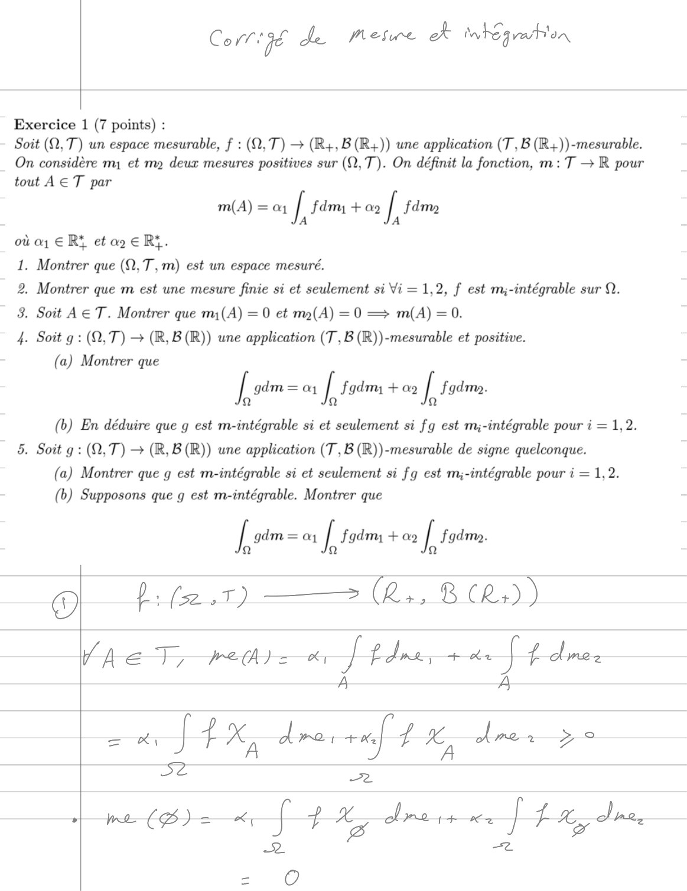

**Lecture OCR à contrôler**

~~~text
Conrtgé de mesure À whe arabion

Exercice 1 (7 points) :

Soit (Q,T) un espace mesurable, f : (Q,T) + (R+,B(R+)) une application (T, B (R+))-mesurable.
On considère m1 et m2 deux mesures positives sur (2,7). On définit la fonction, m: T > R pour
tout A ET par

m(A) = a I, fam + a I, fam,

où a; € RY et ag € RY.

=

. Montrer que (Q,7,m) est un espace mesuré.

. Montrer que m est une mesure finie si et seulement si Vi = 1,2, f est m;-intégrable sur Q.
. Soit A ET. Montrer que nu (A) = 0 et m(A) = 0 = > m(A) = 0.

. Soit g : (Q,T) — (R, B(R)) une application (T, B(R))-mesurable et positive.

(a) Montrer que
[games [ faim +00 | fgdm.
a a a

(b) En déduire que g est m-intégrable si et seulement si fg est m;-intégrable pour i = 1,2.
. Soit g : (Q,T) — (R, B(R)) une application (T, B(R))-mesurable de signe quelconque.

(a) Montrer que g est m-intégrable si et seulement si fg est m;-intégrable pour i = 1,2.

(b) Supposons que g est m-intégrable. Montrer que

[oûm = ox [faim + 02 [ fod,
a a a

+ % D

bal

© pf. T) ——5 (R,, B (Rs) )
~~~

## Page 2

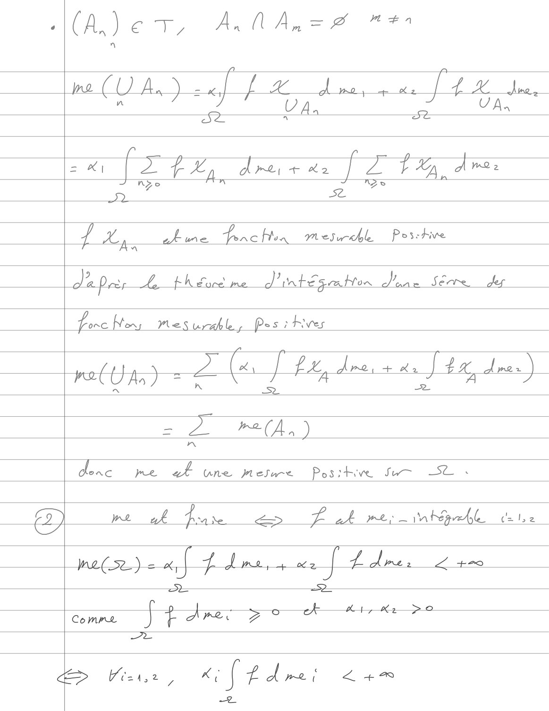

**Lecture OCR à contrôler**

~~~text
(A )eT, A,tA, =f Men

n

re (UA) - “Lx Jusque [4K des
. si Ua 2 YAn

a

nze

= Ky 24 a Arbre de Pre A

by, shure pone fe meswehle Posstie

de pees Le bh Sure me integra tron Dane Sérre er

Pane Mons Mes urahle , Pes hives

mi

mee Ct) =

Z (a. TP, Jour es J 42, due)

n me #2

= 2, eff.)

dre me at une mesure Positive Ju SE à

€) me ak fase > ae ak pes nbs c= le

pat) = af f dre Lee J 4dr +2

S>

Cc ' ©
Comma: ) + re. > le) cok x Kez >
OL

<> Ware, tif £dmei <4
wie
~~~

## Page 3

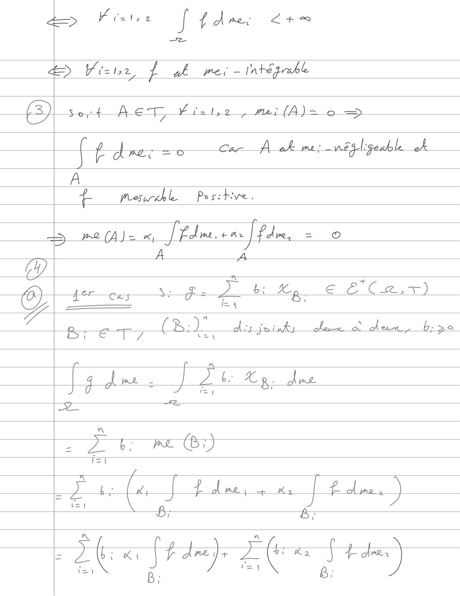

**Lecture OCR à contrôler**

~~~text
eS Fistse J fdnes £ +

ee

D Kiz2 1 Æ me: —Intégrble

(3) et AEs, Li=l,2 tei (A)= o =>

( pdner=e Cac ak me; négligeable oh

A

+ preswrih L Pere hive.

a pwe(Aj- «, JF dnt ear | Pde, = iO
A A

Se

aa +
1 &. 2 Li Kp. € E Ce,T)

Bree T7 (CB) As joints Lerner à eue b:>e
~~~

## Page 4

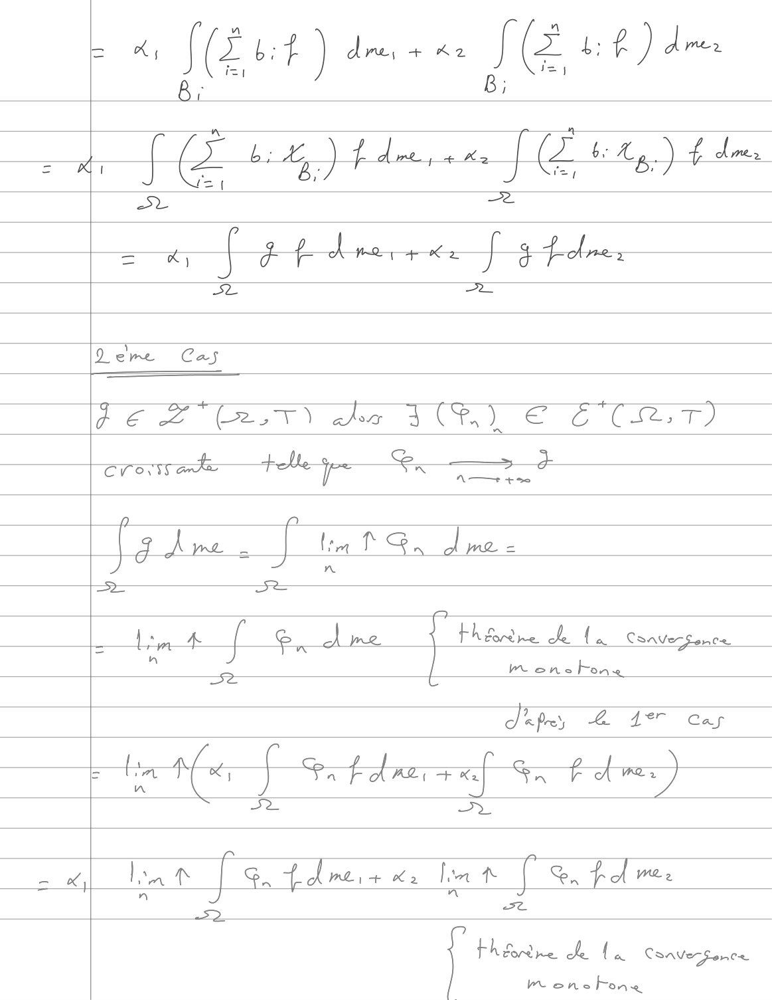

**Lecture OCR à contrôler**

~~~text
1 J : re, + Le ” ft dimer
x [(Ze4) 4 JE: )

Be
Ri f eo Lb: 4) 4 dre, sr | (2 Ag.) f dines
Se
= à; Path [gt
Dere Cas

1e & (2.7) che TUF.) € ÉCART)

cross akc tlle toe Se ——

fl. f Li & Clé.

1 ty A” [ E, A me Fhinère Je La Canvesfonce

wr ensFone

gl opal A ger Cas

bia} iam ee a | GE fof wax)

la J Sg. fidmer+ Xa lin 4 if ®&, fl mee
n 2 z=

| Hhñree À. [> CSAversence

m enchona
~~~

## Page 5

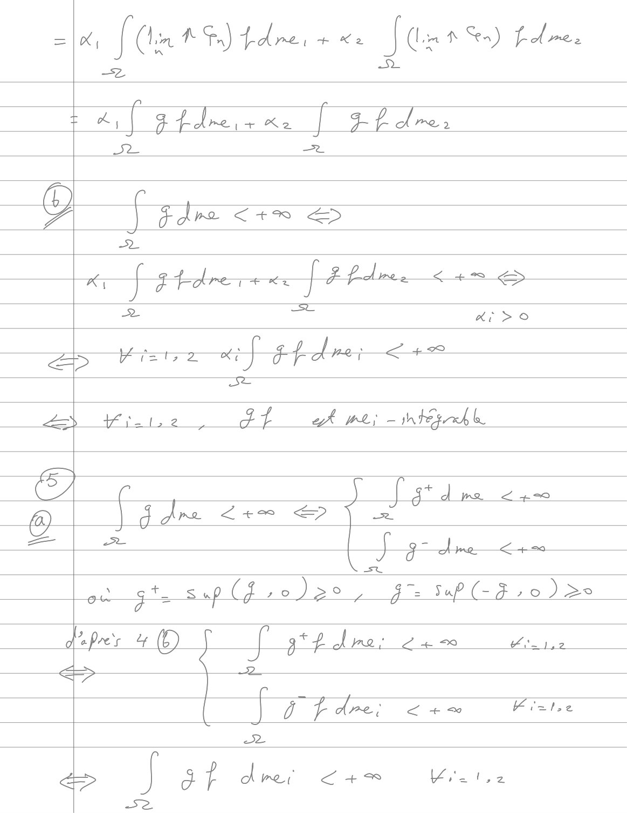

**Lecture OCR à contrôler**

~~~text
il

x“, [Cn 4) dhe, 3x08 Jess) fal mes

[ Fb mes

a

o Fde <a SS

ca 2 [ 4 fdme + Keo
S52

QL
AO Fabre F2 pd SES
+ xr>oe
<at> yr=t oi fp-feclme; +28
=
Ze) Kratz dt À wh; —inteprhh
C7 [a
J à À me + TS
@ Er Lim | Ÿ =
= J g dre +
é En sup Cf ,o)>0 PE SP(-Fro)>s
duper 4 (9) [ 3 f dre; 21-0 PART
a KR SE
| iF T dre; € + Fralee
2
> J aft Amer += ia t,z
ais
~~~

## Page 6

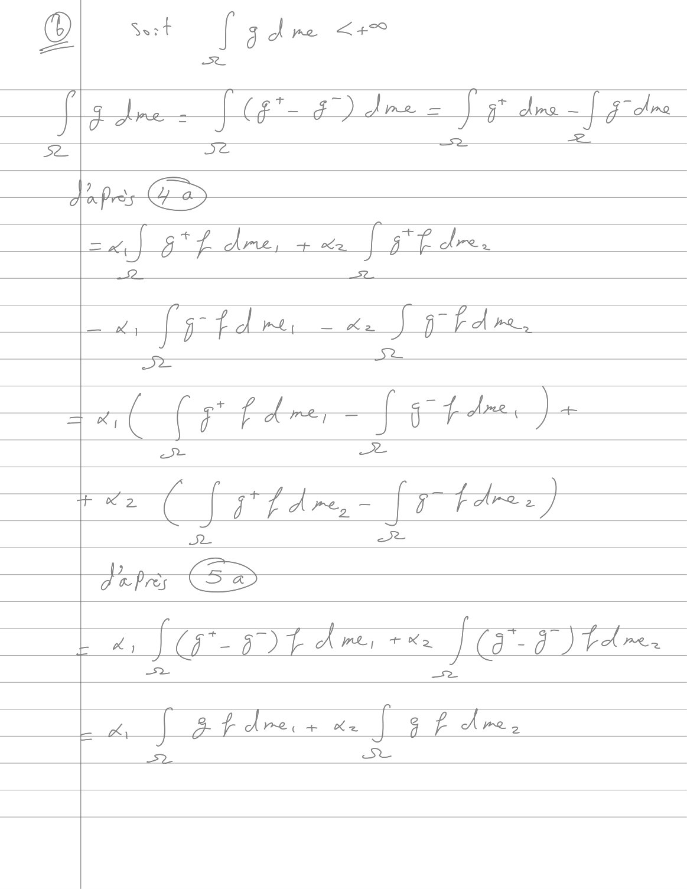

**Lecture OCR à contrôler**

~~~text
Sort [gdne 240

(lg me: we g_) Ane = [7 dus - [go otre

SIA ia =
pes GD
=] sf Are, + 0 [itd
af fd me - Xs J po Fare
DZ Se
dl fp thre feted
= =
ree ({pttdm,- fr teed
de Pres >

PRIS PI TC EL SIC BIC

LA; | af dmecs Ka [ g f Ames

Er SU
~~~

## Page 7

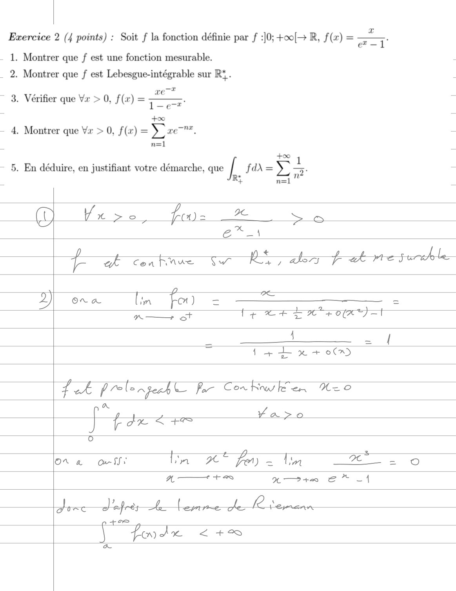

**Lecture OCR à contrôler**

~~~text
Exercice 2 (4 points) : Soit f la fonction définie par f :]0;+00[> R, f(x) = ar

- 1. Montrer que f est une fonction mesurable.
_ 2. Montrer que f est Lebesgue-intégrable sur R*.. :

—2

~ 3. Vérifier que Vr > 0, f(x) = =

+00
- 4, Montrer que Vx > 0, f(x) = Size, -

n=1

+00
- 5. En déduire, en justifiant votre démarche, que | fd\= > =
R} n=l

‘a Pr > eo fix) 2 &

ei
A n + . AL
1 ak Cenhnue Vw Rea, sr F wh re Ste

2.
2) CES [im For) = = =
a lies tarot

4 = |
1+ Lb x + of)

2 prlrgeht Por Conkhwk es Ha
r™ Ya

J pax rs =
0
Or a aeSfe mn KT for) = La T° = 9
90-8 % — +20 ern if
rec d'après hee lon À Pen
p+æ

| as le << +

a
~~~

## Page 8

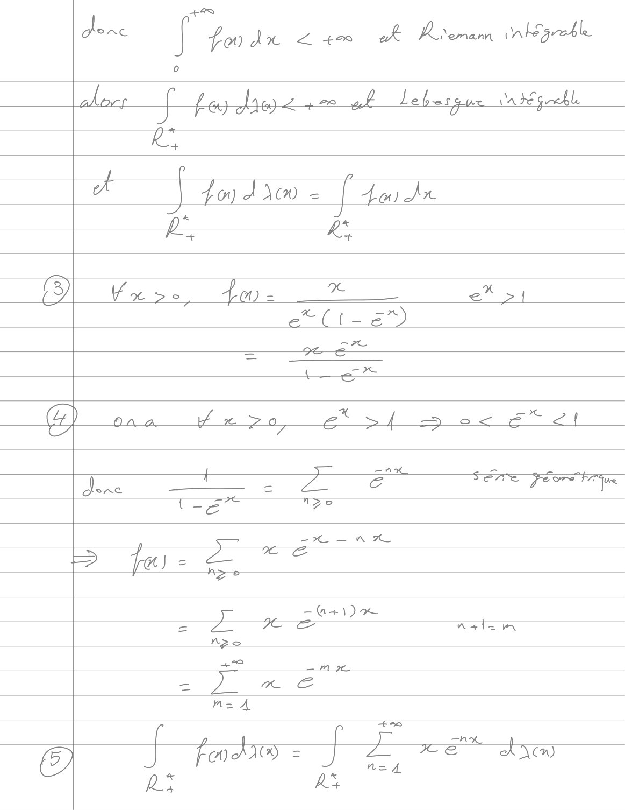

**Lecture OCR à contrôler**

~~~text
done J fon dx < + À Lies nel

alors + Lé-dre <+ at lebessue d'a qe b le

RY

ow f Toy À on = | tous Ar

[2 Re
© Fr > La = ?C e* >|
et fe
= we
4 a

= ane
loz: ee À See Foo tre
t=." nye
à Cm - — KH
Le
TES
—@+1)2
= » PE a nals
KOS
ae mn pe
med
~~~

## Page 9

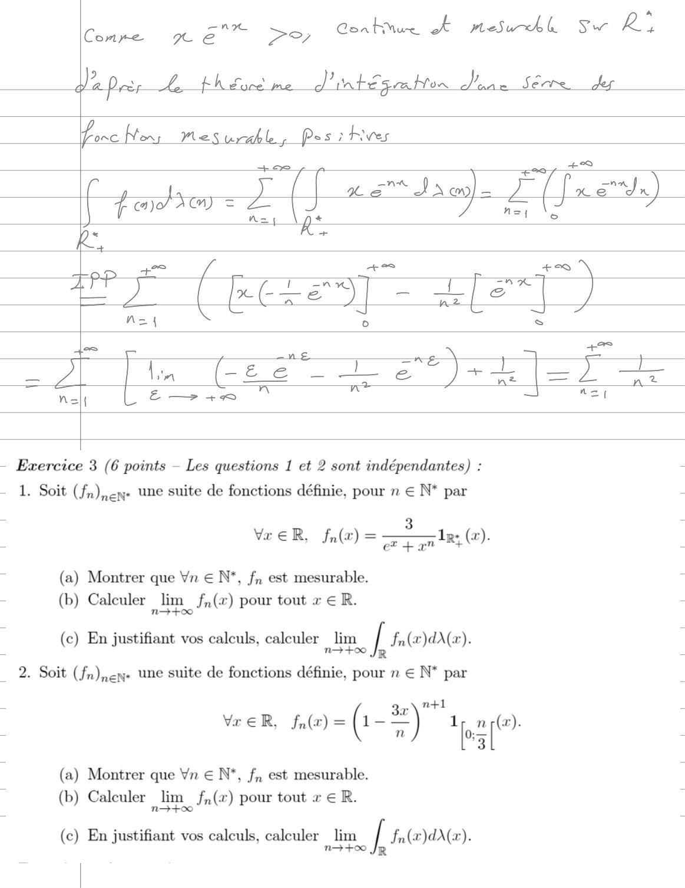

**Lecture OCR à contrôler**

~~~text
nr

Comre zx e

7°
Dep Le th fore me J intégmbon dns Sërre deg

orc Man Mes arah le Pes î Rives

y … Vfl was trole J [fue vn)
fae xo 7 n= LE / ney =

| (Ecresf - HET)

Conte & meSuxhh Sw L°

n=1 7 =
À RE se et) fel
aot

n=| E —> + en

Exercice 3 (6 points — Les questions 1 et 2 sont indépendantes) :

1. Soit (fh),en- une suite de fonctions définie, pour n € N* par

Ve ER, fr(x) = pen sao le, (x).

(a) Montrer que Yn € N*, f, est mesurable.
(b) Calculer lime fh(x) pour tout x € R.

(c) En justifiant vos calculs, calculer ALU Î fr(x)dX(x).

_ 2. Soit (fn),en+ une suite de fonctions définie, pour n € N° par

Vr ER, fn(x) = (: - sy ne
3

n

(a) Montrer que Yn € N°, f, est mesurable.
(b) Calculer lim f,(x) pour tout x € R.
n—+00

(c) En justifiant vos calculs, calculer lim | fr(x)dX(x).
n++00 JR
~~~

## Page 10

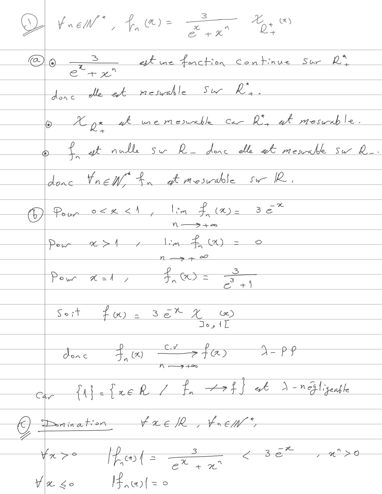

**Lecture OCR à contrôler**

~~~text
« 3
Pre L A (%) = a oA Te ay

eC+rKx
ED g  —_ > wk wie. forction Continue Sur L2\
e+ x"
=
ne le Sur À.

© AC px gh une mesurable Ce hi. À rie sub le.

à L at nulle Sw R_ donc elle ak mesh Sur D

donc treW 4, ot ne sural Su [22 ë

D i) o<x <i lon À (xs 36”
N > +es
Pear >A lem ff = ©
n > 20
Pour wal y 4. 60 = =
c+)
Soest fw - 36% X &
Je,1L
dune 4, fa A= PP

nn 908

cy fe fee R Lf ek} ob Aon Glizeth
‘a Drrina tion ref, VAR eM,
Sy send

2e n
Yr Het = oe a °

eX + 20°
Ya ge col = °
~~~

## Page 11

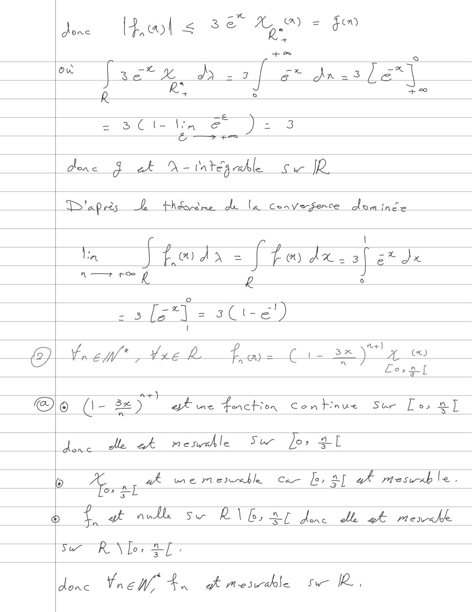

**Lecture OCR à contrôler**

~~~text
Jone (wl < 3€ os = fen

+

se frctx, Bof: 7 ass]

ê R*.

= SCT 7) -

ESS

bone à ak x - La teg able. Cw IR

D'après Le thSondme de la Conve-fence alvin Tris

ne [pods = {feo dx fa

RÉ £

©

~3fe*)>3C-e)
{
tre, trek faye Ci- 32 YT x w

rs
Lo, af

© (\- 3x) wt me fonction Continue Str L ow al

do elle ah mesuahle Tar Jo» 41

© ah we mesurable Can le. 4] ge rte su-nb le.

A
[or SL

© te ot noth Su R \ bes 30 dae ll «ie nest

ver R \l, SL:

donc tn EW, 4, ok peswable Sw R ‘
~~~

## Page 12

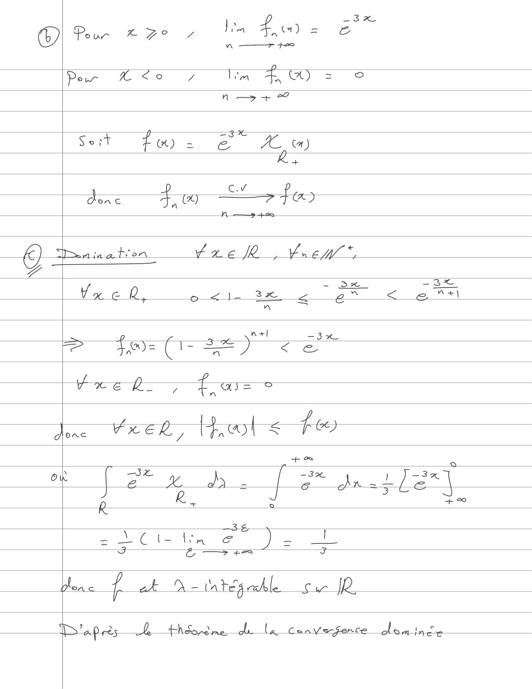

**Lecture OCR à contrôler**

~~~text
© Pur £Z° y LE Fo) x zs

Pu £0 7 lm $M = ©

sot fm. à Aa)
Ka

D cv p
done 5, PTO
R-—>-+00.
© TPeninabion LE JR ne n<
2
- > — 3
to e R, ) Same eT js MT
La)

I =

Les faye Ge say z aie

dre, fase °

Jone “XER, Hicol-< fee)

+8

a 3 >
ù f 2 wb. f 3 mile]
ê R. 2
a +
YCt- te > 1
a - = 7) = =

bone f Æ = tategrchle cu JQ

D'afess À Home ole la coavergence clominge
~~~

## Page 13

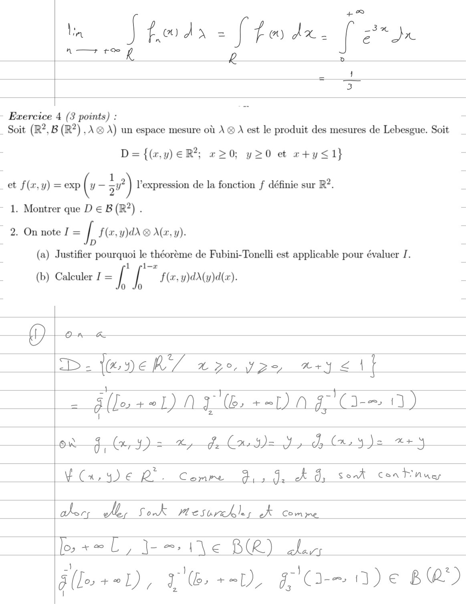

**Lecture OCR à contrôler**

~~~text
+

lin J fe dx = [Fe Ax - fa

n— toe £ 3

1

3

- Exercice 4 (3 points) :
_ Soit (R?,B (R?) ,\@ À) un espace mesure où À @ À est le produit des mesures de Lebesgue. Soit

D={(x,y) ER; 2>0; y>0 et r+y<1}

_ et f(x,y) = exp (v - 3”) l'expression de la fonction f définie sur R?.

1. Montrer que D € B(R?) .

2. On note J = | f(x, y)dd ® (x, y).
D

(a) Justifier pourquoi le théorème de Fubini-Tonelli est applicable pour évaluer 1.
1 plz
(b) Calculer I =) ji f(x, y)dA(y)d(x).
0 JO

D: {eve R" XZ. ~Ze aey elt

J

= _S{lusel) AP (k. +-D Ag’ 9)

on eo) y) = x, f, Co. = 9, f(a y jo 2+

Vu We QR. Comm 9,, 9, AG, sok contnuy

ahsry AL, Toak Mesurhles À Comme

lovely, J-= 11e BR) Lx

flee), LED, HO 0)e BU)
~~~

## Page 14

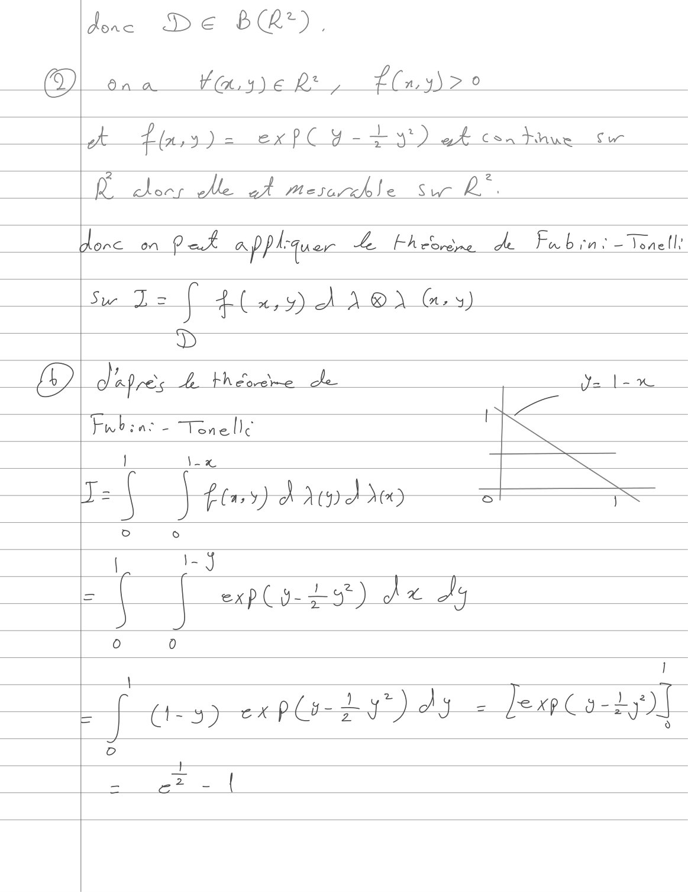

**Lecture OCR à contrôler**

~~~text
done De bR*),
@) na ¥@uyse Rt £(ny)> 0

À Llu,s)= exfC y-ty) C4 ce he Sur
R choay elle, À Mesurxhle Su 2°.
bon on Pak app lquer Æ, Pis gh Feibsint=Tenellt

Sua Ts f dl ar¥ HA) Gos)
D
LD | dupe: 4 thaèe de paie
tp

Fubins = Tone lle

! x
coo | fins) À Xp du) ol |
\ I-J
= expC y-+9°) Ae ay
J
o 0
I

(rsp -ex platy) dy + lexpCa-ty)]
~~~
