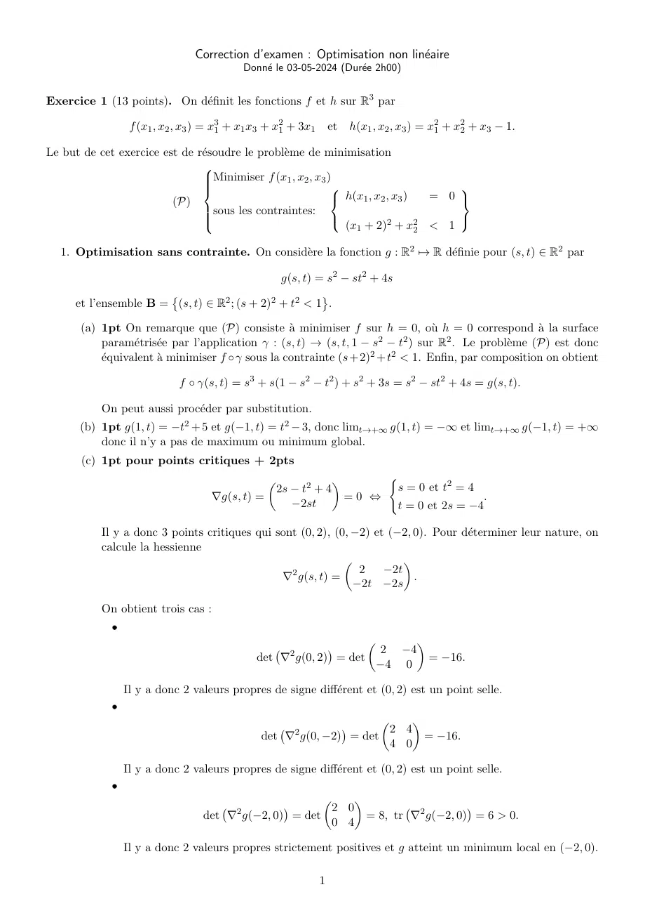
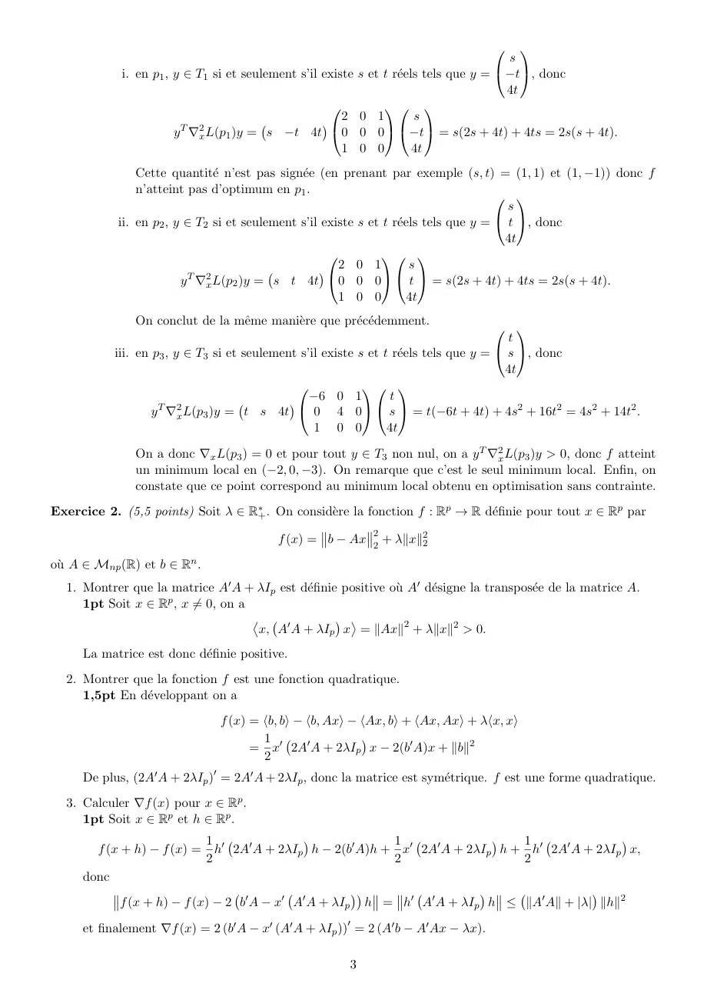
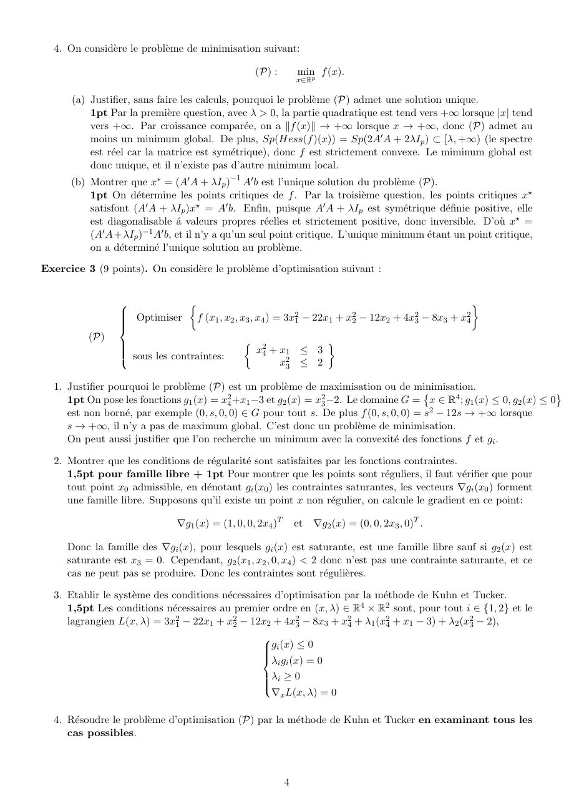

# Correction Examen 23-24.pdf

[Ouvrir l’original](https://drive.google.com/open?id=1NEG1_U-2H5RcZaCLLSruAg1Bg8DQEASp) · Les deux lectures automatiques du PDF divergent sur les pages indiquées. Leur fac-similé accompagne le texte.

**Pages présentant un écart entre les deux extractions** — 1, 3–4.

## Page 1

~~~text
                                 Correction d’examen : Optimisation non linéaire
                                              Donné le 03-05-2024 (Durée 2h00)

Exercice 1 (13 points). On définit les fonctions f et h sur R3 par

                  f (x1 , x2 , x3 ) = x31 + x1 x3 + x21 + 3x1       et   h(x1 , x2 , x3 ) = x21 + x22 + x3 − 1.

Le but de cet exercice est de résoudre le problème de minimisation
                               
                               
                                 Minimiser f (x1 , x2 , x3 )
                               
                                                                                   
                         (P)                                  h(x 1 , x2 , x3 ) = 0 
                               
                                 sous les contraintes:
                                                               (x1 + 2)2 + x22 < 1
                               
                                                                                   

  1. Optimisation sans contrainte. On considère la fonction g : R2 7→ R définie pour (s, t) ∈ R2 par

                                                      g(s, t) = s2 − st2 + 4s

     et l’ensemble B = (s, t) ∈ R2 ; (s + 2)2 + t2 < 1 .
                      

      (a) 1pt On remarque que (P) consiste à minimiser f sur h = 0, où h = 0 correspond à la surface
          paramétrisée par l’application γ : (s, t) → (s, t, 1 − s2 − t2 ) sur R2 . Le problème (P) est donc
          équivalent à minimiser f ◦ γ sous la contrainte (s + 2)2 + t2 < 1. Enfin, par composition on obtient

                             f ◦ γ(s, t) = s3 + s(1 − s2 − t2 ) + s2 + 3s = s2 − st2 + 4s = g(s, t).

           On peut aussi procéder par substitution.
      (b) 1pt g(1, t) = −t2 + 5 et g(−1, t) = t2 − 3, donc limt→+∞ g(1, t) = −∞ et limt→+∞ g(−1, t) = +∞
          donc il n’y a pas de maximum ou minimum global.
       (c) 1pt pour points critiques + 2pts
                                                                    (
                                                 2s − t2 + 4         s = 0 et t2 = 4
                                                            
                                     ∇g(s, t) =                =0 ⇔                   .
                                                    −2st             t = 0 et 2s = −4

           Il y a donc 3 points critiques qui sont (0, 2), (0, −2) et (−2, 0). Pour déterminer leur nature, on
           calcule la hessienne
                                                                        
                                                 2              2    −2t
                                               ∇ g(s, t) =                 .
                                                               −2t −2s

           On obtient trois cas :
             ˆ
                                                                                   
                                                        2
                                                                              2 −4
                                                det ∇ g(0, 2) = det                   = −16.
                                                                               −4 0

                 Il y a donc 2 valeurs propres de signe différent et (0, 2) est un point selle.
             ˆ
                                                                          
                                                            2
                                                                      2 4
                                                 det ∇ g(0, −2) = det        = −16.
                                                                       4 0

                 Il y a donc 2 valeurs propres de signe différent et (0, 2) est un point selle.
             ˆ
                                                            
                                          2              2 0
                                                               = 8, tr ∇2 g(−2, 0) = 6 > 0.
                                                                                 
                                   det ∇ g(−2, 0) = det
                                                         0 4

                 Il y a donc 2 valeurs propres strictement positives et g atteint un minimum local en (−2, 0).

                                                                1
~~~

## Page 2

~~~text
   (d) 1pt On remarque que (−2, 0) ∈ B donc la restriction de g à B atteint un minimum local. De
       plus,

                              det ∇2 g(s, t) = −4(s + t2 ), tr ∇2 g(s, t) = 2 − 2s,
                                                                        

       avec sur B, (s+ 2)2 < 1 donc s < −1 et t2 < 1, donc s + t2 < 0. Ainsi det ∇2 g|B (s, t) > 0 et
                                                                                                 

       tr ∇2 g|B (s, t) > 0, donc en tout point de B, la hessienne de g est définie positive donc g|B est
       strictement convexe. Le minimum local est donc un minimum global.

2. Optimisation sous contrainte d’égalité. On considère le problème d’optimisation
                                
                                 Optimiser f (x1 , x2 , x3 )
                                
                        (PCE)
                                
                                    sous la contrainte : h(x1 , x2 , x3 ) = 0
                                

   (a) 1pt Il n’y a qu’une contrainte, donc la dimension du vecteur λ vaut p = 1. On définit

       L :R3 × R           →R
          (x1 , x2 , x3 , λ) 7→f (x1 , x2 , x3 ) + λh(x1 , x2 , x3 ) = x31 + x1 x3 + x21 + 3x1 + λ x21 + x22 + x3 − 1 .
                                                                                                                     

   (b) 2pt On calcule le gradient de L
                                                     
                                                     
                                                     3x21 + x3 + 2x1 + 3 + 2λx1 = 0
                                                     
                                                                            2λx2 = 0
                                                     
                                                     
                                ∇L(x, λ) = 0 ⇔                                              .
                                                     
                                                                             x1 + λ = 0
                                                     
                                                                   x21 + x22 + x3 − 1 = 0
                                                     
                                                     

       Par (L2 ), on commence avec le cas λ = 0, on obtient par (L3 ), x1 = 0 puis par (L1 ), x3 = −3 et
       par (L4 ) on obtient les points critiques p1 = (0, 2, −3, 0) et p2 = (0, −2, −3, 0).
       Le second cas dans (L2 ) est de prendre x2 = 0, et on obtient le système
                                         2
                                        3x1 + x3 + 2x1 + 3 + 2λx1 = 0
                                        
                                                                   x1 = −λ
                                        
                                                               x3 = 1 − λ 2
                                        

       On remplace les valeurs de x1 et de x3 dans (L1 ) pour obtenir 1 − 2λ + 3 = 0, donc λ = 2. D’où
       le point critique p3 = (−2, 0, −3, 2).
   (c) 1pt +1pt On calcule le gradient de h
                                                                                    
                 2x1                         0                      0                     −4
       ∇h(x) = 2x2  , donc ∇h(0, 2, −3) = 4 , ∇h(0, −2, −3) = −4 , ∇h(−2, 0, −3) =  0  .
                  1                          1                      1                      1

       Pour chacun des points p1 , p2 et p3 , le gradient est un vecteur non nul, il forme une famille
       libre, donc le point est régulier. On peut en particulier déterminer les espaces tangents T (x) =
       ker ∇h(x)T
                                                                            
                             1        0                    1       0                     0      1
              T1 = Vect    0 , −1
                                        , T2 = Vect  0 , 1
                                                                     , T3 = Vect   1 , 0 .
                                                                                             
                             0        4                    0       4                     0      4

   (d) 1pt derivee seconde + 1pt conclusion Pour déterminer les minima locaux, on vérifie que la
       condition au second ordre est satisfaite. On calcule le gradient seconde en x de L
                                                                         
                                                    6x1 + 2 + 2λ 0 1
                                    ∇2x L(x, λ) =        0         2λ 0
                                                          1          0 0

                                                       2
~~~

## Page 3

~~~text
                                                                                        
                                                                                      s
            i. en p1 , y ∈ T1 si et seulement s’il existe s et t réels tels que y = −t, donc
                                                                                      4t
                                                               
                                                       2 0 1          s
                       y T ∇2x L(p1 )y = s −t 4t 0 0 0 −t = s(2s + 4t) + 4ts = 2s(s + 4t).
                                                   

                                                       1 0 0          4t
                Cette quantité n’est pas signée (en prenant par exemple (s, t) = (1, 1) et (1, −1)) donc f
                n’atteint pas d’optimum en p1 .
                                                                                       
                                                                                        s
            ii. en p2 , y ∈ T2 si et seulement s’il existe s et t réels tels que y =  t , donc
                                                                                       4t
                                                                
                                                       2 0 1          s
                         y T ∇2x L(p2 )y = s t 4t 0 0 0  t  = s(2s + 4t) + 4ts = 2s(s + 4t).
                                                   

                                                       1 0 0          4t
               On conclut de la même manière que précédemment.
                                                                                      
                                                                                        t
           iii. en p3 , y ∈ T3 si et seulement s’il existe s et t réels tels que y = s , donc
                                                                                     
                                                                                       4t
                                                            
                                                 −6 0 1          t
                   y T ∇2x L(p3 )y = t s 4t  0 4 0  s  = t(−6t + 4t) + 4s2 + 16t2 = 4s2 + 14t2 .
                                             

                                                  1 0 0          4t

               On a donc ∇x L(p3 ) = 0 et pour tout y ∈ T3 non nul, on a y T ∇2x L(p3 )y > 0, donc f atteint
               un minimum local en (−2, 0, −3). On remarque que c’est le seul minimum local. Enfin, on
               constate que ce point correspond au minimum local obtenu en optimisation sans contrainte.
Exercice 2. (5,5 points) Soit λ ∈ R∗+ . On considère la fonction f : Rp → R définie pour tout x ∈ Rp par
                                                           2
                                         f (x) = b − Ax 2 + λ∥x∥22
où A ∈ Mnp (R) et b ∈ Rn .
  1. Montrer que la matrice A′ A + λIp est définie positive où A′ désigne la transposée de la matrice A.
     1pt Soit x ∈ Rp , x ̸= 0, on a
                                    x, A′ A + λIp x = ∥Ax∥2 + λ∥x∥2 > 0.
                                                   

     La matrice est donc définie positive.
  2. Montrer que la fonction f est une fonction quadratique.
     1,5pt En développant on a
                              f (x) = ⟨b, b⟩ − ⟨b, Ax⟩ − ⟨Ax, b⟩ + ⟨Ax, Ax⟩ + λ⟨x, x⟩
                                      1
                                    = x′ 2A′ A + 2λIp x − 2(b′ A)x + ∥b∥2
                                                         
                                      2
     De plus, (2A′ A + 2λIp )′ = 2A′ A + 2λIp , donc la matrice est symétrique. f est une forme quadratique.
  3. Calculer ∇f (x) pour x ∈ Rp .
     1pt Soit x ∈ Rp et h ∈ Rp .
                            1                             1                  1
       f (x + h) − f (x) = h′ 2A′ A + 2λIp h − 2(b′ A)h + x′ 2A′ A + 2λIp h + h′ 2A′ A + 2λIp x,
                                                                                           
                            2                             2                  2
     donc
            f (x + h) − f (x) − 2 b′ A − x′ A′ A + λIp h = h′ A′ A + λIp h ≤ ∥A′ A∥ + |λ| ∥h∥2
                                                                                      

     et finalement ∇f (x) = 2 (b′ A − x′ (A′ A + λIp ))′ = 2 (A′ b − A′ Ax − λx).

                                                       3
~~~

## Page 4

~~~text
  4. On considère le problème de minimisation suivant:

                                                  (P) :        min f (x).
                                                               x∈Rp

      (a) Justifier, sans faire les calculs, pourquoi le problème (P) admet une solution unique.
          1pt Par la première question, avec λ > 0, la partie quadratique est tend vers +∞ lorsque |x| tend
          vers +∞. Par croissance comparée, on a ∥f (x)∥ → +∞ lorsque x → +∞, donc (P) admet au
          moins un minimum global. De plus, Sp(Hess(f )(x)) = Sp(2A′ A + 2λIp ) ⊂ [λ, +∞) (le spectre
          est réel car la matrice est symétrique), donc f est strictement convexe. Le miminum global est
          donc unique, et il n’existe pas d’autre minimum local.
      (b) Montrer que x∗ = (A′ A + λIp )−1 A′ b est l’unique solution du problème (P).
          1pt On détermine les points critiques de f . Par la troisième question, les points critiques x⋆
          satisfont (A′ A + λIp )x⋆ = A′ b. Enfin, puisque A′ A + λIp est symétrique définie positive, elle
          est diagonalisable á valeurs propres réelles et strictement positive, donc inversible. D’où x⋆ =
          (A′ A+λIp )−1 A′ b, et il n’y a qu’un seul point critique. L’unique minimum étant un point critique,
          on a déterminé l’unique solution au problème.

Exercice 3 (9 points). On considère le problème d’optimisation suivant :

                                                                                           
                
                                                      2           2            2          2
                  Optimiser f (x1 , x2 , x3 , x4 ) = 3x1 − 22x1 + x2 − 12x2 + 4x3 − 8x3 + x4
                
                
                
          (P)
                                                  x24 + x1 ≤ 3
                                                                     
                
                 sous les contraintes:
                
                
                                                        x23 ≤ 2

  1. Justifier pourquoi le problème (P) est un problème de maximisation ou de minimisation.
     1pt On pose les fonctions g1 (x) = x24 +x1 −3 et g2 (x) = x23 −2. Le domaine G = x ∈ R4 ; g1 (x) ≤ 0, g2 (x) ≤ 0
                                                                                        

     est non borné, par exemple (0, s, 0, 0) ∈ G pour tout s. De plus f (0, s, 0, 0) = s2 − 12s → +∞ lorsque
     s → +∞, il n’y a pas de maximum global. C’est donc un problème de minimisation.
     On peut aussi justifier que l’on recherche un minimum avec la convexité des fonctions f et gi .

  2. Montrer que les conditions de régularité sont satisfaites par les fonctions contraintes.
     1,5pt pour famille libre + 1pt Pour montrer que les points sont réguliers, il faut vérifier que pour
     tout point x0 admissible, en dénotant gi (x0 ) les contraintes saturantes, les vecteurs ∇gi (x0 ) forment
     une famille libre. Supposons qu’il existe un point x non régulier, on calcule le gradient en ce point:

                              ∇g1 (x) = (1, 0, 0, 2x4 )T       et   ∇g2 (x) = (0, 0, 2x3 , 0)T .

     Donc la famille des ∇gi (x), pour lesquels gi (x) est saturante, est une famille libre sauf si g2 (x) est
     saturante est x3 = 0. Cependant, g2 (x1 , x2 , 0, x4 ) < 2 donc n’est pas une contrainte saturante, et ce
     cas ne peut pas se produire. Donc les contraintes sont régulières.

  3. Etablir le système des conditions nécessaires d’optimisation par la méthode de Kuhn et Tucker.
     1,5pt Les conditions nécessaires au premier ordre en (x, λ) ∈ R4 × R2 sont, pour tout i ∈ {1, 2} et le
     lagrangien L(x, λ) = 3x21 − 22x1 + x22 − 12x2 + 4x23 − 8x3 + x24 + λ1 (x24 + x1 − 3) + λ2 (x23 − 2),

                                                    gi (x) ≤ 0
                                                   
                                                   
                                                   
                                                   
                                                   λ g (x) = 0
                                                     i i
                                                   
                                                   
                                                   λi ≥ 0
                                                   
                                                    ∇x L(x, λ) = 0

  4. Résoudre le problème d’optimisation (P) par la méthode de Kuhn et Tucker en examinant tous les
     cas possibles.

                                                           4
~~~

## Page 5

~~~text
4pt On cherche en quels points le gradient du lagrangien s’annule

                                                  6x1 − 22 + λ1 = 0
                                                
                                                
                                                
                                                2x − 12 = 0
                                                
                                                    2
                            ∇x L(x, λ) = 0 ⇔
                                                
                                                
                                                 8x3 − 8 + 2λ2 x3 = 0
                                                
                                                  2x4 + 2λ1 x4 = 0

On a x2 = 6. Par (L4 ), on doit avoir λ1 = −1 ou x4 = 0. Avec la contrainte de positivité, la condition
est donc x4 = 0. On a donc les deux systèmes découplés
                                                     
                                 x1 ≤ 3                 x23 ≤ 2
                              
                                                    
                                                     
                                                    
                              λ (x − 3) = 0
                                                    λ (x2 − 2) = 0
                                                     
                                      1   1                       2   3
                                  
                                  
                                  λ1 ≥ 0                     
                                                              
                                                              λ2 ≥ 0
                                                             
                                   6x1 − 22 + λ1 = 0,          (4 + λ ) x = 4
                                                                      2   3

Pour le premier système, si λ1 = 0, on obtient x1 = 113 , mais ce n’est pas possible avec la premiere
ligne. Donc x1 = 3, et λ1 = 22 − 18 = 4.                         √                       √
Pour le second système,√ soit λ2 = 0, donc x√3 = 1. Soit x3 =     2, donc λ2 = −4 + 2 2 < 0 donc
impossible, soit x3 = − 2, donc λ2 = −4 − 2 2 < 0 donc impossible.
Il y a donc un point pour lesquel les conditions de Kuhn-Tucker sont satisfaites :

                                               p1 = (3, 6, 1, 0, 4, 0).

On calcule ensuite le gradient seconde du lagrangien
                                                                 
                                            6 0      0      0
                                           0 2      0      0
                             ∇2x L(x, λ) = 
                                                                  
                                                                  .
                                           0 0 8 + 2λ2     0     
                                            0 0      0  2(1 + λ1 )

En p1 , la seule contrainte qui sature est g1 et
                                                                    
                                   1                               0     0     0
                                  0                            1 0 0
               ∇g1 (3, 6, 1, 0) = 
                                  0 donc T (3, 6, 1, 0) = Vect 0 , 1 , 0 .
                                                                     

                                   0                               0     0     1

Ainsi pour tout y ∈ T (3, 6, 1, 0), y ̸= 0, il existe (s, t, u) ̸= (0, 0, 0) tel que y = (0, s, t, u)T et

                                     y T ∇2x L(p1 )y = 2s2 + 8t2 + 10u2 > 0.

Les conditions au second ordre sont donc satisfaites, et f admet un minimum local en p1 .

                                                      5
~~~
