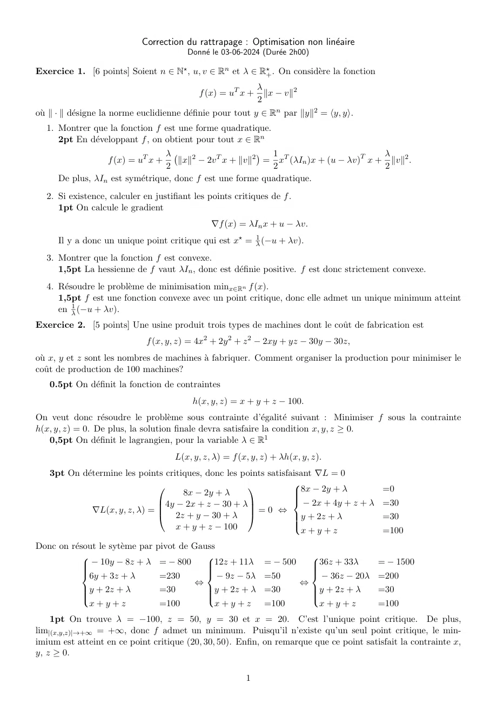
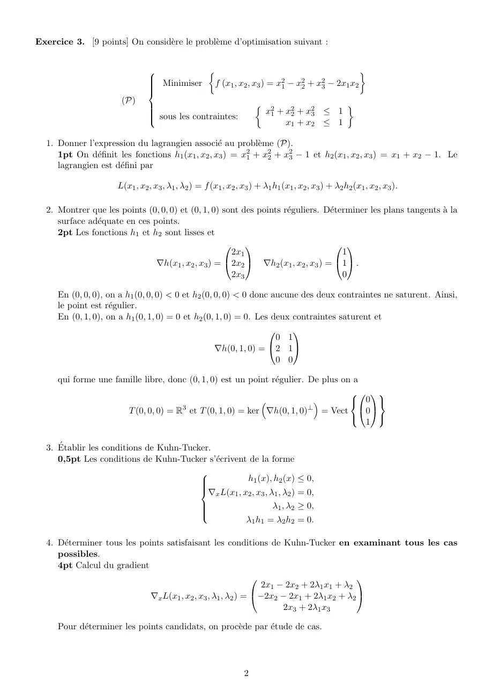
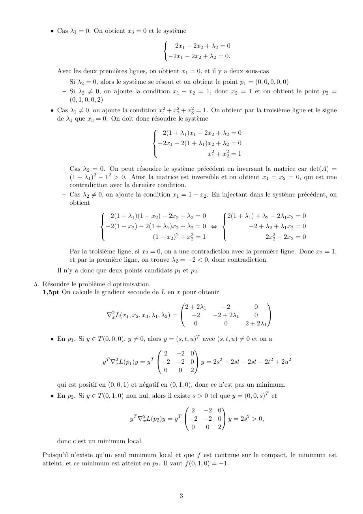

# Correction Rattrapage 23-24.pdf

[Ouvrir l’original](https://drive.google.com/open?id=1ybTZYS53bzliPzXN2o9jOfTrUYI5WxzL) · Les deux lectures automatiques du PDF divergent sur les pages indiquées. Leur fac-similé accompagne le texte.

**Pages présentant un écart entre les deux extractions** — 1–3.

## Page 1

~~~text
                            Correction du rattrapage : Optimisation non linéaire
                                        Donné le 03-06-2024 (Durée 2h00)

Exercice 1. [6 points] Soient n ∈ N⋆ , u, v ∈ Rn et λ ∈ R⋆+ . On considère la fonction
                                                            λ
                                           f (x) = uT x +     ∥x − v∥2
                                                            2
où ∥ · ∥ désigne la norme euclidienne définie pour tout y ∈ Rn par ∥y∥2 = ⟨y, y⟩.
  1. Montrer que la fonction f est une forme quadratique.
     2pt En développant f , on obtient pour tout x ∈ Rn
                                λ                        1                          λ
                 f (x) = uT x +     ∥x∥2 − 2v T x + ∥v∥2 = xT (λIn )x + (u − λv)T x + ∥v∥2 .
                                2                         2                          2
     De plus, λIn est symétrique, donc f est une forme quadratique.
  2. Si existence, calculer en justifiant les points critiques de f .
     1pt On calcule le gradient
                                               ∇f (x) = λIn x + u − λv.
      Il y a donc un unique point critique qui est x⋆ = λ1 (−u + λv).
  3. Montrer que la fonction f est convexe.
     1,5pt La hessienne de f vaut λIn , donc est définie positive. f est donc strictement convexe.
  4. Résoudre le problème de minimisation minx∈Rn f (x).
     1,5pt f est une fonction convexe avec un point critique, donc elle admet un unique minimum atteint
     en λ1 (−u + λv).
Exercice 2. [5 points] Une usine produit trois types de machines dont le coût de fabrication est
                             f (x, y, z) = 4x2 + 2y 2 + z 2 − 2xy + yz − 30y − 30z,
où x, y et z sont les nombres de machines à fabriquer. Comment organiser la production pour minimiser le
coût de production de 100 machines?
   0.5pt On définit la fonction de contraintes
                                          h(x, y, z) = x + y + z − 100.
On veut donc résoudre le problème sous contrainte d’égalité suivant : Minimiser f sous la contrainte
h(x, y, z) = 0. De plus, la solution finale devra satisfaire la condition x, y, z ≥ 0.
   0,5pt On définit le lagrangien, pour la variable λ ∈ R1
                                     L(x, y, z, λ) = f (x, y, z) + λh(x, y, z).
   3pt On détermine les points critiques, donc les points satisfaisant ∇L = 0
                                                                    8x − 2y + λ
                                                                  
                              
                                     8x − 2y + λ
                                                      
                                                                                          =0
                                                                  
                                                                     − 2x + 4y + z + λ
                                                                  
                              4y − 2x + z − 30 + λ                                      =30
             ∇L(x, y, z, λ) = 
                               2z + y − 30 + λ  = 0 ⇔ y + 2z + λ
                                                      
                                                                                          =30
                                   x + y + z − 100
                                                                  
                                                                  
                                                                    x+y+z                  =100
Donc on résout le sytème par pivot de Gauss
              − 10y − 8z + λ = − 800                          = − 500                     = − 1500
                                                                        
                                           12z + 11λ                    36z + 33λ
                                                                        
                                              − 9z − 5λ                    − 36z − 20λ
            
            6y + 3z + λ                                                 
                                =230                         =50                         =200
                                         ⇔                              ⇔
            y + 2z + λ
                               =30        y + 2z + λ
                                                             =30         y + 2z + λ
                                                                                         =30
            
                                          
                                                                         
                                                                          
             x+y+z              =100         x+y+z            =100         x+y+z          =100
    1pt On trouve λ = −100, z = 50, y = 30 et x = 20. C’est l’unique point critique. De plus,
lim|(x,y,z)|→+∞ = +∞, donc f admet un minimum. Puisqu’il n’existe qu’un seul point critique, le min-
imium est atteint en ce point critique (20, 30, 50). Enfin, on remarque que ce point satisfait la contrainte x,
y, z ≥ 0.

                                                         1
~~~

## Page 2

~~~text
Exercice 3. [9 points] On considère le problème d’optimisation suivant :

                                                                                   
                                Minimiser   f (x  , x , x ) = x 2 − x2 + x2 − 2x x
                               
                               
                                                 1 2 3          1    2    3     1 2
                               
                      (P)
                                                                       x21 + x22 + x23 ≤ 1
                                                                                                
                               
                                sous les contraintes:
                               
                               
                                                                             x1 + x2 ≤ 1

  1. Donner l’expression du lagrangien associé au problème (P).
     1pt On définit les fonctions h1 (x1 , x2 , x3 ) = x21 + x22 + x23 − 1 et h2 (x1 , x2 , x3 ) = x1 + x2 − 1. Le
     lagrangien est défini par

                     L(x1 , x2 , x3 , λ1 , λ2 ) = f (x1 , x2 , x3 ) + λ1 h1 (x1 , x2 , x3 ) + λ2 h2 (x1 , x2 , x3 ).

  2. Montrer que les points (0, 0, 0) et (0, 1, 0) sont des points réguliers. Déterminer les plans tangents à la
     surface adéquate en ces points.
     2pt Les fonctions h1 et h2 sont lisses et
                                                                                 
                                                     2x1                            1
                               ∇h(x1 , x2 , x3 ) = 2x2
                                                           ∇h2 (x1 , x2 , x3 ) = 1 .
                                                                                  
                                                     2x3                            0

     En (0, 0, 0), on a h1 (0, 0, 0) < 0 et h2 (0, 0, 0) < 0 donc aucune des deux contraintes ne saturent. Ainsi,
     le point est régulier.
     En (0, 1, 0), on a h1 (0, 1, 0) = 0 et h2 (0, 1, 0) = 0. Les deux contraintes saturent et
                                                                      
                                                                   0 1
                                                   ∇h(0, 1, 0) = 2 1
                                                                   0 0

     qui forme une famille libre, donc (0, 1, 0) est un point régulier. De plus on a
                                                                                    
                                                                                  0 
                      T (0, 0, 0) = R3 et T (0, 1, 0) = ker ∇h(0, 1, 0)⊥ = Vect 0
                                                                                      1
                                                                                       

  3. Établir les conditions de Kuhn-Tucker.
     0,5pt Les conditions de Kuhn-Tucker s’écrivent de la forme

                                                    h1 (x), h2 (x) ≤ 0,
                                         
                                         
                                         
                                         ∇ L(x , x , x , λ , λ ) = 0,
                                         
                                             x   1 2 3 1 2
                                         
                                         
                                                          λ1 , λ2 ≥ 0,
                                         
                                                    λ1 h1 = λ2 h2 = 0.

  4. Déterminer tous les points satisfaisant les conditions de Kuhn-Tucker en examinant tous les cas
     possibles.
     4pt Calcul du gradient
                                                                                      
                                                               2x1 − 2x2 + 2λ1 x1 + λ2
                             ∇x L(x1 , x2 , x3 , λ1 , λ2 ) = −2x2 − 2x1 + 2λ1 x2 + λ2 
                                                                    2x3 + 2λ1 x3

     Pour déterminer les points candidats, on procède par étude de cas.

                                                               2
~~~

## Page 3

~~~text
     ˆ Cas λ1 = 0. On obtient x3 = 0 et le système
                                           (
                                               2x1 − 2x2 + λ2 = 0
                                                 −2x1 − 2x2 + λ2 = 0.

        Avec les deux premières lignes, on obtient x1 = 0, et il y a deux sous-cas
          – Si λ2 = 0, alors le système se résout et on obtient le point p1 = (0, 0, 0, 0, 0)
          – Si λ2 ̸= 0, on ajoute la condition x1 + x2 = 1, donc x2 = 1 et on obtient le point p2 =
            (0, 1, 0, 0, 2)
     ˆ Cas λ1 ̸= 0, on ajoute la condition x21 + x22 + x23 = 1. On obtient par la troisième ligne et le signe
       de λ1 que x3 = 0. On doit donc résoudre le système
                                         
                                          2(1 + λ1 )x1 − 2x2 + λ2 = 0
                                         
                                          −2x1 − 2(1 + λ1 )x2 + λ2 = 0
                                         
                                                               x21 + x22 = 1
                                         

          – Cas λ2 = 0. On peut résoudre le système précédent en inversant la matrice car det(A) =
            (1 + λ1 )2 − 12 > 0. Ainsi la matrice est inversible et on obtient x1 = x2 = 0, qui est une
            contradiction avec la dernière condition.
          – Cas λ2 ̸= 0, on ajoute la condition x1 = 1 − x2 . En injectant dans le système précédent, on
            obtient
                                                                
                        2(1 + λ1 )(1 − x2 ) − 2x2 + λ2 = 0
                                                                2(1 + λ1 ) + λ2 − 2λ1 x2 = 0
                                                                 
                         −2(1 − x2 ) − 2(1 + λ1 )x2 + λ2 = 0 ⇔             −2 + λ2 + λ1 x2 = 0
                                                                
                                                   2   2
                                          (1 − x2 ) + x2 = 1                    2x22 − 2x2 = 0
                                                                

            Par la troisième ligne, si x2 = 0, on a une contradiction avec la première ligne. Donc x2 = 1,
            et par la première ligne, on trouve λ2 = −2 < 0, donc contradiction.
        Il n’y a donc que deux points candidats p1 et p2 .

5. Résoudre le problème d’optimisation.
   1,5pt On calcule le gradient seconde de L en x pour obtenir
                                                                                    
                                                            2 + 2λ1   −2        0
                          ∇2x L(x1 , x2 , x3 , λ1 , λ2 ) =  −2     −2 + 2λ1    0 
                                                               0       0     2 + 2λ1

     ˆ En p1 . Si y ∈ T (0, 0, 0), y ̸= 0, alors y = (s, t, u)T avec (s, t, u) ̸= 0 et on a
                                                            
                                                 2 −2 0
                        y T ∇2x L(p1 )y = y T −2 −2 0 y = 2s2 − 2st − 2st − 2t2 + 2u2
                                                 0    0 2

        qui est positif en (0, 0, 1) et négatif en (0, 1, 0), donc ce n’est pas un minimum.
     ˆ En p2 . Si y ∈ T (0, 1, 0) non nul, alors il existe s > 0 tel que y = (0, 0, s)T et
                                                                    
                                                           2 −2 0
                                   y T ∇2x L(p2 )y = y T −2 −2 0 y = 2s2 > 0,
                                                           0   0 2

        donc c’est un minimum local.

   Puisqu’il n’existe qu’un seul minimum local et que f est continue sur le compact, le minimum est
   atteint, et ce minimum est atteint en p2 . Il vaut f (0, 1, 0) = −1.

                                                     3
~~~
