# OPTI Correction TD 1 à 6.pdf

[Ouvrir l’original](https://drive.google.com/open?id=1QfPH3TC2OuSVroFEqZXktlRL1DwGgECM) · Les deux lectures automatiques du PDF divergent sur les pages indiquées. Leur fac-similé accompagne le texte.

**Pages présentant un écart entre les deux extractions** — 1–5, 7, 9–11, 13, 15, 17–19, 22–24, 26–29, 34–37, 39–46.

## Page 1

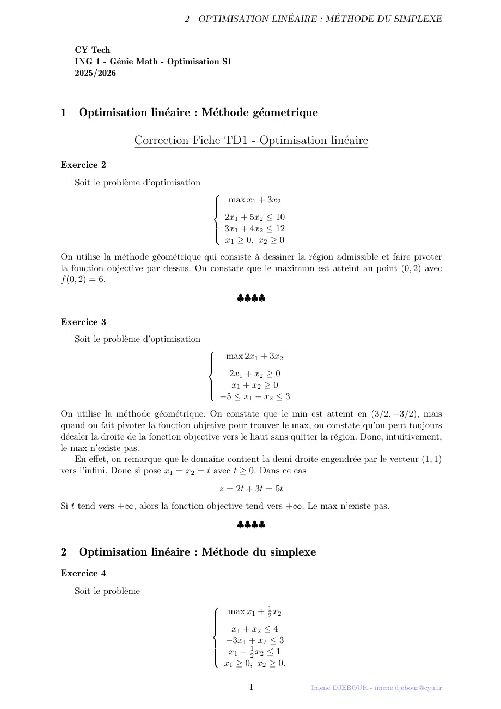

~~~text
                                 2   OPTIMISATION LINÉAIRE : MÉTHODE DU SIMPLEXE

    CY Tech
    ING 1 - Génie Math - Optimisation S1
    2025/2026

1    Optimisation linéaire : Méthode géometrique

                   Correction Fiche TD1 - Optimisation linéaire
Exercice 2
    Soit le problème d’optimisation
                                        
                                        
                                          max x1 + 3x2
                                        
                                        
                                          2x1 + 5x2 ≤ 10
                                        
                                        
                                         3x1 + 4x2 ≤ 12
                                          x1 ≥ 0, x2 ≥ 0
                                        

On utilise la méthode géométrique qui consiste à dessiner la région admissible et faire pivoter
la fonction objective par dessus. On constate que le maximum est atteint au point (0, 2) avec
f (0, 2) = 6.

                                               ♣♣♣♣

Exercice 3
    Soit le problème d’optimisation
                                       
                                       
                                           max 2x1 + 3x2
                                       
                                       
                                             2x1 + x2 ≥ 0
                                       
                                       
                                             x1 + x2 ≥ 0
                                           −5 ≤ x1 − x2 ≤ 3
                                       

On utilise la méthode géométrique. On constate que le min est atteint en (3/2, −3/2), mais
quand on fait pivoter la fonction objetive pour trouver le max, on constate qu’on peut toujours
décaler la droite de la fonction objective vers le haut sans quitter la région. Donc, intuitivement,
le max n’existe pas.
    En effet, on remarque que le domaine contient la demi droite engendrée par le vecteur (1, 1)
vers l’infini. Donc si pose x1 = x2 = t avec t ≥ 0. Dans ce cas
                                           z = 2t + 3t = 5t
Si t tend vers +∞, alors la fonction objective tend vers +∞. Le max n’existe pas.

                                               ♣♣♣♣

2    Optimisation linéaire : Méthode du simplexe
Exercice 4
    Soit le problème

                                           max x1 + 12 x2
                                        
                                        
                                        
                                        
                                        
                                         x1 + x2 ≤ 4
                                        

                                         −3x1 + x2 ≤ 3
                                                1
                                         x1 − 2 x2 ≤ 1
                                        
                                        
                                        
                                          x1 ≥ 0, x2 ≥ 0.
                                        

                                                  1                Imene DJEBOUR - imene.djebour@cyu.fr
~~~

## Page 2

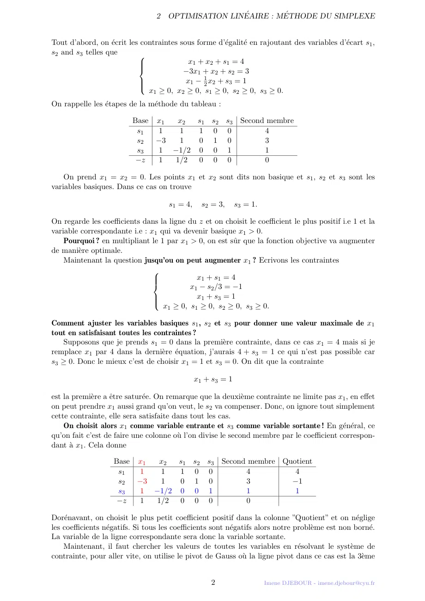

~~~text
                                  2   OPTIMISATION LINÉAIRE : MÉTHODE DU SIMPLEXE

Tout d’abord, on écrit les contraintes sous forme d’égalité en rajoutant des variables d’écart s1 ,
s2 and s3 telles que       
                           
                                          x1 + x2 + s1 = 4
                                         −3x1 + x2 + s2 = 3
                           
                           
                                         x1 − 12 x2 + s3 = 1
                              x1 ≥ 0, x2 ≥ 0, s1 ≥ 0, s2 ≥ 0, s3 ≥ 0.
                           

On rappelle les étapes de la méthode du tableau :

                          Base x1 x2  s1 s2 s3 Second membre
                           s1  1   1  1 0 0          4
                           s2  −3  1  0 1 0          3
                           s3  1 −1/2 0 0 1          1
                           −z  1  1/2 0 0 0          0

    On prend x1 = x2 = 0. Les points x1 et x2 sont dits non basique et s1 , s2 et s3 sont les
variables basiques. Dans ce cas on trouve

                                      s1 = 4,     s2 = 3,     s3 = 1.

On regarde les coefficients dans la ligne du z et on choisit le coefficient le plus positif i.e 1 et la
variable correspondante i.e : x1 qui va devenir basique x1 > 0.
    Pourquoi ? en multipliant le 1 par x1 > 0, on est sûr que la fonction objective va augmenter
de manière optimale.
    Maintenant la question jusqu’ou on peut augmenter x1 ? Ecrivons les contraintes
                               
                               
                                           x1 + s1 = 4
                                          x1 − s2 /3 = −1
                               
                               
                                           x1 + s3 = 1
                                  x1 ≥ 0, s1 ≥ 0, s2 ≥ 0, s3 ≥ 0.
                               

Comment ajuster les variables basiques s1 , s2 et s3 pour donner une valeur maximale de x1
tout en satisfaisant toutes les contraintes ?
   Supposons que je prends s1 = 0 dans la première contrainte, dans ce cas x1 = 4 mais si je
remplace x1 par 4 dans la dernière équation, j’aurais 4 + s3 = 1 ce qui n’est pas possible car
s3 ≥ 0. Donc le mieux c’est de choisir x1 = 1 et s3 = 0. On dit que la contrainte

                                                x1 + s3 = 1

est la première a être saturée. On remarque que la deuxième contrainte ne limite pas x1 , en effet
on peut prendre x1 aussi grand qu’on veut, le s2 va compenser. Donc, on ignore tout simplement
cette contrainte, elle sera satisfaite dans tout les cas.
    On choisit alors x1 comme variable entrante et s3 comme variable sortante ! En général, ce
qu’on fait c’est de faire une colonne où l’on divise le second membre par le coefficient correspon-
dant à x1 . Cela donne

                    Base x1  x2  s1 s2 s3 Second membre Quotient
                     s1   1  1   1 0 0          4          4
                     s2  −3  1   0 1 0          3         −1
                     s3   1 −1/2 0 0 1          1          1
                     −z   1 1/2  0 0 0          0

Dorénavant, on choisit le plus petit coefficient positif dans la colonne ”Quotient” et on néglige
les coefficients négatifs. Si tous les coefficients sont négatifs alors notre problème est non borné.
La variable de la ligne correspondante sera donc la variable sortante.
    Maintenant, il faut chercher les valeurs de toutes les variables en résolvant le système de
contrainte, pour aller vite, on utilise le pivot de Gauss où la ligne pivot dans ce cas est la 3ème

                                                    2                   Imene DJEBOUR - imene.djebour@cyu.fr
~~~

## Page 3

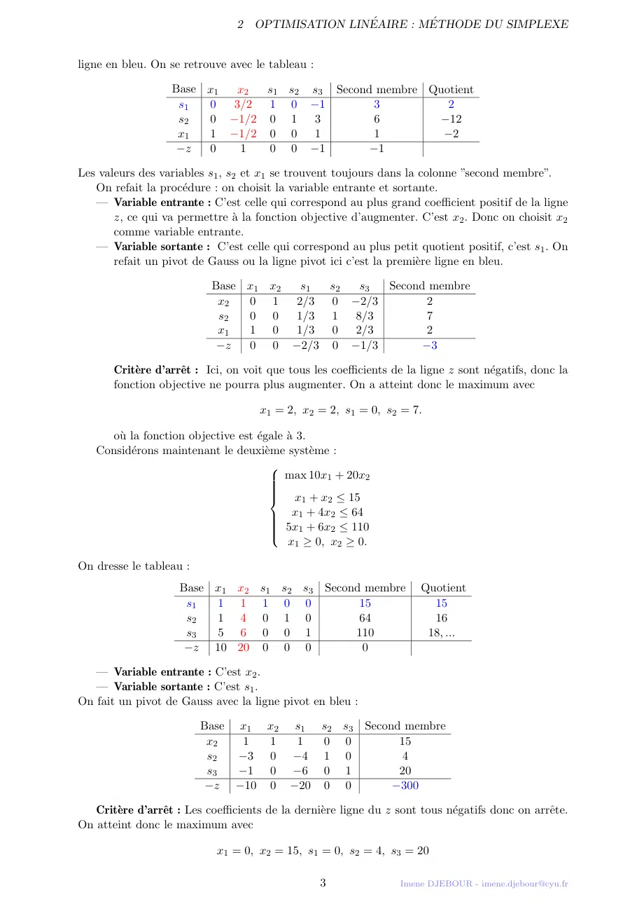

~~~text
                                 2   OPTIMISATION LINÉAIRE : MÉTHODE DU SIMPLEXE

ligne en bleu. On se retrouve avec le tableau :

                   Base x1 x2  s1 s2 s3 Second membre Quotient
                    s1  0  3/2 1 0 −1          3         2
                    s2  0 −1/2 0 1   3         6       −12
                    x1  1 −1/2 0 0   1         1        −2
                    −z  0   1  0 0 −1         −1

Les valeurs des variables s1 , s2 et x1 se trouvent toujours dans la colonne ”second membre”.
   On refait la procédure : on choisit la variable entrante et sortante.
   — Variable entrante : C’est celle qui correspond au plus grand coefficient positif de la ligne
       z, ce qui va permettre à la fonction objective d’augmenter. C’est x2 . Donc on choisit x2
       comme variable entrante.
   — Variable sortante : C’est celle qui correspond au plus petit quotient positif, c’est s1 . On
       refait un pivot de Gauss ou la ligne pivot ici c’est la première ligne en bleu.

                            Base x1 x2  s1 s2  s3 Second membre
                             x2  0 1   2/3 0 −2/3       2
                             s2  0 0   1/3 1  8/3       7
                             x1  1 0   1/3 0  2/3       2
                             −z  0 0 −2/3 0 −1/3        −3

       Critère d’arrêt : Ici, on voit que tous les coefficients de la ligne z sont négatifs, donc la
       fonction objective ne pourra plus augmenter. On a atteint donc le maximum avec

                                      x1 = 2, x2 = 2, s1 = 0, s2 = 7.

      où la fonction objective est égale à 3.
   Considérons maintenant le deuxième système :
                                       
                                       
                                          max 10x1 + 20x2
                                       
                                       
                                        x1 + x2 ≤ 15
                                       

                                            x1 + 4x2 ≤ 64
                                           5x 1 + 6x2 ≤ 110
                                       
                                       
                                       
                                       
                                           x1 ≥ 0, x2 ≥ 0.
                                       

On dresse le tableau :
                     Base x1 x2 s1 s2 s3 Second membre                  Quotient
                      s1  1 1 1 0 0            15                         15
                      s2  1 4 0 1 0            64                         16
                      s3  5 6 0 0 1           110                        18, ...
                      −z 10 20 0 0 0           0

   — Variable entrante : C’est x2 .
   — Variable sortante : C’est s1 .
On fait un pivot de Gauss avec la ligne pivot en bleu :

                         Base x1 x2 s1 s2 s3 Second membre
                          x2  1  1  1  0 0         15
                          s2  −3 0 −4 1 0          4
                          s3  −1 0 −6 0 1          20
                          −z −10 0 −20 0 0        −300

   Critère d’arrêt : Les coefficients de la dernière ligne du z sont tous négatifs donc on arrête.
On atteint donc le maximum avec

                             x1 = 0, x2 = 15, s1 = 0, s2 = 4, s3 = 20

                                                  3                Imene DJEBOUR - imene.djebour@cyu.fr
~~~

## Page 4

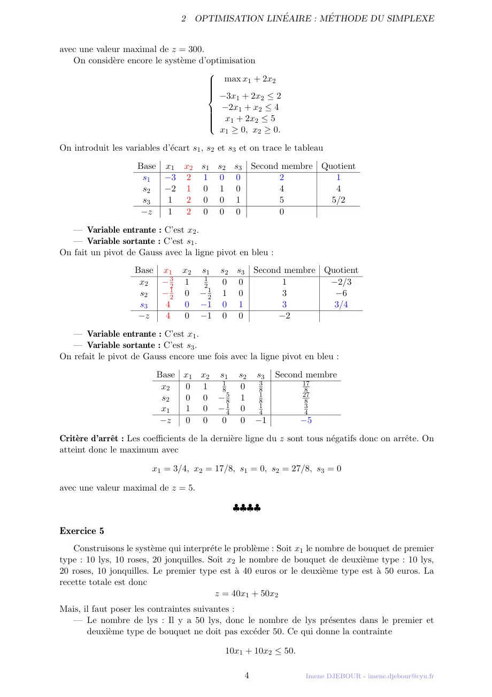

~~~text
                                 2   OPTIMISATION LINÉAIRE : MÉTHODE DU SIMPLEXE

avec une valeur maximal de z = 300.
   On considère encore le système d’optimisation
                                      
                                      
                                         max x1 + 2x2
                                      
                                      
                                       −3x1 + 2x2 ≤ 2
                                      

                                         −2x1 + x2 ≤ 4
                                          x1 + 2x2 ≤ 5
                                      
                                      
                                      
                                      
                                         x1 ≥ 0, x2 ≥ 0.
                                      

On introduit les variables d’écart s1 , s2 et s3 et on trace le tableau

                     Base x1 x2 s1 s2 s3 Second membre Quotient
                      s1  −3 2 1 0 0           2          1
                      s2  −2 1 0 1 0           4          4
                      s3   1 2 0 0 1           5         5/2
                      −z   1 2 0 0 0           0

   — Variable entrante : C’est x2 .
   — Variable sortante : C’est s1 .
On fait un pivot de Gauss avec la ligne pivot en bleu :

                    Base x1      x2 s1 s2 s3 Second membre Quotient
                     x2  − 23    1   1
                                     2   0 0        1       −2/3
                     s2  − 21          1
                                 0 −2 1 0           3        −6
                     s3   4      0 −1 0 1           3        3/4
                     −z   4      0 −1 0 0          −2

   — Variable entrante : C’est x1 .
   — Variable sortante : C’est s3 .
On refait le pivot de Gauss encore une fois avec la ligne pivot en bleu :

                          Base x1 x2 s1          s2 s3 Second membre
                                      1              3       17
                           x2  0 1    8          0   8        8
                           s2  0 0 − 58          1   1
                                                     8
                                                             27
                                                              8
                           x1  1 0 − 14          0   1
                                                     4
                                                              3
                                                              4
                           −z  0 0   0           0 −1        −5

Critère d’arrêt : Les coefficients de la dernière ligne du z sont tous négatifs donc on arrête. On
atteint donc le maximum avec

                         x1 = 3/4, x2 = 17/8, s1 = 0, s2 = 27/8, s3 = 0

avec une valeur maximal de z = 5.

                                               ♣♣♣♣

Exercice 5
    Construisons le système qui interpréte le problème : Soit x1 le nombre de bouquet de premier
type : 10 lys, 10 roses, 20 jonquilles. Soit x2 le nombre de bouquet de deuxième type : 10 lys,
20 roses, 10 jonquilles. Le premier type est à 40 euros or le deuxième type est à 50 euros. La
recette totale est donc
                                          z = 40x1 + 50x2
Mais, il faut poser les contraintes suivantes :
  — Le nombre de lys : Il y a 50 lys, donc le nombre de lys présentes dans le premier et
       deuxième type de bouquet ne doit pas excéder 50. Ce qui donne la contrainte

                                             10x1 + 10x2 ≤ 50.

                                                  4                Imene DJEBOUR - imene.djebour@cyu.fr
~~~

## Page 5

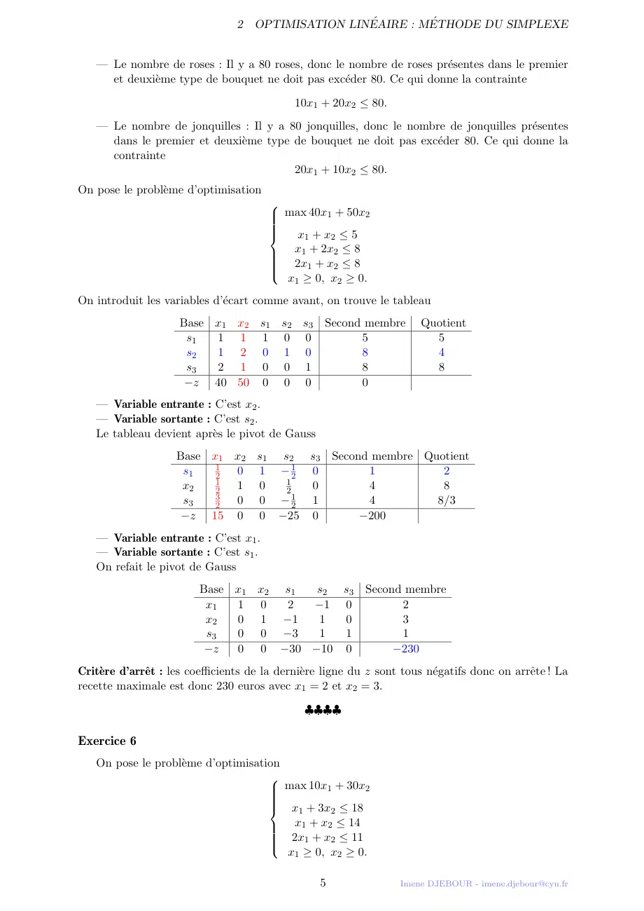

~~~text
                                 2   OPTIMISATION LINÉAIRE : MÉTHODE DU SIMPLEXE

   — Le nombre de roses : Il y a 80 roses, donc le nombre de roses présentes dans le premier
     et deuxième type de bouquet ne doit pas excéder 80. Ce qui donne la contrainte
                                              10x1 + 20x2 ≤ 80.
   — Le nombre de jonquilles : Il y a 80 jonquilles, donc le nombre de jonquilles présentes
     dans le premier et deuxième type de bouquet ne doit pas excéder 80. Ce qui donne la
     contrainte
                                       20x1 + 10x2 ≤ 80.
On pose le problème d’optimisation
                                        
                                         max 40x1 + 50x2
                                        
                                        
                                        
                                            x1 + x2 ≤ 5
                                        
                                        
                                          x1 + 2x2 ≤ 8
                                           2x 1 + x2 ≤ 8
                                        
                                        
                                        
                                        
                                          x1 ≥ 0, x2 ≥ 0.
                                        

On introduit les variables d’écart comme avant, on trouve le tableau
                     Base x1 x2 s1 s2 s3 Second membre                  Quotient
                      s1  1 1 1 0 0            5                          5
                      s2  1 2 0 1 0            8                          4
                      s3  2 1 0 0 1            8                          8
                      −z 40 50 0 0 0           0
   — Variable entrante : C’est x2 .
   — Variable sortante : C’est s2 .
   Le tableau devient après le pivot de Gauss
                    Base x1 x2 s1 s2 s3 Second membre Quotient
                          1
                     s1   2 0 1 − 12 0        1          2
                          1        1
                     x2   2 1 0    2   0      4          8
                          3          1
                     s3   2 0  0  −  2 1      4         8/3
                     −z 15 0 0 −25 0         −200
   — Variable entrante : C’est x1 .
   — Variable sortante : C’est s1 .
   On refait le pivot de Gauss
                         Base x1 x2 s1 s2 s3 Second membre
                          x1  1 0   2  −1 0        2
                          x2  0 1 −1   1  0        3
                          s3  0 0 −3   1  1        1
                          −z  0 0 −30 −10 0       −230
Critère d’arrêt : les coefficients de la dernière ligne du z sont tous négatifs donc on arrête ! La
recette maximale est donc 230 euros avec x1 = 2 et x2 = 3.

                                                ♣♣♣♣

Exercice 6
   On pose le problème d’optimisation
                                    
                                    
                                      max 10x1 + 30x2
                                    
                                    
                                     x1 + 3x2 ≤ 18
                                    

                                       x1 + x2 ≤ 14
                                        2x1 + x2 ≤ 11
                                    
                                    
                                    
                                    
                                       x1 ≥ 0, x2 ≥ 0.
                                    

                                                   5                Imene DJEBOUR - imene.djebour@cyu.fr
~~~

## Page 6

~~~text
                                    2   OPTIMISATION LINÉAIRE : MÉTHODE DU SIMPLEXE

On trace le tableau :
                      Base x1 x2 s1 s2 s3 Second membre Quotient
                       s1  1 3 1 0 0            18         6
                       s2  1 1 0 1 0            14        14
                       s3  2 1 0 0 1            11        11
                       −z 10 30 0 0 0           0

   — Variable entrante : C’est x2 .
   — Variable sortante : C’est s1 .
Pivot de Gauss !
                      Base x1 x2 s1 s2 s3 Second membre
                               1       1
                        x2     3    1  3   0 0  6
                               2         1
                        s2     3    0 −  3 1 0  8
                               5         1
                        s3     3    0 −3 0 1    5
                        −z     0 0 −10 0 0     −180
La valeur maximale est 180 et l’optimum est :

                                 x1 = 0, x2 = 6, s1 = 0, s2 = 8, s3 = 5.

    La variable x1 est non basique associée à un coefficient nul dans la ligne du z. Donc on déduit
qu’il existe une infinité d’optima. En effet, soit (x1 , x2 ) un autre optimum, donc il satisfait :

                  10x1 + 30x2 = 180 =⇒ x1 + 3x2 = 18 =⇒ x2 = (18 − x1 )/3.

D’un autre côté, en utilisant les autres contraintes, on obtient que

           x1 + (18 − x1 )/3 ≤ 14 =⇒ x1 ≤ 12,                2x1 + (18 − x1 )/3 ≤ 11 =⇒ x1 ≤ 3.

Donc toute les solutions sont donnée par la droite :
                                                18 − x1
                                        (x1 ,           ),    x1 ∈ [0, 3].
                                                   3
                                                     ♣♣♣♣

Exercice 7
   Soit                                     
                                            
                                             max 2x1 + 3x2
                                            
                                            
                                               x1 + 3x2 ≤ 5
                                            
                                            
                                             −3x1 + x2 ≤ 5
                                              x1 ≥ 0, x2 ≥ 0.
                                            

On écrit le tableau initial :
                        Base x1 x2 s1 s2 Second membre Quotient
                         s1   1 3 1 0          5         5/3
                         s2  −3 1 0 1          5          5
                         −z   2 3 0 0          0

   — Variable entrante : C’est x2 .
   — Variable sortante : C’est s1 .
Pivot de Gauss par rapport à la première ligne !

                        Base x1         x2 s1 s2 Second membre Quotient
                              1             1           5
                         x2   3         1   3   0       3         5
                         s2  − 10
                                3       0 −3 11        10
                                                        3      −1 < 0
                         −z   1         0 −1 0         −5

                                                         6                   Imene DJEBOUR - imene.djebour@cyu.fr
~~~

## Page 7

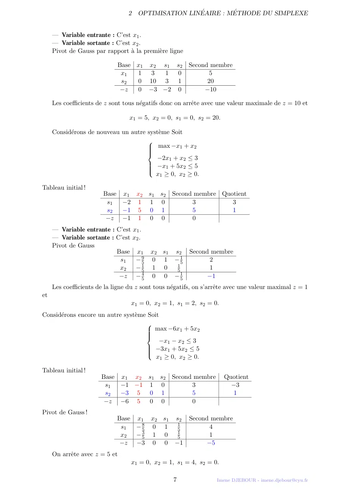

~~~text
                                 2   OPTIMISATION LINÉAIRE : MÉTHODE DU SIMPLEXE

     — Variable entrante : C’est x1 .
     — Variable sortante : C’est x2 .
     Pivot de Gauss par rapport à la première ligne

                             Base x1 x2 s1 s2 Second membre
                              x1  1  3  1  0        5
                              s2  0 10 3   1        20
                              −z  0 −3 −2 0        −10

     Les coefficients de z sont tous négatifs donc on arrête avec une valeur maximale de z = 10 et

                                  x1 = 5, x2 = 0, s1 = 0, s2 = 20.

     Considérons de nouveau un autre système Soit
                                      
                                       max −x1 + x2
                                      
                                      
                                      
                                         −2x1 + x2 ≤ 3
                                      
                                      
                                        −x1 + 5x2 ≤ 5
                                         x1 ≥ 0, x2 ≥ 0.
                                      

Tableau initial !
                        Base x1 x2 s1 s2 Second membre Quotient
                         s1  −2 1 1 0          3          3
                         s2  −1 5 0 1          5          1
                         −z −1 1 0 0           0
     — Variable entrante : C’est x1 .
     — Variable sortante : C’est x2 .
     Pivot de Gauss
                           Base x1        x2 s1 s2       Second membre
                            s1    − 59    0 1 − 15              2
                            x2    − 51    1 0    1
                                                 5              1
                            −z − 54       0 0 − 15             −1
     Les coefficients de la ligne du z sont tous négatifs, on s’arrête avec une valeur maximal z = 1
et
                                  x1 = 0, x2 = 1, s1 = 2, s2 = 0.
Considérons encore un autre système Soit
                                     
                                     
                                       max −6x1 + 5x2
                                     
                                     
                                          −x1 − x2 ≤ 3
                                      −3x1 + 5x2 ≤ 5
                                     
                                     
                                         x1 ≥ 0, x2 ≥ 0.
                                     

Tableau initial !
                       Base x1 x2 s1 s2 Second membre                 Quotient
                        s1  −1 −1 1 0         3                         −3
                        s2  −3 5  0 1         5                          1
                        −z −6 5   0 0         0
Pivot de Gauss !
                             Base x1 x2 s1 s2 Second membre
                              s1  − 85 0 1  1
                                            5        4
                                    3       1
                              x2  −5 1 0    5        1
                              −z −3 0 0 −1          −5
     On arrête avec z = 5 et
                                  x1 = 0, x2 = 1, s1 = 4, s2 = 0.

                                                   7               Imene DJEBOUR - imene.djebour@cyu.fr
~~~

## Page 8

~~~text
                                   2   OPTIMISATION LINÉAIRE : MÉTHODE DU SIMPLEXE

Considérons                              
                                          
                                           max 2x1 + 3x2
                                          
                                          
                                              x1 − x2 ≤ 3
                                          
                                          
                                            −x 1 + x2 ≤ 5
                                            x1 ≥ 0, x2 ≥ 0.
                                          

Tableau initial !
                       Base x1 x2 s1 s2 Second membre                  Quotient
                        s1   1 −1 1 0         3                          −3
                        s2  −1 1  0 1         5                           1
                        −z   2  3 0 0         0
   — Variable entrante : C’est x2 .
   — Variable sortante : C’est s2 .
Pivot de Gauss !
                         Base x1 x2 s1 s2 Second membre
                          s1       0 0 1 1      8
                          x2     −1 1 0  1      5
                          −z       5 0 0 −3    −15
On remarque que x1 rentre dans la base donc il faut augmenter x1 , mais si on regarde les
quotients par rapport à cette colonne : soit on obtient l’infini, soit un nombre négatif. On ne
peut plus avancer et passer à l’étape suivante car on ne sait plus quelle variable sort de la base.
Dans ce cas on reécrit les contraintes :

                                        s1 = 8,   −x1 + x2 = 5.

On voit bien que x1 peut être augmenter arbitrairement car on peut toujours chosir x2 en
fonction de x1
                                    x2 = 5 + x1 > 0
tel que −x1 + x2 = 5. Puisque il n ya pas de limitation pour x1 le problème n’est pas borné. En
effet, la fonction objective devient

                                z = 2x1 + 3(5 + x1 ) = 5x1 + 8 −→ +∞
                                                              x1 →+∞

Regardons un autre exemple                
                                          
                                            max −x1 + x2
                                          
                                          
                                              x1 − x2 ≤ 3
                                          
                                          
                                            −x 1 + x2 ≤ 5
                                            x1 ≥ 0, x2 ≥ 0.
                                          

Tableau initial !
                       Base x1 x2 s1 s2 Second membre                  Quotient
                        s1   1 −1 1 0         3                          −3
                        s2  −1 1  0 1         5                           1
                        −z −1 1   0 0         0
   — Variable entrante : C’est x2 .
   — Variable sortante : C’est s2 .
Pivot de Gauss !
                         Base x1 x2 s1 s2 Second membre
                          s1       0 0 1 1      8
                          x2     −1 1 0  1      5
                          −z       0 0 0 −1     −5
On arrête, la solution est :

                                 x1 = 0, x2 = 5, s1 = 8, s2 = 0, z = 5.

                                                   8              Imene DJEBOUR - imene.djebour@cyu.fr
~~~

## Page 9

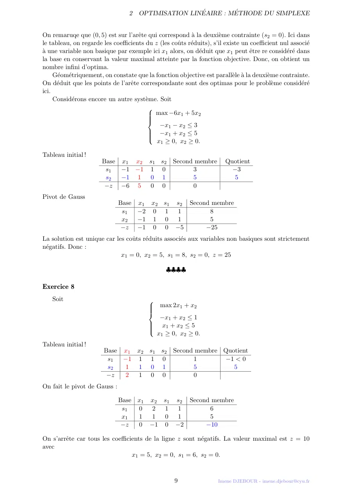

~~~text
                                  2   OPTIMISATION LINÉAIRE : MÉTHODE DU SIMPLEXE

On remaruqe que (0, 5) est sur l’arête qui correspond à la deuxième contrainte (s2 = 0). Ici dans
le tableau, on regarde les coefficients du z (les coûts réduits), s’il existe un coefficient nul associé
à une variable non basique par exemple ici x1 alors, on déduit que x1 peut être re considéré dans
la base en conservant la valeur maximal atteinte par la fonction objective. Donc, on obtient un
nombre infini d’optima.
     Géométriquement, on constate que la fonction objective est parallèle à la deuxième contrainte.
On déduit que les points de l’arête correspondante sont des optimas pour le problème considéré
ici.
     Considérons encore un autre système. Soit
                                        
                                        
                                          max −6x1 + 5x2
                                        
                                        
                                             −x1 − x2 ≤ 3
                                        
                                        
                                            −x1 + x2 ≤ 5
                                            x1 ≥ 0, x2 ≥ 0.
                                        

Tableau initial !
                       Base x1 x2 s1 s2 Second membre                    Quotient
                        s1  −1 −1 1 0         3                            −3
                        s2  −1 1  0 1         5                             5
                        −z −6 5   0 0         0
Pivot de Gauss
                              Base x1 x2 s1 s2 Second membre
                               s1  −2 0 1   1        8
                               x2  −1 1 0   1        5
                               −z −1 0 0 −5         −25
La solution est unique car les coûts réduits associés aux variables non basiques sont strictement
négatifs. Donc :
                             x1 = 0, x2 = 5, s1 = 8, s2 = 0, z = 25

                                                 ♣♣♣♣

Exercice 8
   Soit                                   
                                          
                                            max 2x1 + x2
                                          
                                          
                                             −x1 + x2 ≤ 1
                                          
                                          
                                             x1 + x2 ≤ 5
                                            x1 ≥ 0, x2 ≥ 0.
                                          

Tableau initial !
                        Base x1 x2 s1 s2 Second membre Quotient
                         s1  −1 1 1 0          1       −1 < 0
                         s2   1 1 0 1          5          5
                         −z   2 1 0 0          0
On fait le pivot de Gauss :

                              Base x1 x2 s1 s2 Second membre
                               s1  0  2  1  1        6
                               x1  1  1  0  1        5
                               −z  0 −1 0 −2        −10

On s’arrête car tous les coefficients de la ligne z sont négatifs. La valeur maximal est z = 10
avec
                                  x1 = 5, x2 = 0, s1 = 6, s2 = 0.

                                                    9                 Imene DJEBOUR - imene.djebour@cyu.fr
~~~

## Page 10

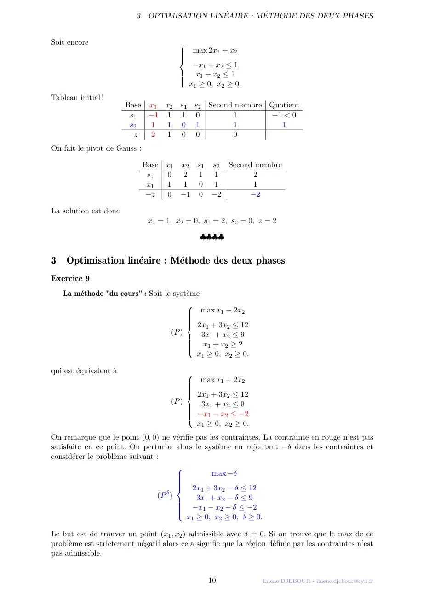

~~~text
                           3    OPTIMISATION LINÉAIRE : MÉTHODE DES DEUX PHASES

Soit encore                              
                                         
                                           max 2x1 + x2
                                         
                                         
                                            −x1 + x2 ≤ 1
                                         
                                         
                                            x1 + x2 ≤ 1
                                           x1 ≥ 0, x2 ≥ 0.
                                         

Tableau initial !
                         Base x1 x2 s1 s2 Second membre Quotient
                          s1  −1 1 1 0          1       −1 < 0
                          s2   1 1 0 1          1          1
                          −z   2 1 0 0          0
On fait le pivot de Gauss :

                               Base x1 x2 s1 s2 Second membre
                                s1  0  2  1  1        2
                                x1  1  1  0  1        1
                                −z  0 −1 0 −2         −2

La solution est donc
                                x1 = 1, x2 = 0, s1 = 2, s2 = 0, z = 2

                                                ♣♣♣♣

3    Optimisation linéaire : Méthode des deux phases
Exercice 9
    La méthode ”du cours” : Soit le système
                                         
                                          max x1 + 2x2
                                         
                                         
                                         
                                          2x1 + 3x2 ≤ 12
                                         
                                    (P )      3x1 + x2 ≤ 9
                                         
                                               x1 + x2 ≥ 2
                                         
                                         
                                         
                                         
                                            x1 ≥ 0, x2 ≥ 0.
                                         

qui est équivalent à                     
                                           
                                             max x1 + 2x2
                                           
                                           
                                            2x1 + 3x2 ≤ 12
                                           
                                      (P )    3x1 + x2 ≤ 9
                                           
                                            −x1 − x2 ≤ −2
                                           
                                           
                                           
                                             x1 ≥ 0, x2 ≥ 0.
                                           

On remarque que le point (0, 0) ne vérifie pas les contraintes. La contrainte en rouge n’est pas
satisfaite en ce point. On perturbe alors le système en rajoutant −δ dans les contraintes et
considérer le problème suivant :
                                         
                                         
                                                 max −δ
                                         
                                         
                                          2x1 + 3x2 − δ ≤ 12
                                         
                                  (P δ )      3x1 + x2 − δ ≤ 9
                                         
                                          −x1 − x2 − δ ≤ −2
                                         
                                         
                                         
                                           x1 ≥ 0, x2 ≥ 0, δ ≥ 0.
                                         

Le but est de trouver un point (x1 , x2 ) admissible avec δ = 0. Si on trouve que le max de ce
problème est strictement négatif alors cela signifie que la région définie par les contraintes n’est
pas admissible.

                                                  10                Imene DJEBOUR - imene.djebour@cyu.fr
~~~

## Page 11

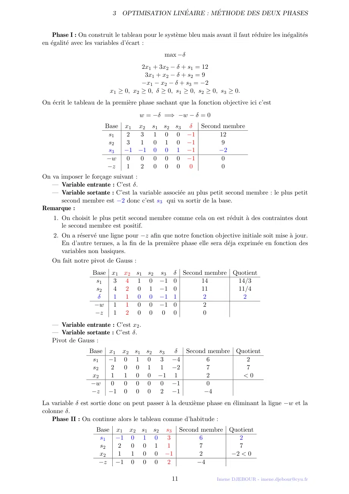

~~~text
                           3   OPTIMISATION LINÉAIRE : MÉTHODE DES DEUX PHASES

    Phase I : On construit le tableau pour le système bleu mais avant il faut réduire les inégalités
en égalité avec les variables d’écart :
                                               max −δ
                                     2x1 + 3x2 − δ + s1 = 12
                                      3x1 + x2 − δ + s2 = 9
                                     −x1 − x2 − δ + s3 = −2
                          x1 ≥ 0, x2 ≥ 0, δ ≥ 0, s1 ≥ 0, s2 ≥ 0, s3 ≥ 0.
On écrit le tableau de la première phase sachant que la fonction objective ici c’est
                                      w = −δ =⇒ −w − δ = 0
                        Base x1 x2 s1 s2 s3              δ Second membre
                         s1  2  3  1 0 0                −1       12
                         s2  3  1  0 1 0                −1       9
                         s3  −1 −1 0 0 1                −1       −2
                        −w   0  0  0 0 0                −1       0
                         −z  1  2  0 0 0                0        0
On va imposer le forçage suivant :
   — Variable entrante : C’est δ.
   — Variable sortante : C’est la variable associée au plus petit second membre : le plus petit
      second membre est −2 donc c’est s3 qui va sortir de la base.
Remarque :
   1. On choisit le plus petit second membre comme cela on est réduit à des contraintes dont
      le second membre est positif.
   2. On a réservé une ligne pour −z afin que notre fonction objective initiale soit mise à jour.
      En d’autre termes, a la fin de la première phase elle sera déja exprimée en fonction des
      variables non basiques.
   On fait notre pivot de Gauss :
                   Base x1 x2 s1 s2          s3    δ Second membre Quotient
                    s1  3 4 1 0              −1    0       14       14/3
                    s2  4 2 0 1              −1    0       11       11/4
                     δ  1 1 0 0              −1    1        2         2
                   −w 1 1 0 0                −1    0        2
                    −z  1 2 0 0               0    0        0
   — Variable entrante : C’est x2 .
   — Variable sortante : C’est δ.
   Pivot de Gauss :
                  Base x1 x2 s1 s2 s3 δ Second membre Quotient
                   s1  −1 0 1 0    3 −4       6          2
                   s2   2 0 0 1    1 −2       7          7
                   x2   1 1 0 0 −1 1          2         <0
                  −w    0 0 0 0    0 −1       0
                   −z −1 0 0 0     2 −1       −4
La variable δ est sortie donc on peut passer à la deuxième phase en éliminant la ligne −w et la
colonne δ.
    Phase II : On continue alors le tableau comme d’habitude :
                     Base x1 x2 s1 s2 s3 Second membre Quotient
                      s1  −1 0 1 0    3        6          2
                      s2   2 0 0 1    1        7          7
                      x2   1 1 0 0 −1          2       −2 < 0
                      −z −1 0 0 0     2        −4

                                                  11                Imene DJEBOUR - imene.djebour@cyu.fr
~~~

## Page 12

~~~text
                          3   OPTIMISATION LINÉAIRE : MÉTHODE DES DEUX PHASES

   — Variable entrante : C’est s3 .
   — Variable sortante : C’est s1 .
On fait un pivot de Gauss, on retrouve

                         Base x1      x2 s 1    s2 s3 Second membre
                          s3  − 13    0   1
                                          3     0 1         2
                               7
                          s2   3      0 − 13    1 0         5
                               2          1
                          x2   3      1   3     0 0         4
                          −z − 13     0 − 23    0 0         −8

On arrête car les coefficients de la ligne du −z sont positifs. Donc le maximum est −8 avec

                              x1 = 0, x2 = 4, s1 = 0, s2 = 5, s3 = 2.

                                             ♣♣♣♣

   Autre Méthode :                    
                                       
                                         max x1 + 2x2
                                       
                                       
                                        2x1 + 3x2 ≤ 12
                                       

                                         3x1 + x2 ≤ 9
                                           x1 + x2 ≥ 2
                                       
                                       
                                       
                                       
                                         x1 ≥ 0, x2 ≥ 0.
                                       

Cette forme n’est pas standard car il y a une inégalité de type ≥. On introduit les variables
d’écart s1 , s2 , s3 et une variable artificielle δ, toutes positives. Les contraintes s’écrivent
                                       
                                        2x1 + 3x2 + s1 = 12
                                             3x1 + x2 + s2 = 9
                                            x1 + x2 − s3 + δ = 2
                                       

Si on ne rajoute pas δ et si on se contente seulement des variables de la base s1 , s2 et s3 on
aurait s3 = −2 < 0 et cela n’est admissible. Donc pour corriger on introduit la variable δ dans
le but d’obtenir une solution admissible en essayant de la faire sortir de la base.
Phase I : On dresse le tableau de la première phase et on regarde les coefficients de δ et on
choisit le plus grand coefficient positif :

                  Base x1 x2 s1 s2 s3 δ Second membre Quotient
                   s1  2 3 1 0     0 0        12         4
                   s2  3 1 0 1     0 0         9         9
                    δ  1 1 0 0 −1 1            2         2
                   −z  1 2 0 0     0 0         0

   — Variable entrante : C’est x2 .
   — Variable sortante : C’est δ.
   Aprés le pivot de Gauss, on obtient :

                 Base x1 x2 s1 s2 s3 δ Second membre Quotient
                  s1  −1 0 1 0    3 −3       6          2
                  s2   2 0 0 1    1 −1       7          7
                  x2   1 1 0 0 −1 1          2       −2 < 0
                  −z −1 0 0 0     2 −2       −4

On a fait sortir δ de la base.
Phase II : On continue alors le tableau comme d’habitude sans tenir compte du δ.
   — Variable entrante : C’est s3 .
   — Variable sortante : C’est s1 .

                                                12               Imene DJEBOUR - imene.djebour@cyu.fr
~~~

## Page 13

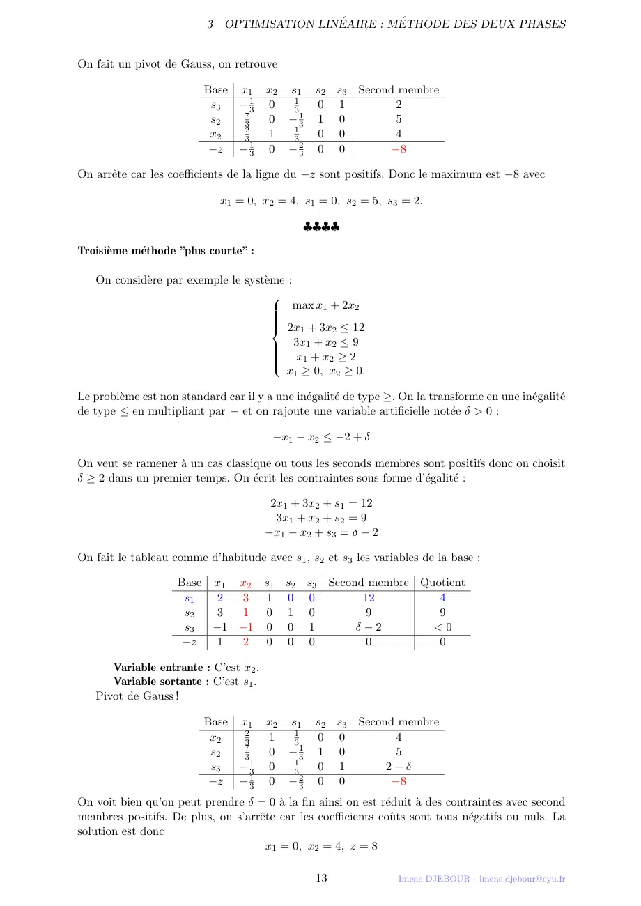

~~~text
                           3   OPTIMISATION LINÉAIRE : MÉTHODE DES DEUX PHASES

On fait un pivot de Gauss, on retrouve

                          Base x1      x2 s 1     s2 s3 Second membre
                           s3  − 13    0   1
                                           3      0 1         2
                                7
                           s2   3      0 − 13     1 0         5
                                2          1
                           x2   3      1   3      0 0         4
                           −z − 13     0 − 23     0 0         −8

On arrête car les coefficients de la ligne du −z sont positifs. Donc le maximum est −8 avec

                               x1 = 0, x2 = 4, s1 = 0, s2 = 5, s3 = 2.

                                               ♣♣♣♣

Troisième méthode ”plus courte” :

   On considère par exemple le système :
                                      
                                      
                                          max x1 + 2x2
                                      
                                      
                                       2x1 + 3x2 ≤ 12
                                      

                                          3x1 + x2 ≤ 9
                                            x1 + x2 ≥ 2
                                      
                                      
                                      
                                      
                                        x1 ≥ 0, x2 ≥ 0.
                                      

Le problème est non standard car il y a une inégalité de type ≥. On la transforme en une inégalité
de type ≤ en multipliant par − et on rajoute une variable artificielle notée δ > 0 :

                                         −x1 − x2 ≤ −2 + δ

On veut se ramener à un cas classique ou tous les seconds membres sont positifs donc on choisit
δ ≥ 2 dans un premier temps. On écrit les contraintes sous forme d’égalité :

                                        2x1 + 3x2 + s1 = 12
                                         3x1 + x2 + s2 = 9
                                       −x1 − x2 + s3 = δ − 2

On fait le tableau comme d’habitude avec s1 , s2 et s3 les variables de la base :

                     Base x1 x2 s1 s2 s3 Second membre Quotient
                      s1   2  3 1 0 0          12         4
                      s2   3  1 0 1 0           9         9
                      s3  −1 −1 0 0 1         δ−2        <0
                      −z   1  2 0 0 0           0         0

   — Variable entrante : C’est x2 .
   — Variable sortante : C’est s1 .
   Pivot de Gauss !

                          Base x1      x2 s 1     s2 s3 Second membre
                                2          1
                           x2   3      1   3      0 0         4
                                7
                           s2   3      0 − 13     1 0         5
                           s3  − 13    0   1
                                           3      0 1        2+δ
                           −z − 13     0 − 23     0 0         −8
On voit bien qu’on peut prendre δ = 0 à la fin ainsi on est réduit à des contraintes avec second
membres positifs. De plus, on s’arrête car les coefficients coûts sont tous négatifs ou nuls. La
solution est donc
                                     x1 = 0, x2 = 4, z = 8

                                                  13               Imene DJEBOUR - imene.djebour@cyu.fr
~~~

## Page 14

~~~text
                           3   OPTIMISATION LINÉAIRE : MÉTHODE DES DEUX PHASES

Un autre exemple :                      
                                        
                                            max x1 − 2x2
                                        
                                        
                                            x1 + x2 ≤ 3
                                        
                                        
                                         −x 1 + 3x2 ≤ −4
                                          x1 ≥ 0, x2 ≥ 0.
                                        

On corrige la deuxième contrainte comme l’exemple précédent pour avoir un second membre
positif.
                             −x1 + 3x2 + s2 = −4 + δ, δ ≥ 4.
On ecrit le tableau :
                        Base x1 x2 s1 s2 Second membre Quotient
                         s1   1 1  1 0         3          3
                         s2  −1 3  0 1        δ−4        <0
                         −z   1 −2    0        0          0

On remarque qu’avec ce choix, on a
   — Variable entrante : C’est x1 .
   — Variable sortante : C’est s1 .
Pivot de Gauss :
                         Base x1 x2 s1 s2 Second membre
                          x1      1  1  1 0     3
                          s2      0  4  1 1    δ−1
                          −z      0 −3 −1 0     −3
On s’arrête car tous les coefficients de −z sont négatifs. On voit que δ doit encore être choisi
strictement positif. Donc, le problème est inadmissible.

                                                ♣♣♣♣

Exercice 10
                                         
                                         
                                           max x1 − 2x2
                                         
                                         
                                             x1 + x2 ≤ 3
                                           x − 3x2 ≤ −4
                                          1
                                         
                                         
                                         
                                           x1 ≥ 0, x2 ≥ 0.
Ce problème n’est pas dans sa forme standard, car il y a un second membre négatif donc le
(0, 0) n’est pas admissible. On introduit une variable artificielle et on écrit la dernière contrainte
comme suit :
                                     −x1 + 3x2 − s2 + δ = 4.
On prend comme base s1 et δ. On trace le premier tabeau (Phase I) dans le but de faire sortir
δ de la base. On regarde les coefficients de δ et on choisit le plus grand coefficient positif :

                     Base x1 x2 s1 s2 δ Second membre Quotient
                      s1   1  1 1  0 0        3          3
                       δ  −1 3  0 −1 1        4         4/3
                      −z   1 −2 0  0 0        0

On remarque qu’avec ce choix, on a
   — Variable entrante : C’est x2 .
   — Variable sortante : C’est δ.

                                                  14                Imene DJEBOUR - imene.djebour@cyu.fr
~~~

## Page 15

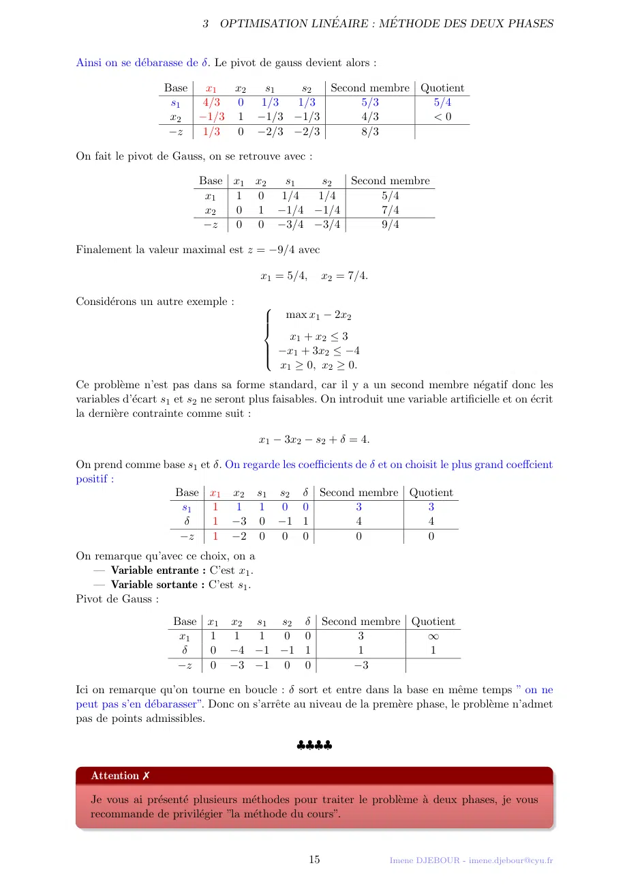

~~~text
                           3   OPTIMISATION LINÉAIRE : MÉTHODE DES DEUX PHASES

Ainsi on se débarasse de δ. Le pivot de gauss devient alors :

                   Base  x1  x2  s1  s2  Second membre Quotient
                    s1   4/3 0  1/3 1/3       5/3        5/4
                    x2  −1/3 1 −1/3 −1/3      4/3        <0
                    −z   1/3 0 −2/3 −2/3      8/3

On fait le pivot de Gauss, on se retrouve avec :

                           Base x1 x2  s1  s2 Second membre
                            x1  1 0   1/4 1/4      5/4
                            x2  0 1 −1/4 −1/4      7/4
                            −z  0 0 −3/4 −3/4      9/4

Finalement la valeur maximal est z = −9/4 avec

                                        x1 = 5/4,        x2 = 7/4.

Considérons un autre exemple :          
                                         
                                             max x1 − 2x2
                                         
                                         
                                             x1 + x2 ≤ 3
                                         
                                         
                                          −x1 + 3x2 ≤ −4
                                           x1 ≥ 0, x2 ≥ 0.
                                         

Ce problème n’est pas dans sa forme standard, car il y a un second membre négatif donc les
variables d’écart s1 et s2 ne seront plus faisables. On introduit une variable artificielle et on écrit
la dernière contrainte comme suit :

                                        x1 − 3x2 − s2 + δ = 4.

On prend comme base s1 et δ. On regarde les coefficients de δ et on choisit le plus grand coeffcient
positif :
                 Base x1 x2 s1 s2 δ Second membre Quotient
                  s1      1   1    1    0 0              3               3
                   δ      1 −3 0 −1 1                    4               4
                  −z      1 −2 0        0 0              0               0
On remarque qu’avec ce choix, on a
   — Variable entrante : C’est x1 .
   — Variable sortante : C’est s1 .
Pivot de Gauss :
                     Base x1 x2 s1 s2 δ Second membre Quotient
                      x1  1  1  1  0 0        3         ∞
                       δ  0 −4 −1 −1 1        1          1
                      −z  0 −3 −1 0 0         −3

Ici on remarque qu’on tourne en boucle : δ sort et entre dans la base en même temps ” on ne
peut pas s’en débarasser”. Donc on s’arrête au niveau de la premère phase, le problème n’admet
pas de points admissibles.

                                                ♣♣♣♣

   Attention ✗

   Je vous ai présenté plusieurs méthodes pour traiter le problème à deux phases, je vous
   recommande de privilégier ”la méthode du cours”.

                                                    15               Imene DJEBOUR - imene.djebour@cyu.fr
~~~

## Page 16

~~~text
                                                         4       OPTIMISATION LINÉAIRE : DUALITÉ

4    Optimisation linéaire : Dualité

                     Correction Fiche TD2 - Optimisation linéaire

Exercice 1
                                          
                                          
                                            max x1 + 2x2
                                          
                                          
                                           −3x1 + 2x2 ≤ 2
                                          

                                           −x1 + 2x2 ≤ 9
                                              x1 + x2 ≤ 5
                                          
                                          
                                          
                                          
                                            x1 ≥ 0, x2 ≥ 0.
                                          

Tableau initial :
                      Base x1 x2 s1 s2 s3 Second membre Quotient
                       s1  −3 2 1 0 0           2          1
                       s2  −1 2 0 1 0           4          2
                       s3   1 1 0 0 1           5          5
                       −z   1 2 0 0 0           0
    — Variable entrante : C’est x2 .
    — Variable sortante : C’est s1 .

                    Base  x1  x2  s1 s2 s3 Second membre Quotient
                     x2  −3/2 1  1/2 0 0          1      −2/3 < 0
                     s2   2   0  −1  1 0          2         1
                     s3  5/2  0 −1/2 0 1          4        8/5
                     −z   4   0  −1  0 0         −2
    — Variable entrante : C’est x1 .
    — Variable sortante : C’est s2 .
                Base x1 x2        s1  s2  s3 Second membre Quotient
                 x2    0 1 −1/4 3/4       0        2.5       <0
                 x1    1 0 −1/2 1/2       0         1        <0
                 s3    0 0       3/4 −5/4 1        1.5        2
                 −z    0 0         1  −2  0        −6
Encore un pivot de Gauss
                           Base x1 x2 s1 s2               s3      Second membre
                            x1  1 0 0 − 13                   2
                                                             3          2
                                          1                  1
                            x2  0 1 0     3                  3          3
                            s1  0 0 1 − 53                   4
                                                             3          2
                            −z  0 0 0 − 13               − 34           −8
La solution est :
                               x∗1 = 2, x∗2 = 3, s1 = 2, s2 = 0, s3 = 0.
Le problème dual correspondant est :
                                 
                                 
                                     min 2y1 + 4y2 + 5y3
                                 
                                 
                                      −3y1 − y2 + y3 ≥ 1
                                 
                                 
                                     2y1 + 2y2 + y3 ≥ 2
                                    y1 ≥ 0, y2 ≥ 0, y3 ≥ 0.
                                 

   Soit (x∗1 , x∗2 ) = (1, 5/2) et (y1∗ , y2∗ , y3∗ ) solution du problème dual. Les conditions de complé-
mentarité sont
                     x∗1 (−3y1∗ − y2∗ + y3∗ − 1) = 0,    x∗2 (2y1∗ + 2y2∗ + y3∗ − 2) = 0,

                                                    16                  Imene DJEBOUR - imene.djebour@cyu.fr
~~~

## Page 17

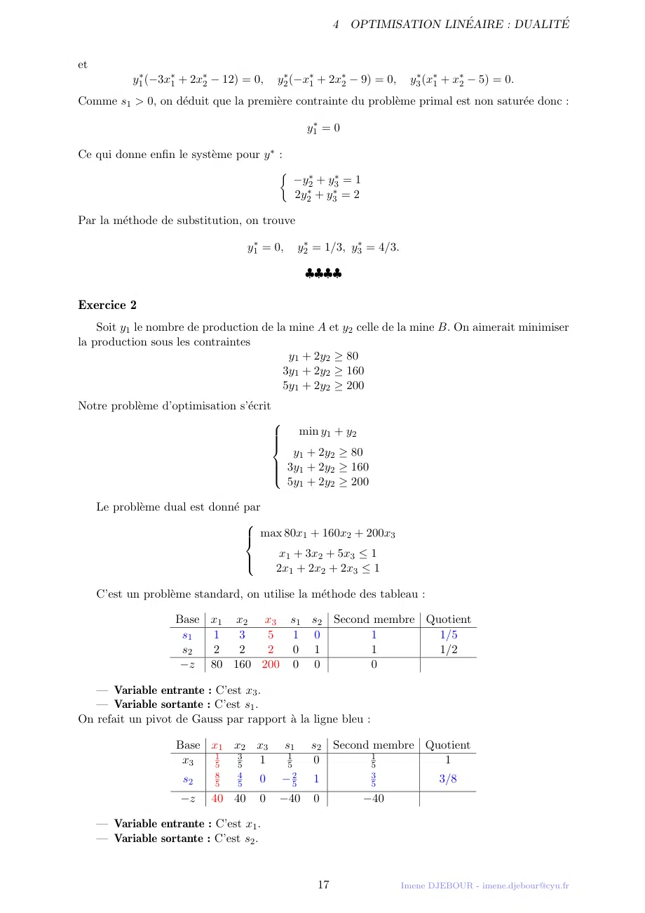

~~~text
                                                               4   OPTIMISATION LINÉAIRE : DUALITÉ

et
            y1∗ (−3x∗1 + 2x∗2 − 12) = 0,     y2∗ (−x∗1 + 2x∗2 − 9) = 0,        y3∗ (x∗1 + x∗2 − 5) = 0.
Comme s1 > 0, on déduit que la première contrainte du problème primal est non saturée donc :

                                                       y1∗ = 0

Ce qui donne enfin le système pour y ∗ :

                                                     −y2∗ + y3∗ = 1
                                        

                                                     2y2∗ + y3∗ = 2

Par la méthode de substitution, on trouve

                                      y1∗ = 0,        y2∗ = 1/3, y3∗ = 4/3.

                                                       ♣♣♣♣

Exercice 2
    Soit y1 le nombre de production de la mine A et y2 celle de la mine B. On aimerait minimiser
la production sous les contraintes
                                          y1 + 2y2 ≥ 80
                                        3y1 + 2y2 ≥ 160
                                        5y1 + 2y2 ≥ 200
Notre problème d’optimisation s’écrit
                                            
                                            
                                                     min y1 + y2
                                            
                                            
                                               y1 + 2y2 ≥ 80
                                              3y 1 + 2y2 ≥ 160
                                            
                                            
                                            
                                              5y1 + 2y2 ≥ 200
                                            

     Le problème dual est donné par
                                  
                                   max 80x1 + 160x2 + 200x3
                                  

                                      x1 + 3x2 + 5x3 ≤ 1
                                      2x1 + 2x2 + 2x3 ≤ 1
                                  

     C’est un problème standard, on utilise la méthode des tableau :

                     Base x1 x2 x3 s1 s2 Second membre Quotient
                      s1  1  3   5  1 0        1         1/5
                      s2  2  2   2  0 1        1         1/2
                      −z 80 160 200 0 0        0

   — Variable entrante : C’est x3 .
   — Variable sortante : C’est s1 .
On refait un pivot de Gauss par rapport à la ligne bleu :

                     Base x1 x2 x3               s1     s2 Second membre Quotient
                           1  3                  1                1
                      x3   5  5 1                5      0         5         1
                             8    4
                      s2     5    5     0    − 25        1             3
                                                                       5              3/8
                      −z    40 40       0    −40         0            −40

     — Variable entrante : C’est x1 .
     — Variable sortante : C’est s2 .

                                                          17                  Imene DJEBOUR - imene.djebour@cyu.fr
~~~

## Page 18

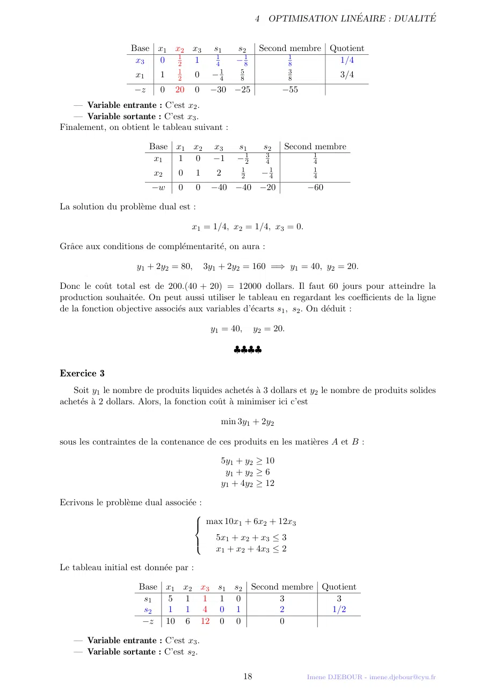

~~~text
                                                            4     OPTIMISATION LINÉAIRE : DUALITÉ

                   Base x1 x2 x3             s1      s2      Second membre Quotient
                    x3  0 12 1                1
                                              4      − 18           1
                                                                    8        1/4
                               1
                    x1     1   2       0    − 14      5
                                                      8
                                                                        3
                                                                        8             3/4
                    −z     0   20      0    −30 −25                    −55
   — Variable entrante : C’est x2 .
   — Variable sortante : C’est x3 .
Finalement, on obtient le tableau suivant :

                         Base x1 x2          x3      s1         s2     Second membre
                          x1  1 0            −1      − 12        3
                                                                 4
                                                                              1
                                                                              4
                                                       1
                         x2    0       1      2        2        − 41          1
                                                                              4
                         −w    0       0    −40 −40 −20                      −60

La solution du problème dual est :

                                    x1 = 1/4, x2 = 1/4, x3 = 0.

Grâce aux conditions de complémentarité, on aura :

                    y1 + 2y2 = 80,         3y1 + 2y2 = 160 =⇒ y1 = 40, y2 = 20.

Donc le coût total est de 200.(40 + 20) = 12000 dollars. Il faut 60 jours pour atteindre la
production souhaitée. On peut aussi utiliser le tableau en regardant les coefficients de la ligne
de la fonction objective associés aux variables d’écarts s1 , s2 . On déduit :

                                            y1 = 40,        y2 = 20.

                                                     ♣♣♣♣

Exercice 3
   Soit y1 le nombre de produits liquides achetés à 3 dollars et y2 le nombre de produits solides
achetés à 2 dollars. Alors, la fonction coût à minimiser ici c’est

                                                  min 3y1 + 2y2

sous les contraintes de la contenance de ces produits en les matières A et B :

                                                  5y1 + y2 ≥ 10
                                                   y1 + y2 ≥ 6
                                                  y1 + 4y2 ≥ 12

Ecrivons le problème dual associée :
                                   
                                    max 10x1 + 6x2 + 12x3
                                   

                                      5x1 + x2 + x3 ≤ 3
                                       x1 + x2 + 4x3 ≤ 2
                                   

Le tableau initial est donnée par :

                     Base x1 x2 x3 s1 s2 Second membre Quotient
                      s1  5 1 1 1 0            3          3
                      s2  1 1 4 0 1            2         1/2
                      −z 10 6 12 0 0           0

   — Variable entrante : C’est x3 .
   — Variable sortante : C’est s2 .

                                                       18                    Imene DJEBOUR - imene.djebour@cyu.fr
~~~

## Page 19

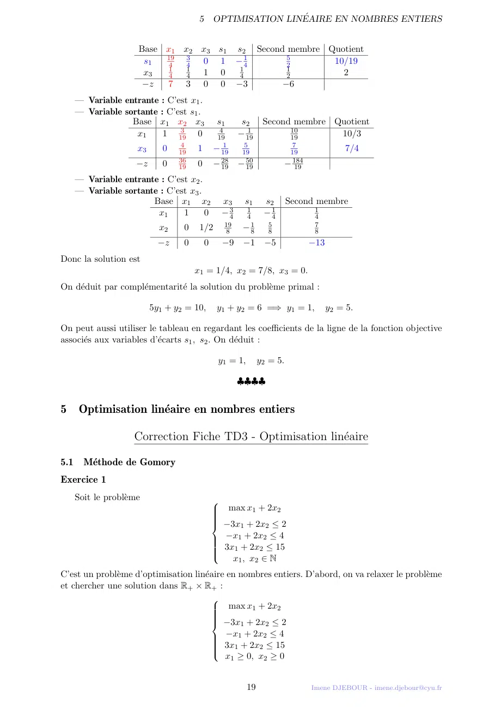

~~~text
                                        5       OPTIMISATION LINÉAIRE EN NOMBRES ENTIERS

                      Base x1 x2 x3 s1 s2                        Second membre Quotient
                           19  3
                       s1   4  4 0 1 − 14                               5
                                                                        2       10/19
                            1  1        1                               1
                       x3   4  4 1 0    4                               2         2
                       −z  7 3 0 0 −3                                  −6
      — Variable entrante : C’est x1 .
      — Variable sortante : C’est s1 .
                   Base x1 x2 x3                 s1       s2      Second membre Quotient
                               3                 4         1            10
                    x1     1 19     0            19      − 19           19       10/3
                                  4                1      5                7
                      x3      0   19   1        − 19      19              19               7/4
                                  36
                      −z      0   19   0        − 28
                                                  19     − 50
                                                           19            − 184
                                                                            19
      — Variable entrante : C’est x2 .
      — Variable sortante : C’est x3 .
                        Base x1 x2                x3      s1      s2       Second membre
                         x1     1      0          − 34     1
                                                           4      − 14            1
                                                                                  4
                                                  19
                             x2    0    1/2       8       − 18     5
                                                                   8
                                                                                  7
                                                                                  8
                             −z    0        0     −9      −1      −5             −13
Donc la solution est
                                       x1 = 1/4, x2 = 7/8, x3 = 0.
On déduit par complémentarité la solution du problème primal :

                           5y1 + y2 = 10,        y1 + y2 = 6 =⇒ y1 = 1,                y2 = 5.

On peut aussi utiliser le tableau en regardant les coefficients de la ligne de la fonction objective
associés aux variables d’écarts s1 , s2 . On déduit :

                                                 y1 = 1,         y2 = 5.

                                                         ♣♣♣♣

5      Optimisation linéaire en nombres entiers

                     Correction Fiche TD3 - Optimisation linéaire

5.1     Méthode de Gomory
Exercice 1
      Soit le problème                         
                                                
                                                  max x1 + 2x2
                                                
                                                
                                                 −3x1 + 2x2 ≤ 2
                                                

                                                 −x1 + 2x2 ≤ 4
                                                  3x1 + 2x2 ≤ 15
                                                
                                                
                                                
                                                
                                                    x1 , x2 ∈ N
                                                

C’est un problème d’optimisation linéaire en nombres entiers. D’abord, on va relaxer le problème
et chercher une solution dans R+ × R+ :
                                       
                                       
                                           max x1 + 2x2
                                       
                                       
                                        −3x1 + 2x2 ≤ 2
                                       

                                           −x1 + 2x2 ≤ 4
                                           3x1 + 2x2 ≤ 15
                                       
                                       
                                       
                                       
                                           x1 ≥ 0, x2 ≥ 0
                                       

                                                           19                    Imene DJEBOUR - imene.djebour@cyu.fr
~~~

## Page 20

~~~text
5.1     Méthode de Gomory             5    OPTIMISATION LINÉAIRE EN NOMBRES ENTIERS

Tableau initial :
                       Base x1 x2 s1 s2 s3 Second membre Quotient
                        s1  −3 2 1 0 0            2         1
                        s2  −1 2 0 1 0            4         2
                        s3   3 2 0 0 1           15       15/2
                        −z   1 2 0 0 0            0
   — Variable entrante : C’est x2 .
   — Variable sortante : C’est s1 .
On fait un pivot de Gauss par rapport à la ligne bleu :
                      Base x1      x2 s1 s2 s3 Second membre Quotient
                       x2  − 23    1   1
                                       2 0 0          1        <0
                       s2   2      0 −1 1 0           2         1
                       s3   6      0 −1 0 1          13       13/6
                       −z   4      0 −1 0 0          −2
      — Variable entrante : C’est x1 .
      — Variable sortante : C’est s2 .
                    Base x1 x2 s1              s2 s3 Second membre Quotient
                     x2     0 1 − 14            3
                                                4 0         5
                                                            2        <0
                     x1     1 0 − 12            1
                                                2 0        1         <0
                     s3     0 0        2       −3 1        7         7/2
                     −z     0 0        1       −2 0        −6
      — Variable entrante : C’est s1 .
      — Variable sortante : C’est s3 .
                         Base x1 x2 s1 s2                    s3     Second membre
                                         3                    1          27
                           x2     0 1 0  8                    8          8
                           x1     1 0 0 − 14                  1
                                                              4
                                                                         11
                                                                         4
                           s1     0 0 1 − 32                  1
                                                              2
                                                                         7
                                                                         2
                           −z     0 0 0 − 12                 − 21       − 19
                                                                           2
La solution est donc
                                           (x1 , x2 ) = (11/4, 27/8)
Les coordonnées ne sont pas entières. On rajoute la coupe correspondante à x1 qui s’écrit :

                      {−1/4}s2 + {1/4}s3 ≥ {11/4} ⇔ −3s2 /4 − s3 /4 ≤ −3/4.

      Information pratique

         1. On choisit la variable basique dont la partie décimale est la plus grande dans ce cas
            c’est : 11/4.
         2. La coupe de Gomory permet d’éliminer la partie décimale retrouvée dans la solution
            et a la forme                   X
                                               {ai }si ≥ {b}
                                                    i

            où les (ai ) sont les coefficients de la ligne correspondant à la variable basique choisie
            et b son second membre.

                 Base x1 x2 s1 s2   s3   s4 Second membre Quotient
                                3    1            27
                  x2  0 1 0     8    8   0         8         9
                                  1  1            11
                  x1  1 0 0    −4    4   0         4        <0
                  s1  0 0 1    − 32  1
                                     2   0         7
                                                   2        <0
                  s4  0 0 0 −3/4 −1/4 1          −3/4        1
                  −z  0 0 0    − 12 − 12 0       − 192

                                                        20                Imene DJEBOUR - imene.djebour@cyu.fr
~~~

## Page 21

~~~text
5.1    Méthode de Gomory            5   OPTIMISATION LINÉAIRE EN NOMBRES ENTIERS

On utilise la méthode Primal-dual : on choisit s4 comme variable sortante et pour choisir la
variable entrante, on regarde les quotients entre les coefficients coûts et la ligne pivot du s4 . On
                                      −1/2 −1/2
choisit la variable associée au min{ −3/4 , −1/4 }. C’est s2 dans ce cas.

   — Variable entrante : C’est s2 .
   — Variable sortante : C’est s4 .
Voici le tableau final :

                       Base x1 x2 s1 s2 s3    s4  Second membre
                        x2  0 1 0 0     0    1/2        3
                                         1
                        x1  1 0 0 0      3   −1/3       3
                        s1  0 0 1 0     1     −2        5
                        s2  0 0 0 1 1/3 −4/3            1
                                           1   2
                        −z  0 0 0 0 −3        −3        −9
La solution entière est donc (3, 3).
   Considérons un autre exemple :
                                         
                                         
                                          max 17x1 + 12x2
                                         
                                         
                                           10x1 + 7x2 ≤ 40
                                         
                                         
                                            x1 + x2 ≤ 5
                                             x1 , x2 ∈ N
                                         

On résoud d’abord le problème relaxé avec la méthode des tableaux :
                        Base x1 x2 s1 s2 Second membre Quotient
                         s1  10 7 1 0          40         4
                         s2  1 1 0 1           5          5
                         −z 17 12 0 0          0
      — Variable entrante : C’est x1 .
      — Variable sortante : C’est s1 .
                     Base x1 x2        s1      s2 Second membre Quotient
                                        1                         40
                      x1     1 7/10 10         0        4          7
                                          1
                      s2     0 3/10 − 10       1        1        3/10
                      −z     0 1/10 − 17 10    0       −68
   — Variable entrante : C’est x2 .
   — Variable sortante : C’est s2 .
Tableau final :
                         Base x1 x2 s1            s2     Second membre
                                      1
                          x1     1 0  3           − 73          5
                                                                3
                          x2     0 1 − 31         10
                                                   3
                                                               10
                                                                3
                          −z     0 0 − 35         − 13        − 205
                                                                  3
Donc la solution est (5/3, 10/3), on choisit la coupe par rapport à x1 :
                     {−1/3}s1 + {7/3}s2 ≥ {5/3} ⇔ −s1 /3 − 2s2 /3 ≤ −2/3
On rajoute une autre variable d’écart s3 tel que :
                                    −s1 /3 − 2s2 /3 + s3 = −2/3
                  Base x1 x2 s1   s2   s3 Second membre Quotient
                              1      7           5
                   x1  1 0    3   −  3 0         3        <0
                                1 10            10
                   x2  0 1   −3    3   0         3         1
                   s3  0 0 −1/3 −2/3 1         −2/3        1
                                5    1           205
                   −z  0 0   −3   −3   0       − 3
On utilise la méthode Primal-dual : on choisit s3 comme variable sortante et pour choisir la
variable entrante, on regarde les quotients entre les coefficients coûts et la ligne pivot du s3 . On
choisit la variable associée au min{ −5/3   −1/3
                                      −1/3 , −2/3 }. C’est s2 dans ce cas.

                                                 21                Imene DJEBOUR - imene.djebour@cyu.fr
~~~

## Page 22

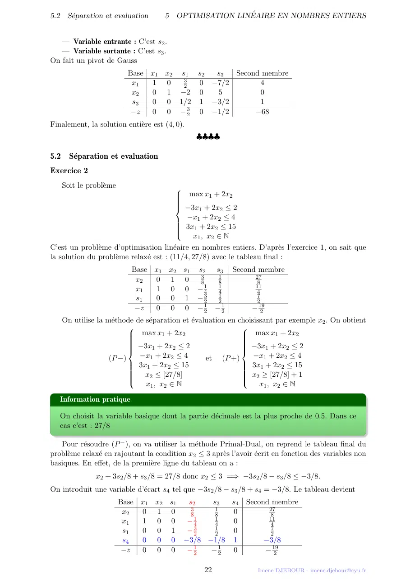

~~~text
5.2     Séparation et evaluation     5   OPTIMISATION LINÉAIRE EN NOMBRES ENTIERS

   — Variable entrante : C’est s2 .
   — Variable sortante : C’est s3 .
On fait un pivot de Gauss
                            Base x1 x2 s1 s2 s3  Second membre
                                        3
                             x1  1 0    2 0 −7/2       4
                             x2  0 1 −2 0    5         0
                             s3  0 0 1/2 1 −3/2        1
                             −z  0 0 − 32 0 −1/2      −68
Finalement, la solution entière est (4, 0).
                                               ♣♣♣♣

5.2     Séparation et evaluation
Exercice 2
      Soit le problème                  
                                         
                                            max x1 + 2x2
                                         
                                         
                                          −3x1 + 2x2 ≤ 2
                                         

                                           −x1 + 2x2 ≤ 4
                                            3x 1 + 2x2 ≤ 15
                                         
                                         
                                         
                                         
                                              x1 , x2 ∈ N
                                         

C’est un problème d’optimisation linéaire en nombres entiers. D’après l’exercice 1, on sait que
la solution du problème relaxé est : (11/4, 27/8) avec le tableau final :
                             Base x1 x2 s1 s2          s3     Second membre
                                            3           1          27
                              x2  0 1 0     8           8          8
                              x1  1 0 0 − 14            1
                                                        4
                                                                   11
                                                                   4
                              s1  0 0 1 − 32            1
                                                        2
                                                                   7
                                                                   2
                              −z  0 0 0 − 12           − 21       − 19
                                                                     2
      On utilise la méthode de séparation et évaluation en choisissant par exemple x2 . On obtient
                                                              
                           
                              max  x 1 + 2x2                   max x1 + 2x2
                                                               
                           
                                                              
                                                               
                            −3x1 + 2x2 ≤ 2                     −3x1 + 2x2 ≤ 2
                           
                                                              
                                                               
                                                              
                     (P −)    −x1 + 2x2 ≤ 4         et (P +)       −x1 + 2x2 ≤ 4
                           
                           
                             3x 1 + 2x 2 ≤ 15                 
                                                               
                                                                 3x 1 + 2x2 ≤ 15
                                x   ≤ [27/8]                      x   ≥ [27/8] + 1
                                                              
                                  2
                                                                2
                           
                                                              
                                                               
                                                              
                                x1 , x2 ∈ N                          x1 , x2 ∈ N
                           

      Information pratique

      On choisit la variable basique dont la partie décimale est la plus proche de 0.5. Dans ce
      cas c’est : 27/8

   Pour résoudre (P − ), on va utiliser la méthode Primal-Dual, on reprend le tableau final du
problème relaxé en rajoutant la condition x2 ≤ 3 après l’avoir écrit en fonction des variables non
basiques. En effet, de la première ligne du tableau on a :
                x2 + 3s2 /8 + s3 /8 = 27/8 donc x2 ≤ 3 =⇒ −3s2 /8 − s3 /8 ≤ −3/8.
On introduit une variable d’écart s4 tel que −3s2 /8 − s3 /8 + s4 = −3/8. Le tableau devient
                          Base x1 x2 s1 s2   s3   s4 Second membre
                                         3    1            27
                           x2  0 1 0     8    8   0         8
                           x1  1 0 0    − 14  1
                                              4   0        11
                                                            4
                           s1  0 0 1    − 32  1
                                              2   0         7
                                                            2
                           s4  0 0 0 −3/8 −1/8 1          −3/8
                           −z  0 0 0    − 12 − 21 0       − 192

                                                  22                Imene DJEBOUR - imene.djebour@cyu.fr
~~~

## Page 23

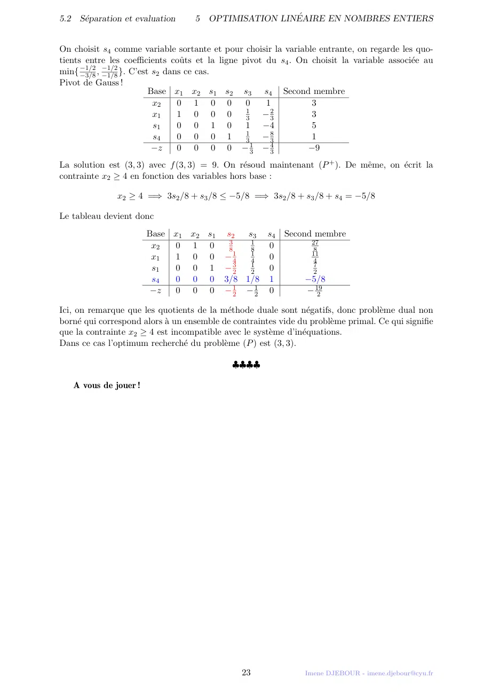

~~~text
5.2    Séparation et evaluation   5   OPTIMISATION LINÉAIRE EN NOMBRES ENTIERS

On choisit s4 comme variable sortante et pour choisir la variable entrante, on regarde les quo-
tients entre les coefficients coûts et la ligne pivot du s4 . On choisit la variable associée au
      −1/2 −1/2
min{ −3/8 , −1/8 }. C’est s2 dans ce cas.
Pivot de Gauss !
                         Base x1 x2 s1 s2 s3 s4 Second membre
                          x2    0 1 0 0           0    1          3
                                                  1     2
                          x1    1 0 0 0           3   − 3         3
                          s1    0 0 1 0           1 −4            5
                                                  1     8
                          s4    0 0 0 1           3   −3          1
                          −z    0 0 0 0 − 13 − 34                −9
La solution est (3, 3) avec f (3, 3) = 9. On résoud maintenant (P + ). De même, on écrit la
contrainte x2 ≥ 4 en fonction des variables hors base :

                 x2 ≥ 4 =⇒ 3s2 /8 + s3 /8 ≤ −5/8 =⇒ 3s2 /8 + s3 /8 + s4 = −5/8

Le tableau devient donc
                          Base x1 x2 s1 s2   s3 s4 Second membre
                                         3    1          27
                           x2  0 1 0     8    8 0         8
                                           1  1          11
                           x1  1 0 0 −4       4 0         4
                           s1  0 0 1 − 23     1
                                              2 0         7
                                                          2
                           s4  0 0 0 3/8 1/8 1          −5/8
                           −z  0 0 0 − 21 − 12 0        − 192

Ici, on remarque que les quotients de la méthode duale sont négatifs, donc problème dual non
borné qui correspond alors à un ensemble de contraintes vide du problème primal. Ce qui signifie
que la contrainte x2 ≥ 4 est incompatible avec le système d’inéquations.
Dans ce cas l’optimum recherché du problème (P ) est (3, 3).

                                             ♣♣♣♣

      A vous de jouer !

                                                23               Imene DJEBOUR - imene.djebour@cyu.fr
~~~

## Page 24

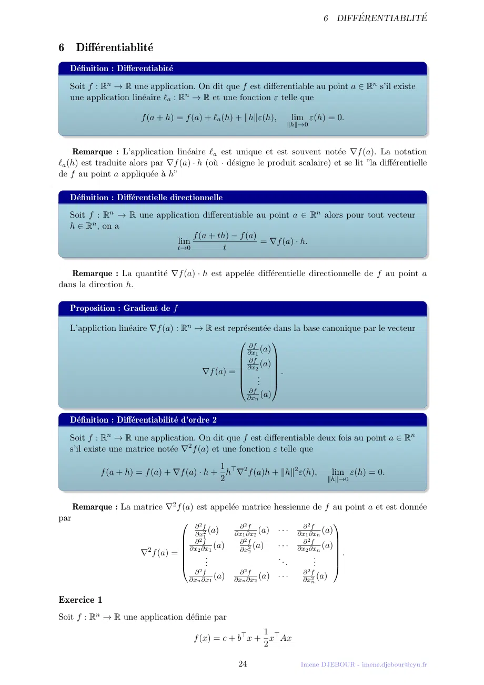

~~~text
                                                                                    6    DIFFÉRENTIABLITÉ

6     Différentiablité
    Définition : Differentiabité
    Soit f : Rn → R une application. On dit que f est differentiable au point a ∈ Rn s’il existe
    une application linéaire ℓa : Rn → R et une fonction ε telle que

                        f (a + h) = f (a) + ℓa (h) + ∥h∥ε(h),               lim ε(h) = 0.
                                                                        ∥h∥→0

     Remarque : L’application linéaire ℓa est unique et est souvent notée ∇f (a). La notation
ℓa (h) est traduite alors par ∇f (a) · h (où · désigne le produit scalaire) et se lit ”la différentielle
de f au point a appliquée à h”

    Définition : Différentielle directionnelle
    Soit f : Rn → R une application differentiable au point a ∈ Rn alors pour tout vecteur
    h ∈ Rn , on a
                                  f (a + th) − f (a)
                              lim                    = ∇f (a) · h.
                             t→0           t

   Remarque : La quantité ∇f (a) · h est appelée différentielle directionnelle de f au point a
dans la direction h.

    Proposition : Gradient de f

    L’appliction linéaire ∇f (a) : Rn → R est représentée dans la base canonique par le vecteur
                                                            
                                                     ∂f
                                                         (a)
                                                   ∂x 1
                                                   ∂f (a) 
                                                             
                                                   ∂x2
                                        ∇f (a) =  .  .
                                                             
                                                   . 
                                                   . 
                                                     ∂f
                                                     ∂xn (a)

    Définition : Différentiabilité d’ordre 2
    Soit f : Rn → R une application. On dit que f est differentiable deux fois au point a ∈ Rn
    s’il existe une matrice notée ∇2 f (a) et une fonction ε telle que
                                             1
             f (a + h) = f (a) + ∇f (a) · h + h⊤ ∇2 f (a)h + ∥h∥2 ε(h),                 lim ε(h) = 0.
                                             2                                       ∥h∥→0

      Remarque : La matrice ∇2 f (a) est appelée matrice hessienne de f au point a et est donnée
par
                                        ∂2f             ∂2f                   ∂2f
                                                                                       
                                             2 (a)     ∂x1 ∂x2 (a)   ···     ∂x1 ∂xn (a)
                                      ∂∂x2 f1          ∂2f                   ∂2f
                                                                                        
                                      ∂x2 ∂x1 (a)
                                     
                                                        ∂x22
                                                             (a)     ···     ∂x2 ∂xn (a)
                        ∇2 f (a) =                                                    .
                                                                                        
                                             ..                      ..          ..
                                   
                                             .                         .         .
                                                                                       
                                                                                       
                                          ∂2f           ∂2f                    2
                                                                              ∂ f
                                         ∂xn ∂x1 (a)   ∂xn ∂x2 (a)   ···      ∂x2
                                                                                   (a)
                                                                                n

Exercice 1
Soit f : Rn → R une application définie par
                                                            1
                                          f (x) = c + b⊤ x + x⊤ Ax
                                                            2

                                                        24                    Imene DJEBOUR - imene.djebour@cyu.fr
~~~

## Page 25

~~~text
                                                                                  6   DIFFÉRENTIABLITÉ

avec c ∈ R, b ∈ Rn et A une matrice d’ordre n symétrique i.e

                                             Ax · y = Ay · x.

On veux chercher ∇f (x). Pour cela, il est plus facile d’identifier la différentielle directionnelle
dans la direction h qui est définie par :

                                                     f (x + th) − f (x)
                                  ∇f (x) · h = lim                      .
                                                 t→0          t
D’abord on remaruqe que
                                                    1
                                 f (x) = c + b · x + Ax · x.
                                                    2
On commence par calculer f (x + th) − f (x)
                                               1                                  1
        f (x + th) − f (x) = c + b · (x + th) + A(x + th) · (x + th) − c − b · x − Ax · x.
                                               2                                  2
On utilise la propriété de distribution du produit scalaire, on trouve

                                            1
                                              Ax · x + t(Ax · h) + t(Ah · x) + t2 (Ah · h)
                                                                                           
  f (x + th) − f (x) = b · x + t(b · h) +
                                            2
                                                                                                  1
                                                                                         − b · x − Ax · x.
                                                                                                  2
Donc
                    f (x + th) − f (x)          1                   t
                                       = b · h + (Ax · h + Ah · x) + Ah · h.
                             t                  2                   2
On fait tendre t vers 0, on trouve

                               f (x + th) − f (x)          1
                  ∇f (x) · h = lim                = b · h + (Ax · h + Ah · x).
                                 t→0    t                  2
Comme A est symétrique alors Ax · h = Ah · x. On obtient

                             ∇f (x) · h = b · h + Ax · h = (b + Ax) · h.

Par identification, on déduit
                                             ∇f (x) = b + Ax.
On écrit le gradient composante par composante
                                                                 n
                                                                 X
                              (∇f (x))i = bi + (Ax)i = bi +            aik xk .
                                                                 k=1

Trouvons la matrice hessienne ∇2 f (x)

                                              d2 f        ∂(∇f (x))i
                            (∇2 f (x))ij =          (x) =            = aij .
                                             ∂xi xj          ∂xj

Donc
                                               ∇2 f (x) = A.

                                                  ♣♣♣♣

                                                     25                 Imene DJEBOUR - imene.djebour@cyu.fr
~~~

## Page 26

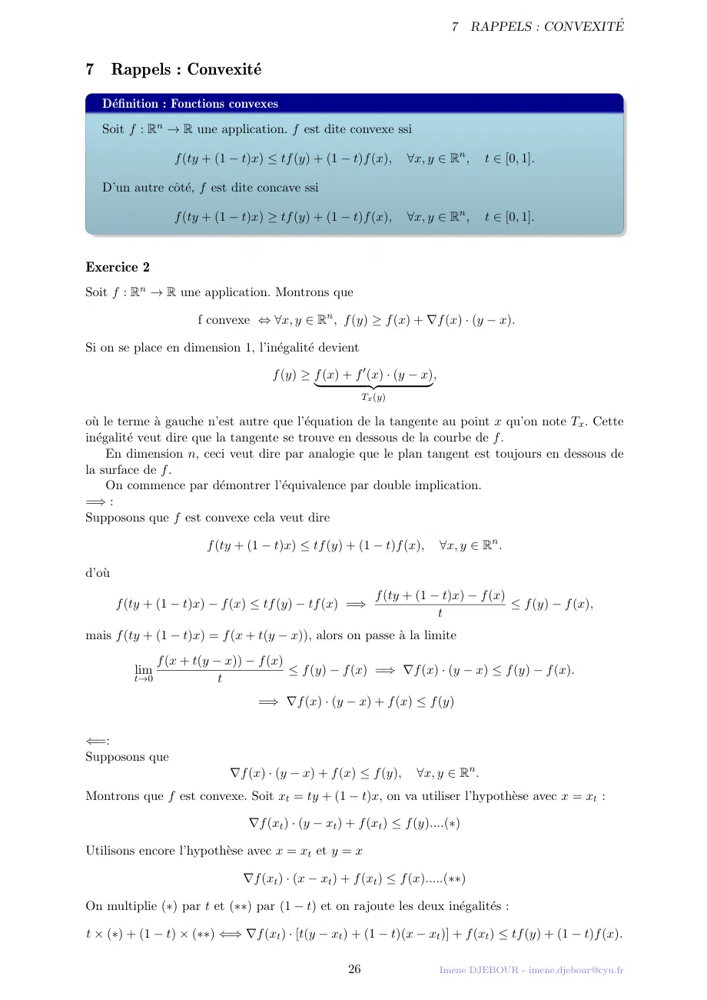

~~~text
                                                                            7     RAPPELS : CONVEXITÉ

7       Rappels : Convexité
    Définition : Fonctions convexes
    Soit f : Rn → R une application. f est dite convexe ssi

                  f (ty + (1 − t)x) ≤ tf (y) + (1 − t)f (x),       ∀x, y ∈ Rn ,     t ∈ [0, 1].

    D’un autre côté, f est dite concave ssi

                  f (ty + (1 − t)x) ≥ tf (y) + (1 − t)f (x),       ∀x, y ∈ Rn ,     t ∈ [0, 1].

Exercice 2
Soit f : Rn → R une application. Montrons que

                       f convexe ⇔ ∀x, y ∈ Rn , f (y) ≥ f (x) + ∇f (x) · (y − x).

Si on se place en dimension 1, l’inégalité devient

                                     f (y) ≥ f (x) + f ′ (x) · (y − x),
                                             |           {z          }
                                                          Tx (y)

où le terme à gauche n’est autre que l’équation de la tangente au point x qu’on note Tx . Cette
inégalité veut dire que la tangente se trouve en dessous de la courbe de f .
     En dimension n, ceci veut dire par analogie que le plan tangent est toujours en dessous de
la surface de f .
     On commence par démontrer l’équivalence par double implication.
=⇒ :
Supposons que f est convexe cela veut dire

                        f (ty + (1 − t)x) ≤ tf (y) + (1 − t)f (x),        ∀x, y ∈ Rn .

d’où
                                                             f (ty + (1 − t)x) − f (x)
        f (ty + (1 − t)x) − f (x) ≤ tf (y) − tf (x) =⇒                                 ≤ f (y) − f (x),
                                                                         t
mais f (ty + (1 − t)x) = f (x + t(y − x)), alors on passe à la limite
               f (x + t(y − x)) − f (x)
           lim                          ≤ f (y) − f (x) =⇒ ∇f (x) · (y − x) ≤ f (y) − f (x).
           t→0             t
                                  =⇒ ∇f (x) · (y − x) + f (x) ≤ f (y)

⇐=:
Supposons que
                            ∇f (x) · (y − x) + f (x) ≤ f (y),        ∀x, y ∈ Rn .
Montrons que f est convexe. Soit xt = ty + (1 − t)x, on va utiliser l’hypothèse avec x = xt :

                                ∇f (xt ) · (y − xt ) + f (xt ) ≤ f (y)....(∗)

Utilisons encore l’hypothèse avec x = xt et y = x

                               ∇f (xt ) · (x − xt ) + f (xt ) ≤ f (x).....(∗∗)

On multiplie (∗) par t et (∗∗) par (1 − t) et on rajoute les deux inégalités :

t × (∗) + (1 − t) × (∗∗) ⇐⇒ ∇f (xt ) · [t(y − xt ) + (1 − t)(x − xt )] + f (xt ) ≤ tf (y) + (1 − t)f (x).

                                                     26                   Imene DJEBOUR - imene.djebour@cyu.fr
~~~

## Page 27

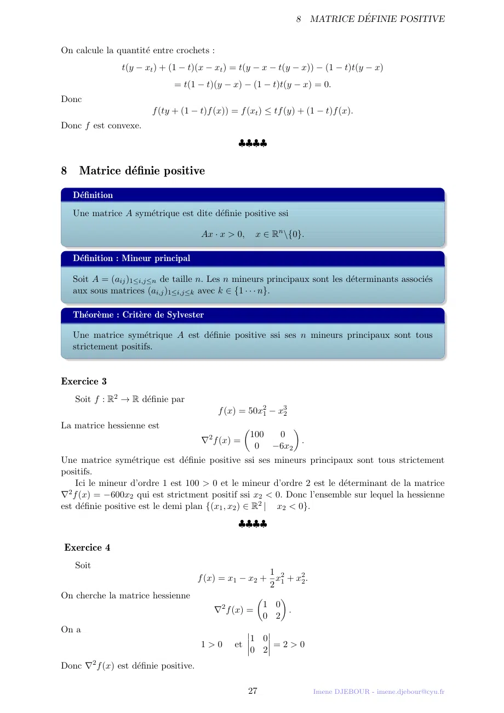

~~~text
                                                                    8     MATRICE DÉFINIE POSITIVE

On calcule la quantité entre crochets :
                  t(y − xt ) + (1 − t)(x − xt ) = t(y − x − t(y − x)) − (1 − t)t(y − x)
                               = t(1 − t)(y − x) − (1 − t)t(y − x) = 0.
Donc
                         f (ty + (1 − t)f (x)) = f (xt ) ≤ tf (y) + (1 − t)f (x).
Donc f est convexe.
                                                  ♣♣♣♣

8    Matrice définie positive
    Définition
    Une matrice A symétrique est dite définie positive ssi

                                       Ax · x > 0,         x ∈ Rn \{0}.

    Définition : Mineur principal

    Soit A = (aij )1≤i,j≤n de taille n. Les n mineurs principaux sont les déterminants associés
    aux sous matrices (ai,j )1≤i,j≤k avec k ∈ {1 · · · n}.

    Théorème : Critère de Sylvester

    Une matrice symétrique A est définie positive ssi ses n mineurs principaux sont tous
    strictement positifs.

Exercice 3
    Soit f : R2 → R définie par
                                             f (x) = 50x21 − x32
La matrice hessienne est                                         
                                         2                100 0
                                       ∇ f (x) =                    .
                                                           0 −6x2
Une matrice symétrique est définie positive ssi ses mineurs principaux sont tous strictement
positifs.
    Ici le mineur d’ordre 1 est 100 > 0 et le mineur d’ordre 2 est le déterminant de la matrice
∇2 f (x) = −600x2 qui est strictment positif ssi x2 < 0. Donc l’ensemble sur lequel la hessienne
est définie positive est le demi plan {(x1 , x2 ) ∈ R2 | x2 < 0}.
                                                  ♣♣♣♣

Exercice 4
    Soit
                                                  1
                                f (x) = x1 − x2 + x21 + x22 .
                                                  2
On cherche la matrice hessienne                     
                                                 1 0
                                     ∇2 f (x) =        .
                                                 0 2
On a
                                                          1 0
                                       1>0       et           =2>0
                                                          0 2
Donc ∇2 f (x) est définie positive.

                                                      27                  Imene DJEBOUR - imene.djebour@cyu.fr
~~~

## Page 28

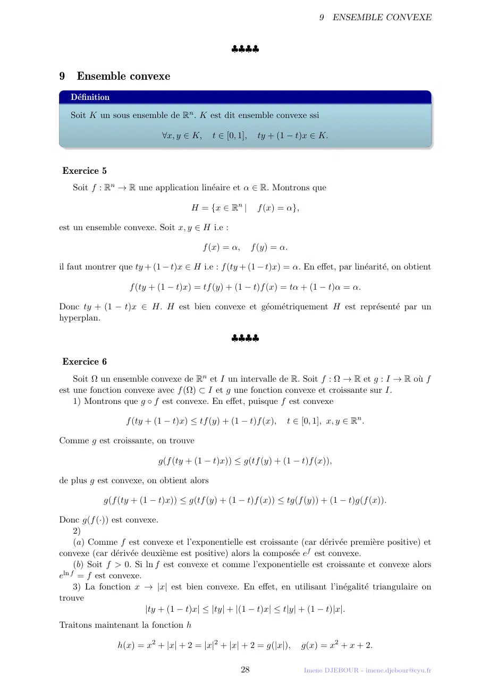

~~~text
                                                                                9   ENSEMBLE CONVEXE

                                                  ♣♣♣♣

9    Ensemble convexe
    Définition
    Soit K un sous ensemble de Rn . K est dit ensemble convexe ssi

                              ∀x, y ∈ K,     t ∈ [0, 1],      ty + (1 − t)x ∈ K.

Exercice 5
    Soit f : Rn → R une application linéaire et α ∈ R. Montrons que

                                      H = {x ∈ Rn |           f (x) = α},

est un ensemble convexe. Soit x, y ∈ H i.e :

                                           f (x) = α,        f (y) = α.

il faut montrer que ty + (1 − t)x ∈ H i.e : f (ty + (1 − t)x) = α. En effet, par linéarité, on obtient

                     f (ty + (1 − t)x) = tf (y) + (1 − t)f (x) = tα + (1 − t)α = α.

Donc ty + (1 − t)x ∈ H. H est bien convexe et géométriquement H est représenté par un
hyperplan.

                                                  ♣♣♣♣

Exercice 6
    Soit Ω un ensemble convexe de Rn et I un intervalle de R. Soit f : Ω → R et g : I → R où f
est une fonction convexe avec f (Ω) ⊂ I et g une fonction convexe et croissante sur I.
    1) Montrons que g ◦ f est convexe. En effet, puisque f est convexe

                    f (ty + (1 − t)x) ≤ tf (y) + (1 − t)f (x),        t ∈ [0, 1], x, y ∈ Rn .

Comme g est croissante, on trouve

                             g(f (ty + (1 − t)x)) ≤ g(tf (y) + (1 − t)f (x)),

de plus g est convexe, on obtient alors

             g(f (ty + (1 − t)x)) ≤ g(tf (y) + (1 − t)f (x)) ≤ tg(f (y)) + (1 − t)g(f (x)).

Donc g(f (·)) est convexe.
     2)
     (a) Comme f est convexe et l’exponentielle est croissante (car dérivée première positive) et
convexe (car dérivée deuxième est positive) alors la composée ef est convexe.
     (b) Soit f > 0. Si ln f est convexe et comme l’exponentielle est croissante et convexe alors
eln f = f est convexe.
     3) La fonction x → |x| est bien convexe. En effet, en utilisant l’inégalité triangulaire on
trouve
                        |ty + (1 − t)x| ≤ |ty| + |(1 − t)x| ≤ t|y| + (1 − t)|x|.
Traitons maintenant la fonction h

                  h(x) = x2 + |x| + 2 = |x|2 + |x| + 2 = g(|x|),            g(x) = x2 + x + 2.

                                                        28                  Imene DJEBOUR - imene.djebour@cyu.fr
~~~

## Page 29

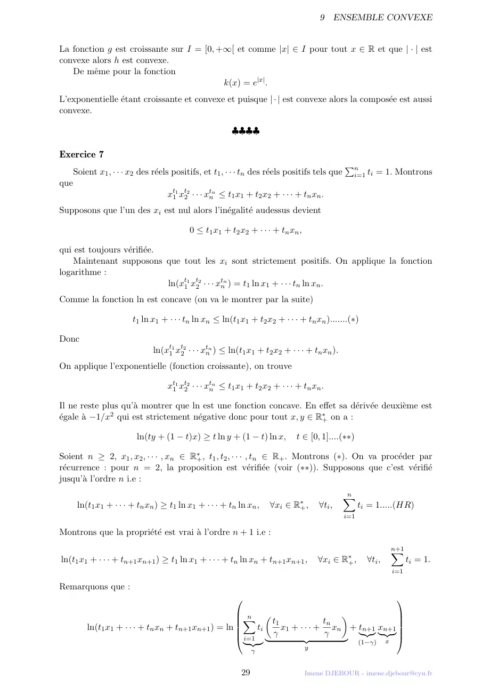

~~~text
                                                                                        9       ENSEMBLE CONVEXE

La fonction g est croissante sur I = [0, +∞[ et comme |x| ∈ I pour tout x ∈ R et que | · | est
convexe alors h est convexe.
   De même pour la fonction
                                          k(x) = e|x| .
L’exponentielle étant croissante et convexe et puisque | · | est convexe alors la composée est aussi
convexe.

                                                          ♣♣♣♣

Exercice 7
                                                                                                 Pn
      Soient x1 , · · · x2 des réels positifs, et t1 , · · · tn des réels positifs tels que      i=1 ti = 1. Montrons
que
                                    xt11 xt22 · · · xtnn ≤ t1 x1 + t2 x2 + · · · + tn xn .
Supposons que l’un des xi est nul alors l’inégalité audessus devient

                                           0 ≤ t1 x1 + t2 x2 + · · · + tn xn ,

qui est toujours vérifiée.
    Maintenant supposons que tout les xi sont strictement positifs. On applique la fonction
logarithme :
                             ln(xt11 xt22 · · · xtnn ) = t1 ln x1 + · · · tn ln xn .
Comme la fonction ln est concave (on va le montrer par la suite)

                         t1 ln x1 + · · · tn ln xn ≤ ln(t1 x1 + t2 x2 + · · · + tn xn ).......(∗)

Donc
                               ln(xt11 xt22 · · · xtnn ) ≤ ln(t1 x1 + t2 x2 + · · · + tn xn ).
On applique l’exponentielle (fonction croissante), on trouve

                                    xt11 xt22 · · · xtnn ≤ t1 x1 + t2 x2 + · · · + tn xn .

Il ne reste plus qu’à montrer que ln est une fonction concave. En effet sa dérivée deuxième est
égale à −1/x2 qui est strictement négative donc pour tout x, y ∈ R∗+ on a :

                          ln(ty + (1 − t)x) ≥ t ln y + (1 − t) ln x,            t ∈ [0, 1]....(∗∗)

Soient n ≥ 2, x1 , x2 , · · · , xn ∈ R∗+ , t1 , t2 , · · · , tn ∈ R+ . Montrons (∗). On va procéder par
récurrence : pour n = 2, la proposition est vérifiée (voir (∗∗)). Supposons que c’est vérifié
jusqu’à l’ordre n i.e :
                                                                                                 n
                                                                                                 X
       ln(t1 x1 + · · · + tn xn ) ≥ t1 ln x1 + · · · + tn ln xn ,      ∀xi ∈ R∗+ ,      ∀ti ,          ti = 1.....(HR)
                                                                                                 i=1

Montrons que la propriété est vrai à l’ordre n + 1 i.e :
                                                                                                                 n+1
                                                                                                                 X
ln(t1 x1 + · · · + tn+1 xn+1 ) ≥ t1 ln x1 + · · · + tn ln xn + tn+1 xn+1 ,             ∀xi ∈ R∗+ ,       ∀ti ,         ti = 1.
                                                                                                                 i=1

Remarquons que :
                                                                                                                 
                                                       n                                   
                                                      X      t1             tn               
          ln(t1 x1 + · · · + tn xn + tn+1 xn+1 ) = ln 
                                                          ti    x1 + · · · + xn + tn+1 xn+1 
                                                       i=1 | γ              γ     |{z} | {z }
                                                                                              
                                                       | {z }          {z       }  (1−γ) x
                                                                  γ                y

                                                             29                    Imene DJEBOUR - imene.djebour@cyu.fr
~~~

## Page 30

~~~text
                                                                  10   OPTIMISATION SANS CONTRAINTES

On applique maintenat (∗∗) avec
                                                    t1             tn
                                t = γ,       y=        x1 + · · · + xn ,   x = xn+1 .
                                                    γ              γ
De plus :
                               n+1
                               X            n
                                            X
                        1=           ti =         ti + tn+1 = γ + tn+1 =⇒ tn+1 = 1 − γ.
                               i=1          i=1

     De (∗∗), on obtient alors
                                                            

     n
    X                                                                             
               t1               tn                              t1               tn
 ln     t i      x 1 + · · · +    x n   + t    x
                                            n+1 n+1 
                                                       ≥ γ ln      x 1 + · · · +    xn + (1 − γ) ln xn+1 .
     i=1 | γ                   γ                                γ                γ
                                          |{z} | {z }
     | {z }              {z            } (1−γ) x
         γ                 y

D’un autre côté,
                                              n               n
                                              X ti          1X     γ
                                                        =      ti = = 1.
                                                    γ       γ      γ
                                              i=1            i=1

On applique alors (HR) pour minorer le premier terme à droite :
                                         
     n                                                                          
    X      t1               t n                              t1               tn
 ln     ti    x 1 + · · · +     x n   + t    x
                                          n+1 n+1 
                                                     ≥ γ ln      x 1 + · · · +    xn + (1 − γ) ln xn+1 .
     i=1 | γ                γ                                 γ                γ
                                        |{z} | {z }
     | {z }           {z             } (1−γ) x
         γ                 y

                                       
               t1              tn
      ≥γ          ln x1 + · · · ln xn       + (1 − γ) ln xn+1 ≥ t1 ln x1 + · · · + tn ln xn + tn+1 ln xn+1 .
               γ               γ
Donc
               ln(t1 x1 + · · · + tn xn + tn+1 xn+1 ) ≥ t1 ln x1 + · · · + tn ln xn + tn+1 ln xn+1 .
La propriété est vraie à l’ordre n + 1 et donc vraie pour tout n ≥ 2.

                                                            ♣♣♣♣

                                             Correction Fiche TD2

10     Optimisation sans contraintes
   Condition nécessaire d’optimalité

   Soit le problème                                (
                                                        Optimiser f (x)
                                                            x ∈ Rn
   Si x∗ est un optimum (f atteint un minimum ou un maximum local en ce point) alors

                                                        ∇f (x∗ ) = 0.

                                                             30              Imene DJEBOUR - imene.djebour@cyu.fr
~~~

## Page 31

~~~text
                                                       10      OPTIMISATION SANS CONTRAINTES

   Condition suffisante d’optimalité

   Soit le problème                      (
                                              Optimiser f (x)
                                                   x ∈ Rn
   Si ∇f (x∗ ) = 0 et si ∇2 f (x∗ ) est définie positive

                                              ∇2 f (x∗ ) > 0,

   alors f admet un minimum local noté : x∗ .

   Remarque :
   — Si ∇2 f (x∗ ) < 0 alors f admet un maximum local.
   — En général, on cherche d’abord les points critiques en résolvant l’équation

                                                   ∇f (x) = 0.

   — Si f est convexe (resp. concave) alors le minimum (resp. maximum) local est global. Si f
     est strictement convexe (resp. concave) l’optimum est unique.

Exercice 1
   Soit f : R2 → R définie par
                                         f (x1 , x2 ) = −x41 − x42 ,
Etudions l’existence d’extremums de la fonction f . Trouvons d’abord les points critiques
                                                 −4x31
                                                      
                                     ∇f (x) =            .
                                                 −4x32
Donc
                                     ∇f (x) = 0 =⇒ x1 = x2 = 0.
On a seulement un point critique : x∗ = (0, 0).

                               −12x21
                                                                  
                    2                      0          2    ∗     0 0
                  ∇ f (x) =                       =⇒ ∇ f (x ) =        .
                                  0     −12x22                   0 0
det(∇2 f (x∗ )) = 0, on ne peut conclure. Mais, on a pour tout x = (x1 , x2 ) :

                                        f (x1 , x2 ) ≤ 0 = f (0, 0).

Donc x∗ = (0, 0) est un maximum global de f .

                                                  ♣♣♣♣

Exercice 2
   Soit f : R2 → R définie par
                                                     1
                                f (x) = x21 + x1 x2 + x22 − 4x1 − 3x2 .
                                                     2
1) Montrons que f est quadratique. En effet,
                                                 
                                  1     2 1        −4
                               = x⊤            x+     · x.
                                  2     1 1        −3
Donc f est quadratique avec
                                                             
                                       2 1                    −4
                                 A=          ,      b=            ,    c = 0.
                                       1 1                    −3

                                                     31                  Imene DJEBOUR - imene.djebour@cyu.fr
~~~

## Page 32

~~~text
                                                     10   OPTIMISATION SANS CONTRAINTES

2) f est convexe car                                    
                                        2            2 1
                                      ∇ f (x) = A =        .
                                                     1 1
Ses mineurs principaux sont positifs : 2 > 0 et det(∇2 f (x)) = 1 donc f est convexe.
3) Cherchons les points critiques de f :
                                                                 
                                                                    2x1 + x2 = 4
              ∇f (x) = 0 =⇒ Ax + b = 0 =⇒ Ax = −b =⇒
                                                                    x1 + x2 = 3

On trouve x∗ = (1, 2). De plus ∇2 f (x∗ ) > 0 donc x∗ est l’unique minimum global de f (car f
est strictement convexe sur R2 ).

                                                ♣♣♣♣

Exercice 3
   Soit f : R2 → R définie par
                                                  1
                                    f (x1 , x2 ) = x21 + x1 cos x2 .
                                                  2
Etudions les extremums de f .
                               
                    x1 + cos x2
  ∇f (x1 , x2 ) =                 = 0 =⇒ xk = (0, π/2 + kπ) ou xk = ((−1)k+1 , kπ),             k ∈ Z.
                    −x1 sin x2

                                                          (−1)k+1
                                                                 
                              2                      1
                            ∇ f (0, π/2 + kπ) =                     ,
                                                  (−1)k+1    0
Ici le determinant est égal à −(−1)2k+2 < 0 et donc les points (0, π/2 + kπ) sont des points selle.
D’un autre côté,                                            
                                     2       k+1          1 0
                                   ∇ f ((−1) , kπ) =             ,
                                                          0 1
c’est la matrice identité donc les points ((−1)k+1 , kπ) sont des minimums locaux.
    Les points ((−1)k+1 , kπ) sont-ils des minimums globaux ? On a
                                                               1
                                        f ((−1)k+1 , kπ) = −
                                                               2
D’un autre côté, on a
                                            −1 ≤ cos x2 ≤ 1
Supposons que x1 est positif, alors
                  x21                   x2  1           1             x2
                      − x1 ≤ x1 cos x2 + 1 ⇔ (x1 − 1)2 − ≤ x1 cos x2 + 1 .
                  2                      2  2           2              2
Donc
               1     1             1              x2
             − ≤ (x1 − 1)2 − ≤ x1 cos x2 + 1 =⇒ f ((−1)k+1 , kπ) ≤ f (x1 , x2 ).
               2     2             2               2
Si x1 est négatif, on utilise les mêmes arguments pour avoir
              1 1           1             x2
             − ≤ (x1 + 1)2 − ≤ x1 cos x2 + 1 =⇒ f ((−1)k+1 , kπ) ≤ f (x1 , x2 ).
              2 2           2              2
Dans les deux cas, on trouve

                            f ((−1)k+1 , kπ) ≤ f (x1 , x2 ),   ∀x1 , x2 ∈ R.

Donc, si k est impair alors les points ((−1)k+1 , kπ) sont des minimums globaux.

                                                ♣♣♣♣

                                                   32                  Imene DJEBOUR - imene.djebour@cyu.fr
~~~

## Page 33

~~~text
                                                   10   OPTIMISATION SANS CONTRAINTES

Exercice 4
   Soit
                         K = {x∗ ∈ R |     x∗ est minimum global de f }.
Montrons que K est un ensemble convexe. L’ensemble K est équivalent à

                         K = {x∗ ∈ R |     f (x) ≥ f (x∗ ) = α,   ∀x ∈ R}.

Soit x1 ∈ K et x2 ∈ K deux minimums globaux, cela veux dire que f atteint son minimum en
x1 et x2 :
                                  f (x1 ) = f (x2 ) = α.
Montrons que tx1 + (1 − t)x2 est aussi un élément de K, cela veux dire que f atteint aussi son
minimum en ce point. En effet, comme f est convexe, alors

                f (tx1 + (1 − t)x2 ) ≤ tf (x1 ) + (1 − t)f (x2 ) ≤ tα + (1 − t)α = α.

Mais comme α est le minimum alors

                                     f (tx1 + (1 − t)x2 ) ≥ α.

Donc
                                     f (tx1 + (1 − t)x2 ) = α.
                                              ♣♣♣♣

Exercice 5
   Soit
                                            1
                                     f (x) = ∥Ax − b∥2
                                            2
avec A une matrice et b un vecteur. Montrons que f est quadratique
                                1
                           f (x) =(Ax · Ax − Ax · b − b · Ax + b · b) .
                                2
                     1 ⊤                         1                      1
             f (x) =   A Ax · x − 2Ax · b + b · b = A⊤ Ax · x − x · A⊤ b + b · b.
                     2                              2                     2
Alors
                           ∇f (x) = A⊤ Ax − A⊤ b,       ∇2 f (x) = A⊤ A.
2) Points critiques :

                   ∇f (x) = 0 =⇒ A⊤ Ax − A⊤ b = 0 =⇒ x = (A⊤ A)−1 A⊤ b.

Il y a un seul point critique ici x∗ = (A⊤ A)−1 A⊤ b.
3) Montrons que f est convexe :

                  ∇2 f (x)x · x = A⊤ Ax · x = Ax · Ax = ∥Ax∥2 ≥ 0,         ∀x ∈ Rn .

Donc f est convexe. Donc le points critique est un minimum global.
   5) Application avec :                             
                                         1 0            6
                                 A = 0 1 , b = 3 .
                                         1 1            3
                                                        
                                                   6       
                          ∗   1 2 −1          1 0 1          4
                         x =                             3 =       .
                              3 −1 2          0 1 1            1
                                                         3

                                              ♣♣♣♣

                                                 33               Imene DJEBOUR - imene.djebour@cyu.fr
~~~

## Page 34

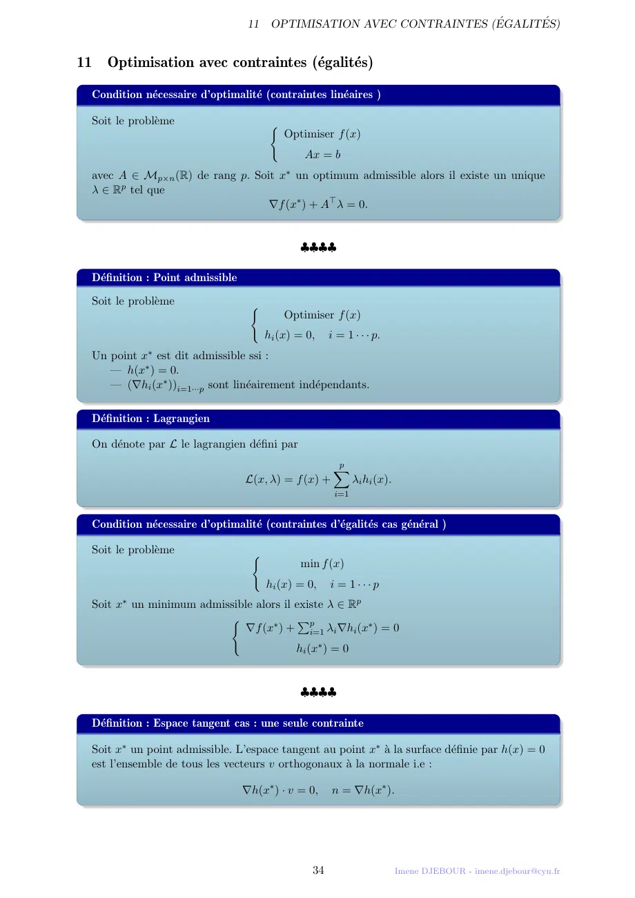

~~~text
                                   11    OPTIMISATION AVEC CONTRAINTES (ÉGALITÉS)

11   Optimisation avec contraintes (égalités)

 Condition nécessaire d’optimalité (contraintes linéaires )

 Soit le problème                       (
                                             Optimiser f (x)
                                                 Ax = b
 avec A ∈ Mp×n       (R) de rang p. Soit x∗ un optimum admissible alors il existe un unique
 λ ∈ Rp tel que
                                        ∇f (x∗ ) + A⊤ λ = 0.

                                                ♣♣♣♣

 Définition : Point admissible
 Soit le problème                 (
                                             Optimiser f (x)
                                        hi (x) = 0,    i = 1 · · · p.
 Un point x∗ est dit admissible ssi :
    — h(x∗ ) = 0.
    — (∇hi (x∗ ))i=1···p sont linéairement indépendants.

 Définition : Lagrangien

 On dénote par L le lagrangien défini par
                                                        p
                                                        X
                                  L(x, λ) = f (x) +           λi hi (x).
                                                        i=1

 Condition nécessaire d’optimalité (contraintes d’égalités cas général )

 Soit le problème                 (
                                                min f (x)
                                        hi (x) = 0,    i = 1···p
 Soit x∗ un minimum admissible alors il existe λ ∈ Rp

                             ∇f (x∗ ) + pi=1 λi ∇hi (x∗ ) = 0
                         (               P

                                               hi (x∗ ) = 0

                                                ♣♣♣♣

 Définition : Espace tangent cas : une seule contrainte

 Soit x∗ un point admissible. L’espace tangent au point x∗ à la surface définie par h(x) = 0
 est l’ensemble de tous les vecteurs v orthogonaux à la normale i.e :

                                  ∇h(x∗ ) · v = 0,     n = ∇h(x∗ ).

                                                  34                       Imene DJEBOUR - imene.djebour@cyu.fr
~~~

## Page 35

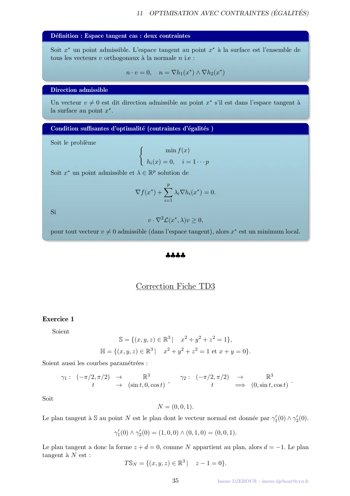

~~~text
                                     11    OPTIMISATION AVEC CONTRAINTES (ÉGALITÉS)

   Définition : Espace tangent cas : deux contraintes

   Soit x∗ un point admissible. L’espace tangent au point x∗ à la surface est l’ensemble de
   tous les vecteurs v orthogonaux à la normale n i.e :

                                 n · v = 0,     n = ∇h1 (x∗ ) ∧ ∇h2 (x∗ )

   Direction admissible

   Un vecteur v ̸= 0 est dit direction admissible au point x∗ s’il est dans l’espace tangent à
   la surface au point x∗ .

   Condition suffisantes d’optimalité (contraintes d’égalités )

   Soit le problème                  (
                                                   min f (x)
                                          hi (x) = 0,      i = 1···p
   Soit x∗ un point admissible et λ ∈ Rp solution de
                                                  p
                                                  X
                                            ∗
                                     ∇f (x ) +          λi ∇hi (x∗ ) = 0.
                                                  i=1

   Si
                                           v · ∇2 L(x∗ , λ)v ≥ 0,
   pour tout vecteur v ̸= 0 admissible (dans l’espace tangent), alors x∗ est un minimum local.

                                                   ♣♣♣♣

                                     Correction Fiche TD3

Exercice 1
   Soient
                              S = {(x, y, z) ∈ R3 |       x2 + y 2 + z 2 = 1},
                       H = {(x, y, z) ∈ R3 |      x2 + y 2 + z 2 = 1 et x + y = 0}.
Soient aussi les courbes paramétrées :

        γ1 : (−π/2, π/2) →        R3                      γ2 : (−π/2, π/2) →         R3
                                             ,                                                  .
                 t       → (sin t, 0, cos t)                       t       =⇒ (0, sin t, cos t)

Soit
                                                N = (0, 0, 1).
Le plan tangent à S au point N est le plan dont le vecteur normal est donnée par γ1′ (0) ∧ γ2′ (0).

                            γ1′ (0) ∧ γ2′ (0) = (1, 0, 0) ∧ (0, 1, 0) = (0, 0, 1).

Le plan tangent a donc la forme z + d = 0, comme N appartient au plan, alors d = −1. Le plan
tangent à N est :
                             T SN = {(x, y, z) ∈ R3 | z − 1 = 0}.

                                                     35                     Imene DJEBOUR - imene.djebour@cyu.fr
~~~

## Page 36

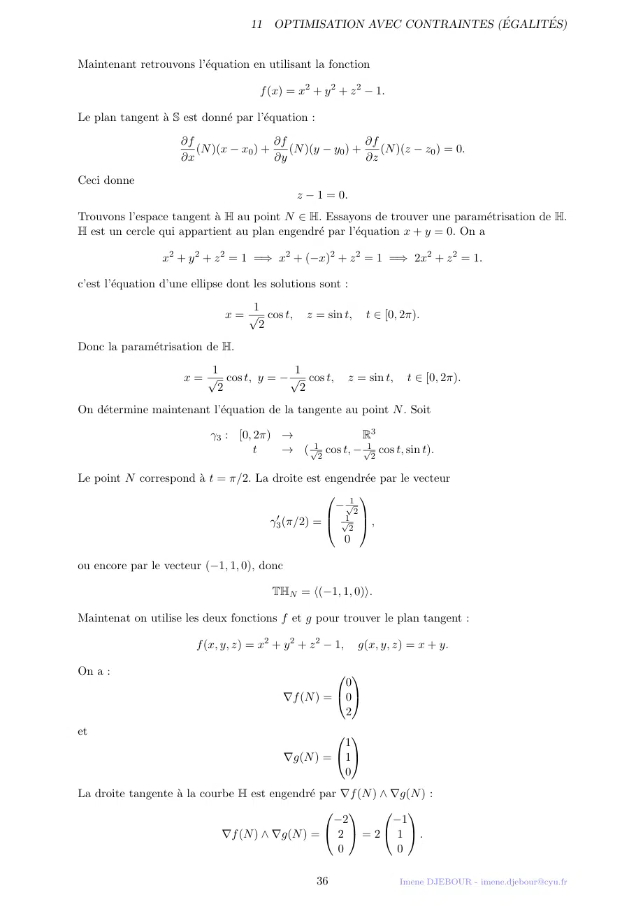

~~~text
                                    11   OPTIMISATION AVEC CONTRAINTES (ÉGALITÉS)

Maintenant retrouvons l’équation en utilisant la fonction

                                      f (x) = x2 + y 2 + z 2 − 1.

Le plan tangent à S est donné par l’équation :
                     ∂f                 ∂f                 ∂f
                        (N )(x − x0 ) +    (N )(y − y0 ) +    (N )(z − z0 ) = 0.
                     ∂x                 ∂y                 ∂z
Ceci donne
                                              z − 1 = 0.
Trouvons l’espace tangent à H au point N ∈ H. Essayons de trouver une paramétrisation de H.
H est un cercle qui appartient au plan engendré par l’équation x + y = 0. On a

                 x2 + y 2 + z 2 = 1 =⇒ x2 + (−x)2 + z 2 = 1 =⇒ 2x2 + z 2 = 1.

c’est l’équation d’une ellipse dont les solutions sont :
                                   1
                               x = √ cos t,     z = sin t,     t ∈ [0, 2π).
                                    2
Donc la paramétrisation de H.
                           1             1
                      x = √ cos t, y = − √ cos t,           z = sin t,    t ∈ [0, 2π).
                            2             2
On détermine maintenant l’équation de la tangente au point N . Soit

                           γ3 : [0, 2π) →              R3
                                    t        1
                                        → ( √2 cos t, − √12 cos t, sin t).

Le point N correspond à t = π/2. La droite est engendrée par le vecteur
                                                 1 
                                                  −√
                                      ′          √1 2 
                                    γ3 (π/2) =  2  ,
                                                   0

ou encore par le vecteur (−1, 1, 0), donc

                                         THN = ⟨(−1, 1, 0)⟩.

Maintenat on utilise les deux fonctions f et g pour trouver le plan tangent :

                        f (x, y, z) = x2 + y 2 + z 2 − 1,     g(x, y, z) = x + y.

On a :                                               
                                                      0
                                           ∇f (N ) = 0
                                                    
                                                      2
et                                                   
                                                     1
                                            ∇g(N ) = 1
                                                    
                                                     0
La droite tangente à la courbe H est engendré par ∇f (N ) ∧ ∇g(N ) :
                                                           
                                                  −2          −1
                             ∇f (N ) ∧ ∇g(N ) =  2  = 2  1  .
                                                   0           0

                                                    36                   Imene DJEBOUR - imene.djebour@cyu.fr
~~~

## Page 37

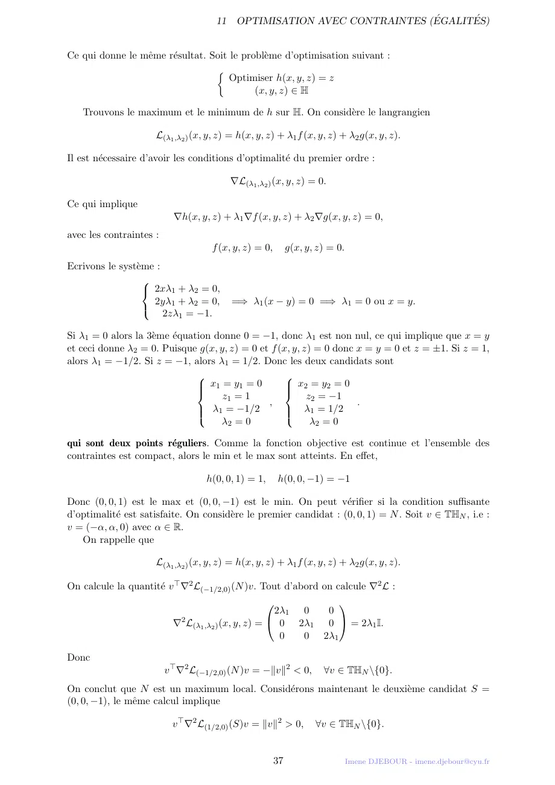

~~~text
                                     11    OPTIMISATION AVEC CONTRAINTES (ÉGALITÉS)

Ce qui donne le même résultat. Soit le problème d’optimisation suivant :
                                  
                                      Optimiser h(x, y, z) = z
                                            (x, y, z) ∈ H

   Trouvons le maximum et le minimum de h sur H. On considère le langrangien

                     L(λ1 ,λ2 ) (x, y, z) = h(x, y, z) + λ1 f (x, y, z) + λ2 g(x, y, z).

Il est nécessaire d’avoir les conditions d’optimalité du premier ordre :

                                          ∇L(λ1 ,λ2 ) (x, y, z) = 0.

Ce qui implique
                           ∇h(x, y, z) + λ1 ∇f (x, y, z) + λ2 ∇g(x, y, z) = 0,
avec les contraintes :
                                    f (x, y, z) = 0,        g(x, y, z) = 0.
Ecrivons le système :
                  
                   2xλ1 + λ2 = 0,
                    2yλ1 + λ2 = 0,        =⇒ λ1 (x − y) = 0 =⇒ λ1 = 0 ou x = y.
                       2zλ1 = −1.
                  

Si λ1 = 0 alors la 3ème équation donne 0 = −1, donc λ1 est non nul, ce qui implique que x = y
et ceci donne λ2 = 0. Puisque g(x, y, z) = 0 et f (x, y, z) = 0 donc x = y = 0 et z = ±1. Si z = 1,
alors λ1 = −1/2. Si z = −1, alors λ1 = 1/2. Donc les deux candidats sont
                                                  
                               
                                 x1 = y1 = 0      
                                                      x2 = y2 = 0
                                      z1 = 1              z2 = −1
                                                  
                                               ,                     .
                               
                                  λ 1 = −1/2      
                                                        λ 1 = 1/2
                                      λ2 = 0               λ2 = 0
                                                  

qui sont deux points réguliers. Comme la fonction objective est continue et l’ensemble des
contraintes est compact, alors le min et le max sont atteints. En effet,

                                   h(0, 0, 1) = 1,     h(0, 0, −1) = −1

Donc (0, 0, 1) est le max et (0, 0, −1) est le min. On peut vérifier si la condition suffisante
d’optimalité est satisfaite. On considère le premier candidat : (0, 0, 1) = N . Soit v ∈ THN , i.e :
v = (−α, α, 0) avec α ∈ R.
   On rappelle que

                     L(λ1 ,λ2 ) (x, y, z) = h(x, y, z) + λ1 f (x, y, z) + λ2 g(x, y, z).

On calcule la quantité v ⊤ ∇2 L(−1/2,0) (N )v. Tout d’abord on calcule ∇2 L :
                                                               
                                                      2λ1 0  0
                           ∇2 L(λ1 ,λ2 ) (x, y, z) =  0 2λ1 0  = 2λ1 I.
                                                       0  0 2λ1

Donc
                         v ⊤ ∇2 L(−1/2,0) (N )v = −∥v∥2 < 0,         ∀v ∈ THN \{0}.
On conclut que N est un maximum local. Considérons maintenant le deuxième candidat S =
(0, 0, −1), le même calcul implique

                          v ⊤ ∇2 L(1/2,0) (S)v = ∥v∥2 > 0,         ∀v ∈ THN \{0}.

                                                       37                     Imene DJEBOUR - imene.djebour@cyu.fr
~~~

## Page 38

~~~text
                                    11   OPTIMISATION AVEC CONTRAINTES (ÉGALITÉS)

Donc S est un minimum local. Comme h est linéaire, on déduit que les optimums locaux qu’on
a trouvés sont en fait globaux.
    Maintentant considérons le problème d’optimalité

                                    Optimiser h(x, y, z) = z 2
                                  

                                           (x, y, z) ∈ S

   Trouvons le maximum et le minimum de h sur S. On considère le langrangien

                               Lλ (x, y, z) = h(x, y, z) + λf (x, y, z).

Il est nécessaire d’avoir les conditions d’optimalité du premier ordre :

                                          ∇Lλ (x, y, z) = 0.

Ce qui implique
                                  ∇h(x, y, z) + λ∇f (x, y, z) = 0,
avec la contrainte :
                                           f (x, y, z) = 0.
Ecrivons le système :     
                               λx = 0,
                                λy = 0,         =⇒ λ = 0 ou x = y = 0.
                             (1 + λ)z = 0.
                           

Si λ = 0 alors z = 0 et en utilisant la contrainte f (x, y, z) = 0, on obtient x2 + y 2 = 1 ou en
d’autre termes l’ensemble des points trouvée dans ce cas est le cercle de centre (0, 0, 0) et de
rayon 1 qui se trouve sur le plan z = 0.
    Sinon si λ = −1, alors x = y = 0 et puisque f (x, y, z) = 0 donc z = ±1. Finalement si
λ ̸= −1 et non nul alors le seul candidat possible dans ce cas est le (0, 0, 0). Finalement, on a :

                   C : {(x, y, z) ∈ R3 | z = 0 et x2 + y 2 = 1}
                                                                    
                                                                       (0, 0, ±1)
                                                                 ,
                                        λ=0                             λ = −1

Ici la fonction h est continue et le domaine des contraintes est un compact, donc le min et le
max existe. De plus :
                                 h(0, 0, ±1) = 1 et h(x, y, 0) = 0.
Donc les points (0, 0, ±1) sont des maximum globaux de h sur S et les points de l’ensemble des
points C sont des minimums globaux.

                                               ♣♣♣♣

Exercice 2
   Soit H un plan dans Rn donné par l’équation

                                               Ax = b.

où A ∈ Mpn (R) de rang p ≤ n. Soit x0 ∈ H et x ∈ Rn . On veut chercher

                                        min ∥x − x0 ∥2
                                      

                                           Ax = b

   Soit f (x) = ∥x − x0 ∥ qui est une fonction quadratique strictement convexe. En effet
                                                                  1
       f (x) = (x − x0 ) · (x − x0 ) = x · x − 2x · x0 + x0 · x0 = x · 2Ix − 2x0 · x + x0 · x0 .
                                                                  2
Donc
                             ∇f (x) = 2Ix − 2x0 ,      ∇2 f (x) = 2I > 0.

                                                  38                Imene DJEBOUR - imene.djebour@cyu.fr
~~~

## Page 39

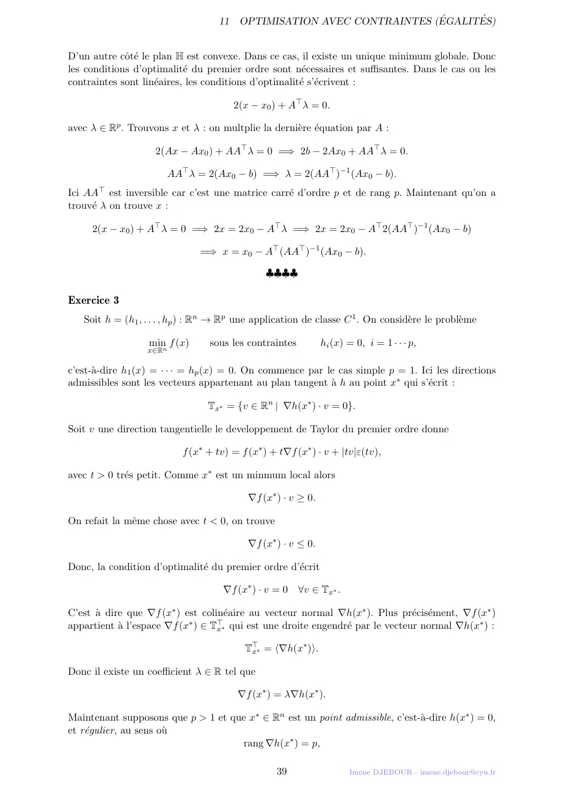

~~~text
                                    11    OPTIMISATION AVEC CONTRAINTES (ÉGALITÉS)

D’un autre côté le plan H est convexe. Dans ce cas, il existe un unique minimum globale. Donc
les conditions d’optimalité du premier ordre sont nécessaires et suffisantes. Dans le cas ou les
contraintes sont linéaires, les conditions d’optimalité s’écrivent :

                                         2(x − x0 ) + A⊤ λ = 0.

avec λ ∈ Rp . Trouvons x et λ : on multplie la dernière équation par A :

                    2(Ax − Ax0 ) + AA⊤ λ = 0 =⇒ 2b − 2Ax0 + AA⊤ λ = 0.

                       AA⊤ λ = 2(Ax0 − b) =⇒ λ = 2(AA⊤ )−1 (Ax0 − b).
Ici AA⊤ est inversible car c’est une matrice carré d’ordre p et de rang p. Maintenant qu’on a
trouvé λ on trouve x :

     2(x − x0 ) + A⊤ λ = 0 =⇒ 2x = 2x0 − A⊤ λ =⇒ 2x = 2x0 − A⊤ 2(AA⊤ )−1 (Ax0 − b)

                               =⇒ x = x0 − A⊤ (AA⊤ )−1 (Ax0 − b).

                                                ♣♣♣♣

Exercice 3
   Soit h = (h1 , . . . , hp ) : Rn → Rp une application de classe C 1 . On considère le problème

                  min f (x)      sous les contraintes           hi (x) = 0, i = 1 · · · p,
                  x∈Rn

c’est-à-dire h1 (x) = · · · = hp (x) = 0. On commence par le cas simple p = 1. Ici les directions
admissibles sont les vecteurs appartenant au plan tangent à h au point x∗ qui s’écrit :

                                 Tx∗ = {v ∈ Rn | ∇h(x∗ ) · v = 0}.

Soit v une direction tangentielle le developpement de Taylor du premier ordre donne

                           f (x∗ + tv) = f (x∗ ) + t∇f (x∗ ) · v + |tv|ε(tv),

avec t > 0 trés petit. Comme x∗ est un minmum local alors

                                            ∇f (x∗ ) · v ≥ 0.

On refait la même chose avec t < 0, on trouve

                                            ∇f (x∗ ) · v ≤ 0.

Donc, la condition d’optimalité du premier ordre d’écrit

                                     ∇f (x∗ ) · v = 0 ∀v ∈ Tx∗ .

C’est à dire que ∇f (x∗ ) est colinéaire au vecteur normal ∇h(x∗ ). Plus précisément, ∇f (x∗ )
appartient à l’espace ∇f (x∗ ) ∈ T⊤                                                          ∗
                                   x∗ qui est une droite engendré par le vecteur normal ∇h(x ) :

                                           T⊤         ∗
                                            x∗ = ⟨∇h(x )⟩.

Donc il existe un coefficient λ ∈ R tel que

                                         ∇f (x∗ ) = λ∇h(x∗ ).

Maintenant supposons que p > 1 et que x∗ ∈ Rn est un point admissible, c’est-à-dire h(x∗ ) = 0,
et régulier, au sens où
                                    rang ∇h(x∗ ) = p,

                                                   39                  Imene DJEBOUR - imene.djebour@cyu.fr
~~~

## Page 40

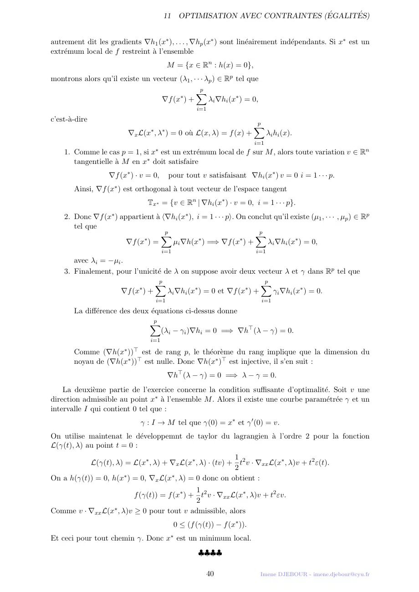

~~~text
                                         11     OPTIMISATION AVEC CONTRAINTES (ÉGALITÉS)

autrement dit les gradients ∇h1 (x∗ ), . . . , ∇hp (x∗ ) sont linéairement indépendants. Si x∗ est un
extrémum local de f restreint à l’ensemble
                                             M = {x ∈ Rn : h(x) = 0},
montrons alors qu’il existe un vecteur (λ1 , · · · λp ) ∈ Rp tel que
                                                      p
                                                      X
                                                ∗
                                        ∇f (x ) +           λi ∇hi (x∗ ) = 0,
                                                      i=1
c’est-à-dire
                                                                            p
                                                                            X
                                   ∗    ∗
                          ∇x L(x , λ ) = 0 où L(x, λ) = f (x) +                  λi hi (x).
                                                                            i=1
    1. Comme le cas p = 1, si x∗ est un extrémum local de f sur M , alors toute variation v ∈ Rn
       tangentielle à M en x∗ doit satisfaire
                   ∇f (x∗ ) · v = 0,         pour tout v satisfaisant ∇hi (x∗ ) v = 0 i = 1 · · · p.
        Ainsi, ∇f (x∗ ) est orthogonal à tout vecteur de l’espace tangent
                                  Tx∗ = {v ∈ Rn | ∇hi (x∗ ) · v = 0, i = 1 · · · p}.
    2. Donc ∇f (x∗ ) appartient à ⟨∇hi (x∗ ), i = 1 · · · p⟩. On conclut qu’il existe (µ1 , · · · , µp ) ∈ Rp
       tel que
                                  X p                               Xp
                       ∇f (x∗ ) =     µi ∇h(x∗ ) =⇒ ∇f (x∗ ) +          λi ∇hi (x∗ ) = 0,
                                        i=1                                 i=1
       avec λi = −µi .
    3. Finalement, pour l’unicité de λ on suppose avoir deux vecteur λ et γ dans Rp tel que
                                       p
                                       X                                        p
                                                                                X
                              ∗                      ∗                  ∗
                       ∇f (x ) +             λi ∇hi (x ) = 0 et ∇f (x ) +             γi ∇hi (x∗ ) = 0.
                                       i=1                                      i=1
        La différence des deux équations ci-dessus donne
                                  p
                                  X
                                    (λi − γi )∇hi = 0 =⇒ ∇h⊤ (λ − γ) = 0.
                                  i=1

        Comme (∇h(x∗ ))⊤ est de rang p, le théorème du rang implique que la dimension du
        noyau de (∇h(x∗ ))⊤ est nulle. Donc ∇h(x∗ )⊤ est injective, il s’en suit :
                                             ∇h⊤ (λ − γ) = 0 =⇒ λ − γ = 0.
    La deuxième partie de l’exercice concerne la condition suffisante d’optimalité. Soit v une
direction admissible au point x∗ à l’ensemble M . Alors il existe une courbe paramétrée γ et un
intervalle I qui contient 0 tel que :
                              γ : I → M tel que γ(0) = x∗ et γ ′ (0) = v.
On utilise maintenat le développemnt de taylor du lagrangien à l’ordre 2 pour la fonction
L(γ(t), λ) au point t = 0 :
                                                         1
           L(γ(t), λ) = L(x∗ , λ) + ∇x L(x∗ , λ) · (tv) + t2 v · ∇xx L(x∗ , λ)v + t2 ε(t).
                                                         2
On a h(γ(t)) = 0, h(x∗ ) = 0, ∇x L(x∗ , λ) = 0 donc on obtient :
                                             1
                         f (γ(t)) = f (x∗ ) + t2 v · ∇xx L(x∗ , λ)v + t2 εv.
                                             2
Comme v · ∇xx L(x∗ , λ)v ≥ 0 pour tout v admissible, alors
                                              0 ≤ (f (γ(t)) − f (x∗ )).
Et ceci pour tout chemin γ. Donc x∗ est un minimum local.
                                                         ♣♣♣♣

                                                          40                    Imene DJEBOUR - imene.djebour@cyu.fr
~~~

## Page 41

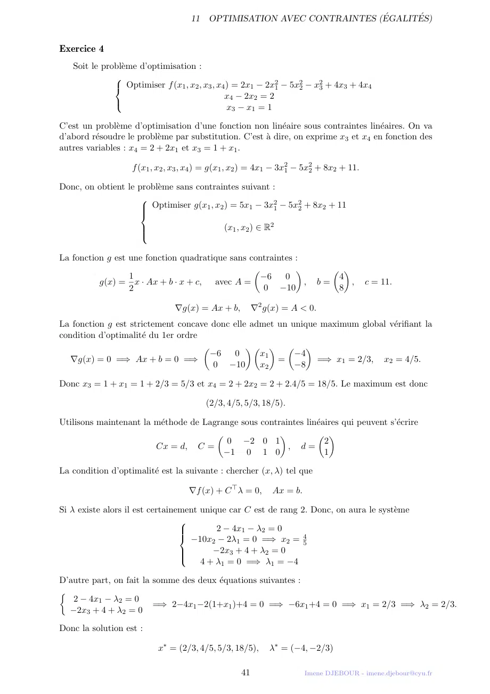

~~~text
                                    11   OPTIMISATION AVEC CONTRAINTES (ÉGALITÉS)

Exercice 4
   Soit le problème d’optimisation :

               Optimiser f (x1 , x2 , x3 , x4 ) = 2x1 − 2x21 − 5x22 − x23 + 4x3 + 4x4
              

                                              x4 − 2x2 = 2
                                               x3 − x1 = 1
              

C’est un problème d’optimisation d’une fonction non linéaire sous contraintes linéaires. On va
d’abord résoudre le problème par substitution. C’est à dire, on exprime x3 et x4 en fonction des
autres variables : x4 = 2 + 2x1 et x3 = 1 + x1 .

                   f (x1 , x2 , x3 , x4 ) = g(x1 , x2 ) = 4x1 − 3x21 − 5x22 + 8x2 + 11.

Donc, on obtient le problème sans contraintes suivant :

                       Optimiser g(x1 , x2 ) = 5x1 − 3x21 − 5x22 + 8x2 + 11
                    
                    
                    
                    
                     
                                             (x1 , x2 ) ∈ R2
                     

La fonction g est une fonction quadratique sans contraintes :
                                                                             
                  1                               −6     0                     4
          g(x) = x · Ax + b · x + c, avec A =                 ,            b=     ,       c = 11.
                  2                                0 −10                       8

                               ∇g(x) = Ax + b,          ∇2 g(x) = A < 0.
La fonction g est strictement concave donc elle admet un unique maximum global vérifiant la
condition d’optimalité du 1er ordre
                                                 
                                       −6  0      x1      −4
   ∇g(x) = 0 =⇒ Ax + b = 0 =⇒                         =        =⇒ x1 = 2/3, x2 = 4/5.
                                       0 −10      x2      −8

Donc x3 = 1 + x1 = 1 + 2/3 = 5/3 et x4 = 2 + 2x2 = 2 + 2.4/5 = 18/5. Le maximum est donc

                                         (2/3, 4/5, 5/3, 18/5).

Utilisons maintenant la méthode de Lagrange sous contraintes linéaires qui peuvent s’écrire
                                                                 
                                          0 −2 0 1                  2
                        Cx = d, C =                      , d=
                                         −1 0 1 0                   1

La condition d’optimalité est la suivante : chercher (x, λ) tel que

                                    ∇f (x) + C ⊤ λ = 0,      Ax = b.

Si λ existe alors il est certainement unique car C est de rang 2. Donc, on aura le système
                                 
                                         2 − 4x1 − λ2 = 0
                                   −10x2 − 2λ1 = 0 =⇒ x2 = 54
                                 
                                 
                                 
                                        −2x3 + 4 + λ2 = 0
                                      4 + λ1 = 0 =⇒ λ1 = −4
                                 

D’autre part, on fait la somme des deux équations suivantes :

   2 − 4x1 − λ2 = 0
                         =⇒ 2−4x1 −2(1+x1 )+4 = 0 =⇒ −6x1 +4 = 0 =⇒ x1 = 2/3 =⇒ λ2 = 2/3.
  −2x3 + 4 + λ2 = 0

Donc la solution est :

                          x∗ = (2/3, 4/5, 5/3, 18/5),       λ∗ = (−4, −2/3)

                                                   41                  Imene DJEBOUR - imene.djebour@cyu.fr
~~~

## Page 42

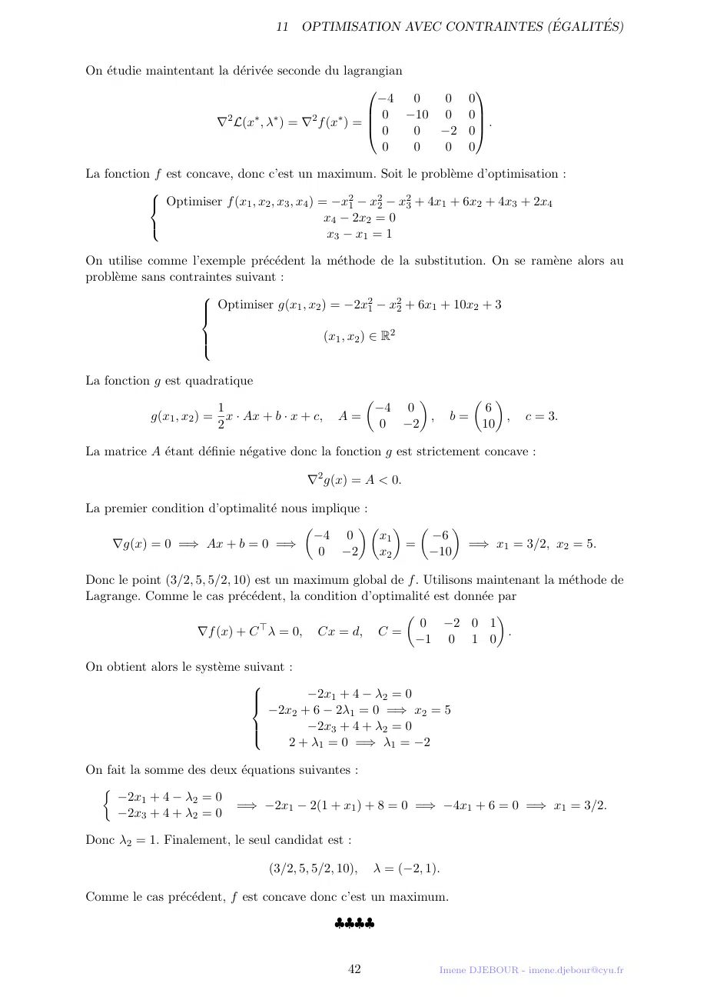

~~~text
                                   11   OPTIMISATION AVEC CONTRAINTES (ÉGALITÉS)

On étudie maintentant la dérivée seconde du lagrangian
                                                                
                                                      −4  0  0 0
                                                      0 −10 0 0
                       ∇2 L(x∗ , λ∗ ) = ∇2 f (x∗ ) =            .
                                                     0   0  −2 0
                                                       0  0  0 0

La fonction f est concave, donc c’est un maximum. Soit le problème d’optimisation :

            Optimiser f (x1 , x2 , x3 , x4 ) = −x21 − x22 − x23 + 4x1 + 6x2 + 4x3 + 2x4
           

                                               x4 − 2x2 = 0
                                               x3 − x1 = 1
           

On utilise comme l’exemple précédent la méthode de la substitution. On se ramène alors au
problème sans contraintes suivant :
                                                 2    2
                    
                     Optimiser g(x1 , x2 ) = −2x1 − x2 + 6x1 + 10x2 + 3
                    
                    
                     
                                               (x1 , x2 ) ∈ R2
                     

La fonction g est quadratique
                                                                                   
                         1                                    −4 0                  6
            g(x1 , x2 ) = x · Ax + b · x + c,      A=                ,     b=           ,   c = 3.
                         2                                    0 −2                  10

La matrice A étant définie négative donc la fonction g est strictement concave :

                                         ∇2 g(x) = A < 0.

La premier condition d’optimalité nous implique :
                                                      
                                         −4 0      x1   −6
    ∇g(x) = 0 =⇒ Ax + b = 0 =⇒                        =      =⇒ x1 = 3/2, x2 = 5.
                                          0 −2     x2   −10

Donc le point (3/2, 5, 5/2, 10) est un maximum global de f . Utilisons maintenant la méthode de
Lagrange. Comme le cas précédent, la condition d’optimalité est donnée par
                                                                          
                                 ⊤                          0 −2 0 1
                    ∇f (x) + C λ = 0, Cx = d, C =                            .
                                                           −1 0 1 0

On obtient alors le système suivant :
                              
                              
                                       −2x1 + 4 − λ2 = 0
                                 −2x2 + 6 − 2λ1 = 0 =⇒ x2 = 5
                              
                              
                                       −2x3 + 4 + λ2 = 0
                                     2 + λ1 = 0 =⇒ λ1 = −2
                              

On fait la somme des deux équations suivantes :
  
     −2x1 + 4 − λ2 = 0
                         =⇒ −2x1 − 2(1 + x1 ) + 8 = 0 =⇒ −4x1 + 6 = 0 =⇒ x1 = 3/2.
     −2x3 + 4 + λ2 = 0

Donc λ2 = 1. Finalement, le seul candidat est :

                                  (3/2, 5, 5/2, 10),      λ = (−2, 1).

Comme le cas précédent, f est concave donc c’est un maximum.

                                                  ♣♣♣♣

                                                     42                  Imene DJEBOUR - imene.djebour@cyu.fr
~~~

## Page 43

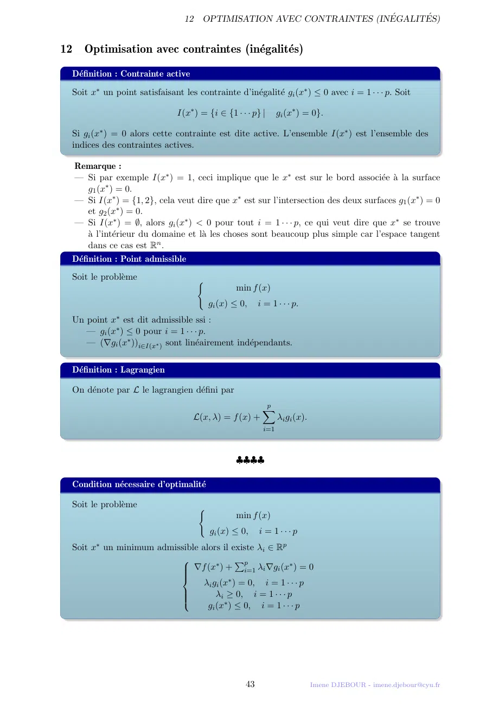

~~~text
                                12   OPTIMISATION AVEC CONTRAINTES (INÉGALITÉS)

12   Optimisation avec contraintes (inégalités)
 Définition : Contrainte active

 Soit x∗ un point satisfaisant les contrainte d’inégalité gi (x∗ ) ≤ 0 avec i = 1 · · · p. Soit

                              I(x∗ ) = {i ∈ {1 · · · p} |      gi (x∗ ) = 0}.

 Si gi (x∗ ) = 0 alors cette contrainte est dite active. L’ensemble I(x∗ ) est l’ensemble des
 indices des contraintes actives.

 Remarque :
 — Si par exemple I(x∗ ) = 1, ceci implique que le x∗ est sur le bord associée à la surface
      g1 (x∗ ) = 0.
 — Si I(x∗ ) = {1, 2}, cela veut dire que x∗ est sur l’intersection des deux surfaces g1 (x∗ ) = 0
      et g2 (x∗ ) = 0.
 — Si I(x∗ ) = ∅, alors gi (x∗ ) < 0 pour tout i = 1 · · · p, ce qui veut dire que x∗ se trouve
      à l’intérieur du domaine et là les choses sont beaucoup plus simple car l’espace tangent
      dans ce cas est Rn .
 Définition : Point admissible
 Soit le problème                   (
                                                min f (x)
                                         gi (x) ≤ 0,    i = 1 · · · p.
 Un point x∗ est dit admissible ssi :
    — gi (x∗ ) ≤ 0 pour i = 1 · · · p.
    — (∇gi (x∗ ))i∈I(x∗ ) sont linéairement indépendants.

 Définition : Lagrangien

 On dénote par L le lagrangien défini par
                                                         p
                                                         X
                                   L(x, λ) = f (x) +           λi gi (x).
                                                         i=1

                                                ♣♣♣♣

 Condition nécessaire d’optimalité

 Soit le problème                   (
                                                min f (x)
                                         gi (x) ≤ 0,    i = 1···p
 Soit x∗ un minimum admissible alors il existe λi ∈ Rp

                             ∇f (x∗ ) + pi=1 λi ∇gi (x∗ ) = 0
                                          P
                         
                         
                         
                                λi gi (x∗ ) = 0, i = 1 · · · p
                         
                         
                         
                                   λi ≥ 0, i = 1 · · · p
                                 gi (x∗ ) ≤ 0, i = 1 · · · p
                         

                                                   43                       Imene DJEBOUR - imene.djebour@cyu.fr
~~~

## Page 44

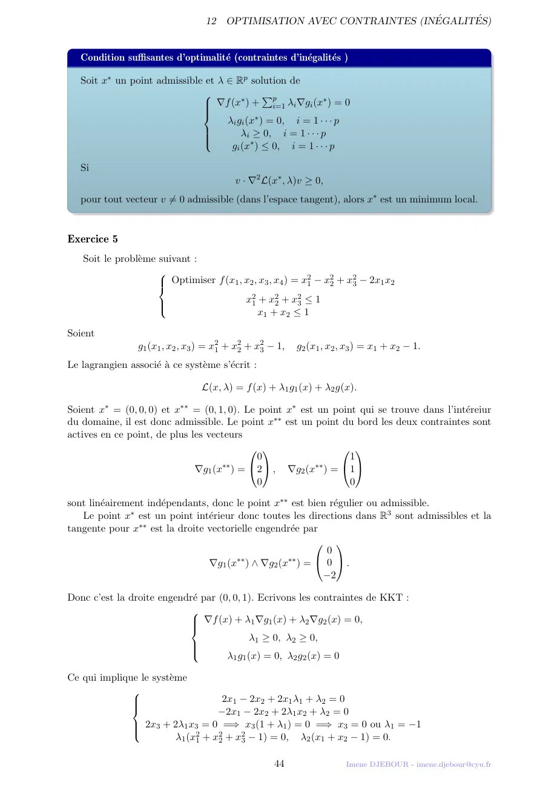

~~~text
                                   12    OPTIMISATION AVEC CONTRAINTES (INÉGALITÉS)

   Condition suffisantes d’optimalité (contraintes d’inégalités )

   Soit x∗ un point admissible et λ ∈ Rp solution de

                                  ∇f (x∗ ) + pi=1 λi ∇gi (x∗ ) = 0
                                              P
                              
                              
                              
                                    λi gi (x∗ ) = 0, i = 1 · · · p
                              
                              
                              
                                       λi ≥ 0, i = 1 · · · p
                                     gi (x∗ ) ≤ 0, i = 1 · · · p
                              

   Si
                                            v · ∇2 L(x∗ , λ)v ≥ 0,
   pour tout vecteur v ̸= 0 admissible (dans l’espace tangent), alors x∗ est un minimum local.

Exercice 5
    Soit le problème suivant :
                                                            2    2    2
                      
                       Optimiser f (x1 , x2 , x3 , x4 ) = x1 − x2 + x3 − 2x1 x2
                      

                                         x21 + x22 + x23 ≤ 1
                                              x1 + x2 ≤ 1
                      

Soient
                 g1 (x1 , x2 , x3 ) = x21 + x22 + x23 − 1,   g2 (x1 , x2 , x3 ) = x1 + x2 − 1.
Le lagrangien associé à ce système s’écrit :

                                  L(x, λ) = f (x) + λ1 g1 (x) + λ2 g(x).

Soient x∗ = (0, 0, 0) et x∗∗ = (0, 1, 0). Le point x∗ est un point qui se trouve dans l’intéreiur
du domaine, il est donc admissible. Le point x∗∗ est un point du bord les deux contraintes sont
actives en ce point, de plus les vecteurs
                                                             
                                             0                   1
                                    ∗∗                   ∗∗
                              ∇g1 (x ) = 2 , ∇g2 (x ) = 1
                                                            
                                             0                   0

sont linéairement indépendants, donc le point x∗∗ est bien régulier ou admissible.
   Le point x∗ est un point intérieur donc toutes les directions dans R3 sont admissibles et la
tangente pour x∗∗ est la droite vectorielle engendrée par
                                                          
                                                            0
                                       ∗∗          ∗∗
                                 ∇g1 (x ) ∧ ∇g2 (x ) =     0 .
                                                           −2

Donc c’est la droite engendré par (0, 0, 1). Ecrivons les contraintes de KKT :
                           
                           
                               ∇f (x) + λ1 ∇g1 (x) + λ2 ∇g2 (x) = 0,
                           
                                           λ1 ≥ 0, λ2 ≥ 0,
                           
                           
                                     λ1 g1 (x) = 0, λ2 g2 (x) = 0
                           

Ce qui implique le système
              
              
                                     2x1 − 2x2 + 2x1 λ1 + λ2 = 0
                                    −2x1 − 2x2 + 2λ1 x2 + λ2 = 0
              
                
                 2x3 + 2λ1 x3 = 0 =⇒ x3 (1 + λ1 ) = 0 =⇒ x3 = 0 ou λ1 = −1
                         λ1 (x21 + x22 + x23 − 1) = 0, λ2 (x1 + x2 − 1) = 0.
                

                                                       44                 Imene DJEBOUR - imene.djebour@cyu.fr
~~~

## Page 45

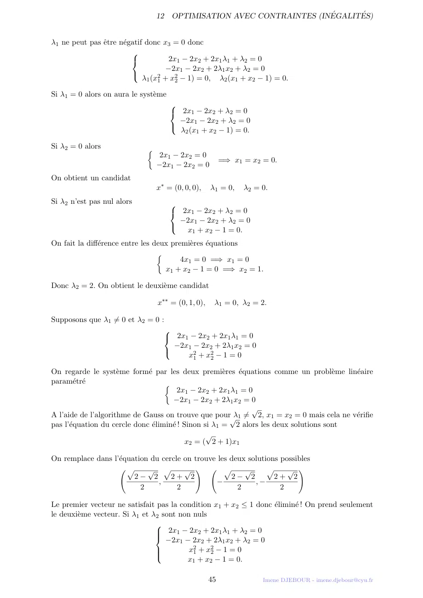

~~~text
                                 12   OPTIMISATION AVEC CONTRAINTES (INÉGALITÉS)

λ1 ne peut pas être négatif donc x3 = 0 donc
                         
                                      2x1 − 2x2 + 2x1 λ1 + λ2 = 0
                                      −2x1 − 2x2 + 2λ1 x2 + λ2 = 0
                             λ1 (x21 + x22 − 1) = 0, λ2 (x1 + x2 − 1) = 0.
                         

Si λ1 = 0 alors on aura le système
                                      
                                       2x1 − 2x2 + λ2 = 0
                                        −2x1 − 2x2 + λ2 = 0
                                        λ2 (x1 + x2 − 1) = 0.
                                      

Si λ2 = 0 alors              
                                  2x1 − 2x2 = 0
                                                         =⇒ x1 = x2 = 0.
                                 −2x1 − 2x2 = 0
On obtient un candidat
                                 x∗ = (0, 0, 0),    λ1 = 0,    λ2 = 0.
Si λ2 n’est pas nul alors             
                                       2x1 − 2x2 + λ2 = 0
                                        −2x1 − 2x2 + λ2 = 0
                                         x1 + x2 − 1 = 0.
                                      

On fait la différence entre les deux premières équations
                                  
                                         4x1 = 0 =⇒ x1 = 0
                                    x1 + x2 − 1 = 0 =⇒ x2 = 1.

Donc λ2 = 2. On obtient le deuxième candidat

                                 x∗∗ = (0, 1, 0),    λ1 = 0, λ2 = 2.

Supposons que λ1 ̸= 0 et λ2 = 0 :
                                 
                                  2x1 − 2x2 + 2x1 λ1 = 0
                                   −2x1 − 2x2 + 2λ1 x2 = 0
                                      x21 + x22 − 1 = 0
                                 

On regarde le système formé par les deux premières équations comme un problème linéaire
paramétré                         
                                        2x1 − 2x2 + 2x1 λ1 = 0
                                       −2x1 − 2x2 + 2λ1 x2 = 0
                                                              √
A l’aide de l’algorithme de Gauss on trouve que pour√λ1 ̸= 2, x1 = x2 = 0 mais cela ne vérifie
pas l’équation du cercle donc éliminé ! Sinon si λ1 = 2 alors les deux solutions sont
                                                  √
                                            x2 = ( 2 + 1)x1

On remplace dans l’équation du cercle on trouve les deux solutions possibles
                      p     √ p        √ !         p     √      p     √ !
                        2− 2       2+ 2              2− 2         2+ 2
                               ,                −           ,−
                          2          2                 2            2

Le premier vecteur ne satisfait pas la condition x1 + x2 ≤ 1 donc éliminé ! On prend seulement
le deuxième vecteur. Si λ1 et λ2 sont non nuls
                                
                                
                                   2x1 − 2x2 + 2x1 λ1 + λ2 = 0
                                   −2x1 − 2x2 + 2λ1 x2 + λ2 = 0
                                
                                
                                         x21 + x22 − 1 = 0
                                         x1 + x2 − 1 = 0.
                                

                                                    45              Imene DJEBOUR - imene.djebour@cyu.fr
~~~

## Page 46

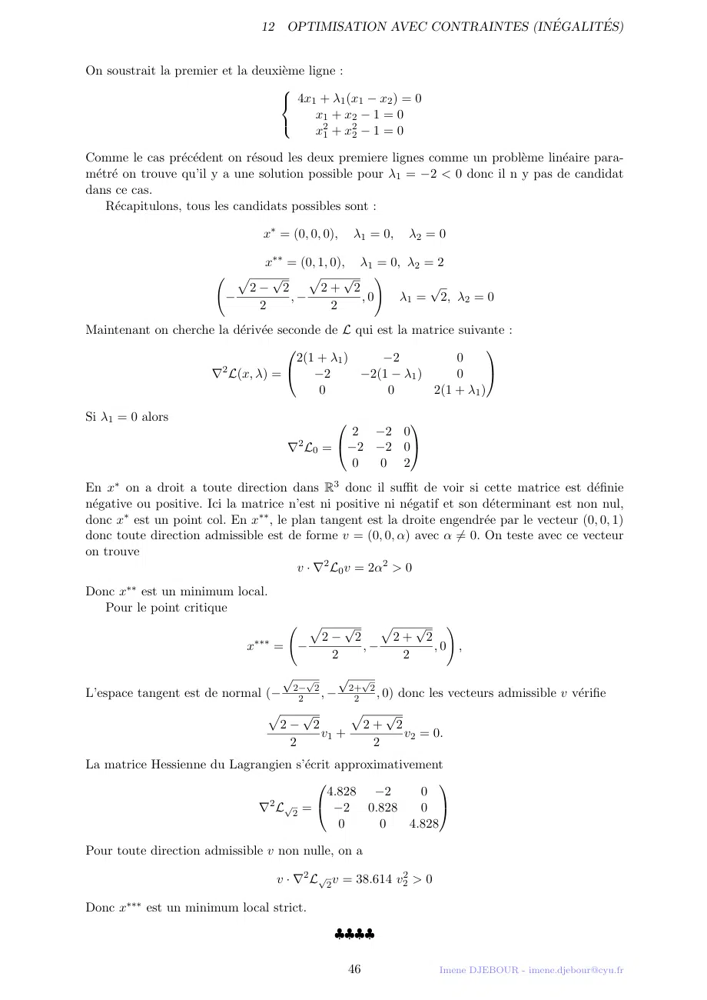

~~~text
                                 12      OPTIMISATION AVEC CONTRAINTES (INÉGALITÉS)

On soustrait la premier et la deuxième ligne :
                                  
                                   4x1 + λ1 (x1 − x2 ) = 0
                                          x1 + x2 − 1 = 0
                                          x21 + x22 − 1 = 0
                                  

Comme le cas précédent on résoud les deux premiere lignes comme un problème linéaire para-
métré on trouve qu’il y a une solution possible pour λ1 = −2 < 0 donc il n y pas de candidat
dans ce cas.
    Récapitulons, tous les candidats possibles sont :

                                 x∗ = (0, 0, 0),    λ1 = 0,   λ2 = 0

                               x∗∗ = (0, 1, 0), λ1 = 0, λ2 = 2
                           p    √     p       √   !
                             2− 2        2+ 2               √
                         −         ,−           ,0     λ1 = 2, λ2 = 0
                              2             2
Maintenant on cherche la dérivée seconde de L qui est la matrice suivante :
                                                                        
                                      2(1 + λ1 )     −2            0
                     ∇2 L(x, λ) =  −2           −2(1 − λ1 )       0     
                                          0           0       2(1 + λ1 )

Si λ1 = 0 alors                                         
                                                  2 −2 0
                                         ∇2 L0 = −2 −2 0
                                                  0  0 2
En x∗ on a droit a toute direction dans R3 donc il suffit de voir si cette matrice est définie
négative ou positive. Ici la matrice n’est ni positive ni négatif et son déterminant est non nul,
donc x∗ est un point col. En x∗∗ , le plan tangent est la droite engendrée par le vecteur (0, 0, 1)
donc toute direction admissible est de forme v = (0, 0, α) avec α ̸= 0. On teste avec ce vecteur
on trouve
                                       v · ∇2 L0 v = 2α2 > 0
Donc x∗∗ est un minimum local.
   Pour le point critique
                                            p   √    p   √   !
                               ∗∗∗           2− 2     2+ 2
                             x       =    −       ,−       ,0 ,
                                              2        2
                                 √ √         √ √
L’espace tangent est de normal (− 2−2
                                       2
                                         , −  2+ 2
                                               2   , 0) donc les vecteurs admissible v vérifie
                               p     √        p       √
                                 2− 2            2+ 2
                                         v1 +            v2 = 0.
                                  2               2
La matrice Hessienne du Lagrangien s’écrit approximativement
                                                             
                                          4.828 −2        0
                             ∇2 L√2 =  −2 0.828          0 
                                             0     0    4.828

Pour toute direction admissible v non nulle, on a

                                      v · ∇2 L√2 v = 38.614 v22 > 0

Donc x∗∗∗ est un minimum local strict.

                                                ♣♣♣♣

                                                    46                Imene DJEBOUR - imene.djebour@cyu.fr
~~~

## Page 47

~~~text
                                 12   OPTIMISATION AVEC CONTRAINTES (INÉGALITÉS)

Exercice 6
   Soit le problème suivant :
                                                3
                         
                          min f (x1 , x2 ) = x1 + 2x1 x2 + 15x1 + 10x2
                         
                                                        √
                                           −x21 + x2 − 2
                                           x21 − x2 − 2 ≤ 0
                         

Soient                                             √
                     g1 (x1 , x2 ) = −x21 + x2 −       2,   g2 (x1 , x2 ) = x21 − x2 − 2.
Soit y = (−1, 1). Montrons que (−1, 1) est admissible :
                                          √
                                g1 (y) = − 2 ≤ 0, g2 (y) = 0.

Les contraintes sont vérifiées avec g2 contrainte active, on calcule le gradient en ce point
                                                    
                                                     −2
                                         ∇g2 (y) =        ̸= 0.
                                                     −1

Donc y est bien admissible. Trouvons le cône tangent, ici les vecteurs admissibles au point y
sont les vecteurs v qui forment un angle optu avec ∇g2 (y), i.e :

                                  ∇g2 (y) · v ≤ 0 =⇒ 2v1 + v2 ≥ 0.

Maintenant écrivons le système KKT au point y :

                                 3x21 + 2x2 + 15 − λ1 + 2λ2 x1 = 0
                              
                              
                              
                              
                              
                                     2x1 + 10 + λ1 −√λ2 = 0
                                      λ1 (−x1 + x2 − 2) = 0
                                        λ2 (x21 − x2 − 2) = 0
                              
                              
                              
                              
                                          λ1 ≥ 0, λ2 ≥ 0.
                              

On remplace (x1 , x2 ) par y, on trouve
                                          
                                           16 − 2λ2 = 0
                                              √λ2 = 8
                                             − 2λ1 = 0
                                          

Donc y est solution avec λ1 = 0 et λ2 = 8. La condition du second ordre s’écrit au point y
comme suit
                                     v · ∇2 L(y)v ≥ 0,
pour toute direction tangente v non nulle vérifiant 2v1 + v2 = 0
                                                   
                               v1      10 2         v1
                                    ·                     = 2v12 ≥ 0.
                             −2v1       2 0        −2v1

Donc y est un minimum local.

                                                   ♣♣♣♣

   A vous de jouer !

                                                       47                Imene DJEBOUR - imene.djebour@cyu.fr
~~~
