# Slides-Opti.pdf

[Ouvrir l’original](https://drive.google.com/open?id=1fR_QJe7XST_1nXYPhBzB588cggdhC7NE) · Les pages signalées comprennent du texte reconnu automatiquement ou des éléments graphiques. Le fac-similé permet de vérifier chaque lecture.

**Pages avec fac-similé ou lecture OCR** — 5, 8, 21, 25, 41, 51, 54, 61, 70.

**Pages présentant un écart entre les deux extractions** — 53, 56–57, 65, 72, 74, 76–77, 81.

## Page 1

~~~text
                                   0.

            Optimisation linéaire et non linéaire
                 ING1 Maths appliquées

                            Nguyen Thi Hien

Thi Hien Nguyen    Optimisation linéaire et non linéaire   ING1 Maths appliquées   1 / 84
~~~

## Page 2

~~~text
                                      0.

Information générale

  1   Volume : 18h CM et 18h TD
  2   Évaluation: Examen 2h sur papier, 2 feuilles A4 recto-verso +
      calculatrice
  3   Contact: thi-hien.nguyen5@cyu.fr / Teams
  4   Motivations :
          Recherche opérationnelle / Logistique / Transport
          Automatique / Contrôle des systèmes
          Machine Learning / Data Science
          Économie / Finance
          ···
  5   Pré-requis mathématiques
          Géométrie analytique : Droites, plans, hyperplans
          Algèbre linéaire : matrice, vecteurs et opérations, rang, valeurs
          propres,...
          Analyse dans Rn : Dérivées partielles, Continuité, diérentiabilité,...
                                                                                    2 / 84
~~~

## Page 3

~~~text
                                      0.

1   Partie I-Optimisation linéaire
      Méthode géométrique
      (pour n = 2)
      Algorithme du simplexe (George Dantzig, 1947)
      Dualité
      Optimisation linéaire en nombres entiers
        Méthode des coupes - Gomory 1958
        Séparation et évaluation (Branch and bound )

2   Partie II-Optimisation non-linéaire
      Forme quadratique et convexité
      Résultats d'existence et d'unicité (P C) minx∈K f (x)
      Optimisation sans contraintes
      Optimisation avec contraintes égalités
      Optimisation avec contraintes d'inégalités

                                                              3 / 84
~~~

## Page 4

~~~text
                 1. Partie I-Optimisation linéaire

Table of Contents
1   Partie I-Optimisation linéaire
      Méthode géométrique
      (pour n = 2)
      Algorithme du simplexe (George Dantzig, 1947)
      Dualité
      Optimisation linéaire en nombres entiers
        Méthode des coupes - Gomory 1958
        Séparation et évaluation (Branch and bound )

2   Partie II-Optimisation non-linéaire
      Forme quadratique et convexité
      Résultats d'existence et d'unicité (P C) minx∈K f (x)
      Optimisation sans contraintes
      Optimisation avec contraintes égalités
      Optimisation avec contraintes d'inégalités

                                                              4 / 84
~~~

## Page 5

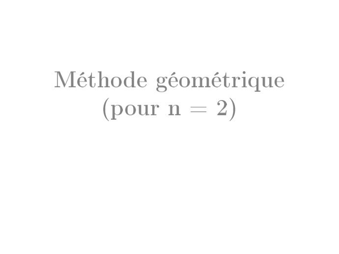

~~~text
Méthode géométrique

   (pour n = 2)
~~~

## Page 6

~~~text
           1. Partie I-Optimisation linéaire   Méthode géométrique ,(pour n = 2)

Méthode géométrique (pour n = 2)
                                                              
                                              2x1 + 4x2 ≤ 10  
          A1 = (x1 , x2 ) ∈ R2                 −3x1 + 4x2 ≤ −2
                                               −x1 − x2 ≤ 0
                                                              

                                                                                   6 / 84
~~~

## Page 7

~~~text
                1. Partie I-Optimisation linéaire   Méthode géométrique ,(pour n = 2)

Ligne de niveau

      A2 = (x1 , x2 ) ∈ R2 2x1 + x2 ≥ 0 et − 5 ≤ x1 − x2 ≤ 3
          

une intersection de ligne de niveau non vide avec le domaine A2 .
                                                                                        7 / 84
~~~

## Page 8

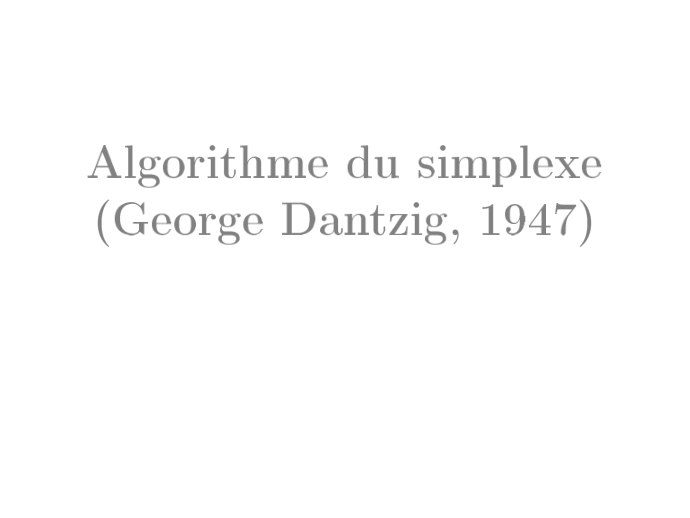

~~~text
Algorithme du simplexe

(George Dantzig, 1947)
~~~

## Page 9

~~~text
                1. Partie I-Optimisation linéaire   Algorithme du simplexe (George Dantzig, 1947)

Algorithme du simplexe
 [Forme standard] Un vecteur c ∈ Rn , une matrice A ∈ Mm,n (R) et un
 vecteur b ∈ Rm tels que :
                      
                       max c⊤ x
              (Ps )     x∈Rn
                      sous la contrainte Ax = b, x ≥ 0

 Le réel y est appelé variable d'écart de l'inégalité α1 x1 +· · ·+αn xn ≤ β
 si y ≥ 0 tel que
                        α1 x1 + · · · + αn xn + y = β

                                                                                                    9 / 84
~~~

## Page 10

~~~text
               1. Partie I-Optimisation linéaire   Algorithme du simplexe (George Dantzig, 1947)

Exemple: Exo1.1.a
                                            
                                            x1 + x2
                                            
                                                                                     ≤4
                                            
                                            −3x + x
               1                                  1     2                             ≤3
       max(x1 + x2 ) sous les contraintes :         1
               2                            
                                            x 1 −    x
                                                    2 2                               ≤1
                                            
                                            
                                            x , x
                                               1    2                                 ≥0
Le problème a pour forme standard :
                  1
       max    x1 + x2 + 0y1 + 0y2 + 0y3 sous les contraintes :
                  2
                     
                     
                     
                        x1 + x2 + y1 = 4
                     
                      −3x + x + y = 3
                              1      2    2
                                1
                     
                     
                        x 1 − 2 x 2 + y3 = 1
                     
                      x ,x ,y ,y ,y ≥0
                           1   2    1  2    3

                                                                                                   10 / 84
~~~

## Page 11

~~~text
             1. Partie I-Optimisation linéaire   Algorithme du simplexe (George Dantzig, 1947)

Méthodes des tableaux: variable entrante/sortante
                   bk
Tableau 1, min{          , ak,j > 0}
                  ak , j
        x1 x2  y1 y2 y3 Second membre                                         Ratio
     f   1 1/2 0 0 0          0
                                                                            4
     y1 1   1  1 0 0          4                                             1 =4
                                                                          3
     y2 −3  1  0 1 0          3                                          −3 = −1 < 0
     y3 1 −1/2 0 0 1          1                                             1
                                                                            1 =1
Tableau 2
             x1 x2  y1 y2 y3 Second membre Ratio
        f    0   1  0 0 −1        −1
        y1   0  3/2 1 0 −1         3        ···
        y2   0 −1/2 0 1   3        6        ···
        x1   1 −1/2 0 0   1        1        ···

                                                                                                 11 / 84
~~~

## Page 12

~~~text
                  1. Partie I-Optimisation linéaire   Algorithme du simplexe (George Dantzig, 1947)

Exercice 1.1. a
Tableau 3
                    x1 x2  y1 y2  y3 Second membre
             f      0 0 −2/3 0 −1/3       −3
             x2     0 1   2/3 0 −2/3       2
             y2     0 0   1/3 1  8/3       7
             x1     1 0   1/3 0  2/3       2

Conclusion : L'optimum est atteint en (x1 , x2 ) = (2, 2), avec une valeur
optimale de 3.
Méthode
    Initialisation (faire tableau avec A, b, c)
    Itération (déterminer variable entrante (x) et variable sortante (y) en
    calculant les ratios) Li = Li − αLj
    Terminaison (quand aucune coecient n'est strictement positif)
Attention: valeur du critère nal est l'opposé de la valeur en n.                                    12 / 84
~~~

## Page 13

~~~text
            1. Partie I-Optimisation linéaire   Algorithme du simplexe (George Dantzig, 1947)

Pratique: Exercice 4.c - TD1

              max         x1 + 2x2 sous les contraintes :
                           
                           
                           
                            −3x1 + 2x2 ≤ 2
                           
                           −x + 2x ≤ 4
                                 1      2
                           
                           
                            x 1 + x 2 ≤  5
                           
                           x ≥ 0, x ≥ 0
                               1           2

                                                                                                13 / 84
~~~

## Page 14

~~~text
              1. Partie I-Optimisation linéaire   Algorithme du simplexe (George Dantzig, 1947)

Simplexe avec les logiciels
    Excel
        Calculatrice
        Fonction Solveur Ficher/Options/Compléments/Compléments
        Solveur/Atteindre/Complément Solveur/OK
        Données/Solveur
        Sommeprod(matrice1,matrice2)

    R
    library(boot)
    z=c(1,2)
    A= matrix(c(-3,2,-1,2,1,1), nrow = 3, byrow = T)
    b=c(2,4,5)
    result = simplex(z, A, b,maxi = T)
    result
    Python
    ···
                                                                                                  14 / 84
~~~

## Page 15

~~~text
             1. Partie I-Optimisation linéaire   Algorithme du simplexe (George Dantzig, 1947)

Cas non standards

                   max         2x1 + x2 sous les contraintes :
                                
                                −x1 + x2 ≤ 1
                                
                                  2x1 − 3x2 ≤ 1
                                
                                  x1 ≥ 0, x2 ≥ 0
                                

                  max         3x1 + 6x2 sous les contraintes :
                                
                                x1 + 2x2 ≤ 2
                                
                                  2x1 + x2 ≤ 2
                                
                                  x1 ≥ 0, x2 ≥ 0
                                

Remarque ?

                                                                                                 15 / 84
~~~

## Page 16

~~~text
                 1. Partie I-Optimisation linéaire   Algorithme du simplexe (George Dantzig, 1947)

Cas d'une origine non admissible : méthode des deux phases
 L'origine n'est pas admissible si au moins l'un des seconds membres est
 strictement négatif.
Phase I
 [Problème auxiliaire]
                                         (
                                          Ax − δe ≤ b
                  (Pa )      max −δ avec
                                          x ≥ 0, δ ≥ 0

Théorème
Si (Pa ) admet un optimum (xa , δ a ), et :
     si δ a = 0, alors xa est une conguration admissible de (P ) ;
     si δ a > 0, alors (P ) n'admet aucune conguration admissible.

Phase II
     Retirer la colonne associée à δ
     Résoudre le problème (P ) à partir la nouvelle conguration                                     16 / 84
~~~

## Page 17

~~~text
                 1. Partie I-Optimisation linéaire   Algorithme du simplexe (George Dantzig, 1947)

Exemple méthode des deux phases

Maximiser (x1 − x2 ) avec                            ⇒ (Pa )Maximiser(−δ) avec
                                                        
      
      
          −2x1 + x2 ≤ −2                                
                                                         
                                                            −2x1 + x2 − δ ≤ −2
      
       x − 2x ≤ 2                                       
                                                          x − 2x − δ ≤ 2
             1        2                                       1      2
       
       
        x1 + x2 ≤ 5                                     
                                                         
                                                            x1 + x2 − δ ≤ 5
       
        x ≥ 0, x ≥ 0                                    
                                                          x ≥ 0, x , δ ≥ 0
          1         2                                         1         2

                x1 x2                 δ y1 y2 y3 Second membre
             f   0  0               −1 0 0 0           0
             y1 −2  1               -1   1 0 0        −2
             y2  1 −2               −1 0 1 0           2
             y3  1  1               −1 0 0 1           5
variable entrante est δ , variable sortante est zi telle que i = argmin{bi }
                                                                                                     17 / 84
~~~

## Page 18

~~~text
                   1. Partie I-Optimisation linéaire   Algorithme du simplexe (George Dantzig, 1947)

Exemple deux phases (suite)

                 x1 x2 δ y1 y2 y3 Second membre                                      Ratio
          f       2 −1 0 −1 0 0         2
          δ      2 −1 1 −1 0 0          2                                               ...
          y2      3 −3 0 −1 1 0         4                                               ...
          y3      3  0 0 −1 0 1         7                                               ...
                 x1   x2    δ   y1 y2 y3 Second membre
          f       0    0  −1     0 0 0         0
          x1      1 −1/2  1/2 −1/2 0 0         1
          y2      0 −3/2 −3/2  1/2 1 0         1
          y3      0  3/2 −3/2  1/2 0 1         4
Phase II. Nous avons
                                     x1 − 21 x2 − 21 y1 = 0
et donc
                                         
               x1 − x2 = 1 + 12 x2 + 21 y1 − x2 = 1 − 21 x2 + 12 y1                                    18 / 84
~~~

## Page 19

~~~text
                1. Partie I-Optimisation linéaire   Algorithme du simplexe (George Dantzig, 1947)

Phase II
                  x1   x2   y1 y2 y3 Second membre
           f       0 −1/2  1/2 0 0        −1
           x1      1 −1/2 −1/2 0 0         1
           y2      0 −3/2 1/2   1 0        1
           y3      0  3/2  1/2 0 1         4
                      x1 x2 y1 y2 y3 Second membre
                f      0  1 0 −1 0        −2
                x1     1 −2 0   1 0        2
                y1     0 −3 1   2 0        2
                y3     0 3   0 −1 1        3
                  x1 x2 y1  y2  y3 Second membre
           f       0 0 0 −2/3 −1/3      −3
           x1      1 0 0   1/3 2/3       4
           y1      0 0 1     1   1       5
           x2      0 1 0 −1/3  1/3       1
                                                                                                    19 / 84
~~~

## Page 20

~~~text
               1. Partie I-Optimisation linéaire   Algorithme du simplexe (George Dantzig, 1947)

Résumer méthode deux phases

    Détecter problème (l'origine n'est pas admissible)
    Phase I: ajouter variable δ et résoudre (P δ )
    Phase II: retirer la colonne associée à δ , exprime le critère en fonction
    de variables hors-base résoudre à partir de cette nouvelle conguration.
Pratique: exercice 9(TD1)
                                                        
                                                        
                                                        
                                                         2x1 + 3x2 ≤ 12
                                                        
                                                         3x + x ≤ 9
                                                             1    2
    Maximiser x1 + 2x2             sous les contraintes
                                                        
                                                        
                                                         x1 + x 2 ≥2
                                                        
                                                         x ≥ 0, x ≥ 0
                                                           1         2

                                                                                                   20 / 84
~~~

## Page 21

~~~text
Dualité
~~~

## Page 22

~~~text
                1. Partie I-Optimisation linéaire   Dualité

Dualité
            (                                                 (
                   maxx∈Rn c⊤ x                                   minu∈Rm b⊤ u
     (P )                                             (D)
                   Ax ≤ b, x ≥ 0                                  A⊤ u ≥ c, u ≥ 0
 On appelle problème dual de (P) le problème d'optimisation linéaire
 (D) déni par :

Exemple, Exo 1- TD2
                                           
                                           
                                           
                                              −3x1 + 2x2 ≤ 2
                                           
                                            −x + 2x ≤ 4
                                                  1     2
      (P ) max(x1 + 2x2 ) sous contraintes
                                           
                                           
                                              x1 + x2 ≤ 5
                                           
                                            x ≥ 0, x ≥ 0
                                                1         2
                                 
                                  −3u1 − u2 + u3 ≥ 1
                                 
     (D) min(2u1 + 4u2 + 5u3 )        2u1 + 2u2 + u3 ≥ 2
                                 
                                      u1 ≥ 0, u2 ≥ 0, u3 ≥ 0
                                 
                                                                                    22 / 84
~~~

## Page 23

~~~text
                1. Partie I-Optimisation linéaire   Dualité

Dualité faible et Dualité forte

Theorem (Dualité faible)
Nous avons (c⊤ x) ≤ (b⊤ u).
De plus, si (c⊤ x) = (b⊤ u) alors x est un optimum de (P ) et u est un
optimum de (D).

Theorem (Dualité forte)
Si (P) admet un optimum, alors (D) en admet un aussi, et réciproquement.

Theorem (Complémentarité)
x∗ est un optimum de (P) et u∗ est un optimum de (D) si et seulement si :

                                                                               
   (A⊤ u∗ − c)⊤ x∗ = 0          ⇐⇒          ∀i ∈ [1, n],      x∗i · (A⊤ u∗ ) − c = 0.
                                                                               i

                                                                                    23 / 84
~~~

## Page 24

~~~text
               1. Partie I-Optimisation linéaire   Dualité

Example, Exo 1- TD2
                                                     
                                                     
                                                     
                                                      −3x1 + 2x2 ≤ 2
                                                     
                                                      −x + 2x ≤ 4
                                                           1     2
      (P ) max(x1 + 2x2 )           sous contraintes
                                                     
                                                     
                                                      x 1 + x2 ≤  5
                                                     
                                                      x ≥ 0, x ≥ 0
                                                         1          2

a un optimum (x1 , x2 ) = (2, 3). En eet, par méthode des tableaux
      comme x1 = 2 ̸= 0, l'optimum dual sature la première contrainte :
      −3u1 − u2 + u3 = 1;
      comme x2 = 3 ̸= 0, l'optimum dual sature la deuxième contrainte :
      2u1 + 2u2 + u3 = 2;
      comme y1 = 2 ̸= 0, l'optimum primal ne sature pas la première
      contrainte donc u1 = 0.
Résoudre le système on a solution de problème dual est
(u1 , u2 , u3 ) = (0, 13 , 34 )
                                                                        24 / 84
~~~

## Page 25

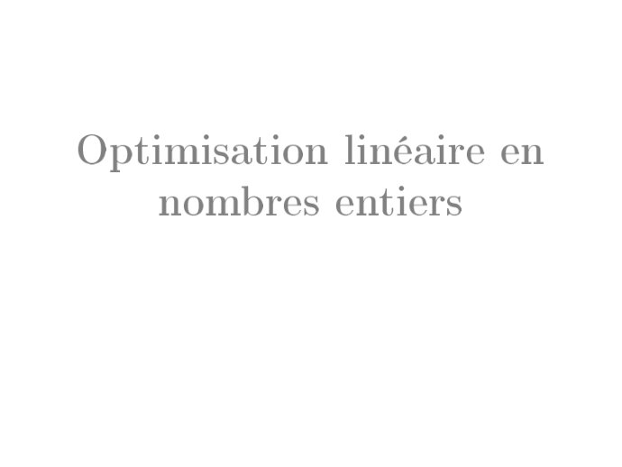

~~~text
Optimisation linéaire en

    nombres entiers
~~~

## Page 26

~~~text
                   1. Partie I-Optimisation linéaire   Optimisation linéaire en nombres entiers

Motivation et Applications
  1   Motivation
          Beaucoup de situations réelles, certaines décisions doivent être entières
          (par exemple, on ne peut pas produire 2,7 voitures, ni embaucher 3,4
          employés)
          Certaines décisions sont binaires (0 ou 1) (par exemple: oui ou non,
          absence ou présente,...)
          PLNE (programmation linéaire en nombres entiers) Modéliser des
          décisions discrètes impossibles avec la PL continue.
  2   Applications
          Planication de production et gestion d'entrepôt
          Optimisation des transports et logistique (Problème du voyageur de
          commerce)
          Décisions stratégiques d'investissement
          Télécommunications et réseaux
          ...

                                                                                                  26 / 84
~~~

## Page 27

~~~text
                1. Partie I-Optimisation linéaire   Optimisation linéaire en nombres entiers

Quelques dénitions
 Problème relaxé (P̄ ) est le problème quand on enlève les conditions
 xi ∈ N
 Matrice totalement unimodulaire si et seulement si le déterminant de
 toute sous-matrice carrée de A est un élément de {−1, 0, 1}.

Theorem
Si A est totalement unimodulaire et b est à composantes entières, alors
tout sommet optimum de (P̄ ) est un optimum de (P).

Exemple
                                                                       
                                                                       
                                                                       
                                                                        x1 ≤ 1
                                                                       
                                                                        x ≤1
                                                                          2
      Maximiser x1 + x2              sous les contraintes
                                                                        x1 + x2 ≤ 1
                                                                       
                                                                       
                                                                       
                                                                        x ,x ∈ N
                                                                          1 2
                                                                                               27 / 84
~~~

## Page 28

~~~text
                1. Partie I-Optimisation linéaire   Optimisation linéaire en nombres entiers

Méthode des coupes - Gomory 1958
Idée: coupe le polyèdre et se rapproche de la solution optimale entière
Exemple 2
                                                                       
                                                                        −x1 + 3x2 ≤ 6
                                                                       
    Maximiser 7x1 + 9x2              sous les contraintes                7x1 + x2 ≤ 35
                                                                       
                                                                         x1 , x2 ∈ N
                                                                       

Résoudre problème relaxe,
       x1     x2 y1 y2                                     x1 x2   y1 y2
    f   7      9 0 0 0    f                                10 0   −3 0 −18
                        → x                             −1/3 1
    y1 −1     3   1 0 6     2                                     1/3 0  2
    y2  7      1 0 1 35   y2                            22/3   0 −1/3 1 33
                           x1 x2    y1     y2
                   f        0 0 −28/11 −15/11 −63
                   x2       0 1   7/22   1/22 7/2
                   x1       1 0 −1/22    3/22 9/2                                              28 / 84
~~~

## Page 29

~~~text
               1. Partie I-Optimisation linéaire   Optimisation linéaire en nombres entiers

Méthode des coupes - Gomory 1958
Comme x∗1 , x∗2 ∈
                / N, on coupe selon x2 pour obtenir
                     x1 x2    y1     y2 γ 1
               f      0 0 −28/11 −15/11 0 −63
               x2     0 1   7/22   1/22 0 7/2
               x1     1 0 −1/22    3/22 0 9/2
               γ1     0 0 −7/22 −1/22 1 −1/2

Here a4,k ← −{a2,k }. Maintenant min{ −28/11       −15/11   −28/11
                                          −7/22 , −1/22 } = −7/22 donc y1
devient une variable de la base à la place de γ1 ,
                          x1 x2 y1 y2   γ1
                    f      0 0 0 −1    −8 −59
                    x2     0 1 0    0    1   3
                    x1     1 0 0 1/7 −1/7 32/7
                    y1     0 0 1 1/7 −22/7 11/7
                                                                                              29 / 84
~~~

## Page 30

~~~text
                 1. Partie I-Optimisation linéaire   Optimisation linéaire en nombres entiers

Méthode de coupes (suite)
Comme x1 ∈
         / N, on coupe selon x1 , pour obtenir
                      x 1 x 2 y1                 y2    γ1 γ2
                f      0 0 0                    −1    −8 0 −59
                x2     0 1 0                      0     1 0   3
                x1     1 0 0                    1/7 −1/7 0 32/7
                y1     0 0 1                    1/7 −22/7 0 11/7
                γ2     0 0 0                  -1/7   −6/7 1 −4/7

                            x1 x2 y1 y2 γ1 γ2
                     f       0 0 0 0 −2 −7 −55
                     x2      0 1 0 0     1  0 3
                     x1      1 0 0 0 −1     1 4
                     y1      0 0 1 0 −4     1 1
                     y2      0 0 0 1     6 −7 4
Alors nous avons (x∗1 , x∗2 ) = (4, 3) et f = 55.
                                                                                                30 / 84
~~~

## Page 31

~~~text
               1. Partie I-Optimisation linéaire   Optimisation linéaire en nombres entiers

Pratique
[Examen 24-25] Résoudre le problème en utilisant la méthode de coupes
                       
                       
                       
                         max      20x1 + 30x2
                       
                       
                       
                       
                                x1 + 2x2 ≤ 20
                       
                                x + x ≤ 12    1      2
                              
                              
                                           5x1 + x2 ≤ 40
                              
                              
                              
                              
                                           2x1 + x2 ≤ 11
                              
                                           x1 , x2 ∈ N

                                                                                              31 / 84
~~~

## Page 32

~~~text
           1. Partie I-Optimisation linéaire   Optimisation linéaire en nombres entiers

Pratique

                                                                                          32 / 84
~~~

## Page 33

~~~text
                   1. Partie I-Optimisation linéaire   Optimisation linéaire en nombres entiers

Séparation et évaluation (Branch and bound )
On choisit une coordonnée non entière x̄i de x̄, optimum du problème
relaxé de (P ), puis on construit les sous-problèmes (P − ) et (P + ) dénis
par :
                                                                
               maxn (c | x)
              x∈R
              
                                                                  maxn (c | x)
                                                                 x∈R
                                                                 
     (P − )    Ax ≤ b,       x ≤ ⌊x̄i ⌋,          et (P + )        Ax ≤ b,        x ≥ ⌈x̄i ⌉ + 1,
                                                                
              x ∈ Nn
                                                                x ∈ Nn
                                                                 

Exemple

Considérons le problème (P )
                  
                  
                   max (3x1 + 5x2 )
                  
                  x + 2x ≤ 3
                                                   et f : (x1 , x2 ) 7→ 3x1 + 5x2 .
                     1      2
                  6x1 + 8x2 ≤ 15
                  
                  
                    x1 , x2 ∈ N
                  

L'optimum de son problème relaxé est
                                    3 3
                                               et f (x̄) = 33
                                          
                            x̄ =     ,
                                    2 4                    4
                                                              = 8, 25.
                                                                                                    33 / 84
~~~

## Page 34

~~~text
               1. Partie I-Optimisation linéaire        Optimisation linéaire en nombres entiers

Exemple séparation (suite)
Eectuons une séparation basée sur la première coordonnée. On obtient
alors les deux sous-problèmes :

                                                                       
            
            max (3x1 + 5x2 )                                           
                                                                        max (3x1 + 5x2 )
                                                                       
            x1 + 2x2 ≤ 3                                               x1 + 2x2 ≤ 3
            
                                                                       
                                                                        
                                                                       
   (P − )    6x1 + 8x2 ≤ 15                        et      (P + )        6x1 + 8x2 ≤ 15
                                                                       
             x1 ≤ 1                                                      x1 ≥ 2
            
                                                                       
                                                                        
            
                                                                       
                                                                        
                                                                       
             x1 , x2 ∈ N                                                 x1 , x2 ∈ N
                                                                       

On résout les problèmes relaxés de ces deux sous-problèmes :
     x̄− = (1, 1) et f (x̄− ) = 8 ;
     x̄+ = 2, 38 et f (x̄+ ) = 638 = 7,875.
                

Donc on en déduit que x̄ est à coordonnées entières et constitue un
                           −

meilleur candidat.
                                                                                                   34 / 84
~~~

## Page 35

~~~text
             1. Partie I-Optimisation linéaire   Optimisation linéaire en nombres entiers

Détail calculs problème relaxé

                 L'optimum de son problème relaxé est

                 x̄ = 32 , 34   et f (x̄) = 8 14 = 8, 25.
                              

                                                                                            35 / 84
~~~

## Page 36

~~~text
             1. Partie I-Optimisation linéaire   Optimisation linéaire en nombres entiers

Solution (P− )

                   Solution x̄− = (1, 1) et f (x̄− ) = 8

                                                                                            36 / 84
~~~

## Page 37

~~~text
            1. Partie I-Optimisation linéaire   Optimisation linéaire en nombres entiers

Solution (P+ ), méthode deux phases

                                                                                           37 / 84
~~~

## Page 38

~~~text
               1. Partie I-Optimisation linéaire   Optimisation linéaire en nombres entiers

Arborescence

                                    Optimum: ( 32 , 43 )
                                     Valeur: 8.25
                          x1 ≤ 1                            x1 ≥ 2

        Optimum: (1,1)                                          Optimum: (2, 83 )
          Valeur: 8                                              Valeur: 7.875

                                                                                              38 / 84
~~~

## Page 39

~~~text
                 1. Partie I-Optimisation linéaire   Optimisation linéaire en nombres entiers

Résumé partie Optimisation linéaire
  1   Méthode géométrique (n=2)
  2   Méthode des tableaux (simplex)
  3   Méthode deux phases
  4   Dualié
  5   Optimisation linéaire nombre entière
          Coupes
          Séparation

                                                                                                39 / 84
~~~

## Page 40

~~~text
             2. Partie II-Optimisation non-linéaire

Table of Contents
1   Partie I-Optimisation linéaire
      Méthode géométrique
      (pour n = 2)
      Algorithme du simplexe (George Dantzig, 1947)
      Dualité
      Optimisation linéaire en nombres entiers
        Méthode des coupes - Gomory 1958
        Séparation et évaluation (Branch and bound )

2   Partie II-Optimisation non-linéaire
      Forme quadratique et convexité
      Résultats d'existence et d'unicité (P C) minx∈K f (x)
      Optimisation sans contraintes
      Optimisation avec contraintes égalités
      Optimisation avec contraintes d'inégalités

                                                              40 / 84
~~~

## Page 41

~~~text
Forme quadratique et

     convexité
~~~

## Page 42

~~~text
             2. Partie II-Optimisation non-linéaire   Forme quadratique et convexité

Forme quadratique
 Soient A une matrice symétrique d'ordre n, b ∈ Rn un vecteur et c ∈ R
 un réel.
 On dénit la forme quadratique f : Rn → R par :
                                                 1
                               f (x) = c + b⊤ x + x⊤ Ax
                                                 2

 Soit A ∈ Sn et b ∈ Rn .
      A est semi-dénie positive ( A ⪰ 0), lorsque :
      x⊤ Ax ≥ 0, ∀x ∈ Rn .
      A est dénie positive (A ≻ 0), lorsque :
      x⊤ Ax > 0, ∀x ∈ Rn \ {0}.

On note (λi )i≥1 ses valeurs propres réelles de A ∈ Sn .
      A ⪰ 0 ⇔ λi ≥ 0,             ∀i
      A ≻ 0 ⇔ λi > 0,             ∀i                                                   42 / 84
~~~

## Page 43

~~~text
                2. Partie II-Optimisation non-linéaire   Forme quadratique et convexité

Exemple forme quadratique, matrice dénit positive
  1   f (x) = 4 − x1 + 2x2 + x21 + x1 x2 + 32 x22 ici

                                                        1
                                      f (x) = c + b⊤ x + x⊤ Ax
                                                        2
      avec                                                       
                                 2 1                              −1
                             A=        ,                 b=           ,       c=4
                                 1 3                              2
  2
                                        
                                   2 1 0
                              A = 1 2 0 est dénit positive
                                   0 0 1

             Calculer les valeurs propres
             Montrer par la dénition

                                                                                          43 / 84
~~~

## Page 44

~~~text
            2. Partie II-Optimisation non-linéaire   Forme quadratique et convexité

Optimum de forme quadratique

 Theorem
 Soit A ∈ Sn dénie positive, et b ∈ Rn , et soit f la forme quadratique
 associée, dénie par :
                                       1
                                f (x) = x⊤ Ax + b⊤ x + c.
                                       2
 Soit x̂ le vecteur (unique) vériant Ax̂ = b. Alors x̂ réalise le minimum de
 f , c'est-à-dire :
                           f (x̂) ≤ f (x), ∀x ∈ Rn .

Appliquons sur exemple précédent.

                                                                                      44 / 84
~~~

## Page 45

~~~text
             2. Partie II-Optimisation non-linéaire   Forme quadratique et convexité

Convexité
 Un ensemble K ⊂ Rn est dit convexe si

                 ∀(x, y) ∈ K 2 , ∀λ ∈ [0, 1]λx + (1 − λ)y ∈ K.

      L'intersection d'un nombre quelconque d'ensembles convexes est
      convexe.
      La réunion de deux parties convexes n'est pas en général convexe.
Exemple
 1   Rn et ∅ sont des convexes.
 2   Sur R, les intervalles sont des convexes.
 3   [1, 2] ∪ [3, 5] non convexe

                                                                                       45 / 84
~~~

## Page 46

~~~text
              2. Partie II-Optimisation non-linéaire   Forme quadratique et convexité

Fonction convexe
Soit f : Ω → R ici Ω ⊂ Rn convexe. On dit f convexe si et seulement si :
 ∀(x, y) ∈ Ω2 , ∀α ∈ [0, 1],              f (αx + (1 − α)y) ≤ αf (x) + (1 − α)f (y).

  1   Si l'inégalité est stricte pour tout x ̸= y , on dit que f est strictement
      convexe
  2   On dit que f est concave lorsque −f est convexe.

                                                 8 f (x)
                                                 6
                                                 4
                                                 2
                                                                          x
                                 −2                                 2
                                                                                        46 / 84
~~~

## Page 47

~~~text
            2. Partie II-Optimisation non-linéaire   Forme quadratique et convexité

Propriétés et caractérisation fonction convexe
 Soit f : R → R une fonction deux fois dérivable. Alors f est convexe si
 et seulement si f ” ≥ 0.
Exemple
     f (x) = x2
     f (x) = sin(x) + 0.2x
 Soit Ω un convexe et f : Ω → R. Soit (x, y) ∈ Ω2 . On dénit la fonction
 :                                                    
                 g : [0, 1] → R, t 7→ f tx + (1 − t)y .
 Alors, g est convexe sur [0, 1], pour tout (x, y) ∈ Ω2 si et seulement si
 f est convexe sur Ω.

 Toute combinaison linéaire de fonctions convexes (à coecients positifs)
 est une fonction convexe

                                                                                      47 / 84
~~~

## Page 48

~~~text
             2. Partie II-Optimisation non-linéaire   Forme quadratique et convexité

Rappels de calcul diérentiel
Soit une fonction f : Rn → R, une fonction deux fois diérentiable.
 le gradient de f , noté ∇f ou grad f , est le vecteur des dérivées partielles
 :
                                                                                ⊤
                                                      ∂f ∂f         ∂f
              ∇f (x1 , x2 , . . . , xn ) =               ,    ,...,
                                                      ∂x1 ∂x2       ∂xn

 la matrice hessienne est dénie par :
                                                       ∂2f 
                               Hf = ∇2 f =
                                                       ∂xi ∂xj ij

Exemple f (x, y, z) = x2 + 3xy − 2z 3 .
                                                                                
                                                                        2 3  0
  ∇f (x, y, z) = (2x + 3y, 3x, −6z 2 )⊤                    Hf = ∇2 f = 3 0  0 
                                                                        0 0 −12z
                                                                                       48 / 84
~~~

## Page 49

~~~text
            2. Partie II-Optimisation non-linéaire   Forme quadratique et convexité

Caractérisation de la convexité en termes du gradient
 Soit f : K ⊂ Rn → R une fonction une fois diérentiable. Alors, f est
 convexe si et seulement si :

             f (y) ≥ f (x) + ∇f (x)⊤ (y − x),                     ∀(x, y) ∈ K 2
 f est strictement convexe si l'inégalité est stricte pour tout x ̸= y.
L'interprétation géométrique quand n = 1?
                       8
                           f (x)

                                        f (x) = ex
                                    Tangente en x = 0
                       6

                       4

                       2

                           x=0

                                                       x                              49 / 84
~~~

## Page 50

~~~text
            2. Partie II-Optimisation non-linéaire   Forme quadratique et convexité

Caractérisation de la convexité en termes du hessien
 Soit Ω ⊂ Rn convexe et f : Ω → R une fonction deux fois diérentiable
 (f ∈ C 2 ), alors
      f est convexe si et seulement si ∇2 f (x) ≥ 0, ∀x ∈ Ω
      strictement convexe si et seulement si ∇2 f (x) > 0, ∀x ∈ Ω.

Corollaire
Soit f une forme quadratique dénie par :
                                     1
                              f (x) = x⊤ Ax + b⊤ x + c,
                                     2
alors f est convexe si et seulement si A ⪰ 0, et strictement convexe si et
seulement si A ≻ 0.

                                                                                      50 / 84
~~~

## Page 51

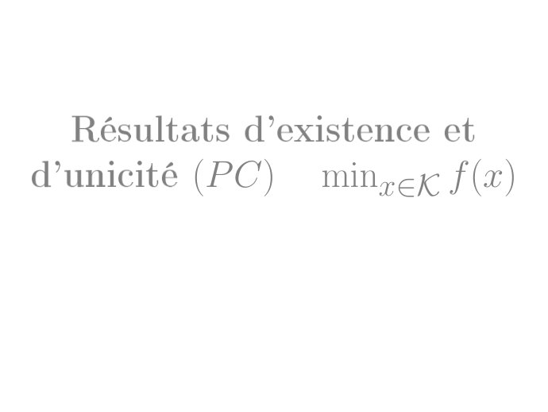

~~~text
  Résultats d'existence et

d'unicité   (P C)   minx∈K f (x)
~~~

**Lecture OCR à contrôler**

~~~text
Résultats d'existence et
d’unicité (PC) minzex f(x)
~~~

## Page 52

~~~text
            2. Partie II-Optimisation non-linéaire   Résultats d'existence et d'unicité (P C)   minx∈K f (x)

Existence solution dans le cas compact
 Un ensemble K ∈ Rn est dit compact si, de toute suite {xk }, où
 xk ∈ K, ∀k , on peut extraire une sous-suite convergente. K ∈ Rn est
 compact si et seulement si il est fermé et borné.
 Soit K ⊂ Rn compact. Si f : K → R est continue alors le problème
 minx∈K f (x) admet une solution optimale x̂ ∈ K , qui vérie :

                               f (x̂) ≤ f (x),          ∀x ∈ K.

 Soit f : Rn → R une fonction continue sur Rn . Si

                                      lim f (x) = +∞,
                                   ∥x∥→∞

  alors le problème minx∈K f (x) admet une solution optimale x̂ ∈ Rn .
Preuve Soit x0 ∈ Rn . il existe M > 0 tel que :
∀∥x∥ > M ⇒ f (x) > f (x0 ). problème :min∥x∥≤M f (x) admet une
solution car la boule {x ∈ Rn : ∥x∥ ≤ M } est compacte.                                                52 / 84
~~~

## Page 53

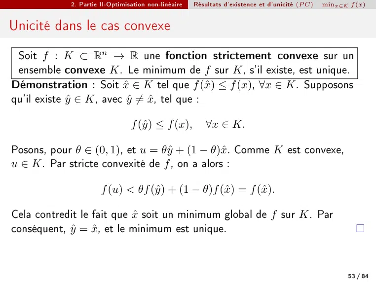

~~~text
            2. Partie II-Optimisation non-linéaire   Résultats d'existence et d'unicité (P C)   minx∈K f (x)

Unicité dans le cas convexe
 Soit f : K ⊂ Rn → R une fonction strictement convexe sur un
 ensemble convexe K . Le minimum de f sur K , s'il existe, est unique.
Démonstration : Soit x̂ ∈ K tel que f (x̂) ≤ f (x), ∀x ∈ K . Supposons
qu'il existe ŷ ∈ K , avec ŷ ̸= x̂, tel que :

                                f (ŷ) ≤ f (x),          ∀x ∈ K.

Posons, pour θ ∈ (0, 1), et u = θŷ + (1 − θ)x̂. Comme K est convexe,
u ∈ K . Par stricte convexité de f , on a alors :

                      f (u) < θf (ŷ) + (1 − θ)f (x̂) = f (x̂).

Cela contredit le fait que x̂ soit un minimum global de f sur K . Par
conséquent, ŷ = x̂, et le minimum est unique.

                                                                                                       53 / 84
~~~

## Page 54

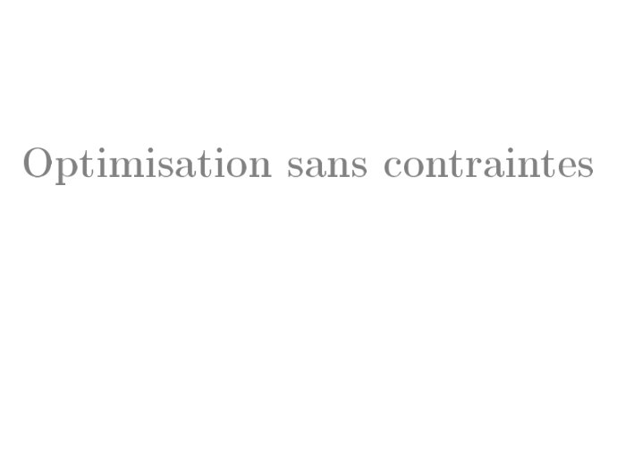

~~~text
Optimisation sans contraintes
~~~

## Page 55

~~~text
             2. Partie II-Optimisation non-linéaire   Optimisation sans contraintes

Point critique
 Soit f : Rn → R une fonction diérentiable sur Rn . Un point x∗ ∈ Rn
 vériant ∇f (x∗ ) = 0 est appelé un point critique.
Exemple Soit la fonction f : R2 → R dénie par :
                                 f (x, y) = x2 + xy + y 2 .

On cherche les points critiques, c'est-à-dire les points où le gradient
s'annule :                              ! 
                                     ∂f               
                                     ∂x        2x + y
                    ∇f (x, y) = ∂f =                    .
                                     ∂y
                                               x + 2y
On résout le système :
                            (                           (
                             2x + y = 0                  x=0
                                                      ⇒
                             x + 2y = 0                  y=0

Conclusion : le seul point critique est (0, 0).
                                                                                      55 / 84
~~~

## Page 56

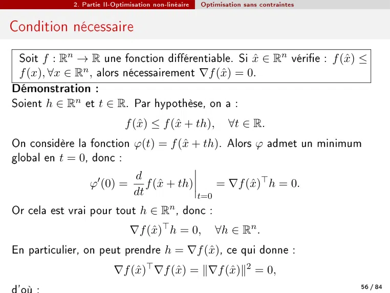

~~~text
            2. Partie II-Optimisation non-linéaire   Optimisation sans contraintes

Condition nécessaire
 Soit f : Rn → R une fonction diérentiable. Si x̂ ∈ Rn vérie : f (x̂) ≤
 f (x), ∀x ∈ Rn , alors nécessairement ∇f (x̂) = 0.
Démonstration :
Soient h ∈ Rn et t ∈ R. Par hypothèse, on a :
                            f (x̂) ≤ f (x̂ + th),            ∀t ∈ R.
On considère la fonction φ(t) = f (x̂ + th). Alors φ admet un minimum
global en t = 0, donc :
                               d
                 φ′ (0) =         f (x̂ + th)     = ∇f (x̂)⊤ h = 0.
                               dt             t=0
Or cela est vrai pour tout h ∈ Rn , donc :
                              ∇f (x̂)⊤ h = 0,            ∀h ∈ Rn .
En particulier, on peut prendre h = ∇f (x̂), ce qui donne :
                         ∇f (x̂)⊤ ∇f (x̂) = ∥∇f (x̂)∥2 = 0,
                                                                                     56 / 84
~~~

## Page 57

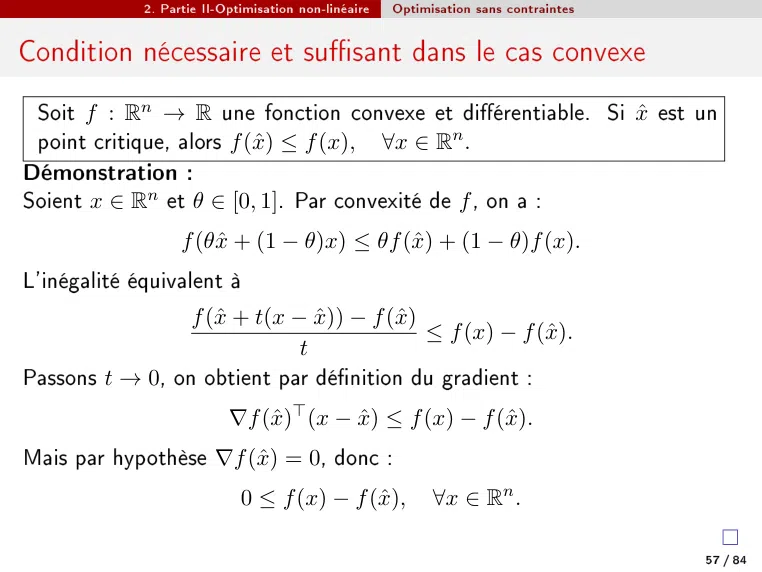

~~~text
             2. Partie II-Optimisation non-linéaire   Optimisation sans contraintes

Condition nécessaire et susant dans le cas convexe
 Soit f : Rn → R une fonction convexe et diérentiable. Si x̂ est un
 point critique, alors f (x̂) ≤ f (x), ∀x ∈ Rn .
Démonstration :
Soient x ∈ Rn et θ ∈ [0, 1]. Par convexité de f , on a :
                   f (θx̂ + (1 − θ)x) ≤ θf (x̂) + (1 − θ)f (x).
L'inégalité équivalent à
                 f (x̂ + t(x − x̂)) − f (x̂)
                                             ≤ f (x) − f (x̂).
                              t
Passons t → 0, on obtient par dénition du gradient :
                           ∇f (x̂)⊤ (x − x̂) ≤ f (x) − f (x̂).
Mais par hypothèse ∇f (x̂) = 0, donc :
                             0 ≤ f (x) − f (x̂),            ∀x ∈ Rn .

                                                                                      57 / 84
~~~

## Page 58

~~~text
            2. Partie II-Optimisation non-linéaire   Optimisation sans contraintes

Cas non convexe, optimum local
 On dit que x⋆ ∈ Rn est un minimum local de f s'il existe ε > 0 tel
 que :
            f (x⋆ ) ≤ f (x), ∀x ∈ Rn tel que ∥x − x⋆ ∥ ≤ ε.

 Soit f : Rn → R une fonction deux fois diérentiable. Si :

                         ∇f (x⋆ ) = 0 et ∇2 f (x⋆ ) ≻ 0,

 alors x⋆ est un minimum local de f .
Démonstration :
Par développement de Taylor à l'ordre 2, ∀h ∈ Rn et t ∈ R, on a :
                                                        t2 ⊤ 2
   f (x⋆ + th) = f (x⋆ ) + t∇f (x⋆ )⊤ h +                 h ∇ f (x⋆ )h + t2 ∥h∥2 ε(th),
                                                        2
Puisque ∇f (x⋆ ) = 0, donc
           f (x⋆ + th) − f (x⋆ )  1
                     2
                                 = h⊤ ∇2 f (x⋆ )h + ∥h∥2 ε(th).
                    t             2                                                   58 / 84
~~~

## Page 59

~~~text
              2. Partie II-Optimisation non-linéaire   Optimisation sans contraintes

Résumer pour le TD, Critères du second ordre
Soit f : Rn → R une fonction dans C 2 , et soit x ∈ Rn un point critique
∇f (x) = 0. On note Hf (x) = ∇2 f (x). Alors :
  1   Si Hf (x) est dénie positive, alors f est localement convexe en x,
      et x est un minimum local.
  2   Si Hf (x) est dénie négative, alors f est localement concave en x,
      et x est un maximum local.
  3   Si Hf (x) est non dénie (i.e. ni positive ni négative), alors x est un
      point selle.
  4   Si Hf (x) est semi-dénie positive ou semi-dénie négative, alors
      aucune conclusion locale ne peut être tirée à partir du second ordre
      uniquement. Une analyse plus ne est nécessaire (ordre supérieur,
      étude géométrique...).

                                                                                       59 / 84
~~~

## Page 60

~~~text
             2. Partie II-Optimisation non-linéaire   Optimisation sans contraintes

Exemple concrète
Étude de la fonction f2 (x, y) = x3 + 3x2 y − 15x − 12y
                                 
                        ∂f2 ∂f2
                                    = 3x2 + 6xy − 15, 3x2 − 12
                                                               
        ∇f2 (x, y) =         ,
                         ∂x ∂y
On cherche les solutions du système :
                         (
                           3x2 + 6xy − 15 = 0
                                    3x2 − 12 = 0

Donc, les points critiques sont : (2, 41 )                et    (−2, − 41 )
On calcule la matrice hessienne :
                                      ∂2f         ∂2f
                                                         !                
                                      ∂x2        ∂x∂y           6x + 6y 6x
               Hf (x, y) =            ∂2f         ∂2f        =
                                                                  6x     0
                                     ∂y∂x         ∂y 2

Les deux points critiques (2, 41 ) et (−2, − 14 ) sont des points selles.
                                                                                      60 / 84
~~~

## Page 61

~~~text
Optimisation avec contraintes

          égalités
~~~

## Page 62

~~~text
            2. Partie II-Optimisation non-linéaire   Optimisation avec contraintes égalités

Contraintes égalités linéaire
On considère                         (
                                            minx∈Rn f (x)
                                            Ax − b = 0
où Ap×n avec p < n, et b ∈ Rp . On note l'ensemble des points admissibles
:
                     S = {x ∈ Rn | Ax − b = 0}.
 Un vecteur d ∈ Rn est une direction admissible en un point x ∈ S s'il
 existe δ > 0 tel que :

                             x + td ∈ S,             ∀t ∈ [−δ, δ].

Dans notre cas, puisque x ∈ S , on a :
                    A(x + td) − b = Ax + tAd − b = tAd.
Donc x + td ∈ S ⇔ Ad = 0.
Autrement dit, les directions admissibles = ker A.                                            62 / 84
~~~

## Page 63

~~~text
                    2. Partie II-Optimisation non-linéaire       Optimisation avec contraintes égalités

  Soit x̂ ∈ S tel que f (x̂) ≤ f (x), ∀x ∈ S.
  Alors il existe nécessairement un vecteur λ ∈ Rp tel que :

                                            ∇f (x̂) + A⊤ λ = 0.

  Si, de plus, la matrice A est de rang p, alors λ est unique.
Démonstration
Soit d une direction admissible, donc d ∈ ker A. Pour tout t ∈ R, on a :

                                                   f (x̂) ≤ f (x̂ + td),

ce qui implique :

                    f (x̂ + td) − f (x̂)                         f (x̂ + td) − f (x̂)
                                           ≥0   pour t > 0,                             ≤0   pour t < 0.
                             t                                             t

En faisant tendre t → 0, on obtient :

                                                                 ⊥             ⊤
                                            ∇f (x̂) ∈ (ker A)        = Im(A ).

Cela prouve le résultat d'existence.
Pour l'unicité, supposons qu'il existe deux vecteurs λ1 et λ2 tels que :

                                                             ⊤             ⊤
                                            ∇f (x̂) = −A λ1 = −A λ2 .

Alors :
                                                    ⊤
                                                  A (λ1 − λ2 ) = 0,
ce qui implique λ1 − λ2 = 0 si A est de rang p, donc λ1 = λ2 . Cela montre l'unicité de λ.

                                                                                                           63 / 84
~~~

## Page 64

~~~text
             2. Partie II-Optimisation non-linéaire   Optimisation avec contraintes égalités

Contraintes inégalité non linéaire
                                                      
                                                      h1 (x) = 0
                                                      
                                                        .
                                                      
          (P CE)        min f (x) sous les contraintes ..
                        x∈Rn                          
                                                      
                                                      h (x) = 0
                                                                              p
On suppose que h est diérentiable, avec :
                    h : Rn → Rp ,             x 7→ (h1 (x), . . . , hp (x)).
 On dit que x̂ est un point régulier pour la contrainte h(x) = 0 si :
      h(x̂) = 0,
      Les vecteurs ∇hi (x̂) sont linéairement indépendants.
Exemple
                                                             (
                                                              x21 + x22 − 2 = 0
      min        f (x1 , x2 , x3 ) = x3 sous les contraintes
(x1 ,x2 ,x3 )∈R3                                              x1 + x2 + x3 = 0
Ici x̂ = (1, −1, 0) est un point régulier pour les contraintes.                                64 / 84
~~~

## Page 65

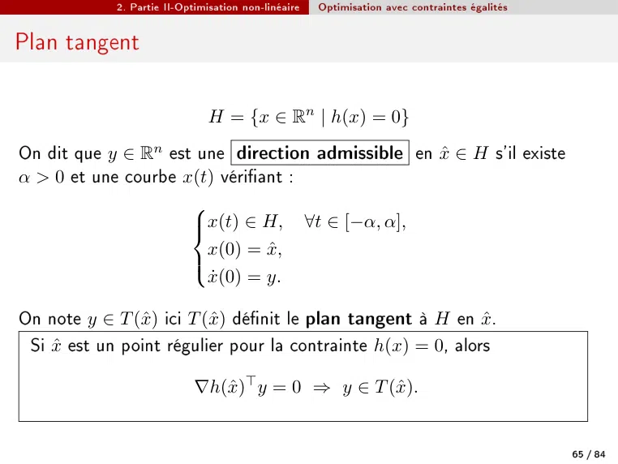

~~~text
            2. Partie II-Optimisation non-linéaire   Optimisation avec contraintes égalités

Plan tangent

                              H = {x ∈ Rn | h(x) = 0}
On dit que y ∈ Rn est une direction admissible en x̂ ∈ H s'il existe
α > 0 et une courbe x(t) vériant :
                     
                     x(t) ∈ H, ∀t ∈ [−α, α],
                     
                       x(0) = x̂,
                     
                       ẋ(0) = y.
                     

On note y ∈ T (x̂) ici T (x̂) dénit le plan tangent à H en x̂.
 Si x̂ est un point régulier pour la contrainte h(x) = 0, alors

                            ∇h(x̂)⊤ y = 0 ⇒ y ∈ T (x̂).

                                                                                              65 / 84
~~~

## Page 66

~~~text
              2. Partie II-Optimisation non-linéaire   Optimisation avec contraintes égalités

Exemple: point régulier et plan tangent
Revenons exemple précédent.
Caractérisons le plan tangent à x̂: Comme x̂ est un point régulier pour
la contrainte h(x) = 0 alors T (x̂) = ker(∇h(x̂)T ).

    Soity = (a, b, c), y ∈ T (x̂) ⇔ y ∈ ker(∇h(x̂)T ) ⇔ ∇h(x̂)T y = 03
                                                  
                                               a        
                                      2 −2 0            0
                                  ⇔                b =
                                      1 1 1               0
                                                   c
                                    
                                       2a − 2b = 0
                                  ⇔
                                       a+b+c=0
                                            ⇔ y ∈ Vect{(1, 1, −2)}

Conclusion:    T (x̂) = Vect{(1, 1, −2)}.

                                                                                                66 / 84
~~~

## Page 67

~~~text
            2. Partie II-Optimisation non-linéaire   Optimisation avec contraintes égalités

Théorème de Lagrange
 On appelle lagrangien associé au problème (PCE) la fonction
                                                                       p
                                                                       X
            L : Rn × Rp → R,                 (x, λ) 7→ f (x) +               λi hi (x)
                                                                       i=1

Soit x̂ un point régulier solution du problème (PCE), vériant :

                                f (x̂) ≤ f (x),          ∀x ∈ H
Alors il existe nécessairement un vecteur λ ∈ Rp unique vériant :
                                                       p
                                                       X
                  ∇x L(x̂, λ) ⇔ ∇f (x̂) +                     λi ∇hi (x̂) = 0
                                                        i=1

Les composantes du vecteur λ sont appelées multiplicateurs de
Lagrange.
                                                                                              67 / 84
~~~

## Page 68

~~~text
             2. Partie II-Optimisation non-linéaire   Optimisation avec contraintes égalités

Condition susent d'optimalité du 2nd ordre
Soit x̂ ∈ Rn , λ ∈ Rp vériant les conditions suivantes :
                            (
                              h(x̂) = 0,
                                       ∇x L(x̂, λ) = 0,

    y ⊤ ∇2xx L(x̂, λ)y > 0, ∀y ∈ T (x̂), y ̸= 0 alors x̂ est un minimum local
    y ⊤ ∇2xx L(x̂, λ)y < 0, ∀y ∈ T (x̂), y ̸= 0 alors x̂ est un maximum local
Example
                                                             (
                                                              x21 + x22 − 2 = 0
      min        f (x1 , x2 , x3 ) = x3 sous les contraintes
(x1 ,x2 ,x3 )∈R3                                              x1 + x2 + x3 = 0

Le lagrangien associé est

     L(x1 , x2 , x3 , λ1 , λ2 ) = x3 + λ1 (x21 + x22 − 2) + λ2 (x1 + x2 + x3 )
                                                                                               68 / 84
~~~

## Page 69

~~~text
               2. Partie II-Optimisation non-linéaire   Optimisation avec contraintes égalités

Exemple (suite)
  1   Condition nécessaire
                                      
                                        ∂L
                                      
                                       ∂x1
                                            = 2λ1 x1 + λ2 = 0
                                      
                                        ∂L
                                       ∂x2 = 2λ1 x2 + λ2 = 0
           (                          
                                                                                      (
                                      
            ∇x L(x̂, λ) = 0             ∂L
                                                                                           λ2 = −1
                                     ⇔ ∂x   = 1 + λ2 = 0                           ⇔
            h(x̂) = 0                    3                                                λ21 = 41
                                      h1 (x) = x21 + x22 − 2 = 0
                                      
                                      
                                      
                                      
                                       h2 (x) = x1 + x2 + x3 = 0
                                      

  2   Condition susante
           λ1 = 12 , λ2 = −1, x̂1 = (−1, −1, 2),
                            T (x̂1 ) = ker ∇h(x̂1 )⊤ = Vect {(1, −1, 0)}
                                                       
                                                               
                                                         −1 0 0
                                     ∇2xx L(x̂1 , λ) =  0 −1 0
                                                          0 0 0
           Donc x̂1 est un maximum local.
                 2 , λ2 = −1, x̂2 = (−1, 1, −2), ... est un minimum local
           λ1 = −1
                                                                                                      69 / 84
~~~

## Page 70

~~~text
Optimisation avec contraintes

         d'inégalités
~~~

**Lecture OCR à contrôler**

~~~text
Optimisation avec contraintes
d’inégalités
~~~

## Page 71

~~~text
            2. Partie II-Optimisation non-linéaire   Optimisation avec contraintes d'inégalités

Problème optimisation avec contraintes d'inégalités (PCI)
                                                  
                                                  g1 (x) ≤ 0
                                                  
                                                    .
                                                  
          (P CI) minn f (x) sous les contraintes : ..
                 x∈R                              
                                                  
                                                  g (x) ≤ 0
                                                                           m

On suppose que g est diérentiable, où :

                  g : Rn → Rm ,              x 7→ (g1 (x), . . . , gm (x)).

On note
                               K = {x ∈ Rn | g(x) ≤ 0}

                                                                                                  71 / 84
~~~

## Page 72

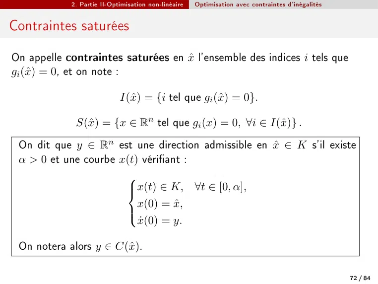

~~~text
            2. Partie II-Optimisation non-linéaire   Optimisation avec contraintes d'inégalités

Contraintes saturées
On appelle contraintes saturées en x̂ l'ensemble des indices i tels que
gi (x̂) = 0, et on note :

                            I(x̂) = {i tel que gi (x̂) = 0}.

             S(x̂) = {x ∈ Rn tel que gi (x) = 0, ∀i ∈ I(x̂)} .
 On dit que y ∈ Rn est une direction admissible en x̂ ∈ K s'il existe
 α > 0 et une courbe x(t) vériant :
                      
                      x(t) ∈ K, ∀t ∈ [0, α],
                      
                         x(0) = x̂,
                      
                         ẋ(0) = y.
                      

 On notera alors y ∈ C(x̂).

                                                                                                  72 / 84
~~~

## Page 73

~~~text
             2. Partie II-Optimisation non-linéaire   Optimisation avec contraintes d'inégalités

Lemme
Soit y ∈ Rn une direction admissible en x̂ ∈ K , alors on a nécessairement

                               ∇gi (x̂)⊤ y ≤ 0,            i ∈ I(x̂).

Démonstration :           Considérons une courbe x(t) dénie pour t ∈ [−α, α]
vériant               
                        x(t) ∈ K,              ∀t ∈ [−α, α], α > 0
                         x(0) = x̂,
                         ẋ(0) = y.
                       

Comme gi (x) < 0 pour i ∈  / I(x̂), on aura toujours gi (x(t)) < 0 pour t
susamment petit. Par contre, pour i ∈ I(x̂), on doit avoir gi (x(t)) ≤ 0
pour t susamment petit. Si on utilise le développement de Taylor de
gi (x(t)) en t = 0 on doit donc avoir
                           gi (x̂) + ∇gi (x̂)⊤ y t + ε(t) ≤ 0.
Puisque gi (x̂) = 0, il faut donc nécessairement que l'on ait
                                        ∇gi (x̂)⊤ y ≤ 0.
                                                                                                   73 / 84
~~~

## Page 74

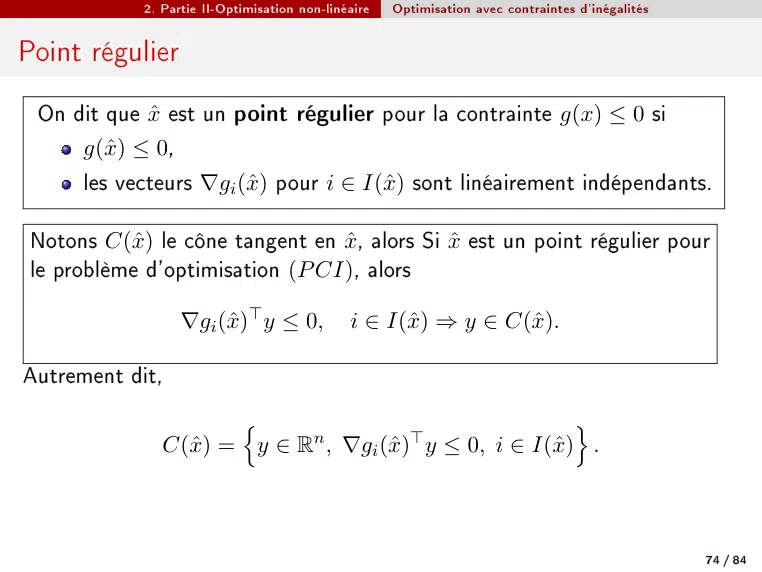

~~~text
             2. Partie II-Optimisation non-linéaire   Optimisation avec contraintes d'inégalités

Point régulier
 On dit que x̂ est un point régulier pour la contrainte g(x) ≤ 0 si
      g(x̂) ≤ 0,
      les vecteurs ∇gi (x̂) pour i ∈ I(x̂) sont linéairement indépendants.

 Notons C(x̂) le cône tangent en x̂, alors Si x̂ est un point régulier pour
 le problème d'optimisation (P CI), alors

                   ∇gi (x̂)⊤ y ≤ 0,            i ∈ I(x̂) ⇒ y ∈ C(x̂).

Autrement dit,
                       n                                   o
                C(x̂) = y ∈ Rn , ∇gi (x̂)⊤ y ≤ 0, i ∈ I(x̂) .

                                                                                                   74 / 84
~~~

## Page 75

~~~text
              2. Partie II-Optimisation non-linéaire   Optimisation avec contraintes d'inégalités

Exemple
On considère le problème suivante: optimiser

                f (x1 , x2 , x3 , x4 ) = 4x21 − 2x1 + 4x22 + x23 − x44
sous les contraintes :                (
                                       x23 ≤ 1 + x1 ,
                                       x4 ≤ 2 + 4x2 .
On met les contraintes sous la forme gi (x) ≤ 0
                  (
                    g1 (x1 , x2 , x3 , x4 ) = x23 − 1 − x1 ,
                          g2 (x1 , x2 , x3 , x4 ) = x4 − 2 − 4x2 .
On note :
                      K = {x ∈ R4 | g1 (x) ≤ 0, g2 (x) ≤ 0}.

                                                                                                    75 / 84
~~~

## Page 76

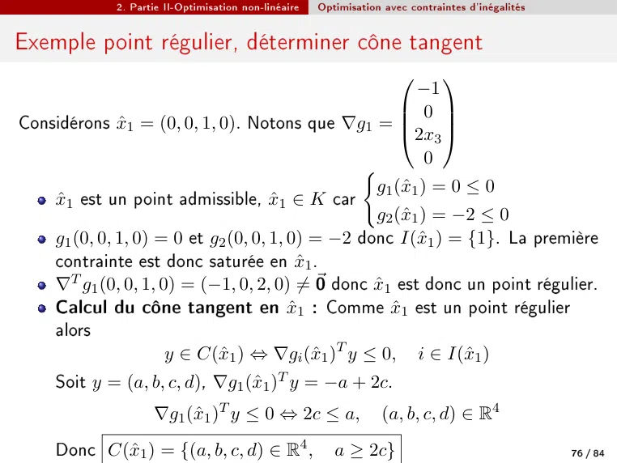

~~~text
             2. Partie II-Optimisation non-linéaire   Optimisation avec contraintes d'inégalités

Exemple point régulier, déterminer cône tangent
                                                                     
                                                          −1
                                                        0 
Considérons x̂1 = (0, 0, 1, 0). Notons que ∇g1 =      2x3 
                                                              

                                                            0
                                                 (
                                                   g1 (x̂1 ) = 0 ≤ 0
    x̂1 est un point admissible, x̂1 ∈ K car
                                                   g2 (x̂1 ) = −2 ≤ 0
    g1 (0, 0, 1, 0) = 0 et g2 (0, 0, 1, 0) = −2 donc I(x̂1 ) = {1}. La première
    contrainte est donc saturée en x̂1 .
    ∇T g1 (0, 0, 1, 0) = (−1, 0, 2, 0) ̸= ⃗0 donc x̂1 est donc un point régulier.
    Calcul du cône tangent en x̂1 : Comme x̂1 est un point régulier
    alors
                     y ∈ C(x̂1 ) ⇔ ∇gi (x̂1 )T y ≤ 0, i ∈ I(x̂1 )
     Soit y = (a, b, c, d), ∇g1 (x̂1 )T y = −a + 2c.
                    ∇g1 (x̂1 )T y ≤ 0 ⇔ 2c ≤ a,                   (a, b, c, d) ∈ R4
     Donc C(x̂1 ) = {(a, b, c, d) ∈ R4 ,                 a ≥ 2c}                                   76 / 84
~~~

## Page 77

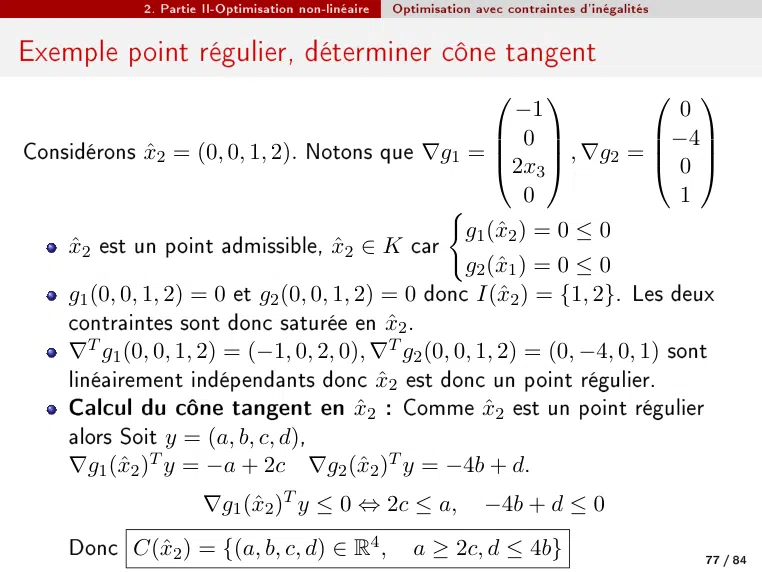

~~~text
             2. Partie II-Optimisation non-linéaire   Optimisation avec contraintes d'inégalités

Exemple point régulier, déterminer cône tangent
                                                                        
                                                          −1                0
                                                        0              −4
Considérons x̂2 = (0, 0, 1, 2). Notons que ∇g1 =      2x3  , ∇g2 =  0 
                                                                         

                                                            0               1
                                                 (
                                                   g1 (x̂2 ) = 0 ≤ 0
    x̂2 est un point admissible, x̂2 ∈ K car
                                                   g2 (x̂1 ) = 0 ≤ 0
    g1 (0, 0, 1, 2) = 0 et g2 (0, 0, 1, 2) = 0 donc I(x̂2 ) = {1, 2}. Les deux
    contraintes sont donc saturée en x̂2 .
    ∇T g1 (0, 0, 1, 2) = (−1, 0, 2, 0), ∇T g2 (0, 0, 1, 2) = (0, −4, 0, 1) sont
    linéairement indépendants donc x̂2 est donc un point régulier.
    Calcul du cône tangent en x̂2 : Comme x̂2 est un point régulier
    alors Soit y = (a, b, c, d),
    ∇g1 (x̂2 )T y = −a + 2c ∇g2 (x̂2 )T y = −4b + d.
                      ∇g1 (x̂2 )T y ≤ 0 ⇔ 2c ≤ a,                    −4b + d ≤ 0
     Donc C(x̂2 ) = {(a, b, c, d) ∈ R4 ,                 a ≥ 2c, d ≤ 4b}                           77 / 84
~~~

## Page 78

~~~text
              2. Partie II-Optimisation non-linéaire   Optimisation avec contraintes d'inégalités

Conditions nécessaires d'optimalité

Proposition
Soit x̂ une solution du problème (P CI). Il existe η > 0 tel que
∀x ∈ B(x̂, η), gi (x) < 0, ∀i ∈
                              / I(x̂). Alors x̂ est la solution du problème
                     (
                          min     f (x)
                              x∈B(x̂,η)
                                              gi (x) = 0,        i ∈ I(x̂)

Théorème (Conditions de Kuhn Tucker (du 1er ordre))
Soit x̂ ∈ K un point régulier solution du problème (P CI), alors il existe un
unique vecteur λ ∈ Rm vériant
                                   m
                     
                                  P
                     
                     
                     
                      ∇f  (x̂) +     λi ∇gi (x̂) = 0
                                              i=1
                           
                           λi ≥ 0, i = 1, . . . , m
                           
                           λ g (x̂) = 0, i = 1, . . . , m
                             i i
                                                                                                    78 / 84
~~~

## Page 79

~~~text
                   2. Partie II-Optimisation non-linéaire   Optimisation avec contraintes d'inégalités

Exemple Kuhn Tucker
Revenons exemple précédent : Optimiser
                     f (x1 , x2 , x3 , x4 ) = 4x21 − 2x1 + 4x22 + x23 − x44
sous les contraintes :
                 (
                   g1 (x1 , x2 , x3 , x4 ) = x23 − 1 − x1 ≤ 0
                           g2 (x1 , x2 , x3 , x4 ) = x4 − 2 − 4x2 ≤ 0.
Alors condition Kuhn Tucker, si x̂ ∈ K un point régulier, alors x̂ est
solution du système
                                                                            
                                                 8x1 − 2
                                                
                                                
                                                                   −1           0     0
                                                                              −4 0
                                                
           m
                                                 8x2 
                                                        
                                                                  0 
                                                                                  
                                                           + λ1       + λ2   =  
          P                                    
                                                
∇f (x̂) +   λi ∇gi (x̂) = 0
                                                  
                                                 2x3          −2x3        0  0
                                               
                                                
                                               
             i=1
  λi ≥ 0, i = 1, . . . , m                  ⇔         −1/4               0                        1      0
                                               
                                                  λ1 ≥ 0, λ2 ≥ 0

                                               
                                                
  λi gi (x̂) = 0, i = 1, . . . , m              
                                                
                                                  λ1 (x23 − 1 − x1 ) = 0
                                                
                                                
                                                
                                                
                                                
                                                
                                                λ (x − 2 − 4x ) = 0
                                                   2    4          2

Solution (λ1 , λ2 ) = (0, 1/4) et x̂ = (1/4, 1/8, 0, 5/2).                                               79 / 84
~~~

## Page 80

~~~text
              2. Partie II-Optimisation non-linéaire   Optimisation avec contraintes d'inégalités

Conditions susantes d'optimalité

Théorème (Condition susante du premier ordre (convexité))
Soit x̂ ∈ K et supposons qu'il existe λ̂ vériant les conditions de
KuhnTucker. Si
      la fonction objectif f est convexe / concave,
      les fonctions contraintes gi , i = 1, . . . , m sont convexes,
alors x̂ est une solution (minimum global/ maximum global) du problème
(PCI).

Revenons l'exemple précédent.
                                                        x4
  1 f (x1 , x2 , x3 , x4 ) = 4x21 − 2x1 + 4x22 + x23 − , f est une somme de
                                                         4
    fonctions convexes, donc f est convexe.
  2 g1 (x1 , x2 , x3 , x4 ) = x23 − 1 − x1 , g1 est donc convexe.
  3 g2 (x1 , x2 , x3 , x4 ) = x4 − 2 − 4x2 , g2 est ane, donc convexe.
                                         
                               1 1      5
On en déduit que x̂ =            , , 0,      est un minimum global.
                               4 8      2                                                           80 / 84
~~~

## Page 81

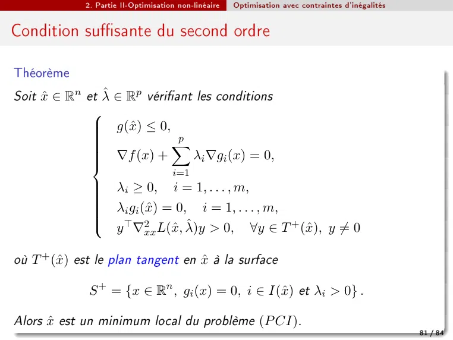

~~~text
             2. Partie II-Optimisation non-linéaire   Optimisation avec contraintes d'inégalités

Condition susante du second ordre

Théorème
Soit x̂ ∈ Rn et λ̂ ∈ Rp vériant les conditions
              
              
                  g(x̂) ≤ 0,
                              p
              
              
              
                             X
                   ∇f  (x) +    λi ∇gi (x) = 0,
              
              
              
              
                                     i=1
              
              
               λi ≥ 0, i = 1, . . . , m,
              
              
              
              
               λi gi (x̂) = 0, i = 1, . . . , m,
               y ⊤ ∇2 L(x̂, λ̂)y > 0, ∀y ∈ T + (x̂), y ̸= 0
              
                       xx

où T + (x̂) est le plan tangent en x̂ à la surface

              S + = {x ∈ Rn , gi (x) = 0, i ∈ I(x̂) et λi > 0} .

Alors x̂ est un minimum local du problème (P CI).
                                                                                                   81 / 84
~~~

## Page 82

~~~text
                2. Partie II-Optimisation non-linéaire   Optimisation avec contraintes d'inégalités

Exemple
Revenons problème optimiser
                       f (x1 , x2 , x3 , x4 ) = 4x21 − 2x1 + 4x22 + x23 − x44
sous les contraintes :
                        (
                         g1 (x1 , x2 , x3 , x4 ) = x23 − 1 − x1 ≤ 0
                         g2 (x1 , x2 , x3 , x4 ) = x4 − 2 − 4x2 ≤ 0.
                                                
             1 1     5                           1
  1   x̂ =    , , 0,     et (λ1 , λ2 ) = 0,          vériant Kuhn-Tucker.
             4 8     2                           4
                                                           +
  2   Calculons le plan tangent en x̂ à la surface S         :

                           S + = x ∈ R4 , gi (x̂) = 0, i ∈ I(x̂) et λi > 0
                                
                                                                 
                                                                1
                               = x ∈ R4 , g2 (x) = 0 et λ2 =
                                                                4
      Soit y = (a, b, c, d), y ∈ T + (x̂) donc y T ∇g2 (x̂) = 0 ⇔ d = 4b.
      Ainsi
                                 T + (x̂) = (a, b, c, 4b), (a, b, c) ∈ R3 .
                                          

  3   Calculons   ∇2xx L(x̂, λ̂) :
                                                                                                      82 / 84
~~~

## Page 83

~~~text
              2. Partie II-Optimisation non-linéaire   Optimisation avec contraintes d'inégalités

Exemple (suite)

                                                           x4 1
 L(x1 , x2 , x3 , x4 , 0, 14 ) = 4x21 − 2x1 + 4x22 + x23 −    + (x4 − 2 − 4x2 )
                                                            4  4
                                  
                      1 1        5
Rappelons x̂ =          , , 0,       ,
                      4 8        2
                                                          
                                                8 0 0 0
                                               0 8 0 0
                              ∇2xx L(x̂, λ̂) = 
                                               0 0 2 0
                                                           

                                                0 0 0 0
Soit y ∈ T + (x̂), y = (a, b, c, d), y ̸= 0
              y T ∇2xx L(x̂, λ̂)y = 8a2 + 8b2 + 2c2 > 0,                        ∀y ̸= 0
                                                                                              
                                                                                   1 1     5
D'après le théorème (condition susant du second ordre), x̂ =                       , , 0,          est un
                                                                                   4 8     2
minimum local du problème. On retrouve le résultat.
                                                                                                        83 / 84
~~~

## Page 84

~~~text
              2. Partie II-Optimisation non-linéaire   Optimisation avec contraintes d'inégalités

Résumé de PCI
  1   Mettre les contraintes sous formes gi (x) ≤ 0.
  2   Résoudre système de condition KuhnTucker
  3   Regarder si les fonctions (f , gi ) convexe/concave.
           Si oui, utiliser condition susante du 1er ordre
           Si non, utiliser condition susante du 2er ordre.
Les questions liées au ce chapitre:
      Vérier un point est régulier?
      Déterminer le cône tangent
      Résoudre problème optimisation

                                                                                                    84 / 84
~~~
