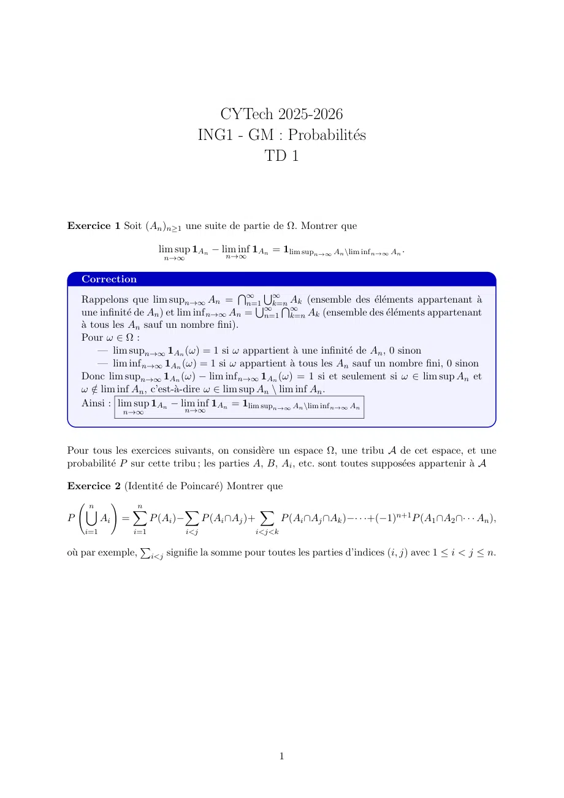
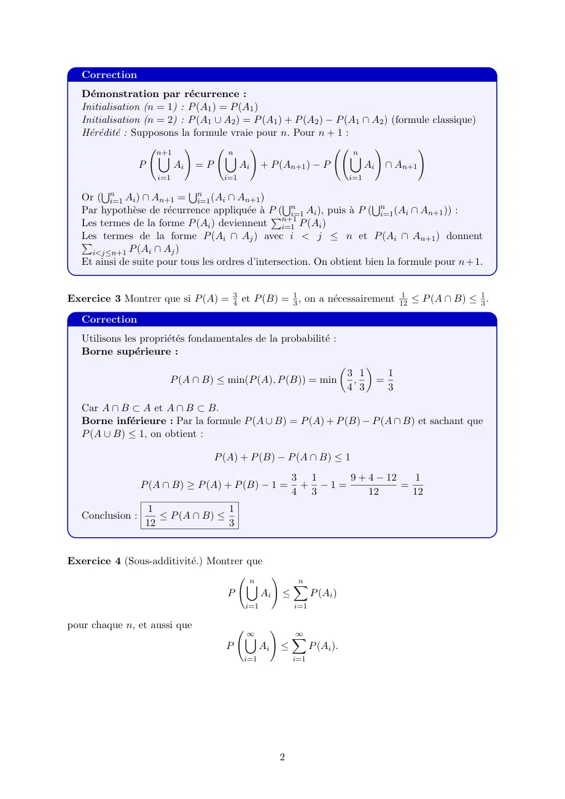
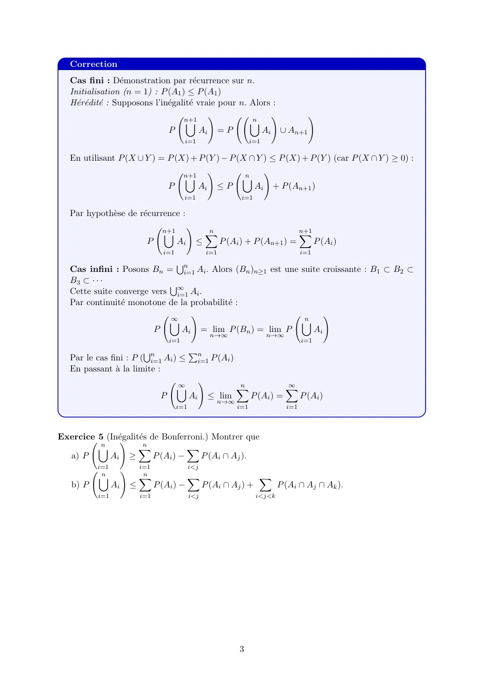
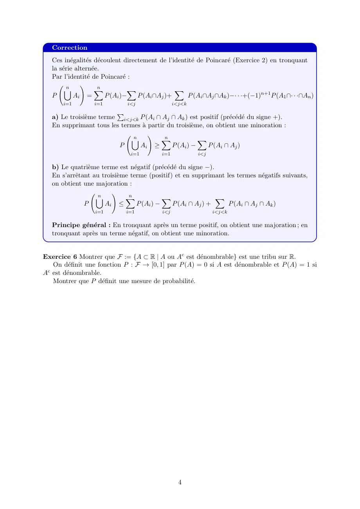
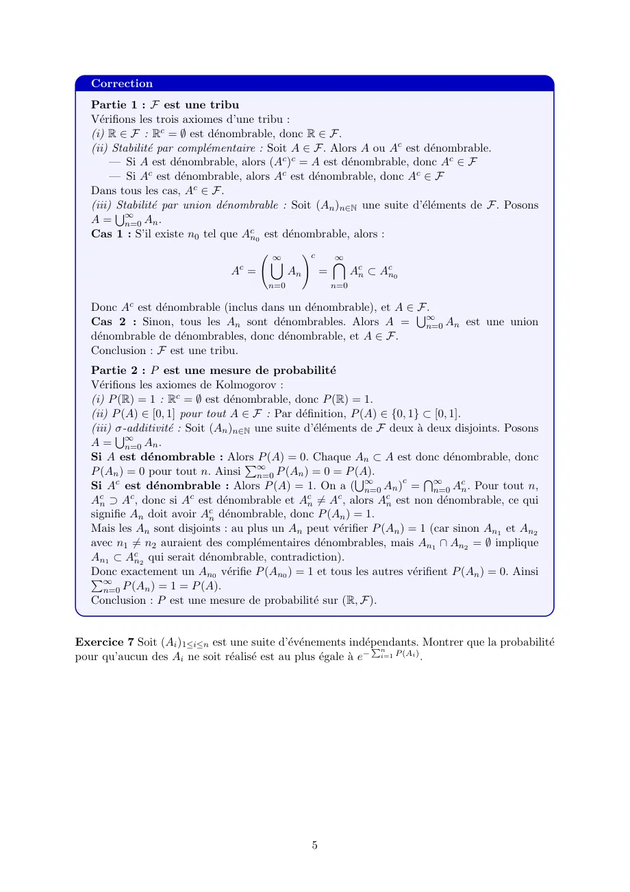
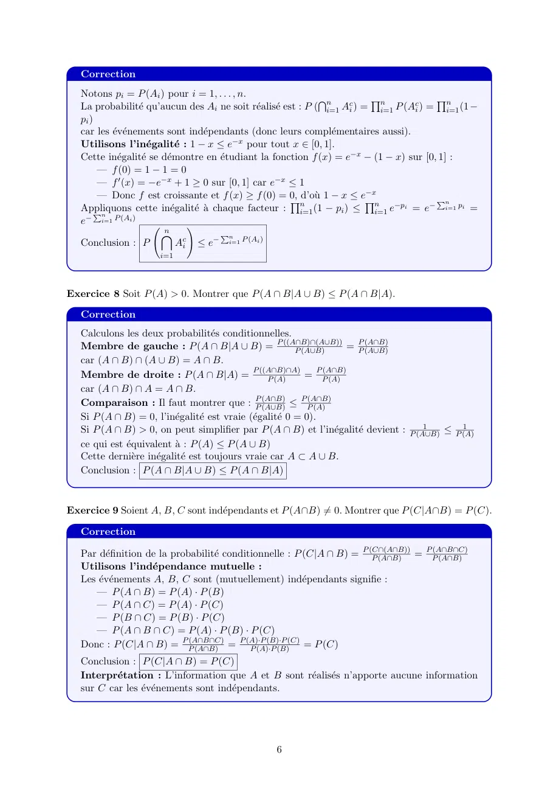
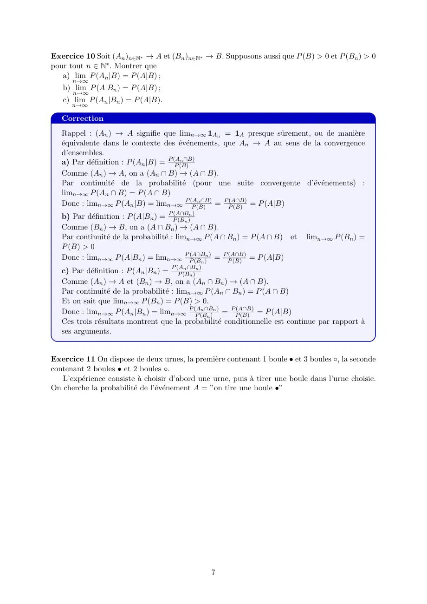
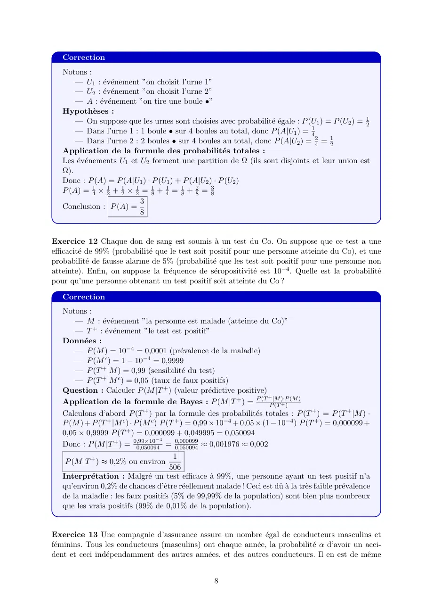
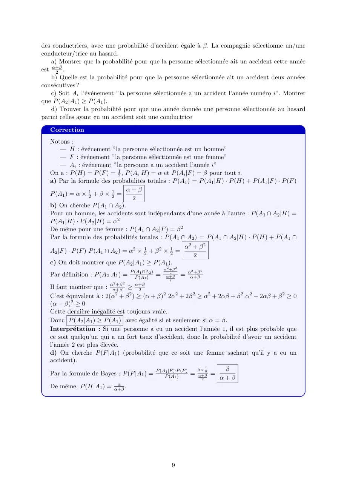

# Claude TD1 PROBA.pdf

[Ouvrir l’original](https://drive.google.com/open?id=1RQ4_Rx7sEaaZUvZ1zGieeZORTXcDn3Lf) · Les deux lectures automatiques du PDF divergent sur les pages indiquées. Leur fac-similé accompagne le texte.

**Pages présentant un écart entre les deux extractions** — 1–9.

## Page 1

~~~text
                                   CYTech 2025-2026
                                ING1 - GM : Probabilités
                                        TD 1

Exercice 1 Soit (An )n≥1 une suite de partie de Ω. Montrer que

                       lim sup 1An − lim inf 1An = 1lim supn→∞ An \lim inf n→∞ An .
                        n→∞            n→∞

   Correction
   Rappelons que lim supn→∞ An = ∞
                                           T      S∞
                                                S∞k=n
                                              n=1     TA∞
                                                          k (ensemble des éléments appartenant à
   une infinité de An ) et lim inf n→∞ An = n=1 k=n Ak (ensemble des éléments appartenant
   à tous les An sauf un nombre fini).
   Pour ω ∈ Ω :
        — lim supn→∞ 1An (ω) = 1 si ω appartient à une infinité de An , 0 sinon
        — lim inf n→∞ 1An (ω) = 1 si ω appartient à tous les An sauf un nombre fini, 0 sinon
   Donc lim supn→∞ 1An (ω) − lim inf n→∞ 1An (ω) = 1 si et seulement si ω ∈ lim sup An et
   ω∈  / lim inf An , c’est-à-dire ω ∈ lim sup An \ lim inf An .
   Ainsi : lim sup 1An − lim inf 1An = 1lim supn→∞ An \lim inf n→∞ An
            n→∞              n→∞

Pour tous les exercices suivants, on considère un espace Ω, une tribu A de cet espace, et une
probabilité P sur cette tribu ; les parties A, B, Ai , etc. sont toutes supposées appartenir à A

Exercice 2 (Identité de Poincaré) Montrer que
    n         n
        !
   [         X            X               X
P     Ai =      P (Ai )−     P (Ai ∩Aj )+      P (Ai ∩Aj ∩Ak )−· · ·+(−1)n+1 P (A1 ∩A2 ∩· · · An ),
    i=1        i=1            i<j             i<j<k
                   P
où par exemple,     i<j signifie la somme pour toutes les parties d’indices (i, j) avec 1 ≤ i < j ≤ n.

                                                      1
~~~

## Page 2

~~~text
   Correction
   Démonstration par récurrence :
   Initialisation (n = 1) : P (A1 ) = P (A1 )
   Initialisation (n = 2) : P (A1 ∪ A2 ) = P (A1 ) + P (A2 ) − P (A1 ∩ A2 ) (formule classique)
   Hérédité : Supposons la formule vraie pour n. Pour n + 1 :
                     n+1             n                             n
                            !             !                            !         !
                      [              [                            [
                  P      Ai = P         Ai + P (An+1 ) − P           Ai ∩ An+1
                     i=1             i=1                                           i=1
       Sn                   Sn
   Or ( i=1 Ai ) ∩ An+1 = i=1 (Ai ∩ An+1 )
   Par hypothèse de récurrence appliquée à PP( ni=1 Ai ), puis à P ( ni=1 (Ai ∩ An+1 )) :
                                                  S                      S
   Les termes de la forme P (Ai ) deviennent n+1  i=1 P (Ai )
   Les termes de la forme P (Ai ∩ Aj ) avec i < j ≤ n et P (Ai ∩ An+1 ) donnent
   P
     i<j≤n+1 P (Ai ∩ Aj )
   Et ainsi de suite pour tous les ordres d’intersection. On obtient bien la formule pour n + 1.

Exercice 3 Montrer que si P (A) = 34 et P (B) = 13 , on a nécessairement 12
                                                                          1
                                                                             ≤ P (A ∩ B) ≤ 13 .

   Correction
   Utilisons les propriétés fondamentales de la probabilité :
   Borne supérieure :
                                                                                        
                                                                                   3 1           1
                        P (A ∩ B) ≤ min(P (A), P (B)) = min                         ,        =
                                                                                   4 3           3

   Car A ∩ B ⊂ A et A ∩ B ⊂ B.
   Borne inférieure : Par la formule P (A ∪ B) = P (A) + P (B) − P (A ∩ B) et sachant que
   P (A ∪ B) ≤ 1, on obtient :

                                  P (A) + P (B) − P (A ∩ B) ≤ 1
                                                              3 1    9 + 4 − 12   1
                  P (A ∩ B) ≥ P (A) + P (B) − 1 =              + −1=            =
                                                              4 3        12       12
                    1               1
   Conclusion :       ≤ P (A ∩ B) ≤
                   12               3

Exercice 4 (Sous-additivité.) Montrer que
                                           n                  n
                                                      !
                                           [                  X
                                     P           Ai       ≤         P (Ai )
                                           i=1                i=1

pour chaque n, et aussi que
                                           ∞                  ∞
                                                      !
                                           [                  X
                                     P           Ai       ≤         P (Ai ).
                                           i=1                i=1

                                                          2
~~~

## Page 3

~~~text
   Correction
   Cas fini : Démonstration par récurrence sur n.
   Initialisation (n = 1) : P (A1 ) ≤ P (A1 )
   Hérédité : Supposons l’inégalité vraie pour n. Alors :
                                    n+1                n
                                            !               !       !
                                     [                 [
                               P          Ai = P          Ai ∪ An+1
                                               i=1                        i=1

   En utilisant P (X ∪ Y ) = P (X) + P (Y ) − P (X ∩ Y ) ≤ P (X) + P (Y ) (car P (X ∩ Y ) ≥ 0) :
                                 n+1              n
                                        !              !
                                 [               [
                             P       Ai ≤ P         Ai + P (An+1 )
                                               i=1                    i=1

   Par hypothèse de récurrence :
                                     n+1                  n                                 n+1
                                                !
                                     [                    X                                 X
                               P           Ai        ≤          P (Ai ) + P (An+1 ) =             P (Ai )
                                     i=1                  i=1                               i=1
                                           Sn
   Cas infini : Posons Bn = i=1 Ai . Alors (Bn )n≥1 est une suite croissante : B1 ⊂ B2 ⊂
   B3 ⊂ · · ·
   Cette suite converge vers ∞
                            S
                              i=1 Ai .
   Par continuité monotone de la probabilité :
                            ∞                                n
                                  !                               !
                            [                               [
                        P      Ai = lim P (Bn ) = lim P        Ai
                                                           n→∞                  n→∞
                                         i=1                                                i=1
                              Sn                 Pn
   Par le cas fini : P ( i=1 Ai ) ≤                   i=1 P (Ai )
   En passant à la limite :
                                           ∞                        n                 ∞
                                                      !
                                           [                        X                 X
                                     P           Ai       ≤ lim           P (Ai ) =         P (Ai )
                                                            n→∞
                                           i=1                      i=1               i=1

Exercice 5 (Inégalités de Bonferroni.) Montrer que
          n            n
               !
         [           X              X
  a) P      Ai ≥          P (Ai ) −   P (Ai ∩ Aj ).
          i=1                i=1                 i<j
           n                 n
                     !
          [                  X                   X                          X
   b) P         Ai       ≤         P (Ai ) −           P (Ai ∩ Aj ) +               P (Ai ∩ Aj ∩ Ak ).
          i=1                i=1                 i<j                        i<j<k

                                                                     3
~~~

## Page 4

~~~text
   Correction
   Ces inégalités découlent directement de l’identité de Poincaré (Exercice 2) en tronquant
   la série alternée.
   Par l’identité de Poincaré :
         n            n
               !
        [            X          X                X
   P        Ai =        P (Ai )−    P (Ai ∩Aj )+     P (Ai ∩Aj ∩Ak )−· · ·+(−1)n+1 P (A1 ∩· · ·∩An )
       i=1        i=1         i<j                i<j<k
                         P
   a) Le troisième terme i<j<k P (Ai ∩ Aj ∩ Ak ) est positif (précédé du signe +).
   En supprimant tous les termes à partir du troisième, on obtient une minoration :
                              n           n
                                    !
                             [           X             X
                          P     Ai ≥        P (Ai ) −     P (Ai ∩ Aj )
                                i=1        i=1           i<j

   b) Le quatrième terme est négatif (précédé du signe −).
   En s’arrêtant au troisième terme (positif) et en supprimant les termes négatifs suivants,
   on obtient une majoration :
                    n          n
                         !
                   [          X             X                   X
               P      Ai ≤        P (Ai ) −     P (Ai ∩ Aj ) +    P (Ai ∩ Aj ∩ Ak )
                   i=1        i=1          i<j                 i<j<k

   Principe général : En tronquant après un terme positif, on obtient une majoration ; en
   tronquant après un terme négatif, on obtient une minoration.

Exercice 6 Montrer que F := {A ⊂ R | A ou Ac est dénombrable} est une tribu sur R.
   On définit une fonction P : F → [0, 1] par P (A) = 0 si A est dénombrable et P (A) = 1 si
Ac est dénombrable.
   Montrer que P définit une mesure de probabilité.

                                                   4
~~~

## Page 5

~~~text
   Correction
   Partie 1 : F est une tribu
   Vérifions les trois axiomes d’une tribu :
   (i) R ∈ F : Rc = ∅ est dénombrable, donc R ∈ F.
   (ii) Stabilité par complémentaire : Soit A ∈ F . Alors A ou Ac est dénombrable.
        — Si A est dénombrable, alors (Ac )c = A est dénombrable, donc Ac ∈ F
        — Si Ac est dénombrable, alors Ac est dénombrable, donc Ac ∈ F
   Dans tous les cas, Ac ∈ F.
         Stabilité par union dénombrable : Soit (An )n∈N une suite d’éléments de F . Posons
   (iii) S
   A= ∞    n=0 An .
   Cas 1 : S’il existe n0 tel que Acn0 est dénombrable, alors :
                                          ∞
                                                    !c       ∞
                                          [                  \
                                   c
                                 A =           An        =         Acn ⊂ Acn0
                                         n=0                 n=0

   Donc Ac est dénombrable (inclus dans un dénombrable), et A ∈ S
                                                                  F.
   Cas 2 : Sinon, tous les An sont dénombrables. Alors A = ∞       n=0 An est une union
   dénombrable de dénombrables, donc dénombrable, et A ∈ F.
   Conclusion : F est une tribu.
   Partie 2 : P est une mesure de probabilité
   Vérifions les axiomes de Kolmogorov :
   (i) P (R) = 1 : Rc = ∅ est dénombrable, donc P (R) = 1.
   (ii) P (A) ∈ [0, 1] pour tout A ∈ F : Par définition, P (A) ∈ {0, 1} ⊂ [0, 1].
         σ-additivité : Soit (An )n∈N une suite d’éléments de F deux à deux disjoints. Posons
   (iii) S
   A= ∞    n=0 An .
   Si A est dénombrable : Alors     P P (A) = 0. Chaque An ⊂ A est donc dénombrable, donc
   P (An ) = 0 pour tout n. Ainsi ∞    n=0 P (An ) = 0 = P (A).
   Si A est dénombrable : Alors P (A) = 1. On a ( ∞
         c
                                                             S         c  T∞       c
                                                               n=0 An ) =   n=0 An . Pour tout n,
     c      c             c                       c      c         c
   An ⊃ A , donc si A est dénombrable et An ̸= A , alors An est non dénombrable, ce qui
   signifie An doit avoir Acn dénombrable, donc P (An ) = 1.
   Mais les An sont disjoints : au plus un An peut vérifier P (An ) = 1 (car sinon An1 et An2
   avec n1 ̸= n2 auraient des complémentaires dénombrables, mais An1 ∩ An2 = ∅ implique
   An1 ⊂ Acn2 qui serait dénombrable, contradiction).
   Donc
   P∞ exactement un An0 vérifie P (An0 ) = 1 et tous les autres vérifient P (An ) = 0. Ainsi
      n=0 P (An ) = 1 = P (A).
   Conclusion : P est une mesure de probabilité sur (R, F ).

Exercice 7 Soit (Ai )1≤i≤n est une suite d’événements indépendants.
                                                               Pn            Montrer que la probabilité
pour qu’aucun des Ai ne soit réalisé est au plus égale à e− i=1 P (Ai ) .

                                                     5
~~~

## Page 6

~~~text
   Correction
   Notons pi = P (Ai ) pour i = 1, . . . , n.
   La probabilité qu’aucun des Ai ne soit réalisé est : P ( ni=1 Aci ) = ni=1 P (Aci ) = ni=1 (1 −
                                                                T             Q              Q
   pi )
   car les événements sont indépendants (donc leurs complémentaires aussi).
   Utilisons l’inégalité : 1 − x ≤ e−x pour tout x ∈ [0, 1].
   Cette inégalité se démontre en étudiant la fonction f (x) = e−x − (1 − x) sur [0, 1] :
        — f (0) = 1 − 1 = 0
        — f ′ (x) = −e−x + 1 ≥ 0 sur [0, 1] car e−x ≤ 1
        — Donc f est croissante et f (x) ≥ f (0) = 0,                        −x
                                                          Qnd’où 1 − x ≤ eQn −pi           − n
                                                                                             P
   Appliquons       cette inégalité à chaque facteur :      (1 −  p   ) ≤       e =    e    i=1 pi =
       Pn                                                  i=1         i       i=1
   e−   i=1 P (Ai )
                           n
                                 !
                          \                Pn
   Conclusion : P             Aci ≤ e− i=1 P (Ai )
                       i=1

Exercice 8 Soit P (A) > 0. Montrer que P (A ∩ B|A ∪ B) ≤ P (A ∩ B|A).

   Correction
   Calculons les deux probabilités conditionnelles.
   Membre de gauche : P (A ∩ B|A ∪ B) = P ((A∩B)∩(A∪B))   P (A∪B)       = PP (A∩B)
                                                                             (A∪B)
   car (A ∩ B) ∩ (A ∪ B) = A ∩ B.
   Membre de droite : P (A ∩ B|A) = P ((A∩B)∩A)   P (A)      = P P(A∩B)
                                                                   (A)
   car (A ∩ B) ∩ A = A ∩ B.
   Comparaison : Il faut montrer que : PP (A∪B)  (A∩B)
                                                         ≤ P P(A∩B)
                                                               (A)
   Si P (A ∩ B) = 0, l’inégalité est vraie (égalité 0 = 0).
                                                                                     1       1
   Si P (A ∩ B) > 0, on peut simplifier par P (A ∩ B) et l’inégalité devient : P (A∪B) ≤ P (A)
   ce qui est équivalent à : P (A) ≤ P (A ∪ B)
   Cette dernière inégalité est toujours vraie car A ⊂ A ∪ B.
   Conclusion : P (A ∩ B|A ∪ B) ≤ P (A ∩ B|A)

Exercice 9 Soient A, B, C sont indépendants et P (A∩B) ̸= 0. Montrer que P (C|A∩B) = P (C).

   Correction

   Par définition de la probabilité conditionnelle : P (C|A ∩ B) = P (C∩(A∩B))
                                                                        P (A∩B)  = P P(A∩B∩C)
                                                                                       (A∩B)
   Utilisons l’indépendance mutuelle :
   Les événements A, B, C sont (mutuellement) indépendants signifie :
      — P (A ∩ B) = P (A) · P (B)
      — P (A ∩ C) = P (A) · P (C)
      — P (B ∩ C) = P (B) · P (C)
      — P (A ∩ B ∩ C) = P (A) · P (B) · P (C)
   Donc : P (C|A ∩ B) = P P(A∩B∩C)
                              (A∩B) =
                                         P (A)·P (B)·P (C)
                                            P (A)·P (B)    = P (C)
   Conclusion : P (C|A ∩ B) = P (C)
   Interprétation : L’information que A et B sont réalisés n’apporte aucune information
   sur C car les événements sont indépendants.

                                                    6
~~~

## Page 7

~~~text
Exercice 10 Soit (An )n∈N∗ → A et (Bn )n∈N∗ → B. Supposons aussi que P (B) > 0 et P (Bn ) > 0
pour tout n ∈ N∗ . Montrer que
   a) lim P (An |B) = P (A|B) ;
      n→∞
   b) lim P (A|Bn ) = P (A|B) ;
      n→∞
   c) lim P (An |Bn ) = P (A|B).
      n→∞

   Correction
   Rappel : (An ) → A signifie que limn→∞ 1An = 1A presque sûrement, ou de manière
   équivalente dans le contexte des événements, que An → A au sens de la convergence
   d’ensembles.
                                         n ∩B)
   a) Par définition : P (An |B) = P (A
                                       P (B)
   Comme (An ) → A, on a (An ∩ B) → (A ∩ B).
   Par continuité de la probabilité (pour une suite convergente d’événements) :
   limn→∞ P (An ∩ B) = P (A ∩ B)
                                               n ∩B)
   Donc : limn→∞ P (An |B) = limn→∞ P (A     P (B)   = P P(A∩B)
                                                           (B) = P (A|B)
   b) Par définition : P (A|Bn ) = P P(A∩B  n)
                                         (Bn )
   Comme (Bn ) → B, on a (A ∩ Bn ) → (A ∩ B).
   Par continuité de la probabilité : limn→∞ P (A ∩ Bn ) = P (A ∩ B) et    limn→∞ P (Bn ) =
   P (B) > 0
   Donc : limn→∞ P (A|Bn ) = limn→∞ P P(A∩B        n) P (A∩B)
                                               (Bn ) = P (B) = P (A|B)
                                           n ∩Bn )
   c) Par définition : P (An |Bn ) = P (A
                                         P (Bn )
   Comme (An ) → A et (Bn ) → B, on a (An ∩ Bn ) → (A ∩ B).
   Par continuité de la probabilité : limn→∞ P (An ∩ Bn ) = P (A ∩ B)
   Et on sait que limn→∞ P (Bn ) = P (B) > 0.
                                                  n ∩Bn )
   Donc : limn→∞ P (An |Bn ) = limn→∞ P (A      P (Bn )   = P P(A∩B)
                                                                (B) = P (A|B)
   Ces trois résultats montrent que la probabilité conditionnelle est continue par rapport à
   ses arguments.

Exercice 11 On dispose de deux urnes, la première contenant 1 boule • et 3 boules ◦, la seconde
contenant 2 boules • et 2 boules ◦.
   L’expérience consiste à choisir d’abord une urne, puis à tirer une boule dans l’urne choisie.
On cherche la probabilité de l’événement A = ”on tire une boule •”

                                                7
~~~

## Page 8

~~~text
   Correction
   Notons :
       — U1 : événement ”on choisit l’urne 1”
       — U2 : événement ”on choisit l’urne 2”
       — A : événement ”on tire une boule •”
   Hypothèses :
       — On suppose que les urnes sont choisies avec probabilité égale : P (U1 ) = P (U2 ) = 21
       — Dans l’urne 1 : 1 boule • sur 4 boules au total, donc P (A|U1 ) = 41
       — Dans l’urne 2 : 2 boules • sur 4 boules au total, donc P (A|U2 ) = 42 = 12
   Application de la formule des probabilités totales :
   Les événements U1 et U2 forment une partition de Ω (ils sont disjoints et leur union est
   Ω).
   Donc : P (A) = P (A|U1 ) · P (U1 ) + P (A|U2 ) · P (U2 )
   P (A) = 41 × 12 + 21 × 12 = 81 + 14 = 81 + 82 = 38
                            3
   Conclusion : P (A) =
                            8

Exercice 12 Chaque don de sang est soumis à un test du Co. On suppose que ce test a une
efficacité de 99% (probabilité que le test soit positif pour une personne atteinte du Co), et une
probabilité de fausse alarme de 5% (probabilité que les test soit positif pour une personne non
atteinte). Enfin, on suppose la fréquence de séropositivité est 10−4 . Quelle est la probabilité
pour qu’une personne obtenant un test positif soit atteinte du Co ?

   Correction
   Notons :
       — M : événement ”la personne est malade (atteinte du Co)”
       — T + : événement ”le test est positif”
   Données :
       — P (M ) = 10−4 = 0,0001 (prévalence de la maladie)
       — P (M c ) = 1 − 10−4 = 0,9999
       — P (T + |M ) = 0,99 (sensibilité du test)
       — P (T + |M c ) = 0,05 (taux de faux positifs)
   Question : Calculer P (M |T + ) (valeur prédictive positive)
                                                                       +
   Application de la formule de Bayes : P (M |T + ) = P (T P|M              )·P (M )
                                                                         (T + )
   Calculons d’abord P (T + ) par la formule des probabilités totales : P (T + ) = P (T + |M ) ·
   P (M ) + P (T + |M c ) · P (M c ) P (T + ) = 0,99 × 10−4 + 0,05 × (1 − 10−4 ) P (T + ) = 0,000099 +
   0,05 × 0,9999 P (T + ) = 0,000099 + 0,049995 = 0,050094
                                    −4
   Donc : P (M |T + ) = 0,99×10           0,000099
                             0,050094 = 0,050094 ≈ 0,001976 ≈ 0,002
                                      1
    P (M |T + ) ≈ 0,2% ou environ
                                    506
   Interprétation : Malgré un test efficace à 99%, une personne ayant un test positif n’a
   qu’environ 0,2% de chances d’être réellement malade ! Ceci est dû à la très faible prévalence
   de la maladie : les faux positifs (5% de 99,99% de la population) sont bien plus nombreux
   que les vrais positifs (99% de 0,01% de la population).

Exercice 13 Une compagnie d’assurance assure un nombre égal de conducteurs masculins et
féminins. Tous les conducteurs (masculins) ont chaque année, la probabilité α d’avoir un acci-
dent et ceci indépendamment des autres années, et des autres conducteurs. Il en est de même

                                                   8
~~~

## Page 9

~~~text
des conductrices, avec une probabilité d’accident égale à β. La compagnie sélectionne un/une
conducteur/trice au hasard.
    a) Montrer que la probabilité pour que la personne sélectionnée ait un accident cette année
est α+β
      2 .
    b) Quelle est la probabilité pour que la personne sélectionnée ait un accident deux années
consécutives ?
    c) Soit Ai l’événement ”la personne sélectionnée a un accident l’année numéro i”. Montrer
que P (A2 |A1 ) ≥ P (A1 ).
    d) Trouver la probabilité pour que une année donnée une personne sélectionnée au hasard
parmi celles ayant eu un accident soit une conductrice

   Correction
   Notons :
       — H : événement ”la personne sélectionnée est un homme”
       — F : événement ”la personne sélectionnée est une femme”
       — Ai : événement ”la personne a un accident l’année i”
   On a : P (H) = P (F ) = 21 , P (Ai |H) = α et P (Ai |F ) = β pour tout i.
   a) Par la formule des probabilités totales : P (A1 ) = P (A1 |H) · P (H) + P (A1 |F ) · P (F )
                                  α+β
   P (A1 ) = α × 21 + β × 12 =
                                    2
   b) On cherche P (A1 ∩ A2 ).
   Pour un homme, les accidents sont indépendants d’une année à l’autre : P (A1 ∩ A2 |H) =
   P (A1 |H) · P (A2 |H) = α2
   De même pour une femme : P (A1 ∩ A2 |F ) = β 2
   Par la formule des probabilités totales : P (A1 ∩ A2 ) = P (A1 ∩ A2 |H) · P (H) + P (A1 ∩
                                                        α2 + β 2
   A2 |F ) · P (F ) P (A1 ∩ A2 ) = α2 × 21 + β 2 × 21 =
                                                           2
   c) On doit montrer que P (A2 |A1 ) ≥ P (A1 ).
                                                   α2 +β 2      2     2
                                       1 ∩A2 )
   Par définition : P (A2 |A1 ) = P (A
                                     P (A1 )   =      2
                                                    α+β      = αα+β
                                                                 +β
                                                      2
                            2   2
   Il faut montrer que : αα+β  +β
                                   ≥ α+β
                                       2
   C’est équivalent à : 2(α2 + β 2 ) ≥ (α + β)2 2α2 + 2β 2 ≥ α2 + 2αβ + β 2 α2 − 2αβ + β 2 ≥ 0
   (α − β)2 ≥ 0
   Cette dernière inégalité est toujours vraie.
   Donc P (A2 |A1 ) ≥ P (A1 ) avec égalité si et seulement si α = β.
   Interprétation : Si une personne a eu un accident l’année 1, il est plus probable que
   ce soit quelqu’un qui a un fort taux d’accident, donc la probabilité d’avoir un accident
   l’année 2 est plus élevée.
   d) On cherche P (F |A1 ) (probabilité que ce soit une femme sachant qu’il y a eu un
   accident).
                                                                β× 1     β
   Par la formule de Bayes : P (F |A1 ) = P (AP1 |F  )·P (F )
                                                   (A1 )      = α+β2 =
                                                                 2     α + β
                                α
   De même, P (H|A1 ) = α+β .

                                                       9
~~~
