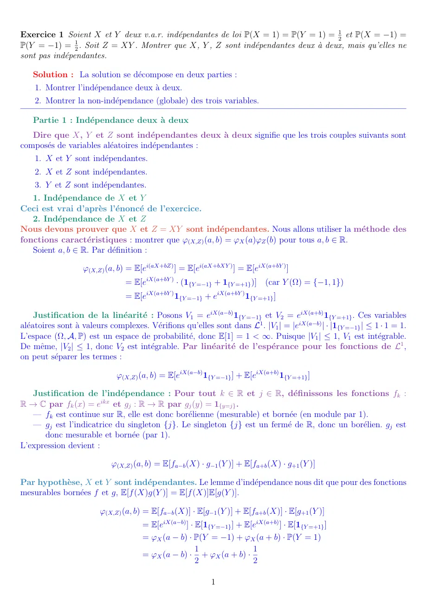
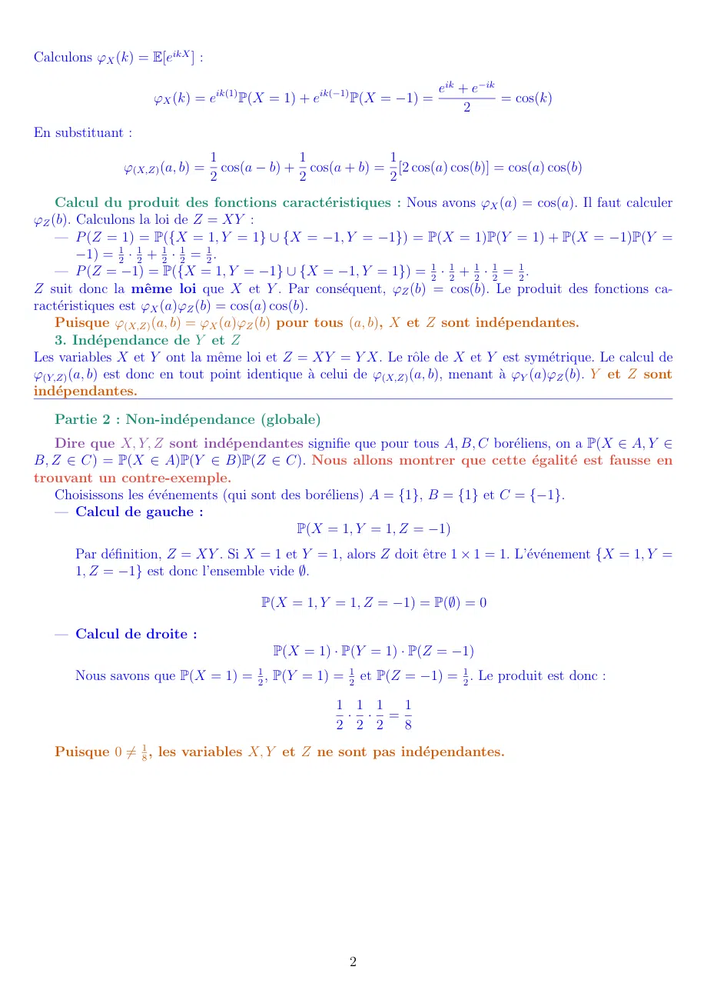

# exercice 1 - td 4 - CORRECTION.pdf

[Ouvrir l’original](https://drive.google.com/open?id=1kaCA3HT1du3Il4XW0XWVcOTgp7TWBa3-) · Les deux lectures automatiques du PDF divergent sur les pages indiquées. Leur fac-similé accompagne le texte.

**Pages présentant un écart entre les deux extractions** — 1–2.

## Page 1

~~~text
Exercice 1 Soient X et Y deux v.a.r. indépendantes de loi P(X = 1) = P(Y = 1) = 12 et P(X = −1) =
P(Y = −1) = 12 . Soit Z = XY . Montrer que X, Y , Z sont indépendantes deux à deux, mais qu’elles ne
sont pas indépendantes.

   Solution : La solution se décompose en deux parties :
    1. Montrer l’indépendance deux à deux.
    2. Montrer la non-indépendance (globale) des trois variables.

   Partie 1 : Indépendance deux à deux
   Dire que X, Y et Z sont indépendantes deux à deux signifie que les trois couples suivants sont
composés de variables aléatoires indépendantes :
    1. X et Y sont indépendantes.
    2. X et Z sont indépendantes.
    3. Y et Z sont indépendantes.
   1. Indépendance de X et Y
Ceci est vrai d’après l’énoncé de l’exercice.
   2. Indépendance de X et Z
Nous devons prouver que X et Z = XY sont indépendantes. Nous allons utiliser la méthode des
fonctions caractéristiques : montrer que φ(X,Z) (a, b) = φX (a)φZ (b) pour tous a, b ∈ R.
   Soient a, b ∈ R. Par définition :

                   φ(X,Z) (a, b) = E[ei(aX+bZ) ] = E[ei(aX+bXY ) ] = E[eiX(a+bY ) ]
                                = E[eiX(a+bY ) · (1{Y =−1} + 1{Y =+1} )] (car Y (Ω) = {−1, 1})
                                = E[eiX(a+bY ) 1{Y =−1} + eiX(a+bY ) 1{Y =+1} ]

     Justification de la linéarité : Posons V1 = eiX(a−b) 1{Y =−1} et V2 = eiX(a+b) 1{Y =+1} . Ces variables
aléatoires sont à valeurs complexes. Vérifions qu’elles sont dans L1 . |V1 | = |eiX(a−b) | · |1{Y =−1} | ≤ 1 · 1 = 1.
L’espace (Ω, A, P) est un espace de probabilité, donc E[1] = 1 < ∞. Puisque |V1 | ≤ 1, V1 est intégrable.
De même, |V2 | ≤ 1, donc V2 est intégrable. Par linéarité de l’espérance pour les fonctions de L1 ,
on peut séparer les termes :

                             φ(X,Z) (a, b) = E[eiX(a−b) 1{Y =−1} ] + E[eiX(a+b) 1{Y =+1} ]

   Justification de l’indépendance : Pour tout k ∈ R et j ∈ R, définissons les fonctions fk :
R → C par fk (x) = eikx et gj : R → R par gj (y) = 1{y=j} .
   — fk est continue sur R, elle est donc borélienne (mesurable) et bornée (en module par 1).
   — gj est l’indicatrice du singleton {j}. Le singleton {j} est un fermé de R, donc un borélien. gj est
      donc mesurable et bornée (par 1).
L’expression devient :

                            φ(X,Z) (a, b) = E[fa−b (X) · g−1 (Y )] + E[fa+b (X) · g+1 (Y )]

Par hypothèse, X et Y sont indépendantes. Le lemme d’indépendance nous dit que pour des fonctions
mesurables bornées f et g, E[f (X)g(Y )] = E[f (X)]E[g(Y )].

                        φ(X,Z) (a, b) = E[fa−b (X)] · E[g−1 (Y )] + E[fa+b (X)] · E[g+1 (Y )]
                                     = E[eiX(a−b) ] · E[1{Y =−1} ] + E[eiX(a+b) ] · E[1{Y =+1} ]
                                     = φX (a − b) · P(Y = −1) + φX (a + b) · P(Y = 1)
                                                      1                1
                                     = φX (a − b) · + φX (a + b) ·
                                                      2                2

                                                           1
~~~

## Page 2

~~~text
Calculons φX (k) = E[eikX ] :

                                                                      eik + e−ik
                    φX (k) = eik(1) P(X = 1) + eik(−1) P(X = −1) =               = cos(k)
                                                                           2
En substituant :
                                 1             1            1
               φ(X,Z) (a, b) =     cos(a − b) + cos(a + b) = [2 cos(a) cos(b)] = cos(a) cos(b)
                                 2             2            2
    Calcul du produit des fonctions caractéristiques : Nous avons φX (a) = cos(a). Il faut calculer
φZ (b). Calculons la loi de Z = XY :
    — P (Z = 1) = P({X = 1, Y = 1} ∪ {X = −1, Y = −1}) = P(X = 1)P(Y = 1) + P(X = −1)P(Y =
        −1) = 12 · 12 + 21 · 12 = 21 .
    — P (Z = −1) = P({X = 1, Y = −1} ∪ {X = −1, Y = 1}) = 12 · 12 + 21 · 12 = 12 .
Z suit donc la même loi que X et Y . Par conséquent, φZ (b) = cos(b). Le produit des fonctions ca-
ractéristiques est φX (a)φZ (b) = cos(a) cos(b).
    Puisque φ(X,Z) (a, b) = φX (a)φZ (b) pour tous (a, b), X et Z sont indépendantes.
    3. Indépendance de Y et Z
Les variables X et Y ont la même loi et Z = XY = Y X. Le rôle de X et Y est symétrique. Le calcul de
φ(Y,Z) (a, b) est donc en tout point identique à celui de φ(X,Z) (a, b), menant à φY (a)φZ (b). Y et Z sont
indépendantes.
   Partie 2 : Non-indépendance (globale)
   Dire que X, Y, Z sont indépendantes signifie que pour tous A, B, C boréliens, on a P(X ∈ A, Y ∈
B, Z ∈ C) = P(X ∈ A)P(Y ∈ B)P(Z ∈ C). Nous allons montrer que cette égalité est fausse en
trouvant un contre-exemple.
   Choisissons les événements (qui sont des boréliens) A = {1}, B = {1} et C = {−1}.
   — Calcul de gauche :
                                            P(X = 1, Y = 1, Z = −1)
       Par définition, Z = XY . Si X = 1 et Y = 1, alors Z doit être 1 × 1 = 1. L’événement {X = 1, Y =
       1, Z = −1} est donc l’ensemble vide ∅.

                                         P(X = 1, Y = 1, Z = −1) = P(∅) = 0

   — Calcul de droite :
                                           P(X = 1) · P(Y = 1) · P(Z = −1)
       Nous savons que P(X = 1) = 12 , P(Y = 1) = 21 et P(Z = −1) = 12 . Le produit est donc :

                                                     1 1 1  1
                                                      · · =
                                                     2 2 2  8
   Puisque 0 ̸= 81 , les variables X, Y et Z ne sont pas indépendantes.

                                                       2
~~~
