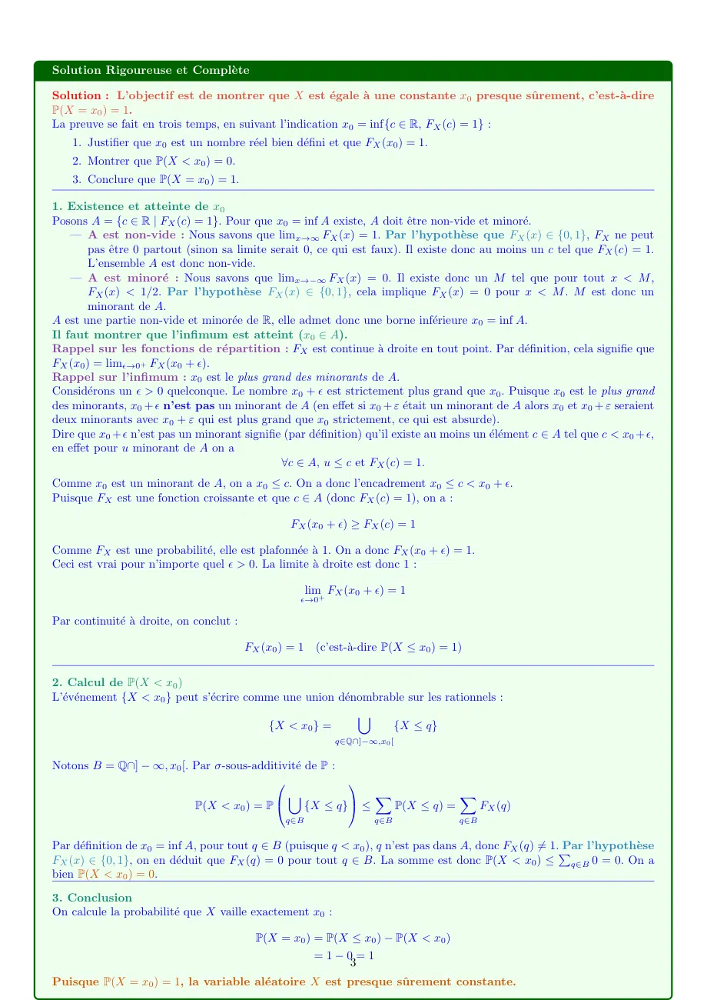

# exercice 2 - td 4 - CORRECTION.pdf

[Ouvrir l’original](https://drive.google.com/open?id=1TTTSRdclyaPigiM3PWX234e8VsKHorbU) · Les deux lectures automatiques du PDF divergent sur les pages indiquées. Leur fac-similé accompagne le texte.

**Pages présentant un écart entre les deux extractions** — 1–3.

## Page 1

~~~text
Exercice 1. Soit X une variable aléatoire telle que FX (x) ∈ {0, 1} pour tout x. Montrer que X est constante presque
sûrement.
    Indication : Utiliser x0 := inf{c ∈ R | FX (c) = 1}

   Solution proposée par l’élève

   ”Soit E := {c ∈ R|FX (c) = 1} On montre que E est non vide et que son infimum existe. Existence de inf E : On
   a que FX (c) → 1 lorsque c → +∞. Cela implique que pour tout ϵ > 0, il existe M > 0 tel que pour c ≥ M ,
   on a FX (c) − 1 ≤ ϵ. En particulier, pour ϵ = 0.5 on a un M tel que FX (M ) = 1. Ainsi, E est non vide et borné
   inférieurement, ce qui permet de définir x0 := inf E. Maintenant, considérons FX (x0 ). Puisque x0 est l’infimum de
   E, on sait que FX (x0 ) = 1 car FX est croissante. On suppose qu’il existe b < x0 tel que FX (b) = 1 Alors, b ∈ E, mais
   cela est une contradiction car x0 est l’infimum de E. Par conséquent, x0 est une valeur prise presque sûrement par X.
   En conclusion, X est constante presque sûrement, et donc P (X = x0 ) = 1”

   Analyse pédagogique de la solution

   Cher élève, Votre solution contient les bonnes intuitions, mais elle n’est pas une démonstration mathématique valide
   car elle comporte plusieurs affirmations non prouvées ou incorrectes. Analysons les points faibles :

   Point de vigilance : Erreur de raisonnement

   Erreur 1 : L’ensemble E est ”borné inférieurement”
   Vous affirmez que E est ”borné inférieurement” sans aucune justification. C’est un trou majeur dans la preuve.
   Pourquoi n’y a-t-il pas de c tel que FX (c) = 1 à −∞ ?

   Correction et Rigueur

   Il faut utiliser l’autre propriété des fonctions de répartition : limx→−∞ FX (x) = 0. Par définition de la limite, il existe
   M ′ tel que pour tout x < M ′ , FX (x) < 1/2. Par l’hypothèse de l’exercice (FX (x) ∈ {0, 1}), cela force FX (x) = 0 pour
   x < M ′ . Donc, M ′ est un minorant de E. L’ensemble E est bien minoré.

   Point de vigilance : Erreur de raisonnement

   Erreur 2 : L’infimum est atteint
   Vous affirmez : ”on sait que FX (x0 ) = 1 car FX est croissante”. Ceci est faux. L’infimum d’un ensemble n’appartient
   pas forcément à cet ensemble, même pour une fonction croissante. Contre-exemple : Soit A =]0, 1]. L’infimum est 0,
   qui n’est pas dans A.

   Correction et Rigueur

   L’argument correct est la continuité à droite de FX . Pour tout ϵ > 0, x0 + ϵ n’est pas un minorant, donc il existe
   c ∈ E tel que x0 ≤ c < x0 + ϵ. Comme FX est croissante et c ∈ E, on a FX (x0 + ϵ) ≥ FX (c) = 1. Donc FX (x0 + ϵ) = 1
   pour tout ϵ > 0. Par continuité à droite : FX (x0 ) = limϵ→0+ FX (x0 + ϵ) = 1.

   Point de vigilance : Erreur de raisonnement

   Erreur 3 : La conclusion est trop rapide
   Votre argument (correct) sur b < x0 prouve que P(X ≤ q) = 0 pour q < x0 , et donc P(X < x0 ) = 0. Mais vous
   concluez immédiatement ”Par conséquent, x0 est une valeur prise presque sûrement”. Il manque l’étape finale du
   calcul.

                                                                  1
~~~

## Page 2

~~~text
Correction et Rigueur

La preuve se termine par le calcul explicite de la probabilité de l’événement {X = x0 } :

                                 P(X = x0 ) = P(X ≤ x0 ) − P(X < x0 ) = FX (x0 ) − 0

Et ce n’est que parce que nous avons prouvé FX (x0 ) = 1 (à l’étape 2) que nous pouvons conclure :

                                                 P(X = x0 ) = 1 − 0 = 1

                                                            2
~~~

## Page 3

~~~text
Solution Rigoureuse et Complète

Solution : L’objectif est de montrer que X est égale à une constante x0 presque sûrement, c’est-à-dire
P(X = x0 ) = 1.
La preuve se fait en trois temps, en suivant l’indication x0 = inf{c ∈ R, FX (c) = 1} :
    1. Justifier que x0 est un nombre réel bien défini et que FX (x0 ) = 1.
    2. Montrer que P(X < x0 ) = 0.
    3. Conclure que P(X = x0 ) = 1.

1. Existence et atteinte de x0
Posons A = {c ∈ R | FX (c) = 1}. Pour que x0 = inf A existe, A doit être non-vide et minoré.
    — A est non-vide : Nous savons que limx→∞ FX (x) = 1. Par l’hypothèse que FX (x) ∈ {0, 1}, FX ne peut
        pas être 0 partout (sinon sa limite serait 0, ce qui est faux). Il existe donc au moins un c tel que FX (c) = 1.
        L’ensemble A est donc non-vide.
    — A est minoré : Nous savons que limx→−∞ FX (x) = 0. Il existe donc un M tel que pour tout x < M ,
        FX (x) < 1/2. Par l’hypothèse FX (x) ∈ {0, 1}, cela implique FX (x) = 0 pour x < M . M est donc un
        minorant de A.
A est une partie non-vide et minorée de R, elle admet donc une borne inférieure x0 = inf A.
Il faut montrer que l’infimum est atteint (x0 ∈ A).
Rappel sur les fonctions de répartition : FX est continue à droite en tout point. Par définition, cela signifie que
FX (x0 ) = limϵ→0+ FX (x0 + ϵ).
Rappel sur l’infimum : x0 est le plus grand des minorants de A.
Considérons un ϵ > 0 quelconque. Le nombre x0 + ϵ est strictement plus grand que x0 . Puisque x0 est le plus grand
des minorants, x0 + ϵ n’est pas un minorant de A (en effet si x0 + ε était un minorant de A alors x0 et x0 + ε seraient
deux minorants avec x0 + ε qui est plus grand que x0 strictement, ce qui est absurde).
Dire que x0 + ϵ n’est pas un minorant signifie (par définition) qu’il existe au moins un élément c ∈ A tel que c < x0 + ϵ,
en effet pour u minorant de A on a
                                               ∀c ∈ A, u ≤ c et FX (c) = 1.
Comme x0 est un minorant de A, on a x0 ≤ c. On a donc l’encadrement x0 ≤ c < x0 + ϵ.
Puisque FX est une fonction croissante et que c ∈ A (donc FX (c) = 1), on a :

                                                   FX (x0 + ϵ) ≥ FX (c) = 1

Comme FX est une probabilité, elle est plafonnée à 1. On a donc FX (x0 + ϵ) = 1.
Ceci est vrai pour n’importe quel ϵ > 0. La limite à droite est donc 1 :

                                                         lim FX (x0 + ϵ) = 1
                                                     ϵ→0+

Par continuité à droite, on conclut :

                                          FX (x0 ) = 1     (c’est-à-dire P(X ≤ x0 ) = 1)

2. Calcul de P(X < x0 )
L’événement {X < x0 } peut s’écrire comme une union dénombrable sur les rationnels :
                                                           [
                                          {X < x0 } =            {X ≤ q}
                                                              q∈Q∩]−∞,x0 [

Notons B = Q∩] − ∞, x0 [. Par σ-sous-additivité de P :
                                                       
                                            [               X            X
                          P(X < x0 ) = P        {X ≤ q} ≤   P(X ≤ q) =   FX (q)
                                                  q∈B                 q∈B               q∈B

Par définition de x0 = inf A, pour tout q ∈ B (puisque q < x0 ), q n’est pas dans A, donc FX (q) ̸= 1.P
                                                                                                       Par l’hypothèse
FX (x) ∈ {0, 1}, on en déduit que FX (q) = 0 pour tout q ∈ B. La somme est donc P(X < x0 ) ≤ q∈B 0 = 0. On a
bien P(X < x0 ) = 0.
3. Conclusion
On calcule la probabilité que X vaille exactement x0 :

                                            P(X = x0 ) = P(X ≤ x0 ) − P(X < x0 )
                                                          =1−0=1
                                                             3
Puisque P(X = x0 ) = 1, la variable aléatoire X est presque sûrement constante.
~~~
