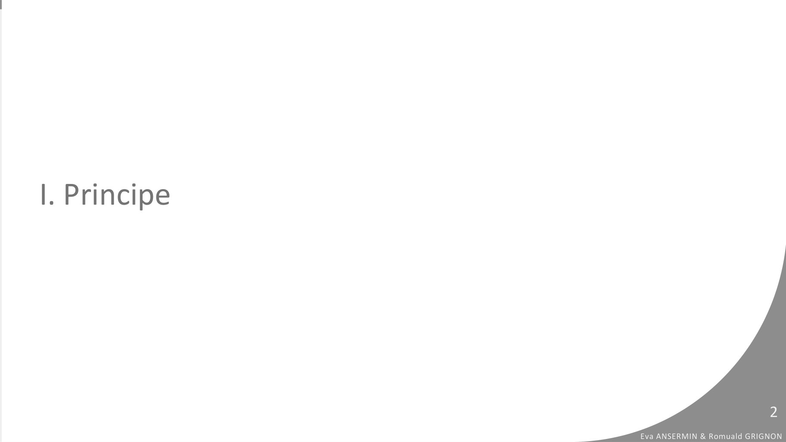
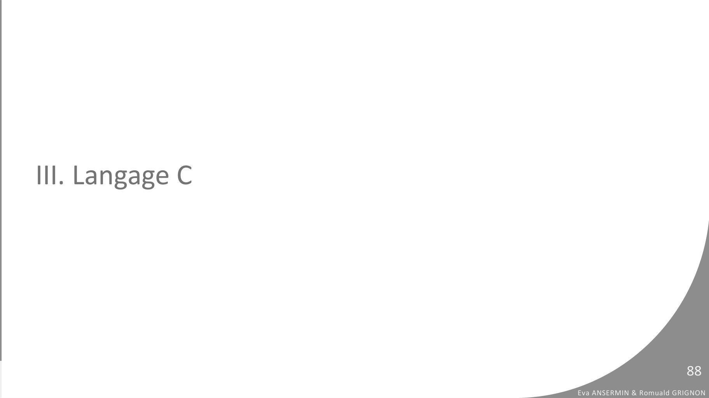

# 02b_Boucles.pdf

[Ouvrir l’original](https://drive.google.com/open?id=1c21EcYeSGCV8dlIvkvqZkoCaM2RaW2Ce) · Les pages signalées comprennent du texte reconnu automatiquement ou des éléments graphiques. Le fac-similé permet de vérifier chaque lecture.

**Pages avec fac-similé ou lecture OCR** — 2, 88.

## Page 1

~~~text
                                                   v1.00

PROGRAMMATION
PROCEDURALE
2B. LES BOUCLES

                  Eva Ansermin & Romuald Grignon
~~~

## Page 2

~~~text
I. Principe

                                         2
              Eva ANSERMIN & Romuald GRIGNON
~~~

**Lecture OCR à contrôler**

~~~text
Eva ANSERMIN & Romuald GRIGNON
~~~

## Page 3

~~~text
Problématique
●   Dans l’algorithme suivant, que peut-on faire pour s’assurer que l’utilisateur rentre
    une note valide ?

           VARIABLE
               n1: Réél
           DEBUT
               ECRIRE (“Donnez la note”)
               LIRE(n1)
               ECRIRE(“Le résultat est” + n1)
           FIN

                                                                                                      3
                                                                           Eva ANSERMIN & Romuald GRIGNON
~~~

## Page 4

~~~text
Problématique
●    Première idée : à l’aide d’une condition, on redemande à l’utilisateur si la valeur
     saisie est incorrecte :
    VARIABLE
        n1: Réél
    DEBUT
        ECRIRE (“Donnez la note”)
        LIRE(n1)
        // condition de note non valide
        SI (n1 EST STRICTEMENT INFERIEUR A 0 OU n1 EST STRICTEMENT SUPERIEUR A 20) ALORS
           // on redemande la saisie
           ECRIRE(“Donnez la note”)
           LIRE (n1)
        FIN SI
        ECRIRE(“Le résultat est” + m)
    FIN
                                                                                                        4
                                                                             Eva ANSERMIN & Romuald GRIGNON
~~~

## Page 5

~~~text
Problématique
 ●   Si l’utilisateur donne plusieurs fois une valeur mauvaise ?
VARIABLE
    n1: Réél
DEBUT
    ECRIRE (“Donnez la note”)
    LIRE(n1)
    // condition de note non valide
    SI (n1 EST STRICTEMENT INFERIEUR A 0 OU n1 EST STRICTEMENT SUPERIEUR A 20) ALORS
         ECRIRE(“Donnez la note”) // on redemande la saisie
         LIRE (n1)
         SI (n1 EST STRICTEMENT INFERIEUR A 0 OU n1 EST STRICTEMENT SUPERIEUR A 20) ALORS
              ECRIRE(“Donnez la note”) // on redemande la saisie
              LIRE (n1)
         FIN SI
    FIN SI
    ECRIRE(“Le résultat est” + m)
FIN                                                                                                    5
                                                                            Eva ANSERMIN & Romuald GRIGNON
~~~

## Page 6

~~~text
Problématique
●   Dans cette situation, on ne sait pas à l’avance combien de fois il va falloir vérifier
    la validité de la valeur saisie : utiliser des branchements conditionnels ne suffit
    pas.

●   Il faudrait pouvoir répeter des instructions tant que la valeur n’est pas valide.

●   C’est le role des boucles : les boucles permettent de répéter des instructions un
    certain nombre de fois pré-déterminé, ou, répéter en fonction d’une condition.

                                                                                                        6
                                                                             Eva ANSERMIN & Romuald GRIGNON
~~~

## Page 7

~~~text
Principe
    • Ce qu’il se passe:
       1.l'ordinateur lit les instructions de haut en bas (comme d'habitude) ;
       2.puis, une fois arrivé à la fin de la boucle, dans certaines conditions il repart
       à la première instruction ;
       3. il recommence alors à lire les instructions de haut en bas…
       4. … et ça recommence !

•        Il existe deux types de boucles :

    1.     les boucles à nombre de tours déterminé par avance (pour)
    2.     les boucles à nombre de tours indéterminé (tant que … faire ... / répéter … tant que ...)
                                                                                                                       7
                                                                                            Eva ANSERMIN & Romuald GRIGNON
~~~

## Page 8

~~~text
II. Les différentes boucles

                                                         8
                              Eva ANSERMIN & Romuald GRIGNON
~~~

## Page 9

~~~text
La boucle TANT QUE
●   La boucle TANT QUE permet de répéter un ensemble d’instructions tant qu’une
    condition vaut VRAI.

             TANT QUE (expression booléenne) FAIRE
                  … // liste d’instructions à répéter
             FIN TANT QUE

                                                                                               9
                                                                    Eva ANSERMIN & Romuald GRIGNON
~~~

## Page 10

~~~text
La boucle TANT QUE
●    La boucle TANT QUE permet de répéter un ensemble d’instructions tant que une
     condition est VRAI.

                 TANT QUE (expression booléenne) FAIRE
                      … // liste d’instructions à répéter
                 FIN TANT QUE

Le FIN TANT QUE indique la fin des instruction à répéter (comme le FIN SI)

                                                                                                      10
                                                                             Eva ANSERMIN & Romuald GRIGNON
~~~

## Page 11

~~~text
La boucle TANT QUE
 ●   La boucle TANT QUE permet de répéter un ensemble d’instructions tant que une
     condition est VRAI.

               TANT QUE (expression booléenne) FAIRE
                    … // liste d’instructions à répéter
               FIN TANT QUE

Indentation obligatoire pour les instructions appartenant au tant que !

                                                                                                   11
                                                                          Eva ANSERMIN & Romuald GRIGNON
~~~

## Page 12

~~~text
La boucle TANT QUE
●   Exemple :
    VARIABLE
        a,b,c : entier
    DEBUT
         a <- 9
         b <- 3
         c <- 0
         TANT QUE (a EST SUPERIEUR OU EGAL A 0) FAIRE
             c <- c + a + b
             a <- a - b
         FIN TANT QUE
         ECRIRE (c)
    FIN

                                                                                 12
                                                        Eva ANSERMIN & Romuald GRIGNON
~~~

## Page 13

~~~text
                                                        Variable   Valeur
La boucle TANT QUE                                      a
                                                        b
●   Exemple :                                           c

    VARIABLE
        a,b,c : entier
    DEBUT
         a <- 9
         b <- 3
         c <- 0
         TANT QUE (a EST SUPERIEUR OU EGAL A 0) FAIRE
             c <- c + a + b
             a <- a - b
         FIN TANT QUE
         ECRIRE (c)
    FIN

                                                                                               13
                                                                      Eva ANSERMIN & Romuald GRIGNON
~~~

## Page 14

~~~text
                                                        Variable   Valeur
La boucle TANT QUE                                      a          9
                                                        b
●   Exemple :                                           c

    VARIABLE
        a,b,c : entier
    DEBUT
         a <- 9
         b <- 3
         c <- 0
         TANT QUE (a EST SUPERIEUR OU EGAL A 0) FAIRE
             c <- c + a + b
             a <- a - b
         FIN TANT QUE
         ECRIRE (c)
    FIN

                                                                                                14
                                                                       Eva ANSERMIN & Romuald GRIGNON
~~~

## Page 15

~~~text
                                                        Variable   Valeur
La boucle TANT QUE                                      a          9
                                                        b          3
●   Exemple :                                           c

    VARIABLE
        a,b,c : entier
    DEBUT
         a <- 9
         b <- 3
         c <- 0
         TANT QUE (a EST SUPERIEUR OU EGAL A 0) FAIRE
             c <- c + a + b
             a <- a - b
         FIN TANT QUE
         ECRIRE (c)
    FIN

                                                                                                15
                                                                       Eva ANSERMIN & Romuald GRIGNON
~~~

## Page 16

~~~text
                                                        Variable   Valeur
La boucle TANT QUE                                      a          9
                                                        b          3
●   Exemple :                                           c          0

    VARIABLE
        a,b,c : entier
    DEBUT
         a <- 9
         b <- 3
         c <- 0
         TANT QUE (a EST SUPERIEUR OU EGAL A 0) FAIRE
             c <- c + a + b
             a <- a - b
         FIN TANT QUE
         ECRIRE (c)
    FIN

                                                                                                16
                                                                       Eva ANSERMIN & Romuald GRIGNON
~~~

## Page 17

~~~text
                                                        Variable            Valeur
La boucle TANT QUE                                      a                   9
                                                        b                   3
●   Exemple :                                           c                   0

    VARIABLE
        a,b,c : entier
    DEBUT
         a <- 9
         b <- 3                                              a ≥0 est VRAI : on rentre
         c <- 0                                              dans la boucle
         TANT QUE (a EST SUPERIEUR OU EGAL A 0) FAIRE
             c <- c + a + b
             a <- a - b
         FIN TANT QUE
         ECRIRE (c)
    FIN

                                                                                                         17
                                                                                Eva ANSERMIN & Romuald GRIGNON
~~~

## Page 18

~~~text
                                                        Variable   Valeur
La boucle TANT QUE                                      a          9
                                                        b          3
●   Exemple :                                           c          12

    VARIABLE
        a,b,c : entier
    DEBUT
         a <- 9
         b <- 3
         c <- 0
         TANT QUE (a EST SUPERIEUR OU EGAL A 0) FAIRE
             c <- c + a + b
             a <- a - b
         FIN TANT QUE
         ECRIRE (c)
    FIN

                                                                                                 18
                                                                        Eva ANSERMIN & Romuald GRIGNON
~~~

## Page 19

~~~text
                                                        Variable   Valeur
La boucle TANT QUE                                      a          6
                                                        b          3
●   Exemple :                                           c          12

    VARIABLE
        a,b,c : entier
    DEBUT
         a <- 9
         b <- 3
         c <- 0
         TANT QUE (a EST SUPERIEUR OU EGAL A 0) FAIRE
             c <- c + a + b
             a <- a - b
         FIN TANT QUE
         ECRIRE (c)
    FIN

                                                                                                 19
                                                                        Eva ANSERMIN & Romuald GRIGNON
~~~

## Page 20

~~~text
                                                        Variable   Valeur
La boucle TANT QUE                                      a          6
                                                        b          3
●   Exemple :                                           c          12

    VARIABLE
        a,b,c : entier
    DEBUT
         a <- 9
         b <- 3
         c <- 0
         TANT QUE (a EST SUPERIEUR OU EGAL A 0) FAIRE
             c <- c + a + b
             a <- a - b
         FIN TANT QUE
         ECRIRE (c)
    FIN

                                                                                                 20
                                                                        Eva ANSERMIN & Romuald GRIGNON
~~~

## Page 21

~~~text
                                                        Variable            Valeur
La boucle TANT QUE                                      a                   6
                                                        b                   3
●   Exemple :                                           c                   12

    VARIABLE
        a,b,c : entier
    DEBUT
         a <- 9
         b <- 3                                              a ≥0 est VRAI : on rentre à
         c <- 0                                              nouveau dans la boucle
         TANT QUE (a EST SUPERIEUR OU EGAL A 0) FAIRE
             c <- c + a + b
             a <- a - b
         FIN TANT QUE
         ECRIRE (c)
    FIN

                                                                                                          21
                                                                                 Eva ANSERMIN & Romuald GRIGNON
~~~

## Page 22

~~~text
                                                        Variable   Valeur
La boucle TANT QUE                                      a          6
                                                        b          3
●   Exemple :                                           c          21

    VARIABLE
        a,b,c : entier
    DEBUT
         a <- 9
         b <- 3
         c <- 0
         TANT QUE (a EST SUPERIEUR OU EGAL A 0) FAIRE
             c <- c + a + b
             a <- a - b
         FIN TANT QUE
         ECRIRE (c)
    FIN

                                                                                                 22
                                                                        Eva ANSERMIN & Romuald GRIGNON
~~~

## Page 23

~~~text
                                                        Variable   Valeur
La boucle TANT QUE                                      a          3
                                                        b          3
●   Exemple :                                           c          21

    VARIABLE
        a,b,c : entier
    DEBUT
         a <- 9
         b <- 3
         c <- 0
         TANT QUE (a EST SUPERIEUR OU EGAL A 0) FAIRE
             c <- c + a + b
             a <- a - b
         FIN TANT QUE
         ECRIRE (c)
    FIN

                                                                                                 23
                                                                        Eva ANSERMIN & Romuald GRIGNON
~~~

## Page 24

~~~text
                                                        Variable   Valeur
La boucle TANT QUE                                      a          3
                                                        b          3
●   Exemple :                                           c          21

    VARIABLE
        a,b,c : entier
    DEBUT
         a <- 9
         b <- 3
         c <- 0
         TANT QUE (a EST SUPERIEUR OU EGAL A 0) FAIRE
             c <- c + a + b
             a <- a - b
         FIN TANT QUE
         ECRIRE (c)
    FIN

                                                                                                 24
                                                                        Eva ANSERMIN & Romuald GRIGNON
~~~

## Page 25

~~~text
                                                        Variable            Valeur
La boucle TANT QUE                                      a                   3
                                                        b                   3
●   Exemple :                                           c                   21

    VARIABLE
        a,b,c : entier
    DEBUT
         a <- 9
         b <- 3                                              a ≥0 est VRAI : on rentre à
         c <- 0                                              nouveau dans la boucle
         TANT QUE (a EST SUPERIEUR OU EGAL A 0) FAIRE
             c <- c + a + b
             a <- a - b
         FIN TANT QUE
         ECRIRE (c)
    FIN

                                                                                                          25
                                                                                 Eva ANSERMIN & Romuald GRIGNON
~~~

## Page 26

~~~text
                                                        Variable   Valeur
La boucle TANT QUE                                      a          3
                                                        b          3
●   Exemple :                                           c          27

    VARIABLE
        a,b,c : entier
    DEBUT
         a <- 9
         b <- 3
         c <- 0
         TANT QUE (a EST SUPERIEUR OU EGAL A 0) FAIRE
             c <- c + a + b
             a <- a - b
         FIN TANT QUE
         ECRIRE (c)
    FIN

                                                                                                 26
                                                                        Eva ANSERMIN & Romuald GRIGNON
~~~

## Page 27

~~~text
                                                        Variable   Valeur
La boucle TANT QUE                                      a          0
                                                        b          3
●   Exemple :                                           c          27

    VARIABLE
        a,b,c : entier
    DEBUT
         a <- 9
         b <- 3
         c <- 0
         TANT QUE (a EST SUPERIEUR OU EGAL A 0) FAIRE
             c <- c + a + b
             a <- a - b
         FIN TANT QUE
         ECRIRE (c)
    FIN

                                                                                                 27
                                                                        Eva ANSERMIN & Romuald GRIGNON
~~~

## Page 28

~~~text
                                                        Variable   Valeur
La boucle TANT QUE                                      a          0
                                                        b          3
●   Exemple :                                           c          27

    VARIABLE
        a,b,c : entier
    DEBUT
         a <- 9
         b <- 3
         c <- 0
         TANT QUE (a EST SUPERIEUR OU EGAL A 0) FAIRE
             c <- c + a + b
             a <- a - b
         FIN TANT QUE
         ECRIRE (c)
    FIN

                                                                                                 28
                                                                        Eva ANSERMIN & Romuald GRIGNON
~~~

## Page 29

~~~text
                                                        Variable            Valeur
La boucle TANT QUE                                      a                   0
                                                        b                   3
●   Exemple :                                           c                   27

    VARIABLE
        a,b,c : entier
    DEBUT
         a <- 9
         b <- 3                                              a ≥0 est VRAI : on rentre à
         c <- 0                                              nouveau dans la boucle
         TANT QUE (a EST SUPERIEUR OU EGAL A 0) FAIRE
             c <- c + a + b
             a <- a - b
         FIN TANT QUE
         ECRIRE (c)
    FIN

                                                                                                          29
                                                                                 Eva ANSERMIN & Romuald GRIGNON
~~~

## Page 30

~~~text
                                                        Variable   Valeur
La boucle TANT QUE                                      a          0
                                                        b          3
●   Exemple :                                           c          30

    VARIABLE
        a,b,c : entier
    DEBUT
         a <- 9
         b <- 3
         c <- 0
         TANT QUE (a EST SUPERIEUR OU EGAL A 0) FAIRE
             c <- c + a + b
             a <- a - b
         FIN TANT QUE
         ECRIRE (c)
    FIN

                                                                                                 30
                                                                        Eva ANSERMIN & Romuald GRIGNON
~~~

## Page 31

~~~text
                                                        Variable   valeur
La boucle TANT QUE                                      a          -3
                                                        b          3
●   Exemple :                                           c          30

    VARIABLE
        a,b,c : entier
    DEBUT
         a <- 9
         b <- 3
         c <- 0
         TANT QUE (a EST SUPERIEUR OU EGAL A 0) FAIRE
             c <- c + a + b
             a <- a - b
         FIN TANT QUE
         ECRIRE (c)
    FIN

                                                                                                 31
                                                                        Eva ANSERMIN & Romuald GRIGNON
~~~

## Page 32

~~~text
                                                        Variable   Valeur
La boucle TANT QUE                                      a          -3
                                                        b          3
●   Exemple :                                           c          30

    VARIABLE
        a,b,c : entier
    DEBUT
         a <- 9
         b <- 3
         c <- 0
         TANT QUE (a EST SUPERIEUR OU EGAL A 0) FAIRE
             c <- c + a + b
             a <- a - b
         FIN TANT QUE
         ECRIRE (c)
    FIN

                                                                                                 32
                                                                        Eva ANSERMIN & Romuald GRIGNON
~~~

## Page 33

~~~text
                                                        Variable            Valeur
La boucle TANT QUE                                      a                   -3
                                                        b                   3
●   Exemple :                                           c                   30

    VARIABLE
        a,b,c : entier
    DEBUT
         a <- 9
         b <- 3                                              a ≥0 est FAUX : on sort de la boucle
         c <- 0
         TANT QUE (a EST SUPERIEUR OU EGAL A 0) FAIRE
             c <- c + a + b
             a <- a - b
         FIN TANT QUE
         ECRIRE (c)
    FIN

                                                                                                          33
                                                                                 Eva ANSERMIN & Romuald GRIGNON
~~~

## Page 34

~~~text
                                                        Variable   Valeur
La boucle TANT QUE                                      a          -3
                                                        b          3
●   Exemple :                                           c          30

    VARIABLE
        a,b,c : entier
    DEBUT
         a <- 9
         b <- 3
         c <- 0
         TANT QUE (a EST SUPERIEUR OU EGAL A 0) FAIRE
             c <- c + a + b
             a <- a - b
         FIN TANT QUE
         ECRIRE (c)
    FIN

                                                                                                 34
                                                                        Eva ANSERMIN & Romuald GRIGNON
~~~

## Page 35

~~~text
                                                        Variable        Valeur
La boucle TANT QUE                                      a               -3
                                                        b               3
●   Exemple :                                           c               30

    VARIABLE
        a,b,c : entier
    DEBUT
         a <- 9
         b <- 3
         c <- 0
         TANT QUE (a EST SUPERIEUR OU EGAL A 0) FAIRE              30
             c <- c + a + b
             a <- a - b
         FIN TANT QUE
         ECRIRE (c)
    FIN

                                                                                                      35
                                                                             Eva ANSERMIN & Romuald GRIGNON
~~~

## Page 36

~~~text
La boucle TANT QUE
●   Remarques :

     ○   Le nombre de tours de boucle n’est pas toujours connu à l’avance

     ○   Attention ! Il est possible de rester “coincé” dans la boucle : c’est une
         boucle infinie

                                                                                                     36
                                                                            Eva ANSERMIN & Romuald GRIGNON
~~~

## Page 37

~~~text
                                                 Variable   Valeur
La boucle TANT QUE                               a
                                                 b
●   Exemple :                                    c

    VARIABLE
        a,b,c : entier
    DEBUT
         a <- 5
         b <- 3
         c <- 0
         TANT QUE (a EST DIFFERENT DE 0) FAIRE
             c <- c + a + b
             a <- a - b
         FIN TANT QUE
         ECRIRE (c)
    FIN

                                                                                        37
                                                               Eva ANSERMIN & Romuald GRIGNON
~~~

## Page 38

~~~text
                                                 Variable   Valeur
La boucle TANT QUE                               a          5
                                                 b
●   Exemple :                                    c

    VARIABLE
        a,b,c : entier
    DEBUT
         a <- 5
         b <- 3
         c <- 0
         TANT QUE (a EST DIFFERENT DE 0) FAIRE
             c <- c + a + b
             a <- a - b
         FIN TANT QUE
         ECRIRE (c)
    FIN

                                                                                         38
                                                                Eva ANSERMIN & Romuald GRIGNON
~~~

## Page 39

~~~text
                                                 Variable   Valeur
La boucle TANT QUE                               a          5
                                                 b          3
●   Exemple :                                    c

    VARIABLE
        a,b,c : entier
    DEBUT
         a <- 5
         b <- 3
         c <- 0
         TANT QUE (a EST DIFFERENT DE 0) FAIRE
             c <- c + a + b
             a <- a - b
         FIN TANT QUE
         ECRIRE (c)
    FIN

                                                                                         39
                                                                Eva ANSERMIN & Romuald GRIGNON
~~~

## Page 40

~~~text
                                                 Variable   Valeur
La boucle TANT QUE                               a          5
                                                 b          3
●   Exemple :                                    c          0

    VARIABLE
        a,b,c : entier
    DEBUT
         a <- 5
         b <- 3
         c <- 0
         TANT QUE (a EST DIFFERENT DE 0) FAIRE
             c <- c + a + b
             a <- a - b
         FIN TANT QUE
         ECRIRE (c)
    FIN

                                                                                         40
                                                                Eva ANSERMIN & Romuald GRIGNON
~~~

## Page 41

~~~text
                                                 Variable   Valeur
La boucle TANT QUE                               a          5
                                                 b          3
●   Exemple :                                    c          0

    VARIABLE
        a,b,c : entier
    DEBUT
         a <- 5
         b <- 3
         c <- 0
         TANT QUE (a EST DIFFERENT DE 0) FAIRE
             c <- c + a + b
             a <- a - b
         FIN TANT QUE
         ECRIRE (c)
    FIN

                                                                                         41
                                                                Eva ANSERMIN & Romuald GRIGNON
~~~

## Page 42

~~~text
                                                 Variable   Valeur
La boucle TANT QUE                               a          5
                                                 b          3
●   Exemple :                                    c          8

    VARIABLE
        a,b,c : entier
    DEBUT
         a <- 5
         b <- 3
         c <- 0
         TANT QUE (a EST DIFFERENT DE 0) FAIRE
             c <- c + a + b
             a <- a - b
         FIN TANT QUE
         ECRIRE (c)
    FIN

                                                                                         42
                                                                Eva ANSERMIN & Romuald GRIGNON
~~~

## Page 43

~~~text
                                                 Variable   Valeur
La boucle TANT QUE                               a          2
                                                 b          3
●   Exemple :                                    c          8

    VARIABLE
        a,b,c : entier
    DEBUT
         a <- 5
         b <- 3
         c <- 0
         TANT QUE (a EST DIFFERENT DE 0) FAIRE
             c <- c + a + b
             a <- a - b
         FIN TANT QUE
         ECRIRE (c)
    FIN

                                                                                         43
                                                                Eva ANSERMIN & Romuald GRIGNON
~~~

## Page 44

~~~text
                                                 Variable   Valeur
La boucle TANT QUE                               a          2
                                                 b          3
●   Exemple :                                    c          8

    VARIABLE
        a,b,c : entier
    DEBUT
         a <- 5
         b <- 3
         c <- 0
         TANT QUE (a EST DIFFERENT DE 0) FAIRE
             c <- c + a + b
             a <- a - b
         FIN TANT QUE
         ECRIRE (c)
    FIN

                                                                                         44
                                                                Eva ANSERMIN & Romuald GRIGNON
~~~

## Page 45

~~~text
                                                 Variable   Valeur
La boucle TANT QUE                               a          2
                                                 b          3
●   Exemple :                                    c          8

    VARIABLE
        a,b,c : entier
    DEBUT
         a <- 5
         b <- 3
         c <- 0
         TANT QUE (a EST DIFFERENT DE 0) FAIRE
             c <- c + a + b
             a <- a - b
         FIN TANT QUE
         ECRIRE (c)
    FIN

                                                                                         45
                                                                Eva ANSERMIN & Romuald GRIGNON
~~~

## Page 46

~~~text
                                                 Variable   Valeur
La boucle TANT QUE                               a          2
                                                 b          3
●   Exemple :                                    c          13

    VARIABLE
        a,b,c : entier
    DEBUT
         a <- 5
         b <- 3
         c <- 0
         TANT QUE (a EST DIFFERENT DE 0) FAIRE
             c <- c + a + b
             a <- a - b
         FIN TANT QUE
         ECRIRE (c)
    FIN

                                                                                          46
                                                                 Eva ANSERMIN & Romuald GRIGNON
~~~

## Page 47

~~~text
                                                 Variable   Valeur
La boucle TANT QUE                               a          -1
                                                 b          3
●   Exemple :                                    c          13

    VARIABLE
        a,b,c : entier
    DEBUT
         a <- 5
         b <- 3
         c <- 0
         TANT QUE (a EST DIFFERENT DE 0) FAIRE
             c <- c + a + b
             a <- a - b
         FIN TANT QUE
         ECRIRE (c)
    FIN

                                                                                          47
                                                                 Eva ANSERMIN & Romuald GRIGNON
~~~

## Page 48

~~~text
                                                 Variable   Valeur
La boucle TANT QUE                               a          -1
                                                 b          3
●   Exemple :                                    c          13

    VARIABLE
        a,b,c : entier
    DEBUT
         a <- 5
         b <- 3
         c <- 0
         TANT QUE (a EST DIFFERENT DE 0) FAIRE
             c <- c + a + b
             a <- a - b
         FIN TANT QUE
         ECRIRE (c)
    FIN

                                                                                          48
                                                                 Eva ANSERMIN & Romuald GRIGNON
~~~

## Page 49

~~~text
                                                 Variable   Valeur
La boucle TANT QUE                               a          -1
                                                 b          3
●   Exemple :                                    c          13

    VARIABLE
        a,b,c : entier
    DEBUT
         a <- 5
         b <- 3
         c <- 0
         TANT QUE (a EST DIFFERENT DE 0) FAIRE
             c <- c + a + b
             a <- a - b
         FIN TANT QUE
         ECRIRE (c)
    FIN

                                                                                          49
                                                                 Eva ANSERMIN & Romuald GRIGNON
~~~

## Page 50

~~~text
                                                 Variable   Valeur
La boucle TANT QUE                               a          -4
                                                 b          3
●   Exemple :                                    c          15

    VARIABLE
        a,b,c : entier
    DEBUT
         a <- 5
         b <- 3
         c <- 0
         TANT QUE (a EST DIFFERENT DE 0) FAIRE
             c <- c + a + b
             a <- a - b
         FIN TANT QUE
         ECRIRE (c)
    FIN

                                                                                          50
                                                                 Eva ANSERMIN & Romuald GRIGNON
~~~

## Page 51

~~~text
                                                 Variable   Valeur
La boucle TANT QUE                               a          -4
                                                 b          3
●   Exemple :                                    c          15

    VARIABLE
        a,b,c : entier
    DEBUT
         a <- 5
         b <- 3
         c <- 0
         TANT QUE (a EST DIFFERENT DE 0) FAIRE
             c <- c + a + b
             a <- a - b
         FIN TANT QUE
         ECRIRE (c)
    FIN

                                                                                          51
                                                                 Eva ANSERMIN & Romuald GRIGNON
~~~

## Page 52

~~~text
                                                 Variable   Valeur
La boucle TANT QUE                               a          -4
                                                 b          3
●   Exemple :                                    c          15

    VARIABLE
        a,b,c : entier
    DEBUT
         a <- 5
         b <- 3
         c <- 0
         TANT QUE (a EST DIFFERENT DE 0) FAIRE
             c <- c + a + b
             a <- a - b
         FIN TANT QUE
         ECRIRE (c)
    FIN

                                                                                          52
                                                                 Eva ANSERMIN & Romuald GRIGNON
~~~

## Page 53

~~~text
                                                 Variable   Valeur
La boucle TANT QUE                               a          -4
                                                 b          3
●   Exemple :                                    c          14

    VARIABLE
        a,b,c : entier
    DEBUT
         a <- 5
         b <- 3
         c <- 0
         TANT QUE (a EST DIFFERENT DE 0) FAIRE
             c <- c + a + b
             a <- a - b
         FIN TANT QUE
         ECRIRE (c)
    FIN

                                                                                          53
                                                                 Eva ANSERMIN & Romuald GRIGNON
~~~

## Page 54

~~~text
                                                 Variable   Valeur
La boucle TANT QUE                               a          -7
                                                 b          3
●   Exemple :                                    c          14

    VARIABLE
        a,b,c : entier
    DEBUT
         a <- 5
         b <- 3
         c <- 0
         TANT QUE (a EST DIFFERENT DE 0) FAIRE
             c <- c + a + b
             a <- a - b
         FIN TANT QUE
         ECRIRE (c)
    FIN

                                                                                          54
                                                                 Eva ANSERMIN & Romuald GRIGNON
~~~

## Page 55

~~~text
                                                 Variable   Valeur
La boucle TANT QUE                               a          -7
                                                 b          3
●   Exemple :                                    c          14

    VARIABLE
        a,b,c : entier
    DEBUT
         a <- 5
         b <- 3
         c <- 0
         TANT QUE (a EST DIFFERENT DE 0) FAIRE
             c <- c + a + b
             a <- a - b
         FIN TANT QUE
         ECRIRE (c)
    FIN

                                                                                          55
                                                                 Eva ANSERMIN & Romuald GRIGNON
~~~

## Page 56

~~~text
                                                 Variable           Valeur
La boucle TANT QUE                               a                  -7
                                                 b                  3
●   Exemple :                                    c                  14

    VARIABLE
        a,b,c : entier
    DEBUT
         a <- 5
         b <- 3
         c <- 0                                       a n’aura jamais la valeur 0: la
         TANT QUE (a EST DIFFERENT DE 0) FAIRE        condition vaudra toujours VRAI.
             c <- c + a + b                           On reste bloqué dans la boucle.
             a <- a - b
         FIN TANT QUE
         ECRIRE (c)
    FIN

                                                                                                  56
                                                                         Eva ANSERMIN & Romuald GRIGNON
~~~

## Page 57

~~~text
La boucle FAIRE TANT QUE
●   La boucle FAIRE … TANT QUE est très similaire à la boucle TANT QUE

             FAIRE
                  … // liste d’instructions à répéter
             TANT QUE (condition)

                                                                                           57
                                                                  Eva ANSERMIN & Romuald GRIGNON
~~~

## Page 58

~~~text
La boucle REPETER TANT QUE
 ●   Les deux type de boucles TANT QUE :

     TANT QUE (expression booléenne) FAIRE

       … // liste d’instructions à répéter

     FIN TANT QUE

     FAIRE

       … // liste d’instructions à répéter

     TANT QUE (expression booléenne)

La boucle FAIRE … TANT QUE permet d’exécuter au moins une fois la liste
d’instructions                                                                               58
                                                                    Eva ANSERMIN & Romuald GRIGNON
~~~

## Page 59

~~~text
La boucle POUR

 ●   On utilise cette boucle lorsque l’on sait combien de fois on doit répéter les
     instructions.
 ●   Une boucle POUR se base sur la valeur d’une variable qui sert de compteur.
 ●   Syntaxe:

POUR var_iter DE val_debut À val_fin [PAS DE n] FAIRE

     //Liste d’instructions à répéter
     …
FIN POUR
                                                                                                    59
                                                                           Eva ANSERMIN & Romuald GRIGNON
~~~

## Page 60

~~~text
La boucle POUR
POUR var_iter DE val_debut À val_fin [PAS DE n] FAIRE
     //Liste d’instructions à répéter
     …
FIN POUR

●   La ligne POUR contient 3 instructions condensées :
     ○   L’initialisation de la variable compteur ou variable d’itération (ici à val_debut)
     ○   La condition d’arrêt de la boucle: lorsque la variable d’itération ≥ val_fin
     ○   L’incrémentation (le pas) de la variable d’itération. À chaque « tour » de
         boucle :
               var_iter ← var_iter + n                                                                 60
                                                                              Eva ANSERMIN & Romuald GRIGNON
~~~

## Page 61

~~~text
La boucle pour
 ●     Exemple

     VARIABLE
         i: entier
     DEBUT
         // lorsque le pas n’est pas précisé il est par défaut à 1
         // la valeur de fin est toujours exclue par défaut
         POUR i DE 0 à 10 FAIRE
              ECRIRE(i)
         FIN POUR
     FIN

                                                                                              61
                                                                     Eva ANSERMIN & Romuald GRIGNON
~~~

## Page 62

~~~text
La boucle pour
 ●     Exemple

     VARIABLE                                                        0
         i: entier                                                   1
     DEBUT                                                           2
         // lorsque le pas n’est pas précisé il est par défaut à 1   3
         // la valeur de fin est toujours exclue par défaut          4
         POUR i DE 0 à 10 FAIRE                                      5
              ECRIRE(i)                                              6
         FIN POUR                                                    7
     FIN                                                             8
                                                                     9

      La boucle s’arrête pour i=10, donc la dernière valeur affichée sera 9.
                                                                                                    62
                                                                           Eva ANSERMIN & Romuald GRIGNON
~~~

## Page 63

~~~text
La boucle pour
                                            Variable   Valeur
                                            n
 ●    Exemple :
                                            i

     VARIABLES
          i,n : entier
     DEBUT
       n ← 10
       POUR i DE 2 À n PAR PAS DE 2 FAIRE
            écrire(i*i)
       FIN POUR
     FIN

                                                                                         63
                                                                Eva ANSERMIN & Romuald GRIGNON
~~~

## Page 64

~~~text
La boucle pour
                                            Variable   Valeur
                                            n          10
 ●    Exemple :
                                            i

     VARIABLES
          i,n : entier
     DEBUT
       n ← 10
       POUR i DE 2 À n PAR PAS DE 2 FAIRE
            écrire(i*i)
       FIN POUR
     FIN

                                                                                         64
                                                                Eva ANSERMIN & Romuald GRIGNON
~~~

## Page 65

~~~text
La boucle pour
                                            Variable   Valeur
                                            n          10
 ●    Exemple :
                                            i          2

     VARIABLES
          i,n : entier
     DEBUT
       n ← 10
       POUR i DE 2 À n PAR PAS DE 2 FAIRE
            écrire(i*i)
       FIN POUR
     FIN

                                                                                         65
                                                                Eva ANSERMIN & Romuald GRIGNON
~~~

## Page 66

~~~text
La boucle pour
                                            Variable   Valeur
                                            n          10
 ●    Exemple :
                                            i          2

     VARIABLES
          i,n : entier                             4
     DEBUT
       n ← 10
       POUR i DE 2 À n PAR PAS DE 2 FAIRE
            écrire(i*i)
       FIN POUR
     FIN

                                                                                         66
                                                                Eva ANSERMIN & Romuald GRIGNON
~~~

## Page 67

~~~text
La boucle pour
                                            Variable   Valeur
                                            n          10
 ●    Exemple :
                                            i          2

     VARIABLES
          i,n : entier                             4
     DEBUT
       n ← 10
       POUR i DE 2 À n PAR PAS DE 2 FAIRE
            écrire(i*i)
       FIN POUR
     FIN

                                                                                         67
                                                                Eva ANSERMIN & Romuald GRIGNON
~~~

## Page 68

~~~text
La boucle pour
                                            Variable   Valeur
                                            n          10
 ●    Exemple :
                                            i          4

     VARIABLES
          i,n : entier                             4
     DEBUT
       n ← 10
       POUR i DE 2 À n PAR PAS DE 2 FAIRE
            écrire(i*i)
       FIN POUR
     FIN

                                                                                         68
                                                                Eva ANSERMIN & Romuald GRIGNON
~~~

## Page 69

~~~text
La boucle pour
                                            Variable   Valeur
                                            n          10
 ●    Exemple :
                                            i          4

     VARIABLES
          i,n : entier                             4
     DEBUT
       n ← 10
       POUR i DE 2 À n PAR PAS DE 2 FAIRE
            écrire(i*i)
       FIN POUR
     FIN

                                                                                         69
                                                                Eva ANSERMIN & Romuald GRIGNON
~~~

## Page 70

~~~text
La boucle pour
                                            Variable    Valeur
                                            n           10
 ●    Exemple
                                            i           4

     VARIABLES
          i,n : entier                             4
     DEBUT                                         16
       n ← 10
       POUR i DE 2 À n PAR PAS DE 2 FAIRE
            écrire(i*i)
       FIN POUR
     FIN

                                                                                          70
                                                                 Eva ANSERMIN & Romuald GRIGNON
~~~

## Page 71

~~~text
La boucle pour
                                            Variable    Valeur
                                            n           10
 ●    Exemple :
                                            i           6

     VARIABLES
          i,n : entier                             4
     DEBUT                                         16
       n ← 10
       POUR i DE 2 À n PAR PAS DE 2 FAIRE
            écrire(i*i)
       FIN POUR
     FIN

                                                                                          71
                                                                 Eva ANSERMIN & Romuald GRIGNON
~~~

## Page 72

~~~text
La boucle pour
                                            Variable    Valeur
                                            n           10
 ●    Exemple :
                                            i           6

     VARIABLES
          i,n : entier                             4
     DEBUT                                         16
       n ← 10
       POUR i DE 2 À n PAR PAS DE 2 FAIRE
            écrire(i*i)
       FIN POUR
     FIN

                                                                                          72
                                                                 Eva ANSERMIN & Romuald GRIGNON
~~~

## Page 73

~~~text
La boucle pour
                                            Variable    Valeur
                                            n           10
 ●    Exemple :
                                            i           6

     VARIABLES
          i,n : entier                             4
     DEBUT                                         16
       n ← 10                                      36
       POUR i DE 2 À n PAR PAS DE 2 FAIRE
            écrire(i*i)
       FIN POUR
     FIN

                                                                                          73
                                                                 Eva ANSERMIN & Romuald GRIGNON
~~~

## Page 74

~~~text
La boucle pour
                                            Variable    Valeur
                                            n           10
 ●    Exemple :
                                            i           8

     VARIABLES
          i,n : entier                             4
     DEBUT                                         16
       n ← 10                                      36
       POUR i DE 2 À n PAR PAS DE 2 FAIRE
            écrire(i*i)
       FIN POUR
     FIN

                                                                                          74
                                                                 Eva ANSERMIN & Romuald GRIGNON
~~~

## Page 75

~~~text
La boucle pour
                                            Variable    Valeur
                                            n           10
 ●    Exemple :
                                            i           8

     VARIABLES
          i,n : entier                             4
     DEBUT                                         16
       n ← 10                                      36
       POUR i DE 2 À n PAR PAS DE 2 FAIRE
            écrire(i*i)
       FIN POUR
     FIN

                                                                                          75
                                                                 Eva ANSERMIN & Romuald GRIGNON
~~~

## Page 76

~~~text
La boucle pour
                                            Variable    Valeur
                                            n           10
 ●    Exemple :
                                            i           8

     VARIABLES
          i,n : entier                             4
     DEBUT                                         16
       n ← 10                                      36
                                                   64
       POUR i DE 2 À n PAR PAS DE 2 FAIRE
            écrire(i*i)
       FIN POUR
     FIN

                                                                                          76
                                                                 Eva ANSERMIN & Romuald GRIGNON
~~~

## Page 77

~~~text
La boucle pour
                                            Variable    Valeur
                                            n           10
 ●    Exemple :
                                            i           10

     VARIABLES
          i,n : entier                             4
     DEBUT                                         16
       n ← 10                                      36
                                                   64
       POUR i DE 2 À n PAR PAS DE 2 FAIRE
            écrire(i*i)
       FIN POUR
     FIN

                                                                                          77
                                                                 Eva ANSERMIN & Romuald GRIGNON
~~~

## Page 78

~~~text
La boucle pour
                                            Variable    Valeur
                                            n           10
 ●    Exemple :
                                            i           10

     VARIABLES
          i,n : entier                             4
     DEBUT                                         16
       n ← 10                                      36
                                                   64
       POUR i DE 2 À n PAR PAS DE 2 FAIRE
            écrire(i*i)
       FIN POUR
     FIN

                                                                                          78
                                                                 Eva ANSERMIN & Romuald GRIGNON
~~~

## Page 79

~~~text
La boucle pour
ATTENTION :

 ●   On ne modifie jamais les bornes de début et de fin dans la boucle
 ●   On ne modifie jamais la valeur de l’itérateur dans la boucle
 ●   On n’arrête jamais un pour avant sa fin prévue

Si vous avez besoin de transgresser un de ces principes, c’est que vous ne devez pas
utiliser une boucle pour.

                                                                                                  79
                                                                         Eva ANSERMIN & Romuald GRIGNON
~~~

## Page 80

~~~text
Comparaison des boucles
                                 Nombre de tours   Au moins un tour   Peut être infinie
                                 connu
    TANT QUE                     Non               Non                Oui
    REPETER TANT QUE             Non               Oui                Oui
    POUR                         Oui               Non                Oui mais plus facile à
                                                                      éviter !

●    Une boucle POUR peut toujours être transformée en boucle TANT QUE, mais
     pas l’inverse ! (voir TD)

●    La boucle POUR est plus courte à écrire => si on connait le nombre de tours
     de boucle à réaliser, il faut utiliser une boucle POUR !                                                  80
                                                                                      Eva ANSERMIN & Romuald GRIGNON
~~~

## Page 81

~~~text
Application
●   Comment gérer le problème du début de cours ?

●   Quelle boucle est la plus adaptée ?

           VARIABLE
               n1: Réél
           DEBUT
               ECRIRE (“Donnez la note”)
               LIRE(n1)
               ECRIRE(“Le résultat est” + n1)
           FIN

                                                                             81
                                                    Eva ANSERMIN & Romuald GRIGNON
~~~

## Page 82

~~~text
Application
●    La boucle POUR ne fonctionne pas : on ne peut pas prévoir le nombre de fois où
     l’utilisateur va se tromper !

    VARIABLE
        n1: Réél
        i: entier
    DEBUT
        POUR i de 0 à 10
             ECRIRE (“Donnez la note”)
             LIRE(n1)
        FIN POUR
        ECRIRE(“Le résultat est” + n1)
    FIN
                                                                                                82
                                                                       Eva ANSERMIN & Romuald GRIGNON
~~~

## Page 83

~~~text
Application
●    La boucle POUR ne fonctionne pas : on ne peut pas prévoir le nombre de fois où
     l’utilisateur va se tromper !

    VARIABLE
        n1: Réél
        i: entier
    DEBUT                                     Ici on va demander 10 fois à
        POUR i de 0 à 10                      l’utilisateur de saisir la note
             ECRIRE (“Donnez la note”)
             LIRE(n1)
                                              indépendamment de si les saisies
        FIN POUR                              sont correctes ou non !
        ECRIRE(“Le résultat est” + n1)
    FIN
                                                                                                83
                                                                       Eva ANSERMIN & Romuald GRIGNON
~~~

## Page 84

~~~text
Application
●   Boucle TANT QUE
    VARIABLE
        n1: Réél
    DEBUT
        ECRIRE (“Donnez la note”)
        LIRE(n1)
        TANT QUE (        )
            ECRIRE (“Donnez la note”)
            LIRE(n1)
        FIN TANT QUE
        ECRIRE(“Le résultat est” + n1)
    FIN

                                                                  84
                                         Eva ANSERMIN & Romuald GRIGNON
~~~

## Page 85

~~~text
Application
●   Boucle TANT QUE
    VARIABLE
        n1: Réél
    DEBUT
        ECRIRE (“Donnez la note”)
        LIRE(n1)
        TANT QUE (n1 STRICTEMENT INFERIEUR A 0 OU n1 STRICTEMENT SUPERIEUR A 20)
            ECRIRE (“Donnez la note”)
            LIRE(n1)
        FIN TANT QUE
        ECRIRE(“Le résultat est” + n1)
    FIN

                                                                                           85
                                                                  Eva ANSERMIN & Romuald GRIGNON
~~~

## Page 86

~~~text
Application
●   Boucle TANT QUE
    VARIABLE
        n1: Réél
    DEBUT
        // il faut donner une valeur à n1 avant de rentrer dans la boucle
        ECRIRE (“Donnez la note”)
        LIRE(n1)
        TANT QUE (n1 STRICTEMENT INFERIEUR A 0 OU n1 STRICTEMENT SUPERIEUR A 20)
            ECRIRE (“Donnez la note”)
            LIRE(n1)
        FIN TANT QUE
        ECRIRE(“Le résultat est” + n1)
    FIN
                                                                                           86
                                                                  Eva ANSERMIN & Romuald GRIGNON
~~~

## Page 87

~~~text
Application
●   Boucle REPETER TANT QUE
    VARIABLE
        n1: Réél
    DEBUT
        // Pas besoin d’initialiser n1
        REPETER
            ECRIRE (“Donnez la note”)
            LIRE(n1)
        TANT QUE(n1 STRICTEMENT INFERIEUR A 0 OU n1 STRICTEMENT SUPERIEUR A 20)
        ECRIRE(“Le résultat est” + n1)
    FIN

                                                                                           87
                                                                  Eva ANSERMIN & Romuald GRIGNON
~~~

## Page 88

~~~text
III. Langage C

                                          88
                 Eva ANSERMIN & Romuald GRIGNON
~~~

**Lecture OCR à contrôler**

~~~text
Ill. Langage C

Eva ANSERMIN & Romuald GRIGNON
~~~

## Page 89

~~~text
Boucle TANT QUE

Tant que (condition) faire   while (condition) {
    …
Fin tant que
                               ...
                             }

Répéter                      do {
    …
                               …
Tant que (condition)
                             } while (condition);

                                                                        89
                                               Eva ANSERMIN & Romuald GRIGNON
~~~

## Page 90

~~~text
Boucle POUR
 ●   Syntaxe :

 for(initialisation; condition; itération) {    for (i=1; i<=n; i++) {
      instructions;                                   instructions;
 }                                              }

 ●   Déroulement :
      1. exécute initialisation
      2. vérifie condition, si faux -> sortie
      3. exécute instructions
      4. exécute itération
                                                                                  90
      5. retour à 2
                                                         Eva ANSERMIN & Romuald GRIGNON
~~~

## Page 91

~~~text
Boucle POUR
                                 for (i=1; i<n; i++) {
Pour i de 1   à n faire            ...
    …                            }
Fin pour

                                 for (i=1; i<=n; i=i+2) {
Pour i de 1 à n+1 par pas de 2     ...
faire
    …                            }
Fin pour

                                                                           91
                                                  Eva ANSERMIN & Romuald GRIGNON
~~~

## Page 92

~~~text
Boucle POUR
●   Contrairement au pseudo-code, l’initialisation et l’itération de la boucle for peut
    contenir des blocs d’instructions.
●   Les instructions de ces blocs doivent être séparés par des virgules.

●   Exemple :

                     for (i=1, j=-5; i<=n; i=i+2, j=j*3) {
                       ...
                     }

                                                                                                     92
                                                                            Eva ANSERMIN & Romuald GRIGNON
~~~

## Page 93

~~~text
Application
VARIABLE
    n1: Réél
DEBUT
    // Pas besoin d’initialiser n1
    REPETER
         ECRIRE (“Donnez la note”)
         LIRE(n1)
    TANT QUE(n1 STRICTEMENT
INFERIEUR A 0 OU n1 STRICTEMENT
SUPPERIEUR A 20)
    ECRIRE(“Le résultat est” + n1)
FIN

                                                              93
                                     Eva ANSERMIN & Romuald GRIGNON
~~~

## Page 94

~~~text
Application
VARIABLE
    n1: Réél
                                     int main(){
DEBUT
                                        float n1;
    // Pas besoin d’initialiser n1
                                        do{
    REPETER
                                            printf(“Donnez la note”);
         ECRIRE (“Donnez la note”)
                                            scanf(“%f”,&n1);
         LIRE(n1)
                                         } while(n1<0 || n1 >20);
    TANT QUE(n1 STRICTEMENT
                                         printf(“Le résultat est %f”,n1);
INFERIEUR A 0 OU n1 STRICTEMENT
SUPPERIEUR A 20)
    ECRIRE(“Le résultat est” + n1)
FIN

                                                                                      94
                                                             Eva ANSERMIN & Romuald GRIGNON
~~~

## Page 95

~~~text
Application

    int main(){
       int i,n;
       printf(“Donnez un nombre”);
       scanf(“%d”,&n)
       for (i=1; i<=n;i++){
           printf(“%d”, i*i);
       }
       return 0;

                                                              95
                                     Eva ANSERMIN & Romuald GRIGNON
~~~

## Page 96

~~~text
Application

     int main(){
        int i,n;
        printf(“Donnez un nombre”);
        scanf(“%d”,&n)
        for (i=1; i<=n;i++){
            printf(“%d”, i*i);
        }
        return 0;

  Ce code permet d’afficher le carré des n premiers nombres entiers.
                                                                                                96
                                                                       Eva ANSERMIN & Romuald GRIGNON
~~~

## Page 97

~~~text
Conclusion
●   Les boucles sont très utilisées en algorithmie : elles permettent de répéter des
    instructions plusieurs fois.

●   Il existe plusieurs types de boucles différentes : POUR (for), TANT QUE (while) et FAIRE
    … TANT QUE (do … while). A chaque situation correspond le bon type de boucle.

●   Les boucles associées aux branchements conditionnels constituent la base de
    l’algorithmie !

                                                                                                        97
                                                                               Eva ANSERMIN & Romuald GRIGNON
~~~
