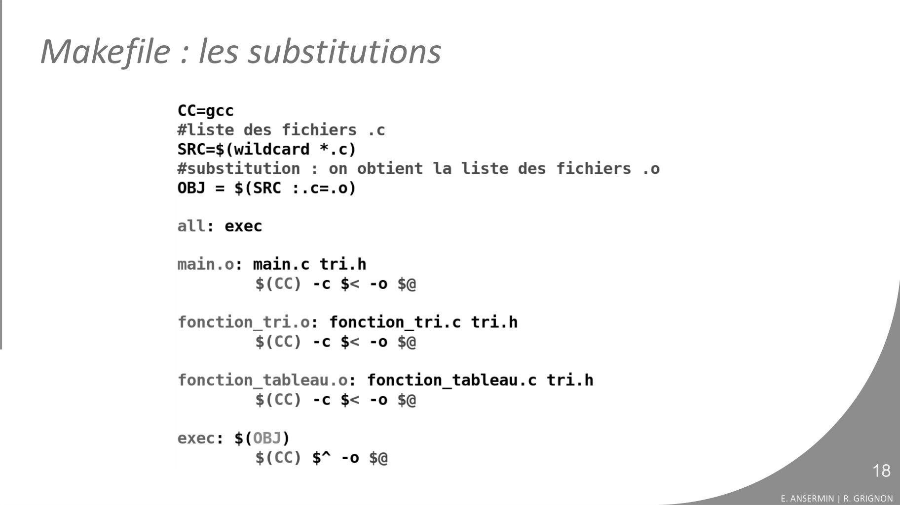
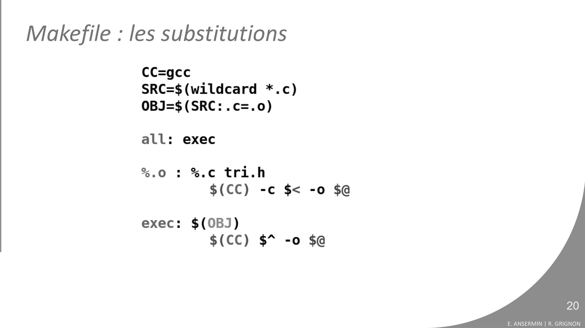
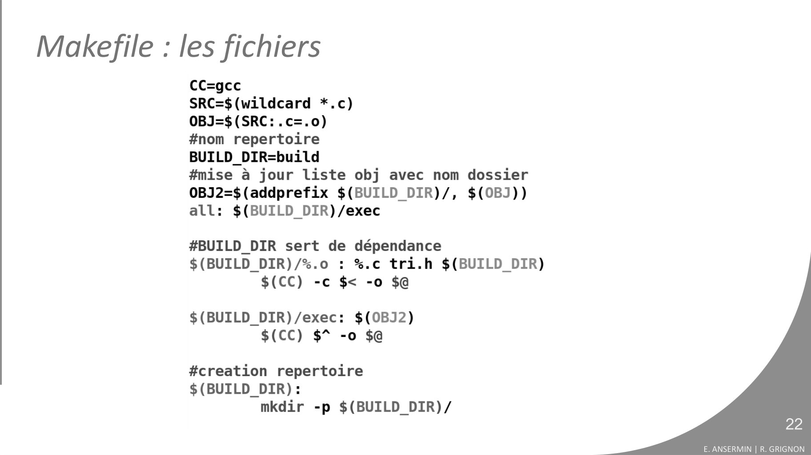

# 06b_makefile.pdf

[Ouvrir l’original](https://drive.google.com/open?id=1pA7Hz6rbAy3u6Q-dRp1h3BnTxas1MBc5) · Les pages signalées comprennent du texte reconnu automatiquement ou des éléments graphiques. Le fac-similé permet de vérifier chaque lecture.

**Pages avec fac-similé ou lecture OCR** — 18, 20, 22.

## Page 1

~~~text
                                                     v1.00

PROGRAMMATION
PROCEDURALE
6B. MAKEFILE   __

                    Eva ANSERMIN & Romuald GRIGNON
~~~

## Page 2

~~~text
Problématique : compilation manuelle

              fonction_tableau.c   fonction_tableau.o

      tri.h        main.c               main.o
                                                        exec

                                                                                    2
                fonction_tri.c       fonction_tri.o
                                                               E. ANSERMIN | R. GRIGNON
~~~

## Page 3

~~~text
Problématique : compilation manuelle
• Code modulé <=> plus pratique et lisible mais nécessite plus de commandes
  de compilation :
       gcc –c fonction_tri.c -o fonction_tri.o
       gcc –c fonctions_tableau.c –o fonctions_tableau.o
       …
       gcc –c main.c -o main.o
       gcc fonction_tri.o fonction_tableau.o … main.o -o myExec

• il faut aussi gérer l'arbre des dépendances et l'ordre des commandes :
        Pénibilité, risque d’erreur, impossible de demander à un utilisateur de
        faire cela.
        Perte de temps : il est inutile de tout recompiler : seuls les fichiers
        modifiés doivent l’être.

• Il faut automatiser la compilation.
                                                                                                       3
                                                                                  E. ANSERMIN | R. GRIGNON
~~~

## Page 4

~~~text
Solution : make (et Makefile)
• make est un logiciel (utilisé par les système UNIX) qui permet de construire
  automatiquement des executables à partir de fichiers sources.

• make utilise des fichiers de configurations appelés souvent Makefile

• le Makefile:
   • décrit les dépendances entre les fichiers
   • Se base sur les dates des fichiers pour savoir ce qui est à jour
   • peut compiler des fichiers, les déplacer, créer des dossiers, construire
     des bibliothèques, lancer des tests, créer des fichiers d'archives,
     effectuer des commits sur un dépôt git, lancer la génération de
     documentation (ex: avec Doxygen)
   • utilise des commande shell (langage de script des systèmes UNIX)

                                                                                                      4
                                                                                 E. ANSERMIN | R. GRIGNON
~~~

## Page 5

~~~text
Solution : make (et Makefile)
• make est un logiciel (utilisé par les système UNIX) qui permet de construire
  automatiquement des executables à partir de fichiers sources.

• make utilise des fichiers de configurations appelés souvent Makefile

• Exemple de Makefile :

                                                                                                      5
                                                                                 E. ANSERMIN | R. GRIGNON
~~~

## Page 6

~~~text
Makefile : structure
• Le makefile permet (entre autres)de générer les fichiers issus de la compilation.

• Un Makefile est composé de règles pour la génération ou l'exécution de
  commandes.

• Structure d'une règle :
                  Cible                                            Dépendances
           (fichier à générer)                      (fichiers nécessaires pour générer la cible )

            Commande(s) à exécuter si les dépendances existent.                                                      6
                                                                                                E. ANSERMIN | R. GRIGNON
~~~

## Page 7

~~~text
Makefile : structure
    # Ligne de commentaire
    # ____ est une tabulation (pas d'espace !)

    cible1 : cible2 cible3

    cible2 : dependanceA dependanceB
    ____commande shell
    ____commande shell                           Aux tabulations !

    cible3 : dependanceA dependanceC
    ____commande shell

    Cible4 :
    ____commande shell                                                         7
                                                          E. ANSERMIN | R. GRIGNON
~~~

## Page 8

~~~text
Makefile : utilisation
 • Pour lancer un makefile :
                         make
 • Si l'on souhaite exécuter une cible particulière :
                        make cible
 • Pour forcer un fichier spécifique :
                    make –f filepath cible

 • Les commandes ne sont exécutées que si les dépendances existent
   ET sont plus récentes que la cible ! =>
    Entre 2 appels à make, seuls les fichiers modifiés (et ceux dont ils
    dépendent) seront recompilés.
                                                                                                8
                                                                           E. ANSERMIN | R. GRIGNON
~~~

## Page 9

~~~text
Makefile : cibles particulières
• Si la cible est omise (make) la première cible du fichier sera exécutée.
• On nomme souvent la première cible all : elle ne contient que des cibles
  dépendantes et n'a pas de commande.

                                                                                                  9
                                                                             E. ANSERMIN | R. GRIGNON
~~~

## Page 10

~~~text
Makefile : cibles particulières
• Il existe des règles sans dépendance comme clean qui serviront à exécuter
  sans condition des commandes de nettoyage de l'environnement par exemple

                                                                                           10
                                                                        E. ANSERMIN | R. GRIGNON
~~~

## Page 11

~~~text
Makefile dynamique
•   Le Makefile précédent n'est pas dynamique : il dépend du nom des fichiers
    et de leurs nombres.

•   On peut complexifier le makefile pour le rendre plus adaptable aux fichiers
    sources.

•   Il est possible de :
    •     Utiliser des variables
    •     Lister les différents fichiers
    •     Utiliser différentes commandes shell
    ...
                                                                                                11
                                                                             E. ANSERMIN | R. GRIGNON
~~~

## Page 12

~~~text
Makefile : variables prédéfinies

  •   Variables prédéfinies:
      • $@ représente la cible
      • $^ représente la liste des dépendances
      • $< représente la 1ère dépendance

  • Plus difficile à lire mais permet moins de redondance.

  • Modifier le makefile précédent

                                                                                12
                                                             E. ANSERMIN | R. GRIGNON
~~~

## Page 13

~~~text
Makefile : variables prédéfinies

                                                      13
                                   E. ANSERMIN | R. GRIGNON
~~~

## Page 14

~~~text
Makefile : variables utilisateur
  •   On peut définir ses propres variables. Ex:
      •   nomVariable=valeur
      •   CC=gcc
      •   MY_FILES=functions.c functions.h
      •   DIR=projet/build

  •   Pour utiliser les variables :
                          $(nomVariable)
  •   Modifier le makefile précédent

                                                                      14
                                                   E. ANSERMIN | R. GRIGNON
~~~

## Page 15

~~~text
Makefile : variables utilisateur

                                                      15
                                   E. ANSERMIN | R. GRIGNON
~~~

## Page 16

~~~text
Makefile : wildcard
   •   Le code précédent est toujours dépendant des noms de fichiers.

   •   L’instruction wildcard permet l’utilisation de caractères jokers pour
       remplacer n’importe quelle chaîne:
            SRC = $(wildcard *.c)
       Dans notre exemple :
            SRC <=> main.c fonction_tri.c fonction_tableau.c
   •   Il est également possible de parcourir de manière récursive tous les
       sous-répertoires:
             SRC = $(wildcard **/*.c)

                                                                                                  16
                                                                               E. ANSERMIN | R. GRIGNON
~~~

## Page 17

~~~text
Makefile : les substitutions
 •   En pratique on n'utilise pas directement la liste des .c mais la liste des .o.
 •   Il est possible de modifier le nom des suffixes d'une liste, c'est la substitution :
                OBJ = $(SRC:.c=.o)
      Dans notre exemple :
                 OBJ <=> main.o fonction_tri.o fonction_tableau.o

 •   Modifier le makefile précédent

                                                                                                     17
                                                                                  E. ANSERMIN | R. GRIGNON
~~~

## Page 18

~~~text
Makefile : les substitutions

                                                  18
                               E. ANSERMIN | R. GRIGNON
~~~

**Lecture OCR à contrôler**

~~~text
Makefile : les substitutions

CC=gcc

#liste des fichiers .c

SRC=$(wildcard *.c)

#substitution : on obtient la liste des fichiers .o
OBJ = $(SRC :.c=.0)

all: exec

main.o: main.c tri.h
$(CC) -c $< -o $@

fonction_tri.o: fonction_tri.c tri.h
$(CC) -c $< -o $@

fonction_tableau.o: fonction_tableau.c tri.h
$(CC) -c $< -o $@

exec: $(0BJ)
$(CC) $* -o $@

18

E. ANSERMIN | R. GRIGNON
~~~

## Page 19

~~~text
Makefile : motifs (pattern)

  • % permet de définir un pattern commun entre la cible et une dépendance

  • Permet la factorisation de plusieurs cibles
  • On peut ainsi raccourcir grandement le makefile et s’affranchir très souvent
    des noms des fichiers

  • Modifier le makefile précédent

                                                                                              19
                                                                           E. ANSERMIN | R. GRIGNON
~~~

## Page 20

~~~text
Makefile : les substitutions

                                                  20
                               E. ANSERMIN | R. GRIGNON
~~~

**Lecture OCR à contrôler**

~~~text
Makefile : les substitutions

CC=gcc
SRC=$(wildcard *.c)
OBJ=$ (SRC: .c=.0)

all: exec

.0 : %.c tri.h
$(CC) -c $< -o $@

®

exec: $(0BJ)
$(CC) $* -o $@

20

E. ANSERMIN | R. GRIGNON
~~~

## Page 21

~~~text
Makefile : les fichiers
     •   On peut créer les .o et l'exécutable dans un dossier séparé
         souvent appelé build.
     •   Il faudra alors toujours indiquer le chemin des cibles :
         •   Exemple:
                build/%.o : %.c tri.h $(BUILD_DIR)
                                 $(CC) -c $< -o $
     •   Si le dossier n'existe pas, il faut le créer et utiliser la cible
         comme dépendance pour les autres cibles qui doivent être
         stockées dedans:
         •   Exemple:
                build/:
                      mkdir -p build/                                                           21
                                                                             E. ANSERMIN | R. GRIGNON
~~~

## Page 22

~~~text
Makefile : les fichiers

                                             22
                          E. ANSERMIN | R. GRIGNON
~~~

**Lecture OCR à contrôler**

~~~text
Makefile : les fichiers

CC=gcc

SRC=$(wildcard *.c)

OBJ=$ (SRC: .c=.0)

#nom repertoire

BUILD_DIR=build

#mise a jour liste obj avec nom dossier
0BJ2=$(addprefix $(BUILD_DIR)/, $(0BJ))
all: $(BUILD DIR) /exec

#BUILD_DIR sert de dépendance
$(BUILD DIR)/%.o : %.c tri.h $(BUILD_DIR)
$(CC) -c $< -o $@

$(BUILD_DIR)/exec: $(0BJ2)
$(CC) $* -o $@

#creation repertoire
$(BUILD DIR):
mkdir -p $(BUILD DIR)/

22

E. ANSERMIN | R. GRIGNON
~~~

## Page 23

~~~text
Makefile : les cibles ‘PHONY’
     • Chaque cible définie est vue par make comme étant un fichier
       physique sur le disque.

     • Il est possible de rajouter des étapes à la compilation, de nouvelles
       cibles, dont les noms ne font pas forcément référence à des fichiers :
       ce sont les cibles PHONY

     • Une cible PHONY sera toujours exécutée, comme les cibles sans
       dépendances, mais à l’inverse de ces dernières, on peut ajouter des
       dépendances aux cibles phony

                                                                                             23
                                                                          E. ANSERMIN | R. GRIGNON
~~~

## Page 24

~~~text
Makefile : les cibles ‘PHONY’
      ...

      VERSION = 1.2

      # script pour envoyer l’archive dans un dépôt de code, ...
      .PHONY commit
      commit : archive
         git …..

      # script pour envoyer un mail après création executable, ...
      .PHONY mail
      mail : exec
        bash envoyer_mail.sh
      …
                                                                                        24
                                                                     E. ANSERMIN | R. GRIGNON
~~~

## Page 25

~~~text
Makefile : une multitude d’options
   • Il existe plusieurs instructions pour gérer les listes de fichiers :
         • V1 = $(notdir $(V0))                # enlève les noms de dossiers
         • V2 = $(dir $(V0))                   # enlève les noms de fichiers
         • V3 = $(suffix $(V0))                # extrait seulement les extensions
         • V4 = $(basename $(V0))              # enlève les extensions
         • V5 = $(addprefix dir/, $(V0))       # ajoute un prefixe à chaque fichier
         • V6 = $(addsuffix .c, $(V0))         # ajoute un suffixe à chaque fichier

   • Les différentes possibilités de make sont très nombreuses

   • La documentation officielle se trouve sur le site de gnu.org
      https://www.gnu.org/software/make/manual/html_node/

                                                                                                25
                                                                             E. ANSERMIN | R. GRIGNON
~~~

## Page 26

~~~text
Conclusion
  Les bonnes pratiques d’un projet en langage C :

     • On module son code avec au minimum:
       • Un fichier .c pour la fonction main
       • Un fichier .c par module
       • Un header .h par module avec
              • les prototypes des fonctions
              • les constantes
              • les types redéfinis / structures
              • les variables globales si il y en a
       • Un header .h global pour le projet (paramètres)

     • On écrit un makefile le plus générique possible pour pouvoir le
       réutiliser.
                                                                                            26
                                                                         E. ANSERMIN | R. GRIGNON
~~~
